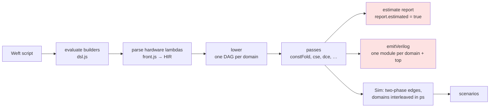
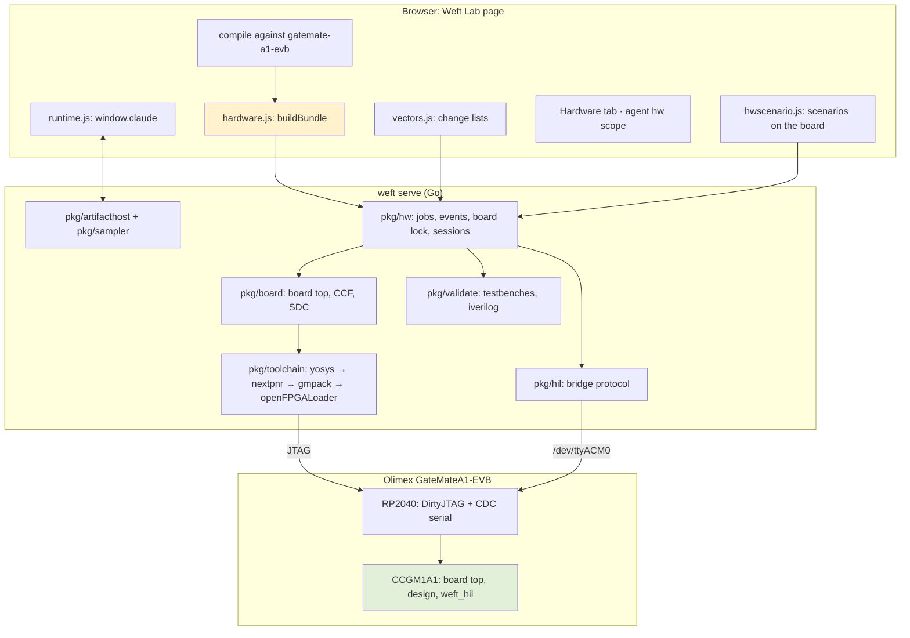
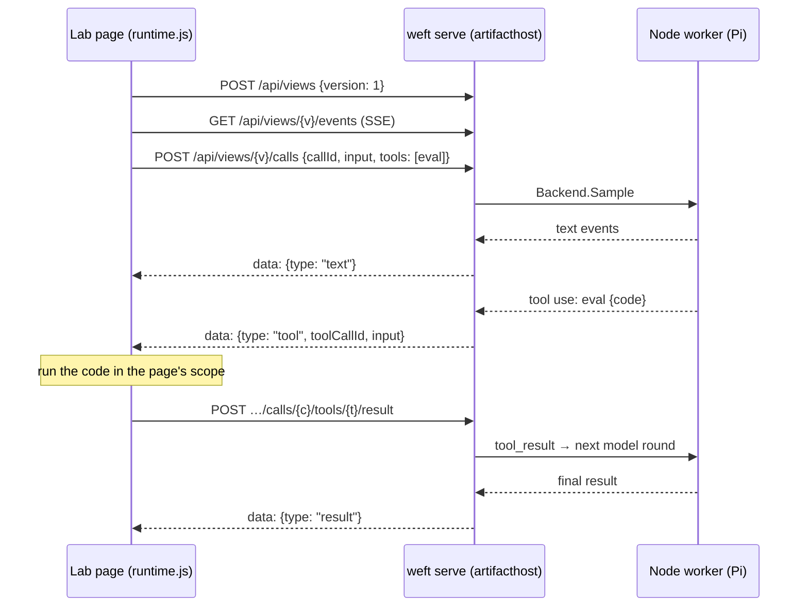
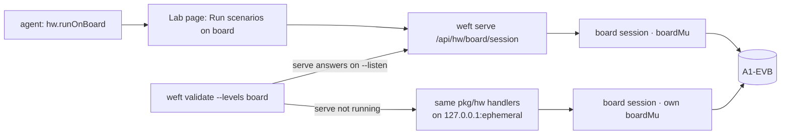

# Weft Lab on Real Hardware

**Weft** is a proposed JavaScript API for describing FPGA hardware. A Weft script is a program that builds a circuit, and a multi-pass compiler turns the circuit into a bitstream. Two books specify it. *Weft, From First Principles* explains the language through nineteen example designs and says of itself: "Weft is a design, not a shipped tool." *Building Weft: Implementation and Reference* specifies the compiler, with small reference implementations of its algorithms, and opens with: "Weft has no implementation yet." **Weft Lab** is the first implementation. It is a browser IDE, published as a claude.ai artifact: one HTML page of 843 KB that compiles the nineteen examples to dataflow graphs, simulates them cycle by cycle on a virtual board, runs their test scenarios, and prints an estimated build report. Nothing it produced had ever reached a chip.

This report covers ticket WEFT-001, which took the Lab to a real FPGA in one day, 2026-10-18. The result is a Go program, `weft`, that serves the Lab from the local machine. It builds bitstreams for the Olimex GateMateA1-EVB with the open-source GateMate toolchain and loads them over USB. It then checks, at four levels of increasing cost, that the hardware does what the simulator said it would. None of the three sources mentions GateMate: the books target iCE40, ECP5 and Xilinx 7-series parts on fictional boards. The board profile, the toolchain integration, the hardware cores, the validation ladder and the hardware-in-the-loop bridge were all designed for this project. Work proceeded in eight phases, P1 to P8, each with a commit and an entry in a detailed diary. Before any of it, an intern-oriented design guide was written, reviewed and uploaded to reMarkable.

The project set exit criteria per phase. The main ones hold:

- **An unmodified example reaches the board.** `weft build weft-lab/examples/F-01-blinky.js --load` compiles the Lab's own blinky example, synthesizes, places, routes and packs it in about 3.6 s, and loads it into the FPGA in 26 ms.
- **The emitted hardware provably matches the simulator.** F-01's scenario "blinks at 2 Hz" passes RTL co-simulation and gate-level netlist co-simulation over all of its 1.1 million cycles. A deliberately broken netlist fails at the expected place: "cycle 250001: led is 0, the simulator drove 1".
- **Scenarios pass on the board itself, timed in board cycles.** The full ladder for F-01 runs in 35.9 s: build, RTL, netlist and board all pass. On the board, the scenario waits exactly 11,000,000 cycles of the 10 MHz clock and counts exactly 4 toggles of the LED. F-05, whose buttons go through a hardware debouncer, passes all four levels, including button presses injected by the host.
- **Designs with the Lab's UART and debounce components run in hardware.** F-16 upper-cases text sent over the board's USB serial port. After a fix to the transmitter, found only on the board, 50,000 bytes echo intact at the full line rate.
- **The Lab and its agent drive the hardware.** The page gains a Hardware tab, and the Lab's in-page agent built, inspected and reported on a design on its own through `hw.build()` and `hw.job()`.


> [!summary]
> - **The compiler stays in JavaScript; a JSON bundle crosses to Go.** The page (or the CLI, through Node) compiles the design against a GateMate profile and emits a `weft.hw-bundle/v1` document holding the Verilog, the clocks and the resource behind every port bit. Go never parses Verilog and never runs the compiler during a build.
> - **Go owns every fact about the board.** A generated board top adds the 10 MHz clock, the reset chain, PLLs, pin polarity, input synchronizers and stand-ins for missing hardware. The toolchain runner decides success from the tools' logs, not their exit codes, and refuses to load a build that failed timing unless forced.
> - **A ladder of four checks, each isolating one transformation.** L0 builds. L1 replays the simulator's recorded port changes against the emitted RTL in iverilog. L2 replays them against a GateMate netlist of that RTL. L3 runs the scenario's steps on the board.
> - **The board level measures time in the board's own cycles.** A small UART bridge reports every output change, stamped with a 56-bit cycle count, through one queue in cycle order. A line stamped with cycle *c* therefore proves that every change up to *c* has arrived, which makes "wait 1.1 s, then count toggles" exact on real hardware.

## 1. Terms

The report uses vocabulary from three areas: FPGA implementation, the Weft language, and the infrastructure built here. The terms are listed in dependency order; each definition uses only terms defined above it.

**FPGA implementation**

- **FPGA.** A chip whose logic is set by a configuration file rather than fixed in silicon. Its fabric is a grid of logic blocks connected by programmable routing.
- **LUT and flip-flop.** A lookup table (LUT) implements any Boolean function of a few inputs. A flip-flop (FF) stores one bit and updates it on a clock edge.
- **CPE.** GateMate's logic block (cartridge programmable element). The CCGM1A1 part has 20,480 CPEs, which nextpnr counts as 40,960 LUT sites (`CPE_LT`) and 40,960 flip-flop sites (`CPE_FF`).
- **Synthesis, placement, routing, packing.** Synthesis (yosys `synth_gatemate`) turns Verilog into a **netlist** of the family's primitive cells (`CC_LUT2`, `CC_DFF`, `CC_ADDF`, `CC_BRAM_40K`, …). Placement assigns cells to sites. Routing connects them (nextpnr-himbaechel). Packing (gmpack) writes the **bitstream**, the file that configures every site and switch.
- **fmax and timing.** Static timing analysis reports the maximum frequency at which each clock's longest register-to-register path still settles. A design whose fmax is below its clock's frequency has *failed timing*.
- **SRAM loading.** Programming writes the bitstream into the FPGA's configuration SRAM over JTAG (openFPGALoader). It takes effect at once and is lost at power-off.

**The Weft language and the Lab**

- **Design and builders.** A Weft script is the body of a JavaScript function that returns a design. `module()`, `design()` and `std.debounce()` return immutable builder values whose methods return new builders.
- **Hardware lambda.** A lambda passed to `.seq()`, `.every()`, `.on()` and similar methods. It is never called: the compiler parses its source text and turns its statements into gates and registers. `$ => { $.led = !$.led; }` is one.
- **Clock domain.** The set of registers driven by one clock, with the logic between them. The default domain `sys` runs on the board's main clock.
- **DAG.** The compiler's central data structure: one hash-consed dataflow graph per clock domain. Its nodes are pure operations (`add`, `mux`, `slice`, …) and stateful ones (`reg`, `mem`, `in`, `out`, `cell`).
- **Initializer.** The value a register holds before its first clock edge (`reg [21:0] blink_every = 22'h0;` in emitted Verilog). The Lab's simulator never resets a design. Registers start from their initializers.
- **Board profile and resource.** A board profile names the resources a design can bind to, such as `led:0`, `btn:user` and `uart.tx`. `.bind({ led: "led:0" })` ties a port to a resource. On the A1-EVB, a **physical** resource exists on the board. A **virtual** resource (`btn:1..3`, `sw:0..7`) compiles, but has no pin.
- **Native cell.** A standard component whose behaviour the Lab implements in JavaScript rather than in the graph: `std.debounce`, `std.uart.rx`, `std.uart.tx` and a few more. The models work at the transaction level. A received byte appears at once, one frame time after it was sent, not bit by bit.
- **Scenario and step.** A scenario is a test that drives the simulated board and checks what it sees. A `kind: "steps"` scenario is a recorded list of steps, for example `.press("btn:2").wait("20ms").expectPins("led:0..7", 4)`.
- **Portable step.** A step the real board can perform: `wait`, `press`, `release`, `toggle`, `set`, `uart`, `expectPins`, `expectToggles`, `expectUart`. Steps that reach into the design (`poke`, `force`, `knob`, hot patches) are not portable.
- **Artifact runtime.** On claude.ai an artifact page receives `window.claude`. Its `use("sample")` capability calls a Claude model, and `use("downloads")` saves files. The Lab's architect agent uses `sample` with one tool, `eval`, whose code runs inside the page.

**Terms this project adds**

- **Hardware bundle.** A JSON document (`weft.hw-bundle/v1`) that the JavaScript side produces for the Go side: the emitted Verilog files, the clocks, the reset, and the board resource behind every bit of every top-level port.
- **Board top.** A generated Verilog module, `weft_board_top`, that instantiates the design and adds everything board-specific. The pin constraint file (CCF) and timing constraint file (SDC) are generated with it.
- **Build job.** One run of synthesis, place and route, packing and, optionally, loading and validation, kept in `var/weft/builds/<id>/`.
- **Co-simulation and change list.** Co-simulation replays a scenario's inputs into Verilog in iverilog and compares the outputs, cycle by cycle, with what the Lab's simulator produced. The simulator's side is recorded as a *change list*, one `<cycle> <port> <value>` entry per change of a top-level port.
- **Core and adapter.** A core is a hand-written Verilog implementation of a native cell (`weft_core_uart_tx`). An adapter is a module, generated per design, that keeps the cell's interface in the emitted Verilog and instantiates the core.
- **HIL bridge.** `weft_hil`, a UART device the board top adds next to the design (hardware in the loop). It reports output changes and sets inputs on the host's command.
- **Board cycle.** The bridge's count of main-clock edges since its last reset command. It is the time base of board-level scenarios.
- **Board session.** The server holds the board for one build: it loads the bitstream, opens the serial port, and accepts reset, input and wait requests until the session closes.

## 2. The starting point

### 2.1 What the books specify

Book 1 builds the language from first principles, one example per chapter. Three ideas from it shape everything this project had to preserve.

The first is the distinction between three kinds of lambda. The method a lambda is passed to decides its kind, and nothing in the syntax marks it. A builder lambda runs once while the script is evaluated. A hardware lambda is parsed into the compiler's intermediate representation. A runtime lambda runs beside the running circuit, as a host handler or a scenario predicate such as `n => n === 4`. That last kind matters later: a scenario's checks are JavaScript functions, so whatever runs scenarios on the board must be able to run JavaScript.

The second is that durations become cycle counts only once the clock is known. "A duration is a number of cycles only once the clock is known" (Book 1, §1.4). `.every("250ms", …)` is a counter with an enable, not a derived clock. The same source therefore produces different dividers for different boards without an edit. F-01, written for the fictional `pico` board at 12 MHz, runs at 10 MHz on the A1-EVB, and the compiler sizes its prescaler for 10 MHz.

The third is determinism and agreement across levels. "Simulation is deterministic: the same design and the same scenario produce the same trace on every run" (§1.6). Book 2 makes this a rule for the compiler's levels: "A scenario may run at `hir`, `dag` or `net` … Traces from different levels are compared on the observables alone" (R8.10). Book 1 adds that a disagreement between two levels of one target "is a compiler bug by definition". This project extends the comparison past the compiler, to Verilog, a vendor netlist and the board.

Here is F-01 as Book 1 presents it:

```js
const blink = module("blink")
  .out("led", bit)
  .every("250ms", $ => { $.led = !$.led; })         // 12 MHz × 250 ms: a 22-bit prescaler, generated for you
  .bind({ led: "led:0" });

return design("blinky")
  .board("pico")
  .use(blink)
  .scenario("blinks at 2 Hz", sc => sc
    .wait("1.1s")
    .expectToggles("led:0", n => n === 4));
```

Book 2 is the specification of a full toolchain: bit-vector semantics, staged elaboration, lowering, a two-phase compiled simulator, verification, an IR core with invariants, passes, timing, technology mapping and back ends, a runtime bridge, and live change. Its build order ends with milestones that need real silicon:

| Milestone | Gate (Book 2, "The build order") |
| --- | --- |
| M3 Clocked logic | F-01/F-02 at level `dag`, with a minimal IR and a two-phase simulator |
| M9 Silicon | "F-01 blinks on a real board; F-16 agrees at `net` on every part" |
| M10 Runtime | "F-12's bounds hold in hardware" |

Two parts of Book 2 are close to what this project built, and the differences are instructive. Its simulator rules fix the semantics that co-simulation must reproduce: each domain's k-th edge is at `round(k · 10^12 / f)` picoseconds (R8.1), and every edge evaluates all combinational logic from the current registers before committing all registers at once (R8.2). Its runtime bridge (Chapter 14) is a 9-byte framed protocol with CRC-8 for reading and writing a design's register map, the *knobs*. That bridge serves host software that tunes a running design. The bridge in this report observes pins with cycle stamps, a different job; §11 explains why it is a separate design.

### 2.2 What the Lab implements

The Lab's architecture document (`weft-lab/ARCH.md`) states its contracts. "Where this file and the books differ, this file wins for the Lab." It was built by four owners working in parallel on one contract: the front end and lowering (A), passes, estimates and the Verilog emitter (B), the simulator, cells and scenarios (C), and the UI and agent (D). Everything under `app/src/core/` is free of the DOM and runs in Node, which is how its tests run.



The two shaded outputs were where the Lab stopped. The report is an estimate by contract (`report.estimated === true`), computed from a per-family delay model. The Verilog is real Verilog-2005: one module per clock domain and a top. Its limits are explicit:

```verilog
// blinky: top level generated by Weft — 1 clock domain, 0 native cells
// Clocks are top-level inputs (PLL primitives are not emitted); rst is synchronous and active high.
```

Native cells are emitted as `(* blackbox *)` stubs. There is no physical clock pin, no reset source, no pin polarity and no programming cable. The simulator works in picoseconds, with a two-phase evaluation per edge (Book 2's D15). It skips stretches of cycles in which only prescaler counters change ("quiescence skipping"). Native cells are JavaScript objects ticked once per edge of their domain.

The imported source passed its own suites unchanged: type, IR, compile, simulator, cell, pass and formal tests, and 28 scenarios with 26 passing and 2 skipped. The two skips are the scenarios that need a Claude model. This fixed the starting point before any backend work began.

### 2.3 The gap

| Need | The Lab before WEFT-001 | What had to be built | Phase |
| --- | --- | --- | --- |
| Serve the Lab locally with a working agent | the page works fully only inside claude.ai | an artifact host and a model sampler | P1, P2 |
| Compile against the real board | profiles `pico`, `dev`, `studio` | a `gatemate-a1-evb` profile, the `ccgm1a1` part, a PLL model | P3 |
| A self-contained build input | `emitVerilog` files only | the hardware bundle | P3 |
| Physical clock, reset, polarity, pins | clocks and `rst` are bare inputs | the generated board top, CCF and SDC | P4 |
| Real synthesis and timing | an estimate | a toolchain runner that reads logs | P4 |
| Load the board, from the page | nothing | jobs, a board lock, a Hardware tab, `hw` for the agent | P5 |
| Evidence that the hardware matches the simulator | nothing | a validation ladder L0–L3 | P6, P8 |
| Native cells in hardware | black boxes | cores and generated adapters | P7 |

## 3. The plan

### 3.1 A spike first, then a guide

The highest risk was the hardware path itself: toolchain flags, pin names, polarity and bitstream loading. Before designing anything, two spike scripts compiled F-01 with the unmodified compiler in Node, wrapped the emitted Verilog in a hand-written board top, and ran yosys, nextpnr-himbaechel, gmpack and openFPGALoader. Synthesis took 0.29 s and place and route 3.8 s. The result used 63 of 40,960 `CPE_LT` and 25 `CPE_FF`, with an fmax of 90.86 MHz against the 10 MHz constraint. The 4,172-byte bitstream loaded with "Load SRAM 100% Done".

With the path proven, the design guide was written for a new intern. It is 1,297 lines of system orientation, current-state evidence with file and line references, the bundle contract, the board layer, the toolchain runner, the validation ladder, decision records, pseudocode and a phase plan. A reviewer agent with fresh context then checked every file:line claim and the technical soundness, and returned 17 findings. Several of them changed the design before any code existed:

- **Change lists, not windows.** L1 and L2 vectors taken from a 200,000-cycle window would never see F-01 or F-02 toggle. Co-simulation must record whole scenarios, with a short co-simulation clock.
- **No reset in the testbench.** The simulator never resets, so the testbench must hold `rst` low from cycle 0 instead of pulsing it.
- **Cut at the cells.** Pins driven by native cells have no DAG node, so co-simulation must cut the design at the cell boundary.
- **Synthesize L2 separately.** The board top's netlist cannot be simulated: `CC_USR_RSTN` and `CC_PLL` have no simulation models.
- **Allow timing failures.** Gating place and route on any `ERROR:` line would make a forced load impossible: nextpnr must run with `--timing-allow-fail`, and the runner must parse timing itself.
- **The board session owns the lock and does the load.** Otherwise another load could slip in between loading and observing.

### 3.2 Decision records

| Id | Decision | Reason |
| --- | --- | --- |
| D-1 | Compile in JavaScript, build in Go, with a bundle between them | One compiler. The page already holds the exact compiled design the user is looking at. A bundle can be inspected, hashed and tested on its own. |
| D-2 | The open flow (yosys, nextpnr-himbaechel, gmpack), not Cologne Chip's `p_r` | Every earlier GateMate project of the user's reached hardware with it. It is installed, scriptable, and its logs can be parsed. |
| D-3 | Go owns pins and polarity; JavaScript owns design facts | Pin facts caused most of the bring-up mistakes in past projects (an inverted LED, a button pin that "took three attempts"). They belong in one reviewed Go table with tests. |
| D-4 | Fixed Verilog cores plus generated adapters for native cells | Timing-critical logic (UART bit timing, debouncing) is written and reviewed once. The per-design part is wiring, which the emitter already knows. |
| D-5 | Copy francois's artifact runtime shim and model worker client | francois already provides `sample` with page-side tools for locally hosted artifacts, and it is not on the Go module proxy. |
| D-6 | One origin, one page | The Lab keeps saved designs in `localStorage`. A fixed origin keeps them across restarts. |
| D-7 | Load to SRAM only | A power cycle reverses it, and every past project did the same. |
| D-8 | The main domain runs from the 10 MHz oscillator; other domains get a `CC_PLL` | The compiler already recomputes every divider from the clock frequency. 10 MHz gives the most timing margin. |
| D-9 | Board-level validation through the board's own UART | The board has one LED, one button and no logic analyzer. `/dev/ttyACM0` needs no wiring, and cycle stamps measure time on the board's clock instead of through USB latency. |

### 3.3 The board

The Olimex GateMateA1-EVB carries a Cologne Chip CCGM1A1 and an RP2040 microcontroller. The RP2040 runs DirtyJTAG firmware, so one USB cable serves as the JTAG adapter (USB `1209:c0ca`, openFPGALoader board name `olimex_gatemateevb`). The same device also provides two CDC serial ports. The first, `/dev/ttyACM0`, is wired to the FPGA's UART pins.

| Board resource | FPGA pin | Notes |
| --- | --- | --- |
| 10 MHz oscillator | `IO_SB_A8` | needs `SCHMITT_TRIGGER=true` |
| user LED (`led:0`) | `IO_SB_B6` | active-low, the only LED |
| user button (`btn:user`, alias `btn:0`) | `IO_SB_B7` | active-low |
| UART TX, FPGA to host | `IO_SA_B6` | to the RP2040, then `/dev/ttyACM0` |
| UART RX, host to FPGA | `IO_SA_A6` | from the RP2040 |
| PMOD (`led:1..7`) | `IO_EA_A4..A7`, `IO_EA_B4..B6` | 3.3 V |

The pin facts were taken from the user's earlier GateMate projects' constraint files, and one older pin note in those projects had the UART TX pin wrong.

### 3.4 Phases

| Phase | Commit | Content | Exit check |
| --- | --- | --- | --- |
| P1 | `92600d2` | Go module, Glazed root, `weft serve` with the embedded Lab, `weft doctor` | doctor lists tool versions and finds the board; the page loads |
| P2 | `67bfc56` | artifact runtime host, model sampler | the Lab's agent answers through the local worker |
| P3 | `afea73a` | GateMate profile, PLL port, hardware bundles | every example bundles or is refused with a named reason |
| P4 | `b4f6dec` | board layer, toolchain runner, `weft emit/build/flash` | golden-file tests; F-01 builds and loads |
| P5 | `e5acc8c` | hardware API, the Lab's Hardware tab, `hw` for the agent | build and load from the browser; the agent builds on its own |
| P6 | `93f5da0` | validation L0–L2, `weft validate`, Validate in the Lab | F-01 and F-02 pass L1 and L2 over whole scenarios; a broken netlist fails with cycle and port |
| P7 | `c6e0dc0` | cores for debounce, uart-rx, uart-tx; adapters; co-simulation cut at the cells | core testbenches pass; F-05 and F-16 pass L1; F-16 echoes on the board |
| P8 | `134b04c` | `weft_hil`, board sessions, scenarios on the board | F-01 "blinks at 2 Hz" passes in board cycles; a `btn:user` scenario passes through the override |

## 4. Architecture

### 4.1 The whole system



Read it as one build. The page compiles the editor's script against the `gatemate-a1-evb` profile and packs the result into a bundle (yellow). It posts the bundle to `weft serve`. The server generates the board top and constraints, runs the toolchain as a job, and streams stage events and log lines back. On request it loads the bitstream over JTAG. For validation, the page also sends the change lists it recorded, and the server generates and runs testbenches. For board-level scenarios, the page or the CLI opens a board session and drives the board through the HIL bridge over the serial port.

The command line reaches the same functions without a browser. `weft emit`, `weft build`, `weft flash` and `weft validate` run the compiler by executing an esbuild bundle of `weft-lab/app/tools/weft-hw.mjs` with Node. The bundle is embedded in the Go binary. The CLI therefore uses the same JavaScript as the page, and depends on Node.

### 4.2 Code size

| Area | Lines | What it holds |
| --- | --- | --- |
| `cmd/weft` | 976 | Glazed commands: serve, doctor, emit, build, flash, validate |
| `pkg/hw` | 2,151 | jobs, events, the board lock, status, HTTP API, sessions, serial port |
| `pkg/hil` | 669 | the host side of the bridge protocol, a software bridge for tests |
| `pkg/toolchain` | 663 | locating the suite, running stages, log parsing, the build report |
| `pkg/board` | 568 | the A1-EVB table, the board top, CCF, SDC, HIL planning |
| `pkg/validate` | 531 | vectors, testbench generation, L1/L2 runs |
| `pkg/artifacthost`, `pkg/sampler` | 922 | the artifact runtime host and the model backends, from francois |
| other Go | 610 | bundle types, emitter, server, web embedding, docs, `hdl` |
| Go tests | 1,656 | 40 test functions |
| Verilog | 432 + 433 | three cores and the bridge, plus their four testbenches |
| JavaScript added | 1,292 | `gatemate-pll.js`, `hardware.js`, `vectors.js`, `hwscenario.js`, `hw.js`, `Hardware.jsx`, `weft-hw.mjs` |
| JavaScript changed | 165 lines added or removed | `boards.js`, `compile.js`, `estimate.js`, `verilog.js`, `App.jsx`, `lab-agent.js` |

The Lab's original source is about 14,000 lines of JavaScript. The project touched six of its files, adding or removing 165 lines; the rest of the JavaScript on the hardware path is new. That ratio follows from D-1: the compiler and simulator were reused as they were, and the new code sits around them.

## 5. Serving the Lab and its agent (P1, P2)

### 5.1 One binary, one loopback origin

`weft` is a Glazed application, following the layout of the user's francois project: a Cobra root with Glazed's logging section and embedded help system. Commands are declared as typed fields. Commands that report results, such as `weft doctor` and `weft validate`, emit rows that print as a table, JSON or YAML. `weft serve` hosts the Lab page, built by the Lab's own `build.mjs` and embedded in the binary with `go:embed`. A `--lab-file` flag serves a page from disk instead, which keeps the edit loop short.

The server binds to loopback only and refuses `--listen 0.0.0.0:…`. It also checks every request's `Host` header against the listen address and the `Origin` header against its own origin. Both checks follow from what the server can do. The page runs code that a language model writes, through the agent's `eval` tool, and the server can load bitstreams into hardware. A page on another origin must not be able to reach it, including through DNS rebinding, where a hostile domain resolves to 127.0.0.1 and would otherwise pass a loopback-only check. A rebound `Host` answers 403 `forbidden_host`, a foreign `Origin` 403 `forbidden_origin`.

`weft doctor` prints one row per prerequisite: the OSS CAD Suite and each tool's version, Node, the embedded page, the board (through `openFPGALoader -b olimex_gatemateevb --detect`) and the serial device. On its first real run it found the board: `colognechip GateMate Series GM1Ax (idcode 0x20000001)`. It also reported that `/dev/ttyACM0` did not exist, because the `cdc_acm` kernel module was not loaded. The user loaded it during P6.

### 5.2 The artifact runtime outside claude.ai

The Lab asks for two capabilities at startup: `sample`, for its architect agent, and `downloads`, to save files. On claude.ai the platform provides them. Served locally, the page needs a substitute, and francois already implements one: it injects a boot block and a `runtime.js` shim into the page's `<head>`, and the shim talks to the Go server through Server-Sent Events plus a few POST endpoints. P2 copied that design into `pkg/artifacthost` and `pkg/sampler`, with a provenance note naming francois commit `d847ba4`.

The difficult property of `sample` is that the tool loop spans two processes. The model runs in a Node worker on the server side, but the `eval` tool must execute inside the page, where the compiler, the simulator and the editor live:



The host enforces limits that matter later for hardware. At most 2 calls run and 10 wait, a call is bounded at 5 minutes, each round trip to the page at 150 s, and a tool result at 32 KiB. Every call ends with exactly one terminal event, `result` or `error`. When a backend returns without settling the call, the host emits an error itself, so a page never waits for an event that will not come. The `sampler.Backend` interface has three implementations: the Pi worker, which reuses the model credentials the user's Pi coding agent already keeps; a fake, used in tests; and `none`, which makes `sample` answer `sampling_disabled` and keeps the rest of the Lab usable.

With the real worker, the Lab's agent in Read-only mode was asked to count the lines of the current script with one `eval`. It answered "Worked through 1 step · 4.2 s — The current script is 202 lines long." The copied `runtime.js` carries exactly one change: its downloads allowlist gains `v`, `sv`, `js`, `ccf`, `sdc`, `vcd`, `bit` and `yaml`, so the Lab can save Verilog and constraint files. It still refuses programs (`x.exe` → `rejected_extension`).

## 6. Compiling for the board (P3)

### 6.1 The board profile and retargeting

`boards.js` gained the `ccgm1a1` part (40,960 LUT and flip-flop sites, 64 block RAM halves, 162 I/O sites, no DSPs) and the `gatemate-a1-evb` profile. The profile's main clock is 10 MHz. Its physical resources are `led:0`, `btn:user` with its alias `btn:0`, `uart.tx`, `uart.rx` and seven PMOD LEDs `led:1..7`. The virtual resources `btn:1..3` and `sw:0..7` are listed too, because the examples use them: a design that reads `sw:0` should still compile and run, with the switch reading 0.

Retargeting is a compile option: `compile(script, { board: "gatemate-a1-evb" })` replaces the board a script names. Because durations become cycle counts only at compile time, every `.every()` prescaler is resized for 10 MHz. Here is the domain module the compiler emits for F-01 on this board, unchanged:

```verilog
// blinky_sys: clock domain sys @ 10000000 Hz, generated by Weft from the DAG (13 nodes)
module blinky_sys (
  input  wire clk,
  input  wire rst,
  output wire [0:0] o_pin_led_0
);
  reg [0:0] blink_led = 1'h0;
  reg [21:0] blink_every = 22'h0;
  wire [21:0] n2 = 22'h26259F;
  ...
  assign n3 = blink_every == n2;  // .every("250ms") (line 11)
  ...
  always @(posedge clk) begin
    blink_led <= rst ? 1'h0 : n11;
    blink_every <= rst ? 22'h0 : n8;
  end
endmodule
```

`22'h26259F` is 2,499,999: the counter wraps every 2,500,000 cycles, 250 ms at 10 MHz. Each register has an initializer and a synchronous reset to the same value. That pair is what lets both the testbench (§9) and the board (§7) start from the simulator's initial state.

Retargeting has one trap. `compile` with a board override silently drops outputs that the new board cannot bind and frees inputs it cannot drive. A design written against a bare part, with no board at all, therefore "compiles" for the A1-EVB into a circuit with no pins. The bundle builder refuses such designs before it looks at anything else.

### 6.2 The PLL: reproduce the tool instead of modelling the chip

A design with a second clock domain, F-10's 25.175 MHz pixel clock for example, needs a PLL on the board. The simulator, the hardware bundle and the cores' `CLK_HZ` parameters must all use the frequency the PLL actually produces, not the requested one. A UART core computes its baud divider from `CLK_HZ`, so any error moves onto the wire. GateMate's `CC_PLL` reaches only a grid of frequencies. In SPEED mode its oscillator runs at `DCO = 10 MHz × PDIV1 × N1 × N2` within (1250, 2500] MHz, and the output is `DCO / (2 · PDIV1 · M1 · M2)`, with `M1 · M2` even or 1.

Several settings often reach nearly the same frequency, and nextpnr picks one with a weighted search. Probe builds showed that its choice depends on the mode, the divider limits and a floating-point tolerance walk. A model of the PLL from the datasheet would agree with nextpnr only most of the time. `gatemate-pll.js` is therefore a port of nextpnr's own `GateMatePacker::get_pll_settings`, restricted to the path the board top uses (internal feedback, `PDIV0_MUX = 1`). Its header states the rule the port follows:

```js
// Only the path weft's board top uses is ported: CLK_FEEDBACK unconnected, PDIV0_MUX = 1. Frequencies are
// in MHz, as in nextpnr. The loops, limits and floating-point steps follow the C++ exactly, because the
// chosen setting (not just the best frequency) decides the result.
```

The tolerance walk is the delicate part. nextpnr starts with a delta of 0 and widens it by a step derived from the fourth-decimal formatting of the requested frequency ("25.1750" gives 0.001). It accepts the first setting within the delta, weighted by the error and the divider sizes. Reproducing the walk with a different step lets a different `(N1, N2, M1, M2)` win a tie, and the frequency changes. A probe script built one PLL per frequency with yosys and nextpnr and read nextpnr's `PLL fout=` line:

| Requested MHz | nextpnr (SPEED) | JS port |
| --- | --- | --- |
| 7.3728 | 7.3718 | 7.3718 |
| 25.175 | 25.2083 | 25.2083 |
| 33.333 | 33.3333 | 33.3333 |
| 66 | 65.8333 | 65.8333 |
| 133 | 132.5 | 132.5 |
| 1, 12, 24, 37.5, 48, 50, 100, 125 | exact | exact |

All 14 probes, including one in ECONOMY mode (25.175 → 25.2778), match to four decimals. The ECONOMY probe also exposed a trap: the first probe build copied `PERF_MD("ECONOMY")` from an earlier project and drew the warning `PLL 'pll' PERF_MD mode is 'ECONOMY' but FPGA performance mode is 'SPEED'`. The board top uses SPEED. The toolchain runner (§7) closes the loop: after every build it compares each `PLL fout=` with the bundle's `hz` and fails the build if they differ by more than 1e-4 MHz.

### 6.3 The hardware bundle

The bundle is the only thing the Go side needs from the compiler. `hardware.js` builds it from a compiled design; `weft emit` prints it. Here is F-01's, with the Verilog texts shortened:

```json
{
  "schema": "weft.hw-bundle/v1",
  "design": "blinky",
  "board": "gatemate-a1-evb",
  "part": "ccgm1a1",
  "source": { "file": "F-01-blinky.js", "sha256": "24dd97e7…" },
  "top": "blinky",
  "files": [
    { "path": "blinky_sys.v", "text": "// blinky_sys: clock domain sys @ 10000000 Hz …" },
    { "path": "blinky.v", "text": "// blinky: top level generated by Weft …", "top": true }
  ],
  "clocks": [ { "domain": "sys", "port": "clk_sys", "hz": 10000000, "kind": "board", "main": true } ],
  "reset": { "port": "rst", "activeHigh": true, "synchronous": true },
  "ports": [
    { "name": "led", "dir": "out", "width": 1, "indexed": true,
      "bits": [ { "bit": 0, "resource": "led:0", "kind": "led", "domain": "sys" } ] }
  ],
  "cells": [],
  "knobs": [],
  "estimate": { "resources": { "luts": 37, "ffs": 23, "carry": 22, "ios": 1 }, "fmaxMHz": { "sys": 102.5 } },
  "scenarios": [ { "name": "blinks at 2 Hz", "kind": "steps", "portable": true, "steps": ["wait", "expectToggles"] } ]
}
```

The `ports` list is the contract that matters most. Go places pins from it and never parses Verilog, so it must describe the emitted top exactly. The port name is the base name of the resource (`led:5` → `led`, `uart.tx` → `uart_tx`). The bit index comes from the resource id (`led:5` → 5), not from the bit's position inside the DAG node. The two differ for descending ranges such as `led:7..0` and for designs that bind single bits from several nodes. The width is the highest index plus one, as the emitter sizes the port, so a design that binds only `led:3` has a 4-bit port with one entry. To make the agreement structural rather than tested, `verilog.js` exports the name mapping, `pinParts`, and the bundle builder calls the same function as the emitter.

A design that cannot go to hardware is refused with a code and a reason instead of producing a bundle. In P3, F-01, F-02, F-04 and F-06 bundled. The others were refused:

| Code | Meaning | Examples (P3) |
| --- | --- | --- |
| `bare-part` | the source names no board, so retargeting would drop every pin | F-11, F-13, F-14 |
| `no-pins` | nothing on the board could observe or drive the design | F-07, F-09, F-15, F-18 |
| `cells` | a native cell has no hardware core | F-05, F-16 (until P7) |
| `compile` | compile errors against this board ("the gatemate-a1-evb board has no hdmi") | F-03 (deliberate), F-08, F-10, F-12, F-17, F-19 |

## 7. From bundle to bitstream (P4)

### 7.1 The generated board top

The emitted design has bare clock and reset inputs and active-high ports. Everything between those ports and the package pins belongs to the board, and `pkg/board` generates it. Here is the board top for F-02, the counter, with the comments the generator writes:

```verilog
// weft_board_top: gatemate-a1-evb board top for the Weft design counter (generated by weft; do not edit).
// Clock clk_10m (10 MHz) feeds the main domain; active-low pins are inverted here, so the design sees
// active-high levels; physical inputs pass a two-flop synchronizer in their domain.
module weft_board_top (
  input  wire clk_10m,
  output wire pin_led_0,
  ...
  input  wire pin_btn_user
);
  wire usr_rstn;
  CC_USR_RSTN u_usr_rstn (.USR_RSTN(usr_rstn));
  wire rst_req = ~usr_rstn | ~pin_btn_user;
  reg [1:0] rst_sync = 2'b11;
  always @(posedge clk_10m or posedge rst_req)
    if (rst_req) rst_sync <= 2'b11; else rst_sync <= {rst_sync[0], 1'b0};
  wire rst = rst_sync[1];
  wire [0:0] d_sw;
  assign d_sw[0] = 1'b0;  // sw:0 is virtual: tied inactive
  wire [7:0] d_led;
  assign pin_led_0 = ~d_led[0];
  assign pin_led_1 = d_led[1];
  ...
  counter u_design (
    .clk_sys(clk_10m),
    .rst(rst),
    .sw(d_sw),
    .led(d_led)
  );
endmodule
```

The wrapper does five things:

- **Reset.** `CC_USR_RSTN` is low while the FPGA configures. Each PLL's `locked` output, and optionally a button (`--button-reset btn:user`, as in this F-02 build), add further reset requests. They are ORed and released through a two-flop synchronizer on the always-running 10 MHz clock. Every register therefore starts at its reset value, whether or not the GateMate flip-flops honour `INIT` attributes.
- **Clocks.** The main domain runs directly from `clk_10m`. Every other domain gets one `CC_PLL` in SPEED mode with `OUT_CLK` set to the frequency the compiler modelled, plus a `CC_BUFG`.
- **Polarity.** The LED and the button are active-low on this board. The wrapper inverts them, so the design sees active-high levels, as it did in the simulator.
- **Synchronizers.** Every physical input passes a two-flop synchronizer in the domain that reads it. Book 1 makes the same promise for every bound input pin.
- **Virtual resources.** A virtual input is tied to 0 with a comment, and a virtual output is left unconnected. The build report lists them under `virtual`, so nobody mistakes a silent switch for a broken one.

Two resources on one pin are refused. The constraint files are short:

```text
# top.ccf
Pin_in  "clk_10m" Loc = "IO_SB_A8" | SCHMITT_TRIGGER=true;
Pin_out "pin_led_0" Loc = "IO_SB_B6";
...
# top.sdc
create_clock -name clk_10m -period 100.000 [get_ports clk_10m]
```

Only the 10 MHz input needs an SDC line. nextpnr-himbaechel constrains PLL output nets itself, from `OUT_CLK`: `constraining clock net 'clk0' to 25.17 MHz`.

### 7.2 The toolchain runner: decide from the logs

`pkg/toolchain` writes a build directory and runs three stages, streaming each stage's output to its log:

```text
yosys      -p "read_verilog rtl/*.v board/weft_board_top.v; synth_gatemate -top weft_board_top -luttree -nomx8; write_json synth.json"
nextpnr-himbaechel --device CCGM1A1 --json synth.json -o pins=board/top.ccf -o out=top.txt \
           --sdc board/top.sdc --router router2 --seed N --timing-allow-fail
gmpack     top.txt top.bit
```

`-nomx8` is mandatory for this version of nextpnr, whose placement fails on `CC_MX8` cells. The more important decision is how the runner decides whether a build succeeded. nextpnr's exit code depends on a flag and does not report the facts the build needs:

| Situation | without `--timing-allow-fail` | with `--timing-allow-fail` |
| --- | --- | --- |
| Timing met | exit 0 | exit 0 |
| Timing failed | `ERROR: Max frequency for clock … (FAIL at …)`, exit 1 | `Warning: Max frequency … (FAIL at …)`, exit 0 |
| Real error (unroutable, bad constraint) | `ERROR: …`, exit 1 | `ERROR: …`, exit 1 |
| PLL frequency | only in the log | only in the log |

In both modes nextpnr writes `top.txt` even when strict timing fails, so "the file exists" proves nothing either. The runner therefore always passes `--timing-allow-fail` and parses the log with a few patterns:

```go
reUtil   = regexp.MustCompile(`^Info:\s+([A-Z][A-Z0-9_]*):\s+(\d+)/\s*(\d+)\s+\d+%\s*$`)
reTiming = regexp.MustCompile(`^(?:Info|Warning|ERROR): Max frequency for clock '([^']+)': ([\d.]+) MHz \((PASS|FAIL) at ([\d.]+) MHz\)`)
rePLL    = regexp.MustCompile(`PLL fout=\s*([\d.]+) MHz \(fout error ([\d.]+)% of requested ([\d.]+) MHz\)`)
reError  = regexp.MustCompile(`^ERROR: (.*)$`)
```

A build is `ok` when no `ERROR:` line except timing lines appears, `top.txt` exists, and `top.bit` is not older than `pnr.log`. It is `timingOk` when every clock passes. For each clock the last timing line wins, since nextpnr prints estimates during placement before its final report. The PLL check fails the build when nextpnr configured a different frequency than the compiler modelled:

```go
c.OK = math.Abs(c.FoutMHz-c.ModelMHz) < 1e-4 // nextpnr prints four decimals
if !c.OK {
    return out, errors.Errorf("PLL %s: the compiler modelled %.4f MHz but nextpnr configured %.4f MHz", p.Domain, c.ModelMHz, c.FoutMHz)
}
```

The log parsers are tested against real logs saved from builds, with home paths scrubbed, including both the strict and the allow-fail variant of a timing failure.

### 7.3 Loading, and the timing gate

A build that failed timing still produces a bitstream, but `--load` and `weft flash` refuse it unless the user passes `--force`. A design that misses its clock by 5 % may be worth trying on the bench, while a design asked to run at 400 MHz is a mistake. The decision belongs to the user, so the refusal message names the exact command, `weft flash <id> --force`. Loading itself is fast: 26–38 ms for 4–13 KB bitstreams over the RP2040's JTAG. Board detection, at about 0.3 s, costs more than a load.

### 7.4 Measurements

`weft build weft-lab/examples/F-01-blinky.js --load`: synthesis 218 ms, place and route 3,387 ms, packing 8 ms. The design uses `CPE_LT` 63/40,960, `CPE_FF` 25/40,960 and `IOSEL` 2/162, and reaches 87.46 MHz (PASS at 10 MHz). The 4,413-byte bitstream loaded with "Load SRAM via JTAG: 100% Done". Two test designs exercised the other paths. A two-clock design got a pixel domain at 25.20833 MHz in the model and 25.2083 MHz from nextpnr; the PLL check passed, and the domain reached 83.03 MHz. A design asking for 400 MHz reached 90.59 MHz: the build reported `ok: true, timingOk: false`, `--load` refused with exit 1, and `weft flash <id> --force` loaded it.

The Lab's report had always been an estimate. For the first time it could be compared with nextpnr. The GateMate delay model was a first guess made in P3 from one nextpnr run:

| Example | estimated fmax | nextpnr fmax | estimated LUTs | `CPE_LT` |
| --- | --- | --- | --- | --- |
| F-01 blinky | 102.5 MHz | 87.46 MHz | 37 | 63 |
| F-02 counter | 108.7 MHz | 103.25 MHz | 58 | 91 |
| F-04 breathing | 66.0 MHz | 79.81 MHz | — | 369 |
| F-06 hello-uart | 51.7 MHz | 63.69 MHz | — | 351 |

The fmax estimates are within ±20 %, with errors in both directions, which four data points cannot fit better. The LUT estimate is consistently low by a factor of 1.6–1.7 on the small designs, while flip-flop counts are within 10 %. A LUT scale factor for the GateMate family is the cheap correction, left for when more designs have been built.

## 8. The hardware API and the Hardware tab (P5)

### 8.1 Jobs, one board lock, and events

P5 moved the build behind `weft serve`. `pkg/hw.Manager` keeps a job table with three rules:

- **Builds are bounded.** A build waits on a semaphore of `--max-builds` slots (default 2), so two builds can run while a third waits.
- **The board is a single resource.** Every load holds `boardMu`. A status probe runs `openFPGALoader --detect` only when `boardMu.TryLock()` succeeds, so detection never interrupts a load. While a board session is open (§11), a load is refused with 409 `board_session`.
- **Jobs survive restarts.** `job.json` is written when a job is submitted and when it finishes. At startup the manager lists every directory under `var/weft/builds/`, reading `job.json`, or `report.json` for builds made with the CLI. The page and the CLI share one build directory, so each can load the other's builds.

A job's progress is published as events: `snapshot` (the whole job, then the last 500 log lines), `state`, `stage`, `log`, `report` and `done`. The page reads them over Server-Sent Events. Two details make the stream reliable without a replay log. First, `Subscribe` builds the snapshot and registers the subscriber under the job mutex, and every publish happens under the same mutex, so no event can fall between the snapshot and the live stream. Second, when a subscriber's 1,024-event buffer is full, log lines are dropped but any other event closes the stream. A lost log line costs nothing, but a lost `done` would leave the page waiting forever. Closing makes the browser's `EventSource` reconnect, and the fresh snapshot repairs whatever was lost.

### 8.2 The agent's view: long polls instead of streams

The Lab's agent reaches the hardware through an `hw` object in its `eval` scope: `hw.bundle()`, `hw.build()`, `hw.job()`, `hw.load()`, `hw.builds()`, `hw.log()`, and later `hw.validate()` and the session methods. The artifact host's limits (§5.2) shape this API. An `eval` runs inside one `sample` round, a call has at most 5 tool rounds, and a call is bounded at 5 minutes. A build that blocked inside one `eval` would use up a round. `hw.build()` therefore returns a job id at once, and `hw.job(id, { wait: "30s" })` makes one long-poll request, `GET /api/hw/builds/{id}?wait=30s` (capped at 60 s), that returns either the result or the current state. The page, which wants every log line as it arrives, uses the event stream instead.

Two rules protect the user. The system prompt lists `hw` only when the backend answers, and says "never load without the user asking for it". In Read-only mode, `hw.load` and `hw.build({ load: true })` throw. A build alone stays allowed, since it writes only under `var/weft/builds`.

### 8.3 What was exercised

In the browser, *Build and load* on F-01 took synthesis 237 ms, place and route 3.5 s, packing 9 ms and loading 26 ms, and ended with the toast "blinky is on the board". A timing-failed build skipped its load stage with "this build failed timing; load it anyway with force", and *Load anyway* loaded it in 38 ms. The agent, given a task in Balanced mode, used 4 `eval` calls in 22.8 s: `hw.bundle()`, then `report()` and `hw.build({ load: false })`, then `hw.job(…, { wait: "30s" })`, then a table for the chat. It reported 91 `CPE_LT` against 58 estimated, 31 flip-flops against 31, and 103.25 MHz against 108.7 MHz, and it did not load. Restarting the server restored every build, including its load stage and seed.

## 9. The validation ladder, L0 to L2 (P6)

### 9.1 Why a ladder

Between the scenario that passes in the Lab and the LED on the board lie several transformations: the Verilog emitter, synthesis, place and route, and the board top. A failure on the board alone does not say which of them broke the design. The validation ladder checks one transformation per level, in order of cost:

| Level | Question | Mechanism | What it cannot see |
| --- | --- | --- | --- |
| **L0 build** | Did synthesis, routing and timing succeed? | the runner's criteria (§7.2): bitstream, no errors, fmax ≥ every clock | behaviour |
| **L1 rtl** | Does the emitted Verilog behave like the Lab's simulator? | iverilog runs the RTL against a change list recorded from the simulator | synthesis, the board top |
| **L2 net** | Did synthesis preserve behaviour? | the same change list against a GateMate netlist of the RTL, with the vendor cell models | place and route, the board top, the pins |
| **L3 board** | Does the board do what the scenario expects? | the scenario's steps on the real board through the HIL bridge (§11) | nothing structural; limited by what the bridge can observe |

A level that cannot run a scenario says so and skips, with a reason. It does not report a failure that is not a bug. Each level is also a test of the stage below it: L1 tests the emitter, L2 tests synthesis, and running them over every example that bundles is the broadest regression check the project has.

### 9.2 What "cycle k" means

Co-simulation compares two simulators that number time differently. The Lab's simulator works in picoseconds; the testbench works in clock cycles. The comparison is only sound if both agree on what belongs to cycle *k*. `vectors.js` fixes the definitions:

- Cycle *k* is the *k*-th rising edge of the main clock.
- An input change at cycle *k* is first seen by edge *k*, so the testbench applies it before that edge.
- An output value at cycle *k* is what the design drives just before edge *k*. The simulator computes it during edge *k*, from the registers of cycle *k − 1* and the inputs of edge *k*.

These follow from the simulator's edge order (Book 2's R8.2): evaluate the combinational logic, notify the pin observers, then commit the registers. The first design recorded changes from the simulator's waves. Waves record a change when the simulator notices it, which for an input can be the instant the scenario sets it rather than the edge that first sees it. The recorder hooks the board model instead:

```js
board.setInput = (res, level) => { setInput(res, level); put(D.cycle + 1, res, level ? 1 : 0); };
const pin = board._pin.bind(board);
board._pin = (PD, k, v) => {
  pin(PD, k, v);
  for (const { res, bit } of PD.pinWatch[k].res) put(PD.cycle + 1, res, bitOf(v, bit));
};
```

`setInput` runs between edges, so its change belongs to the next edge, `D.cycle + 1`. `_pin` fires during edge *k* before the commit, when `PD.cycle` still holds *k − 1*. `put` merges several bit-level changes of one port in one cycle into one entry, so the testbench applies one word per port per cycle. Scenarios with a step that changes the design's internals (`poke`, `force`, `knob`, hot patches) are skipped with the step named. The recorder also wraps `sim.poke`, so a testbench-style scenario that pokes through the API is caught as well.

### 9.3 A co-simulation clock

At 10 MHz, F-01's 1.1 s scenario is 11 million cycles, and its LED does not change before cycle 2.5 million. The reviewer's first finding was that a short window of vectors would compare a constant. `vectors()` therefore compiles a co-simulation variant of the design with `overrides: { "clock.sys": 1e6 }`. Every prescaler shrinks by the same factor, F-01's 250 ms tick becomes 250,000 cycles, and the whole scenario runs. The RTL for L1 is emitted from the same variant, so both sides share every divider. The board build keeps the real clock. Here is F-01's change list:

```text
# weft co-simulation change list: blinky, scenario "blinks at 2 Hz", 1100000 cycles at 1e+06 Hz, device under test blinky
# port led out 1
250001 led 1
500001 led 0
750001 led 1
1000001 led 0
```

### 9.4 The generated testbench

`pkg/validate` turns a change list into a Verilog testbench and one `$readmemh` table per port, each word `{cycle[63:0], value}`. The testbench for F-01, as generated:

```verilog
initial begin
  for (cycle = 1; cycle <= 1100000; cycle = cycle + 1) begin
    while (i_led < 4 && ch_led[i_led][64:1] == cycle) begin want_led = ch_led[i_led][0:0]; i_led = i_led + 1; end
    #1;
    if ((p_led & 1'h1) !== (want_led & 1'h1)) begin
      $display("MISMATCH cycle=%0d port=led got=%h want=%h", cycle, p_led & 1'h1, want_led & 1'h1);
      $finish;
    end
    #4 clk = 1;
    #5 clk = 0;
  end
  $display("WEFT-COSIM PASS %0d", 1100000);
  $finish;
end
```

Each cycle applies that cycle's input words, waits 1 ns, compares every output, and then raises the clock. That order is the definition from §9.2 written as Verilog. Comparisons are masked to the bits the design binds: a port can be wider than its bound bits, and unbound bits may differ. Go parses the output for `WEFT-COSIM PASS <n>` or the first `MISMATCH cycle=… port=… got=… want=…`.

The testbench holds `rst` low from cycle 0 and never pulses it. The simulator never resets: its registers start from their initializers. The emitted RTL declares the same initializers (`reg [21:0] blink_every = 22'h0;`). iverilog honours them, `synth_gatemate` keeps them as `INIT` on `CC_DFF`, and the GateMate cell models honour `INIT`. Both sides therefore start from the same state with no reset. On the board, the board top's reset puts every register at the same values (§7.1), so the board agrees too, by a different mechanism.

### 9.5 L2: a separate synthesis

The netlist that goes to the board cannot be simulated. Synthesis flattens it, and it contains `CC_USR_RSTN` and `CC_PLL`, which the GateMate library declares as black boxes with no simulation model. L2 therefore synthesizes the design top alone, from the co-simulation RTL:

```text
yosys -p 'read_verilog rtl/*.v; synth_gatemate -top blinky -noiopad -noclkbuf -luttree -nomx8; write_verilog -noattr netlist.v'
iverilog -g2005 tb.v netlist.v <yosys datdir>/gatemate/cells_sim.v
```

`-noiopad` and `-noclkbuf` keep I/O and clock buffers out, so the netlist has the same ports as the RTL, and the same testbench and change list apply unchanged. The board-top primitives are simulated at no level; L3 covers them.

### 9.6 Proving that the checker can fail

A checker that never fails proves nothing, so the exit criteria required a broken netlist to fail at a named cycle and port. The first attempt deleted the `assign` that drives `led`, and the test passed when it should have failed. In the netlist, `led` is not driven by an `assign` but by the `.Q` output of a `CC_DFF`, so deleting the assignment changed nothing. The test now redirects `.Q` to another net and adds `assign led = 1'b0;`. The second attempt was rejected by iverilog with `Output port expression must support a continuous assignment.`, because the new wire was declared after its first use. Dropping the declaration, which makes it an implicit net, fixed that. The broken netlist now fails with `MISMATCH cycle=250001 port=led got=0 want=1`, the first toggle.

### 9.7 Measurements

Netlist simulation is 7–12 times slower than RTL simulation in iverilog. For F-01 in P6, 1.1 million cycles took 4.2 s as RTL (about 260,000 cycles/s) and 31.5 s as a netlist (about 35,000 cycles/s). The final run behind this report, `weft validate F-01 --levels build,rtl,net,board`, measured 1.9 s and 22.8 s. In the browser, *Validate* on F-02 passed build in 5.5 s, RTL in 3.3 s and netlist in 39.9 s over 650,000 cycles. Its second scenario, "wraps below zero", was skipped at both levels: `step poke("counter.down") changes the design's internals, which the RTL's ports cannot reproduce`. Recording the vectors in the page takes 43–135 ms per design.

## 10. Native cells in hardware (P7)

### 10.1 Transaction-level models, bit-level cores

The Lab models its standard components in JavaScript at the transaction level. `std.uart.rx` makes a byte appear at once, one frame time after the sender started it. `std.uart.tx` drops `ready` for ten bit times measured in picoseconds. A debouncer emits press events by the model's rule `t - since >= settle`. Hardware has no transactions, only bits on clock edges. Generating whole cell implementations from the models would mean writing the bit-level design anyway, and comparing models with cores cycle by cycle would fail for reasons that are not bugs.

Decision D-4 resolves this with two parts. Three cores are written once in Verilog (`hdl/cells/`) and embedded in the binary: `weft_core_uart_tx`, `weft_core_uart_rx` and `weft_core_debounce`. Each header lists where the core differs from its model. The emitter, instead of a black box, writes an **adapter**: a module with exactly the black box's interface that instantiates the core and maps the cell's stream signals to its ports. Stream names differ per design (`presses_valid`, `rx_bytes_data`), so only generated code can do this mapping. The rest of the emitted design, including its top, stays exactly as it was. For F-05 the adapter reads:

```text
weft_debounce #(.LONG_CYC(5000000), .SETTLE_CYC(100000)) u_buttons
  → weft_core_debounce #(.N(4), .ID_W(2), ...) with .ev_id(presses_data[2:1]), .ev_long(presses_data[0])
```

The cycle counts arrive as parameters computed in JavaScript from the domain's frequency (10 ms and 500 ms at 10 MHz), so fractional milliseconds and non-integer clock rates need no Verilog parameter arithmetic.

### 10.2 Co-simulation cut at the cell boundary

With cores in the design, L1 and L2 compare against the cores rather than the models. The reviewer's third finding applies here, and the testbench cuts the design at the cell boundary. The device under test becomes the main domain's module. The testbench drives into it what the cells drive into the graph (a byte stream's valid and data, a debouncer's events) and checks what the cells read from it (ready, the raw buttons, the bytes to send), bit by bit, every cycle. The timing of the cut follows from the simulator's edge order. A cell ticks inside edge *k* after the graph is evaluated, so what it reads belongs to cycle *k*, and what it drives is first seen by edge *k + 1*. Each core is checked against its model by its own testbench instead:

| Testbench | Checks | Result |
| --- | --- | --- |
| `weft_core_uart_tx_tb` | 5 bytes back to back decoded at the nominal rate; start and stop bits; `s_ready` low time | `WEFT-TB PASS weft_core_uart_tx (5 bytes, DIV 86)` |
| `weft_core_uart_rx_tb` | nominal and ±2.5 % baud; presentation time; a lost second byte; a glitch; a low stop bit | `WEFT-TB PASS weft_core_uart_rx (latency 9.547 bit times)` |
| `weft_core_debounce_tb` | bouncy press and release, glitch, long press, short press, stalled consumer, at exact cycles from the model's rule | `WEFT-TB PASS weft_core_debounce (5 events)` |

Synthesized alone, the cores are small: uart-tx 79 cells (20 `CC_DFF`), uart-rx 89 (31), and debounce with four inputs at 10 MHz 980 (180). F-05 then passed L1 in 10.0 s and L2 in 13.1 s over 761,000 cycles. F-16 passed L1 and L2 over 1,328 cycles, with its UART cells cut out.

### 10.3 Two defects only the board could show

The cores passed their testbenches, and the board still lost bytes. Both causes lay outside any single core.

**The transmitter was slower than the host.** A 2,000-byte burst sent to F-16, which upper-cases what it receives, came back as 1,998 bytes, with the first difference at byte 1,442. The transmitter's divider was 87 cycles per bit, `CLK_HZ/BAUD` rounded to nearest: 114,943 baud, 0.22 % slow. The RP2040 sends at about 115,207 baud. F-16 forwards bytes one to one, so it fell behind by one byte every few hundred and overran its one-byte receive register once the pipeline's slack was used up. The Lab's models never fall behind, because their receive and transmit rates are identical by construction. The divider now rounds down to 86, which gives 116,279 baud, 0.94 % fast and well inside a receiver's tolerance. The same burst comes back intact. The core's header records the reason, so the rounding is not "corrected" back later.

**The USB bridge has no flow control.** 10,000 bytes written at once came back as 1,808, with a 14-byte gap at byte 141. The loss happened before the FPGA: the kernel and USB accepted all 10,000 bytes in 18 ms, and the RP2040 forwards USB data to its UART without flow control, dropping what overflows its buffer. Keeping at most 1 KB in flight fixes it. The host-side writer (`writePaced` in `pkg/hw/serial.go`) enforces that limit, and the `build-and-flash` help topic documents it. With both fixes, 10,000 and 50,000 bytes echo intact at 115,200 baud. `hello, fabric` returns as `HELLO, FABRIC` 3.9 ms after it is sent.

A third, smaller lesson came from the first read of the port: it returned `llo\r\nhello\r\nhello…`, output of the previously loaded design, buffered while nothing read the port. `tcflush` does not reach the RP2040's buffer, so every opener now drains the port for 300 ms first.

## 11. Board-level validation (P8)

### 11.1 Requirements

L3 runs a scenario's steps on the board and must judge them as the simulator does. That sets four requirements:

1. **Observe every output, with time.** The board has one LED. A scenario such as F-05's checks eight outputs, and "four toggles in 1.1 s" needs timestamps that USB latency cannot distort.
2. **Drive every input.** That includes the virtual buttons and switches, which do not exist on the board, and the physical button, without rewiring.
3. **Start from the design's reset state,** as each simulator run does.
4. **Detect loss.** A missed output change must fail the scenario, not shift a toggle count.

Decision D-9 chose a UART device inside the FPGA, `weft_hil`, reached through `/dev/ttyACM0`. Book 2's runtime bridge (§2.1) addresses a register map with binary frames. It answers "what is the value of knob X now", not "when did pin Y change", so a different design was needed.

### 11.2 The protocol

The bridge speaks text at 115,200 baud, one line per message, all fields in lower-case hex. `ss` is an 8-bit sequence number counting lines, and `c…` is a 56-bit count of main-clock cycles since the last reset command.

| Board → host | Meaning |
| --- | --- |
| `O ss c… oo…` | the outputs changed at cycle *c*; `oo…` holds all outputs, output 0 in bit 0 |
| `H ss c…` | heartbeat, every 2^20 cycles (about 0.1 s at 10 MHz) |
| `A ss c…` | a command took effect at or before cycle *c* |
| `E ss c…` | a malformed command was ignored |
| `X ss llll` | `llll` output changes were lost because the queue was full; an `O` line with the current outputs follows |

| Host → board | Meaning |
| --- | --- |
| `I <vins> <ovr>` | set the HIL input values; `ovr` selects which physical inputs take the host's value instead of their pin |
| `W <mask>` | report changes only of the outputs in the mask |
| `R` | reset: inputs and overrides cleared, the design held in reset, the cycle count restarted; `A` at cycle 0, then an `O` line |
| `T` | answer with an `A` line carrying the current cycle |

The design guide's sketch had only `O`, `H`, `X` and `I`. Building the host side added the other four. `R` meets requirement 3. `T` and `A` let the host wait for a cycle. `E` turns a garbled command into an answer instead of a silent timeout. `W` exists for designs with outputs too fast to report.

### 11.3 One queue in cycle order

The central property of the bridge comes from one structural choice. Every line, of every kind, passes through a single queue in the order of the cycles it describes. A line stamped with cycle *c* therefore proves that every output change up to cycle *c* has been reported before it. To learn the outputs' complete history up to cycle *c*, the host only has to see one line stamped *c* or later. To wait for a cycle, it sends `T` and reads up to the `A`. It needs no polling of output state and no assumptions about USB latency.

The queue is 512 entries deep, `{kind[2:0], cycle[55:0], outs[NOUT-1:0]}` each, one `CC_BRAM_40K`. At most one entry enters per cycle, chosen by a fixed priority:

```verilog
// one push a cycle: X, then O, then A/E, then H
always @* begin
  push = 1'b0;
  din  = {K_O, cycle, outs};
  if (!full && !in_r) begin
    if (lost != 0) begin
      push = 1'b1; din = {K_X, lost, 40'd0, outs};
    end else if (chg || force_o) begin
      push = 1'b1; din = {K_O, cycle, outs};
    end else if (ack_pend || err_pend) begin
      push = 1'b1; din = {err_pend ? K_E : K_A, cycle, outs};
    end else if (hb_pend) begin
      push = 1'b1; din = {K_H, cycle, outs};
    end
  end
end
```

An output change that finds the queue full is counted in `lost` rather than reported. As soon as there is room, an `X` line reports the count, and a forced `O` line carries the current outputs, so the host's state is correct again even though the history has a hole. Acknowledgements and heartbeats wait behind output changes. They are stamped with the cycle in which they enter the queue, so they still respect the order. At 115,200 baud an `O` line for eight outputs takes about 2 ms, so the bridge reports about 500 changes a second. The queue absorbs bursts of 512 beyond that.

The bridge's own testbench (`hdl/hil/tb/weft_hil_tb.v`, at 1 Mbaud with three outputs, two inputs and an 8-entry queue) checks each command, the cycle stamps, malformed commands, the heartbeat at cycle 0x100000, and overflow. In the overflow case, 30 changes are made quickly, and reported plus lost must equal 30, followed by an `O` line.

### 11.4 The bridge in the board top

`board.Wrap` with `HIL: true` adds the bridge to the generated top. Here is the relevant part for F-05, which binds `sw:0`, `btn:0..3` and `led:0..7`:

```verilog
wire rst_cfg = rst_sync[1];
wire hil_rst;                      // the bridge's R command
wire rst = rst_cfg | hil_rst;
wire [4:0] hil_vins, hil_ovr;
wire pin_sw_0_lvl = hil_vins[0];  // sw:0 is virtual: the bridge drives it
wire pin_btn_0_lvl = hil_ovr[1] ? hil_vins[1] : ~pin_btn_0;
wire pin_btn_1_lvl = hil_vins[2];  // btn:1 is virtual: the bridge drives it
...
reg [1:0] hs_btn_0 = 2'b00;
always @(posedge clk_10m) hs_btn_0 <= {hs_btn_0[0], pin_btn_0_lvl};
assign d_btn[0] = hs_btn_0[1];
...
assign hil_outs[0] = d_led[0];  // led:0
...
weft_hil #(.CLK_HZ(10000000), .BAUD(115200), .NOUT(8), .NIN(5)) u_hil (
  .clk(clk_10m), .rst(rst_cfg), .outs(hil_outs), .vins(hil_vins), .ovr(hil_ovr),
  .dut_rst(hil_rst), .tx(pin_uart_tx), .rx(pin_uart_rx));
```

Four details carry the requirements:

- **Inputs.** Every bound input is a HIL input, in bundle order. A physical input passes a multiplexer *before* its synchronizer. The physical button therefore keeps working by hand during a session, and the host takes it over only while it sets the override.
- **Outputs.** Outputs are tapped where the design drives them, before polarity inversion, so the bridge reports the levels the simulator reports. Outputs of other clock domains are synchronized into the main domain first.
- **Reset.** The design's reset is `rst_cfg | hil_rst`. The bridge itself uses only `rst_cfg`, so an `R` resets the design and leaves the bridge running.
- **Exclusion.** The bridge occupies the UART pins. A design that binds `uart.*` is refused with "HIL: the design uses uart.tx"; such designs are observed through their own UART instead (§11.7).

### 11.5 A trace: why the first toggle is at 2,499,996

After `R`, the bridge counts down nine cycles. During the first four of them it holds `dut_rst` high; during all nine it holds its cycle count at 0. Its `A` line is stamped 0 when the countdown ends. The design therefore leaves reset four cycles before the bridge's cycle 0. F-01's counter wraps 2,500,000 cycles after the design's reset ends, so the probe script saw the LED toggle at cycles 2,499,996, 4,999,996, 7,499,996 and 9,999,996. The offset is constant and the period exact. The scenario measures time from the first `O` line after the reset, so neither the offset nor USB latency enters the result.

### 11.6 What the bridge costs

| Build | `CPE_LT` | `CPE_FF` | `RAM_HALF` | fmax | place and route |
| --- | --- | --- | --- | --- | --- |
| F-01, plain | 63 | 25 | 0 | 87.46 MHz | 3.4 s |
| F-01, with the bridge (1 output, 1 input) | 1,230 | 402 | 2 | 58.75 MHz | 8.6 s |
| F-05, plain (debounce core) | 774 | 190 | 0 | 41.35 MHz | — |
| F-05, with the bridge (8 outputs, 5 inputs) | 2,219 | 638 | 2 | 36.67 MHz | 15.8 s |

The bridge costs about 1,170–1,450 LUT sites and 380–450 flip-flops, plus one 40K block RAM, about 3 % of the device's LUT sites. It lowers fmax, but both builds still meet 10 MHz by a factor of 3.7 or more. The Lab's estimate covers only the design's own graph. The screenshot at the top shows its consequence: for F-05 with the bridge, 81 estimated LUTs against 2,219 placed.

### 11.7 The host side and board sessions

`pkg/hil.Conn` reads the bridge's lines. It ignores everything until the `A` of its own `R`, stamped 0. Lines before that belong to whatever ran before, possibly a previous design. It then tracks the output history, sequence gaps, `X` losses and heartbeats. Every reset increments an **epoch**, and a cursor into the change history from an earlier epoch is refused. Commands are serialized, one outstanding at a time with a 2 s acknowledgement timeout. `WaitCycle` uses the clock rate to sleep until the board should have passed the target, then confirms with `T`:

```go
ahead := time.Duration(float64(target-cyc) / c.m.Hz * float64(time.Second))
if sleep := time.Until(at.Add(ahead)); sleep > 0 { /* sleep, or return on ctx.Done() */ }
if _, err := c.Time(ctx); err != nil {
    return cyc, err
}
```

A **board session** (`pkg/hw/session.go`) holds the board for one build. It takes one of three modes from the build:

| Mode | When | What the host sees | Time base |
| --- | --- | --- | --- |
| `hil` | the build carries the bridge | every bound output, every change; every bound input can be set | board cycles |
| `uart` | the design binds `uart.tx`/`uart.rx` itself | the bytes the design sends; the host can send bytes | the host's clock |
| `none` | neither | nothing; the session only holds the board | — |

`OpenSession` acquires `boardMu` with `TryLock` and keeps it for the session's lifetime. It loads the bitstream itself, under that lock, then opens the serial port (raw termios, drained for 300 ms), then resets the bridge. The order is the reviewer's last finding put into code: no other load can reach the board between loading and observing, and while the session is open every load answers 409 `board_session`. The HTTP API sits under `/api/hw/board/session`: open, get (`null` when no session is open), close, an SSE `events` stream, `reset`, `inputs`, `wait`, and `uart` send and read.

### 11.8 Running scenarios on the board

`hwscenario.js` interprets a scenario's recorded steps against a session instead of a simulator. It is JavaScript because scenario predicates such as `n => n === 4` are JavaScript, and it runs both in the page and, for `weft validate`, in Node. In `hil` mode:

- `wait("1.1s")` advances the scenario's time by 11,000,000 board cycles at 10 MHz and waits until the board has passed that cycle.
- `press`, `release`, `toggle` and `set` send an `I` command. The input takes effect at the cycle in the bridge's `A`, and the scenario's time moves to that cycle. A 50 ms press holds for 500,000 board cycles from that acknowledgement.
- `expectPins` and `expectToggles` read the reported history by binary search. With `{ within }`, they pass if the expected value holds at any change up to that much later. The history is complete up to any cycle the board has passed (§11.3), so the check is exact.
- A lost change or a sequence gap fails the scenario.

In `uart` mode only `wait`, `uart` and `expectUart` run, on the host's clock, and each `expectUart` gets 25 ms on top of its `within` for the trip over USB. A step with no board equivalent skips the scenario with the step named, as in co-simulation.

Book 2 already expects some latency at this point: "An input pin passes through the D6 synchronizer, so logic sees a pin change two or three edges after it is applied … a test must not depend on the exact cycle" (R8.3). Here is F-05's scenario on the board, from the run behind this report. The times are board time since the reset:

```text
  ok   press("btn:2") (68.074 ms)
  ok   wait("20ms") (88.074 ms)
  ok   expectPins("led:0..7", 4) — led:0..7 = 4 (88.074 ms)
  ok   press("btn:0", { bounce: "3ms" }) — no chatter on the board (3ms bounce asked): each input change is one UART command (153.406 ms)
  ok   wait("20ms") (173.406 ms)
  ok   expectPins("led:0..7", 5) — led:0..7 = 5 (173.406 ms)
  ok   toggle("sw:0") (180.876 ms)
  ok   wait("1ms") (181.876 ms)
  ok   expectPins("led:0..7", 250) — led:0..7 = 250 (181.876 ms)
  ok   press("btn:1", { for: "600ms" }) (796.819 ms)
  ok   wait("20ms") (816.819 ms)
  ok   expectPins("led:0..7", 0) — led:0..7 = 0 (816.819 ms)
pass "toggle, invert, clear"
```

The waits are exact: each `wait("20ms")` adds exactly 20.000 ms. Each input step lands 7.5–7.7 ms of board time after the previous step ended: `toggle("sw:0")` 7.47 ms after 173.406, and each press's two commands about 15 ms on top of its hold. That interval is the host's round trip. The runner first confirms that the board has passed the previous target (`T`/`A`). The `set` request then travels from Node over HTTP to `weft serve`, as an `I` line over USB and the UART, and back as an `A` line, about 20 bytes, or 1.7 ms of line time. The interval does not affect the verdict, because every later step is measured from the acknowledged cycle. It would matter only for a scenario that expects an output change within a few milliseconds of an input, which F-05 does not.

### 11.9 Three callers, one API



The page and the agent go through `weft serve`. `weft validate` first asks whether serve answers on `--listen`. If it does, the CLI builds and opens its session there, and serve's board lock keeps the Lab and the CLI from loading over each other. If serve is not running, the CLI mounts the same handlers in-process on an ephemeral loopback port for the length of the run, and the Node runner talks to that URL. With `board` in `--levels`, one HIL build serves both the build row and the board row. The final F-01 run:

```text
+-------+----------------+--------+----------+-------+-------------------------------------------------------------------------------------+
| level | scenario       | status | cycles   | ms    | message                                                                             |
+-------+----------------+--------+----------+-------+-------------------------------------------------------------------------------------+
| build |                | pass   | 0        | 9180  | build 20261018-210021-blinky-8a42, u_design.clk_sys 58.75 MHz (with the HIL bridge) |
| rtl   | blinks at 2 Hz | pass   | 1100000  | 1873  | 1100000 cycles match                                                                |
| net   | blinks at 2 Hz | pass   | 1100000  | 22833 | 1100000 cycles match                                                                |
| board | blinks at 2 Hz | pass   | 11000000 | 1110  | hil session, build 20261018-210021-blinky-8a42                                      |
+-------+----------------+--------+----------+-------+-------------------------------------------------------------------------------------+
```

RTL and netlist count co-simulation cycles at 1 MHz; the board row counts board cycles at 10 MHz. The board row's 1,110 ms of wall time for 1.1 s of board time is the scenario running in real time, plus about 10 ms of overhead.

### 11.10 The Lab's panel and the agent

The Hardware tab gained a **HIL** box, which builds with the bridge, and an **On the board** section. *Open session* loads the build and shows a cell per output and a button per input. A physical input shows `pin` until the host takes it over, and ↩ gives it back. A note keeps the current cycle and the number of changes since the reset, updated from the event stream. *Run scenarios on board* runs the editor's scenarios, reusing the open session when it is on the same build, and fills a results table in board cycles. From the page, F-05 passed in 8,114,752 board cycles. The agent's `hw` scope gained `session()`, `openSession()`, `setInputs()`, `resetBoard()`, `sendUart()`, `runOnBoard()` and `closeSession()`. Read-only mode keeps only `session()`.

## 12. Testing layers

The project has six kinds of tests, ordered here from cheapest to most expensive. The ladder in §9 and §11 is one of them. The others guard the code that builds the ladder.

| Layer | Location | What it checks | Run with |
| --- | --- | --- | --- |
| Go unit and golden tests | `pkg/board`, `pkg/toolchain`, `pkg/hw`, `pkg/hil`, `pkg/artifacthost`, `pkg/sampler`, `pkg/server`, `pkg/doc` | board tops, CCF and SDC files against golden files (F-01, F-02, F-05, and F-05 with the bridge); log decisions against four recorded logs (yosys statistics, nextpnr with a PLL, timing failure allowed, timing failure strict); jobs, events and sessions; every help topic parses | `make test`; `-race` on `pkg/hil` and `pkg/hw` |
| Software bridge | `pkg/hil/hiltest` | the host side against a bridge in Go over pipes, with a model function and a hook that drops lines | `go test ./pkg/hil` |
| Verilog testbenches | `hdl/cells/tb`, `hdl/hil/tb` | the three cores against their models' rules, and the bridge's commands, stamps, errors, heartbeat and overflow | `go test ./hdl` (iverilog) |
| Co-simulation fixtures | `pkg/validate/testdata` | recorded change lists for F-01, F-02, F-05 and F-16 through L1 and L2, and the broken netlist | `go test ./pkg/validate` (107 s) |
| JavaScript | `weft-lab/app/test/` | `hardware.test.mjs` (P3: profile, PLL port, bundles), `vectors.test.mjs` (P6: change lists), `hwscenario.test.mjs` (P8: the board runner against a fake board built on the Lab's own `Sim`, with a 20,000-cycle input latency), plus the Lab's original suite | `make js-test` |
| Board | `weft validate --levels board`; `scripts/07-uart-echo.py`, `08-hil-probe.py`, `09-btn-user.js` | the examples' scenarios on the A1-EVB; byte bursts through the UART; the bridge's raw protocol | the board on `/dev/ttyACM0` |

The layers caught different defects, and the pattern matters for the next project. The Verilog testbench caught the bridge's overflow bug (§15), which no software test could see. The golden files make every change to the board top visible in review before it reaches a bitstream. The software fakes caught protocol mistakes early and made the session code testable with `-race`. Building the fake board exposed the stale `_pin` read. The fakes passed four defects that only the board showed: the transmitter's rate drift, the RP2040's missing flow control, the stale buffered output, and Go's `nil` slice arriving as JSON `null`. Each of the four lay *between* components that passed their own tests. The fake bridge never produced an empty change list, and the models' receive and transmit rates are equal by construction.

## 13. Measurements

All figures come from the diary and from the final runs behind this report, on one machine with the toolchain at `~/fpga/oss-cad-suite` (yosys 0.68+130, nextpnr-0.11.1-9-gb17408e2, openFPGALoader v1.1.1, iverilog 14.0 (devel), Node v24.18.0). Times for the same step vary by up to a factor of two between runs: F-01's netlist simulation took 31.5 s in P6 and 22.8 s in the final run. They indicate orders of magnitude, not benchmarks.

**Builds** (main clock 10 MHz, all PASS)

| Design | `CPE_LT` | `CPE_FF` | `RAM_HALF` | fmax | Build |
| --- | --- | --- | --- | --- | --- |
| F-01 blinky | 63 | 25 | 0 | 87.46 MHz | synth 218 ms, pnr 3,387 ms, pack 8 ms |
| F-01 with the bridge | 1,230 | 402 | 2 | 58.75 MHz | 9.2 s |
| F-02 counter | 91 | 31 | — | 103.25 MHz | — |
| F-04 breathing | 369 | — | — | 79.81 MHz | — |
| F-06 hello-uart | 351 | — | — | 63.69 MHz | — |
| F-16 shout (UART cores) | 299 | 91 | — | 75.48 MHz | — |
| F-05 lights (debounce core) | 774 | 190 | 0 | 41.35 MHz | — |
| F-05 with the bridge | 2,219 | 638 | 2 | 36.67 MHz | 16.8 s |
| two clocks, PLL domain | — | — | — | 83.03 MHz at 25.2083 MHz | — |
| 400 MHz request | — | — | — | 90.59 MHz (FAIL, refused for load) | — |

**Validation**

| Run | RTL (L1) | Netlist (L2) | Board (L3) | Total |
| --- | --- | --- | --- | --- |
| F-01, CLI through serve | 1,100,000 cycles, 1.9 s | 22.8 s | 11,000,000 cycles, 1.11 s, 4 toggles | 35.9 s |
| F-05, CLI through serve | 761,000 cycles, 5.4 s | 6.9 s | 8,168,193 cycles, 0.82 s | 31.1 s |
| F-02, browser | 650,000 cycles, 3.3 s | 39.9 s | 6,607,564 cycles (P8) | — |
| `09-btn-user.js` | 103,000 cycles | pass | 1,408,939 cycles, 4 toggles | — |
| F-16 | 1,328 cycles, cells cut out | pass | `uart` mode: echo after 7 ms | — |

**Host paths**

| Quantity | Value |
| --- | --- |
| load over JTAG | 26–38 ms for 4–13 KB |
| board detection | about 0.3 s |
| opening a board session | 0.47 s |
| `wait` for cycle 11,000,001 | returned at cycle 11,029,409, 2.9 ms past the target |
| one input step, end of previous step to acknowledged cycle | 7.5–7.7 ms of board time |
| `hello, fabric` round trip through F-16 | 3.9 ms |
| UART bursts, paced to 1 KB in flight | 10,000 and 50,000 bytes intact |
| recording change lists in the page | 43–135 ms per design |
| agent, one `eval` | 4.2 s; four `eval`s with a build: 22.8 s |

## 14. Results against the exit criteria

| Phase | Exit check | Result |
| --- | --- | --- |
| P1 | doctor lists tool versions and finds the board; the page loads | Met. Doctor found the FPGA (idcode `0x20000001`) and every tool. The page served 842,672 bytes; a rebound Host and a foreign Origin got 403. The serial row failed until `cdc_acm` was loaded. |
| P2 | the Lab's agent answers through the local worker | Met: "Worked through 1 step · 4.2 s — The current script is 202 lines long." |
| P3 | every example bundles or is refused with a named reason | Met. F-01, F-02, F-04 and F-06 bundled. The others were refused: F-03 for its intentional compile error, F-05 and F-16 for native cells (until P7), F-07/F-09/F-15/F-18 for having no pins, F-08/F-10/F-12/F-17/F-19 for resources the board lacks, and F-11/F-13/F-14 as bare-part designs. |
| P4 | golden-file tests; F-01 builds and loads | Met: 3.6 s to a bitstream, 26 ms to load. Nobody watched the LED in P4; the probe in P8 confirmed the toggles by cycle stamp. |
| P5 | build and load from the browser; the agent builds on its own | Met (§8.3). |
| P6 | F-01 and F-02 pass L1 and L2 over whole scenarios; a broken netlist fails with cycle and port | Met (§9.6, §9.7). |
| P7 | core testbenches pass; F-05 and F-16 pass L1; F-16 echoes on the board | Met, after the two board fixes in §10.3. |
| P8 | F-01 passes in board cycles; a `btn:user` scenario passes through the override | Met: 11,000,000 cycles and 4 toggles; press, release and a 100 ms press of the physical button, with 4 toggles in 1,408,939 cycles. |

Book 2 sets milestone M9 as "F-01 blinks on a real board; F-16 agrees at `net` on every part." The project meets the first half on a part the book does not list. The second half holds on GateMate: F-16's design graph agrees with its synthesized netlist, with the UART cells cut out and their cores checked by their own testbenches. The book's other parts (iCE40, ECP5, 7-series) were not attempted.

## 15. Defects found and fixed

| Phase | Defect | How it showed | Fix |
| --- | --- | --- | --- |
| P1 | nextpnr version regex | returned the program name `nextpnr-himbaechel` | capture `Version (nextpnr-…)` |
| P1 | `node --test test/` | Node 24 treats a directory argument as a file | `node --test test/*.test.mjs` |
| P3 | probe PLL in `ECONOMY` mode | nextpnr warned of a mode mismatch and gave 25.2778 MHz instead of 25.2083 | the board top and the port use `SPEED` |
| P3 | the guide claimed nextpnr "does not pick the closest frequency" | a hand check of the divider grid | text corrected: 121/24 and 91/18 are the closest reachable values |
| P4 | strict-mode timing failure counted as a toolchain error | nextpnr prints `ERROR: Max frequency … FAIL` and exits 1 | the timing regex accepts `Info\|Warning\|ERROR` and runs first; both logs are fixtures |
| P4 | `c.Port[len("clk_"):]` | would panic on a port not named `clk_*` | the clock map stores the port name |
| P5 | stage table without summaries | the job took stage views only from tool events | views replaced from `report.Stages` and the load result |
| P5 | CLI builds showed "seed 0" | seed read from `job.json`, which the CLI does not write | read from `report.json` |
| P5 | `synth undefined` in the log pane | `Event.Line` is `omitempty`, so an empty line arrives without `line` | the client defaults it to `""` |
| P6 | broken-netlist test passed | `led` is driven by `CC_DFF .Q`, not an `assign` | redirect `.Q`, add `assign led = 1'b0;` |
| P6 | help topic silently missing | `Short:` with a colon parsed as a YAML mapping; glazed logs it at debug level | quoted; `TestTopicsParse` checks every topic and duplicate slugs |
| P7 | `release` as a wire name | a Verilog keyword | renamed `unpress` |
| P7 | two core testbenches failed | ready raised just after a falling edge; the monitor sampling at the falling edge never saw the transfer | ready rises just after a rising edge |
| P7 | stale output on the first read | the RP2040 buffered the previous design's output | drain the port for 300 ms on open |
| P7 | 1,998 of 2,000 bytes echoed | tx divider 87 (114,943 baud) slower than the host's 115,207 baud | divider 86 (116,279 baud) |
| P7 | 1,808 of 10,000 bytes echoed | the RP2040 forwards USB to UART without flow control | `writePaced`: at most 1 KB in flight |
| P8 | overflow never reported | `(wp - rp) == (1 << AW)` evaluated at 32 bits | `wire [AW:0] used = wp - rp; full = used[AW]` |
| P8 | an `O` line from before the reset after `R`'s `A` | a pending forced `O` could leave before the `A` | the forced `O` waits for the `A` (`r_o`) |
| P8 | wrong `I` line sent | `Set` built its line in a callback while `command` sent its own argument | `command` takes `build func() string` |
| P8 | `w.changes is not iterable` on the first board run | `Changes` returned a `nil` slice, encoded as `null` | return `[]Change{}`; the runner guards with `\|\| []` |
| P8 | `release("btn:user")` skipped in co-simulation | `isInternal` treated every `release` as an internal step | a release of board resources is a port step |
| P8 | the fake board recorded no changes | `board.read()` inside `_pin` returns the value from before the edge | take the level from the hook's arguments |
| P8 | a 404 in the page on every load | `GET /session` answered `no_session` | answers 200 `null` |
| P8 | `weft-hw.mjs: unknown flag --url` | `make build` does not regenerate the embedded tool | run `make web` first |

Most of these were found by the first test that exercised the path, which is the argument for writing that test in the same phase. Three were testbench or test mistakes rather than design bugs: the broken-netlist test, the core testbenches' ready timing, and a bridge testbench that waited for 12 lines when the bridge sends 11. The testbench fix follows the sampling discipline in [[ARTICLE - Playbook - Race-Free Testbench Monitors and the Ready-Valid Boundary]].

## 16. Deviations from the design guide

The guide was written and reviewed before any code. Implementation changed it in seven places. Each change came from evidence the guide's author did not have.

1. **Load first, then open the port.** The guide's session took the lock, opened the serial port, loaded, then streamed, so that it would capture "output from the first cycle". The built session loads, opens the port and drains it for 300 ms, then sends `R`. The RP2040 holds the previous design's output where `tcflush` does not reach it, so a port opened before the load would deliver bytes from the wrong design. In `hil` mode, `R` defines cycle 0 regardless of when the port opened. In `uart` mode, the design's first few hundred milliseconds of output are discarded.
2. **Eight message kinds instead of four.** The guide sketched `O`, `H`, `X` and `I`. The bridge adds `R` for reset, `T` and `A` for waiting, `E` for malformed commands and `W` for masks. A 512-entry queue in cycle order for every kind replaces the sketched line buffer (§11.2, §11.3).
3. **A reset per scenario.** The guide relied on the board top's reset after configuration and expected the board to run "two cycles behind the simulator". Every scenario now starts with `R`. The design leaves reset four cycles before the bridge's cycle 0, and scenarios measure from the first `O` line, so the offset cancels (§11.5).
4. **Package boundaries.** The guide put the board session in `pkg/validate` and the bridge in `hdl/cells`. Sessions live in `pkg/hw` with the board lock they depend on, the protocol in a new `pkg/hil`, and the bridge in `hdl/hil`.
5. **A larger session API.** The guide listed five routes and four event kinds. The built API adds `GET` (answering `null` with no session), `reset`, `wait` with an epoch and a cursor, and a UART read, plus the events `session`, `gap`, `reset` and `closed`. It also adds three modes (`hil`, `uart`, `none`). The `wait` route exists because the cycle-ordered queue makes it exact.
6. **Host-side pacing and draining.** Neither is in the guide. Both came from P7's board runs (§10.3).
7. **The transmitter's divider.** The guide wrote it as `CLK_HZ/BAUD`, which Verilog's integer division truncates to 86. The first core rounded to the nearest value, 87, and the board showed the cost: an echo design needs a transmitter at least as fast as the sender. The fix returned to the truncated value, and the core's header now gives the reason.

## 17. What the project establishes

**The specification's first hardware milestone is reachable without changing the compiler.** The Lab's compiler and simulator were used as they were. Six of its files changed, by 165 lines: a board, a part, a delay model, a PLL branch, the cell adapters in the Verilog emitter, the Hardware tab and the agent's `hw` scope. Everything else is new code around the compiler: a bundle on one side, a board top and a toolchain runner on the other. Decision D-1 is why the change stayed this small. The compiler never had to know about Go, and Go never had to parse Verilog.

**A ladder makes a simulator's claims checkable one transformation at a time.** Each level adds one transformation and costs more than the level before: about 260,000 cycles/s for RTL, about 35,000 for the netlist, real time on the board. A failure names the transformation that broke. The ladder rests on two definitions. One is "cycle *k*", fixed for both simulators (§9.2). The other is a reset-free starting state, given by register initializers in simulation and by the reset in hardware (§9.4).

**Models and cores agree at a boundary, not everywhere.** Transaction-level models and bit-level cores cannot agree cycle by cycle, and requiring it would turn every legitimate difference into a failure. The design is checked against the cores at the cell boundary, and each core is checked against its model by its own testbench, with the differences written in its header.

**Cycle-ordered reporting removes host timing from the verdict.** The bridge sends every line through one queue in cycle order, so a line stamped *c* proves that the history up to *c* is complete. Waiting then costs one round trip, and expectations read a complete history. F-05's run shows the consequence: each input step lands 7.5 ms later than the scenario wrote it, and the scenario still passes, because every later step is measured from the acknowledged cycle.

**The board level is required.** Four of the defects in §15 appeared only on the board, and each lay between components that had passed their own tests. Two were rate and buffering effects of the USB bridge, which no model of the design could contain. One was a disagreement between two correct-looking clock dividers. One was a Go value crossing into JavaScript. A project that stops at netlist simulation would have shipped all four.

## 18. Limitations and open questions

- **The input interval is longer than the documentation says.** The `board-session` help topic says an input changes "a millisecond or two after the step because of USB". The F-05 run measured 7.5–7.7 ms from the end of one step to the acknowledgement of the next. The interval covers a `T`/`A` round trip, an HTTP request from Node to serve, and the `I`/`A` exchange. The topic should state the measured figure. A scenario that expects an output within a few milliseconds of an input would need a host-free path, such as a timed input queue in the bridge.
- **The acknowledged cycle is not the cycle the design sees.** A HIL input passes two synchronizer stages after the bridge applies it, as a pin would. The runner treats the acknowledged cycle as the input's cycle, so an expectation at exactly that cycle, without `within`, could be off by two cycles.
- **Reporting is limited to about 500 changes per second.** A PWM output, such as F-03's, overflows the queue, and the scenario fails with a reported loss rather than a wrong count. Faster reporting (921,600 baud, or only the changed bits) is not built.
- **UART designs cannot use the bridge.** The A1-EVB has one FPGA UART. A `uart` step on a design with the bridge would need a second channel or a tunnel through the bridge, so such scenarios skip.
- **Steps that reach into the design have no board equivalent.** `poke`, `force`, `knob` and hot patches skip at L1, L2 and L3. Book 2's runtime bridge (9-byte frames with a CRC-8 addressing a register map) would cover knobs; it is not implemented.
- **The estimate does not include cores or the bridge.** For F-05 with the bridge, the Lab estimates 81 LUTs and nextpnr places 2,219. The GateMate delay model was fitted to four designs (±20 % on fmax, LUTs 1.6–1.7 times low).
- **Serve detection is a 1 s probe.** `weft validate` decides between serve and in-process handlers with a 1 s `GET /api/hw/status`. A hung serve makes the CLI start its own handlers, which then fail to open the serial port that serve holds.
- **Pacing is tuned for one bridge.** `writePaced` keeps 1 KB in flight, measured for the RP2040's firmware. Other USB-UART bridges are untested.
- **The page's counters come from events.** The session panel counts `pins` events. It matches the server's cursor only while the event stream drops nothing.
- **One board, one family, SRAM only.** Everything ran on one A1-EVB, loaded to SRAM. Nothing was written to flash.
- **The CLI depends on Node.** The CLI runs the compiler by executing an embedded esbuild bundle with Node.

## 19. Next steps

1. Correct the input-latency sentence in the `board-session` topic (§18), and record the bridge's area cost next to the Lab's estimate, so that the report's comparison table is not read as an estimation error.
2. Add a GateMate LUT scale factor to the delay model once more designs have been built, and extend the estimate with fixed costs for the three cores and the bridge.
3. Add a timed input queue to the bridge, so that input steps take effect at the cycle the scenario names rather than at the cycle the host reaches.
4. Build faster reporting (higher baud rate, or deltas only) for designs whose outputs change every few hundred microseconds.
5. Run the ladder over every example that bundles as one regression command, and keep the results per commit.
6. Close WEFT-001. Every task in it is checked.

## 20. Reproducing

```bash
# once: the toolchain at ~/fpga/oss-cad-suite, and the CDC driver for /dev/ttyACM0
sudo modprobe cdc_acm

cd /home/manuel/code/wesen/2026-10-18--weft
make web            # build the Lab page and the embedded weft-hw.mjs (needed before build)
make build          # → ./bin/weft
./bin/weft doctor   # every row ok: true

# the Lab, with its Hardware tab, at http://127.0.0.1:8088/
./bin/weft serve

# from a second terminal: build and load, then the full ladder
./bin/weft build weft-lab/examples/F-01-blinky.js --load
./bin/weft validate weft-lab/examples/F-01-blinky.js --levels build,rtl,net,board
./bin/weft validate weft-lab/examples/F-05-buttons.js --levels build,rtl,net,board

# tests
make test           # Go, including the Verilog testbenches and co-simulation fixtures
make js-test        # the Lab's node:test suite
make lint           # go vet and glazed-lint
```

`weft help getting-started`, `weft help build-and-flash`, `weft help validation-ladder` and `weft help board-session` are the user documentation, embedded in the binary.

## 21. Files

| Path (under `/home/manuel/code/wesen/2026-10-18--weft`) | Content |
| --- | --- |
| `cmd/weft/cmds/` | the Glazed commands: `serve`, `doctor`, `emit`, `build`, `flash`, `validate`, `validate_board.go` |
| `pkg/hw/` | `Manager`: jobs, events, the board lock, the HTTP API, `session.go`, `session_http.go`, `serial.go` |
| `pkg/hil/` | the bridge protocol on the host: `ParseLine`, `Conn`, `WaitCycle`; `hiltest` |
| `pkg/board/` | the A1-EVB table, `Wrap`, `hil.go`, golden files in `testdata/` |
| `pkg/toolchain/` | `suite.go`, stage runner, log parsing, the build report, log fixtures |
| `pkg/validate/` | testbench generation, L1 and L2 runs, change-list fixtures |
| `pkg/artifacthost/`, `pkg/sampler/` | the artifact runtime host and the model backends |
| `hdl/cells/` | `weft_core_uart_tx.v`, `weft_core_uart_rx.v`, `weft_core_debounce.v`, testbenches |
| `hdl/hil/` | `weft_hil.v` and its testbench |
| `weft-lab/app/src/core/` | `hardware.js` (bundles), `gatemate-pll.js`, `vectors.js` (change lists), `hwscenario.js` (scenarios on the board) |
| `weft-lab/app/src/ui/` | `Hardware.jsx`, `hw.js` |
| `weft-lab/app/tools/weft-hw.mjs` | the Node entry the CLI embeds |
| `pkg/doc/topics/` | `01-getting-started.md`, `02-build-and-flash.md`, `03-validate.md`, `04-board-session.md` |
| `ttmp/2026/10/18/WEFT-001--…/design-doc/01-…-intern-guide-….md` | the design guide (1,297 lines, reviewed) |
| `ttmp/2026/10/18/WEFT-001--…/diary/01-implementation-diary.md` | the implementation diary, ten steps |
| `ttmp/2026/10/18/WEFT-001--…/scripts/` | spike scripts, the PLL probe, `07-uart-echo.py`, `08-hil-probe.py`, `09-btn-user.js` |
| `ttmp/2026/10/18/WEFT-001--…/sources/` | the imported Lab source and both books |

## Related notes

- [[fpga-hdl-gatemate]]: the map of content for FPGA, HDL and GateMate work in this vault.
- [[ARTICLE - Textbook - Weft, From First Principles]]: Book 1, the language design.
- [[ARTICLE - Textbook - Building Weft - Implementation and Reference]]: Book 2, the specification with milestones M1–M9 and the reference algorithms.
- [[ARTICLE - Playbook - GateMate Board Evidence Workflow]]: the toolchain flow and evidence rules from earlier work on the same board (active-low LED, cells against CPEs, recording versions and seeds). The `weft build` report records the same facts on every build.
- [[ARTICLE - Playbook - Differential Verification with a Frozen Trace Contract]]: the same idea as the change lists in §9, with a model and RTL printing one trace format.
- [[ARTICLE - Playbook - Race-Free Testbench Monitors and the Ready-Valid Boundary]]: the sampling discipline behind the P7 testbench fix.
- [[ARTICLE - Playbook - The yosys and iverilog SystemVerilog Subset]]: the constructs on which the two tools disagree. The cores and the bridge avoid them by being plain Verilog-2005, compiled with `iverilog -g2005`.
- [[PROJ - MATE-16 VM CPU on the GateMateA1-EVB]] and [[PROJ - Uxn Computer - A Varvara Machine in GateMate FPGA]]: earlier projects on the same board. MATE-16's Makefile and Uxn's PLL module supplied the pin names, polarity, `-nomx8`, the PLL usage and the openFPGALoader board name.
- [[PROJECT REPORT - GateMate Symbolic - A Precise Tagged Stack Evaluator from Abstract Machine to Hardware]]: its physical-qualification script grepped `^ERROR:` and compared file times, the check that the log-based runner in §7.2 replaces.
- [[ARTICLE - PCA-Z80 - Firmware BRAM and Physical UART on GateMate]]: an earlier physical UART on the same board and the same RP2040 bridge.
- [[serial-protocols-from-go]]: serial communication from Go, for comparison with the RP2040's missing flow control.
