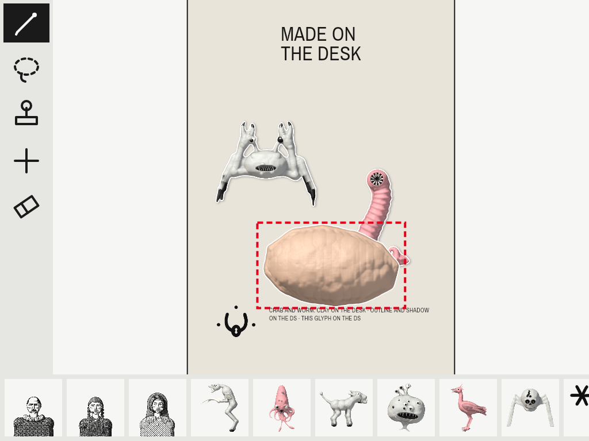
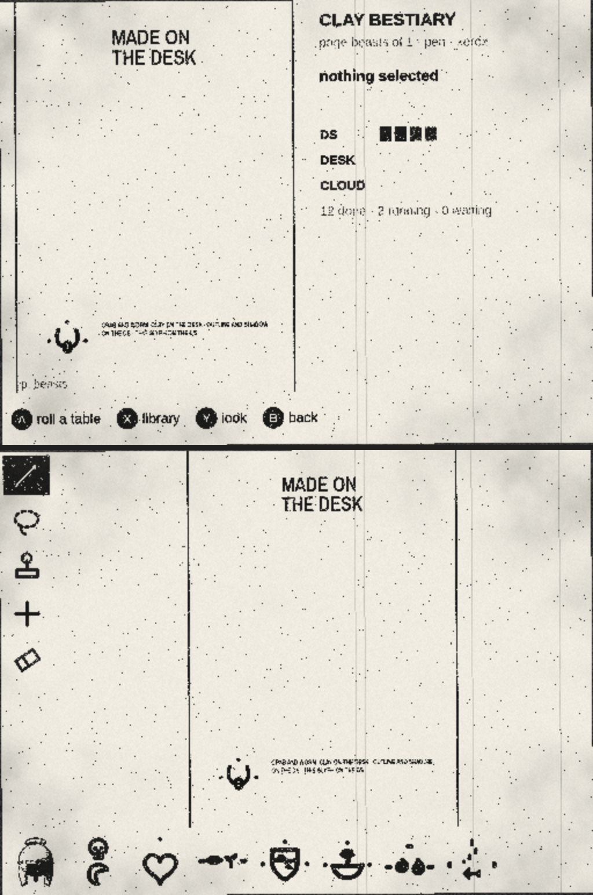
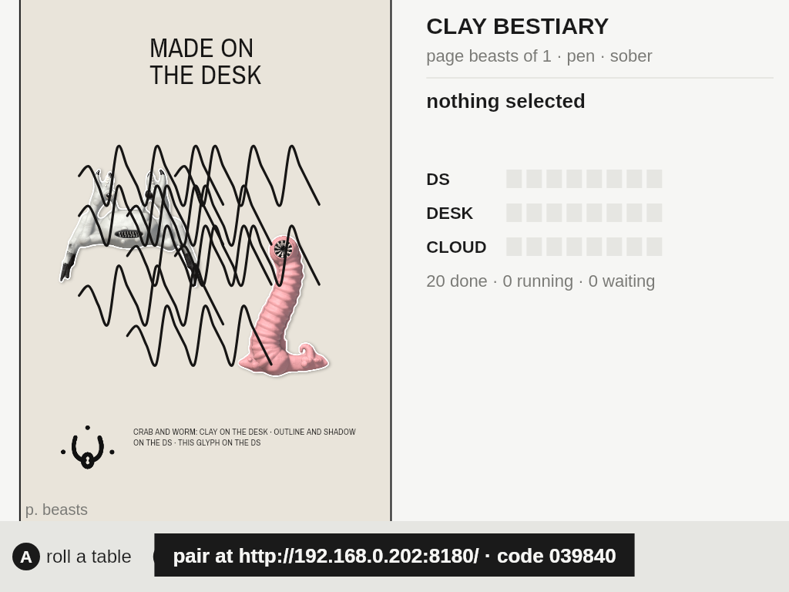
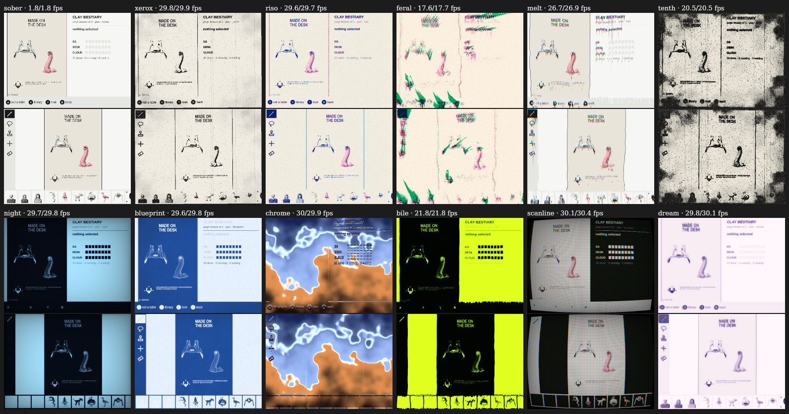
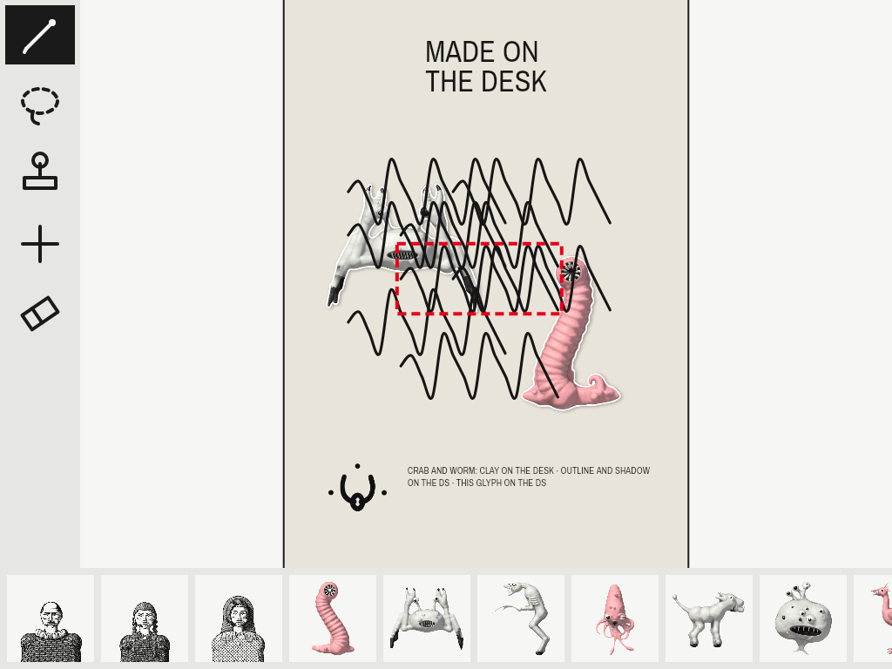
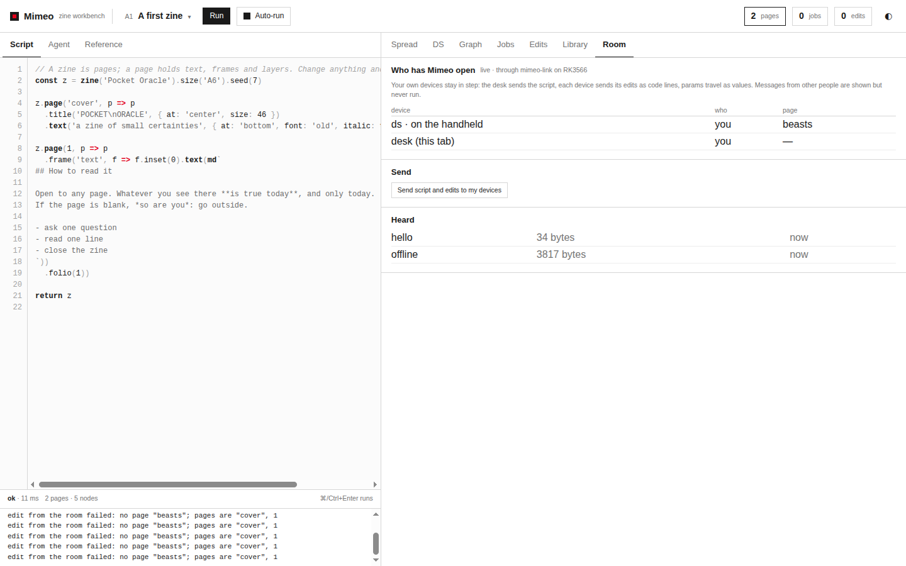
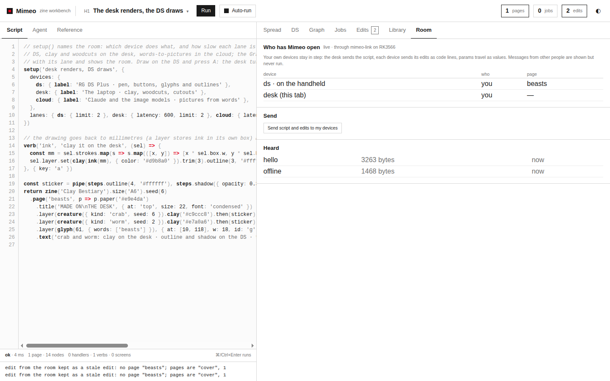
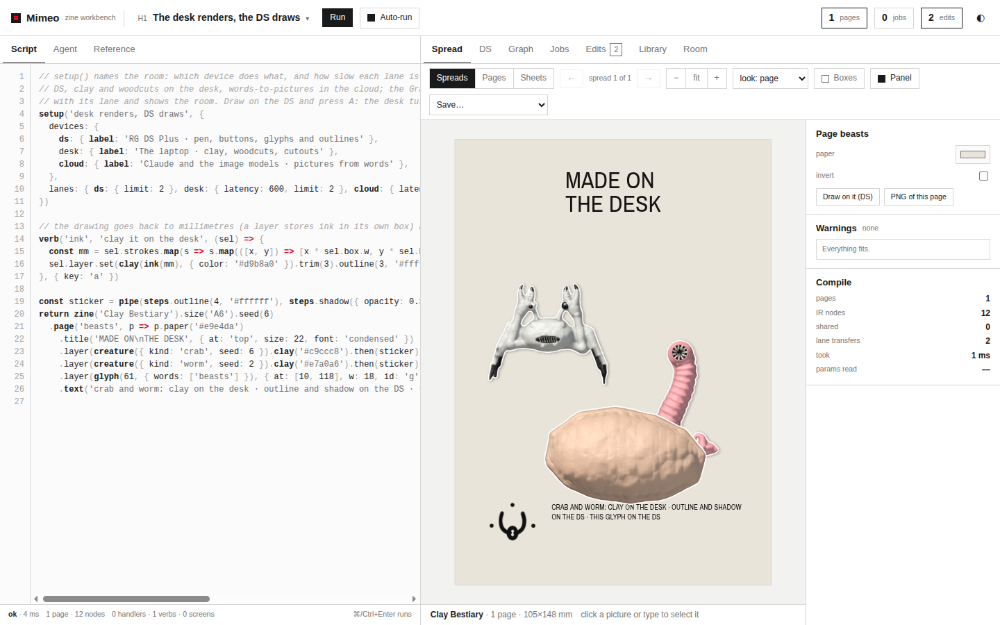
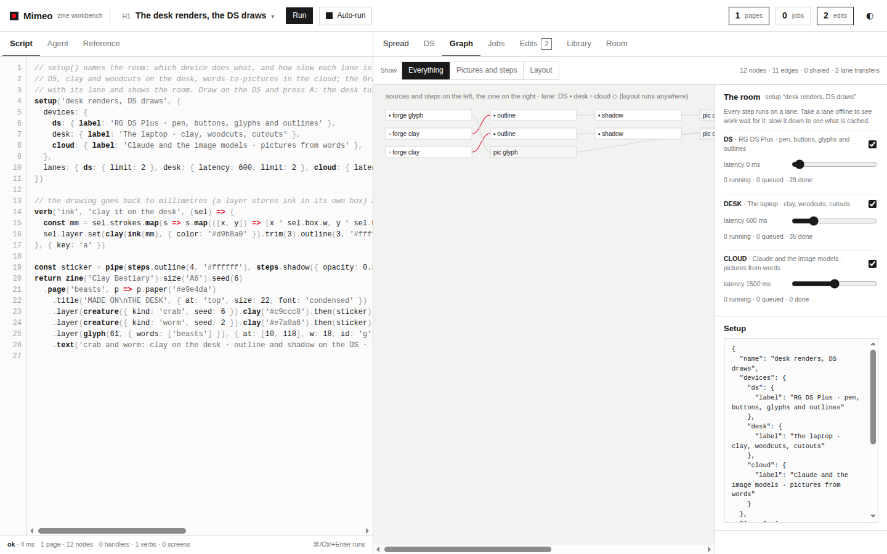

# Mimeo on the RG DS Plus, Part 4: On the Handheld

Parts [[PROJECT REPORT - Mimeo on the RG DS Plus, Part 1 - The DS Twin Leaves the Browser - A Skia Canvas, Fonts That Measure Like Chromium and Paint on Change|1]], [[PROJECT REPORT - Mimeo on the RG DS Plus, Part 2 - One Room for Desk and Device - A Pairing Hub in Go, Offline Edits That Arrive Once and Pictures Made Where Their Lane Is|2]] and [[PROJECT REPORT - Mimeo on the RG DS Plus, Part 3 - Two Windows and a GPU - dsnative, a WebGL2 Shim That Matches Chromium Bit for Bit and Each Panel Presented at Once|3]] built `mimeo-ds` on the desk while a colleague had the handheld. This report covers the two phases that put it on the device:
- **Phase 5** packs everything the handheld needs into one directory, without touching the handheld. It holds Node for arm64, the arm64 Skia prebuild, `dsnative` cross-built against the device's own SDL, the Go hub, Mimeo's web files and a Ports launcher: 160 MB.
- **Phase 6** deploys that package, runs it on both panels, pairs a browser on the desk with it over Wi-Fi, and measures. The guide's exit check reads: "press → screen and pen → ink latency, paint ms per screen, fps per look at scale 0.5, RSS, cold start; recorded in the diary".

All of it is measured, and the main numbers are these:

- **First frame on both screens.** About 0.8–1.4 s warm. 4.6 s on the very first start, while the GPU programs are compiled and stored. About 5.5 s from the Ports launcher with the page cache dropped.
- **Looks at half resolution.** Seven of the twelve looks hold the 30 fps cap, each drawing in 1.5–4.6 ms per screen on the Mali-G52. The slowest is `feral`, at 17.6 fps.
- **Latency.** A button press reaches the screen in p50 125–130 ms; pen ink appears in p50 207–261 ms. Paint, not input handling, sets both: one screen takes about 50 ms on the Cortex-A55.
- **Memory.** `mimeo-ds` uses 235–264 MiB RSS, about half of it file-backed; the hub uses 11 MiB.
- **The twin over Wi-Fi.** A shape drawn on the handheld is clayed by the browser and back on the handheld in p50 479 ms. It was 1216 ms before two fixes this phase made.

The hardware also found three bugs that no desk test had caught:
- the package could not load Skia;
- pairing a fresh browser replaced the handheld's drawings with a first-run preset;
- the lanes round trip carried 600 ms of simulated latency, and a clay made twice.



> [!summary]
> - **One directory, checked before it moves.** `package.sh` builds `build-device/mimeo/`; `deploy.sh --yes` rsyncs it to `/storage/apps/mimeo` and installs `/storage/roms/ports/Mimeo.sh`. Everything that can be proven on the desk was: the package tree, with x64 binaries swapped in, runs alone and under the hub exactly as the launcher starts it. That run found an addon bug that would have stopped `mimeo-ds` at once.
> - **Measure through the real input path.** Kernel input events are written to the handheld's own `/dev/input` devices and timed against the moment `mimeo-ds` presents. Both timestamps come from one clock, the handheld's. The result: latency is one or two paints, and a paint is about 50 ms per screen on the A55.
> - **The handheld can be where the zine lives.** A browser that opens the handheld's workbench for the first time holds nothing worth keeping. DR-11: such a desk takes the handheld's zine instead of imposing its own, and an edit that does not apply is kept as a stale line rather than dropped.
> - **Simulated delays must stay out of real work.** A latency that plays a missing device, and a picture whose live and replayed forms hash differently, together more than doubled the twin's round trip.

## 1. Terms

- **Handheld, device.** The Anbernic RG DS Plus:
  - Rockchip RK3566 (four Cortex-A55 cores), Mali-G52 GPU, 975 MB RAM;
  - two 1024×768 panels, the bottom one touch;
  - ROCKNIX (nightly 20261010) with the Sway compositor.
- **Desk.** The laptop: where the browser runs, and where `mimeo-ds` ran for Parts 1–3.
- **mimeo-ds.** The device program, `node host/main.mjs` (Part 3).
- **mimeo-link, the hub.** The Go server (Part 2) that serves the workbench on port 8180, pairs browsers by six digits, relays the room and supervises `mimeo-ds`.
- **Ports launcher.** `/storage/roms/ports/Mimeo.sh`, which ROCKNIX's menu (EmulationStation → Ports) runs. It starts the hub, and the hub starts `mimeo-ds`.
- **Room, overlay, edit.** Desk and device share one room. The desk owns the script; an *edit* is one line of code in the *overlay* replayed over the script (Part 2). DR-10 and DR-11 are the design guide's decision records for joining a room.
- **Lane.** Where a picture job runs: `ds`, `desk` or `cloud`. A job on a lane served by another device travels there as a recipe and comes back as a PNG (Part 2).
- **End to end (e2e).** From the moment an input event is written to the kernel until `mimeo-ds`'s present for the paint showing it returns. Both are `Date.now()` on the handheld; vsync is off, and the compositor shows the frame at its next refresh.

## 2. The problem

Parts 1–3 answered "can Mimeo's DS twin run outside the browser?" on a desk that has a fast x86 CPU, a desktop Mesa and no Wi-Fi in between. Three questions were left that only the handheld can answer.

**Does it start there at all?** The package mixes three foreign binaries (Node, the Skia prebuild, `dsnative`) with a launcher that has never run on ROCKNIX. Each has its own idea of library paths, glibc versions and environment.

**Is it fast enough?** The guide set the Phase 6 exit check to latency, paint time, frame rate per look, memory and start time, because those decide whether the pen feels like a pen. On the desk, painting both screens took p50 8.9 ms (Part 1). The A55 is a small in-order core, and no estimate replaces a measurement.

**Does the twin hold up?** Pairing, offline edits and lanes (Part 2) had been tested against test doubles and against a browser on the desk talking to a `mimeo-ds` on the desk. The real configuration is a browser on a laptop opening the handheld's page over Wi-Fi, often for the first time.

## 3. The package (Phase 5)

### 3.1 Shape

```mermaid
flowchart LR
  subgraph desk[Desk: build-device/]
    V[versions.sh<br/>every pin] --> FN[fetch-node.sh<br/>Node 22 arm64, sha256]
    V --> FM[fetch-modules.sh<br/>canvas + arm64 prebuild, acorn]
    V --> ST[stage-target-libs.sh<br/>device libSDL2 copies]
    ST --> BN[build-native.sh --aarch64<br/>toolchain image, network none]
    FN --> P[package.sh]
    FM --> P
    BN --> P
    G[go build GOARCH=arm64<br/>mimeo-link, static] --> P
    W[mimeo/ + device/host/] --> P
    P --> D[build-device/mimeo/<br/>160 MB, MANIFEST.sha256]
  end
  D -- deploy.sh --yes<br/>rsync --delete --> A[/storage/apps/mimeo/]
  D -- launcher --> L[/storage/roms/ports/Mimeo.sh/]
  A -. state, programs, logs .-> S[/storage/mimeo/]
  style D fill:#f4e3c1
  style S fill:#dde8f3
```

A background agent wrote most of the Phase 5 scripts in its own git worktree, under these rules:
- never contact the handheld or any `192.168.x.x` address;
- run `deploy.sh` only as a dry run;
- put downloads into empty directories and check them against the release's SHA-256;
- edit nothing in the device program.

I reviewed its work, merged it, and did the parts that touch the addon and the device program. The package holds:

- `bin/node`: the official Node v22.23.3 linux-arm64 binary, checked against a pinned SHA-256;
- `bin/mimeo-link`: the hub, cross-built static for arm64;
- `node_modules/`: `@napi-rs/canvas` 0.1.80 with its `linux-arm64-gnu` prebuild, and acorn;
- `native/dsnative.node`: built in the local `lattice-ds-toolchain` Docker image with `--network none`. It compiles against the toolchain's SDL2 2.26.5 headers and links the handheld's own `libSDL2-2.0.so.0` (2.32.10) through `DSNATIVE_TARGET_LIBS`. SDL2 keeps its ABI backward compatible;
- `host/`, `web/` (with `.gz` siblings for the browser), `ports/Mimeo.sh`, `run/` (a development runner, §4), `VERSION`, `MANIFEST.sha256`.

One toolchain finding mattered. The handheld's `libGLESv2` and `libEGL` are Mali hook shims that export no symbols, and the image's gcc links with `--as-needed`, so a directly linked `gl*` call would not resolve on the device. `dsnative` loads every GL entry point through `SDL_GL_GetProcAddress` (Part 3), so it was never affected. `build-native.sh` now checks for that and for every `napi_*`/`SDL_*` import against the arm64 node and the device's SDL.

### 3.2 Running the package on the desk first

`deploy.sh --dry-run` lists what would go where, but it cannot tell whether the tree runs. So a script copies `build-device/mimeo/` and swaps in the desk's x64 `node`, `dsnative.node`, canvas prebuild and hub. It then runs the copy exactly as `Mimeo.sh` would:
- from inside the copy, with the launcher's environment and no repository paths;
- first alone, then under the hub with the launcher's argument shape.



That run found a bug every windowed test had missed, because they all pass `--desk`. The launcher starts `mimeo-ds` without `--desk`, so `main.mjs` passes `{ positions: undefined }` to `dsnative.open()`. The addon asked only whether the property existed, then read `undefined` as an array:

```text
TypeError: Cannot convert undefined or null to object   at main.mjs:72:23
```

The option reader in `addon.cpp` now treats `undefined` and `null` as absent. A test starts `mimeo-ds` as the launcher does; it fails without the fix (a 20 s timeout) and passes with it. The launcher also exported environment names `main.mjs` never read, so state would have gone to `~/.local/state/mimeo-ds`. It now exports `MIMEO_STATE`, `MIMEO_WEB` and `MIMEO_DSNATIVE`.

### 3.3 The first start on the handheld

The real deploy (`deploy.sh --yes`) worked. The first start then died before drawing anything:

```text
Error: Failed to load native binding
    at Object.<anonymous> (/storage/apps/mimeo/node_modules/@napi-rs/canvas/js-binding.js:348:9)
```

The launcher set `NAPI_RS_NATIVE_LIBRARY_PATH` to point the canvas package at its prebuild. In version 0.1.80, that path goes through `requireNative()`, which assigns the binding it loads but does not return it; the caller then overwrites the binding with `undefined`. Without the variable, the package detects glibc by reading `/usr/bin/ldd` (glibc's own on ROCKNIX), picks `canvas-linux-arm64-gnu`, and Skia loads in 174 ms. The launcher no longer sets it, and a comment says why.

## 4. Measuring on the handheld

### 4.1 The rig

Under the hub, `mimeo-ds` has no control channel; its log is the only window in. For measurement, a development runner (`run/run-mimeo-ds.sh`) starts it without the hub, with `--place --no-link --control`. Its stdin is a FIFO, `/tmp/mimeo.ctl`, opened read-write (`<>`) so that it never sees end-of-file. `run/ctl.sh CMD` writes one command and prints the new log lines. The desk drives everything over ssh:
- `stats`, `look NAME`, `screen NAME` and `inputs N` go in through the FIFO;
- grim captures each Sway output to PNG;
- Lattice's `evinject.py` injects input.

```mermaid
flowchart LR
  subgraph deskside[Desk]
    S11[11-device-looks.mjs]
    S13[13-input-latency.mjs]
    S14[14-lanes-roundtrip.mjs]
  end
  subgraph hh[Handheld]
    INJ[12-inject.py + evinject.py<br/>prints write time] --> EV[/dev/input/event6 joypad<br/>/dev/input/event1 touch/]
    EV --> SDL[SDL2 on Wayland]
    SDL --> LOOP[mimeo-ds loop<br/>poll: Date.now&#40;&#41;]
    LOOP --> PAINT[paint: Canvas 2D on Skia]
    PAINT --> LOOKS[looks: WebGL2 on Mali]
    LOOKS --> PRES[present: Date.now&#40;&#41;]
    PRES --> SWAY[Sway: DSI-2 top, DSI-1 bottom]
    FIFO[/tmp/mimeo.ctl/] --> LOOP
    LOG[/tmp/mimeo.log/]
    LOOP --> LOG
  end
  S13 -- ssh --> INJ
  S13 -- ssh ctl inputs --> FIFO
  S11 -- ssh ctl look/stats --> FIFO
  S11 -- ssh grim --> SWAY
  S14 -- ssh drag + press A --> INJ
  style PRES fill:#f4e3c1
  style INJ fill:#f4e3c1
```



Input is injected at the kernel, not through the control channel's synthetic events. The SDL event queue, the loop's poll interval and the panel's touch scaling are all part of the latency a finger sees. `12-phase6-inject.py` writes real `EV_KEY` and multitouch `EV_ABS` events into the handheld's own devices and prints the wall time of each write. For each input batch that led to a paint, `mimeo-ds` records when the batch was polled and when the present returned. The desk joins the two lists:

```js
// 13-phase6-input-latency.mjs, per injected press (sketch)
const sample = samples.find(s => s.kind.startsWith('button') && s.inputWall >= press.wall - 5 && s.inputWall < nextPress.wall);
e2e         = sample.presentWall - press.wall;   // what a finger waits for
waitForPoll = sample.inputWall   - press.wall;   // the loop's poll interval
pollToPresent = sample.ms;                       // paint + looks + present
```

### 4.2 Start-up

| Start | First frame on both screens |
| --- | --- |
| First ever (no program cache, fresh state) | 4597 ms after `main()` |
| Warm, development runner | 1373, 833, 792 ms after `main()` (1148 ms after the process started) |
| Ports launcher, page cache dropped | 3618 ms after `main()`, 5027 ms after the process started, about 5.5 s from the launcher |
| Ports launcher, warm | 1112 ms after `main()`, about 1.5 s from the launcher |
| Warm, one clay lump in the overlay | 2415 ms |

The program cache works with Arm's blob driver: the first start compiles and stores the programs, and later ones report `compiled 0, cached 2`. The last row is a lead for later. With no desk present, desk-lane work such as a clay runs inline on the main thread at boot and delays the first present.



### 4.3 Looks at half resolution

Each look ran for 4 s; then `stats` was read and both outputs were captured with grim, so the sheet shows exactly what the panels showed. No look produced an error.

| look | fps top/bottom | GPU draw per screen | | look | fps top/bottom | GPU draw per screen |
| --- | --- | --- | --- | --- | --- | --- |
| sober | paints on change | — | | night | 29.7 / 29.8 | 3.9 / 3.4 ms |
| xerox | 29.8 / 29.9 | 2.6 / 1.9 ms | | blueprint | 29.6 / 29.8 | 2.3 / 2.2 ms |
| riso | 29.6 / 29.7 | 1.6 / 1.5 ms | | chrome | 30 / 29.9 | 4.3 / 3.0 ms |
| feral | 17.6 / 17.7 | 16.9 / 18.5 ms | | bile | 21.8 / 21.8 | 17.1 / 19.0 ms |
| melt | 26.7 / 26.9 | 2.0 / 2.1 ms | | scanline | 30.1 / 30.4 | 4.1 / 3.5 ms |
| tenth | 20.5 / 20.5 | 19.2 / 20.8 ms | | dream | 29.8 / 30.1 | 4.6 / 3.9 ms |



Part 3's "two swaps per frame" also holds here. Under Wayland each window's buffer is composited whole, so the client side cannot tear, and presenting both windows costs p50 0.7 ms.

### 4.4 Input, paint and memory

| | run 1 | run 2 |
| --- | --- | --- |
| buttons mapped as printed | 14 / 14 | 14 / 14 |
| press → screen, e2e p50 / p90 (20 presses, none missed) | 125.5 / 185.9 ms | 130.5 / 227.1 ms |
| of which: waiting for the poll, p50 | 29.4 ms | 16.0 ms |
| of which: poll → present, p50 | 92.4 ms | 119.2 ms |
| pen → ink, e2e p50 / p90 (8 strokes, 128 moves) | 206.8 / 226.2 ms | 260.9 / 284.6 ms |

**Paint is where the time goes.** Painting one screen with Canvas 2D on Skia takes p50 49.5 ms for the top and 51–57 ms for the bottom; both together take p50 104–108 ms, max 153 ms. A button press waits for at most one poll and then one paint of both screens. Pen ink waits for about two paints, because when a move arrives the loop is usually still painting the previous batch. GC was ruled out: Mark-Compact takes 6–9 ms and scavenges 1–2 ms. Idle is idle: 0 paints in 10 s when nothing changes.

The p90 outliers have a cause too. The library screen's low-priority thumbnail jobs mark the DS dirty as each finishes; pressing X led to about 14 full repaints in 3.5 s. A press that arrives during one of them waits for it to finish.



**Memory.**
- During the looks sweep, `mimeo-ds` used 235–260 MiB RSS, of which 95–123 MiB was anonymous (the rest is file-backed: Node, Skia, the GL driver).
- Under the launcher, paired, with nine clay lumps on the page: 264 MiB (135 MiB anonymous, peak 269 MiB); the hub used 11 MiB.
- With EmulationStation running as well, 278 MiB stayed available.

**Variance.** The CPU governor is `ondemand`, 408 MHz to 1.992 GHz, and the GPU runs `simple_ondemand` at 200 MHz; temperatures were 42.5–43 °C. The two input runs differ by up to a quarter (pen → ink p50 207 against 261 ms), the same order as frequency effects, so smaller single-run differences are noise.

## 5. Pairing a real browser

### 5.1 What happened

The handheld held H1, "Clay Bestiary", with 8 edits: pen strokes made with no desk around. A browser on the laptop opened `http://192.168.0.202:8180/` for the first time. It had nothing in its storage, so it booted on the first-run preset, A1. I typed the six digits from the top screen, and both peers showed as live in one room. Then:

1. DR-10, as built in Part 2, did its job: the device sent its 8 offline edits (`m.offline`), then its hello.
2. The desk replayed each edit onto A1. Each failed with `no page "beasts"; pages are "cover", 1` and was dropped with a warning.
3. The desk answered the hello with its state: A1 with no edits. The device adopted it.

Afterwards the handheld's `state.json` held A1's script with an empty overlay. The drawings were gone from both sides.



The design guide had foreseen half of this. DR-10's consequences said that an offline edit that no longer applies "becomes a stale edit in the overlay panel", but the code dropped it instead. The other half it had not foreseen: with `mimeo-link`, the handheld is often where the zine lives, and a browser that has just opened the handheld's page holds nothing worth keeping.

### 5.2 DR-11: a desk with nothing of its own takes the device's zine

```mermaid
sequenceDiagram
  participant D as mimeo-ds (handheld)
  participant H as mimeo-link
  participant B as browser (desk)
  B->>H: POST /api/pair {code}
  H-->>D: peers: a desk joined
  D->>B: m.offline {ops made while alone}
  Note over B: replay each; one that fails is kept<br/>as a stale line (remote, origin, error)
  D->>B: m.hello {want, has: {src, ops: every line}}
  alt the desk is untouched (a preset as it comes, only remote lines)
    Note over B: take: overlay := has.ops, script := has.src
  else the desk has work of its own
    Note over B: stay the authority (DR-10)
  end
  B->>D: m.state {src, ops, re: [want]}
  Note over D: adopt; every line is now in step
```

The rule is small, and three details make it work:

```js
// mimeo/js/room.js (desk side)
takes(has) { return this.device === 'desk' && typeof has?.src === 'string'
  && (has.src !== this.rt.script || (has.ops || []).length > 0) && this.untouched(); }
take(has)  { this.setOps(has.ops); this.rt.setScript(has.src, { reason: 'from the device' }); }
// mimeo/js/ide.js: the desk has nothing of its own while its script is a preset as it comes
// and every line in its overlay came from the room
untouched: () => PRESETS.some(p => p.src === this.rt.script) && this.rt.doc.ops.every(o => o.remote)
```

- **Order.** `m.offline` arrives before `m.hello`, so a fresh desk first applies the offline edits as stale lines. `untouched` counts only lines of the desk's own, so those remote lines don't make it "touched".
- **All lines, not just the unsent ones.** The hello carries the whole overlay. Lines that a previous desk had already seen are not offline edits, and taking only the unsent ones would lose them a second time.
- **Ids.** `setOps` moves the document's edit counter past the adopted ids, so the desk's next edit cannot reuse one.

A desk with work of its own stays the authority, as DR-10 says, and an edit that does not apply there is kept as a stale line (`{ id, code, label, by, at, remote: true, origin, error }`). It travels with the state, so the device keeps it too, and it applies again if its page comes back.

The same scenario was then run again: H1 with two strokes made alone, a browser with empty storage, the hub's sessions removed. The browser came up showing H1 with both edits, and the handheld kept them, now marked as in step.



Choosing "any preset" for `untouched` is deliberate. A browser where someone picked B2 from the menu and made no edits will also take the handheld's zine. Losing an unchanged preset costs one click; losing drawings cannot be undone.

## 6. The twin over Wi-Fi

H1 is the preset written for this: "Draw on the DS and press A: the desk turns your drawing into clay". The DS's verb for wet ink builds `clay(ink(mm)).trim(3).outline(3, '#ffffff')`. The clay step is on the desk lane, so the handheld sends its recipe to the browser. The browser forges the clay and sends back a PNG, and the handheld trims and outlines it on its own lane. A small script measured it on the handheld: draw a closed shape with injected touch events, press A while the ink is wet, and read the line `mimeo-ds` now logs for every picture another device made for it (`lanes: forge clay made on desk in N ms`, from the job being asked for to the picture being in hand).

| build | round trip p50 | p90 | the browser's clay |
| --- | --- | --- | --- |
| as deployed | 1216 ms | 1868 ms | ~690 ms, of which 600 ms slept |
| no simulated latency for served work | 726 ms | 807 ms | 47–84 ms |
| live and replayed inks are one picture | **479 ms** | **511 ms** | 51–77 ms |

**600 ms that were not there.** H1's `setup()` declares `desk: { latency: 600 }`, so that one tab playing the whole room shows what a slow lane looks like. `Jobs._start` slept that latency for every job without a remote executor. That included jobs the browser was serving for the handheld, which had already paid real latency over Wi-Fi. On the handheld it also slept on desk-lane work run locally while no browser was there. Now a job knows whom it is for, and the device turns simulation off:

```js
// mimeo/js/jobs.js, Jobs._start
if (this.simulate && this.latency[job.lane] && !ex && !job.for) await sleep(this.latency[job.lane]);
// LaneServer: rt.images.realize(pic, { for: who })  →  job.for = 'ds'
// device/host/main.mjs: rt.jobs.simulate = false   // real hardware: nothing is added
```

The first version of its test compared wall-clock times. It passed alone and failed in the full suite under load. Timers fire in the order they are due, so the test now compares the order in which three jobs finish: one on a lane the tab plays, one served for a device, one with simulation off.

**A clay made twice.** After the first fix, the browser's job list still showed each clay twice: once as `for ds: forge clay` (key `5a87cdc1`), then as `forge clay` for its own spread (key `efae7b04`).
- An edit travels as code, and `exprOf` writes ink coordinates rounded to three decimals, then two from 2 up.
- The live picture on the handheld kept every digit of `x * sel.box.w`, so the code rebuilt a slightly different ink with a different cache key.
- The handheld would also have asked for the clay again after any re-run, which rebuilds from the code.

`Ink` now quantizes its coordinates at construction exactly as `exprOf` writes them, and the two roundings must stay in that order:

```js
// mimeo/js/things.js — idempotent with exprOf's fix3-then-num
const inkQ = (n) => { if (!Number.isFinite(n) || Number.isInteger(n)) return n;
  const a = +n.toFixed(3); return Number.isInteger(a) ? a : +a.toFixed(Math.abs(a) < 2 ? 3 : 2); };
```

Rounding once to two decimals would round some values differently (17.2949 → 17.29, but through 17.295 → 17.30). A test asserts that a live ink and its rebuilt code have one key and that writing it again changes nothing. Old overlays replay unchanged, since their code already had this precision. After the fix the browser made each of 8 new clays once, and its spread reused them.



Of the remaining ~480 ms, the browser's clay is about 55 ms. The rest is the handheld's recipe check, PNG encode and decode on both ends, Wi-Fi, and the job queue. Splitting those needs timing inside the router, which is the next lanes task.



The round-trip script had a bug of its own at first. Its shapes came in three sizes, and the verb scales strokes to their box, so equal shapes made equal recipes. From the fourth shape on, the content-addressed cache answered with no job at all, and only 3 of 8 clays were measured. Reproducing it in Node with the same shapes showed neither the remote nor the inline path being called. The script now draws a distinct shape every time.

## 7. Testing

- `npm test`: 47 tests pass, five of them new in this phase:
  - room: a desk with nothing of its own takes the zine; a desk with the same preset takes the device's edits; a desk with work of its own keeps it and keeps a stale edit;
  - lanes: simulated latency only where a tab plays a lane; a live ink and its replayed code are one picture.
- Every fix was mutation-checked: each new test fails without the change it covers.
- Two earlier fixes in this phase came from the suite itself:
  - The windowed room test failed about one run in four under load. Edits arriving while an adopted state re-ran the script were lost, and are now held until the run ends.
  - The test's orphaned `mimeo-ds` spun at 100 % once its X server was gone and ignored SIGTERM. The test now quits it in a `finally`.
- On the handheld the evidence is the measurement scripts' JSON and grim captures, and they are repeatable (§9).

## 8. Limitations and open questions

- **The page-layer cache (DR-5) now has its numbers.** Pen ink costs two paints of about 50 ms per screen. Incremental ink, painting only what changed, is the obvious target; the decision is still open.
- **The first frame waits for clay forged at boot** (2.4 s with one lump against 1.1 s with ink only). The fix would be to present first, then forge.
- **The launcher-run app has no control channel.** It can only be measured through its log, or by running it without the hub.
- **The desk still plays its own lanes' latency in a real room.** H1's creature clays took about 690 ms on the browser for its own spread. It no longer slows anything the handheld asked for, but whether a desk in a real link room should simulate at all is open.
- **The pairing banner covers the X and Y hints** on the top screen, and the hub names the device "RK3566" (its SoC) where "RG DS Plus" would read better.
- **Two devices with different zines meeting one untouched desk:** the first to greet wins, and the second adopts it (its own lines go first as offline edits).

## 9. Reproducing

With the handheld free and the user's go-ahead:

```bash
cd /home/manuel/code/wesen/2026-10-18--mimeo
device/scripts/package.sh && device/scripts/deploy.sh --yes          # 160 MB, rsync to /storage/apps/mimeo
T=ttmp/2026/10/18/MIMEO-001--real-nintendo-ds-client-and-twin-device-link-for-mimeo
scp $T/scripts/12-phase6-inject.py root@192.168.0.202:/tmp/          # next to Lattice's evinject.py
ssh root@192.168.0.202 /storage/apps/mimeo/run/run-mimeo-ds.sh --preset H1 &
node $T/scripts/11-phase6-device-looks.mjs /tmp/looks                # every look: stats + grim + sheet.png
node $T/scripts/13-phase6-input-latency.mjs /tmp/input               # buttons, press → screen, pen → ink
ssh root@192.168.0.202 /storage/apps/mimeo/run/ctl.sh quit
ssh root@192.168.0.202 'setsid /storage/roms/ports/Mimeo.sh &'       # or Ports → Mimeo on the device
# pair a browser at http://192.168.0.202:8180/ (code on the top screen), load H1, then:
node $T/scripts/14-phase6-lanes-roundtrip.mjs /tmp/lanes --n 8
```

## 10. Next steps

- **Phase 7:** twin modes (follow, drive, parity against the device's own screens) and `see('device')` for the agent.
- **DR-5 / incremental ink**, decided with §4.4's numbers.
- **Present before forging** at boot; **a control channel** under the hub; **router timing** for the remaining lanes round trip.
- **Ports registration:** a gamelist entry and an image for Mimeo, after Octavo's `register.sh`.

## 11. Files

| Path (in `/home/manuel/code/wesen/2026-10-18--mimeo`) | Role |
| --- | --- |
| `device/scripts/{versions,fetch-node,fetch-modules,stage-target-libs,build-native,package,deploy}.sh` | the Phase 5 package and deploy |
| `device/ports/Mimeo.sh` | the Ports launcher: Wayland env, log rotation, hub → `mimeo-ds` |
| `device/run/run-mimeo-ds.sh`, `ctl.sh` | the development runner on the handheld, FIFO control |
| `device/native/src/addon.cpp` | `open()` options: `undefined`/`null` count as absent |
| `device/host/loop.mjs`, `main.mjs` | input → present samples, paint per screen, first-frame log, lanes log, `jobs.simulate = false` |
| `mimeo/js/room.js`, `mimeo/js/ide.js` | DR-11 (`takes`, `take`, `setOps`, `untouched`), stale edits, held edits during a run |
| `mimeo/js/jobs.js`, `mimeo/js/images.js` | `Job.for`, `Jobs.simulate` |
| `mimeo/js/things.js` | `inkQ`: live and replayed inks are one picture |
| `ttmp/2026/10/18/MIMEO-001--…/scripts/11-…` to `14-…` | looks, injector, input latency, lanes round trip |
| `ttmp/2026/10/18/MIMEO-001--…/various/phase6-device/` | `looks.json`, `input{1,2}/input.json`, `lanes-{before,after,final}/lanes.json` |
| `ttmp/2026/10/18/MIMEO-001--…/diary/01-diary.md` | Phase 5 is Step 14, Phase 6 is Step 15 |

Commits:
- Phase 5: `044d17b` (the merge), `78533d9`.
- Phase 6:
  - room race: `58e229c`;
  - launcher, runner and measurements: `75bd935`, `5b4a821`, `22ac430`;
  - DR-11: `996aadc`;
  - lanes log line: `c6b6002`;
  - simulated latency: `c399e9c`;
  - ink quantization: `a718a6f`;
  - diary and evidence: `e2108b3`.

## Related notes

- [[PROJECT REPORT - Mimeo on the RG DS Plus, Part 1 - The DS Twin Leaves the Browser - A Skia Canvas, Fonts That Measure Like Chromium and Paint on Change]]: the headless runtime whose paint this phase measured on the A55
- [[PROJECT REPORT - Mimeo on the RG DS Plus, Part 2 - One Room for Desk and Device - A Pairing Hub in Go, Offline Edits That Arrive Once and Pictures Made Where Their Lane Is]]: the hub, DR-10 and the lanes that met a real browser here
- [[PROJECT REPORT - Mimeo on the RG DS Plus, Part 3 - Two Windows and a GPU - dsnative, a WebGL2 Shim That Matches Chromium Bit for Bit and Each Panel Presented at Once]]: the windows, the WebGL2 shim and the loop that run on the device
- [[PROJECT REPORT - Lattice DS Native, Part 2 - A Two-Thread Shell and a Thin V8 Layer on the RG DS Plus]]: the platform layer, the button table and `evinject.py`
