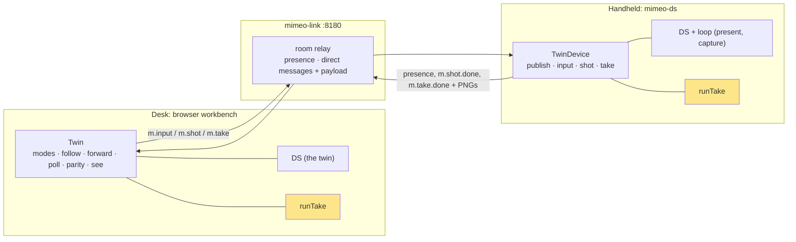
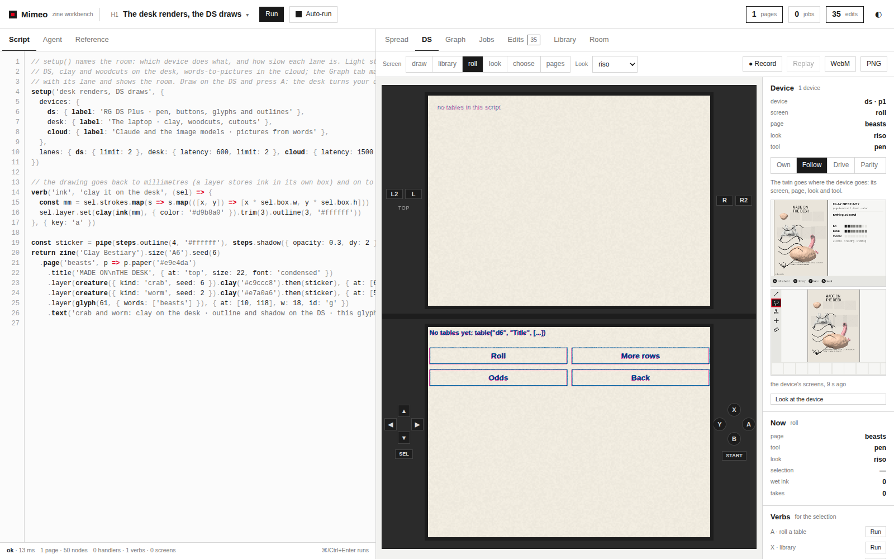
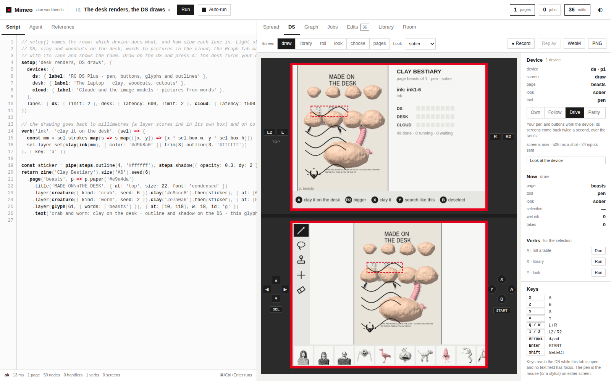
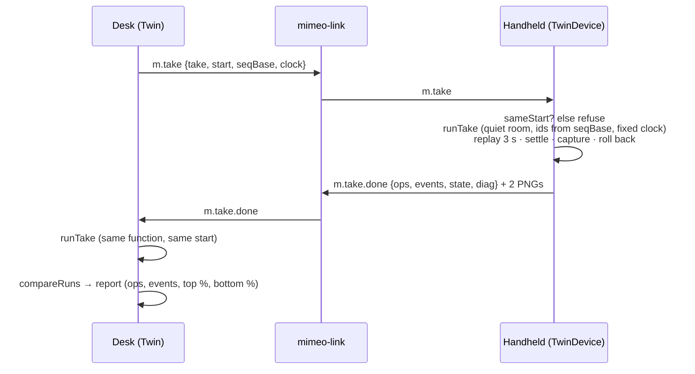
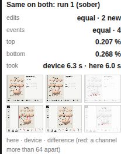
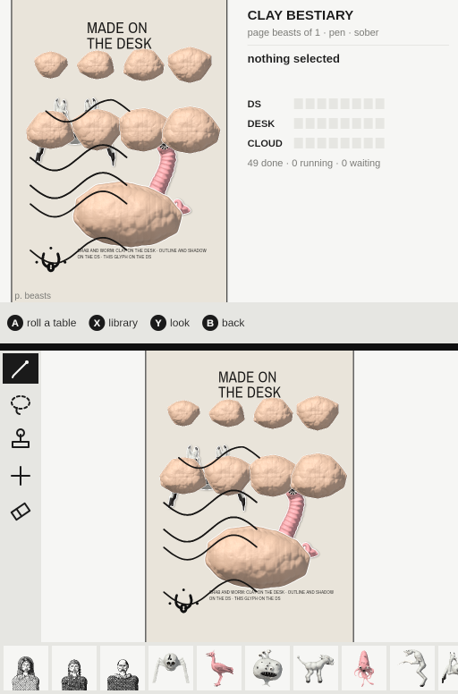
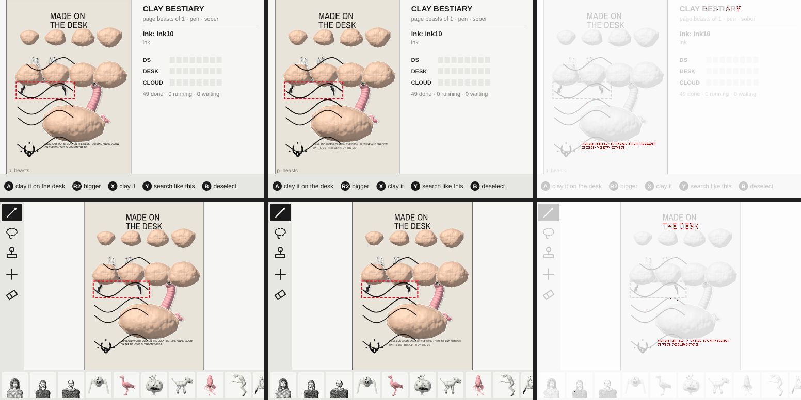
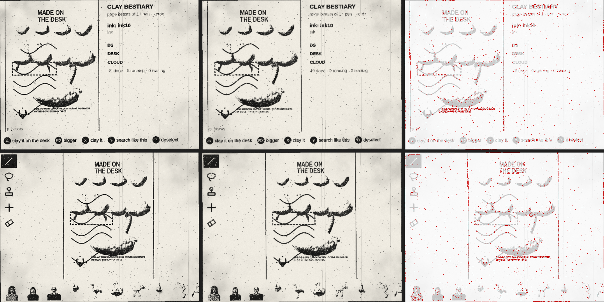
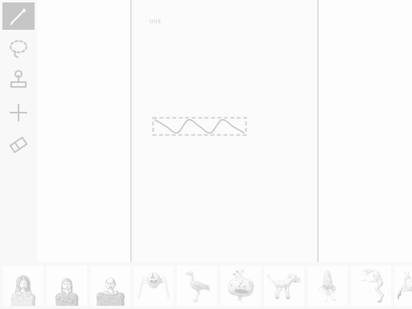
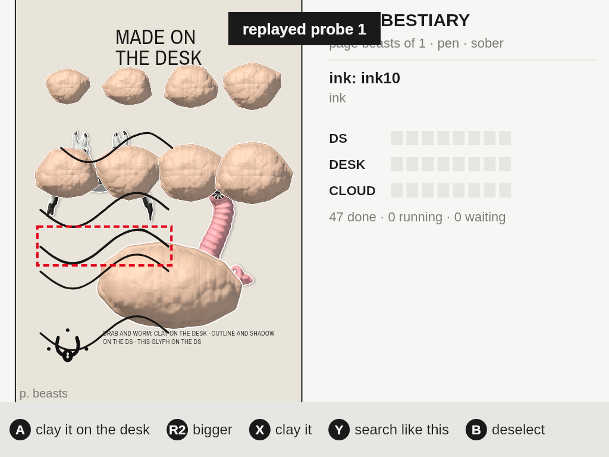

# Mimeo on the RG DS Plus, Part 5: The Twin and the Handheld

[[PROJECT REPORT - Mimeo on the RG DS Plus, Part 4 - On the Handheld - A 160 MB Package, Latency Set by Paint and Three Bugs Only the Hardware Showed|Part 4]] put `mimeo-ds` on the handheld and paired a browser on the desk with it over Wi-Fi. At that point the two shared a zine (edits, params, scripts and picture jobs), but each was still its own DS. The browser's DS tab, the *twin*, could not show what the handheld was doing, could not work it, and could not tell whether the handheld drew what the desk drew.

This report covers Phase 7, which closes that gap. The DS tab gains a Device panel with four modes:
- **own** (independent): as before;
- **follow**: the twin goes to the handheld's screen, page, look and tool;
- **drive**: the twin's pen and buttons work the handheld, and the handheld's screens come back twice a second;
- **parity**: one recorded take is replayed on both sides from the same start, and the edits, events and pixels are compared.

The workbench's agent can also look at the handheld with `see('device')`.

The guide's exit check reads: "a parity run of one take on desk and device with equal overlay lines and pixel differences within tolerance". It was met on the RG DS Plus:

- **Parity, sober, three runs.** The edits were equal (2 new on each side), the events equal (4), and 0.204–0.207 % of the top screen's pixels and 0.265–0.269 % of the bottom's were apart. Octavo's rule passes a screen under 0.5 %.
- **Follow.** The twin follows the handheld in p50 423 ms: screens in about 200 ms, looks in 560–1100 ms.
- **Drive.** A press on the twin is the handheld's new screen in p50 174 ms. A half-size shot of both screens comes back in 531 ms, 441 ms of it on the handheld.
- **`see('device')`.** Both full-size screens in 823 ms.

Parity also found two bugs that no desk test had shown, because the desk renders too fast for them. The tray's order depended on which items were added in the same millisecond. On a slow device, a toast could stay on the top screen after it had expired.


> [!summary]
> - **One function runs a take on both sides.** `runTake` in `mimeo/js/twin.js` runs on the device for `m.take` and on the desk for the comparison. The only things left to differ are the machines and their renderers, which is what parity is meant to measure.
> - **Parity needs a proven start and a quiet room.** The desk sends a hash of its script, its overlay codes and a hash of its params; the device refuses a take that does not start there. During a run both sides give new things the same ids, roll from a fixed seed, and send nothing to the room. Afterwards everything is put back (DR-12).
> - **A slow device turns timing into pixels.** Both bugs parity found are about order: ties within a millisecond, and one paint spread over two 50 ms screens. A desk paints both screens in a few milliseconds and hides them.
> - **Put the diagnosis in the report.** A 2.15 % difference on the top screen could have been a GPU difference. The paint state captured around the screenshot (no toasts, `live: false`, 320 ms since the last paint) pointed straight at the repaint logic.

## 1. Terms

- **Handheld, device; desk.** As in Part 4: the Anbernic RG DS Plus (RK3566, Mali-G52, two 1024×768 panels, ROCKNIX with Sway), and the laptop running the browser.
- **mimeo-ds, mimeo-link.** The device program (Node, Skia, `dsnative`) and the Go hub that serves the workbench, pairs browsers and relays the room (Parts 1–4).
- **Twin.** The DS tab of the workbench: Mimeo's own DS, the same `DS` class as on the device, drawn in the browser.
- **Take.** A recording of DS input: `{ name, screen, look, page, tool, events: [{ t, k: 'b', b } | { t, k: 'p', type, screen, x, y }] }`. Takes record inputs, not pixels, so one take is valid on both sides.
- **Presence.** What each peer tells the room about itself. The device's presence now carries `{ page, screen, look, tool }`.
- **Direct message.** A room message `to` one peer, optionally with a binary payload. Picture jobs already used them (Part 2); the twin's shots, inputs and takes do too, so twin modes need a link room (mimeo-link), not claude.ai's.
- **Start.** What both sides must share before a parity run: the script, the overlay (every edit's code) and the params.
- **Octavo's tolerance.** From [[PROJECT REPORT - Octavo, Part 3 - The Development Loop - A Server on the Handheld, a WebGL2 Twin and a Parity Check|Octavo Part 3]]: a pixel differs when any channel is more than 64 apart, and a screen passes when fewer than 0.5 % of its pixels differ.

## 2. The problem

Mimeo's book describes the DS twin as a way to design for a handheld without holding one. That only holds while the twin is faithful. Parts 1–4 showed that the code runs on the device; they did not show that the device *shows the same thing*. There were three gaps.

**Watching.** When someone uses the handheld, the desk sees the edits arrive but not where the person is: which screen, which look, which tool. Debugging a report like "the library screen looks wrong in riso" means walking over and looking.

**Working it.** Pressing START twenty times on a handheld to reach a screen, or drawing a precise stroke on a 3.5" panel, is slow. The desk has a mouse and a keyboard. It should be able to drive the handheld the way a remote desktop does, and see the result.

**Checking it.** The device renders with Skia on an ARM CPU and the Mali blob through a WebGL2 shim (Part 3); the twin renders with Chromium's Skia and ANGLE. Fonts were made to measure alike (Part 1), and the shim matched Chromium bit for bit on the desk (Part 3). Whether the whole pipeline agrees on the handheld, after real input, through real timers, had never been checked.

## 3. Design: one module, two ends

Everything lives in `mimeo/js/twin.js`:



- **`TwinDevice`** runs wherever a DS stands in for the device: in `mimeo-ds` (`device/host/main.mjs`), or in a `#ds` page in a browser. It publishes presence and answers three direct messages.
- **`Twin`** runs in the workbench and backs the Device panel (`views.js` `deviceBlock`).
- **`runTake`** is the one function both sides use to run a take.

### 3.1 Messages

| topic | from → to | data | answer |
| --- | --- | --- | --- |
| presence | device → room | `{ page, screen, look, tool }`, sent when one changes (50 ms debounce) | — |
| `m.input` | desk → device | `{ k: 'b', b }` or `{ k: 'p', type, screen, x, y }` | none; the presence changes |
| `m.shot` | desk → device | `{ id, scale: 0.5 or 1 }` | `m.shot.done { id, ok, w, h, sizes: [n0, n1], screen, look, page, ms }` + two PNGs |
| `m.take` | desk → device | `{ id, take, start, seqBase, clock }` | `m.take.done { id, ok, ops, added, events, state, settled, ms, diag, w, h, sizes }` + two PNGs, or `{ ok: false, error }` |

Everything from the room is sanitized before it touches the DS. `inputOf` accepts only the fourteen button names, the three pen types, screens 0 and 1, and finite coordinates, clamped to 512×384. `takeOf` accepts at most 20,000 events within ten minutes and truncates names. A take is data, never code.

### 3.2 Follow

Follow is the simplest mode. The device publishes where it is, and the desk applies it:

```js
follow() {
  const p = this.device(), ds = this.ds; if (!p) return;
  if (p.screen && p.screen !== ds.screen && this.rt.screenNamed(p.screen)) ds.show(p.screen);
  if (p.page != null && String(p.page) !== String(ds.pageId)) ds.goPage(p.page);
  if (p.look && p.look !== ds.lookName) ds.setLook(p.look);
  if (p.tool && p.tool !== ds.tool && this.rt.toolNamed(p.tool)) ds.setTool(p.tool);
}
```

The device publishes from a 50 ms timer that both the DS's change listener and the runtime's event stream arm, and only when the tuple differs from the last one sent. The old presence line in `main.mjs` (page and screen on every room change) is gone.



### 3.3 Drive

Driving needed a hook in the DS itself. `pointer()` and `press()` record into a take if one is recording. They now also offer the input to `ds.forward` before handling it:

```js
// ds.js, pointer(): a replay always plays here
if (this.forward && !this.replaying && this.forward({ k: 'p', type, screen, x, y })) return;
```

In drive mode `Twin.setMode` sets `ds.forward = (ev) => this.forward(ev)`. That sends `m.input` to the device and returns `true`, so the twin itself does nothing. With no device to talk to, it returns `false` and the twin keeps the input.

While driving, the twin asks for half-size shots at 2 Hz. The loop never piles requests up: the next one is scheduled when the last one is in, 500 ms after it started, or at once if it took longer. A button press or a pen-up brings the next shot forward to 120 ms, so the result of an action shows up sooner than the next tick:

```js
poll(delay = 0) {
  clearTimeout(this.pollTimer);
  this.pollTimer = setTimeout(async () => {
    if (this.mode !== 'drive' || this.polling) return;
    this.polling = true; const t0 = now();
    try { await this.shot({ scale: 0.5 }); } finally { this.polling = false; }
    if (this.mode === 'drive' && !this.pollTimer) this.poll(Math.max(0, 500 - (now() - t0)));
  }, delay);
}
```

On the device, a shot comes from the frame loop's own capture (`loop.capture()`, the frames last presented to the panels), not from a fresh render. The panel draws the returned screens over the twin's canvases in an accent frame, so it is obvious that what you see is the device.



### 3.4 Parity

A parity run, from the Device panel's "Run on both and compare" or from `twin.parity(take)`, has three steps:

1. **The device runs the take.** The desk sends `m.take` with the take, its start, the id base and a clock, and waits up to the take's length plus 60 s.
2. **The desk runs the same take** with the same `runTake`.
3. **`compareRuns`** compares the two results.

The device runs first because it is slower and is the side that may refuse (busy, or at another start). If it refuses, the desk has not touched its own state.

`runTake` is where the care goes. A take is just input, so to produce the same output on two machines, everything else the input meets has to be the same:

```js
async function runTake(rt, ds, take, { room, screens, clock = 1, seqBase, kick }) {
  keep = snapshot(overlay ops, seq, undone, screen, prevScreen, look tuple, page, tool, id counters)
  listen to rt's 'event' stream → events[] (normalized)
  room.quiet++                                    // no edit or param leaves this side
  try {
    clear(wet ink, gesture, selection, results, focus, toasts, pen)
    ds.inkSeq = ds.cutSeq = ds.stampSeq = ds.genSeq = seqBase   // new things get the same ids
    ds.fixedClock = clock; ds.rollSeq = 0                        // rolls seed clock+1, clock+2, …
    await ds.replay(take, { speed: 1, onEvent: kick })           // real timers: the pen commits after 1.1 s
    settled = await settle()     // 300 ms with no wet ink, gesture, run, toast < 2.6 s, or job
    diag.before = paintState(); shots = await screens(); diag.after = paintState()
    return { ops: codes, added, events, state, settled, ms, screens: shots, diag }
  } finally {
    restore(keep); ds.fixedClock = null; room.quiet--
    rt.rerun('after a parity run'); kick()
  }
}
```

Each piece of that is there because a run failed without it:

- **The start check.** The desk's `start` is `{ script: FNV-1a(src), ops: [every overlay code], params: FNV-1a(sorted params) }`. The device compares it with its own and refuses with the first difference: `not at the desk's start: the script differs`, `… the overlay differs (N and M edits)` or `… the params differ`. A device somewhere else would otherwise produce a confusing pixel difference instead of a stated refusal.
- **The same ids.** Edits are named from counters (`ink12`, `cut3`, `stamp5`). Both sides start the run's counters at the desk's `seqBaseOf(rt)`, the highest such number in the script and overlay. The run's new edits then have the same names, and the overlays compare as code.
- **A fixed roll seed.** Tables roll from `Date.now()` by design. `ds.rollSeed()` now returns `fixedClock + n` while a run has a clock.
- **A quiet room.** Without `Room.quiet`, each side's new edits would travel to the other side, which is busy producing the same edits, and both would end with four instead of two.
- **Settling.** A pen stroke is wet ink for 1.1 s before it becomes an edit, and a toast lasts 2.6 s. Capturing early compares a half-committed state on one side with a committed one on the other.
- **Rolling back.** The run must leave no trace. That means the overlay, its undo stack, the ids, and the screen, look, page and tool, then a re-run of the script so the canvases match the restored overlay.

`compareRuns` then checks:
- the overlay codes, in order, and the count of new ones;
- the events (each number rounded to two decimals, arrays longer than 16 as a count and a hash);
- each screen at 512×384 with Octavo's tolerance.

The report also keeps both sides' paint state around the capture (`diag`), the time each side took, and a difference picture per screen: the desk's screen in grey, differing pixels in red.





### 3.5 `see('device')`

The agent in the workbench already had `see('spread' | 'page' | 'ds')`: each queues a rendered view, and the model receives it as an image after its turn. `see('device')` asks the handheld for a full-size shot and stacks the two screens into one 512×776 picture. The agent's render round now awaits a promise, since this view comes over the network. Without a device, it fails with a message that says why: "no device to see: none is in the room, or the room is not a link".



## 4. On the desk first

The handheld was busy with a colleague's tests while this was built. Everything was therefore proven on the desk first, with nothing simulated: the real hub, `mimeo-ds` under Xvfb with `--link` (as the hub runs it on the device), and the workbench in Chromium (Playwright), paired with the code (`scripts/15-phase7-twin-desk.mjs`).

| | result |
| --- | --- |
| follow (look, page and screen changed on the device) | 116 ms |
| drive | START and a stroke reached the device; the stroke became its edit and then the desk's; 10 shots, the last in 134 ms |
| parity | edits equal (2 new), events equal (4); top 0.213 %, bottom 0.279 % |
| `see('device')` | 186 ms |

Eight unit tests (`device/host/test/twin.test.mjs`) run both ends in one process over a fake hub that implements presence, direct messages with `to`, and payloads:
- sanitizing inputs and takes;
- follow;
- drive (half-size shots, START, a stroke to device ink to desk overlay, about 2 shots/s);
- parity from the same start (identical, then rolled back on both);
- a device that differs (a wider pen: found out);
- a device at another start (refused);
- the toast invariant (§6.2);
- fixed-seed rolls.

## 5. On the handheld

Once the handheld was free again, the package was rebuilt and deployed (`package.sh && deploy.sh --yes`). The rig in `scripts/16-phase7-twin-device.mjs` then:
- starts Mimeo.sh over ssh and reads the pairing code from the hub's log;
- pairs Playwright's Chromium, which takes the handheld's zine (DR-11);
- sets a known start by driving: START until the draw screen, SELECT until sober;
- measures follow, drive and parity, and captures both panels with grim.

**Two clocks.** Follow latency starts on the handheld (the kernel input event, written by the injector from Part 4) and ends on the desk (the twin following). The rig estimates the clock offset from seven ssh round trips over one ControlMaster connection; the uncertainty is half the best round trip, ±69 ms. Drive latency needs only the desk's clock: the press on the twin to the device's new screen arriving in its presence.

| | n | p50 | p90 | range |
| --- | --- | --- | --- | --- |
| follow, all (±69 ms) | 8 | 423 ms | 1103 ms | 201–1103 ms |
| · screen (START) | 2 | | | 201–245 ms |
| · tool (tap on the tool column) | 4 | | | 232–702 ms |
| · look (SELECT) | 2 | | | 560, 1103 ms |
| drive: press → presence | 12 | 174 ms | 313 ms | 64–557 ms |
| drive: half-size shot, round trip | 20 in 10 s | 531 ms | 615 ms | 487–647 ms |
| · of which on the handheld | 20 | 441 ms | 491 ms | 402–534 ms |
| · payload (two PNGs) | 20 | 170 KB | | 96–170 KB |
| `see('device')` | 1 | 823 ms | | |

Parity, four runs (three in sober, one in xerox), each with a fresh take recorded on the twin: a stroke, the wait while it is wet, then R2 "bigger" (13 inputs over 3.2–3.9 s):

| run | edits | events | top | bottom | device / desk |
| --- | --- | --- | --- | --- | --- |
| 1 sober | equal, 2 new each | equal, 4 | 0.207 % | 0.268 % | 6.3 / 6.0 s |
| 2 sober | equal | equal | 0.207 % | 0.269 % | 6.8 / 6.5 s |
| 3 sober | equal | equal | 0.204 % | 0.265 % | 6.0 / 5.7 s |
| 4 xerox | equal | equal | 1.8 % | 1.653 % | 7.6 / 7.4 s |

The sober runs pass with about a 2× margin, and the residue is antialiasing. Xerox is outside tolerance as expected: looks render at half scale on the device (Part 4) and on another GPU, so the grain differs pixel by pixel. Its edits and events are still equal, which is the part that would reveal a behaviour difference.





What the numbers say:

- **Follow is limited by when presence is published, not by Wi-Fi.** Screens follow in about 200 ms. A look change follows in 560–1100 ms because the device switches looks and paints both screens on the main thread (about 50 ms a screen, Part 4) before the 50 ms presence timer gets to run.
- **Shots are expensive on the A55.** 441 ms of a shot's 531 ms is the device capturing and encoding two half-size PNGs. At 2 Hz the device spends close to half of every second on shots while driven. That is acceptable for a debugging mode, but it is why shots are half size.
- **Memory.** After all the runs, `mimeo-ds` was at 299 MB RSS, against 264 MiB paired in Part 4; the hub was at 12 MB.

## 6. Two bugs parity found

### 6.1 The tray, shifted by one

Under full-suite load on the desk, the parity test failed now and then with the bottom screen 1.5–2.3 % apart (`"percent": 1.506, "pixels": 2960, "meanAbs": 2.26` in one failure) and the top screen identical. The difference picture showed the tray along the bottom: the same thumbnails, shifted by one.



`lib.recent()` sorted the library by `added`, a `Date.now()`. Two items added in the same millisecond on one machine, and a millisecond apart on the other, came out in different orders. `_put` now numbers items as they are added, and `recent()` breaks ties by that number:

```js
_put(it) { it.added = it.added || Date.now(); it.n = this.n = (this.n || 0) + 1; … }
recent(n = 12) { return … this.all().sort((a, b) => (b.added - a.added) || (b.n - a.n)) … }
```

### 6.2 The toast that stayed

The first run on the handheld failed every parity run on the top screen: `screens [2.156, 0.276]`, then `[2.155, 0.276]`. The device's top screen still showed the toast "replayed …" that ends every replay; the desk's had gone.



To find out why, `runTake` now records each side's paint state just before and after the capture. On the handheld:

```json
{"toasts":[],"live":false,"dirty":false,"sincePaint":320,"version":35}
```

The DS had no toasts left, did not consider itself live (it repaints on change, plus every `liveMs` while something animates), had nothing dirty, and had last painted 320 ms earlier. So the panel was showing a frame painted with a toast that the DS no longer had.

The cause was where toasts expired. `paintOverlay(g, s)` ran once per screen and filtered `this.toasts` itself:

```mermaid
sequenceDiagram
  participant P as paint()
  participant T as top screen (≈50 ms)
  participant B as bottom screen (≈50 ms)
  P->>T: paintOverlay: toast is 2590 ms old (< 2600) → drawn
  P->>B: paintOverlay, 50 ms later: toast is 2640 ms old → filtered out
  P->>P: live = toasts.length > 0 → false
  Note over P,B: nothing dirty, not live → no more paints;<br/>the top panel keeps the toast
```

On the desk, both screens paint within a few milliseconds, so the window between "drawn on top" and "dropped below" almost never opens. On the A55, a screen takes about 50 ms, so the window opened in every run, because every run ends with a toast and then waits for it to expire. The fix moves the expiry to one place, the start of `paint()`. A toast is then either on the top screen *and* in the list (so the DS keeps repainting until it has gone), or in neither:

```js
paint() {
  const t0 = now();
  // toasts expire once a paint, at its start
  this.toasts = this.toasts.filter(x => t0 - x.t < 2600);
  ...
}
```

The regression test paints the bottom screen 40 ms slowly, with toasts 5, 15, 25 and 35 ms from expiry, and checks the invariant directly: a toast is on a screen exactly while `ds.live` holds. It fails without the fix. After the redeploy, the three sober runs passed.

## 7. Testing

- `npm test`: 54 tests pass. Eight are the twin tests above, including the toast invariant.
- Three failures found while building this were fixed in the tests themselves:
  - **The refusal test passed when it should have failed.** It changed a param on the device to make a different start, but the room synced the param to the desk, so the take ran (`Missing expected rejection` at `twin.test.mjs:175`). It now makes the change with the device's room quiet, and the take is refused with `not at the desk's start: the params differ`.
  - **The windowed stroke test** (`dsnative.test.mjs`) slept a fixed 1.8 s before looking for the committed edit and failed under load. It now polls `stats` for up to 8 s.
  - **The tray flake** (§6.1).
- On the handheld, the evidence is `twin-device.json` plus the grim captures and parity pictures; the rig is repeatable (§9).

## 8. Limitations and open questions

- **Parity is claimed for sober only.** Looks render at half scale on the device; comparing them would need the desk to render at the look's scale too. Edits and events are compared in every look.
- **Looks follow slowly** (560–1100 ms) because presence goes out from a timer after the look has painted. Publishing at once when the look changes, before painting, should bring it to the ~200 ms of screens.
- **A device running a take swallows its own input** for the length of the run (about 6 s) and does not say why on its screens.
- **Test edits stay.** Recording a take on the twin makes real edits, which the room carries to the device as it should. After this phase the handheld's H1 holds 44 lines where it had 35, and those test strokes are on its page.
- **Shots cost the device about 440 ms each.** Fine for driving and for the agent, but too slow for anything like video.
- **RSS grew to 299 MB.** It is worth watching against the 975 MB device with EmulationStation resident.

## 9. Reproducing

With the handheld free and the user's go-ahead:

```bash
cd /home/manuel/code/wesen/2026-10-18--mimeo
npm test                                                             # 54, including twin.test.mjs
T=ttmp/2026/10/18/MIMEO-001--real-nintendo-ds-client-and-twin-device-link-for-mimeo
node $T/scripts/15-phase7-twin-desk.mjs /tmp/twin-desk               # hub + mimeo-ds on Xvfb + Chromium
device/scripts/package.sh && device/scripts/deploy.sh --yes          # then, on the handheld:
scp $T/scripts/12-phase6-inject.py root@192.168.0.202:/tmp/          # next to Lattice's evinject.py
node $T/scripts/16-phase7-twin-device.mjs /tmp/twin-device --start --runs 3 --look xerox
```

By hand: start Mimeo from Ports, open `http://192.168.0.202:8180/`, enter the code from the top screen, open the DS tab, and pick a mode in the Device panel. For parity, ● Record a take on the twin first.

## 10. Next steps

- **Twin follow-ups:** presence at once on a look change; a note on the device while the desk runs a take; parity in looks at the look's scale.
- **DR-5 / incremental ink:** a paint is still ~50 ms per screen, which sets pen latency, shot cost and the toast window alike.
- **Present before forging** at boot; **a control channel** under the hub; **router timing** for the lanes round trip; **Ports registration**.

## 11. Files

| Path (in `/home/manuel/code/wesen/2026-10-18--mimeo`) | Role |
| --- | --- |
| `mimeo/js/twin.js` | `Twin` (desk), `TwinDevice` (device), `runTake`, `compareScreens`/`compareRuns`, `startOf`/`sameStart`/`seqBaseOf` |
| `mimeo/js/ds.js` | the `forward` hook in `pointer()`/`press()`, `rollSeed()` with `fixedClock`, the tool in takes, `replay`'s `onEvent`, toasts expiring once a paint |
| `mimeo/js/room.js` | `quiet`; `look` and `tool` in `peers()` |
| `mimeo/js/lib.js` | insertion numbers break `recent()`'s ties |
| `mimeo/js/views.js`, `mimeo/index.html` | the Device panel, the device's screens over the twin while driving |
| `mimeo/js/ide.js`, `mimeo/js/agent.js` | `Twin` in the workbench, `TwinDevice` in a `#ds` page, `see('device')` |
| `device/host/main.mjs` | `TwinDevice` in `mimeo-ds`, shots from the loop's capture |
| `device/host/test/twin.test.mjs` | eight tests over a fake hub |
| `ttmp/2026/10/18/MIMEO-001--…/scripts/15-…`, `16-…` | the desk run and the handheld run |
| `ttmp/2026/10/18/MIMEO-001--…/various/phase7-{desk,device}/` | `twin-desk.json`, `twin-device.json`, screenshots and parity pictures |
| `ttmp/2026/10/18/MIMEO-001--…/design-doc/01-…` | §7.6.3 topics, §7.8 as built, DR-12 (parity rules) |
| `ttmp/2026/10/18/MIMEO-001--…/diary/01-diary.md` | Phase 7 is Step 17 |

Commits:
- twin core and tests: `8228283`;
- the workbench (Device panel, drive overlay, `see('device')`): `cff0b96`;
- the toast fix and the handheld evidence: `697f4b5`;
- diary, design doc and DR-12: `14652a6`.

## Related notes

- [[PROJECT REPORT - Mimeo on the RG DS Plus, Part 4 - On the Handheld - A 160 MB Package, Latency Set by Paint and Three Bugs Only the Hardware Showed]]: the package, the injector and the paint numbers this phase builds on
- [[PROJECT REPORT - Mimeo on the RG DS Plus, Part 3 - Two Windows and a GPU - dsnative, a WebGL2 Shim That Matches Chromium Bit for Bit and Each Panel Presented at Once]]: the loop whose capture the shots use, and the shim behind the sober runs' 0.2 %
- [[PROJECT REPORT - Mimeo on the RG DS Plus, Part 2 - One Room for Desk and Device - A Pairing Hub in Go, Offline Edits That Arrive Once and Pictures Made Where Their Lane Is]]: the room, direct messages and payloads the twin rides on
- [[PROJECT REPORT - Mimeo on the RG DS Plus, Part 1 - The DS Twin Leaves the Browser - A Skia Canvas, Fonts That Measure Like Chromium and Paint on Change]]: paint on change, where the toast bug lived
- [[PROJECT REPORT - Octavo, Part 3 - The Development Loop - A Server on the Handheld, a WebGL2 Twin and a Parity Check]]: the parity method and tolerance used here
