# Octavo, Part 10: Drawing to the Tutor

Octavo is a reader for abstract mathematics on the Anbernic RG DS Plus: two 1024×768 screens, the lower one a touch screen, cards typeset by Typst into display lists, a JavaScript runtime in V8, and a tutor answered by a language model (Parts 1–9). Before the work described here, nothing the reader drew reached the tutor. A lasso on the scratch page told the model "3 strokes of ink" and nothing more. A lasso on the card drew a red line, because the card's ink layer turned the lasso tool into the pen. The tutor tab took no touch at all. The scratch page could not be sent as a picture, although the model the handheld uses accepts pictures.

This report explains how three capabilities were added. The reader can circle printed text on a card, or part of a tutor answer, and ask about it; the request then quotes what was circled. A model that reads pictures also receives a picture of the circled region, drawn on the CPU of the script thread with the reader's ink and lasso on it. The same model transcribes handwriting to LaTeX and reviews a submitted proof page.

By the end of this report you should understand four things. The first is how a polygon drawn over a page is turned back into the words printed under it, with no change to the typesetter. The second is how the same polygon becomes a PNG, and why that PNG is drawn on the CPU of the thread that runs JavaScript rather than read back from the screen. The third is how one request format serves two model APIs, and what happens when a model refuses a picture. The fourth is which defects appeared only when the parts ran together in the real program, and why the layer that caused each one could not see it.

The work is ticket OCTAVO-003 in the repository at `/home/manuel/code/wesen/2026-10-17--octavo`. The code commits are `ac68a49` to `3aec8ed` on top of `e0e8446`; `b692f6f` adds the final diary entry and the evidence from the handheld. The code change spans 30 files under `js/` and `native/`, with 1341 lines added and 94 removed. It closes the two items that Part 9 listed as open under "Scratch to the tutor" and "Circle and ask".

## 1. Terms

- **Slot and screen.** The runtime presents pages into named slots: `top.main` and `bottom.main` among them. Normally `top.main` shows the card on the top screen and `bottom.main` shows the panel (scratch, tutor and notes tabs) on the touch screen.
- **Swap.** Holding SELECT exchanges the two screens: the card moves to the touch screen, where the reader can write on it in red, and the panel moves to the top screen (Part 5, §7).
- **Surface.** An ink layer over one slot, declared by the runtime on every update (`Runtime.inkSurfaces`) and drawn by the main thread in GL (Part 5). This ticket gives three surfaces a lasso: `scratch` (the canvas of the scratch tab, 1024×630 at y = 70), `memo` (red ink over the card while swapped) and the new `chat` (over the tutor tab's conversation).
- **Anchor.** The key under which a surface's strokes are kept: the card id for the scratch page, `memo:<card>` for the memo, `chat:<card>` for the tutor tab. Strokes under `chat:` are never stored.
- **Lasso.** A closed path drawn with the lasso tool. The main thread sends it to the script thread as `{op: 'lasso', surface, anchor, poly}` when it has at least five points. `poly` is a flat list `[x0, y0, x1, y1, …]` in the surface's pixels.
- **Span.** A run of typeset content with an id. Typst encodes the id as a colour in the display list; the runtime's `Builder` keeps an entry per id in `byId` (focusable or not, its selection, its state). Each laid-out span carries `rects`, one `[x, y, w, h, baseline]` per line it occupies.
- **Passage.** A span that remembers the source text it shows (new in this ticket): a card's paragraph, a condition row, a proof step, a tutor answer's paragraph or the reader's question.
- **Region selection.** The selection a lasso produces: `{kind: 'ink-region', anchor, surface, ids, poly, under, label, subject, target, page}`. `ids` are the strokes inside the lasso; `under` lists the terms and passages printed under it.
- **Compass.** The four-direction menu that opens on a selection (Part 5, §5): N ask, E keep, S transform, W find, and NE erase when strokes are selected.
- **Chooser.** The tutor tab's list of six intents for a question: explain, example, counterexample, unwind, why it matters, picture it (Part 6, §7).
- **Picture.** A PNG of a region, base64-encoded, drawn by the native function `__native.picture`.
- **Content part.** The tutor's neutral representation of one piece of a message: `{type: 'image', mime, data}` or `{type: 'text', text}`. The model adapters in `js/host/llm.js` turn parts into each API's shape.
- **Seeing model.** A model whose catalog entry lists `image` among its `input` kinds. `Runtime.tutorSees()` is true when the configured model is one.
- **PageStore.** The C++ cache of laid-out pages, keyed by the page key `fnv64(layoutId + "\n" + treeText)` (Part 9, §1).
- **Twin.** The browser build of the runtime with a WebGL2 port of the drawing code, used to check that the device and the browser receive the same messages and draw the same pixels (parity).

## 2. What was missing

The investigation that opened the ticket read the ink, compass, tutor, runtime, host and native code. The colleague's notes that prompted it (the OCTAVO-002 handoff brief) were right in outline. They were wrong in four details. The lasso was not available on the memo at all. Plain card text had no spans that a lasso could resolve to. The IDE (the browser authoring environment in `ide/`) already had picture features that the handheld lacked. And device screenshots read the GL framebuffer; the CPU compositor existed, but only `olist-render` used it.

| Capability | Before | After |
| --- | --- | --- |
| Lasso over the card (memo) | The memo mapped the lasso tool to the pen; a test asserted "a lasso draws" | A lasso selects strokes and printed text; the compass opens on the top screen |
| What a lasso over print means | Only focusable spans (terms, cards, hypotheses) had entries; paragraph text had span id 0 | Paragraphs, conditions, steps, answers and questions are passages; `region.under` finds them |
| What the tutor is told | "N strokes of ink" | The circled terms and the quoted passage, with line numbers |
| Tutor tab | No ink surface | A lasso-only surface from under the tabs to above the chooser |
| Pictures | `ink.snapshot()` was a stub; the compass's transform on ink was dimmed | `__native.picture` draws a region with span states, ink and lasso; `ink.snapshot` returns it |
| Requests | Text only | Image parts first, then text; both APIs; one retry in words |
| Transcription, proof review | Only in the IDE | On the handheld, with the IDE's prompts and its VERDICT protocol |

The design was written down as seven decisions in the ticket's intern guide before any code was changed. They are referred to by number below.

| # | Decision | Reason |
| --- | --- | --- |
| D1 | Resolve regions to spans in JavaScript, by paragraph | No change to the typesetter or the display-list format; per-glyph text would enlarge every page and every message |
| D2 | One selection kind, `ink-region`, for every lasso | Packages, the compass and the journal keep working unchanged |
| D3 | Draw pictures on the CPU, on the script thread | The CPU compositor exists, a picture is needed a few times per session, and a region can be taller than the screen |
| D4 | The tutor tab takes a lasso, not ink | The conversation keeps only the last two exchanges and reflows while an answer streams; saved strokes would end up over other text |
| D5 | The tutor tab's surface ends above the chooser | A touch that starts on a surface can never become a tap; the chooser must stay tappable |
| D6 | Asking ends the swap | While swapped, the panel is on the top screen, so a chooser opened there could not be touched |
| D7 | Neutral content parts in requests | The tutor never learns which API is behind the model |

## 3. Passages: from pixels back to words

### 3.1 Why print had nothing to resolve to

The Typst exporter writes each glyph run with the span id of the element that encloses it. Before this ticket only interactive elements had ids: a term link, a cross-reference, a hypothesis that the reader can strike. A paragraph's ordinary words were written with span id 0. A polygon over the middle of a paragraph therefore covered glyphs that the runtime could not name, and the only honest thing the runtime could say to the tutor was how many strokes were inside.

Two designs could fix this. The first would carry the text of every glyph, or of every word, into the display list, so that a polygon could be resolved to exact words. That changes the exporter, the olist format, the C++ loader and the twin, and it enlarges every page and every message that carries one. The second, chosen as D1, gives each block of text a span id and keeps the block's source text in JavaScript, where the page was built. The resolution is then a paragraph and the lines of it that the lasso touched, not individual words. That is coarser, but the tutor receives the source text with its LaTeX, which it reads better than a run of glyphs.

A passage is a tint span (a span with a state but no focus) whose builder entry carries the text:

```js
// js/core/elements.js
passage(info, state, bits) {
  const id = this.tint(state, bits);
  this.byId.get(id).passage = info;
  return id;
}
```

The card view wraps each paragraph's inline content in a span with that id, and gives conditions and steps passage ids of their own:

```js
// js/views/read.js
const p = { t: 'p', c: [{ t: 'span', kind: 'passage',
  id: b.passage({ kind: 'paragraph', card: card.id, text: blk.text }), c: kids }] };
// a condition row: id: b.passage({ kind: 'condition', card: card.id, label: blk.label, text: blk.text })
// a step:          s.id = b.passage({ kind: 'step', card: card.id, text: it.text }, d.state, d.bits)
```

The tutor tab does the same for its conversation (`js/views/panel.js`, `chatBlocks`). Each question is a grey passage `{kind: 'question', text}`, and each paragraph of an answer, including the one still streaming, is `{kind: 'answer', text, question}`. Every answer paragraph therefore knows which question it answers.

A passage costs one thing on the page. The exporter adds a hidden focus-underline rule under every rectangle of every span, so each passage line adds one rule: the presheaf card went from 423 to 429 quads. It also changes every card page's key, because the element trees changed. The handheld's prebuilt layouts were rebuilt with the next device build ("643 laid out, 0 failed").

### 3.2 What lies under a polygon

`js/core/region.js` is a module of pure functions that the Node tests call on pages laid out by the real typesetter. Its central function takes a laid-out page, the builder's `byId` map, the polygon, and an offset that moves the polygon from surface pixels onto the page:

```js
// js/core/region.js
const COVER = 0.3;      // a rectangle counts when this share of its sample points is inside the lasso,
const ON = 0.3;         // or (a passage's line) when this share of the lasso's box lies on it
const GRID = [6, 3];    // sample points per rectangle: columns, rows

function under(page, byId, poly, dx, dy) {
  const terms = [], passages = [];
  const P = dx || dy ? shift(poly, dx || 0, dy || 0) : poly;
  const box = bbox(P);
  const seen = new Set();
  for (const sp of page.spans || []) {
    const e = byId.get(sp.id);
    if (!e || (!e.passage && !(e.focusable && e.sel))) continue;
    const lines = [];
    (sp.rects || []).forEach((r, i) => {
      if (/* r outside the lasso's bounding box */) return;
      if (coverage(r, P) >= COVER || inside(r[0] + r[2] / 2, r[1] + r[3] / 2, P)
          || (e.passage && onShare(box, r) >= ON)) lines.push(i);
    });
    if (!lines.length) continue;
    if (e.passage) { passages.push(Object.assign({}, e.passage, { lines, of: sp.rects.length })); continue; }
    const key = e.sel.kind + '|' + e.sel.target + '|' + e.sel.label;   // a link that wraps counts once
    if (!seen.has(key)) { seen.add(key); terms.push(Object.assign({}, e.sel)); }
  }
  return { terms, passages };
}
```

`inside` is the even-odd point-in-polygon test. `coverage(r, P)` places 6 × 3 sample points evenly inside the rectangle and returns the share of them inside the polygon. A rectangle (one line of a span) counts under one of three rules:

| Rule | Applies to | Purpose |
| --- | --- | --- |
| At least 30 % of the 18 samples inside the lasso | every span | A loop drawn round a word, a term or several lines |
| The rectangle's centre inside the lasso | every span | A short rectangle (one term) whose samples straddle a loose loop's edge |
| At least 30 % of the lasso's bounding box lies on the rectangle | passages only | A small loop round one word of a long line |

The third rule was added while writing `under`, not planned. A line of a paragraph is about 900 px wide, and its six sample columns are 150 px apart. A loop round one 80 px word can contain no sample at all, and the line's centre is usually elsewhere, so the first two rules alone found nothing when the reader circled a word. The third rule asks the question from the other side: does most of the loop lie on this line? Used alone, it would also count the neighbouring lines of a tall loop; combined with the other two, each at 30 %, it gave the expected lines in every test case.

On the presheaf card (Definition 8.2 of the sheaves book), these rules give the following results:

- A loop round line 2 of the first paragraph finds that paragraph with `lines: [1], of: 5`.
- A loop round the link "topological space" finds the term (Definition 8.1) and the paragraph line it sits on.
- A loop in the left margin finds nothing, and the reader sees the toast "nothing inside the lasso".

### 3.3 Saying it in words

`describe(u, strokes)` turns the result of `under` into three strings, each with a different consumer.

| Field | Used by | Example (a loop round the term, two red strokes inside) |
| --- | --- | --- |
| `label` | the compass's centre, the chooser's "about …" line | `2 strokes of ink over Definition 8.1 (Topological space)` |
| `subject` | the question: "Explain *subject* in plain words…" | `Definition 8.1 (Topological space)` |
| `context` | the tutor's request | `The student circled, on the card: Definition 8.1 (Topological space), in the paragraph (line 1 of 5) “A presheaf (of sets) $\mathcal F$ on a topological space $X$ …”.` followed by `The student's 2 strokes of ink are drawn there too.` |

The separation of `label` and `subject` came from reading a real request. With only a label, the question read "Explain 1 stroke of ink over “Gluing. If …” in plain words". The strokes are already described in the context and visible in the picture, so the question should name only what is printed. A region over a tutor answer has the subject "the circled part of the answer", and its context quotes the paragraph and the question it answered:

```text
The student circled this part of your earlier answer to “Explain Definition 8.2 (Presheaf) …”:
“Restriction maps go from larger opens to smaller ones.”
```

The quotes keep the source's LaTeX. `plain()` removes link syntax and Markdown emphasis and collapses white space, but leaves `$…$` alone, because the model reads LaTeX directly. The short names used in labels are a different case, and §7.4 explains why they stop before the first formula.

## 4. Three surfaces take a lasso

### 4.1 One selection kind

Every lasso, on any surface, goes through one function in `js/core/runtime.js`. It finds the anchor's strokes that are at least half inside the polygon (the IDE's rule), resolves the print underneath on the surfaces that have print, and builds a single selection kind (D2):

```js
lassoSelect(anchor, poly, surface) {
  const ids = this.ink.strokes(anchor).filter(/* at least half of the points inside poly */).map(s => s.id);
  const under = surface === 'memo' ? R.under(this.page, this.byId, poly, 0, 0)
    : surface === 'chat' ? R.under(this.panel, this.panelById, poly, 0, O.ink.CANVAS.y)
    : { terms: [], passages: [] };                       // the scratch canvas has no print
  if (!ids.length && R.empty(under)) { this.toast('nothing inside the lasso'); return; }
  const d = R.describe(under, ids.length);
  this.emit({ ev: 'ink.lasso', anchor, surface, strokes: ids.length, terms: under.terms.length, passages: under.passages.length });
  const sel = { kind: 'ink-region', anchor, surface, ids, poly, under, label: d.label, subject: d.subject,
                target: this.anchorCardId(anchor) || undefined };
  // the page under it as it is now, for a picture taken when the reader asks
  if (surface === 'memo' && this.page) sel.page = this.pageRef(this.page, this.byId, 0);
  if (surface === 'chat' && this.panel) sel.page = this.pageRef(this.panel, this.panelById, O.ink.CANVAS.y);
  if (surface === 'chat') this.openChat(sel);   // a follow-up is the point: the chooser at once
  else this.openCompass(sel);
}
```

Because the kind is the same everywhere, the compass's verbs work on a region of the card without new cases. Keep stores the strokes together with the quoted words (`region.quote`), so a note made from a circle over the term reads "topological space — A presheaf (of sets) …". Ask builds the request from `context`, and the journal's `ink.lasso` event records counts rather than text. The transform verb (S) depends on what is inside the lasso: it gives an example when only print is circled, and it transcribes strokes when the model sees (§6.4).

### 4.2 The memo: circling on the card

Before this ticket the memo deliberately mapped the lasso tool to the pen, and `js/test/swap.test.js` asserted that "a lasso draws". The reason was that, while swapped, the panel on the top screen is a fixed page: a compass or chooser opened there could not be touched or even reached. Three changes made the lasso useful on the memo:

1. The memo surface takes the tool chosen on the scratch page (`tool: this.ink.tool`), so the lasso is a lasso.
2. The swapped panel adds the compass element when a compass is open. The compass then appears on the top screen while the card stays on the touch screen, and the buttons drive it as usual.
3. Ask ends the swap (D6). `showTab(tab)` calls `setSwap(false)` before it sets the chooser, so the chooser and the answer appear on the touch screen, where the reader can circle the answer in turn.

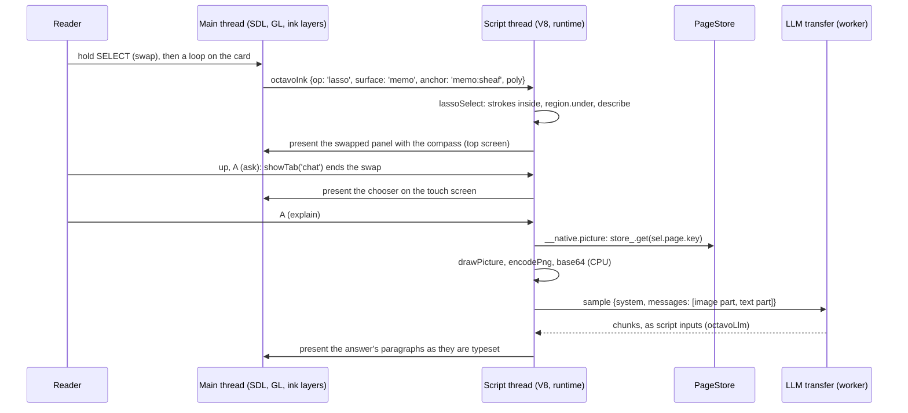

In the handheld run, driven through the program's control channel (§8), a red wave was drawn under "agree on overlaps" in condition (S2) of Definition 8.3 (Sheaf), the lasso was chosen, and a loop was drawn round the condition. The card on the touch screen shows both marks:

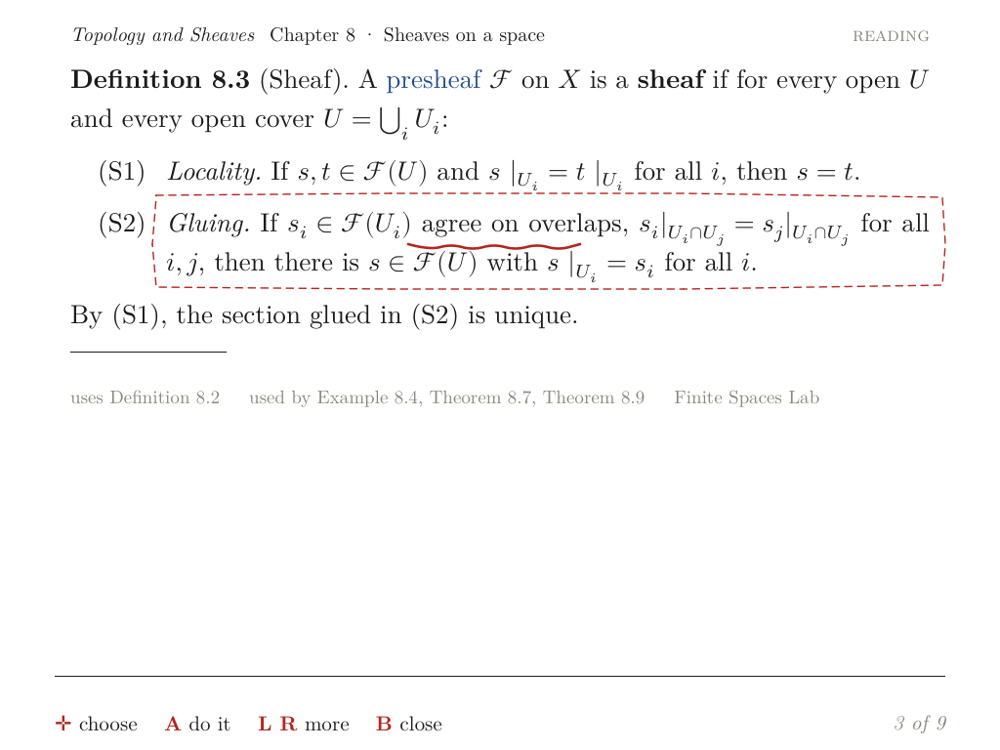

The compass opened on the top screen with the label "1 stroke of ink over condition (S2) “Gluing. If …”". Up and A opened the chooser on the touch screen, and A sent "Explain condition (S2) “Gluing. If …” in plain words, and say why it matters here." The context quoted the whole condition with its LaTeX.

### 4.3 The tutor tab

Circling part of an answer is the case that the original request described as "draw over the transcript and ask about it". The tutor tab differs from the card in three ways, and each one led to a decision.

The first difference is that the conversation moves. The tab keeps the last two exchanges (`CHAT_KEEP = 2`), it is presented scrolled to its end, and the paragraph being streamed is laid out again at most once every 150 ms. Strokes saved over it would be over different text a few seconds later. The surface therefore takes only the lasso and stores nothing (D4), and its anchors `chat:<card>` are session-only: `Ink.entry` does not load them and `Ink.write` does not append them.

The second difference is that the chooser's six questions are tappable spans on the same page. The native touch code decides at finger-down: once a surface takes the touch, it can never become a tap (`native/src/app/main.cpp`). Rather than teach the native side to turn short gestures into taps, which would have changed `ink.cpp`, `main.cpp` and the twin's `twinink.js`, the surface ends above the first tappable span (D5):

```js
// js/core/runtime.js: where the tutor tab's tappable spans begin below the tabs, or the page's end
chatTapTop(panel) {
  let top = Math.max(O.ink.CANVAS.y, Math.ceil(panel.h || 0));
  for (const sp of panel.spans) {
    const e = this.panelById && this.panelById.get(sp.id);
    if (!e || !e.tap) continue;
    for (const r of sp.rects) if (r[1] >= O.ink.CANVAS.y) top = Math.min(top, r[1] - 6);
  }
  return top;
}
// inkSurfaces, on the tutor tab with no compass open:
// want.chat = { slot: 'bottom.main', key: panel.key, anchor: 'chat:<card>',
//               rect: [0, 70, 1024, chatTapTop(panel) - 70], scrolls: true, tool: 'lasso', ... }
```

The third difference is coordinates. The surface's layer starts at y = 70 of the panel page, under the tabs, so a lasso's polygon arrives in surface pixels and `region.under` is called with `dy = 70` to move it back onto the page. The surface scrolls with the slot, as the memo does.

A lasso on this tab opens the chooser at once, with no compass, because a follow-up question is the only thing the reader can do with a region of a conversation:

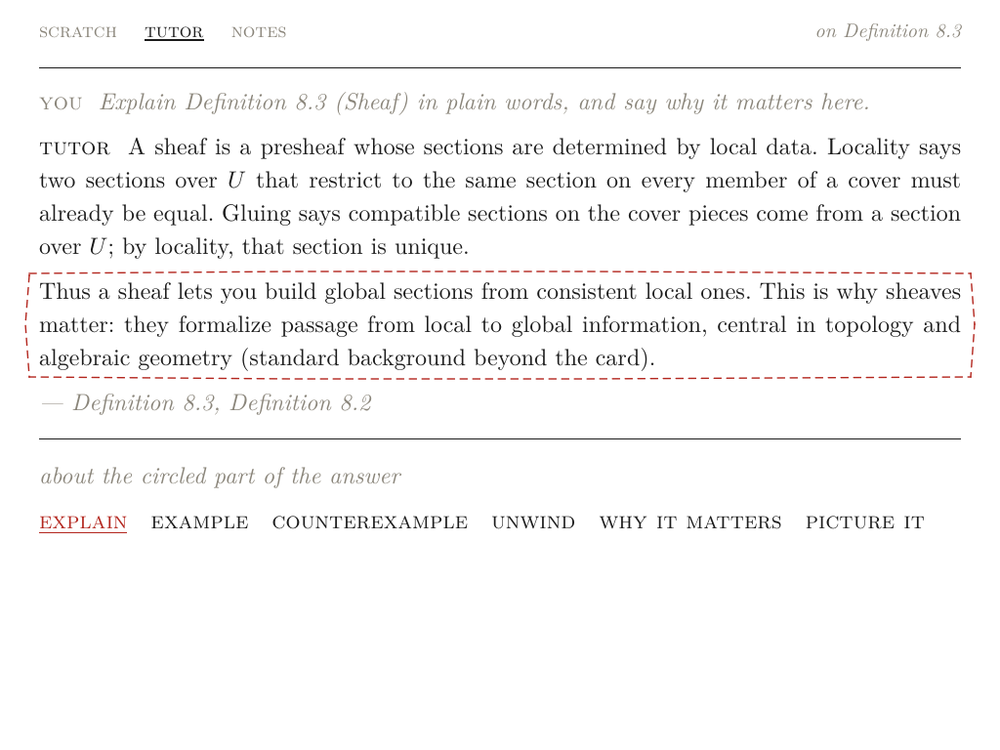

The follow-up answer on the handheld took the circled sentence apart. It explained "consistent local ones" as sections that agree on overlaps and "global section" as the single section they determine:

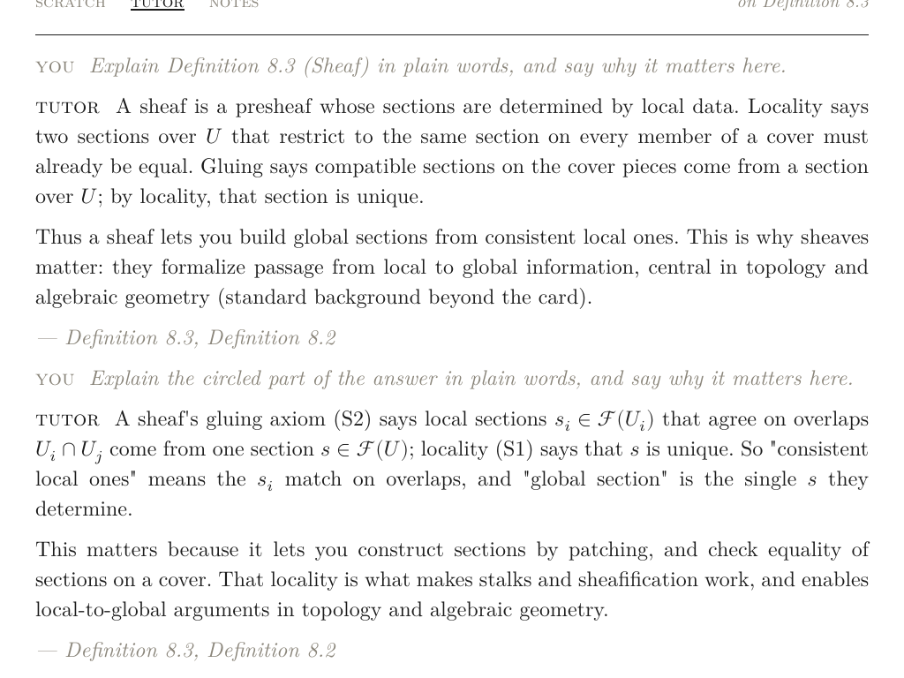

## 5. Pictures drawn on the CPU

### 5.1 Why the CPU, and why the script thread

A picture for the model could come from one of two places. The main thread could read back the GL framebuffer, or the script thread could rasterise the page again on the CPU. Reading back the framebuffer gives only what is on the screen now: the memo can be up to 4096 px tall and scrolled, and a circled region can extend past the screen's edge. It also needs a round trip between threads (the request from the script thread, the read on the main thread at the end of a frame, the reply). The CPU path has neither problem. The repository already had a complete CPU compositor, used by the `olist-render` tool to produce reference images: `render::Atlas` for glyphs, `buildQuads` and `composite` for text, `buildSegments` and `compositeSegments` for rules, and `encodePng`. `PageStore::get` is thread-safe. A picture is needed only when the reader asks, a few times per session. Decision D3 was therefore to draw on the CPU, on the script thread, which waits for the result.

The one shared resource that does not cross threads is the glyph atlas. The main thread's atlas is a GL texture. The script thread creates its own `render::Atlas` on the first picture; each atlas has its own `FT_Library`, so the two threads share no FreeType state. It costs 4 MB (2048² bytes, one channel) once the first picture is drawn, and it is recreated when full.

### 5.2 The native call

`native/src/js/script.cpp` defines the function on the V8 global `__native`:

```cpp
// Pictures (OCTAVO-003): the script thread rasterises on the CPU with an atlas of its own (the main
// thread's is GL's), made on the first picture and remade when full.
v8->define("picture", [this, &atlas](const std::vector<JsValue>& a) {
  const double t = nowMs();
  const JsValue& spec = a[0];                       // {page, states, crop: [x, y, w, h], strokes, lasso}
  const int cx = int(std::floor(crop->arr[0].num)), cy = int(std::floor(crop->arr[1].num));
  const int w = std::clamp(int(std::ceil(crop->arr[2].num)), 1, 1600),
            h = std::clamp(int(std::ceil(crop->arr[3].num)), 1, 1600);
  render::PictureSource src;
  if (/* spec.page is a non-empty key */) {
    page = store_.get(key->str);
    if (!page) throw std::runtime_error("picture: page " + key->str + " is not in the store");
    if (atlas && atlas->full()) atlas.reset();
    if (!atlas) atlas = std::make_unique<render::Atlas>(o_.fontsDir);
    // span states from spec.states: [[id, state, bits], ...]
    src.page = &page->list; src.atlas = atlas.get(); src.states = &states;
  }
  for (/* each stroke {pts, c, w} */) render::strokeSegments(pts, w, c & 3u, src.ink);
  if (lasso.size() >= 3) render::dashes(lasso, true, 7, 6, 1.6f, 3, src.ink);   // as app/ink.cpp draws it
  const std::vector<uint8_t> rgb = render::drawPicture(src, cx, cy, w, h);
  const std::vector<uint8_t> png = render::encodePng(rgb.data(), w, h, false);
  // returns {data: base64(png), w, h, bytes: png.size(), ms: nowMs() - t}
});
```

A picture is an RGB buffer filled with white, then the page's glyphs and rules offset by the crop, then the ink:

```cpp
// native/src/render/page.cpp
std::vector<uint8_t> drawPicture(const PictureSource& src, int cx, int cy, int w, int h) {
  std::vector<uint8_t> rgb(size_t(w) * size_t(h) * 3, 255);
  if (src.page && src.atlas) {
    const std::vector<Quad> quads = buildQuads(*src.page, *src.atlas);
    composite(rgb, w, h, quads, *src.atlas, st, bookPalette(), 1.0f, float(-cx), float(-cy));
    compositeSegments(rgb, w, h, buildSegments(*src.page), st, bookPalette(), 1.0f, float(-cx), float(-cy));
  }
  compositeInk(rgb, w, h, src.ink, kInkColors, float(-cx), float(-cy));
  return rgb;
}
```

The span states make the picture show what the screen shows: link colours, reading-state tints and struck hypotheses. One state is deliberately left out. `pageRef` takes the states without the focus (`stateList(byId, false)`), because a cursor's box round a term would look, to the model, like something the reader had marked.

The same code runs in `olist-render --picture SPEC`, whose spec file has lines `crop X Y W H`, `stroke C W x y x y …` and `lasso x y …`, with `-` as the input for white paper. The ticket's script `scripts/01-picture-specs.js` records the specs the runtime would send and draws them with the tool, so a picture can be inspected on the host without the app.

### 5.3 Ink on paper

The GL path draws ink as triangles into a layer texture (Part 5, §3). The CPU path needed its own stroke rasteriser, `compositeInk`. A stroke arrives as a sequence of segments, each a capsule: a line segment from (x0, y0) to (x1, y1) with a width. For every pixel near a capsule, the coverage is a one-pixel linear ramp at its edge:

```cpp
// native/src/render/page.cpp, inside compositeInk: per segment, per pixel in its bounding box
const float t = std::clamp((px * bax + py * bay) / bb, 0.0f, 1.0f);          // nearest point on the segment
const float dx = px - bax * t, dy = py - bay * t;
const float a = std::clamp(hw + 0.5f - std::sqrt(dx * dx + dy * dy), 0.0f, 1.0f);
if (c > cover[i]) { cover[i] = c; which[i] = uint8_t(s.color & 3u); }   // c = a in 0..255
// after all segments: one blend per pixel, rgb = rgb * (1 - a) + colors[which] * a
```

The coverage is collected in a separate buffer and combined by maximum, and the colour is blended into the page only once, after all segments. Consecutive capsules of one stroke overlap at their joints. Blending each capsule separately would apply the colour twice where they overlap, and every joint would be darker than the rest of the stroke. With the maximum, a pixel at a joint has the coverage of the nearer capsule and the stroke has a uniform tone. The colours are `kInkColors = {0x2e2e2e, 0xb3261e, 0xb3261e, 0xb3261e}`: index 0 is the pencil, the others the red of the memo, the selection and the lasso. These are the values of the GL palette in `render/ink.cpp`.

### 5.4 Three coordinate systems

A picture's crop is in page pixels. The strokes and the lasso arrive in the pixels of their surface, and the surfaces are placed differently:

| Surface | Stroke and lasso coordinates | Page under them | `pageRef.dy` |
| --- | --- | --- | --- |
| scratch | canvas pixels, within 1024×630 | none (white paper) | — |
| memo | card-page pixels; the memo's rect starts at (0, 0) | the card | 0 |
| chat | surface pixels; the surface starts 70 px down the panel page | the panel page | 70 |

`snapshot` shifts the lasso and the strokes by `dy` before it computes the crop, so the crop, the strokes and the page agree.

A second timing question has the same root. On the tutor tab, the chooser that opens after a lasso changes the panel page ("about the circled part of the answer" is new text), so its page key changes before the reader asks. The selection therefore records the page as it was when the lasso was drawn (`sel.page`), and the picture shows what the reader circled. The PageStore still holds that page when the reader asks a moment later: it keeps transient pages, and it is the only cache that decides whether a page exists (Part 9, §7). If the page has nevertheless been evicted, the native throws `picture: page <key> is not in the store`. `snapshot` logs that, returns null, and the question goes out in words.

### 5.5 What a picture contains

`Runtime.snapshot(target)` builds the spec for each surface:

| Surface | Contents | Crop |
| --- | --- | --- |
| memo | the card with its span states, all of the memo's red strokes, the dashed lasso | the lasso and the chosen strokes, padded by 40 px |
| chat | the conversation with its span states and the dashed lasso | the lasso, padded by 40 px |
| scratch | the chosen strokes on white | the strokes, padded by 30 px; the whole 1024×630 canvas when none are chosen (proof review) |
| any, `paper: true` | the chosen strokes alone, on white | the strokes, padded by 30 px (transcription) |

A crop is at least 60 px wide and at most 1600 px tall (`PICTURE_MAX_H`, the same limit the native enforces). On the memo all strokes are drawn, not only those inside the lasso: they are the reader's marks on that part of the card, and the crop shows only that part. The result is `{mime: 'image/png', data, w, h}`, the neutral image part of D7. Every picture logs one line, which is where the measurements in §8 come from:

```text
[js info] picture: memo 892x178, 1 strokes, 41531 bytes, 47.8 ms
```

The pictures below are the ones that two requests carried in the host runs. The first is the memo region of §4.2: the condition, the reader's red wave and the lasso, with the neighbouring lines as context. The second is from a tutor-tab run on the compact-sets material, where the circled paragraph sits between the end of the previous paragraph and the start of the next.

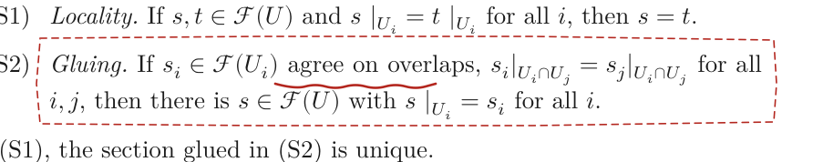

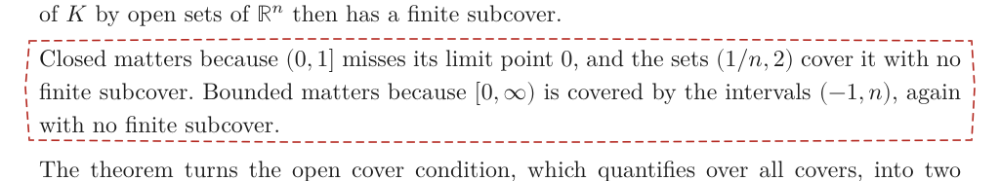

### 5.6 Two encoders, one set of globals

`stb_image_write`'s PNG settings are process globals: Octavo's hook `zlibLevel` and stb's `stbi_write_force_png_filter`. The dev screenshot on the main thread sets them to fast values (zlib level 1, no row filter) and restores them afterwards. A picture on the script thread uses stb's defaults (zlib level 6, a filter chosen per row), because it is sent over the network once and its size matters more than a few milliseconds. Without coordination, a picture encoded during a screenshot could come out at level 1, or reset the screenshot's settings halfway through. Both encoders now take one mutex:

```cpp
std::mutex pngMutex;
std::vector<uint8_t> encodePng(const uint8_t* rgb, int w, int h, bool fast) {
  std::lock_guard<std::mutex> l(pngMutex);
  struct Fast {
    explicit Fast(bool on) : on(on) { if (on) { zlibLevel = 1; stbi_write_force_png_filter = 0; } }
    ~Fast() { if (on) { zlibLevel = 6; stbi_write_force_png_filter = -1; } }
    bool on;
  } settings(fast);
  // stbi_write_png_to_func(...) appends into the result
}
```

## 6. The tutor sees

### 6.1 Neutral parts and two APIs

The handheld's model is resolved by the vendored Lattice agent code (`native/vendor/lattice/net/agent.cpp`). This ticket made it copy the catalog entry's `input` array into the model info that JavaScript receives; an agent made from `--claude-key` declares `["text", "image"]`. JavaScript decides with one predicate:

```js
// js/host/llm.js
const sees = info => !!info && Array.isArray(info.input) && info.input.includes('image');
```

The tutor writes a message's content as a string, or as a list of neutral parts (D7). Each adapter maps the image part to its API and passes text parts through:

```js
const withParts = (messages, image) => messages.map(m => !Array.isArray(m.content) ? m
  : Object.assign({}, m, { content: m.content.map(p => p.type === 'image' ? image(p)
      : { type: 'text', text: String(p.text == null ? '' : p.text) }) }));
// 'openai-completions':  p => ({ type: 'image_url', image_url: { url: `data:${p.mime};base64,${p.data}` } })
// 'anthropic-messages':  p => ({ type: 'image', source: { type: 'base64', media_type: p.mime, data: p.data } })
```

| Part | OpenAI chat completions | Anthropic Messages |
| --- | --- | --- |
| image | `{type: 'image_url', image_url: {url: 'data:image/png;base64,…'}}` | `{type: 'image', source: {type: 'base64', media_type: 'image/png', data: '…'}}` |
| text | `{type: 'text', text}` | `{type: 'text', text}` |

A string content is left untouched, so every request a text-only model receives is byte-for-byte what it was before.

### 6.2 Asking with a picture

`tutorAsk` adds a picture only for a region selection and only for a seeing model, and it puts the picture before the words. Anthropic recommends that order for image prompts, and the OpenAI-style API accepts it:

```js
// js/core/tutor.js
const content = (text, pictures) => !pictures || !pictures.length ? text
  : pictures.map(p => ({ type: 'image', mime: p.mime, data: p.data })).concat([{ type: 'text', text }]);

const pictures = sel && sel.kind === 'ink-region' && this.tutorSees() ? [this.snapshot(sel)].filter(Boolean) : [];
const words = withPicture => `${context}${withPicture ? PICTURE_SAYS[sel.surface] + '\n' : ''}\nRequest: ${question}`;
```

`PICTURE_SAYS` tells the model what it is looking at, per surface. For the memo it says "The picture shows that part of the card as the student sees it, with their red ink; the dashed red line is their lasso." The journal's `tutor.ask` event gains `pictures: 1`. The request a seeing model received for the memo question of §4.2 therefore had this shape:

```text
system:  TUTOR_RULES (Part 6, §5.1)
user:    [image/png, 892×178]
         <the card context of Part 6>
         The student circled, on the card: the condition (S2) “Gluing. If $s_i \in \mathcal F(U_i)$ agree on overlaps, …”.
         The student's 1 stroke of ink is drawn there too.
         The picture shows that part of the card as the student sees it, with their red ink; the dashed red line is their lasso.

         Request: Explain condition (S2) “Gluing. If …” in plain words, and say why it matters here.
```

### 6.3 A refusal is asked again in words

The catalog says that the handheld's default model, `lunaroute/deepseek-4.1-flash`, reads pictures. Before Phase 7 it was not known whether the proxy in front of it would pass image parts through. The ticket's guide listed that as its main risk. If the proxy rejected a picture, the reader would get the offline fallback for a question the model could answer from the words alone. `tutorAsk` therefore retries once:

```js
const send = pics => this.host.sample(request(pics), text => this.tutorStream(msg, text)).then(/* finish */, e => {
  const code = (e && e.code) || 'api_error';
  // a model or proxy that does not take the picture after all: once more, in words
  if (pics.length && !(e && e.text) && (code === 'invalid_request' || code === 'api_error')
      && !msg.stopped && this.tutorBusy === msg) {
    this.host.log('info', 'tutor: asking again without the picture');
    msg.note = 'The model did not take the picture; this answer is from the words.';
    return send([]);
  }
  // otherwise as in Part 6: the error, the canned answer or the card's first sentence
});
return send(pictures);
```

Each condition excludes a case where a retry would be wrong. With no picture there is nothing to drop. Once text has arrived the model accepted the request, and the failure happened later. `errorCode` maps an HTTP 400 to `invalid_request`, which is how a proxy rejects a part it does not accept, and any unclassified failure to `api_error`; the other codes (`network`, `not_granted`, `rate_limited`, `prompt_too_large`) are not about the picture and are not retried. `msg.stopped` and `tutorBusy === msg` ensure that the reader has not asked something else in the meantime. The answer then carries the note, so the reader knows that the model did not see the drawing. On the handheld the retry never fired: the proxy accepted `image_url` parts and reported them in its usage (§8).

### 6.4 Transcription

The compass's S on a region with strokes transcribes them when the model sees. With a text-only model it stays dimmed, as before. `transcribe(sel)` uses the IDE's prompt unchanged, with no system prompt:

```text
Transcribe this handwritten mathematics into LaTeX. Reply with only the LaTeX for inline math, without dollar
signs or commentary. If it is a commutative diagram, describe it as "A \to B" relations separated by semicolons.
```

The picture is the chosen strokes alone on white (`snapshot({…, paper: true})`), because any print or other ink in the crop would also be transcribed. The answer is stripped of code fences and dollar signs and stored as an ink note whose body is `$<latex>$`, with the strokes attached, and the notes tab opens. `maxTokens` is 512, or 4096 for reasoning models, whose reasoning tokens count against the same limit. Without a seeing model, without a picture, or when the answer is empty, the strokes are kept as an ink note and a toast says why. The journal records `ink.transcribe {anchor, strokes}`.

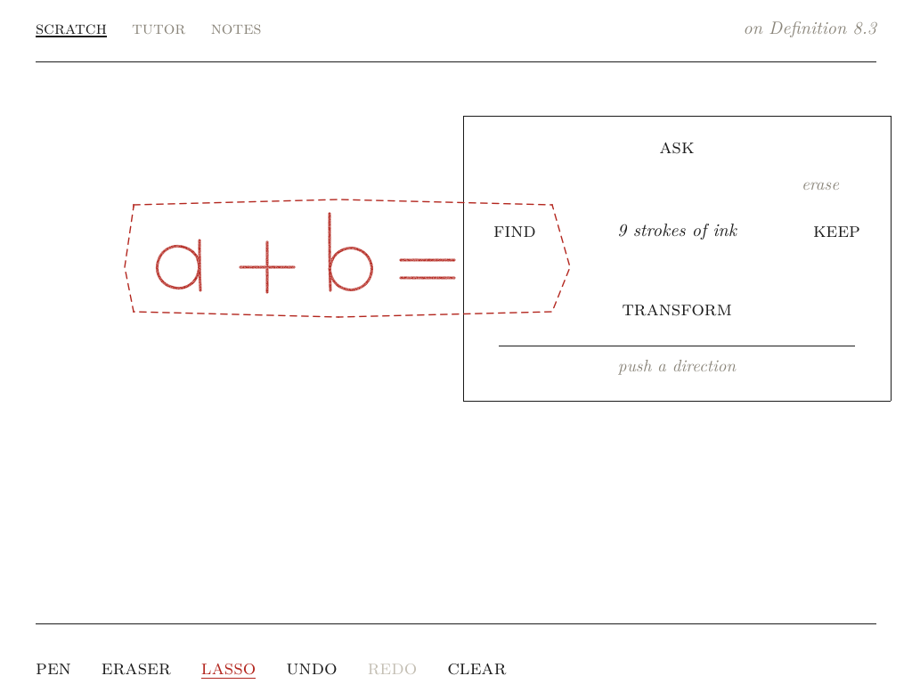

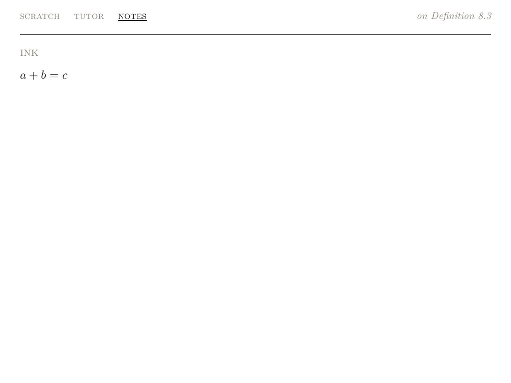

### 6.5 Proof review and the hidden verdict line

In the quest flow (Part 7), the reader writes an argument on the scratch page and submits it with X. The flow already handled the verdicts `'empty'`, `'pass'`, `'gaps'` and `null` (`js/core/flows.js`). What was missing was a `tutorCheck` that could produce them. It now sends the whole scratch page as a picture, with the exercise, the list of what a complete answer must contain (the quest's `checks`), and the IDE's reply format:

```text
Exercise: <statement>
What a complete answer must contain: <claim (must)>; <claim (must)>; ….
The image is the student's handwritten scratch page.
Reply format: the first line is exactly VERDICT: PASS or VERDICT: GAPS. Then at most 90 words: what is right,
and the single most important gap if there is one. Do not write out the full solution.
```

The verdict line is protocol, not something to show the reader, and the answer streams. The text grows as `"VERD"`, then `"VERDICT: GA"`, then `"VERDICT: GAPS\nYou…"`. `reviewText(text, final)` returns nothing while the text so far could still be the start of that line. Once the line is complete it returns everything after the first line break. At the end it also cuts a verdict written on the same line as the review ("VERDICT: GAPS. You …"):

```js
function reviewText(text, final) {
  const s = String(text || '').replace(/^\s+/, '');
  if (!/^VERDICT\b/i.test(s) && !'VERDICT'.startsWith(s.toUpperCase())) return s;   // not a verdict line
  const nl = s.indexOf('\n');
  if (nl >= 0) return s.slice(nl + 1).replace(/^\s+/, '');
  return final ? s.replace(/^VERDICT:?\s*\w*[.!:]?\s*/i, '') : '';
}
```

While nothing is shown, the conversation displays "thinking…", as for any answer that has not yet produced text. The verdict is read from the complete answer (`/^\s*VERDICT:\s*PASS\b/i` gives `'pass'`; anything else gives `'gaps'`), and the journal records `quest.review {quest, verdict}`. An empty page is answered with a toast, "the scratch page is empty: write the argument, then submit", and the tab does not change. §7.3 explains why that detail matters.

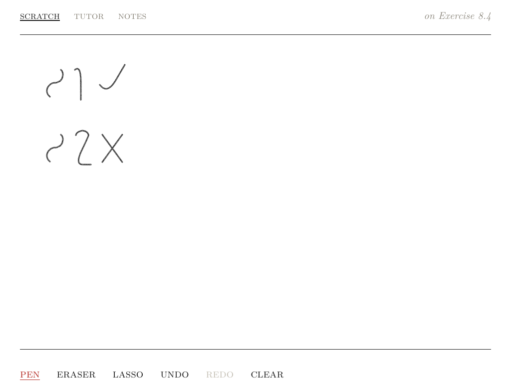

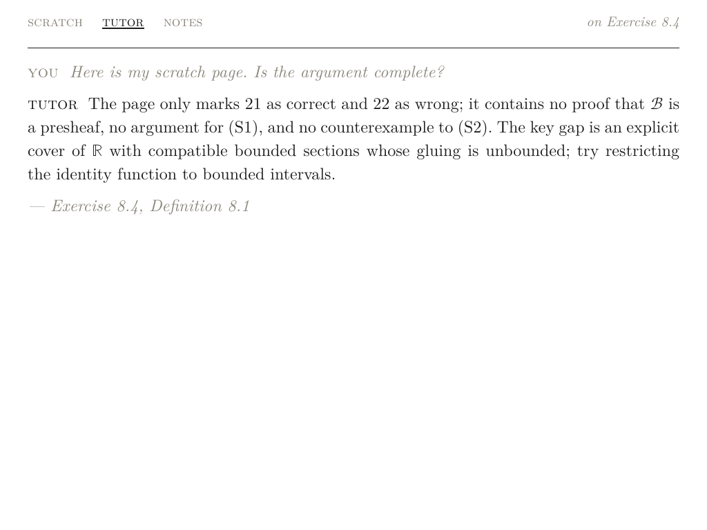

The model read the drawn "S" as "2". In the screenshot the synthetic S strokes do look like 2s, so this is a fair reading of a poor drawing, not a fault in the picture.

## 7. Defects that appeared only when the parts ran together

Each phase was tested where it was written: the region code on real layouts in Node, the native code through `olist-render`, the tutor with a fake model in Node. Four defects were still found later, each at a boundary between layers, where the layer that caused the defect could not observe its effect.

### 7.1 A paragraph that the renderer treated as a term

After Phase 2, the presheaf card was rendered with `olist-render --links` before and after the change. In the second rendering the whole body of the card was in link blue. An inline `span` element without a `kind` is given the default kind `term` by the transpiler (`set/src/transpile.rs`), and `--links` colours every term span. On the handheld the colour comes from span states, and passages have none, so the device would have looked correct. However, any code that reads span kinds, now or later, would have treated every paragraph as a link. Paragraph spans now state `kind: 'passage'`, and the before and after renderings are pixel-identical (`ImageChops.difference(...).getbbox()` returns `None`).

### 7.2 The atlas that was destroyed before the script ran

The first end-to-end run of Phase 6 started the real program on the host under Xvfb, with the mock model of OCTAVO-001 declared as reading pictures. It drove the program through its control channel: Y, A, a loop round an answer paragraph, A. The run did not finish. The program's log ended:

```text
shot …/b/lasso-bottom.png
draw bottom 3.707 ms
Segmentation fault (core dumped)
```

The crash came on the first picture. In `ScriptThread::run()`, the natives are defined inside a `try { … }` block (lines 262–554 at the time), and the block ends before the loop that runs JavaScript. The atlas's `std::unique_ptr` was declared inside that block, and the `picture` lambda captured it by reference. When JavaScript called `picture`, the block had already ended and the reference pointed at a destroyed object. The fix (`4688ff4`) moves the declaration to the top of `run()`, before `v8`:

```cpp
void ScriptThread::run() {
  std::unique_ptr<render::Atlas> atlas;      // picture()'s glyphs, made on the first picture; outlives the isolate
  std::unique_ptr<V8Host> v8;
  ...
```

The order is significant. C++ destroys locals in the reverse order of declaration, so the isolate, and with it every lambda that refers to the atlas, is destroyed before the atlas. The Node tests could not find this defect, because their host's `picture` is a stub that records the spec and returns a PNG signature. The run also showed a second problem in the test script: it hung because the control script blocks writing to the program's FIFO once the program has died. The script now runs the program under `timeout 100`.

### 7.3 An empty submit that moved the reader onto the lasso surface

The first host run of proof review produced two answers saying, in effect, that the page was empty, and no request with a picture. The first X had been pressed on an empty page, as intended, to check the empty case. At that time the empty case added a message to the conversation and switched to the tutor tab. The next three lines of "handwriting" therefore landed on the tutor tab. Since Phase 4 the tutor tab has a lasso surface, so the lines became lasso gestures over the conversation, not strokes on the scratch page. Neither feature was wrong on its own; together they turned a harmless tab switch into lost writing. The empty case is now a toast, and the tab stays on the scratch page. The Node test had hidden the defect because it set `rt.tab = 'scratch'` by hand before writing; it now asserts the tab instead.

### 7.4 LaTeX in a label that is not typeset

On the handheld, after the memo circle, the compass on the top screen read:

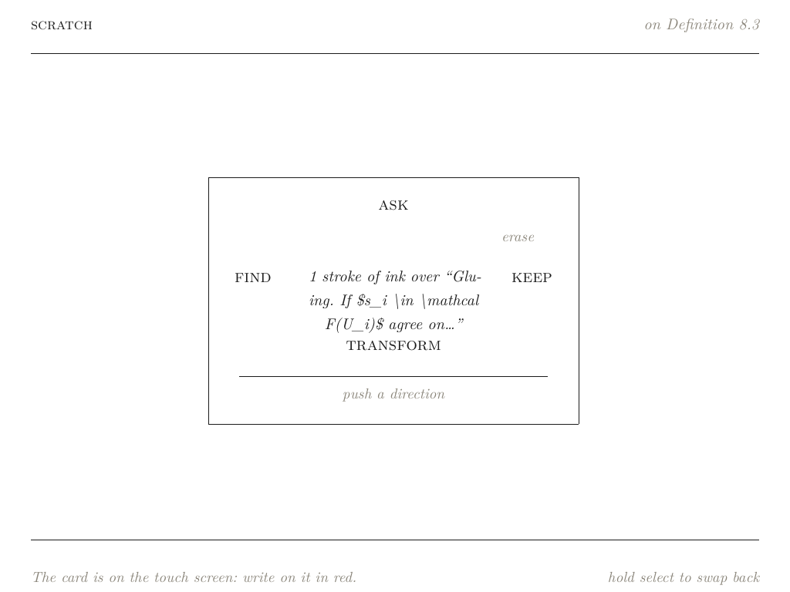

The label is passed to Typst as a string literal (`lit(label)` in `set/src/transpile.rs`), not as markup, so `$…$` is not maths there and the source is printed as it is. The chooser's question line goes through `O.md` and was typeset correctly, which is why no host test had shown the problem: the tests compared the label string, and the string was what the code intended. The fix stays in JavaScript (`3aec8ed`). `head(text, n)` quotes a passage's opening words only up to its first formula, and a condition is named by its label:

```js
function head(text, n) {
  const t = plain(text), i = t.indexOf('$');
  const h = (i < 0 ? t : t.slice(0, i)).replace(/[\s,;:(]+$/, '').trim();
  if (!h) return '';
  const c = clip(h, n);
  return `“${c}${i >= 0 && !c.endsWith('…') ? ' …' : ''}”`;
}
const shortName = p => p.kind === 'condition' && p.label
  ? `condition (${p.label})${head(p.text, 32) ? ' ' + head(p.text, 32) : ''}`
  : head(p.text, 48) || SHORT[p.kind] || 'the circled text';
```

The alternative was to make the compass label rich text. That would have changed the transpiler, the Typst template and the twin's `set.wasm` in order to typeset a few words. After a rebuild and redeploy, the compass read correctly:

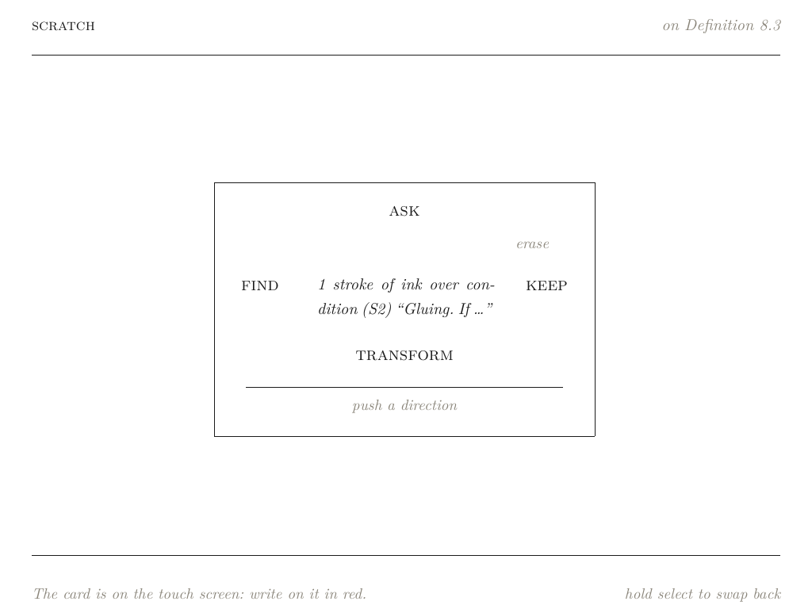

The context sent to the tutor still quotes the passage in full with its LaTeX. Only the short name for the screen is cut.

## 8. Measurements on the handheld

The handheld runs the install tree at `3aec8ed` with its own model configuration: `lunaroute/deepseek-4.1-flash` through the proxy, OpenAI chat completions, with the credential resolved from the device's `auth.json` by the C++ side (Part 6, §3). The ticket's script `scripts/03-device-sees.sh` sets up a bench directory with the sheaves and quest presets, starts the program, and drives it over ssh through the control FIFO with `press`, `touch bottom x,y …`, `tap bottom x y` and `hold SELECT`. It also copies screenshots, logs and journals back to `various/phase7/` in the ticket. The other program on the handheld (mimeo) had to be stopped first, because it held the screens.

| Scenario | Picture (`picture:` line) | Model: first text / complete | Prompt tokens (image) | Outcome |
| --- | --- | --- | --- | --- |
| Tutor tab: Y, A, loop round the 2nd answer paragraph, A | chat 1024×190, 41778 B, 48.1 ms | 1538 / 2745 ms | 851 (194) | The follow-up explains the circled sentence |
| Memo: red wave, lasso round (S2), N, A, A | memo 892×178, 1 stroke, 41531 B, 47.8 ms | 1064 / 1631 ms | 885 (182) | Explains gluing |
| Memo, after the label fix | memo 892×178, 41531 B, 46.8 ms | 1082 / 1606 ms | 878 (182) | Same; compass label correct |
| Transcribe "a+b=c", 9 strokes | scratch 475×148, 5728 B, 10.1 ms | not logged in that build | — | INK note `a + b = c` |
| Quest: X on empty page, then "S1 ✓ / S2 ✗", X | scratch 1024×630, 7 strokes, 9705 B, 63.1 ms | 2451 / 2886 ms | 743 (392), 494 reasoning | Empty: toast, tab unchanged; then the review, verdict `gaps` |

Four conclusions follow from these numbers.

- **The proxy accepts pictures.** Every request with a picture reports `prompt_tokens_details.multimodal_tokens.image`, between 182 and 392 tokens at these sizes, and the words-only retry never fired.
- **A picture costs tens of milliseconds on the handheld's RK3568 (Cortex-A55).** It takes 47–48 ms for a 1024×190 page region and 63 ms for the whole 1024×630 scratch page. The model's first text arrives after 1–2.5 s, so the picture adds about 2–5 % to the wait. In the same session the text-only question that preceded the tutor-tab circle had its first text after 2114 ms, which is slower than the request with a picture: the variation in the model's latency is larger than the cost of the picture.
- **The handheld is about 4.5 times slower than the host and produces the same PNG size.** The same memo gesture on the host gave 892×178, 41531 bytes in 10.6 ms. Pages with text compress to about 40 KB (55 KB in base64). Scratch ink on white compresses to 6–10 KB, even for the whole canvas.
- **The script thread is blocked while it draws.** 48–63 ms is three to four frames at 60 Hz of script work, delayed once, at the moment the reader has just pressed A to ask, when the screen is changing to the conversation anyway.

## 9. Testing and parity

The ticket added tests at three levels, each able to find a different class of defect.

**Unit tests in Node** use the real typesetter (`set/target/release/octavo-set`), the real card books and a fake model that records its requests. The suite grew from 38 to 52 test cases, and all pass:

- `region.test.js`: `under` and `describe` on laid-out cards, including the circled term, a line of a paragraph, the left margin, and condition (S2) with its short name.
- `circle.test.js`: the memo circle (selection, compass items, swap ending on ask, request text), red ink and print in one lasso, keep, and the tutor-tab circle (surface rectangle, chooser at once, the surface ending above the six questions, the follow-up's quote, nothing written under `chat:`).
- `picture.test.js`: the spec `snapshot` sends for each surface: the scratch canvas with the chosen strokes or all of them; the memo with its red ink and lasso and no cursor; the tutor tab under the lasso, using the page recorded at lasso time; and a null result without pictures or without the page.
- `sees.test.js`: a region's picture before the words, and words only for a text-only model; a refused picture asked again in words; S on strokes transcribed to a `$…$` note, and dimmed for a text-only model; a submitted scratch page answered VERDICT: GAPS and then PASS, an empty page, and a text-only model.

**Host end-to-end runs** (`scripts/02-host-sees.sh`) start the real program under Xvfb with the mock model, drive it through the control FIFO, and write every image part of every logged request to a PNG. `API=anthropic` switches the run to the Anthropic Messages API. These runs found the defects of §7.2 and §7.3, which the Node tests could not have found.

**Parity on the handheld** compares, for scripted button and touch sequences, the messages that the runtime sends to the device's host with those it sends to the browser twin, and compares their screenshots with a tolerance of 64/255 per channel. A run passes when the message streams are equal and no more than 0.5 % of pixels differ beyond the tolerance. Every suite of OCTAVO-001 was rerun on the handheld, and a new one, `scripts/04-parity-circle.cjs`, covers the two circles:

| Suite | Runs (messages) | Result |
| --- | --- | --- |
| `09-parity` | sheaves 81, compact-hausdorff 77, leitfaden 65, contents 62 | PASS, 0.000 % beyond tolerance |
| `16-parity-ink` | all 60, compass 18, memo 17 | PASS |
| `23-parity-tutor` | offline 29, transform 32, talk 17 | PASS |
| `28-parity-flows` | quest 28, review 36, proof-builder 30 | PASS |
| `32-parity-packages` | toggle 31, lab 31 | PASS |
| `04-parity-circle` (new) | memo-circle 46 (18 ink messages), chat-circle 29 | PASS |

Parity covers the selection, the compass, the chooser and the request text, which are identical on both. It does not cover pictures. The twin has no `__native.picture`: its `host.picture` returns null, so `snapshot` returns null there and every request from the twin carries words only. The regression walks of OCTAVO-002 (the device book's 17 cards, dead presses, layout errors, hypothesis strikes surviving navigation) gave the same results as before the ticket.

## 10. What is still open

- **Mimeo on the handheld.** It was stopped for Phase 7 and has not been restarted; whether to restart it is an operational decision for whoever uses the device next.
- **Term labels with formulas.** A compass label that comes from a card title containing `$…$` still shows the LaTeX source. This predates the ticket; the fix of §7.4 covers only passages. The general fix is to typeset the compass label, which means changing the transpiler, the Typst template and `set.wasm`, so that short names could keep their maths.
- **The retry's scope.** `api_error` is treated as a possible refusal of the picture, so a genuine server error is retried once in words, costing one more request.
- **Concurrent transcription.** A transcription can run while a tutor answer streams. `tutorAbort` aborts only the newest transfer. This edge case was left alone.
- **The memo crop.** Pictures of the memo are cropped 40 px round the lasso. The surrounding text reaches the model as words, but a model might answer better with more of the page; the padding is one constant.
- **Choosing the memo's tool while swapped.** The lasso must be chosen on the scratch page's tools before swapping, because the tools row is on the top screen while swapped. A button chord would remove the round trip.
- **Duplicate hypotheses.** `region.under` merges focusable spans by kind, target and label, so two different hypotheses with the same label on one card would be reported as one.

## 11. Key points

- A lasso over print can be resolved without changing the typesetter: give each block of text a span id and keep its source text where the page was built, and the display list's existing rectangles do the rest.
- Coverage by sample points fails for a small loop on a long line; asking what share of the loop lies on the line fixes that case, and the two rules together found the intended lines in every test.
- One selection kind for every lasso let the compass, keep, packages and the journal work on regions of the card and of the conversation without new cases.
- A surface that takes touches must leave tappable elements uncovered, because the native side decides between a stroke and a tap at finger-down; ending the surface above the chooser was cheaper than changing that decision on two platforms.
- Drawing pictures on the CPU of the script thread reuses the reference compositor, reaches parts of a page that are not on the screen, and costs 10–63 ms on the handheld, against 1–2.5 s for the model's first text.
- A picture must show the page as it was when the reader circled it, so the selection records the page key at lasso time and the native page store decides whether that page still exists.
- Neutral content parts keep the tutor independent of the model API; a single retry in words protects the reader from a proxy that refuses pictures, guarded so that it never answers a question the reader has already replaced.
- Every defect found after unit testing sat at a boundary between layers: a default kind in the transpiler, a C++ lifetime that a JavaScript stub could not exercise, two features that were correct alone and wrong together, and a label string that was correct as a string and wrong as Typst. End-to-end runs of the real program, first on the host and then on the handheld, are what found them.

## Related notes

- [[PROJECT REPORT - Octavo, Part 9 - The Frozen Page - Two Caches, a Journal That Witnessed It and a Fix That Restored One Truth]] — listed "scratch to the tutor" and "circle and ask" as open; this report closes both.
- [[PROJECT REPORT - Octavo, the Whole System - The Reader, the Typesetter, the Runtime and the Build]] — the architecture this work extends.
- [[PROJECT REPORT - Octavo, Part 5 - Ink - A Layer per Surface, a Compass of Span States and the Card on the Touch Screen]] — surfaces, the lasso, the compass and the swap.
- [[PROJECT REPORT - Octavo, Part 6 - The Tutor - A Credential Kept in C++, Answers as Script Inputs and a Trial Layout per Paragraph]] — the tutor's requests, streaming and the chooser.
