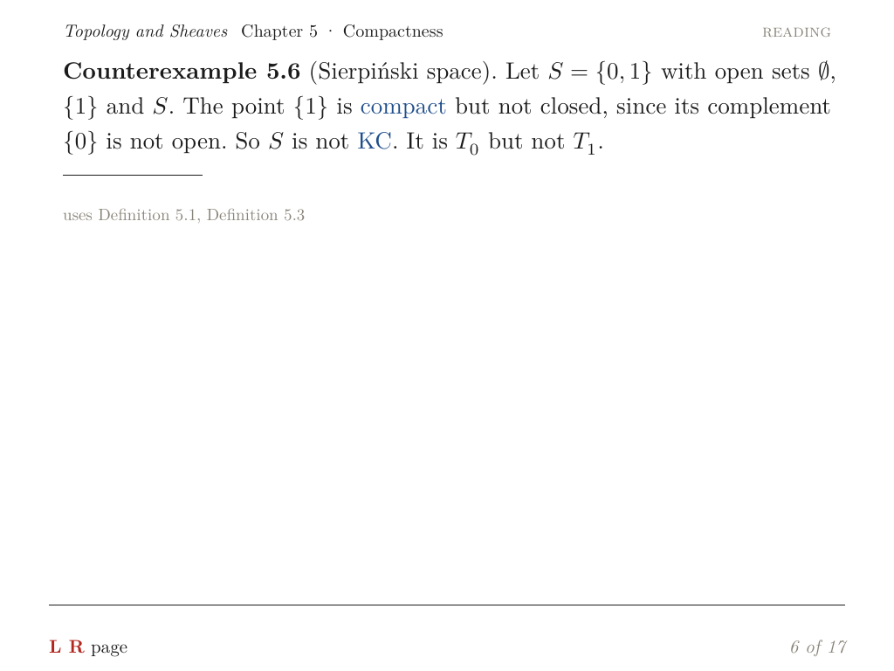
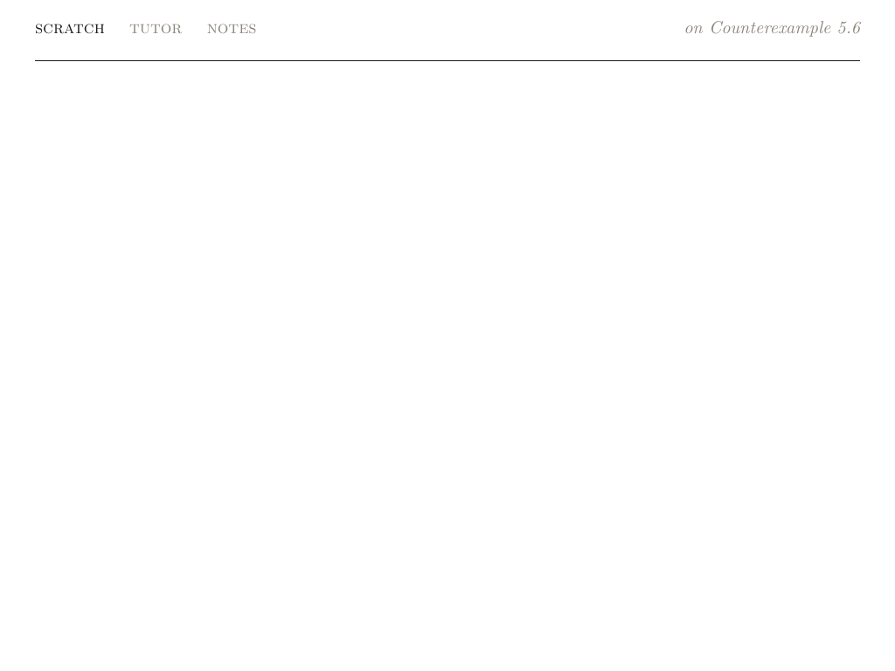
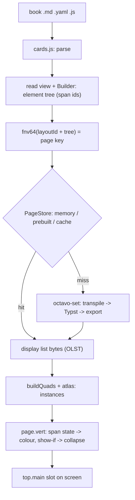
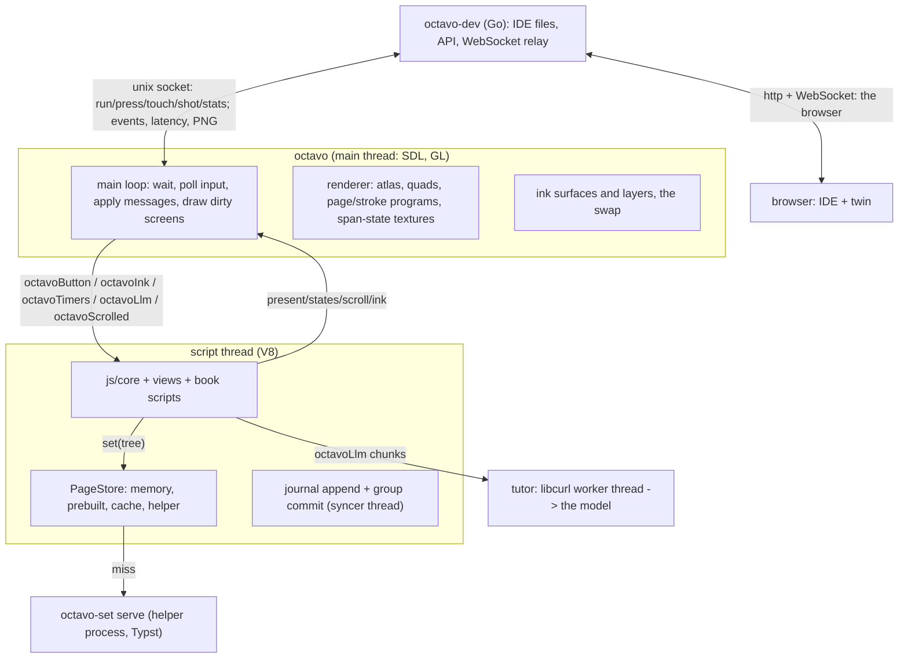
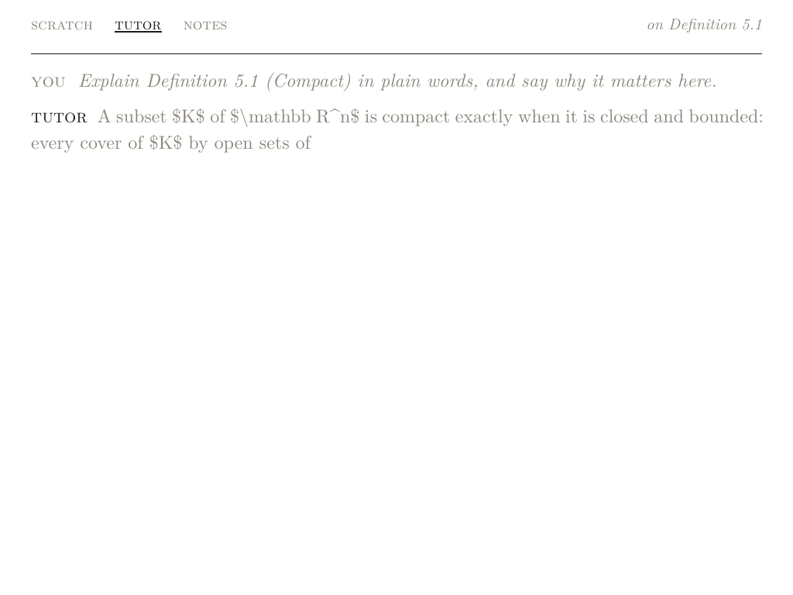
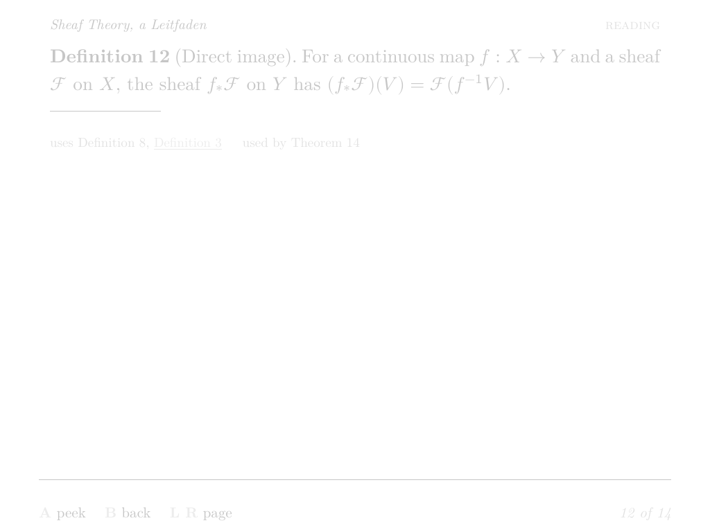
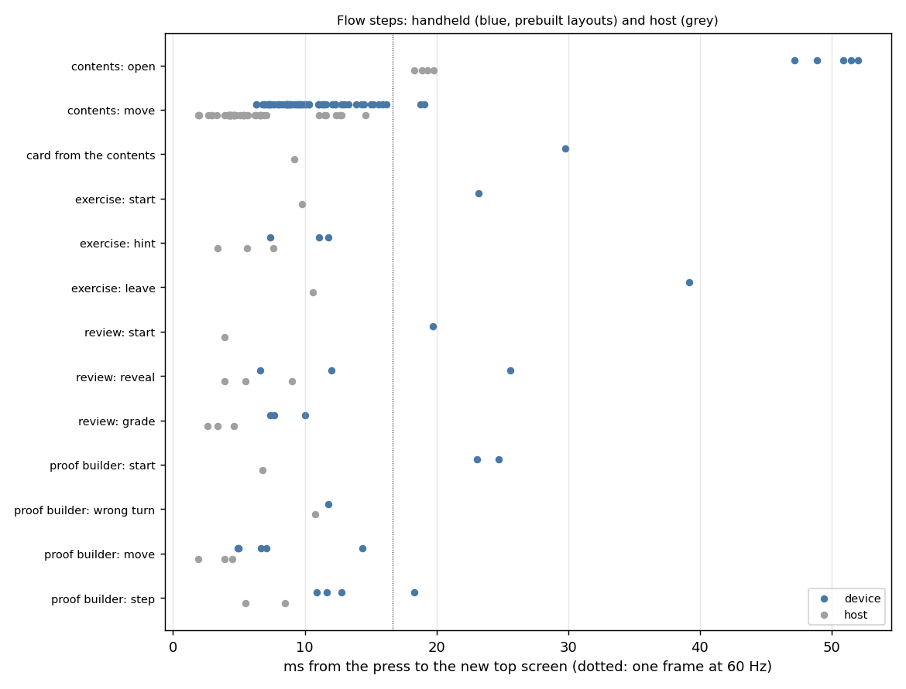
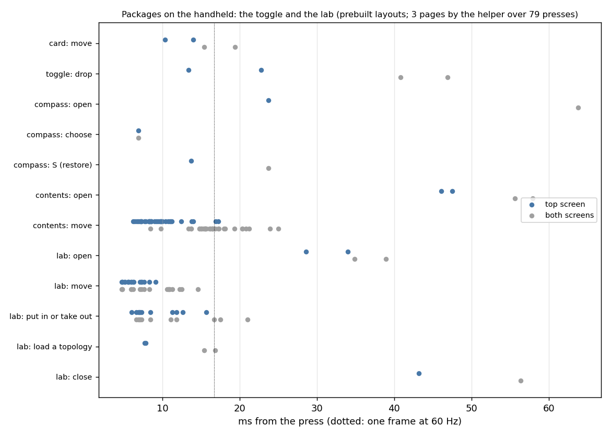

# Octavo, the Whole System

**Octavo** is a reader for typeset mathematics on the Anbernic RG DS Plus. The RG DS Plus is a Linux handheld with two 1024 × 768 screens and a Mali-G52 GPU; the top screen only displays, and the bottom screen is a touch panel. A book is a directory of markdown, YAML and JavaScript files. The top screen shows one card at a time — a definition, a theorem, an exercise — with real typography: Optimized line breaking, OpenType mathematics in the Computer Modern look, commutative diagrams. The bottom screen is the reader's hand: scratch ink over the card, notes, the tutor's answers, and the panel's tabs. A fixed grammar of buttons — the D-pad for the cursor, A to open, B to go back, X for the compass of actions, Y to ask the tutor — drives everything, and the prompt line names the verbs that apply where the cursor is.





The eight earlier reports follow the project through its phases:

- [[PROJECT REPORT - Octavo, Part 1 - Typst on a Handheld - Display Lists, Span Ids as Colours and a Page Shader on the RG DS Plus|Part 1]] — Typst on the handheld, display lists, the page shader.
- [[PROJECT REPORT - Octavo, Part 2 - The Reading Loop on the Handheld - Element Trees from V8, Prebuilt Pages and a Main Loop That Sleeps|Part 2]] — the reading program, element trees from V8, prebuilt pages.
- [[PROJECT REPORT - Octavo, Part 3 - The Development Loop - A Server on the Handheld, a WebGL2 Twin and a Parity Check|Part 3]] — the dev server, the twin, the parity check.
- [[PROJECT REPORT - Octavo, Part 4 - Reading State - An Event Log, Folds and Type That Changes Without Layout|Part 4]] — the journal, folds, reading state in the type of a title.
- [[PROJECT REPORT - Octavo, Part 5 - Ink - A Layer per Surface, a Compass of Span States and the Card on the Touch Screen|Part 5]] — ink, the lasso, the compass, notes, the swap.
- [[PROJECT REPORT - Octavo, Part 6 - The Tutor - A Credential Kept in C++, Answers as Script Inputs and a Trial Layout per Paragraph|Part 6]] — the tutor.
- [[PROJECT REPORT - Octavo, Part 7 - Flows - Sessions in the Event Log, Positions Rebuilt from Events and Book Views as Element Trees|Part 7]] — flows.
- [[PROJECT REPORT - Octavo, Part 8 - Packages - A Checked Manifest, Verbs in Empty Slots and Two Features Moved Out of Core|Part 8]] — packages.

This report is different in kind. It reads the finished software as one system, at commit `1f246af`, and explains how every part works and how the parts are built and put together. It does not follow the phases; it follows the software. Where a phase report owns a topic in depth, this report covers the same mechanism briefly enough to make the whole system comprehensible and links to the part that owns the detail.

> [!summary]
> - **Typesetting is a compiler, and the device only draws.** Every screen's content is an element tree, which a Rust typesetter (`octavo-set`) compiles through Typst into a small binary display list: positioned glyphs, rules, paths, and the rectangles of every focusable span. The same display list is produced at build time on a laptop, on the fly by a helper process on the handheld, or in the browser by a WASM build of the same Rust code.
> - **One JavaScript runtime runs in three places.** The core in `js/` — screens, focus, verbs, flows, the event log, the tutor — runs inside V8 on the device, inside the browser twin, and in Node for tests, against a table of about twenty host functions. A parity check replays button sequences on the twin and on the device and compares the message streams and the pixels.
> - **Nothing expensive happens twice.** Layout is memoized by Typst, cached on disk by a key computed identically in Rust, C++ and JavaScript, and prebuilt at install time by walking every page a reader can reach. Shaders load from a binary cache. A year of reading history folds in 8 ms from a snapshot instead of 580 ms from the journal. The journal is group-committed off the input path.
> - **The build assembles a self-contained tree for a handheld that lacks almost everything.** One script cross-compiles the C++ program against the handheld's own libraries, builds a static musl Rust binary, a static Go server, and a WASM module, subsets the fonts, inlines the IDE into one HTML file, writes every prebuilt page, and checks itself.

## 1. Terms

The phase reports define these terms in order as they appear. This report needs most of them at once, so they are collected here, in dependency order.

- **Book.** A directory of `.md` (the cards), `.yaml` (data, exercises, tutor answers) and `.js` (behaviour) files.
- **Card.** One unit of mathematical content, fenced in the markdown by `::: definition {#id title="…" terms="…"}` … `:::` lines, with an optional YAML header between `---` lines. Kinds include definition, theorem, proposition, lemma, example, exercise.
- **Element tree.** A JSON tree of a closed vocabulary (`t: 'p'`, `t: 'span'`, `t: 'steps'`, `t: 'cond'`, `t: 'leitfaden'`, `t: 'compass'`, …) that describes one page. Views build it; the typesetter lays it out; the renderer draws it. Nothing between those steps knows about the others' internals.
- **Span.** A piece of a page the runtime must be able to name: a term, a card title, a hypothesis, a proof step, a tab, a tool, a compass word. Every span has a numeric **span id**, unique within the page, allocated in document order (1 … 65535).
- **Span state and bits.** Per span, the renderer's state — normal, link, focus, dimmed, unread — picks a colour from the palette, and the bits — focus, struck, shown — turn on geometry the exporter already placed (the focus underline, the strike rule) or the glyphs of one variant of an `alt` pair.
- **Display list (olist).** The typesetter's output: one binary page of glyphs (atlas coordinates implicit: face, size, glyph id, position, span, flags), rules, paths, and span rectangles. A card comes out at a few KB.
- **Slot.** One of three rectangles the app shows pages in: `top.main` (the page, y 0–692), `top.prompt` (the prompt line, y 692–768) and `bottom.main` (the panel). The swap moves the page's slot to the bottom screen and the panel's to the top.
- **Page key.** `fnv64(layoutId + "\n" + treeText)` — the 64-bit FNV-1a hash of the typesetter's identity and the tree's JSON text. Pages are cached under this name in memory, in the install tree (prebuilt), in a writable cache directory, and in the twin.
- **Prebuilt page.** A display list laid out at build time and shipped in the install tree, found by its key.
- **Layout helper.** The `octavo-set serve` process the app starts and keeps running, which typesets on request over framed stdin/stdout.
- **Journal.** `events/<YYYY-MM>.jsonl` under the data directory: every event the runtime emits, one JSON line per event, appended before the screen changes.
- **Fold.** A function of the journal updatable one event at a time: seen cards, mastered cards, the last card, review boxes, flow sessions. **Snapshot.** The folds serialized with the journal position they cover, so a start reads only the tail.
- **Twin.** The device's software running in the browser: the same `js/` files, the same shaders, a WebGL2 port of the renderer, and `set.wasm` for layout. **Parity check.** A replay of one button sequence on the twin and on the device, comparing message streams and pixels.
- **Prompt line.** The strip under the page naming the verbs that apply at the cursor (A open, B back, L/R page, X actions, …), generated from the verbs the views and scripts declare.
- **Compass.** X's overlay on the selection: four fixed words at the cardinal points (N ask, E keep, S transform, W find) and up to four diagonals for script verbs.
- **Flow.** A generator that yields effects — `ui.waitFor(verbs)` or a promise — and is resumed by the runtime; its position is rebuilt from its own events in the journal after a restart.
- **Package.** A directory with a checked `package.yaml` manifest, an entry script and data files, installed next to the runtime (not inside a book); `hypothesis-toggle` and `finite-spaces-lab` are the two shipped.
- **Dev link.** The unix socket between `octavo --dev` and the `octavo-dev` server, over which the IDE runs books on the device, presses buttons, takes screenshots and reads latencies.

## 2. The problem and the shape it produces

The RG DS Plus is a Rockchip RK3568: four Cortex-A55 cores, a Mali-G52 GPU with OpenGL ES 3.2, 1 GB of RAM, and two 4.3″ 1024 × 768 screens. It runs a minimal Linux (ROCKNIX, Wayland composited by sway). The design session's first conclusion (`docs/device-architecture.md`) is that a browser engine does not fit in 1 GB, and that MathJax's output — HTML needing a CSS layout engine, or SVG paths instead of glyphs — is the wrong shape for this screen. The conclusion that shaped everything else: **treat typesetting as a compiler, and the device as a very good glyph renderer.**

That one decision produces the system's shape:

1. Layout runs wherever it is cheap — at build time on a laptop for book content, in a helper process for what the walk missed and for tutor answers, in the browser as WASM for the twin — and always produces the same format.
2. The seam between layout and drawing is the display list, small enough to cache by content and to compare byte for byte (the parity check hashes it).
3. The device program never waits for layout: layout happens on the script thread, and the main thread only applies finished messages between frames.
4. The renderer never re-lays anything out. Reading state, focus, dropped hypotheses, the shown variant of a title in italic — all of it is span state, one texel per span in a small texture, so a D-pad press costs two texel writes and one redraw.
5. The same JavaScript runs on the device (V8), in the twin (browser) and in Node (tests), so behaviour can be compared rather than re-implemented.

The display list is the load-bearing interface, so its identity matters. The typesetter's `layout_id` is a hash of the program version, the Typst and mitex versions, the exporter version, and every file compiled into the binary (the template, mitex's specs, xarrow). A page's key is `fnv64(layout_id + "\n" + treeText)`, where FNV-1a 64-bit is implemented three times in the repository — Rust (`set/src/lib.rs`), C++ (`native/src/app/pages.cpp`) and JavaScript (`js/core/olist.js`) — so prebuilt pages found on the device were laid out by the same software that asks for them.

## 3. The repository

| Path | What it holds |
| --- | --- |
| `set/` | `octavo-set`, the typesetter (Rust): `transpile.rs` (tree → Typst), `world.rs` (the Typst world), `export.rs` (frames → display list), `main.rs` (the CLI), `lib.rs` (identity and keys), `wasm/` (the browser build), `typst/octavo.typ` (the template), `vendor/packages` (mitex and xarrow, pinned) |
| `native/` | `octavo`, the device program (C++): `app/` (main loop, ink, pages, dev link, waiter, `p0`), `render/` (atlas, quads, GL, ink, programs), `js/` (the script thread), `olist/` (the display-list parser), `setter/` (the helper process wrapper); `vendor/lattice/` (copied platform, V8 host, net; see `PROVENANCE`), `third_party/stb` (PNG) |
| `js/` | The runtime: `core/` (12 modules), `views/` (read, panel, map, flows, dev), `host/` (device, llm), `main.js` (the entry points the script thread calls), `node/` (Node hosts for tests and the prewarm walk), `test/` (12 test files), `tools/prewarm.js`, `manifest.json` (the load order) |
| `ide/` | The browser IDE: `src/` (twin, parity, device target, runtime, views, build), `presets/` (25 example books), `build.py` (the one-file build), `dist/octavo-ide.inline.html` (committed), `node/` (jsdom checks) |
| `dev/` | `octavo-dev`, the Go dev server (std-lib only, incl. a hand-written WebSocket) |
| `shaders/` | GLSL ES 3.00: `page`, `stroke`, `ink`, `layer` — the same files on the device and in the twin |
| `device/` | `build.sh`, `deploy.sh`, `book.sh`, `toolchain.Dockerfile`, `scripts/` (run scripts for the handheld), `tools/` (git built for the device) |
| `mockups/` | The design session: SVG screens, wireframes, the design system, the fonts (Latin Modern, Latin Modern Math, JetBrains Mono, Inter, Caveat, DejaVu) |
| `docs/` | The design session's documents: `device-architecture.md`, `formats-widgets-and-scripting-api.md`, the original zip README |
| `library/fixtures/` | Element trees for tests and fixtures |
| `packages/` | `index.json` (load order) and the two packages, `hypothesis-toggle` and `finite-spaces-lab` |
| `ttmp/` | The OCTAVO-001 docmgr ticket: the intern guide (13 sections, 10 decisions, 5 appendices), the diary (33 steps), per-phase results including every measurement |
| `build-device/` | The cross-build's output: the install tree, logs, the aarch64 git tarball |
| `target-libs/`, `third_party/v8/` | The handheld's shared libraries and V8's, copied in (git-ignored) |

## 4. One card, end to end

The system is easiest to hold onto by following one card from its file to its pixels. The card is Theorem 5.4 of the book *Topology and Sheaves*, a two-chapter book assembled by `device/book.sh` from the IDE's presets.

**Input.** The book's `05-compactness.md` contains:

```markdown
::: theorem {#compact-closed title="Compact sets in a Hausdorff space are closed"}
Proof. Fix $y \notin K$. … For each $x \in K$ choose disjoint opens $U_x \ni x$ and $V_x \ni y$. …
:::
```

`js/core/cards.js` parses the fence into a card: kind, number, title, terms, an inline token list (text, `{t:'m', tex}` for `$…$`, `{t:'hyp', key, label}` for `{{K|…}}` hypotheses, links `[[…]]`), and proof steps collected with their `@uses(...)` markers.

**Element tree.** The read view builds the page with a `Builder` (`js/core/elements.js`). Every focusable place gets a string focus id (stable across renders, reused by the IDE) and a numeric span id. A step of the proof becomes, in the tree:

```json
{"t":"steps","c":[
  {"id":17,"kind":"step","c":[
    "For each ", {"t":"m","tex":"x \\in K"}, " choose disjoint opens ",
    {"t":"span","id":18,"kind":"hypothesis","strike":true,"target":"compact-closed",
     "c":[{"t":"m","tex":"U_x \\ni x"}]}, " and ", …]}]}
```

Span 18 is a hypothesis: the exporter will give it a strike rule, and dropping it later costs only a bit in the state texture.

**Key and cache.** The tree's JSON text is hashed: `fnv64(layoutId + "\n" + treeText)`. The script thread's `PageStore` (`native/src/app/pages.hpp`) looks that key up in memory, then in the read-only install directories (`layout/`), then in the writable cache, and only then asks the helper. For this card — the book's centrepiece — the page is prebuilt, and the lookup finds it in the install tree.

**Transpile.** In `octavo-set`, `transpile.rs` turns the tree into Typst markup. All text is emitted inside Typst string literals (`#"…"`), so nothing in a card's prose can be interpreted as markup. The steps above become (trimmed, with the converted mathematics abbreviated):

```typst
#steps([For each #mi("x ∈ K") choose disjoint opens
         #span(18)[#mi("U_x ∋ x")] and #span(19)[#mi("V_x ∋ y")]. …])
```

The mathematics went through `mitex` (LaTeX → Typst math). Two rewrites make real-world LaTeX survive: `tex_compat` turns `\varinjlim` and `\varprojlim` into `\lim` with an arrow under it and `\xrightarrow{f}` into `\overset{f}{\longrightarrow}`; `rename_ident` fixes mitex emitting Typst's renamed symbol `sect` for intersection. A formula mitex cannot convert becomes its TeX source in grey monospace and a warning on stderr — one formula is lost, not the page.

**Typst.** The template `set/typst/octavo.typ` (embedded in the binary) provides the page setup, the theorem environments, `steps`, `cond` (hanging condition rows), `span(id)[…]`, `alt[a][b]`, `cd` (commutative diagrams), `leitfaden`, `toc`, `tabs`, `tools`, `compass`, `prompt` and `sketch` (an ink note drawn as strokes). `span(id)` is the trick that carries identity through Typst: it sets the text fill colour to an RGB triple encoding (palette index, span id high byte, span id low byte) — the colour *is* the span id (decision D7).

**Export.** `export.rs` walks Typst's `PagedDocument` frames. For each text run it decodes the fill into (palette, span id), keeps each glyph's position with its fractional part, and records a glyph box per glyph into that span's list. Axis-aligned lines and rect strokes become **rules** (filled rectangles, no antialiasing — a rule thinner than one pixel is widened to one, because a 0.9 px edge at x = 511.55 covers no pixel centre and vanishes); curves are flattened to polylines (8 samples per cubic) and become **paths**; foreign fills that do not decode as a tag are counted and fail the `--check` span audit. Then each span's glyph boxes are merged into one rectangle per line (boxes whose vertical overlap exceeds 0.3 of the shorter height belong to one line), and two rules are added per rectangle: a focus underline just under the baseline with the `SHOW_IF_FOCUS` flag, and, for a hypothesis, a strike rule through it with `SHOW_IF_STRUCK`. The span's rectangles `[x, y, w, h, baseline]` go into the list.

**Output.** `DisplayList::to_bytes` writes the binary form (`OLST`, version 1):

| Block | Layout |
| --- | --- |
| header | `"OLST"`, u16 version, u16 flags, f32 w, f32 h, seven u32 counts |
| faces | u32 string offset + u32 face index |
| styles | u16 face + u16 pad + f32 size |
| glyphs | f32 x, f32 y, u16 glyph, u16 style, u16 span, u16 flags |
| rules | f32 x, y, w, h, u16 span, u16 flags |
| paths | u32 point count, f32 width, u16 span, u16 flags (bit 12 closed, 13 filled), points |
| spans | u16 id, u16 rect count, u32 kind string, u32 target string, rects (f32 x, y, w, h, baseline) |
| strings | NUL-terminated UTF-8; all offsets point here |

The same bytes are read by the C++ parser (`native/src/olist`), by the browser twin (`ide/src/twin.js`), and by Node (`js/core/olist.js`).

**Draw.** On the main thread, `buildQuads` (`native/src/render/page.cpp`) asks the atlas for each glyph at its pixel size and one of three sub-pixel phases, baselines on whole pixels, rules snapped to the pixel grid; each glyph and rule becomes one 36-byte instance. `gl_page.cpp` uploads the instances and the page's own span-state texture. `page.vert` reads the span's texel (state in R, bits in G), picks the colour — the span's own palette colour when the state is normal, else the state's — and collapses the geometry to a point when the instance's show-if bits are not set. `page.frag` shapes the atlas coverage with a contrast exponent. The card is on the screen.



## 5. The typesetter: `octavo-set`

### 5.1 The Typst world

`world.rs` implements Typst's `World` trait with no filesystem: the template and the vendored packages (mitex's specs sit in the project root so that no plugin machinery is involved; xarrow is a real package) are compiled into the binary with `include_str!`, and the fonts come from one directory, loaded once in sorted order (the order decides the font book's indices; the WASM build gets the same order from the browser). The main source is replaced in place for each request, which is what lets Typst's memoization (comemo) keep the work for unchanged parts: an unchanged page returns in about 1 ms, a changed paragraph in 5.5–8.1 ms on the A55 cores, and a first layout in a fresh process costs 120–166 ms — the price of initializing Typst's standard library, the template and mitex's 1,130-line specification, paid once per process. `Setter::evict(age)` drops comemo's least-recently-used memoized results; the CLI calls it per page during batch builds and the helper after each request.

### 5.2 The transpiler's vocabulary

The element vocabulary is closed (decision D6): every `t` maps to one Typst call in the template, and unknown `t` is an error, not a pass-through. The mapping covers the reading page (`card`, `cond`, `steps`, `list`, `grid`/`table`, `rule`, `p`/`thm`, `b`, `i`, `sc`, `grey`, `code`, `m`, `dm`, `qed`, `span`, `head`, `trail`), the book views (`toc`, `xref`, `tabs`, `leitfaden` with per-slot widths and long edges each with its own span), the panel (`tools`, `compass` with per-word, per-line and per-hint spans, `prompt`, `sketch`), `alt` pairs (`#alt[a][b]`, or `#alt-block` when both variants wrap in the container's width), and figures (commutative diagrams from YAML nodes and edges).

Span ids are validated here: 1 … 65535, each used at most once per tree — the duplicate check is what keeps focus and state unambiguous. `--check` then verifies the round trip: every span must come back with glyphs and at least one rectangle, and for spans without mathematics the letters and digits of its glyph text must equal the tree's.

### 5.3 Identity, keys, and the four subcommands

`VERSION` is `"octavo-set 0.1.0 typst 0.14.2 mitex 0.2.4 export 3"`; the export counter rises when the exporter's output changes for the same tree. `layout_id()` hashes the version and every embedded file; `layout_key(id, text)` hashes the id and the tree text. The CLI:

- `set --fonts DIR TREE.json [--json/--olist/--typ/--check]` — one tree, with timings and peak RSS on stderr.
- `build --fonts DIR --out DIR TREES.jsonl` — the prewarm walk's output, one tree per line, into `OUT/<key>.olist`; existing files are kept; failures are counted and fail the run.
- `bench --fonts DIR TREE.json [--n N]` — first, memoized and perturbed layouts as JSON.
- `serve --fonts DIR` — the device helper: a u32-LE length, a JSON request `{"id", "tree"}`, and a reply of a JSON header `{"id", "ok", "ms", "bytes"}` plus `bytes` bytes of display list.
- `layout-id`, `version`.

### 5.4 The WASM build

`set/wasm` compiles the same `Setter` for `wasm32-unknown-unknown` with a small C ABI (`oc_alloc`, `oc_font`, `oc_init`, `oc_set`, `oc_glyph`, `oc_layout_id`, `oc_free`, and one pointer+length result buffer). The fonts arrive from the browser as bytes, in the same sorted order. It has no clock, so it reports zero timings. Glyphs for the twin's atlas are rasterized in the module (ttf-parser outlines and an area-coverage rasterizer), close to FreeType's output but not identical — which is exactly why the parity check tolerates small coverage differences instead of requiring byte equality (section 8.3).

## 6. The device program: `octavo`

`native/src/app/main.cpp` is the reading program. Its header comment and the guide's section 7.2 describe the division: two threads, one GPU context, one helper process.



### 6.1 Process and thread layout

`mallopt(M_ARENA_MAX, 2)` runs before the GPU driver and V8 start their threads (a Lattice finding, kept). The main thread owns the two SDL windows (one GLES 3 context, both screens), the input translation and all GL calls. The script thread owns one V8 isolate (`vendor/lattice/js/v8host`, run on the script thread instead of Lattice's UI thread) and the `PageStore`. A syncer thread group-commits the journal. The tutor's one libcurl transfer runs on its own worker thread. The helper is a separate process, started at launch and restarted transparently if it dies; its stderr goes to the app's log. `octavo-dev` is a third process, connected over a unix socket only under `--dev`.

### 6.2 The script thread

`ScriptThread` (`native/src/js/script.cpp`) is the whole native side of the JavaScript contract. It loads `js/manifest.json`'s files into one isolate, applies V8 code caches from `<data>/cache/v8`, and registers the native functions on `globalThis.__native`:

| Function | What it does |
| --- | --- |
| `set(text, transient)` | lay out a tree through the PageStore; returns `{key, digest, w, h, spans}` or `{error}`; transient pages are memory-only and never cached on disk |
| `present(slot, key, anim, scroll)` / `states(key, list)` / `scroll(slot, y)` | the drawing messages |
| `journal(line)` / `journalFiles()` / `history(offsets)` | append one line; list month files; read the journal after a snapshot's offsets |
| `stateRead(name)` / `stateWrite(name, text)` | the folds snapshot under `<data>/cache/state` |
| `now()` / `clock()` | wall and steady clocks |
| `readText(path)` / `listDir(path)` / `check(source, name)` | book files; a compile-only check for a book script's syntax errors |
| `dataRead(rel)` / `dataAppend(rel, line)` | the reader's own files under `<data>/`: `ink/<book>/<card>/scratch.jsonl` and `notes/<book>.jsonl` |
| `ink(json)` | a message for the ink surfaces on the main thread |
| `dev(json)` | only under `--dev`: one message for octavo-dev |
| `llmAvailable()`, `llmInfo()`, `llmStart(bodyJson)`, `llmAbort(id)` | the tutor's model; the request body is built in JavaScript, the credential is added in C++ |

Two details matter for correctness. Transfers from the model arrive cut anywhere, and V8 would turn each half of a split character into U+FFFD, so `utf8Tail` holds back the incomplete UTF-8 sequence at the end of a chunk. And every input (button, touch, timer) is accounted: the thread measures its own JavaScript time and the helper's layout time for that input and reports both in the `Done` message, which is what makes the per-press latency lines in the log exact (`latency #2 A: screen 16.5 ms (complete 30.7 ms), script 23.3 ms (layout 0.4 ms, 0 by the helper)`).

The journal is written here, and it is the one write path that must not cost the reader a press: every line is appended and flushed before the screen changes, and a syncer thread `fdatasync`s the month file at most 500 ms after the first unsynced line (a dup'd descriptor, so the month file can switch meanwhile). `--journal-sync` instead syncs per line and prints the cost — 6.15 ms median, 32.6 ms worst on the card, doubling the median press latency, which is why group commit exists. The same syncer covers the ink and notes files.

### 6.3 The main loop

The loop is built around one fact: an idle reader draws nothing. It waits on `poll(2)` with a computed timeout — 0 when a screen is dirty, the next frame boundary (16.7 ms) while a slide or a scroll tween runs, the next D-pad repeat (90 ms after the first 320 ms), the next hold decision (450 ms), the next synthetic touch step (8 ms), or nothing at all. The wait is on the Wayland display's file descriptor, found with `dlopen("libwayland-client.so.0", RTLD_NOW | RTLD_NOLOAD)` because SDL loads it with `RTLD_LOCAL` and its symbols are not in the global namespace — without that, SDL's event loop wakes 883 times a second while a gamepad is open and an idle reader still burns 5 % of a core.

Waking, it polls SDL for input; translates buttons (the D-pad repeats while held; B, Y and SELECT are a tap on release within 450 ms or a hold after it — the same grammar the IDE's keyboard and the twin implement); reads the control FIFO (`press`, `hold`, `down`, `up`, `shot`, `contrast`, `touch`, `tap`, `stats`, `quit`); reads dev-link frames; drains the script thread's message queue; applies each message (`Present`, `States`, `Scroll`, `Ink`, `Done`, `Dev`); scrolls with the stick at the display rate — the stick moves `top.main` directly, without the script, and the script learns where it ended when the stick centres; and then draws exactly the dirty screens.

Animations are the only reason to draw repeatedly: a peek rises over the card with a one-pixel grey edge (`PeekIn`), B lowers it (`PeekOut`), L and R slide cards (`PageNext`, `PagePrev`), all 140 ms cubic ease-out, scroll tweens 110 ms, at most one animation frame per 16.7 ms. New content is drawn at once. The first host walk drew 304 frames for seven presses; the rule change took it to 44.

Latency is a first-class output. Every press gets a sequence number carried through the script thread and back on every message; the main thread records the first swap that shows any of the press's messages and the swap after its last one, and prints or sends both, with the script's and the helper's shares. A press that changes nothing still produces a `latency` message — without it, a replaying client cannot tell "no effect" from "still working".

### 6.4 The renderer

- **Atlas** (`render/atlas.cpp`, adapted from Lattice's): one 2048 × 2048 R8 coverage texture, FreeType unhinted (`FT_LOAD_NO_HINTING`) at exact pixel sizes — no signed distance fields, because they round off Latin Modern's hairlines at these sizes — with three horizontal sub-pixel phases (0, ⅓, ⅔ px) and shelf packing with one texel of padding. A 4×4 block of full coverage serves rules: their quads sample its centre texel, so glyphs and rules are one instanced draw.
- **Quads and segments** (`render/page.cpp`): glyphs at the nearest phase, baselines on whole pixels, rules snapped and at least one pixel; diagram strokes as capsules with anti-aliased edges. Both are instance buffers; a page is one instanced draw of a four-vertex strip for quads and one for segments. Filled paths are not drawn yet.
- **Span states** (`render/page.hpp`): one RGBA8 texel per span id — state in R, bits in G — 256 ids per row, at most 256 rows. Each GPU page owns its texture, so two pages in a slide keep different states. `page.vert` looks the span up, picks the colour (`STATE_COLOR` for state ≠ normal, else the geometry's own palette index) and collapses show-if geometry to a point when the bits are not set: the focus underline and the strike rule are *always* in the buffer, hidden unless the state asks (decision D5). A focus move is two texel writes and one redraw: 2.4–4.7 ms on the Mali-G52, 0.003–0.08 ms of state work.
- **Programs** (`render/programs.cpp`, adapted from lattice-shade): three programs — `page`, `stroke`, and `ink`+`layer` — linked once and cached as binaries (`OES_get_program_binary`, files named by fnv64 of the driver and the sources, written through a temp file and renamed). Compiling one program costs median 435 ms on the Mali-G52; loading the binary about 1 ms. The `page` program measured 146.7 ms on first start, 0.7 ms afterwards.
- **Page lifetime**: at most 24 GPU pages beyond those shown, evicting the least recently used that no slot holds.

### 6.5 Ink

Ink lives on the main thread; meaning lives in the script (`app/ink.hpp` states the contract). The script says which surfaces exist: `{op:'surface', name, slot, key, anchor, rect, scrolls, tool, color, width, grain, hole, strokes?, sel?, poly?}` — the scratch canvas, a memo layer that scrolls with the card, the lab's canvas. The main thread draws stroke pieces into the surface's persistent RGBA8 layer texture as they arrive (a `Smoother(3, 0)` over the points, a new piece when a point moves 2 px), composites the layer over the page with one rectangle and pencil grain from a 64×64 noise texture, and cuts a `hole` (the compass's box, drawn by the page underneath) with `discard` in `layer.frag`. Erasing, a new selection or a new anchor redraws the layer from the stroke list — 1.43 ms per 1000 pieces — which is the only cost that grows with strokes, and it happens once per such change, not per frame. The script learns of a stroke, an erase or a lasso when the finger lifts (`octavoInk`), keeps the truth of the stroke lists, persists them as JSONL under `<data>/ink/…`, and re-sends the whole list when the anchor changes. Stroke ids made on this side start with `t`, script-added ones with `a`, so the two sides never collide. Layers are clamped to `GL_MAX_TEXTURE_SIZE` (2048 is all GLES 3.0 guarantees), and a hidden surface releases its layer and redraws from the list when shown again.

A touch that begins outside every surface is a tap (slop 20 px, within 800 ms): it goes to the script with the slot it landed in and the page coordinates, and the script's own spans decide what it hit (a tab, a tool, a compass word). SELECT held swaps the screens: the card and its prompt line go to the touch screen, with a second, red, scrolling memo surface over them.

### 6.6 The tutor

The model is resolved once at start-up (`vendor/lattice/net/agent.cpp`): from a pi agent setup (`settings.json`, `models.json`, `auth.json` — the same setup the pi coding agent uses), or from a bare Anthropic key file, with `--model` naming the model (the default is `lunaroute/deepseek-4.1-flash` through the agent setup, `claude-haiku-5-5` with a key file), and `--llm-url` to point tests at a mock. The credential stays in the C++ process; JavaScript sees `llmInfo()` without it. `--no-tutor` runs without a model and the tutor answers from the card's YAML header. One libcurl transfer per request streams on its own thread; `script.cpp` adds the credential to the headers built in JavaScript and queues the bytes back to the script thread as `octavoLlm({id, kind:'data', data})` chunks and one `done`.

### 6.7 The dev link

Under `--dev`, the app connects to `octavo-dev`'s unix socket (`app/devlink.cpp`) and speaks JSON frames, both directions: `run` (a book directory in a fresh V8 isolate, `tutor: false` for parity runs; the windows, the atlas, the GL programs and the page store stay), `press`, `touch`/`tap` (replayed with the same 8 ms point spacing as the control FIFO, their latency answered like a press's), `shot`, `stats`, `reset` (clear the journal), `pair`, `quit` — and back: `hello` (pid, layout id, GL renderer, book, tutor), `ran`, one `latency` per press, `event`, `console`, `error`, `present`, `states`, `ink`, and screenshots as PNG payloads. The `shot` path reads both screens and encodes PNG with stb and the handheld's `libz.so.1` through `STBIW_ZLIB_COMPRESS` at zlib level 1: 264–273 ms from request to picture, of which 41–42 ms encoding, instead of 615–622 ms with stb's default encoder.

### 6.8 The smaller programs

`octavo-p0` is the Phase 0 spike kept in the tree: display lists drawn with the `page` program only, the D-pad moving focus by span states, A striking a hypothesis, START cycling contrast — the program that proved the architecture before the runtime existed. `olist-render` draws any display list to a PNG with the CPU reference compositor (`render::composite`), the same quads, atlas and colour rules as the GL renderer, for reference images and looking at pages without the device.

## 7. The JavaScript layer

### 7.1 Shape and load order

`js/` is written as IIFEs on one namespace (`globalThis.Octavo`), plain modern JavaScript with no build step, because it must run in V8, in the browser and in Node unchanged. `manifest.json` fixes the load order — js-yaml, the `core` modules, the `views`, `host/llm.js`, `host/device.js`, `main.js` — and is the contract read by the script thread, the twin and Node's loader. `main.js` defines the entry points the native thread calls (`octavoStart`, `octavoButton`, `octavoScroll`, `octavoScrolled`, `octavoTimers`, `octavoDevInfo`, `octavoInk`, `octavoLlm`, `octavoSettle`), each wrapped in a guard that catches into the host's error path, asks the runtime to redraw, and returns the number of milliseconds until the next timer, or −1 when none is pending.

### 7.2 The Runtime and the host interface

`Runtime` (`js/core/runtime.js`, ported from the IDE's class of the same name) owns meaning and never lays out or draws. After every event it builds the current view's element tree, asks the host to lay it out, presents it, and sends the span states, the prompt line and the panel. The host interface is deliberately small:

| Host call | Purpose |
| --- | --- |
| `set(tree, text, transient)` → `{key, w, h, spans}` | layout (device: the helper; twin: set.wasm; Node: a test host) |
| `present(slot, key, {anim, scroll})` / `states(key, list)` / `scroll(slot, y)` | drawing |
| `journal(ev)` | one event, appended before the screen changes |
| `after(ms, fn)` / `now()` / `log(level, text)` / `error(e)` | timers, clock, logging |
| `ink(msg)`, `inkLoad(anchor)`, `inkAppend(anchor, line)` | the ink surfaces and their files |
| `notesLoad()` / `notesAppend(line)` | the notes file |
| `history()` / `saveSnapshot(folds)` | the journal and the folds snapshot |
| `readText` / `listDir` / `packagesDir` / `check` | book and package files |
| `sample(req, onText)` / `tutorInfo()` / `tutorAbort()` | the tutor's model, when one exists |

`boot()` runs the book's scripts, `restore()` replays history, and a screen (`view`, props, stack) is pushed, replaced or popped by the verbs. Book scripts are compiled with `new Function` and a `sourceURL` of their bare file name, so errors carry file and line; `errorInfo` subtracts the three lines `new Function` puts before the source, and `__native.check` finds a syntax error's line when V8 reports none.

### 7.3 Focus

The cursor moves over span rectangles, piece by piece (`js/core/focus.js`). One rule from the IDE had to be replaced: the IDE measures each focusable as one bounding box, and for "a Hausdorff space", which wraps across two lines in Theorem 5.4, that box covers both lines with its centre to the right of the next hypothesis — RIGHT from one went to the other and back, forever. The device has one rectangle per line of a span, so the algorithm leaves a span from its last line piece for RIGHT and DOWN and from its first for LEFT and UP; LEFT/RIGHT consider only pieces on the same line; UP/DOWN measure along the direction plus 0.6 of the gap between horizontal extents (not centres — with centres, a long left-aligned row lost to a shorter row below it); when nothing qualifies, the cursor steps to the neighbour in document order. A focus scrolled out of view starts from the first (or last) piece in view.

### 7.4 The journal, folds and flows

Events (`card.open`, `peek.push`, `hypothesis.drop`, `quest.hint`, `review.grade`, `flow.start`, `tutor.answer`, `note.keep`, …) are written before the screen changes, so a crash or a SIGKILL loses nothing shown. Folds (`js/core/log.js`) are updated one event at a time — seen, mastered, lastCard, opens, quest tiers, review boxes, open flow sessions — and `restore` folds only what the snapshot does not cover (the snapshot stores the journal file sizes it covers; a shorter journal invalidates it and the whole journal is read again). A synthetic year of daily reading is 43 800 events in 4.6 MB: 580 ms to read and fold on the handheld, 8.0 ms from the snapshot.

Flows are generators (`FlowRun` in `runtime.js`): `ui.waitFor(verbs)` pauses until the reader presses one of the verbs; a promise pauses until it settles; a step that yields 2 000 times without waiting is killed as a bug. The flow's position is never stored: `flow.start {flow, args, session}` opens a session, the events it emits carry the session, and starting the same flow again rebuilds the position from the session's own events in the journal — which is why a flow survives a quit, another flow, and SIGKILL. Quest and review are the built-in flows; the proof builder and the Finite Spaces Lab are book- and package-defined ones.

### 7.5 The tutor in the runtime

`core/tutor.js` sends the card, its required cards, the exercise, the selection and the reader's notes with a fixed system prompt (at most 110 words, LaTeX in single dollars, smallest useful hint, name where a fact comes from). The stream is turned into paragraphs: the one being written is grey plain text with raw `$…$`, re-laid at most every 150 ms and **transient** (memory-only, four kept, never written to the layout cache); a finished paragraph is laid out once on its own page and shown typeset in the conversation. A paragraph Typst rejects stays plain, and only that one. Without a model, the answer comes from the card's `tutor:` YAML (explain, example, counterexample) and says so. Conversations are per card per session; the journal records the ask and the answer's shape.



### 7.6 Packages

A package is a directory with `package.yaml` (`needs`: core version, capabilities; `provides`: views, flows, verbs, decorations, events, data), an entry script and data files, installed next to `js/` and listed in `packages/index.json`. Eleven kinds of bad manifest are refused before the entry script runs. The API the entry script receives is the book's scripting API filtered by the manifest: capabilities (`aside`, `tutor`, `ink`, `notes`, `journal`, `library`) are checked at each call, and registrations are staged and applied only when the entry script returns — a package that fails registers nothing. Everything a package defines is namespaced by its id, and no function it defines receives the runtime object. Verbs go into empty slots only: A and the compass cardinals are core's, except where core leaves them empty (S on a hypothesis, A/S/W on a selection kind core does not create), and the diagonals are open. The hypothesis toggle left core as a package with byte-identical pages, panel and journal; the Finite Spaces Lab — 256 sets of open sets as span states, the analysis in the aside — is a package with its own view and a resumable flow.

### 7.7 The views

`views/read.js` builds the card page (title with its reading-state type as an `alt` pair: both variants laid out, the state shows one), proof steps with hypotheses, the peek, the exercise screens. `views/panel.js` builds the bottom panel's tabs (scratch with its canvas and tools row, chat, notes, aside) and the prompt line's status. `views/map.js` builds the contents and each chapter's Leitfaden — rows of `alt` pairs, long edges with a span each. `views/flows.js` builds the quest and review screens; `views/dev.js` the pairing screen. The runtime's `update()` asks the current view for its tree, so a view is just a function from `(rt, props)` to elements.

## 8. The development loop

### 8.1 `octavo-dev`

`dev/main.go` (634 lines) serves the IDE to a laptop browser and relays to the app, and is deliberately small: the Go standard library only, a hand-written WebSocket (`dev/ws.go`, RFC 6455: handshake, fragmentation, ping/pong, 8 MiB limit), no command endpoint anywhere. It serves the committed IDE page (`/`, `/ide/*`), the device's own `/js/`, `/fonts/`, `/shaders/`, `/packages/` (so the twin loads the same files the device runs), and a file API over the library directory on the SD card:

| Endpoint | What it does |
| --- | --- |
| `POST /api/pair {code}` | the pairing code shown on the device's dev screen; sets the session cookie; 5 wrong codes → a new code |
| `GET /api/version` | commit hashes, the app's hello |
| `GET /api/tree` | the files below the library, with sizes and mtimes |
| `GET/PUT/DELETE /api/file?path=REL` | one file (4 MiB cap) |
| `PUT /api/dir?path=REL {files}` | make a directory hold exactly these files |
| `GET /api/ws` | the WebSocket: commands to the app, its messages back |

### 8.2 The IDE and the twin

`ide/build.py` inlines React, ReactDOM, htm and js-yaml and the application's nine files into one HTML file, and subsets the fonts to woff2 by character range (text, mathematics, mono) — the page carries its own fonts. `ide/node/test.js` loads the built page in jsdom, picks each of the 25 presets, presses buttons, and reports errors, unknown TeX and render failures.

The twin (`ide/src/twin.js`) is a WebGL2 port of the device's renderer with the device's own JavaScript: it fetches `/js/manifest.json` and the files from octavo-dev, loads `set.wasm` with the same fonts (subset list from `/fonts/index.json`), and gives the runtime a browser `__native` whose `set` calls the WASM module, whose `present`/`states`/`scroll` drive a port of the slots, the atlas (its own consumer of dirty rectangles), the quads and the shaders — the same `/shaders` files. `twinink.js` ports the ink surfaces; the bottom canvas takes pointer input as the touch screen. The result is a program whose only differences from the device are the host table and the rasterizer.

### 8.3 The parity check

`ide/src/parity.js` runs one preset and one button sequence on both and compares:

- **Messages.** Every journal event (times stripped), every `present` (slot, page key, display-list digest, anim, scroll), every `states`, `scroll` and `ink`, every error. The digest is the fnv64 of the display list's bytes — a wrong layout shows up even when the tree was right.
- **Pixels.** A pixel differs when a channel differs by more than 64 of 255; the check passes when under 0.5 % of each screen's pixels differ. The difference picture (the twin in grey, differing pixels in red) is the report.

The protocol makes the comparison exact: `ran` ends a run, every press ends with a `latency` (changed or not), a shot is taken only at rest, and the device target keeps at most one shot in flight so a fast sequence shows the latest state rather than a queue. Parity now passes for the reading presets, the ink sequences, the flows and the two packages, on the desktop and on the handheld; 13 runs stay green.



A parity run's difference picture of the Leitfaden's top screen: grey marks a pixel the twin and the device agree on within the tolerance, red one beyond it (64 of 255 per channel). This run had none.

## 9. The build

### 9.1 `device/build.sh`

One script builds everything, and its steps explain the constraints:

1. **The handheld's libraries.** `libSDL2-2.0.so.0`, `libfreetype.so.6`, `libz.so.1` and `libcurl.so.4` are copied from the handheld over ssh into `target-libs/` (git-ignored, hashed), and the C++ build links against them with `--allow-shlib-undefined` and Debian's arm64 headers — the handheld's ROOTFS cannot provide headers, so the program is built against the exact binaries it will run with.
2. **The toolchain.** A Debian arm64 image (`device/toolchain.Dockerfile`) with cmake + ninja, configured with `native/cmake/aarch64-toolchain.cmake`.
3. **V8.** `third_party/v8/.work` holds Debian's `libnode.so.108` (43.5 MiB, V8 10.2) and its dependencies (`libicudata.so.72` alone is 31.3 MiB) — the `lib/` directory is 78 MiB of the install. `liblattice_ssl_trace.so` provides the `SSL_trace` symbol that ROCKNIX's OpenSSL omits.
4. **`octavo-set`** builds as a static aarch64 musl binary (Rust 1.90.0, rust-lld), stripped — 28.7 MiB.
5. **The install tree** is assembled under `build-device/octavo/`: `bin/` (`octavo`, `octavo-p0`, `olist-render`, `octavo-set`), `lib/`, `shaders/`, the fonts the reader uses (Latin Modern, Latin Modern Math, DejaVu, JetBrains Mono), `js/` (exactly what the manifest loads), `packages/`, `library/` with the book.
6. **The book** is assembled by `device/book.sh` from the IDE's presets: chapters 5 and 8 (`compact-hausdorff`, `sheaves`), the quest renumbered to 8.10 by `sed`, the proof builder's `start()` line dropped, and a `main.js` that opens Theorem 5.4.
7. **Prebuilt pages.** `node js/tools/prewarm.js` walks the book in Node with a `RecordHost` that collects every tree: per card, every focusable focused, Y's chooser opened and closed, A on each span and undone, one level of peeks with the same inside, the panel tabs, the compass, the swap, hypotheses dropped one at a time with every other card once (the aside follows the reader), the contents and Leitfadens, the flows' screens. The trees go to `trees.jsonl`, `octavo-set build` lays them out on the host, and the display lists land in `layout/` under their keys. `octavo-set layout-id` is written beside them.
8. **`octavo-dev`** builds as a static linux/arm64 Go binary with the commit hash, and the committed `ide/dist/octavo-ide.inline.html` is copied in — with a warning printed if `ide/src` is newer than the committed page.
9. **`set.wasm`** (about 20 MiB, served gzipped) is copied into `ide/`, and the commit hashes of the tree and the IDE page are written into `COMMIT` and `ide/COMMIT`.

| Install tree (`/storage/apps/octavo`, 110 MiB, measured at this commit) | Size |
| --- | --- |
| `bin/` — `octavo`, `octavo-p0`, `olist-render`, `octavo-set`, `octavo-dev` | 35 MiB |
| `lib/` — V8 and its dependencies | 78 MiB |
| `ide/` — the IDE page and `set.wasm` (about 20 MiB, also gzipped) | 28 MiB |
| `layout/` — 245 prebuilt display lists | 3.8 MiB |
| `fonts/` | 2.1 MiB |
| `js/`, `packages/`, `shaders/`, `library/`, `scripts/` | under 0.5 MiB together |

### 9.2 Deploy and run

`device/deploy.sh` rsyncs the tree to the handheld (`--delete`, only that directory) and immediately verifies that `octavo-set layout-id` on the device equals the built `layout-id` — a mismatch means the prebuilt pages will never be found and the helper will do all the work. `device/scripts/run-octavo.sh` starts the reader on the handheld: the Wayland/sway environment variables, `--place` to place both windows on their panels, the control FIFO at `/tmp/octavo.ctl`, the journal and caches under `/storage/octavo`, `--layout layout` with the layout id, and the lock at `/tmp/octavo.lock`. SELECT+START quits. A second run script does the same for `octavo-p0`.

`device/tools/build-git.sh` builds git 2.56.0 for aarch64 and ships it in the install: the development library lives on the SD card as a git repository, so the reader's books are versioned on the device itself.

### 9.3 Tests and checks

| Check | What it covers |
| --- | --- |
| `node --test test/*.test.js` (12 files) | the runtime: reading, flows, the log, packages, ink, notes, the compass, the tutor, the map, swap |
| `ide/node/npm test` | every preset loaded headlessly in jsdom: buttons pressed, errors, unknown TeX, render failures |
| `cargo test` | the transpiler's TeX rewrites |
| `octavo-set set --check` | the span audit: every span returns with glyphs, rectangles and matching text |
| `olist-render` | CPU reference images of display lists |
| parity | twin vs device: message streams and pixels, on the desktop and on the handheld |
| the deploy check | the layout id matches |

## 10. What the measurements say

The numbers that shaped the software, from the phase reports:

| Measurement | Value (on the handheld unless said) |
| --- | --- |
| First layout in a fresh `octavo-set` | 120–166 ms |
| A changed paragraph | 5.5–8.1 ms; an unchanged page about 1 ms |
| Press to first screen | p50 10.7 ms, p90 15.4 ms, max 77.4 ms (40 presses) |
| State work of a D-pad press | 0.003–0.08 ms; redraw 2.4–4.7 ms |
| First frame on both screens | 214–238 ms warm (177–208 ms of it SDL + GL); first page 386–427 ms |
| Idle | zero frames in 10 s; with the Wayland-fd wait, no measurable CPU (was 5 % of one core, 883 wakeups/s) |
| Journal: a year (43 800 events, 4.6 MB) | 580 ms read+fold; 8.0 ms from the snapshot; 3 years: 1618 ms vs 7.3 ms |
| `fdatasync` per line | 6.15 ms median, 32.6 ms worst; group commit: press p50 6.0 ms |
| Ink: touch to frame | p50 4–5 ms, max 27 ms; the same with 0, 100 and 400 strokes; layer redraw 1.43 ms per 1000 pieces |
| Tutor: first text from a real model | 1.6–2.3 s; a finished paragraph typesets in 2.5–22 ms (mock); live updates 10–20 ms of script time, off the render thread |
| Flows: every press inside | 4.9–25.6 ms, all prebuilt; leaving an exercise 39.2 ms |
| Packages: load cost at start | 32.4–35.3 ms for both |
| Memory | 72–90 MiB resident for the reader, 18–22 MiB for the helper, 23.2–23.8 MiB peak for `octavo-set` alone |
| Shader programs | 146.7 ms compiled, 0.7 ms from the cache |
| A screenshot over the dev link | 264–273 ms request-to-picture |



Press latency inside a flow, from Part 7's measurements: the exception is leaving an exercise, which lays out the card it returns to.



The packages' cost, from Part 8: every press inside the lab reaches the screen well inside a frame budget, with no page laid out by the helper.

## 11. What keeps the implementations the same

Three implementations of one system — Rust, C++, JavaScript; device, browser, Node — hold together because every shared fact is written once and checked mechanically:

- **FNV-1a 64-bit** in `set/src/lib.rs`, `native/src/app/pages.cpp` and `js/core/olist.js` — the prewarm walk in Node names the same pages the device looks for, and the deploy step refuses a layout-id mismatch.
- **The element vocabulary** exists only in the transpiler and the builder; the parity check would catch a drift in either.
- **The display list** is one format with one version, read by three parsers, and its bytes are hashed into the digest the parity check compares.
- **The GLSL** is the same files on the device and in the twin (decision D10).
- **The JavaScript** is one set of files with one load order, loaded by the script thread, the twin and Node.
- **The span audit** (`--check`) fails the build when a span does not round-trip.
- **The protocol ends**: `ran` for a run, one `latency` per press, shots at rest — the parity check waits on facts, not timeouts.

## 12. What is not there yet

The guide's risks and open questions, checked against the tree at `1f246af`:

- **Transform on ink** — transcribing a lasso's strokes to LaTeX — needs a model that reads pictures; the compass shows it dimmed and says so. The plumbing (an `ink-region` selection kind, the `transform` slot, the surfaces protocol) is in place.
- **Filled paths** in display lists are parsed and exported but not drawn.
- **The prewarm walk** does not reach every combination (a SELECT that changes the panel tab while an aside is open was found late); those pages fall to the helper at run time, which is correct but slower.
- **Long-running measurement** — battery, thermal, a year of real use — is not done.
- The design's **remote rendering** variant (a laptop typesetting LLM answers over the network) is superseded in practice by the helper plus the proxy option, and was not built.

## 13. Related notes

The eight phase reports own the depth; this one owns the whole:

- [[PROJECT REPORT - Octavo, Part 1 - Typst on a Handheld - Display Lists, Span Ids as Colours and a Page Shader on the RG DS Plus|Part 1: Typst on a handheld]]
- [[PROJECT REPORT - Octavo, Part 2 - The Reading Loop on the Handheld - Element Trees from V8, Prebuilt Pages and a Main Loop That Sleeps|Part 2: the reading loop]]
- [[PROJECT REPORT - Octavo, Part 3 - The Development Loop - A Server on the Handheld, a WebGL2 Twin and a Parity Check|Part 3: the development loop]]
- [[PROJECT REPORT - Octavo, Part 4 - Reading State - An Event Log, Folds and Type That Changes Without Layout|Part 4: reading state]]
- [[PROJECT REPORT - Octavo, Part 5 - Ink - A Layer per Surface, a Compass of Span States and the Card on the Touch Screen|Part 5: ink]]
- [[PROJECT REPORT - Octavo, Part 6 - The Tutor - A Credential Kept in C++, Answers as Script Inputs and a Trial Layout per Paragraph|Part 6: the tutor]]
- [[PROJECT REPORT - Octavo, Part 7 - Flows - Sessions in the Event Log, Positions Rebuilt from Events and Book Views as Element Trees|Part 7: flows]]
- [[PROJECT REPORT - Octavo, Part 8 - Packages - A Checked Manifest, Verbs in Empty Slots and Two Features Moved Out of Core|Part 8: packages]]
- [[rg-ds-plus]] — map of all RG DS Plus projects: the platform, how the projects built on each other, and the shared toolchain, threading, twin and parity patterns.
