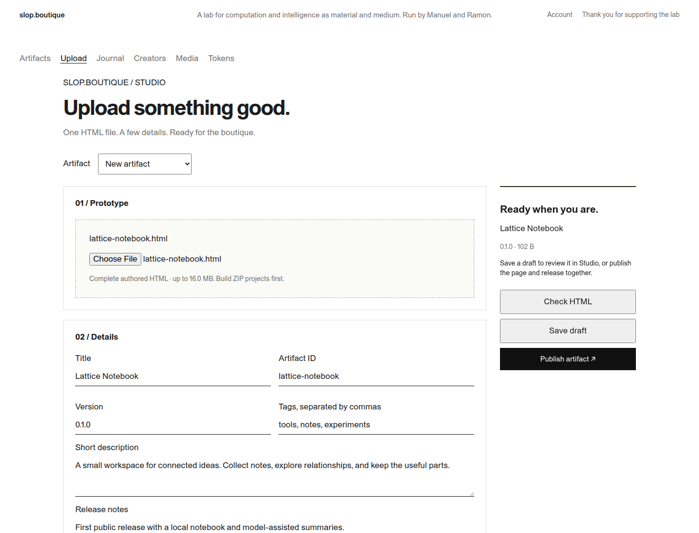
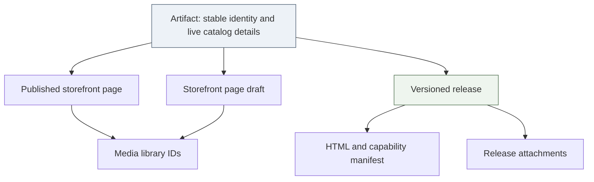
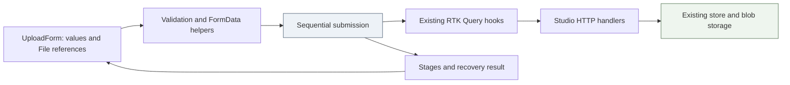
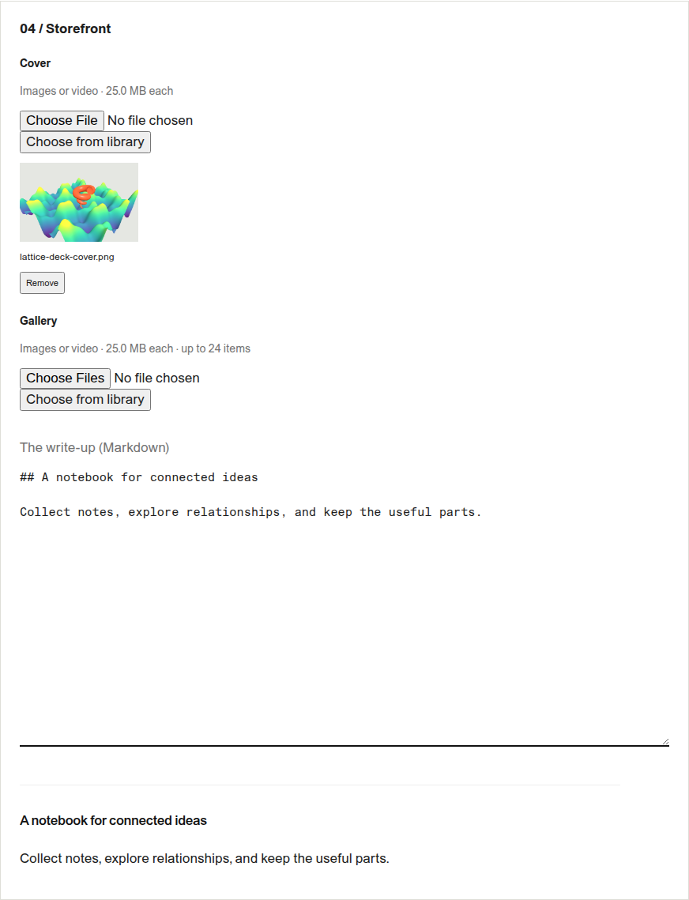
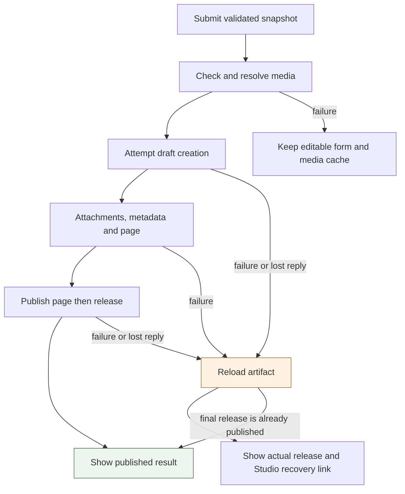
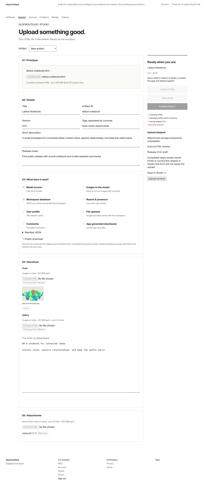
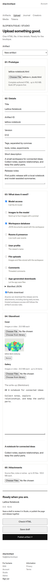

# Slop Uploader: A Small Publication Workflow with Explicit Recovery

Slop Uploader adds a single authoring screen to the Francois application that runs slop.boutique. An author selects an HTML artifact, supplies its catalog information and capability manifest, chooses storefront media, adds attachments, and saves a draft or publishes. The implementation integrates this workflow into `/studio/upload`, using the same session, creator permissions, HTTP handlers and storage operations as the existing Studio editors.

The principal engineering problem is coordinating several independent writes while presenting one understandable action. An HTML release, an artifact's catalog metadata, its editorial page, and its attachments are separate records with different publication rules. A successful HTTP request changes durable state even if the next request fails. The uploader makes that fact explicit through ordered operations, a factual progress list and a recovery link to the saved release.

This report describes the implemented system at commit `16ad125`, following the initial implementation in `0bd8a10`. It includes the browser evidence, the defects found during integration and the boundaries of verification. The branch has been committed locally; this report does not claim a production deployment.

> [!summary]
> The implementation adds one Studio route, local form state, pure validation helpers and a sequential submission function. It adds no database migration, backend service, dependency or endpoint. After release creation is attempted, the form reconciles uncertain outcomes and directs further editing to Studio instead of replaying creation.

## 1. Product context and the supplied reference

Francois hosts HTML applications and their supporting catalog pages. Public browsing, downloading a release and launching a hosted workspace are related but distinct operations. The uploader serves authors and administrators who need to prepare those applications for the site. It does not expose customer token management or introduce another public product surface.

The input for FRANCOIS-018 was a JPEG and a ZIP archive under `~/Downloads`. The JPEG established the primary form sections: prototype, details, capabilities, storefront content and attachments. The ZIP contained a standalone uploader prototype. The implementation retained that straightforward form structure while placing it inside Studio, where authentication and author permissions already exist.

The resulting interface uses the site's existing typography and neutral colors. Desktop layout places the authoring sections beside a persistent action summary. On narrow screens, the sections and summary form one column. The primary action is visually distinct, but the form remains ordinary HTML controls with labels and keyboard focus behavior. Media selection and Markdown preview reuse the established Studio components.



*Figure 1. The actual built Studio interface with deterministic fixture data. The screenshot is a local browser capture, not a production session.*

The form has three actions. **Check HTML** validates the proposed release without saving it. **Save draft** creates the release and saves its supporting content for review. **Publish artifact** performs the same preparation and then publishes the storefront page when needed, followed by the release. Titles, descriptions and tags on existing artifacts are live metadata, so the form explicitly explains that saving a draft can update those catalog fields.

## 2. The records an author is editing

Understanding the storage model explains both the interface and its failure behavior. The word “artifact” names the catalog entity, while a release identifies a particular uploaded version. The editorial page is associated with the artifact rather than with a particular release. Attachments belong to a release. Media exists independently in a shared library and is referenced by page content.

| Entity | Relevant data | Persistence and visibility |
|---|---|---|
| Artifact | Stable ID, title, description, tags, visibility and access settings | Catalog metadata changes are immediate. |
| Release | Version, HTML, manifest, changelog, public-download setting and state | Upload creates a draft; publication is a separate mutation. |
| Storefront page | Markdown body, cover ID and ordered gallery IDs | Draft content and published content are distinct. |
| Media | Image or video bytes, type and metadata | Upload creates a reusable library record. |
| Attachment | File associated with a release | Each upload is a separate durable operation. |

These relationships allow an author to publish a new application version without replacing its catalog identity. They also allow editorial changes independently of release publication. The uploader respects those existing relationships instead of combining the records into a new aggregate with another save protocol.



For a concrete example, consider an artifact with ID `lattice-notebook`, title “Lattice Notebook” and proposed version `0.1.0`. The uploaded HTML becomes a draft release. A cover image first becomes a media record; its ID is then written into the artifact's page draft. An attached `notes.txt` file is associated with the new release. Publishing the page and publishing the release are two final, independent requests.

If `notes.txt` cannot be stored, the release already exists as a draft. The correct result is therefore “upload stopped; release 0.1.0 is a draft,” accompanied by a link to the existing editor. Reporting a generic failure and leaving the Publish button active would conceal the durable release and encourage a duplicate attempt.

## 3. Implementation boundaries

The implementation separates three kinds of work. `uploader.tsx` owns rendering, browser events and local editing state. `uploader-model.ts` owns field normalization, validation, capability editing and multipart construction. `uploader-submit.ts` owns the sequence of asynchronous operations and the resulting recovery state.

This division gives the sequence a small injectable API. The production component supplies RTK Query mutation functions; tests supply deterministic functions that record calls or fail at a selected step. The module does not import the Redux store or know about the DOM. Its inputs are the submitted values, selected files, an API adapter, a media-ID cache and a progress callback.



The implementation keeps browser `File` objects in component state. They do not belong in Redux's serializable server cache: a file is a pending browser resource, not a persisted application record. Existing artifacts, releases and media records remain in RTK Query, whose invalidation behavior is already used elsewhere in Studio.

Shared fields were extracted narrowly into `studio-fields.tsx`. The existing Markdown editor, media thumbnails, library picker and media upload controls remain available to the older editors. The extraction also associates the Markdown label with its textarea and ignores stale preview responses. It does not introduce a general form library or a new component framework.

The CSS source remains `pkg/catalog/web/static/catalog.css`. The repository serves this file directly. JavaScript is built from `ui/catalog/main.tsx` into the embedded `pkg/catalog/web/static/catalog.js` bundle. Both the TypeScript changes and the resulting tracked bundle are committed.

## 4. Loading and editing an existing artifact

The artifact selector distinguishes a new artifact from a new release of an existing artifact. For an existing selection, the form loads the Studio detail record and initializes the title, description, tags and editorial content. A page draft takes precedence over the published page because the author should continue the current editorial work. Release settings come from the newest published release, or a draft when no published release exists.

Version suggestions are deliberately limited. If releases contain ordinary three-component numeric versions, the helper sorts them numerically and increments the greatest patch component. Thus `1.9.0` and `1.10.2` produce `1.10.3`. If existing versions are only names such as `preview`, the field remains empty and the author supplies a version. The form does not invent semantics for arbitrary labels.

Switching artifacts resets the mounted form, including staged HTML, attachments, media choices, error messages and progress. A dirty form requires confirmation before that reset. The parent uses the query's current data so a previous selection's detail record cannot initialize the next artifact while its request is loading. This prevents one artifact's files from being combined accidentally with another artifact's metadata.

For a new artifact, selecting HTML reads at most the first 64 KiB as text and uses an inert `DOMParser` to find its title. This is a convenience for default values, not a preview of executable HTML. The title and generated slug are populated only if those fields have not been edited. An asynchronous read also carries a generation number; a response from an earlier file selection is ignored.

The existing artifact selector is the explicit route to adding a version. If a new artifact ID already exists, validation asks the author to select it above. Files are not transferred automatically across that selection boundary. This keeps the relationship between identity and uploaded content visible to the author.

## 5. Validation and capability preservation

The browser validates fields before starting the upload sequence, while the server remains authoritative for content and permissions. Validation uses UTF-8 byte length where the backend defines byte limits. A title containing 41 three-byte characters occupies 123 bytes and therefore exceeds a 120-byte limit even though its JavaScript character count is smaller.

`GET /api/studio/me` now returns the configured HTML, media and attachment byte limits together with the existing fixed gallery and attachment counts. Both the TypeScript response and the Go CLI client response were updated. The strict client contract test checks the resulting fields against the real handler, preventing a response addition from silently breaking strict decoding.

The relevant limits exposed by the form are:

- Titles are limited to 120 UTF-8 bytes; descriptions to 2,000; release notes to 8,000.
- Manifest JSON is limited to 64 KiB and must parse as an object.
- Editorial Markdown is limited to 100 KiB.
- A gallery contains at most 24 items, and a release at most 20 attachments.
- HTML, media and attachment byte ceilings come from current server configuration.

Capability checkboxes edit the complete manifest rather than reconstructing it from the visible controls. This matters because a manifest can include scoped options and namespaces that the form does not expose individually. For example:

```json
{
  "sample": { "images": true, "model": "default" },
  "db": { "tables": ["notes"] },
  "slop_boutique": { "artifacts": true }
}
```

Turning off image input removes `sample.images` and preserves the remaining declarations. Turning an already enabled database capability on does not replace its table options with an empty object. Unusual declaration shapes remain editable in the JSON field; the corresponding simplified control is disabled when it cannot safely express that shape.

This preservation behavior is tested independently of the UI. A shallow reconstruction from known checkbox names would lose permissions or settings without making that loss obvious to an author. Keeping the full JSON object is both simpler and more faithful to the existing API.

The label **Public download** maps to the existing `freeSample` wire field. It means that this release's files and attachments can be downloaded publicly, including during an artifact's early-access period. It does not grant hosted workspace access. The UI states that distinction next to the checkbox, preserving the site's existing access policy.

## 6. Media, attachments and browser resource lifetime

Cover and gallery files selected from disk remain local until a save operation. Each local thumbnail creates an object URL, and the thumbnail component revokes that URL when its file changes or the component unmounts. Existing library choices use their persisted media IDs. Gallery order is explicit, with removal and move-left controls.



*Figure 2. Staged cover media and the shared server-rendered Markdown preview. The cover uses a previously captured Lattice Deck image as fixture media; it is not a new production artifact upload.*

The media library picker retains its existing immediate-upload control. Files uploaded through that control already exist in the library even if the author later leaves the form. Files selected directly in the uploader remain staged. This distinction follows the existing component's semantics and is documented in the ticket's implementation completion note.

The submission function caches successful media IDs by `File` object identity. If a cover upload succeeds and a gallery upload fails, retrying before release creation reuses the cover ID. The cache is local to the mounted form; it is not a persistent retry system. Once a release-creation request has been attempted, recovery proceeds through Studio instead of replaying the whole sequence.

Browser verification found a concrete React lifetime defect in attachment selection. The first handler scheduled a state updater that read `event.target.files`, then cleared the input. By the time React evaluated the updater, the FileList could be empty. The corrected handler copies the files before clearing the control:

```typescript
const files = Array.from(event.target.files ?? []);
setAttachments(previous => [...previous, ...files]);
event.target.value = "";
```

The copy makes the updater independent of mutable DOM state. Clearing the control remains useful because it allows the same file to be selected again after removal. The browser script now verifies that `notes.txt` appears before exercising the attachment-failure path, preventing the test from silently skipping the operation it intends to fail.

## 7. The submission sequence

Each submission validates a snapshot of the current values and file references. A synchronous busy reference rejects double-clicks before the React disabled state is rendered. The fieldset and artifact selector remain disabled during the operation, and navigation is blocked while requests are running.

The actual sequence is compact:

```text
validate local snapshot
check authored HTML on server
if Check was requested:
    return checks
resolve cover and gallery IDs, reusing successful uploads
mark release creation as attempted
create draft release
upload attachments in order
patch existing artifact metadata if changed
save page draft if changed
if Publish was requested:
    publish page when changed or an existing draft is present
    publish release
return saved state and release identity
```

A stage is appended when an operation begins and marked done or failed when it settles. The UI displays those real stages. It does not estimate a percentage from a collection of differently sized requests. The result contains checks, release identity and state, whether recovery is required, any error and whether page publication was confirmed.

| Operation | HTTP contract | Purpose |
|---|---|---|
| Load settings | `GET /api/studio/me` | Identity, creator linkage and limits |
| Load artifact | `GET /api/studio/artifacts/{id}` | Existing metadata, page and releases |
| Validate HTML | `POST /api/studio/releases/check` | Validate multipart release input without saving |
| Upload media | `POST /api/studio/media` | Resolve local media to persisted IDs |
| Create release | `POST /api/studio/releases` | Create the draft HTML release |
| Attach file | `POST /api/studio/releases/{id}/attachments` | Persist one supporting file |
| Update metadata | `PATCH /api/studio/artifacts/{id}` | Change live catalog fields |
| Save page | `PUT /api/studio/artifacts/{id}/draft` | Save editorial content |
| Publish page | `POST /api/studio/artifacts/{id}/draft/publish` | Make editorial content public |
| Publish release | `POST /api/studio/releases/{id}/publish` | Make the release published |

These calls use the existing shared RTK Query base query, including its CSRF header. The uploader supplies multipart `FormData` for files without manually setting its content type; the browser supplies the boundary. No personal API token is requested or copied into the page.

## 8. Failure, uncertainty and recovery

There are two distinct failure boundaries. Before release creation, the author can correct the form and retry, reusing media records already uploaded during the current form session. After creation is attempted, the request may have committed even if its response never reached the browser. The form must determine what exists before allowing another creation attempt.

The result therefore enters recovery mode immediately before sending the create request. When a later operation throws, the submission function reloads the artifact and searches for the known release ID. If the create response was lost and no ID is known, it searches by the submitted version. This query is evidence about persisted state, not an instruction to retry a mutation.



A lost final publish response has a specific resolution. If the last attempted stage was publishing the release and the reloaded release is published, every preceding stage had completed. The function reports success and marks that final stage complete. This avoids displaying an error for a publication that actually succeeded.

Other partial outcomes remain explicit. An attachment failure leaves a draft release. A metadata failure can leave uploaded attachments. A release-publication failure after page publication can leave a public page referring to the artifact while the new release remains draft. There is no rollback or compensating deletion. Those records are accessible through the existing Studio editor, which is the appropriate place to finish or correct the partial result.



*Figure 3. The failure fixture confirms that the release is saved as a draft, identifies the failed attachment stage and disables replay. Completed media and release writes remain durable.*

Recovery is intentionally bounded. The implementation does not introduce idempotency keys, a job queue or a resumable server workflow. If reconciliation also fails, the UI states that creation may have been saved and asks the author to inspect Studio before uploading again. This behavior matches the existing API's observable guarantees without claiming transactionality across several requests.

## 9. Verification and what the evidence establishes

Verification covered complementary layers. Six new frontend tests exercise manifest preservation, numeric version suggestions, byte limits, read-only Check behavior, publication order, attachment failure, lost replies and media reuse. Together with the existing tests, `pnpm test` reported 18 passing tests. TypeScript compilation and production bundling passed.

The real PostgreSQL-backed catalog and CLI tests passed, followed by the complete Go suite. `TestClientContract` uses strict decoding and now asserts that StudioMe supplies all uploader limits. `make lint logcopter-check` completed with zero lint issues and no generated-contract mismatch. These checks verify the actual server code, not the fixture handler used for screenshots.

The Chromium script loads the committed catalog bundle and mocks the Studio API at a local fixture origin. It exercises title and ID autofill, field editing, capability controls, cover selection, publication, attachment failure, draft reconciliation, disabled replay, switching artifacts, full-manifest prefilling and saving a draft. It checks for page errors and horizontal overflow at 1440 and 390 pixels.



*Figure 4. The same built form at 390 pixels. Sections and actions stack vertically without horizontal overflow.*

The browser run found two defects that were then corrected: the attachment FileList lifetime bug, and an unnecessary `crypto.randomUUID` requirement for local media keys on the HTTP fixture origin. A form-local counter now supplies those keys. Chromium initially could not launch inside the restricted execution sandbox; an approved run outside that restriction completed the checks. The diary records the exact failure and recovery.

The evidence does not constitute a single browser-to-PostgreSQL end-to-end test. Browser interaction and visual behavior are verified using mocked APIs; actual authorization and persistence are verified by the Go integration suite. No production artifact was created by the screenshot script. The build commands also emitted a Node engine warning in the shell using Node 20.17.0, although the commands succeeded; the browser run used Node 24.18.0.

The source ticket contains six screenshots: desktop overview, desktop full form, mobile full form, storefront detail, published result and recovery result. Its `browser.json` records actions, requests, viewports and the empty page-error list. The vault copies those images beside this article so that reading the report does not depend on another repository's filesystem.

## 10. Source map and completion state

A reader extending this implementation should start with the submission function because it defines the persistence contract exposed by the UI. The form then explains how values enter that function. The backend files remain the authority for permissions and content validation.

| Source | Responsibility |
|---|---|
| `ui/catalog/uploader.tsx` | Selection, local state, controls, snapshots and results |
| `ui/catalog/uploader-model.ts` | Initial values, versions, manifest edits, validation and FormData |
| `ui/catalog/uploader-submit.ts` | Ordered mutations, progress and reconciliation |
| `ui/catalog/studio-fields.tsx` | Shared Markdown and media controls |
| `ui/catalog/studio-api.ts` | RTK Query endpoints and Studio response types |
| `ui/catalog/studio.tsx` | Studio navigation and uploader entry points |
| `pkg/catalog/studio.go` | Creator-facing HTTP handlers and limits response |
| `pkg/catalog/client/types.go` | Strict Go client response contract |
| `pkg/catalog/client_contract_test.go` | Real handler/client contract verification |
| `tests/uploader.test.ts` | Pure validation and orchestration tests |
| `pkg/catalog/web/static/catalog.css` | Responsive uploader styling |

The complete design, original source archive, implementation diary and reproduction script are under `ttmp/2026/10/20/FRANCOIS-018--slop-uploader-for-artifacts-and-release-metadata/`. The design guide was previously uploaded to reMarkable as `FRANCOIS-018 Slop Uploader Implementation Guide` in `/ai/2026/10/20/FRANCOIS-018`. Its completion note now identifies the implemented files and the explicit behavior choices.

The implementation is committed on `feat/slop-uploader` in `0bd8a10` and `16ad125`, based on main at `e457daf`. It provides the requested authoring workflow with the existing site's authorization and publication model. Deployment remains a separate action; the local implementation and its evidence are complete.
