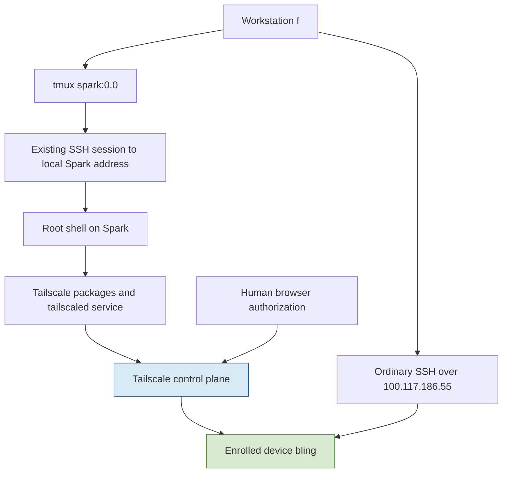
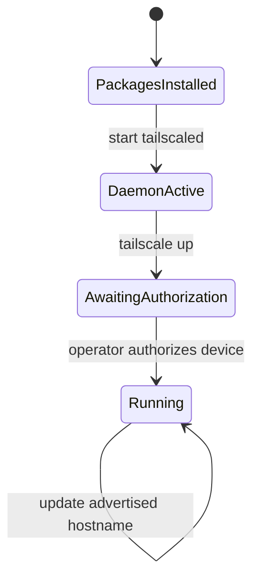

# Bling: Bringing a DGX Spark onto Tailscale

A newly installed NVIDIA DGX Spark was reachable on the local network as `spark-d13c.local`. This project established authenticated access through the existing Tailscale network and renamed the machine to `bling`. The result is a running ARM64 host with a stable overlay address, a verified DNS name, and an ordinary SSH connection that works over Tailscale.

The interesting engineering work is not the number of installation commands. It is separating the properties those commands establish: package authenticity, daemon availability, network membership, name resolution, peer connectivity, and SSH server identity. This report develops those distinctions before following the actual installation and verification sequence. It also records the limits of the evidence: local direct connectivity was tested, but off-site access and reboot persistence were not exercised.

> [!summary]
> - `bling` joined `go-go-golems.org.github` and retained the Tailscale IPv4 address `100.117.186.55` after renaming.
> - Its DNS name is `bling.tail879302.ts.net`; both a Tailscale ping and an SSH command over the overlay address succeeded.
> - `tailscaled` is active and enabled at boot. An actual reboot was not part of validation.
> - A follow-up inspection found the old name in `/etc/hosts`. That local configuration remains an explicit cleanup item, not an undocumented completed change.

## 1. The problem and the definitions needed to solve it

A local IP address identifies a network interface within the current network configuration. Before installation, the Spark reported `192.168.0.65` on interface `wlP9s9`. The `.local` name used to open the original SSH connection belongs to local name discovery; it is not the same namespace as the DNS names assigned by Tailscale. Neither the local address nor that local name alone establishes access from another network.

Tailscale supplies an encrypted overlay network: participating devices communicate using addresses assigned to that network while the encrypted packets travel over underlying network connections. A **tailnet** is the set of devices, identities, and access policy managed together. In this case, the intended tailnet was not inferred from an account name or chosen during installation. It was read from the already-connected workstation: `go-go-golems.org.github`.

The **control plane** handles membership and distributes information needed for devices to communicate. The **data plane** carries traffic between devices, directly when possible and through a relay when necessary. These responsibilities must not be conflated. Successful browser authentication proves an enrollment step; a successful peer ping proves that a particular communication path works. Neither alone proves that an SSH server accepts the expected account and key.

Finally, **MagicDNS** provides tailnet device names. For this network, its suffix is `tail879302.ts.net`. The short name `bling` and the fully qualified name `bling.tail879302.ts.net` refer to the same enrolled device from clients with the appropriate Tailscale DNS configuration. The Linux hostname is another setting. Changing it does not, by itself, prove that every network naming system has updated.

## 2. The machine and the achieved state

The initial SSH banner identified NVIDIA DGX Spark software version 7.6.0. Follow-up inspection with `hostnamectl` and `/etc/os-release` established the operating system and architecture more precisely:

| Property | Observed value |
| --- | --- |
| Hardware model | `NVIDIA_DGX_Spark` |
| Operating system | Ubuntu 24.04.5 LTS, Noble |
| Kernel | `7.0.0-1019-nvidia` |
| Architecture | `arm64` (`aarch64` in the initial login banner) |
| Final static hostname | `bling` |
| Installed Tailscale version | `1.104.1` |
| Tailnet | `go-go-golems.org.github` |
| Tailscale IPv4 | `100.117.186.55` |
| Tailscale IPv6 | `fd7a:115c:a1e0::a2b:ba38` |
| MagicDNS name | `bling.tail879302.ts.net` |
| Backend state | `Running` |
| Service state | `active`, `enabled` |

This was a host provisioning task, not an application repository implementation. No GPU benchmarks, CUDA workloads, container configuration, model serving, subnet routing, or exit-node configuration were performed. The report is stored in the vault at `/home/manuel/code/wesen/go-go-golems/go-go-parc`; there is no separate source repository for the host changes described here.

## 3. Architecture: installation access and operational access are different

The installation used an existing SSH session inside tmux. The tmux target was `spark:0.0`; its foreground command was `ssh`. Capturing its visible terminal output showed an authenticated session on the Spark and a root shell obtained through `sudo su`. A subsequent `hostname; id` confirmed the target machine and effective privileges before package installation.

That sequence matters because tmux metadata describes the local terminal process, not necessarily the remote operating system. A pane title is insufficient evidence that a command will execute on the intended machine or as the intended user.

After enrollment, the operational path changed. The workstation could address the Spark through the tailnet rather than relying on its local IP. The SSH application and its server identity remained separate from Tailscale membership.



The diagram separates two kinds of authentication. Browser authorization associates the device with the tailnet. SSH authentication authorizes a login to the operating system. This project did not enable Tailscale SSH; the tested connection used the existing SSH service and the existing `manuel` account.

## 4. Installing the correct package on the correct platform

The actual installation command downloaded Tailscale's installer to a temporary file and executed it as root:

```bash
hostname
id
curl -fsSL https://tailscale.com/install.sh -o /tmp/tailscale-install.sh \
  && sh /tmp/tailscale-install.sh \
  && systemctl enable --now tailscaled \
  && tailscale up
```

The `&&` operators prevented later steps from running after an earlier command failed. The initial identity probes were informational; they were checked in the captured output rather than implemented as automated assertions.

The installer detected Ubuntu Noble and selected the APT installation method. It created a repository keyring and repository definition at these paths:

```text
/usr/share/keyrings/tailscale-archive-keyring.gpg
/etc/apt/sources.list.d/tailscale.list
```

The repository definition used the keyring explicitly:

```text
deb [signed-by=/usr/share/keyrings/tailscale-archive-keyring.gpg] https://pkgs.tailscale.com/stable/ubuntu noble main
```

The `signed-by` setting associates this repository with a specific signing key. HTTPS protects the download connection, while APT's signed repository metadata supplies package verification within the package manager. These are different checks. Executing a downloaded installer still requires trusting the installer source: the session did not independently inspect or pin the script before execution. Downloading it to a file avoided a streaming execution pipeline, but did not remove that trust dependency.

APT installed two new packages, `tailscale` and `tailscale-archive-keyring`. The client package was specifically `arm64`, version `1.104.1`. The package transaction downloaded approximately 37.3 MB and reported no package upgrades. Existing NVIDIA and Ubuntu repositories participated in the metadata refresh, but the transaction was not a general system upgrade.

### Service activation and boot configuration

Installing an executable is not equivalent to having a working background service. `tailscaled` maintains the network connection and local Tailscale state; the `tailscale` CLI sends requests to that daemon.

```bash
systemctl enable --now tailscaled
```

Here, `--now` requests immediate service startup, and `enable` configures startup through systemd on subsequent boots. The installer output showed a link under `multi-user.target.wants`, and later read-only checks returned:

```text
$ systemctl is-enabled tailscaled
enabled
$ systemctl is-active tailscaled
active
```

These observations establish current activity and boot configuration. They do not establish successful recovery after an actual restart. The machine was not rebooted during this work.

## 5. Enrollment as a state transition

A new installation does not yet have an authorized identity in the intended tailnet. Running `tailscale up` initiated enrollment and printed a browser authentication URL. The operator completed the browser authorization, after which the waiting command printed `Success.`.

The authentication URL is intentionally not reproduced here. It was a transient enrollment artifact, not a durable operating instruction or a credential that belongs in a versioned report.

A useful model distinguishes package installation from authorized operation:



This is an explanatory model of the observed workflow, not a complete transcription of every internal Tailscale state. Its purpose is to prevent a common diagnostic error: treating an installed package or active systemd service as evidence of successful membership.

After authorization, the workstation's peer list contained:

```text
100.117.186.55  spark-d13c  wesen@  linux  -
```

A peer ping then succeeded:

```text
pong from spark-d13c (100.117.186.55) via 192.168.0.65:41641 in 124ms
```

The destination is the overlay address, while the `via` field identifies the underlying endpoint used for this exchange. In this observation, the peers communicated directly over the local network. This proves an encrypted peer path was available in that environment. It does not measure off-site performance or prove that relay fallback works from another network.

## 6. Verifying SSH without weakening server identity checks

The next check attempted ordinary SSH over `100.117.186.55`, with batch mode enabled so that an unexpected authentication prompt could not stall the command. The first attempt failed:

```text
Host key verification failed.
```

That failure occurred at the SSH server identity check, before a successful remote command. It did not contradict the successful Tailscale ping. The network path could be working while SSH refused to associate a newly used address with a trusted server key.

The existing local-name connection had already established a known-host identity for `spark-d13c.local`. The successful follow-up reused that identity explicitly:

```bash
ssh \
  -o BatchMode=yes \
  -o ConnectTimeout=10 \
  -o HostKeyAlias=spark-d13c.local \
  manuel@100.117.186.55 \
  'hostname; systemctl is-enabled tailscaled; systemctl is-active tailscaled'
```

`HostKeyAlias` changes the name SSH uses for host-key lookup and verification. It does not change the destination address: the connection still goes to `100.117.186.55`. Unlike disabling strict host-key checking, this preserves verification against the previously known server identity.

The successful connection established that the server at the overlay address presented an accepted existing host key and allowed the existing account authentication. This is stronger application-level evidence than a peer ping alone. It is not a general audit of SSH policy, account privileges, or the provenance of the original trusted host key.

## 7. Renaming the host without reenrolling it

The requested rename involved at least two settings: the operating system's static hostname and the hostname advertised to Tailscale. Both were changed explicitly:

```bash
hostnamectl set-hostname bling \
  && tailscale set --hostname=bling \
  && hostnamectl --static
```

The first command changes the Linux static hostname. The second updates an existing Tailscale preference without requiring a fresh enrollment. Keeping these operations distinct makes the intent testable: a local `hostname` result is not evidence that MagicDNS has changed, and a new MagicDNS name is not evidence that the operating system hostname changed.

### A terminal input failure and its cause

The first attempted rename did not execute as intended. The terminal already contained the partial text `renam`, and the injected command was appended to it. The resulting command began with:

```text
renamhostnamectl set-hostname bling
renamhostnamectl: command not found
```

Because the rename commands were connected with `&&`, neither the Tailscale rename nor the following checks ran after that failure. A lookup of `bling` at this point also failed. That DNS failure was not evidence of delayed propagation after a successful change; the change had not happened.

The retry sent `Ctrl-U` before entering the command, clearing pending input under the shell's line-editing behavior. The intended command then succeeded. This illustrates a specific constraint of automating an interactive terminal: text injection is not an isolated command execution interface. The pending input buffer is part of the execution state. A safer operational sequence is to inspect the pane, coordinate exclusive use, clear a known idle prompt if appropriate, enter one bounded command, and inspect its result. Clearing another person's partially typed command without coordination is not a generally safe default.

### Name changes and address stability

Follow-up SSH inspection returned:

```text
bling
bling.tail879302.ts.net.
```

The trailing dot represents a fully qualified DNS name in the JSON status output. It is normally omitted when typing the name interactively. A subsequent peer ping returned:

```text
pong from bling (100.117.186.55) via 192.168.0.65:41641 in 8ms
```

The same overlay IPv4 address appeared before and after renaming. The device's displayed name changed; its enrollment was not replaced. The two reported ping durations are individual observations, not a benchmark or evidence that renaming improved performance.

## 8. A remaining inconsistency: local hosts-file naming

The report's follow-up inspection checked `/etc/hosts` and found:

```text
2:127.0.0.1       spark-d13c
```

This was not changed during the session. It is an important distinction between completing the requested static and Tailscale hostname changes and normalizing every local reference to the previous name. `/etc/hosts` contributes to local name resolution independently of MagicDNS. An old entry can preserve an old local alias and may leave the new hostname dependent on other resolver mechanisms.

The appropriate next step is to inspect the full file and the host's hostname-resolution configuration before making a targeted edit. The observed single line is not sufficient justification to replace the whole file, remove unrelated loopback entries, or assume the exact desired distribution-specific layout. That cleanup should preserve `localhost`, IPv6 entries, and any intentional aliases. No resolution failure for `bling` on the Spark itself was demonstrated here, so this is a configuration inconsistency rather than a proven application outage.

## 9. A verification method based on independent properties

A reliable acceptance test asks several narrow questions instead of relying on one success message:

| Question | Evidence collected | What remains outside the result |
| --- | --- | --- |
| Was the intended host targeted? | Remote `hostname` and root `id` before installation. | No hardware attestation was performed. |
| Is the software installed? | APT installation output and `tailscale version`. | Future update behavior was not tested. |
| Is the daemon operating? | `systemctl is-active` returned `active`. | No restart or crash recovery test was run. |
| Is startup configured? | `systemctl is-enabled` returned `enabled`. | No boot cycle was observed. |
| Did enrollment reach the correct network? | JSON status named `go-go-golems.org.github` and state `Running`. | Tailnet-wide access policy was not audited. |
| Does peer communication work? | Tailscale ping reached the device directly. | Off-site connectivity was not tested. |
| Does the existing SSH service work over the overlay? | Batch-mode remote commands succeeded with verified host-key identity. | Tailscale SSH was not enabled or tested. |
| Did both requested names change? | `hostname` returned `bling`; status returned the new DNS name; `tailscale ping bling` succeeded. | The old `/etc/hosts` entry remains. |

This method exposes partial completion. If the service is active but the backend needs login, investigate authorization rather than reinstalling packages. If a peer ping succeeds but SSH fails host-key verification, investigate the SSH trust association rather than changing firewall rules. If `hostname` changes but MagicDNS does not, inspect the advertised Tailscale name instead of repeating the Linux rename.

A compact read-only inspection sequence for the current machine is:

```bash
# On the Spark:
hostnamectl --static
tailscale version
systemctl is-enabled tailscaled
systemctl is-active tailscaled
tailscale status --json

# On an already connected tailnet peer:
tailscale ping --c 1 bling
```

The raw JSON contains more information than is needed for routine reporting. This report preserves only the relevant state, name, address, and network identity fields; it does not archive device keys or the full peer inventory.

## 10. Current operating instructions and next work

The operational identifiers are now `bling`, `bling.tail879302.ts.net`, and `100.117.186.55`. Clients need appropriate tailnet membership, policy permission, and DNS configuration to use the name and reach the machine. Normal SSH account authentication remains required.

For the provisioning workstation, the already-tested address-based SSH command can continue using `HostKeyAlias=spark-d13c.local` until known-host naming is deliberately normalized. This alias is a client-side trust lookup setting, not the device's current advertised name. A plain first connection to `manuel@bling` may require a verified known-host association for that new name; this session did not demonstrate that exact command.

The remaining work is bounded and separate from the achieved enrollment:

1. Inspect and normalize `/etc/hosts` while preserving the machine's required local mappings.
2. Associate the new SSH hostname with the independently verified existing server key, rather than suppressing host-key checks.
3. Test access from a different underlying network to distinguish local direct success from remote availability.
4. Perform a controlled reboot when convenient, then verify daemon startup, network reconnection, DNS resolution, and SSH access.
5. Review device key-expiry and tailnet access policy for the intended long-lived compute-host role; no policy changes were made here.

The completed project establishes a verified network and application access path to the Spark without changing its SSH authentication model or configuring broader routing privileges. Its most reusable lesson is the verification structure: installation, authorization, naming, transport, and application identity are separate properties, and each should have its own observable evidence.

## 11. Adding `bling.scapegoat.dev` as a DNS alias

After the initial bring-up, the host received a custom-domain alias managed in `/home/manuel/code/wesen/terraform`. This adds a stable name under the existing public DNS zone without replacing Tailscale enrollment, changing the host address, or exposing the SSH service to the public Internet. The alias is a CNAME: a DNS record that identifies another DNS name as its target rather than assigning an address directly.

The resulting lookup chain is:

```text
bling.scapegoat.dev
  CNAME bling.tail879302.ts.net.
  A     100.117.186.55  # resolved on the tested tailnet-connected workstation
```

Publishing the CNAME and resolving its target are separate operations. DigitalOcean serves the alias in the public `scapegoat.dev` zone; the tested workstation resolves the Tailscale target through its configured resolver. A client still needs suitable Tailscale connectivity and policy permission to reach the resulting address. Public visibility of the alias does not make the destination publicly routable, and a client without the relevant DNS configuration may not resolve the target successfully.

### Terraform implementation

The zone environment is `dns/zones/scapegoat-dev/envs/prod`. Its `main.tf` defines a `base_records` map, merges that with records supplied by the SES remote state, and instantiates `digitalocean_record.records` with `for_each`. The addition was a single map entry:

```hcl
bling_cname = {
  type  = "CNAME"
  name  = "bling"
  value = "bling.tail879302.ts.net."
  ttl   = 3600
}
```

The trailing dot makes the target explicitly fully qualified. The TTL is 3,600 seconds. Provider authentication uses an ephemeral Vault KV read of `kv/infra/dns/scapegoat-dev`, taking the `api_token` field; the token was not copied into the record definition or this report.

### Why the full plan was not applied

Formatting and validation passed, but the full Terraform plan included three additions and one deletion. Only one addition was requested: `bling_cname`. The other proposed changes were additions for `pds.yolo` and `*.pds.yolo`, and deletion of `*.apps.francois.yolo`. Those unrelated changes were not applied.

A targeted plan restricted the operation to the new resource:

```bash
direnv exec . terraform -chdir=dns/zones/scapegoat-dev/envs/prod plan \
  '-target=digitalocean_record.records["bling_cname"]' \
  -out=/tmp/bling-dns-only.tfplan
```

Resource targeting was an explicit exception to isolate the requested change from pre-existing configuration/state differences, not a recommendation for routine deployment. The first targeted plan exposed an output-expression defect:

```text
Error: Invalid index
  on outputs.tf line 19, in output "managed_records":
  value = local.records[key].value
```

The output iterated over resource instances, including an existing state entry whose key was absent from the current configuration map. Looking that key up in `local.records` failed. The correction in `outputs.tf` reads the value from the resource being iterated instead:

```hcl
for key, record in digitalocean_record.records : key => {
  id    = record.id
  fqdn  = record.fqdn
  type  = record.type
  value = record.value
}
```

This aligns each reported value with the corresponding resource instance and avoids assuming that the configuration map contains every key retained during a targeted operation. It changes an output expression, not the DNS configuration of those other resources.

The revised targeted plan passed validation. Its JSON was checked to assert that the only non-no-op resource action was creation of `digitalocean_record.records["bling_cname"]`. Applying the saved plan returned:

```text
digitalocean_record.records["bling_cname"]: Creation complete [id=1835946885]
Apply complete! Resources: 1 added, 0 changed, 0 destroyed.
```

The apply also reported the existing deprecation of the backend's `dynamodb_table` setting in favor of `use_lockfile`; backend migration was not part of this change. The unrelated zone differences remain unresolved, and a future full apply still requires reviewing them. At this checkpoint, the Terraform edits in `main.tf` and `outputs.tf` remain local and uncommitted; successful deployment is not evidence that their repository changes have been published.

### End-to-end verification

The authoritative DNS server returned the new CNAME:

```text
$ dig +short @ns1.digitalocean.com bling.scapegoat.dev CNAME
bling.tail879302.ts.net.
```

The workstation's resolver then returned the expected overlay address through `getent ahostsv4 bling.scapegoat.dev`. Finally, ordinary SSH through the custom name executed a command on the expected host:

```text
$ ssh -o BatchMode=yes -o ConnectTimeout=10 \\
    -o HostKeyAlias=spark-d13c.local manuel@bling.scapegoat.dev hostname
bling
```

This tests the complete path from custom name through address resolution to an authenticated SSH command. The explicit host-key alias retains the previously trusted server identity; it does not imply that a bare first connection to the new hostname already has its own known-host entry. No TLS certificate for `bling.scapegoat.dev` was requested or installed. DNS aliasing, SSH trust, and HTTPS certificate issuance remain independent configuration concerns.

The preferred human-facing address is now `bling.scapegoat.dev`; the Tailscale DNS name and overlay address remain valid underlying identifiers. The earlier `/etc/hosts`, reboot, off-site testing, and access-policy follow-ups remain open.

## Evidence provenance

The implementation evidence is the 2026-10-20 provisioning session: tmux pane captures, APT output, operator-confirmed browser authorization, workstation Tailscale status and ping output, and successful SSH checks against the Spark. The final report also used a fresh read-only inspection of `hostnamectl`, `/etc/os-release`, `tailscale version`, service state, selected Tailscale status fields, and the relevant `/etc/hosts` line. The DNS follow-up adds the Terraform source edits, full and targeted plan results, the successful one-resource apply, an authoritative CNAME query, workstation address resolution, and a successful SSH command through `bling.scapegoat.dev`.

Conceptual explanations describe the responsibilities needed to interpret those observations. They are not claims that internal protocol behavior, every resolver path, or every access-policy rule was inspected. No external documentation research or performance study was undertaken for this report.
