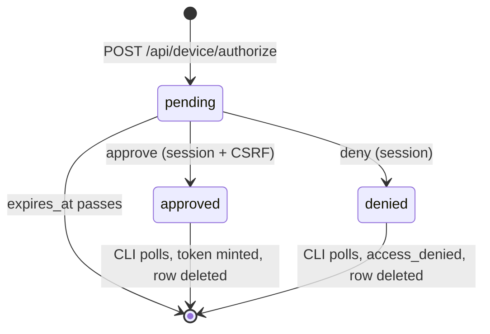

# Francois — CLI Device Login and Stored API Tokens

## 0. What this document is

This is the project report for ticket `FRANCOIS-019`, which gave the `francois` command-line tool a way to obtain a personal API token without copying it out of a web page. Before this work, a person who wanted to run `francois catalog whoami` or `francois catalog releases push` against the hosted catalog had to sign in to the portal in a browser, open the account page, create a token, copy the secret, and place it in `FRANCOIS_TOKEN` or a file passed with `--token-file`. After this work, the person runs one command:

```bash
francois catalog auth login --server https://slop.boutique
```

The command prints a short code, the person approves that code in a browser where they are already signed in, and the CLI receives a token, stores it in a per-user credentials file, and uses it for every later command. The implementation is in pull request [go-go-golems/francois#19](https://github.com/go-go-golems/francois/pull/19), branch `feat/cli-auth`, about 2,500 lines across thirty files, roughly half of them tests.

The report explains the problem, the protocol that solves it (the OAuth 2.0 Device Authorization Grant, RFC 8628), how francois implements each side of that protocol, how the stored credentials are resolved, and the decisions and failures that shaped the result.

> [!summary]
> - **Device login.** `auth login` implements the RFC 8628 shape: the CLI holds a secret *device code*, the human approves a short *user code* in a signed-in browser, and the CLI exchanges the device code for a token. The token is minted in the same database transaction that consumes the approval.
> - **Stored, per-server credentials.** Tokens live in `~/.config/francois/credentials.json` (mode `0600`), keyed by portal origin. Resolution order is `--token-file`, then `FRANCOIS_TOKEN`, then the file, so existing scripts behave as before.
> - **One grant rule.** The account page and the device approval share `tokenGrant`, so a token minted by either path obeys the same scope and lifetime limits.
> - **Logout revokes.** A token may revoke itself through `DELETE /api/me/token`, so `auth logout` invalidates the token on the server instead of only deleting the local copy.

## 1. The problem in francois terms

Francois is a catalog and hosting service for small web applications. Its portal authenticates people through an OpenID Connect identity provider and keeps a browser *session*: a cookie whose value hashes to a row in the `sessions` table, plus a CSRF token that every mutating request must echo. The JSON API under `/api/` accepts two kinds of principal. A browser request carries the session cookie. A non-browser request carries a *personal API token* in `Authorization: Bearer frt_…`.

A personal API token is the string `frt_` followed by the base64url encoding of 32 random bytes. The server stores only its SHA-256 hash in `api_tokens`, together with the owning user, a name, a list of *scopes*, and an optional expiry. A scope is a named capability. Francois has four: `studio` (publish and manage one's own apps), `account` (read and change one's own account), `admin:read`, and `admin:write`. Each user role permits a subset of them; `store.ScopesForRole(role)` returns that subset. A creator may hold `studio` and `account`; an admin may also hold the two admin scopes, but a token that carries an admin scope must expire within 90 days.

Every route is wrapped in a `guard` that names the principal kinds it accepts. The token routes were deliberately written so that a token cannot create tokens:

```go
// Tokens are managed from a browser session only: a token cannot mint or
// revoke tokens.
m.HandleFunc("GET /api/tokens", s.guard(session, noToken, s.tokens))
m.HandleFunc("POST /api/tokens", s.guard(enabled, noToken, s.createToken))
m.HandleFunc("DELETE /api/tokens/{id}", s.guard(session, noToken, s.revokeToken))
```

That rule is correct and the work kept it. It is also the reason a CLI login is not a single API call: the only principal that may mint a token is a browser session, and a terminal does not have one. The CLI therefore needs a protocol in which a browser session authorizes the mint and a terminal receives the result.

The client side had a second, smaller problem. The shared `connect` helper in `cmd/francois/cmds/api.go` read the token only from `--token-file` or `FRANCOIS_TOKEN` and the server only from `--server` or `FRANCOIS_SERVER`. `push.go` carried its own copy of that logic, required `--server` unconditionally, and its help text still pointed at a "Studio → Tokens" page that had moved. There was no place to keep a token between invocations.

## 2. The device authorization grant

RFC 8628 defines a login flow for a device that can display text but cannot run a browser session of its own. A terminal is such a device. The flow has two secrets and two channels.

- The **device code** is a long random secret that only the CLI knows. It is the credential with which the CLI later claims the token. It never appears on screen.
- The **user code** is a short code that the CLI shows to the human. Its only job is to let the human identify the pending request in the browser. Francois uses eight letters from `BCDFGHJKLMNPQRSTVWXZ`, shown as `XXXX-XXXX`. The alphabet has no vowels, so a code cannot spell a word, and no digits, so `0`/`O` and `1`/`I` cannot be confused. Eight letters from twenty symbols give about 34.6 bits.
- The **verification URI** is the portal page where the human enters or confirms the user code: `/device?code=FKBH-SFFG`.
- **Polling** is how the CLI learns the outcome. The CLI repeatedly posts the device code to the token endpoint, waiting at least the server-specified *interval* between requests. The server answers `authorization_pending` until the human decides, `slow_down` if the CLI polls too quickly, `access_denied` if the human denied, `expired_token` if the request timed out, and the token once it is approved.

The security of the flow rests on the separation of the two codes. A person who sees the user code over someone's shoulder can at most approve or deny that request with their *own* account. They cannot claim the token, because claiming requires the device code. The residual risk is the reverse: an attacker starts a login, sends the victim a link with the attacker's user code, and hopes the victim approves it. The approval page addresses this by telling the human to check that the code matches what their own terminal shows, and by showing the client name and the network address the request came from.

The full sequence in francois:

```mermaid
sequenceDiagram
    participant CLI as francois CLI
    participant API as catalog server
    participant DB as Postgres
    participant B as Browser (signed in)
    CLI->>API: POST /api/device/authorize {clientName, scopes, days}
    API->>DB: INSERT device_authorizations (hash(device), hash(user), ...)
    API-->>CLI: deviceCode, userCode, verificationUri, interval, expiresIn
    CLI->>CLI: print URL + code, maybe open browser
    loop every interval
        CLI->>API: POST /api/device/token {deviceCode}
        API-->>CLI: 400 authorization_pending
    end
    B->>API: GET /api/device/requests/FKBHSFFG (session)
    API-->>B: client, origin address, allowed + suggested scopes
    B->>API: POST .../approve {scopes, days} (session + CSRF)
    API->>DB: UPDATE status='approved', user_id, approved_scopes
    CLI->>API: POST /api/device/token {deviceCode}
    API->>DB: BEGIN; SELECT ... FOR UPDATE; DELETE row; INSERT api_tokens; COMMIT
    API-->>CLI: token, info, user
    CLI->>CLI: write credentials.json (0600)
```

## 3. Server side

### 3.1 The pending-login table

A pending login is one row in `device_authorizations`, created by migration `019_device_authorizations.sql`. Both codes are stored only as SHA-256 hashes, for the same reason token secrets are: a database dump must not contain a credential that can be replayed.

```sql
CREATE TABLE device_authorizations (
    device_code_hash bytea PRIMARY KEY,
    user_code_hash bytea NOT NULL UNIQUE,
    portal_origin text NOT NULL,
    client_name text NOT NULL,
    requested_scopes text[] NOT NULL,
    requested_days integer NOT NULL,
    requester_address text NOT NULL,
    status text NOT NULL DEFAULT 'pending' CHECK (status IN ('pending', 'approved', 'denied')),
    user_id text REFERENCES users(id),
    approved_scopes text[],
    approved_days integer,
    interval_seconds integer NOT NULL,
    last_polled_at timestamptz,
    created_at timestamptz NOT NULL DEFAULT now(),
    expires_at timestamptz NOT NULL
);
```

Three columns deserve explanation. `portal_origin` binds the request to the site on which it was created; francois serves more than one portal origin from one process, and a code created on one must not be approvable on another. Every lookup filters on it. `interval_seconds` and `last_polled_at` hold the polling state, which lets the server enforce the interval rather than trusting the client. `user_code_hash` is `UNIQUE`; the 34.6-bit space makes collisions rare, and `CreateDeviceAuthorization` returns `ErrConflict` on one so the handler can draw a new code.

The row is never turned into a token in place. It lives for at most ten minutes (`DeviceTTL`) and is deleted when the CLI claims its token, when the CLI learns of a denial, or by expiry.

The life of a row is a small state machine:



### 3.2 Routes and guards

```go
m.HandleFunc("POST /api/device/authorize", s.guard(public, noToken, s.deviceAuthorize))
m.HandleFunc("POST /api/device/token", s.guard(public, noToken, s.deviceToken))
m.HandleFunc("GET /api/device/requests/{code}", s.guard(session, noToken, s.deviceRequest))
m.HandleFunc("POST /api/device/requests/{code}/approve", s.guard(enabled, noToken, s.deviceApprove))
m.HandleFunc("POST /api/device/requests/{code}/deny", s.guard(session, noToken, s.deviceDeny))
```

The first two routes are public because the CLI has no credential yet. They are the only unauthenticated routes that write to the database, so each is rate-limited by client address: 20 authorizations per hour per address and 600 per hour globally, and 1,200 polls per hour per address. The last three routes require a browser session and refuse tokens, which preserves the FRANCOIS-007 rule: a token still cannot cause a token to be minted. `approve` uses the `enabled` guard, which additionally requires that the account is not disabled, and like every session mutation it checks `Origin` and the CSRF header. The lookup route counts unknown codes per user and stops after 30 per hour, so a signed-in user cannot enumerate the user-code space.

### 3.3 Approval and the default grant

When the approval page loads, `GET /api/device/requests/{code}` returns what the CLI asked for, what the approving user's role allows, and a suggested grant. The CLI may request specific scopes with `--scopes`; by default it requests none. The owner decided that an empty request means "the maximum for this role", including admin scopes for an admin, with the admin lifetime cap applied:

```go
func suggestGrant(allowed, requested []string, days int) ([]string, int) {
	out := []string{}
	for _, sc := range requested {
		if slices.Contains(allowed, sc) && !slices.Contains(out, sc) {
			out = append(out, sc)
		}
	}
	if len(requested) == 0 {
		out = append(out, allowed...)
	}
	if slices.ContainsFunc(out, store.IsAdminScope) && (days < 1 || days > maxAdminTokenDays) {
		days = maxAdminTokenDays
	}
	return out, days
}
```

The suggestion only pre-fills the form. The human can untick scopes and shorten the lifetime before approving, and the approval body carries the final choice. In the end-to-end run below, the CLI requested the default and the approver narrowed it to `studio` for 7 days.

### 3.4 One grant rule for both paths

Before this work, the validation of scopes and lifetime lived inline in `createToken`. A second path that mints tokens would have needed a second copy, and two copies of an authorization rule drift. Phase 0 of the ticket extracted the rule into `tokenGrant`, which both the account page and the device flow call:

```go
func tokenGrant(role string, scopes []string, days int) ([]string, *time.Time, *grantError) {
	if days < 0 || days > 366 { /* invalid_request */ }
	allowed := store.ScopesForRole(role)
	if len(allowed) == 0 { /* tokens_unavailable */ }
	// every scope must be in allowed; duplicates dropped
	// an admin scope requires 1 <= days <= maxAdminTokenDays
	...
}
```

The same phase extracted `insertToken(ctx, rowQuerier, …)` in `store/tokens.go`, which takes either a pool or a transaction. The device flow needs the transactional form, for the reason given next.

### 3.5 Minting inside the claim transaction

The central correctness property of the server side is that one approval yields at most one token, and only to a user who may still hold it. `PollDevice` implements this with a single transaction that locks the row:

```go
err = tx.QueryRow(ctx, `SELECT status,user_id,client_name,approved_scopes,approved_days,interval_seconds,expires_at <= now(),
  last_polled_at IS NOT NULL AND last_polled_at > now() - make_interval(secs => interval_seconds)
FROM device_authorizations WHERE device_code_hash=$1 AND portal_origin=$2 FOR UPDATE`, Hash(deviceCode), origin).
	Scan(&status, &user, &client, &scopes, &days, &interval, &expired, &fast)
```

`FOR UPDATE` serializes concurrent polls for the same device code. If two polls arrive together after approval, the second waits for the first, and by the time it reads, the first has deleted the row, so the second sees no row and answers `expired_token`. Without the lock both could read `approved` and both could mint.

The expiry and the polling interval are computed by Postgres with `now()`, not by the Go process. Francois currently runs one replica, but a rule that compares application clocks across replicas would be wrong the day a second one is added, and computing it in the query costs nothing.

When the row is `approved`, `issueDevice` deletes it, re-reads the approving user, and calls back into the HTTP layer's grant function before inserting the token, all in the same transaction:

```go
func (s *Store) issueDevice(ctx context.Context, tx pgx.Tx, key []byte, userID, client string, scopes []string, days int, grant DeviceGrant) (DevicePoll, error) {
	if _, err := tx.Exec(ctx, `DELETE FROM device_authorizations WHERE device_code_hash=$1`, key); err != nil {
		return DevicePoll{}, err
	}
	u, err := scanUser(tx.QueryRow(ctx, `SELECT `+userColumns+` FROM users WHERE id=$1`, userID))
	if err != nil {
		return DevicePoll{}, err
	}
	scopes, expires, err := grant(u, scopes, days)
	if err != nil {
		return DevicePoll{State: DeviceDenied}, nil
	}
	secret, t, err := insertToken(ctx, tx, u.ID, client, scopes, expires)
	...
}
```

The re-check matters because approval and claim are separated in time. Between them an administrator may disable the account or demote an admin to creator. The grant callback passed by `deviceToken` rejects a disabled user and runs `tokenGrant` against the user's *current* role, so the token never carries more than the user holds at mint time. The store package does not import the HTTP package's rules; it receives them as a function value of type `DeviceGrant`, which keeps the dependency direction of the codebase intact.

The `slow_down` branch adds five seconds to `interval_seconds`, capped at sixty, and stores it. The interval is therefore a property of the row that only grows, and a client that ignores `slow_down` gets slower answers rather than more of them.

### 3.6 A token may revoke itself

The owner's first decision was that a token may revoke itself. This is the one exception to "a token cannot manage tokens", and it is safe because it can only reduce access. The route is `DELETE /api/me/token`, guarded `session, anyToken`; called with a session it fails with `400 token_required`, because a session has no token to revoke. It writes the audit action `token.revoke_self`. Without this route, `auth logout` could only delete the local file and the token would stay valid on the server until it expired.

## 4. Client side

### 4.1 The credentials file

The CLI stores logins in a JSON file managed by the new package `pkg/catalog/credentials`. Its location is `$FRANCOIS_CONFIG_DIR/credentials.json` if that variable is set, otherwise `$XDG_CONFIG_HOME/francois/credentials.json`, otherwise `~/.config/francois/credentials.json`. The directory is created `0700` and the file `0600`. Writes go to a temporary file in the same directory followed by `rename`, so a crash leaves either the old file or the new one, never a truncated one.

```json
{
  "version": 1,
  "default": "https://slop.boutique",
  "servers": {
    "https://slop.boutique": {
      "token": "frt_…",
      "tokenId": "tok_894760215f43df96a8419bb2",
      "name": "e2e laptop",
      "user": {"id": "usr_e2e", "name": "Eve Tester", "email": "e2e@example.com", "role": "creator"},
      "scopes": ["studio"],
      "expiresAt": "2026-10-28T16:08:49Z",
      "savedAt": "2026-10-21T16:08:49Z"
    }
  }
}
```

The file is keyed by *origin*: scheme, host, and port, normalized by `NormalizeOrigin` so that `https://slop.boutique/` and `https://SLOP.boutique` name the same entry. Keying by origin means one person can be logged in to production and to a local development server at once, and a token for one is never sent to the other. The `default` field names the origin used when no server is given. Storing the user, scopes, and expiry next to the token lets `auth status` and the expiry warnings work without a network call.

### 4.2 Resolving the server and the token

Every API command, `releases push`, and `francois mcp` now go through one function, `credentials.Resolve`, called from the shared `connect` helper. It answers two questions in a fixed order.

| Question | 1st | 2nd | 3rd |
|---|---|---|---|
| Which server? | `--server` | `FRANCOIS_SERVER` | `default` in the file |
| Which token? | `--token-file` | `FRANCOIS_TOKEN` | the file's entry for that server |

```go
switch {
case in.TokenFile != "":
	raw, err := os.ReadFile(in.TokenFile)
	...
	r.Token, r.TokenSource = strings.TrimSpace(string(raw)), FromTokenFile
case os.Getenv("FRANCOIS_TOKEN") != "":
	r.Token, r.TokenSource = os.Getenv("FRANCOIS_TOKEN"), FromEnv
default:
	f, warning, err := Load()
	...
	if e, ok := f.Servers[r.Server]; ok {
		r.Token, r.TokenSource, r.Entry = e.Token, FromFile, &e
	}
}
```

The explicit sources come first so that the change is invisible to every existing script and CI job: anything that set `FRANCOIS_TOKEN` before still uses it. The file is read lazily, only when a flag or the environment leaves a question open, so a CI job with both variables set never touches the home directory. `Resolved.TokenSource` records which source won, and `auth status` reports it: a stored login shadowed by `FRANCOIS_TOKEN` shows `used: no, overridden by FRANCOIS_TOKEN`. This addresses the most common confusion with layered credentials, which is a person logging in and then wondering why commands still act as someone else.

`connect` adds two checks on top. If the stored entry has already expired, it fails before sending anything, with a message that names the expiry date and the login command. If fewer than 72 hours remain, it prints a warning to stderr. When the server rejects a token with `token_invalid`, `loginHint` wraps the error with the login command.

### 4.3 The auth commands

| Command | Behavior |
|---|---|
| `auth login` | Device login (default) or `--with-token` to store an existing token read from stdin. Flags: `--scopes`, `--days`, `--name`, `--no-browser`, `--no-default`, `--host`. |
| `auth status [--check]` | One row per stored login with user, scopes, expiry, and whether commands use it. `--check` asks each server whether the token is still valid. |
| `auth token [--yes]` | Prints the token that commands would use, for `export FRANCOIS_TOKEN=$(francois catalog auth token)`. Refuses to print to a terminal unless `--yes` is given. |
| `auth logout [--all] [--keep-token]` | Revokes the token on the server through `DELETE /api/me/token`, then removes the entry. A token the server already considers invalid is treated as revoked. `--keep-token` skips the server call. |

The refusal in `auth token` exists because a token printed to a terminal lands in scrollback, screen recordings, and pasted logs. A pipe or a command substitution is the intended use, and those are not terminals.

The device login loop polls at the server's interval, never faster than a floor, and grows the interval on `slow_down`:

```go
func pollDevice(ctx context.Context, api *client.Client, dc client.DeviceCode) (client.DeviceToken, error) {
	interval := max(time.Duration(dc.Interval)*time.Second, devicePollFloor)
	deadline := time.Now().Add(time.Duration(dc.ExpiresIn) * time.Second)
	for {
		select {
		case <-ctx.Done():
			return client.DeviceToken{}, ctx.Err()
		case <-time.After(interval):
		}
		tok, err := api.DevicePoll(ctx, dc.DeviceCode)
		switch {
		case err == nil:
			return tok, nil
		case client.IsCode(err, "authorization_pending"):
		case client.IsCode(err, "slow_down"):
			interval += deviceSlowDown
		case client.IsCode(err, "access_denied"):
			return tok, errors.New("the login was denied in the browser")
		case client.IsCode(err, "expired_token"):
			return tok, errors.New("the code expired; run francois catalog auth login again")
		...
		default: // network trouble: keep trying until the code expires
			fmt.Fprintln(os.Stderr, "francois: "+err.Error()+"; retrying")
		}
		...
	}
}
```

Network errors are retried until the code expires, because a laptop that changes Wi-Fi during the wait should not lose the login. Any other API error ends the loop.

The CLI opens the verification URL in a browser only when stderr is a terminal and the session is not SSH, on macOS or Windows or on Linux with `DISPLAY` or `WAYLAND_DISPLAY` set, and only when the URL is under the server's origin. The last condition prevents a malicious or misconfigured server from making the CLI open an arbitrary URL.

### 4.4 The approval page

The portal's React application gained a `/device` route (`ui/catalog/device.tsx`). Without a code it shows a form to enter one; with `?code=` it loads the request and shows the client name, the requesting address, the expiry, and a scope checklist pre-filled from `suggestedScopes`, with the lifetime from `suggestedDays`. Approve and Deny post to the routes in §3.2 with the session's CSRF token. The server-side route `GET /device` serves the same single-page application shell as the rest of the portal.

## 5. An end-to-end trace

The ticket's script `scripts/01-device-login-e2e.sh` starts a real catalog server against Postgres, inserts a creator and a browser session with SQL (so no identity provider is needed), runs `auth login` in the background, and approves the request with `curl` exactly as the page does. The recorded output, abridged:

```text
== auth login (background)
To authorize this terminal, open
  http://localhost:18093/device?code=FKBH-SFFG
and check that it shows the code  FKBH-SFFG  (expires in 10 minutes).
Waiting for approval...
== approval page data for FKBH-SFFG
{"allowedScopes":["studio","account"],"clientName":"e2e laptop","requestedScopes":[],
 "suggestedScopes":["studio","account"],"suggestedDays":90,"requestedFrom":"127.0.0.1",...}
== approve (studio only, 7 days)
{"approved":true}
== login result
{ "server": "http://localhost:18093", "user": "Eve Tester", "role": "creator",
  "scopes": "studio", "expires": "2026-10-28", "token_id": "tok_894760215f43df96a8419bb2" }
-rw-------  1 manuel.odendahl  staff  547 Oct 21 12:08 .../config/credentials.json
== whoami with the stored login (no flags, no env)
  "token": { "id": "tok_894760215f43df96a8419bb2", "name": "e2e laptop", "scopes": ["studio"] }
== auth status --check
| http://localhost:18093 | true | Eve Tester | ... | studio | 2026-10-28 | ... | yes | valid |
== logout revokes
| http://localhost:18093 | true | revoked |
tok_894760215f43df96a8419bb2|t
token.device_approve
token.create
token.revoke_self
```

Reading it in order: the request asked for no specific scopes, so the server suggested the creator maximum (`studio`, `account`) and 90 days. The approver narrowed it to `studio` for 7 days, and the minted token carries exactly that. The credentials file has mode `0600`. `whoami` ran with no flag and no environment variable and authenticated as the new token. Logout set `revoked_at` on the token row (the `|t`). The audit log has the three actions in order: the human's approval, the mint, and the self-revocation.

## 6. How the work was sequenced

The ticket's design guide divided the work into phases so that each commit left the tree working.

| Phase | Content | Commit |
|---|---|---|
| 0 | Extract `tokenGrant`, transactional `insertToken`; client omits an empty `Authorization` header; `push` uses `connect` | `3c36520` |
| 1 | `credentials` package; `auth login --with-token`, `status`, `token`, `logout` | `c5240b0` |
| 2 | Migration 019, store and HTTP device endpoints, rate limits, tests | `0e396ba` |
| 4/5 | `DELETE /api/me/token`; client `DeviceAuthorize`/`DevicePoll`/`RevokeSelf`; CLI device login and revoking logout | `e5e2ed4`, `17b0386` |
| 3 | `/device` approval page | `8ed195b`, `3b7157e` |

Phase 1 shipped before the device flow on purpose. `--with-token` gives the credentials file a user immediately, and it remains the path for environments that cannot reach a browser at all.

## 7. What was tricky

**Another session's commits on the same branch.** The work began in the main checkout on branch `feat/cli-auth-login`. A separate agent session working on experiment "made-at" dates (FRANCOIS-021) committed to the same branch and left uncommitted edits, one of which redeclared `MadeAt` and broke the build of my phase. The fix was to move the work to a dedicated worktree (`francois-cli-auth`, branch `feat/cli-auth`) and, before opening the PR, rebase to drop the two foreign commits. The lesson is that concurrent agent sessions in one checkout need separate worktrees from the start.

**A ten-second test.** The first version of the client device test took ten seconds, because the fake server answered `slow_down` once and the client correctly added five seconds to its interval. The poll floor and the slow-down increment became package variables (`devicePollFloor`, `deviceSlowDown`) that the test lowers, which brought the test under a second without changing production behavior.

**Code generation without `node_modules`.** `go generate` in this repository also builds the frontend and failed in the fresh worktree because `node_modules` was absent. The logcopter generator for the new `credentials` package was run directly instead; the frontend bundle `catalog.js` was rebuilt separately with `pnpm run build` in the last commit.

**Lint rules.** golangci-lint's `exhaustive`, `gofmt`, and `nonamedreturns` checks required changes to switch statements over `credentials.Source` and to function signatures. They are small but they explain some code shapes, such as the empty `case credentials.FromFlag, credentials.FromFile:` in `describe`.

**Push access.** The `manuel-tulip` account has no push access to `go-go-golems/francois`, so the branch was pushed to the fork `manuel-tulip/francois` and the PR opened from there.

## 8. Validation

At the final commit: `gofmt` clean, golangci-lint v2.12.2 reports zero issues, the logcopter check passes, the build succeeds, and every Go test package passes except `pkg/catalog/mcpserver`'s `TestLocalPathAllowDirs`, which fails on main as well because macOS resolves `/var` to `/private/var`. The frontend's `pnpm run test` passes 18 of 18, and `pnpm run check` and `pnpm run build` succeed. The device tests in `pkg/catalog/device_test.go` cover user-code normalization, `suggestGrant`, a full login, a second claim of the same device code, refusals (a token or a missing CSRF header trying to approve, denial, admin-scope lifetime, a user disabled between approval and claim, a code used on another site, expiry, malformed and unknown codes, the per-user lookup budget), the authorize rate limit, self-revocation, and the client loop. The `/device` page has not been checked visually in a browser.

## 9. Key points

- A CLI login against a service where only browser sessions may mint tokens needs a two-channel protocol; RFC 8628's device code and user code supply it without weakening the session-only rule.
- The user code identifies a request and the device code claims it. Seeing the user code gives no access to the token.
- Minting inside the transaction that locks and deletes the approval row guarantees one token per approval, and re-checking the user at that moment bounds the token by the user's current role.
- Explicit credentials (`--token-file`, `FRANCOIS_TOKEN`) still win over stored ones, so existing automation is unaffected, and `auth status` says which source is in effect.
- Logout revokes on the server through the one route by which a token may act on itself.

## 10. Open questions and next steps

- **Visual check of `/device`.** The page builds and its API calls are covered by the end-to-end script, but no one has looked at it in a browser yet.
- **Demotion test.** The role re-check at claim time is exercised for a disabled user but not for a user demoted between approval and claim; a test for that case would pin the behavior.
- **Cleanup of expired rows.** Expired `device_authorizations` rows are ignored by every query but are not deleted by a background job. The table is small and indexed on `expires_at`; a periodic delete would keep it that way.
- **Rate limits are per process.** The limiter is in memory. Production runs one replica (`doc/production.md`), so this is sufficient now; a second replica would need a shared limiter.
- **OS keychain storage.** The token is stored in a `0600` file. Storing it in the macOS Keychain or the Secret Service API would protect it from other processes running as the same user; this was left out to keep the first version dependency-free.

## Important project docs

- Design guide: `/Users/manuel.odendahl/code/go-go-golems/francois-cli-auth/ttmp/2026/10/21/FRANCOIS-019--cli-login-create-store-and-load-api-tokens-without-copy-paste/design-doc/01-cli-token-login-analysis-design-and-intern-implementation-guide.md`
- Diary: same ticket, `reference/01-investigation-diary.md`
- End-to-end script and output: same ticket, `scripts/01-device-login-e2e.sh` and `sources/01-device-login-e2e-output.txt`
- Server: `pkg/catalog/device.go`, `pkg/catalog/store/device.go`, `pkg/catalog/tokens.go`
- Client: `pkg/catalog/credentials/credentials.go`, `cmd/francois/cmds/auth.go`, `pkg/catalog/client/device.go`
- UI: `ui/catalog/device.tsx`
