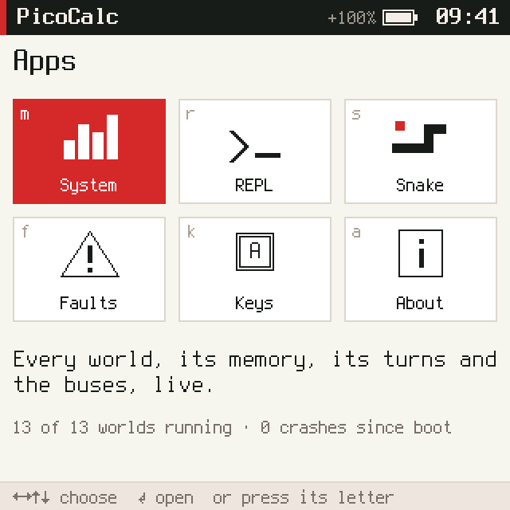
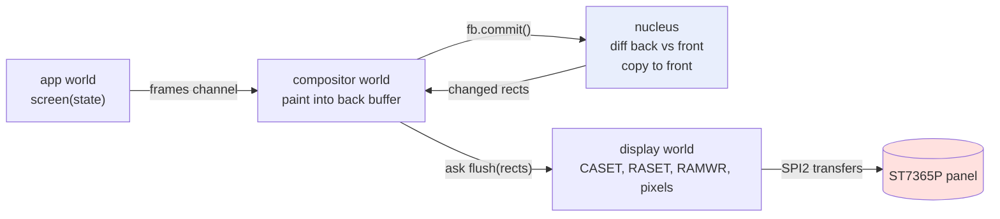
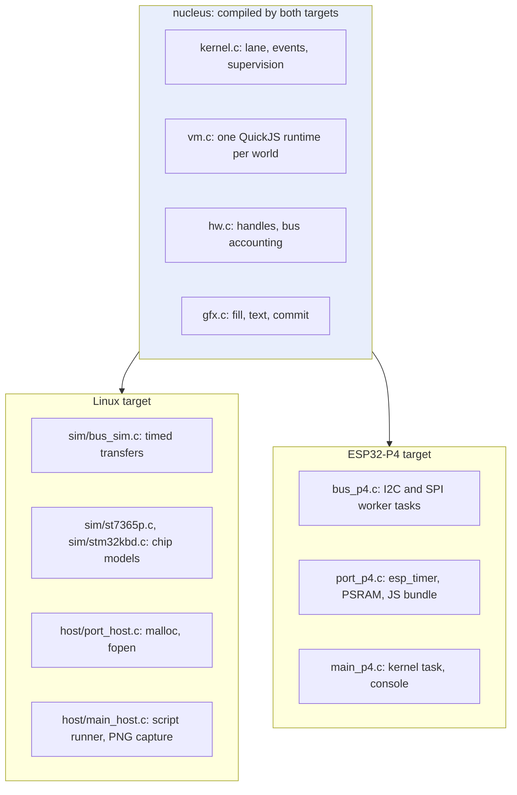
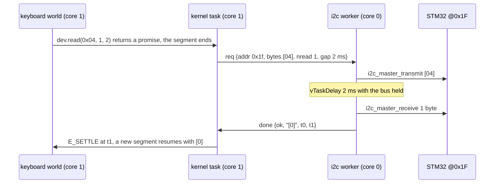
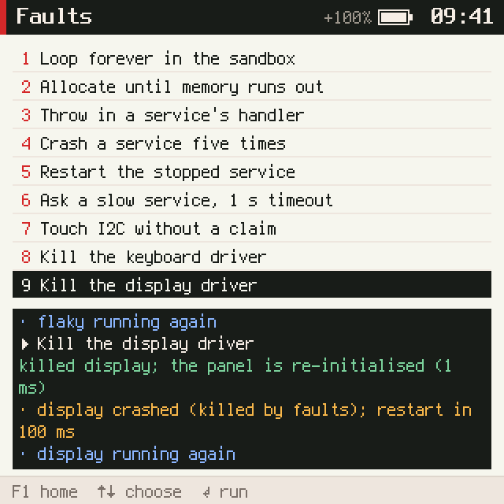
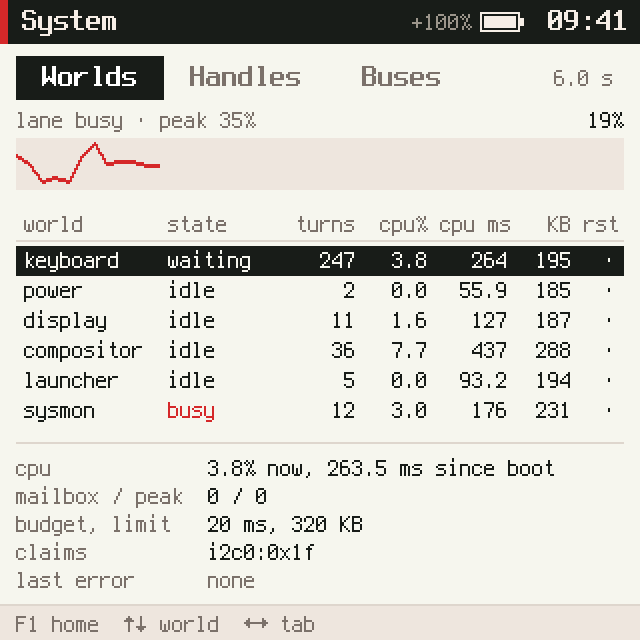
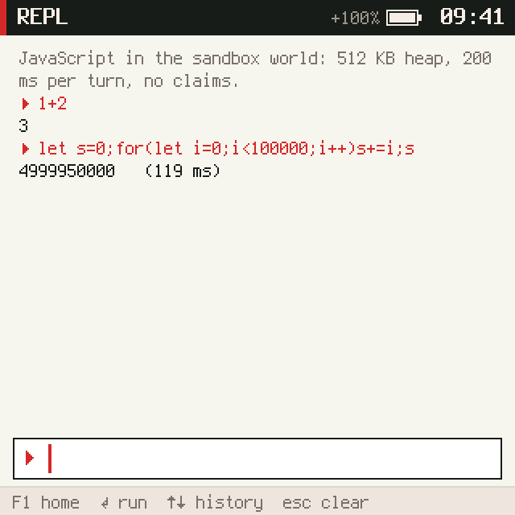
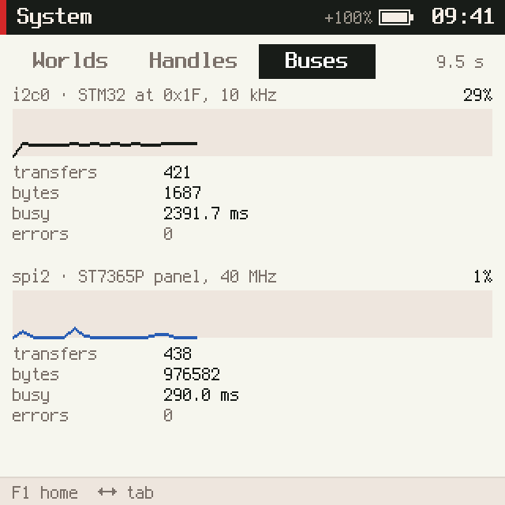
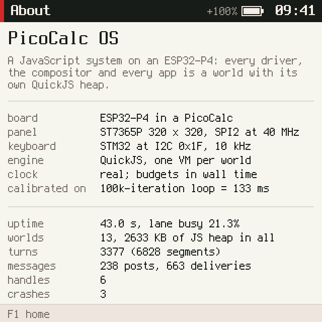

# picocalc-os on the ESP32-P4: From Simulator to Hardware

picocalc-os is a small operating system for the PicoCalc handheld in which almost everything is
JavaScript. A C core of about 2,100 lines, the *nucleus*, runs a dozen independent QuickJS virtual
machines one at a time. The keyboard driver, the display driver, the window compositor and every
application are each a separate virtual machine with its own heap limit and time budget. The system was
written and tested on Linux against a simulated board, on a simulated clock. This report describes how
it was moved onto the real device: a PicoCalc whose Raspberry Pi Pico has been replaced by a Waveshare
ESP32-P4-WIFI6 board. It covers which parts of the design held on the hardware, which had to
change, and what the hardware revealed that the simulator could not.

The port took one working session. Most of it was not spent on writing drivers, which the design had
already reduced to JavaScript. It was spent on three questions. Where exactly does the nucleus depend on
the simulator? How does a scheduler built around a computed clock behave when time is measured instead?
And why did a system that ran perfectly on x86 crash on every boot on RISC-V?

> [!summary]
> - The nucleus reached the simulated board through only a handful of functions, so a small **port API**
>   was enough: the Linux build and the ESP32-P4 build compile the same kernel, VM, handle and graphics
>   code, and the Linux build's screenshots stayed byte-identical through the refactor.
> - On the device the kernel runs on the **real clock**. Bus transfers run on **one FreeRTOS worker task
>   per bus** and are handed back to the kernel through a single queue, so the nucleus stays
>   single-threaded.
> - Hardware exposed three faults the simulator could not: QuickJS **miscompiled at `-O2` without
>   `-fno-strict-aliasing`** on 32-bit RISC-V, ESP-IDF's heap returning **4-aligned blocks** where
>   QuickJS assumes 8, and `int32_t` being `long` on RISC-V newlib.
> - Measured on the device: the 100k-iteration benchmark loop runs in 115–124 ms (the simulator assumed
>   133 ms), the keyboard is polled 49.5 times a second, and the lane is 8–23% busy.




The first image is the launcher as the device's compositor sent it to the panel, captured over the serial
console. The second is the same screen from the Linux simulator. The layouts are identical. The battery
reads `+100%` on the device because the STM32 reports that the battery is charging over USB. The clock
reads 09:41 in both, because the system's `Date` starts at a fixed boot time.

## Why this project exists

picocalc-os was built to test an idea about embedded systems: that drivers, services and applications
can all be ordinary JavaScript programs, isolated from each other by separate interpreter instances
rather than by an MMU, and supervised so that any of them can crash without taking down the rest. The
simulator made that idea testable without hardware. It also made the system deterministic. Every run of
a test script produced the same pixels, and its README ended with a paragraph explaining what a device
build would change and claimed that "the JavaScript does not change."

That paragraph is a set of claims, not a result. This project turned it into a firmware image and
checked each claim. The useful outcome is not only a working device. It is also a list of the places
where a simulation that was carefully calibrated against the same chip was still wrong, and why.

## The system being ported

A reader needs five concepts to follow the port. Each is defined here in the terms the code uses.

A **world** is one QuickJS runtime and context, created from one JavaScript file listed in the manifest
`js/system.json`. The manifest gives each world a heap limit (`mem_kb`), a time budget per turn
(`budget_ms`) and a list of *claims*, the hardware or privileges it may request. Thirteen worlds run:
three drivers (`keyboard`, `power`, `display`), three services (`compositor`, `sandbox`, `flaky`) and
seven applications. A world's file defines it through a builder API that a shared prelude installs:

```js
app("snake")
  .title("Snake")
  .state({ score: 0 })
  .needs("keys")                         // channels it receives
  .on("key", (s, payload, msg) => ...)   // a handler; returning a value answers an ask
  .every(110, (s) => ...)                // a timer
  .screen((s) => ui.col(...));           // what it shows, as a tree of plain objects
```

Worlds share no memory. They communicate by messages carrying JSON: `send` delivers one message, `ask`
delivers one and returns a promise for the answer, and `publish` delivers to every world that `needs`
a channel.

There is one **lane** of execution: at most one world runs at any moment. A **turn** is one message
handled to completion. If the handler is `async`, the turn lasts until its promise settles, and the world
takes no other message meanwhile. A turn therefore consists of one or more **segments**. A segment is
one period during which the world holds the lane: the first delivers the message, and later ones
deliver each promise settlement. The lane chooses the next world by priority (drivers, then services,
then applications) and then by arrival time.

Every effect a segment has on the outside is **deferred**: messages, channel posts, replies and bus
transfers are collected and applied only when the segment ends. A segment that throws is discarded with
all its effects. That property is what makes supervision safe. A crashed world is torn down, its
hardware handles are dropped, and it is restarted after a backoff of 100 ms doubling to 2 s. After five
crashes in ten seconds it stays stopped.

A **handle** is an integer standing for a piece of hardware: an I2C device, the SPI bus or a DMA
framebuffer. The kernel checks the handle on every use. The compositor owns the framebuffer and gives
the display driver a read-only child handle of it.

The **screen pipeline** follows from these pieces. Applications never draw. After each of an
application's turns the nucleus calls its `screen()` function. If the returned tree changed, it is
published on the `frames` channel. The compositor lays out the focused application's tree and paints it
into the back half of a 320 × 320 RGB565 framebuffer. Then it calls `commit()`, which compares back with
front, copies the changed rows to front and returns the changed rectangles. Finally it asks the display
driver to send those rectangles to the panel.



### Time in the simulator

On Linux, time is virtual, counted in microseconds. A segment's cost is computed, not measured:

```text
cost = 40 µs (entering and leaving a world)
     + steps × ns_per_step       (QuickJS interrupt-counter steps: one per loop back-edge or call)
     + host-call costs           (pixels filled, glyphs drawn, JSON bytes encoded)
```

`ns_per_step` is calibrated so that a 100,000-iteration loop costs 133 ms. That figure came from an
earlier firmware on the same ESP32-P4. Bus transfers take the time their bits take on the wire: I2C at
10 kHz with 9 clocks per byte, and SPI at 40 MHz plus 12 µs per 32 KiB DMA chunk. Because nothing
depends on how fast the Linux machine runs, a script replays exactly, and its PNG screenshots are
byte-identical between runs. That determinism became the main regression test for the port.

## The hardware

The PicoCalc's mainboard carries two chips the host talks to. The first is an **ST7365P LCD controller**
on SPI, with separate data/command (D/C), chip-select and reset lines. It holds the image in its own
memory, so the host only sends changed pixels. The second is an **STM32F103 "southbridge"** at I2C address
0x1F. It scans the keyboard into a 31-entry FIFO, drives the backlights and measures the battery. A
register read on the STM32 is a one-byte write of the register number, a pause of about 2 ms while
the STM32 prepares the answer, and then a read.

The Waveshare board sits on a "same-position" adapter: each Pico socket pin lands on the Waveshare
header pin in the same physical position. The resulting GPIO map was verified in an earlier bring-up
project (`esp32-s3-m5/0099-esp32-p4-picocalc-display-keyboard`):

| Function | Pico pin | ESP32-P4 GPIO |
|---|---|---|
| keyboard I2C SDA / SCL | GP6 / GP7 | 50 / 49 |
| LCD SCK / MOSI | GP10 / GP11 | 3 / 2 |
| LCD CS / D/C / RST | GP13 / GP14 / GP15 | 7 / 24 / 25 |
| console | (on-board CH343) | UART0, 37 / 38 |

Two facts from that earlier work matter here. The LCD pins go through the ESP32-P4's GPIO matrix rather
than the SPI2 IO-MUX, and ESP-IDF rejects SPI clocks above 20 MHz on such pins unless the device selects
the `SPI_CLK_SRC_SPLL` clock source. The second fact is that STM32 register 0x08 resets the keyboard
microcontroller, and touching it can wedge the I2C bus until the device is power-cycled. picocalc-os's
drivers never touch it, and the port adds nothing that does.

## Where the nucleus depended on the simulator

Reading every C file produced a short inventory. Each entry is a place where the code would not run on
the device as written.

| Where | What it did | Why the device needs something else |
|---|---|---|
| `hw.c` `run_i2c`, `run_spi_cmd`, `run_spi_pixels` | Called the STM32 and panel models and computed end times from bit counts | Real transfers take real time and must not stall the kernel |
| `kernel.c` `kernel_now`, `run_segment` | Virtual time; computed segment cost | The device has a clock |
| `vm.c` allocator | `malloc` + `malloc_usable_size` (glibc) | ESP-IDF puts small blocks in internal RAM (about 580 KB). Thirteen heaps need megabytes of PSRAM |
| `vm.c` `JS_SetMaxStackSize(192 KB)` | Stack limit for each runtime | Must be below the FreeRTOS task's real stack |
| `hw.c` `dmabuf_alloc` | `calloc` of two 200 KB framebuffers | PSRAM |
| `util.c` `read_file` | `fopen` of the JS sources | There is no file system |
| `quickjs.c` `getTimezoneOffset` | `tm.tm_gmtoff` | newlib's `struct tm` lacks that field |

Two properties of the existing design made the port easier than the table suggests. Bus effects were
already asynchronous: a world never waits on a bus inside a segment, it receives a promise, and the
kernel settles that promise later through an event. So on the device a transfer can run on another
FreeRTOS task, provided the kernel has a thread-safe way to learn that "transfer N finished at time t
with result r". The second property concerns the front framebuffer: it is never written while the
display driver reads it. The compositor's `draw` handler is `async` and awaits the flush, and the lane
never gives a world a new message while one of its turns is in progress. The only writer of the front
buffer, `commit()` inside `draw`, therefore cannot run while pixels are in flight.

## The port seam

The first change moved every platform dependency behind a named interface at the end of
`nucleus/nucleus.h`. Each build target implements it once:

```c
vtime_t port_clock(void);                 // real time, µs since boot; used when K.realtime
void *port_heap_malloc(size_t n);         // world heaps
void *port_heap_realloc(void *p, size_t n);
void port_heap_free(void *p);
size_t port_heap_usable(const void *p);
void *port_big_calloc(size_t n);          // framebuffers
void port_big_free(void *p);
size_t port_js_stack(void);               // JS stack limit per runtime
char *port_read_file(const char *path, size_t *len);
const char *port_board_name(void);
// each starts the transfer a deferred effect describes and settles d->promise once, later
void bus_run_i2c(deferred_t *d, vtime_t at);
void bus_run_spi_cmd(deferred_t *d, vtime_t at);
void bus_run_spi_pixels(deferred_t *d, vtime_t at);
```

The three bus functions moved *verbatim* from `nucleus/hw.c` into `sim/bus_sim.c`. Moving them unchanged
is what made the refactor verifiable. After the move, `make shots` regenerated every committed
screenshot, and `git status out/` showed no changes. The test is strict: one extra microsecond in any
world's modelled cost moves a cpu-ms figure in the System application's table, and that changes a PNG.

The strictness was demonstrated immediately. Adding a `board` field to `sys.stats()`, so that the About
application could name the hardware instead of hard-coding "(simulated)", changed exactly one digit in
one screenshot: a world's cpu ms went from 1.3 to 1.4. The kernel charges 25 ns per byte of JSON a
world receives, so a payload about 40 bytes longer costs a microsecond more. The behaviour was correct,
so the change went into its own commit with that explanation, and the gate for the refactor itself
remained "no pixel changed".



## Time on the device

The kernel gained a flag, `K.realtime`. Three functions consult it, and in each the virtual branch is
unchanged:

```c
vtime_t kernel_now(void) {
  if (frozen_now >= 0) return frozen_now;   // while a crash is being handled
  if (K.realtime) return port_clock();
  ...virtual time, as before...
}

static void run_segment(world_t *W, bool is_settle) {
  if (K.realtime) K.vnow = port_clock();    // it starts now, which may be later than when it was due
  ...dispatch, render...
  vtime_t cost = K.realtime ? port_clock() - K.vnow
                            : PROFILE.turn_base_us + steps * ns_per_step + K.seg_cost;
  ...
}
```

The budget check moved too. QuickJS calls an interrupt handler about every thousand steps; one of this
project's QuickJS patches lowered that interval from ten thousand. On Linux the handler compares the
counted steps with the budget converted to steps. On the device it compares the clock with a deadline
set when the segment began:

```c
if (K.realtime ? port_clock() > W->seg_deadline
               : W->interrupts - W->seg_interrupts0 > W->budget_interrupts) { W->overrun = true; return 1; }
```

A step counter measures JavaScript work but not time spent inside host calls, in PSRAM stalls or in
JSON encoding. A world author's contract is "this turn may take 80 ms", and on the device milliseconds
can be measured directly, so measuring them is the honest check.

The kernel loop itself runs on a FreeRTOS task pinned to core 1. Its whole structure is:

```c
for (;;) {
  while (xQueueReceive(p4_kq, &m, 0))            // finished transfers and console lines
    m.line ? console_exec(m.line) : bus_p4_done(&m);
  kernel_run_until(port_clock());                // every due event, every runnable world
  vtime_t wait = kernel_next_wake() - port_clock();
  if (wait > 0)                                  // sleep until something is due or a result arrives
    if (xQueueReceive(p4_kq, &m, ticks(min(wait, 50 ms))))
      m.line ? console_exec(m.line) : bus_p4_done(&m);
}
```

`kernel_next_wake()` is the one new kernel function. It returns the time the lane is free if some
world is runnable, else the time of the earliest scheduled event, else infinity. With a 1 kHz FreeRTOS
tick, the kernel task sleeps whenever nothing is due, and wakes within a millisecond of a timer or a bus
result.

## Buses on worker tasks

The alternative to worker tasks was to perform each transfer synchronously when the kernel applies a
segment's deferred effects. The cost of that alternative is easy to compute. A keyboard poll holds I2C
for about 5.6 ms, and the keyboard polls 50 times a second, which would block every world for 28% of
all time. A full-screen flush is 204,800 bytes, about 41 ms at 40 MHz. The simulator models buses as
running in parallel with the lane, and a synchronous port would contradict the model it was meant to
validate.

Each bus therefore gets a worker task on core 0 and a request queue. The kernel task's `bus_run_*`
functions copy everything a transfer needs out of the deferred effect into a request:

```c
typedef struct {
  int kind, w, epoch, promise;     // what to settle, and for which incarnation of the world
  int addr, hz;
  uint8_t bytes[64]; int nbytes, nread;
  vtime_t gap_us;                  // I2C: the bus is held this long between write and read
  int cmd;                         // SPI command byte
  int buf; const uint16_t *px; int stride, x, y, wd, ht;   // SPI pixels
} req_t;
```

When the worker finishes, it posts a completion containing the result as JSON, the start and end
times and the byte count to the kernel queue `p4_kq`. The kernel task then calls `kernel_settle_at()`,
exactly as the simulator's bus code does. Nothing outside the kernel task ever touches the kernel's
state, so the nucleus needs no locks.

The following sequence shows one keyboard poll end to end:



Three properties of this design are worth stating precisely.

- **A register read is atomic.** The STM32 prepares its answer when the register number arrives and
  returns it on the next read. The keyboard and power drivers both talk to it. In the simulator, a
  driver that split the write and the read once received the other driver's battery reading as a key
  press. The worker handles one request at a time, so the write, the 2 ms gap and the read can never be
  split by another world's access.
- **Order within a bus is preserved.** The display driver queues `CASET`, `RASET`, `RAMWR` and the
  pixel transfer for each rectangle. One worker per bus processes them in the order they were issued.
- **The system cannot deadlock on its queues.** The kernel blocks when a bus request queue is full, and
  a worker blocks when the kernel queue is full. A deadlock would need both at once. The kernel queue
  holds 64 + 256 + 64 entries, enough for every request the two bus queues (64 and 256 entries) can
  hold plus console lines. A worker's post therefore always succeeds while the kernel is waiting on a
  request queue.

The SPI worker sends commands with `spi_device_polling_transmit`, with D/C low for the command byte and
high for its parameters. Pixels need more care. The front framebuffer lives in PSRAM in host byte order,
and the panel expects big-endian RGB565. The worker reads the rectangle row by row, byte-swaps it into
one of two 32 KiB DMA-capable buffers in internal RAM, and queues the buffers alternately with
`spi_device_queue_trans`. That way the swap of the next chunk overlaps the DMA of the current one.

That leaves one hazard. If a world is killed while its pixels are being sent, the framebuffer could be
freed under the worker. `bus_run_spi_pixels` increments the buffer's reference count before queueing,
and the kernel decrements it when the completion arrives. The Faults application's "Kill the display
driver" experiment exercises exactly this case. The device log shows
`display crashed handling flush: killed by faults`, the restart 100 ms later, the panel initialisation
running again, and the screen returning.



## Memory, files and the JavaScript bundle

World heaps and framebuffers come from the 32 MB of PSRAM through `heap_caps_*`. The thirteen worlds
use 2,582 KB of JavaScript heap in total, and 30.5 MB of PSRAM is still free after boot. The kernel task
has an 80 KB stack in internal RAM. QuickJS records the stack pointer when a runtime is created and
raises `RangeError` when a call would pass `stack_top − max_stack_size`, so the device limit is set to
56 KB. That leaves room for C frames below the deepest JavaScript call. Deep recursion in the REPL
therefore fails earlier on the device than on Linux, where the limit is 192 KB.

The device has no file system for the JavaScript sources. A CMake script, `bundle_js.cmake`, reads every
`.js` and `.json` file under `js/` at build time and writes them into a C table keyed by relative path.
`port_read_file("js/drivers/display.js")` strips the root and looks the path up in that table. The
prelude, the manifest and every world source are loaded through it, so `kernel_boot()` did not change.
The files are the same bytes the Linux build reads from disk, which makes the README's claim that the
JavaScript does not change literally true. ESP-IDF constrains where the generation can happen: a
component's CMakeLists is first evaluated in a script mode that forbids `add_custom_command`. The
command is therefore declared after `idf_component_register`, and its output is attached with
`target_sources`.

## Bring-up: the build, the first boot and the crash

### Build errors

The first device build failed in the nucleus:

```text
nucleus/kernel.c:536:34: error: passing argument 2 of 'JS_ToInt32' from incompatible pointer type
```

`JS_ToInt32` takes an `int32_t *`. On x86 glibc `int32_t` is `int`, and on RISC-V newlib it is `long`.
Both are 32 bits wide, but they are distinct types, and GCC 14 makes the mismatch an error. The fix in
the nucleus was to declare the five affected locals as `int32_t`, which is portable, and the Linux gate
stayed clean. QuickJS has the same pattern internally, and `-w` does not suppress an error that GCC 14
raises by default. Upstream code was not edited; it is compiled with
`-Wno-error=incompatible-pointer-types`, as the earlier native-QuickJS firmware did.

### First boot

The first image booted further than expected:

```text
[   156.040] calibration on the real clock: the 100k loop took 114.3 ms (the model says 133), fib(20) 28.9 ms (the model says 29.1)
[   170.645] booting 13 worlds from js/system.json
I (2734) bus: spi2: panel device at 40000000 Hz requested, 40000 kHz actual
Guru Meditation Error: Core  1 panic'ed (Load access fault). Exception was unhandled.
MEPC    : 0x40017e06  ...  A0 : 0x90175214  ...  MTVAL : 0x90175220
```

The worlds started in about 55 ms each. The power driver read
`{"pct":100,"charging":true,"backlight":32}` from the real STM32, and the compositor's first frame
reached the panel; the user watching the device saw "starting launcher…". Then core 1 faulted, the
chip reset, and the cycle repeated. The address `0x90175214` lies in neither internal RAM (0x4ff…) nor
PSRAM (0x48…).

### The investigation

With eh-frame backtraces enabled in `sdkconfig`, the panic produced a complete stack:

```text
string_getc            quickjs.c:4268
js_string_iterator_next
JS_IteratorNext
js_array_from          ← Array.from(string)
js_array_every         ← QuickJS's shared implementation of forEach/map/every/some/filter
JS_CallInternal ×4
vm_dispatch            nucleus/vm.c:677
run_segment            nucleus/kernel.c
kernel_task            port/esp32p4/main/main_p4.c
```

The compositor contains `const len = (s) => Array.from(s).length;`, called from `lines.forEach(...)` in
its text drawing. The interpreter was iterating a string whose internal pointer was garbage. The kernel
log appeared to place the crash inside a keyboard tick, but that turned out to be misleading. The panic
handler writes straight to the UART and discards whatever is still in the UART driver's transmit
buffer, so the last log line before a panic is not reliably the last thing that happened. The stack
was the reliable evidence.

The faulting address was identical in every run, which pointed to a deterministic cause rather than a
race. Three hypotheses were tested in order, each with one change and one flash:

| Hypothesis | Change | Result |
|---|---|---|
| Upstream QuickJS's Makefile sets `-fwrapv`; signed overflow is optimised differently without it | Add `-fwrapv` to QuickJS | Still crashes at about 1.47 s |
| The heap breaks QuickJS's alignment assumption | Probe, then 8-aligned allocation | Real violation found; still crashes |
| The optimisation level exposes undefined behaviour or a miscompilation | QuickJS at `-Og`; then `-O2 -fno-strict-aliasing` | Both run clean |

The alignment hypothesis came from reading the allocator. QuickJS 2026-06-04 has its own arena
allocator layered over the host `malloc`, and its block headers are declared
`__attribute__((aligned(JS_MALLOC_ALIGN)))` with `JS_MALLOC_ALIGN = 8`. A boot-time probe of
ESP-IDF's PSRAM heap printed:

```text
heap probe: malloc(13)   -> 0x48000a80 (mod 8 = 0), allocated_size 16
heap probe: malloc(24)   -> 0x48000a94 (mod 8 = 4), allocated_size 24
heap probe: malloc(4085) -> 0x48000f0c (mod 8 = 4), allocated_size 4096
```

ESP-IDF's TLSF heap guarantees 4-byte alignment. glibc guarantees 16, on both 32- and 64-bit x86, so no
Linux build could ever show this. The port now allocates world heaps with
`heap_caps_aligned_alloc(8, …)` and implements `realloc` as allocate, copy and free. That fixed a genuine
precondition violation, but the fault remained, at `MTVAL 0x9017be0c`.

The third experiment found the cause. With QuickJS alone compiled at `-Og`, the device ran for more
than ten seconds with no fault, and the calibration changed to 134.9 ms and 31.5 ms. Those figures match
the earlier firmware's measurements (133 ms and 31 ms), which had been built at ESP-IDF's default `-Og`.
With QuickJS at `-O2 -fno-strict-aliasing`, the device also ran clean, at 115.7 ms and 29.0 ms. The
conclusion is that QuickJS's 32-bit value representation violates C's strict-aliasing rule somewhere,
and GCC 14.2 for RISC-V exploits that violation at `-O2`. On 32-bit targets QuickJS uses *NaN-boxing*:
every JavaScript value is a 64-bit integer, with doubles stored directly and pointers or small integers
stored in the bit patterns of NaN values. Code that reads such a value through a pointer of another
type is undefined behaviour under strict aliasing. x86-64 builds do not use NaN-boxing at all, which is
why the host never failed. Both builds now compile QuickJS with `-fwrapv -fno-strict-aliasing`. The
violating code itself has not yet been identified.

The investigation also corrected an earlier measurement. The simulator's calibration constant, 133 ms
for the benchmark loop, describes an `-Og` build of QuickJS. The device at `-O2` is about 13% faster
than the simulator assumes.

## Observability without looking at the glass

An agent driving the port cannot see the panel, and the panel cannot be read back, because MISO is not
connected. The UART therefore carries a console as well as the kernel log. Lines typed into it are queued
to the kernel task and executed between batches, so commands may read kernel state freely:

| Command | Effect |
|---|---|
| `stats`, `worlds`, `handles`, `heap` | Kernel and allocator tables |
| `key NAME [ms]`, `type TEXT` | Publish key events on the `keys` channel, as the keyboard driver would |
| `crash WORLD`, `restart WORLD` | Fault or restart a world |
| `shot` | Send the compositor's front framebuffer |
| `bench`, `trace on\|off` | Re-run the calibration; log every message |

`shot` encodes the framebuffer as a run-length list of `(count, rgb565)` pairs of little-endian 16-bit
integers in base64, 76 characters per line, between `#SHOT 320 320` and `#END <crc32> <runs>`. A user
interface is mostly flat colour, so a 204,800-byte frame takes about 5,600 runs, roughly 25 KB of text.
The host tool `tools/p4cap.py` resets the board through the CH343's DTR and RTS lines, sends timed
console lines, and decodes every shot into a PNG after checking the CRC. All screenshots in this report
were made that way.

A shot shows what the compositor sent to the panel, which is not quite the same as what the panel
shows. Glass-level confirmation still needs a person. During this session it came from the user's own
report, "i see display 'starting launcher' and then it turns dark, in a loop", which was the first
frame followed by the crash loop described above.

### The tool that disturbed the measurement

The first version of `shot` encoded and printed on the kernel task. During a scripted tour with four
shots, the keyboard world polled only 1,154 times in 34.7 s, about 33 per second rather than 50. An
isolated test showed typing into the REPL kept polling at 49 per second. The difference came from the
shots themselves. At 115,200 baud, 25 KB takes about 2.5 s, and for that whole time no world ran: four
shots account for roughly 550 missing polls. The kernel task now only copies the framebuffer (a
memcpy within PSRAM). A low-priority task encodes and prints the copy, and the decoder accepts only
lines matching `^[A-Za-z0-9+/]+=*$` between the markers, so log lines from other tasks can interleave
without corrupting a shot. With four shots in flight the keyboard polled 48 times per second. The
general rule is that diagnostics sharing the scheduler they measure must be shown not to perturb it.

## What a long-running device revealed in the user interface

Watching the System application on the device, the user asked what the main graph shows, how to see
CPU use per process, and why the turns counter "overwrites the cpu / ms". The graph is *lane busy*: the
fraction of wall time the single lane spent in segments, sampled every 500 ms, which is the JavaScript
system's CPU use on core 1. Per-world CPU existed only as cumulative milliseconds.

The overwrite was a real layout defect. The table's `turns` and `cpu ms` columns were flexible, about
42 px each in a 6-pixel-wide font. The compositor right-aligned a cell with
`tx = cx + width − 4 − textWidth`, which moves the text left of its own column once it is wider than
the column. Simulator scripts run for seconds and never produce six-digit counters. A device running
for an hour does. Two changes fixed it in general:

```js
// compositor: a right-aligned value wider than its column starts at the column's edge and is cut
const tx = cols[i].align === "right" ? Math.max(cx + 2, cx + ws[i] - 4 - tw) : cx + 4;
fb.text(tx, ty, s, f, c, cx + ws[i] - 2 - tx);

// sysmon: at most five characters, checked at every rounding boundary
short(9999.6) === "10.0k"; short(99960) === "100k"; short(999600) === "1.0M"
```

A new `cpu%` column shows each world's share of wall time since the previous sample, computed as the
difference in its `cpu_ms` divided by the difference in the kernel clock. With the System application
in front, the device shows the compositor at 7.7%, the keyboard driver at 3.8% and the System
application itself at 3.0%. The compositor's share comes from the System application's own twice-a-second
refresh.



## Measurements

| Quantity | Simulator model | Device |
|---|---|---|
| 100k-iteration loop | 133 ms | 115 ms (calibration runtime, internal-RAM heap), 124 ms (sandbox world, PSRAM heap), 135 ms at `-Og` |
| fib(20) | 29.1 ms | 29.0 ms (`-O2`), 31.5 ms (`-Og`) |
| world start | — | about 55 ms each; 13 worlds in about 0.8 s |
| first frame on the panel | — | about 1.4 s after the kernel starts |
| keyboard poll rate | 50/s | 49.5/s idle; 48–49/s while typing, evaluating, or sending shots |
| I2C occupancy | "about a third" | 26–28% (about 5.6 ms per status read) |
| SPI efficiency | 40 MHz + 12 µs per chunk | 468,834 bytes in 120 ms of bus time against 93.8 ms on the wire, about 78% |
| lane busy | — | about 8% on the home screen; 18–23% with System open |
| compositor | — | about 13 ms of CPU per turn on average; well inside its 80 ms budget |
| memory | — | 2,582 KB of JS heap; 30.5 MB PSRAM and 193 KB internal RAM free |



The simulator's predictions held where it modelled physics: wire time on the buses, and polling
arithmetic. They drifted where it modelled the compiler: the cost per interpreter step, which depends
on optimisation level and on whether the heap is in internal RAM or PSRAM (115 ms against 124 ms for
the same loop). No world came near its budget in normal use. The sandbox's deliberate infinite loop
was stopped at its 200 ms wall-clock budget and reported on the UART as a fault frame:

```text
#OCT1 {"ev":"fault","t":28457.816,"world":"sandbox","file":"system/sandbox.js","handling":"eval","why":"ran past its turn budget of 200 ms","crashes":1,...}
```



## Current project status

The port is implemented, committed and running on the device. All thirteen worlds boot. The display,
the STM32 battery and backlight registers, supervision, the REPL and the fault experiments work.
Injected key events drive every application. Pressing keys on the physical keyboard is the one path a
person still has to confirm: the Keys application's `events` counter counts reads from the STM32 FIFO.
The Linux build is unchanged except for deliberate, separately committed UI changes, and its screenshot
gate passes.



## Important project files and docs

- `/home/manuel/code/wesen/2026-10-20--ds-js-os/picocalc-os/nucleus/nucleus.h`: the nucleus contract,
  ending with the port API.
- `/home/manuel/code/wesen/2026-10-20--ds-js-os/picocalc-os/nucleus/kernel.c`: `run_segment`,
  `kernel_run_until`, `kernel_next_wake`, `crash_at`.
- `/home/manuel/code/wesen/2026-10-20--ds-js-os/picocalc-os/port/esp32p4/main/main_p4.c`: the kernel
  task, the console, the shot task.
- `/home/manuel/code/wesen/2026-10-20--ds-js-os/picocalc-os/port/esp32p4/main/bus_p4.c`: the I2C and SPI
  workers, request and completion handling, framebuffer pinning.
- `/home/manuel/code/wesen/2026-10-20--ds-js-os/picocalc-os/port/esp32p4/main/port_p4.c`: the clock,
  8-aligned PSRAM heaps, the bundle lookup.
- `/home/manuel/code/wesen/2026-10-20--ds-js-os/picocalc-os/port/esp32p4/main/CMakeLists.txt`: the
  QuickJS flags, with the reason for each.
- `/home/manuel/code/wesen/2026-10-20--ds-js-os/picocalc-os/tools/p4cap.py`: reset, console scripting,
  shot decoding.
- Ticket `PICOCALC-P4-PORT` under `/home/manuel/code/wesen/2026-10-20--ds-js-os/ttmp/2026/10/24/`: the
  intern-level design guide (section 15 holds status and measurements) and the chronological diary.
- Earlier work: [[ARTICLE - ESP32-P4-WIFI6 as PicoCalc MCU - Deep Technical Dive]],
  [[ARTICLE - Native QuickJS on ESP32-P4 - Removing Wasm from the Firmware Stack]],
  [[ARTICLE - PicoCalc Keyboard Reset and I2C Recovery - ESP32-P4 Host Investigation]],
  [[ARTICLE - ESP32-P4 Visual QuickJS REPL - From Engine Bring-Up to PicoCalc Interface]].

Build and run:

```bash
cd /home/manuel/code/wesen/2026-10-20--ds-js-os/picocalc-os/port/esp32p4
source ~/esp/esp-idf-5.4.2/export.sh
idf.py build
idf.py -p /dev/serial/by-id/usb-1a86_USB_Single_Serial_5B61091051-if00 flash
cd ../.. && python3 tools/p4cap.py -s 20 -c "5 stats" -c "6 shot" --shot-dir /tmp/shots
```

## Open questions

- Which QuickJS code violates strict aliasing under NaN-boxing? A minimal reproduction (32-bit RISC-V,
  `-O2`, `Array.from` over a string decoded from JSON) would be worth reporting upstream. Until then,
  `-fno-strict-aliasing` is a mitigation, not a fix.
- Should drivers get a second lane on core 0? Today a 200 ms sandbox turn delays keyboard polling by
  up to ten ticks, because there is only one lane.
- Should hot worlds (the drivers, the compositor) get internal-RAM heaps? The same loop is 7% slower with
  a PSRAM heap.
- What should happen when the STM32's I2C interface wedges? The keyboard world's crash-and-backoff
  already produces quiet periods, but the safe recovery found earlier (more than 3 s of bus silence,
  then recreate the master) is not automated.

## Near-term next steps

- Confirm physical key presses with the Keys application open.
- Load JavaScript updates over the serial link into a LittleFS partition and restart a single world,
  so iterating on an application no longer requires reflashing.
- Run the 32-bit Linux build (`make M32=1 shots`) on a machine with gcc-multilib. It uses NaN-boxing,
  so it can reproduce the aliasing issue on x86 if QuickJS is compiled without the flag.
- Add backlight levels and sleep. The current backlight control is the STM32's on/off register.

## Project working rule

Change the nucleus only through the port API, and gate every nucleus change on `make shots` leaving
`out/` untouched. Any change visible to JavaScript goes into its own commit, with the reason its pixels
moved. On the device, treat the simulator's numbers as predictions to be measured, and make sure any
tool that measures the system does not run on the lane it is measuring.
