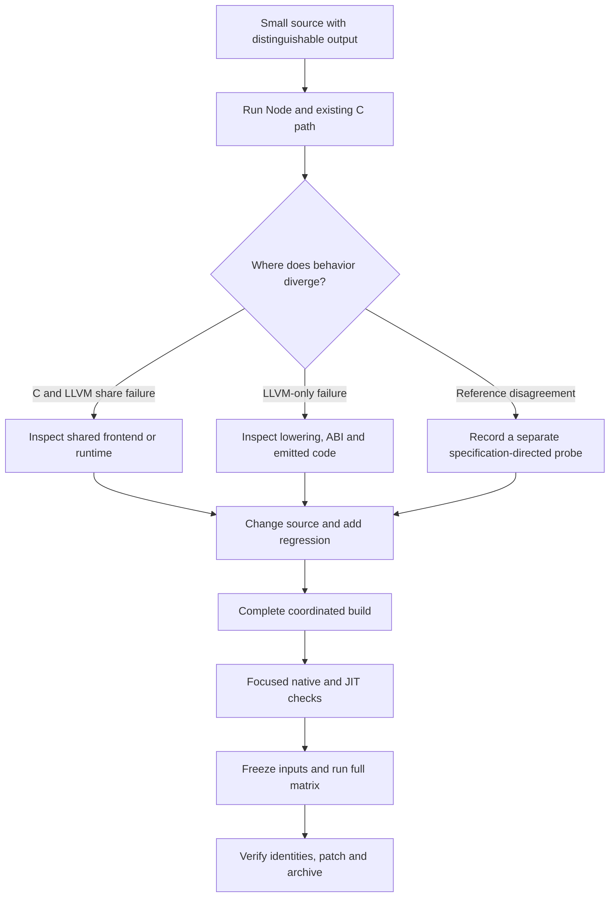

# Direct LLVM JavaScript: Engineering the ECMAScript Extensions

The difficult part of extending this compiler was identifying which component owned each failed behavior. A generator required a new LLVM emission case, but a Promise ordering failure belonged to shared runtime JavaScript. Lexical eval required new runtime compilation context, but optimized eval also required changes to variable analysis and scope retention. A passing source program could still depend on stale binaries or a test fixture changed during execution. The engineering process therefore had to establish both semantic correctness and a reliable connection between results and the code that produced them.

This article reconstructs that process from the delivered engineering diaries, source changes, failed build logs, focused probes, and final validation records. It explains the purpose of each investigation, the observation that changed the implementation, and the evidence that later closed it. The narrative is written retrospectively; it does not claim that the present author performed the colleague's historical experiments or had access to an unrecorded reasoning transcript.

The final code is explained in [[PROJ - Direct LLVM JavaScript - ECMAScript Extensions Implementation]]. The preceding baseline is [[PROJ - Direct LLVM JavaScript - Original Release Deep Dive]]. All three reports concern the repository at `/home/manuel/code/wesen/2026-10-28--llvm-js`, with distinct original and extension release evidence.

> [!summary]
> The extension grew through executable counterexamples. Early success established generator execution and rich-value bridges; subsequent failures exposed shared Promise behavior, async cleanup ordering, typed-array receiver rules, and missing eval metadata. The final release was accepted only after a completed build and a complete unchanged-input validation run. Historical failures and partial successes remain preserved as separate evidence.

## 1. How to read the chronology

The source diary is a consolidation of ten component records, all associated with 28 October 2026. Its first four records describe the extension phase; later records preserve the original backend and RV32 work. Several activities overlapped. Section order in the consolidated file is therefore not a total timestamp ordering of every edit.

This reconstruction uses explicit build numbers, recorded dependencies, and before/after probes to establish sequence where the evidence supports it. Within overlapping component work, it presents the causal order of a failure and its correction without inventing exact times. A source change, a successful compile, a focused execution, and a completed release gate are different milestones.

Most extension evidence lives under `hermes/docs/llvm/feature-work/`. Original backend evidence lives under `hermes/docs/llvm/evidence/`. The consolidated `Direct-LLVM-Engineering-Diary.md` points to those records, and the component-specific diaries retain additional detail. New import and reproduction results are stored separately in `ttmp/2026-10-28/extensions-validation/`.

The user's request for this report was: “Ok, then unzip it and then write the seccond two reports (the implementation report about the code itself, and then a diary report article about how it was implemented. Spare no detail)”. The subsequent style instruction was: “Use a textbook authoring style in both cases as done previously”. The resulting article uses chronological explanation and concrete evidence rather than a raw command transcript.

## 2. The original baseline: establish native execution first

Before the extensions, the project had two separate systems. The PicoCalc prototype compiled a restricted integer language and executed RV32 instructions in a supervised simulator. The new Static Hermes backend targeted dynamic JavaScript on a Linux x86-64 host. Keeping those contracts separate prevented successful integer-world tests from being treated as evidence for managed objects or closures on hardware.

The upstream compiler was pinned to `f837b9dd8396ebf5c4e8115412417d273565f0fe`. Source inspection found a usable boundary after shared module lowering and before C-specific register allocation and call rewriting. The new emitter generated textual LLVM IR there. A fixed C bridge supplied access to the existing runtime; it was built once per configuration rather than generated for every guest program.

The initial ABI used root slots for values, simultaneous copies for phi edges, and fixed-width function descriptors converted by compiled C into native bitfield structures. These decisions made layout and garbage-collection assumptions inspectable. They also gave later generator and eval work a consistent way to pass managed values across native helper calls.

The first substantial probe combined a loop sum, recursive factorial, an object, and closures sharing mutable state. The emitted module contained eight LLVM functions and assembled successfully. Native execution later printed:

```text
45 720 11 12 12
```

That output established several operations together, but it did not establish exception construction, lexical defaults, every GC path, or JIT linkage. The later failures show why a broad smoke example still needs focused cases for distinct runtime contracts.

### Build integration was part of the implementation

The first generated build graph did not yet include the new emitter object. Reconfiguration added it; the subsequent compiler errors exposed mismatched instruction getter names. Reading the pinned C emitter and IR definitions resolved those API assumptions without changing the existing instruction interfaces.

Upstream hidden symbol visibility then prevented independently compiled code from resolving bridge helpers. The bridge target received a default-visibility override. A separate static archive and shared library supported native linking and `lli` respectively. This was a packaging requirement of the new ABI, not a language change.

The historical build used AddressSanitizer. LeakSanitizer failed in its restricted environment, so subsequent commands used `ASAN_OPTIONS=detect_leaks=0` while retaining address checks. The diary explicitly separated that environmental workaround from a source fix and from successful leak validation.

## 3. Baseline failures established important invariants

The first wider native runs found that ES6 block scoping and temporal-dead-zone checks were opt-in in the pinned compiler. Loop closures therefore observed a shared final variable unless the appropriate frontend options were enabled. Both C and LLVM showed the same issue, locating the cause before backend selection. The wrapper and comparison commands enabled the same options, and separate raw-driver tests later established the direct-emission defaults and explicit overrides.

Error construction exposed a genuine bridge defect. AddressSanitizer traced a crash to native stack-trace recording. The bridge initialized the source-location index to `UINT32_MAX`, but this runtime's invalid-location sentinel was zero. Arithmetic and closure examples had not exercised that path. Rebuilding with the correct sentinel allowed exception tests to proceed.

Independent review also found that a proposed admission of 65,536 roots could allocate over 512 KiB before accounting for arguments. That could cross the native stack-check safety gap. The implementation reduced the combined root/argument admission to 1,024 slots. This was a conservative bound on explicit payload, not a claim to bound all native spills, recursion, or runtime memory.

A separate review corrected TDZ representation: LiteralEmpty and LiteralUninit are not interchangeable. The pinned Static Hermes convention represents Uninit with undefined bits while retaining type-level distinctions, so the helper needed the explicit invalid-type mask. Another finding required rejecting specialized typed object-literal forms rather than silently assigning ordinary enumerable-property semantics.

These checks established a pattern that continues through the extension work: inspect the actual runtime representation, identify the precise invariant, and make the backend either preserve it or reject the unsupported operation explicitly.

## 4. The first release gate and the dependency correction

The original full matrix passed 22 source cases: sixteen positive programs, three runtime errors, and three compile rejections. The positives produced 64 native comparisons across two Hermes and two LLVM optimization settings. Three actual `lli` cases and six native error executions passed. The forced-GC case called `gc()` unconditionally after allocation pressure and retained escaping closures; merely allocating many objects was not treated as proof that collection had happened.

A later review added the conditional lowered-Hermes-IR verifier call. Focused checks produced 32 byte-identical option pairs and 64 LLVM verifier passes. The report qualified that the full upstream Hermes verifier is Debug-only; the Release experiment demonstrated option plumbing and unchanged output, while the external LLVM verifier genuinely ran.

The final reproduction review then found a first-run dependency bug: the wrapper refreshed only the shared bridge, although native linking consumes the static archive. Existing build artifacts had hidden this omission during earlier tests. The correction requested both targets and tested rebuilding a deliberately absent archive. The recreated archive matched byte for byte and the counter ran successfully.

That dependency build also refreshed the VM shared library. Its changed binary identity justified repeating the complete host matrix. The final original-release gate then passed against one stable set of 42 recorded implementation, tool, fixture, and binary identities. This sequence explains why the archived “first pass,” focused verifier checks, dependency probes, and final validation are separate records.

## 5. The RV32 work provided a separate regression contract

The original device experiment was upgraded from per-module C emission to direct LLVM without changing its restricted state/capability model. The frontend used wrapping i32 operations, explicit signedness for fields such as event and schema, control-flow blocks for loops, phi nodes for short-circuit expressions, and fixed-register inline assembly for `ecall` capability calls.

The original C emitter remained selectable as an oracle. Tests compared seeded event streams, checked integer boundaries, verified emitted IR, and executed actual RV32 instructions through the simulator. A sandbox denied the Unix-socket compiler-service test; the failure remained recorded as an environmental limitation. A permitted retry returned a tool status that looked successful but left an incomplete test transcript. Only the subsequent full transcript, including the 24-test summary, counted as the gate.

The recorded reload scenario advanced score to three, retained state across a new generation that produced 43, rejected a bad migration, and continued the surviving generation to 129 with epoch two. Six modules had independent assembly/verifier and ELF/disassembly evidence. These observations establish the simulator path, not physical device execution.

The extension release preserves that lane unchanged. This matters when interpreting the new feature list: async functions and dynamic eval belong to the host Hermes work, and the old RV32 results are retained historical regression evidence rather than new device-feature evidence.

## 6. Extension planning: find existing machinery before adding representations

The extension request covered generators, async/await, Promises, RegExp, BigInt, private fields, typed arrays, and dynamic eval/Function. The first useful discovery was that much of the required language machinery already existed. Shared Static Hermes lowering invoked `LowerGeneratorFunction`, and the ordinary async path drove generators through an existing Promise implementation and console event loop.

The missing generator emission operation was `CreateGeneratorInst`, after suspension had already been transformed into heap state and a resumption function. Reusing that lowering avoided inventing a second continuation representation. The runtime helpers for RegExp, BigInt, and private fields similarly supplied tested representations that the LLVM bridge could expose through rooted operands.

Eval required a different investigation. The inherited C helper supplied no caller lexical environment. Connecting the LLVM instruction to that helper could demonstrate global evaluation while still failing the requested lexical behavior. The implementation therefore treated global/indirect eval and Function as existing runtime services needing validation, while designing a separate metadata path for strict lexical direct eval.

The engineering question was not simply whether an API with the right name existed. Each candidate path had to preserve its operands, environment identity, lifetime, and observable ordering. That distinction determined which features needed an emitter case and which required deeper shared changes.

## 7. First generator execution and the initial integration defect

The first generator protocol program compiled, passed LLVM verification, linked, and ran. Its record included values sent into `next`, caught throws, early returns, finally cleanup, completed-state behavior, and reentrant resume raising TypeError. The outputs are preserved in `generator-protocol-native.txt`; the build is in `generator-build.log`.

Iterator begin/next/close and property enumeration bridges followed. Their mutable arguments remained caller-owned root slots, and enumeration branches continued through the existing simultaneous phi-copy machinery. Additional fixtures separated delegation, iterator cleanup, finally suspension, enumeration, and GC survival instead of relying on one generator example.

The first broader compiler build failed on the private-membership integration:

```text
error: use of undeclared identifier 'BinaryPrivateInInst'
```

`extensions-build-1.log` records the diagnostic. The name described an instruction tag represented by `BinaryOperatorInst`, not a distinct C++ class. Dispatching its `ValueKind` inside binary emission fixed the representation mistake. The bridge's rooted operand contract did not need to change.

This is a useful distinction in compiler debugging: a source-level operation, an IR kind, and a concrete implementation class need not be one-to-one. Existing emitter dispatch is stronger evidence than inferring class names from an operation's textual spelling.

## 8. The first extension matrix: four failures and an invalid freeze

The first integrated extension run covered 24 selected source contracts. Twenty passed and four failed:

| Fixture | Observed area of failure | Component implicated by comparison |
|---|---|---|
| `async_generator_queue.js` | Async-generator completion/request behavior | Shared async driver |
| `async_generators.js` | Async-generator cleanup/return behavior | Shared async driver |
| `features_typed_arrays.js` | Negative numeric property became ordinary storage | Shared object runtime |
| `promise_subclass.js` | Promise subclass/species behavior | Shared Promise implementation |

The same discrepancies occurred through the C backend. That did not excuse them; it located them outside LLVM-only instruction selection. The result was useful diagnostic evidence because multiple execution routes agreed on the wrong behavior relative to Node.

The record also reported `input_files_unchanged: false`. During the run, the generator GC fixture was strengthened from an optional GC call to an unconditional one. Even if every case had passed, the test set would not represent one frozen input state. `extension-first-pass.json` therefore remains a selected historical run, with both semantic failures and changed-input qualification intact.

The harness itself was designed to preserve this distinction. Node ran sources as scripts with `vm.runInThisContext`, async fixtures declared completion lines, frontend and LLVM optimization levels were independent, and actual `lli` execution was a separate route. C-oracle waivers required explicit reasons. These mechanisms became necessary as lexical eval legitimately outgrew the inherited C helper.

## 9. Promise.all: an exit-zero failure revealed scheduling semantics

Before the broad matrix, a minimal probe showed an inherited Promise.all ordering defect. A reaction on an already-resolved aggregate and a separate resolved-Promise reaction both completed successfully, but their order differed:

```text
Node:        tick, all
Old Hermes: all, tick
```

The source contained a fast path that invoked the element resolver synchronously for fulfilled core Promises outside test262 mode. That removed an observable reaction step. The fix always called the input's `then` operation, allowing settlement through the job queue and preserving observable property access.

This was a shared-runtime correction. No new LLVM instruction was needed, and adding another event loop would have addressed the wrong component. The corrected order already passed in the first direct LLVM probes, while later failures concerned other Promise behaviors.

The general lesson is concrete: process success and final aggregate values do not capture asynchronous semantics. A test must include observations whose ordering changes under the suspected shortcut. The two-line counterexample was more diagnostic than a large async application whose outputs happened not to distinguish the job sequence.

## 10. Async-generator cleanup: a return request is not every later resumption

The async generator driver takes external next, throw, and return requests and drives an underlying synchronous generator. A tagged yielded value distinguishes internal await from an exposed yield. The old driver reused the pending return operation after an internal await fulfilled.

The failing sequence was: issue `return("closed")`; enter finally; encounter `await 0`; resume with `return(0)`. That second return abandoned the rest of finally and replaced the original completion. The required continuation was `next(0)`, because the generator already retained the pending return while executing cleanup.

The source correction changed kind-zero fulfillment to normal next resumption. Rejection still resumed with throw. The new finally fixture covered ordinary cleanup, finally return overriding the pending result, finally throw, yielding during cleanup, rejection during cleanup, injected throw, and loop-body exception precedence during close.

The final trace includes `cleanup-events start|awaited|end`, followed by completion with the expected pending value. This trace tests that cleanup actually resumed; merely observing a completed result would not prove that the intermediate finally statements ran.

No frontend change was required for this first bug. Later return-value defects did require AST changes. Separating those investigations prevented one successful finally correction from being mistaken for complete async-generator return support.

## 11. Species, subclass reactions, thenable jobs, and fresh identity

The Promise investigation then expanded from aggregate ordering to construction and resolution. The old `then` and `finally` paths did not implement the needed `Symbol.species` selection. The correction added a species getter and selection helper, with observable lookup ordering, default fallback, and constructibility validation. A VM-backed `HermesInternal.isConstructor` avoided testing constructibility by executing user code.

Subclass result settlement had another ordering problem. An intermediate core Promise introduced an extra reaction before resolving the selected constructor's capability. The fix attached that capability to the original reaction handler and settled it in the same job. Tests compared core and subclass order, not just instance types.

`finally` also changed to use the abstract-style internal Promise resolution helper rather than reading `C.resolve`. A public overridden resolve property is an observable operation that the cleanup protocol does not necessarily call. Species and finally tests checked getter counts and invalid constructors to expose such extra accesses.

A focused thenable probe produced another decisive trace:

```text
Node:        sync|then|tick|resolved:4
Old C path:  then|sync|resolved:4|tick
```

The runtime invoked the thenable immediately. The fix kept the `then` property read synchronous but queued its invocation, using a captured intrinsic apply operation. A later fixture added an explicit getter marker and produced `get|sync|then|tick|resolved:4`, separating property inspection from method invocation.

The same probe found public primitive Promise wrappers being cached: `Promise.resolve(0) === Promise.resolve(0)` was true in Hermes and false in Node. The correction created fresh public wrappers while retaining private await caches as an internal implementation detail. Tests covered exact-Promise identity and negative zero as well.

After coordinated build four, the focused async/Promise run passed seventeen contracts: fourteen positive programs and three expected uncaught errors. It executed 68 native contracts, seventeen real JIT contracts, and both C frontend configurations with unchanged inputs. This was a successful focused gate, but later return-protocol and traversal investigations still remained.

## 12. Rich-value integration exposed an ordinary-property fallback

The value component first inspected the C emitter and actual Static Hermes helper implementations. BigInt serialization reused `ParsedBigInt` bytes, private access used the documented null-cache path, and RegExp creation used runtime literal operations. These choices avoided reimplementing managed representations or depending on mutable global constructors.

Six initial programs were compared with Node through both C frontend optimization settings. Five matched: RegExp, BigInt, private fields, BigInt typed arrays, and combined GC behavior. The ordinary typed-array fixture differed at `a[-1] = 8`, which Hermes treated as an ordinary property.

The defect was traced to computed setting and a typed-array TODO in property definition. The correction classified canonical numeric index strings before ordinary-property fallback. A fixed buffer and the existing number parser/formatter handled canonical spellings without unnecessary allocation. BigInt keys used exact string conversion. The change did not alter object layout or GC metadata.

Invalid indexes required more than returning early. Same-receiver writes still had to perform value conversion, including `valueOf`, Number/BigInt errors, and established buffer checks. The implementation therefore called the existing element setter with an invalid-index sentinel. Definitions followed their own validation order. A new fixture checked descriptors, nonextensible arrays, key/value conversion order, GC during conversion, and numeric prototype entries.

### A reference engine can disagree with a specific algorithm

The next probe used a typed-array target and a different receiver. For an invalid canonical numeric index, the specification-directed expectation omitted conversion and returned success. The recorded Node v24.22.1 result performed conversion instead. The first lines were:

```text
Specified expectation: invalid true 0 false
Recorded Node:         invalid true 1 false
```

Symbol and BigInt-array cases also exposed the difference through TypeError. The implementation followed the typed-array Set algorithm, whose distinct-receiver invalid-index branch returns before element setting. The separate probe retained both outputs and the stated source for the expectation. [ECMAScript 2026 typed-array Set](https://tc39.es/ecma262/2026/multipage/ordinary-and-exotic-objects-behaviours.html#sec-typedarray-exotic-objects-set-p-v-receiver)

The main differential fixture kept a distinct-receiver case with a primitive value that did not expose the disputed conversion. The separate specification-directed record was not counted as a matching Node execution. That treatment is more informative than weakening every comparison or presenting one engine as infallible.

### The reverse receiver case required another guard

Read-only inspection found `Reflect.set({}, "-1", value, typedArrayReceiver)`. Here the target is ordinary, so an early check on the target cannot enforce the receiver's exotic definition behavior. The first correction still returned true where the expected definition failed.

The expanded fixture was executed against the unmodified build-four binary before applying the final guard, preserving an actual failing observation in `typed-array-receiver-before-guard.json`. The fix delegated canonical keys on typed-array receivers to `defineOwnComputedPrimitive` before ordinary property addition.

After build eight, the normal receiver fixture and separate normative probe passed through C, native LLVM, and `lli`. Invalid reverse-receiver assignment returned false without conversion; a valid element converted once. `values-final-probes.json` records commands, output, and unchanged before/after hashes. The final complete suite later passed seven rich-value fixtures, 28 native comparisons, seven JIT comparisons, and fourteen C executions.

## 13. Lexical eval: first preserve the binding, then compile the string

The eval investigation began by reading the IR builder, semantic resolver, SH helpers, `evalInEnvironment`, `compileEvalModule`, and managed-environment implementation. The decisive observation was that native SH environments are real Hermes `Environment` objects, which bytecode closures can also capture. The implementation could share cells instead of inventing a copied representation.

The runtime compiler still needed semantic and IR parent information that an LLVM-compiled function did not provide. The chosen design built a non-executed synthetic parent, mapped its declarations to actual native slots, and used it as context for compiling the requested string to Hermes bytecode. Execution received the original environment, receiver, and new target.

Several details were corrected before the first native result. Physical environments can contain multiple source blocks, so their complete slot lists are not the lexical view. The IR instruction had to retain the nearest visible declaration per identifier at the original source site. Implicit arguments needed an explicit captured native variable and a controlled source alias.

Constness also required care. A synthetic const declaration could make an eval assignment fail during compilation instead of raising a catchable runtime TypeError. Early scaffolding experimented with lexical declarations; the final source used `var` for semantic name creation and restored TDZ/constness metadata on the variables. No scaffold initialization executes.

The design explicitly rejected sloppy direct string eval because it can introduce caller bindings dynamically. It preserved non-string pass-through. Class-private and super context, derived constructors, and nested bytecode eval remained separate questions to resolve or reject; they were not assumed correct merely because ordinary lexical reads worked.

## 14. The first eval build: hidden APIs and position-independent code

The helper needed compiler and VM implementation APIs whose symbols are hidden from ordinary shared-library clients. It was placed in the full VM archive and exported one C entry point for generated code. This kept the public bridge narrow but introduced a build requirement that the newly direct-compiled object had not inherited.

Build three failed while creating the shared VM:

```text
relocation R_X86_64_PC32 against symbol `shllvm_eval_direct' can not be used when making a shared object; recompile with -fPIC
```

The correction enabled position-independent code on the containing archive target. `extensions-build-3.log` preserves the failure and build four records successful linking. This was distinct from the earlier bridge visibility issue: one concerns symbol resolution, the other whether object relocations are valid inside a shared library.

The first native O0-frontend/LLVM-O2 probes then matched Node for ordinary lexical reads/writes, shadowing, out-of-scope names, eval replacement, non-string inputs, const/TDZ errors, receiver/arguments, constructor new target, and escaped closures after GC. `eval-initial-native-probes.json` also retained the predicted nested-eval failure.

The initial generic probe lacked final boundary metadata and labeled some intentional rejections as failures. The historical record was not rewritten into a passing semantic result. Later fixtures assigned explicit support-boundary contracts, keeping rejected valid JavaScript separate from expected language errors.

## 15. Optimized eval exposed hidden scope dependencies

The first emission sweep used both frontend O0 and O, then LLVM assembly for successful modules. Unoptimized positive fixtures assembled, while several optimized fixtures failed the emitter's environment-chain check. The instruction still referenced its captured variables, but scope hoisting had removed a needed ancestor environment.

`ScopeHoisting` understood ordinary explicit scope-resolution uses. Eval introduced a dependency carried through captured Variable operands, with no ordinary source expression necessarily resolving those scopes. The correction added the parents of eval-visible variables and captured arguments to its retained dependencies.

Other optimizer guards prevented eval-visible cells from being classified as store-once, promoted to stale native stack copies, or omitted from captured-load/store knowledge. Function analysis declined assumptions that no longer held for a variable with an eval user. These changes conservatively limit optimization of affected bindings rather than disabling every optimization in the static program.

Source-site global and derived-constructor context also became explicit instruction metadata. A function moved or inlined by optimization must not change whether the original eval site may use `new.target`, or whether it falls under the derived-constructor rejection. This is a semantic use of metadata: removing it can change accepted programs even when ordinary data flow appears unchanged.

## 16. Ownership review found a second destructor

The initial design retained the compiler Module through shared ownership, which appeared sufficient for escaping eval closures. A deeper destruction-path review found that `BytecodeFunction::~BytecodeFunction` deletes its associated `FunctionIR`. The temporary synthetic provider could therefore destroy a remembered parent function even while the Module itself survived.

The correction transferred destruction responsibility after successful eval compilation. Synthetic bytecode functions had their `FunctionIR` pointers cleared; the Module's owning compiled-functions list retained and eventually released those metadata-only nodes. Actual evaluated functions kept their ordinary provider ownership. Failure paths kept ordinary cleanup.

This finding illustrates why “the parent object is shared” is not a complete lifetime argument. One must identify every owner that can destroy the referenced child. The component diary records that an initial review missed this detail, then rechecked the destructor and owning-list relationship after the eval owner identified it. The corrected review is part of the evidence, not a claim that review was infallible.

The runtime exception boundary received the same scrutiny. C++ strings, compiler providers, and RAII guards must finish destruction before Static Hermes's longjmp-style propagation. The implementation returned a `CallResult` from its C++ evaluation function and invoked `_sh_throw_current` only in the outer entry after cleanup. GC roots and C++ ownership were reviewed as separate obligations.

## 17. Nested eval required interpreter metadata, not another emitter case

An eval-created closure can later evaluate another string. At that point the caller is bytecode, so the original native descriptor entry is no longer enough. The old interpreter direct-eval operation still lacked the required lexical integration.

The interpreter correction used retained `DebugScopingInfo` to locate the current environment, either in a frame register or a spilled environment slot. It rooted that environment and called `evalInEnvironment` with the actual receiver and new target. Missing scope metadata produced a diagnostic instead of falling back silently to global lookup.

Runtime compilation began retaining scope metadata even without debugger support. Lazy compilation and the full dynamic optimization pipeline were disabled for this path until they could preserve equivalent context. This was an explicit performance and memory tradeoff for correct nested evaluation, not a claim that the runtime became a general LLVM JIT.

The first implementation of the interpreter root extraction did not compile. Build seven reported:

```text
error: no viable overloaded '='
```

The assignments attempted to put generic pinned/GC values into `PinnedValue<Environment>`. The correction used the existing `vmcast<Environment>` extraction pattern and immediately assigned the typed pointer to the root, with no allocating operation between extraction and rooting. Reading a nearby established debugger pattern resolved the representation issue.

## 18. Build coordination uncovered several nonsemantic failures

The recorded integration builds provide a useful map of distinct failure classes. They should not be collapsed into one statement that “the build was flaky.” Each had a specific cause and evidence:

| Build or checkpoint | Observation | Correction or next verification |
|---|---|---|
| Build 1 | `BinaryPrivateInInst` was not a C++ class | Dispatch its value-kind through binary instruction handling |
| Build 3 | Eval object was not PIC for shared linkage | Enable PIC on the full VM archive target |
| Build 4 | Focused native/JIT work succeeded | Continue semantic probes; no claim of complete release readiness |
| Build 5 | `CLFlag` lacked `getNumOccurrences` | Add `isSpecified` for positive and negative option spellings |
| Build 6 | Internal compiler subprocess hit LeakSanitizer restrictions | Apply the recorded leak-inspection workaround to build execution too |
| Build 7 | Typed environment-root assignments failed | Use the established typed extraction pattern |
| Build 8 | Log stopped before final targets despite a completion indication | Resume remaining work and require Ninja to report no pending work |
| Build 9 | Build completed; focused probes exposed remaining semantic issues | Correct global eval context, slot use, and parameter traversal |
| Build 10 | All sixteen remaining steps and final links completed | Run the final complete unchanged-input gate |

The build-five diagnostic was `no member named 'getNumOccurrences' in '(anonymous namespace)::CLFlag'`. The wrapper type was not an ordinary `llvh::cl::opt`. Its new `isSpecified` checked both enabled and disabled spellings so defaults could respect explicit overrides and option precedence.

The build-six logs explicitly reported a LeakSanitizer fatal error. Applying `detect_leaks=0` to the build mattered because build-time tools were themselves instrumented. AddressSanitizer remained enabled historically; no leak-check success was claimed.

Build eight required resumed invocations. A dry run showed pending work after an apparent session completion. The final resumed log included VM, console, and shared-bridge links, and only a subsequent `ninja: no work to do` established that the coordinated targets were current. This prevented focused tests from unknowingly mixing a new compiler with stale runtime code.

A warning-option probe also initially used `/dev/null` as an output-publication destination. Atomic file replacement could not replace that device. The corrected probe used stdout and verified both real LLVM definitions and warning behavior. The failed initial probe remained in `eval-warning-options-initial.json`, avoiding confusion between a publication-path mistake and an eval diagnostic bug.

## 19. Build-eight eval: twelve of fourteen contracts passed

The focused eval/Function matrix after build eight was complete for its selection and used unchanged inputs. Twelve of fourteen contracts passed, including the five explicit boundaries. Two positive cases failed: `eval_nested.js` and `function_dynamic_eval.js`.

The first failure occurred when eval immediately performed another eval in the evaluated program body. The runtime reported missing scope metadata. Comparing `doItInScope` with ordinary program/function generation showed that it did not establish the current lexical scope. Bytecode locations therefore lacked the scope index required by the interpreter's new path. The correction added `ScopedLexicalScopeChange` during eval IR generation.

The second failure involved a Function-created function whose eval could access ordinary locals but produced NaN from an arguments expression. `EvalCompilationData` had retained a null arguments operand, and eval IRGen did not restore the caller capture. The correction retained and restored arguments metadata, and preserved inherited arrow capture state instead of initializing a fresh ordinary-function context over it.

Additional probes deliberately tested adjacent assumptions. A transient Function parent returning an eval closure that later performed another eval after GC already passed. The implementation did not add a speculative broader provider-ownership change merely because ownership was under discussion. A separate optimized TDZ probe failed and required a real fix.

This distinction is valuable: a targeted passing control can rule out one proposed cause even while a neighboring feature remains broken. Investigation should narrow changes to evidence-backed defects, especially in ownership code where unnecessary changes can introduce new lifetime failures.

## 20. TDZ widening: Any did not include the uninitialized state

The optimized TDZ probe captured a `let` that was never initialized. Unoptimized execution threw ReferenceError, while optimized execution produced an invalid value printed as NaN. The source had not become valid merely because type inference widened the binding.

The defect was an early return of the ordinary Any type after encountering an eval user. That stopped analysis before initialization stores could contribute Empty or Uninit. Those are internal compiler states, distinct from the set of ordinary JavaScript values. Losing them could remove a required TDZ check.

The correction unioned Any into the inferred type and continued scanning other stores. Synthetic variables also included Empty when their original binding obeyed TDZ. Build-nine probes then matched Node for the never-initialized closure, nested lexical eval, Function arguments, and escaped arrow context.

The lesson is specific to analyses with internal states: making a value type more permissive can still make a program less correct if the widened set omits uninitialized or exceptional states. “Unknown value” and “possibly uninitialized binding” must remain separate facts.

## 21. Nested global eval exposed synthetic function context

After the build-nine corrections, a strict script containing nested eval of `new.target` was still incorrectly accepted. The first-level global syntax validation worked for a direct occurrence, but a second compilation followed retained synthetic parent metadata.

Those anonymous synthetic functions never execute, yet their semantic records looked like real function contexts to `nearestNonArrow`. The compiler therefore treated a script expression as if it had a legal enclosing function. The fix marked every synthetic parent as a program node for a global caller, allowing the semantic walk to reach the genuine global function.

`eval_nested_global.js` checks direct and arrow-origin global rejections, absence of a global arguments binding, and valid native and dynamically created constructor contexts. The constructor controls prevent a crude blanket rejection from appearing correct. The fix changed compile-time metadata, not GC layout or execution ownership.

The final eval family contained twelve positive programs, three runtime boundary rejections, and two compiler boundary rejections. Its positive cases produced 48 native and twelve JIT comparisons. Seven positive lexical/context cases and three runtime-boundary cases explicitly limited the inherited C oracle; five positive cases still matched it at both frontend levels.

## 22. Return-value probes forced a frontend change

The earlier internal-await/finally correction did not solve all async-generator returns. A helper probe passed a rejected Promise to an external return request. Native Node delivered the rejection at the suspended yield, where the generator's catch recovered and yielded another value. The old driver closed the generator before observing rejection and rejected the request instead.

The correction introduced explicit request-start normalization. An external return argument settles before a return or throw is injected. A source return expression has a separate requirement: it must await inside its original try/catch/finally region. The AST visitor therefore wraps the expression with the internal await mechanism before the generator body exits.

Awaiting the final result again would introduce an extra microtask and could unwrap a delegated return value that should remain a Promise in the iterator result. The completed path now concludes directly. Completed next and throw requests drain iteratively, while return requests still normalize their arguments. A 2,052-request fixture exercises this path and retained queue state under GC.

The new tests also cover empty async generators, nested arrows, cleanup that overrides a result, constructor-getter failures during argument resolution, and timers with microtask processing between callbacks. Helper-only before/after probes isolated the JavaScript driver's behavior; later rebuilt C/native/JIT runs established the combined frontend and runtime result.

## 23. Traversal bugs appeared in expression roots and parameter defaults

Independent review first found that the new arrow visitor isolated function context but visited only the body. A nested async generator in a default parameter could therefore remain untransformed. The narrow fix visited all arrow children while the enclosing-generator flag was cleared.

Build-eight probes then found a broader operand-root problem. Nested await was rejected as outside an async function, and async-generator expressions inside await or yield operands reached execution without their transformation. A visitor that traverses only an operand's children skips the operand itself when it is the operation needing rewriting.

The final await, yield, and return visitors process operand roots through `visitESTreeNode` before adding generated wrappers. They preserve one traversal of each original operand. This replaced special handling for one `yield* await` shape with a more consistent traversal rule.

A later read-only review found declarations and ordinary function expressions still visiting only their bodies. A concrete default-parameter probe covered four enclosing forms: ordinary declaration, ordinary expression, async function, and async generator. Node produced Promise-valued iterators yielding one, two, three, and four. Both Hermes frontend levels produced caught TypeErrors for the untransformed nested async generators, while an ordinary async-function control worked.

`recurseFunctionParameters` now visits parameter nodes before moving or transforming them, under a fresh non-async-generator context. The body is then traversed under its own function state. The permanent `async_parameter_expressions.js` fixture closes this gap. This is why context isolation and traversal completeness are separate requirements: resetting a context flag correctly does not help a subtree that is never visited.

## 24. Large async fixtures exceeded the frame bound

Two larger unoptimized async fixtures exceeded the original root-slot admission. Raising the bound would have weakened an earlier stack-safety decision. The investigation instead examined what the emitter actually stored.

The original constructor allocated a slot for every instruction, including side-effect-only instructions and unused results. The revised constructor keeps unique roots for values with users and constants, plus a dedicated scratch slot and rooted discard slot. Unused results can share discard storage during their own emission; used address-like values still retain separate storage. No instruction is deleted, and side effects still execute.

Independent review checked helper reentrancy, allocation during initialization, phi transfers, and frame initialization. The unchanged 1,024-slot calculation now admitted the two fixtures with maxima of 642 and 826 slots. `root-slot-admission-probes.json` reports successful assembly and verification for those modules; execution came from later focused and complete suites.

The next focused async run was interrupted after eleven positive cases. Those eleven had passed 44 native executions, eleven JIT executions, and 22 C executions, including both formerly oversized programs. The file is named `async-promise-final-pass.json`, but its content explicitly says `complete: false`. The filename is not the evidence contract. Without completion and a final fingerprint check, that record could not establish a release gate.

## 25. The frozen release gate closed the pending investigations

Build ten completed all sixteen remaining steps, including final VM, console, and shared-bridge links. A fresh Ninja dry run reported no pending work. The source freeze then covered 679 recorded implementation, configuration, fixture, harness, and binary identities. The complete core, extension, publication, and lexical-default gates ran against that completed build.

The resulting counts distinguish test kinds rather than treating every expected failure as a successfully executed program:

| Final historical gate | Result and interpretation |
|---|---|
| Core sources | 22/22: seventeen positive, three runtime-error, two compiler-rejection cases |
| Core positive native comparisons | 68 across four optimization combinations |
| Core JIT checks | Three actual lli executions |
| Core runtime errors | Six checked native executions |
| Extension sources | 53/53: forty-four positive, three language-error, three runtime-boundary, three compiler-error cases |
| Extension native executions | 176 positive comparisons, twelve language-error checks, twelve boundary rejections |
| Extension JIT executions | Forty-four positive, three language-error, three boundary checks |
| Publication checks | 6/6 |
| Raw lexical defaults | 5/5 |
| Input identity | All 679 recorded identities unchanged across the coordinated gate |

The async/Promise subset accounted for 24 contracts: twenty positive programs, three expected runtime errors, and one invalid-await rejection. Its 23 executable contracts passed 92 native and 23 lli executions, plus 46 C comparisons. These include errors; the positive-only native count is eighty. The newly added expression-root and parameter-default regressions passed at both frontend settings and both native LLVM settings, plus JIT.

The rich-value subset passed seven positive fixtures. The eval/Function subset passed twelve positives and its five explicit boundary contracts. Ten executable extension fixtures limited the inherited C oracle for documented eval reasons; forty executable contracts matched the required C route. This accounting prevents the expression “all comparisons passed” from hiding cases in which a comparator was not applicable.

The records `core-final-validation.json`, `extension-final-validation.json`, `driver-final-validation.json`, and `lexical-defaults-final-validation.json` identify those outcomes. `final-validated-files.json` connects them to unchanged inputs and successful commands. Interrupted or selected runs remain useful history but no longer carry the release claim.

## 26. Reporting and packaging were verified separately from execution

The colleague's report was regenerated only after the final named evidence records existed. Its extension chapter explained implementation, boundaries, and exercises; counts came from completed validation rather than an earlier partial summary. The PDF builder was designed to reject failed, partial, or changed-input extension gates.

The historical report contained 35 pages and approximately 15,124 words. The diary records rendering every page, reviewing contact sheets and full-size diagrams/tables, and checking text bounds and missing glyphs. That review found stale feature wording in the PicoCalc integration chapter and a layout issue with a generator-state table. Those documentation changes were made and the affected output was rendered again.

The delivered PDF's recorded hash is `4d4a02e3d60defbf44dfaf968983685db1f676807c487fda4c22194dbca99c68`, and its size is 221,967 bytes. These are historical artifact identities; the present Markdown reports are new analyses, not edits to that PDF. Their source discussion uses the editable chapters, implementation, and raw evidence.

Patch construction used a private Git index and private object directory. A second independent index started at the pinned upstream base and applied the patch. The resulting tree matched the proposed tree `01e2d894b12153ddd4dd0a5e04ed06d5c70d987a`. The final compact patch was 421,828 bytes and covered 124 paths. This test establishes that the patch reproduces the intended source delta against that base; it does not replace execution tests.

The archive builder retained complete source, licenses, tests, evidence, report, and diary while omitting build directories, toolchain downloads, Git history, and node_modules. It read every member back for CRC and SHA-256 validation. The final archive has 13,192 members. Release metadata outside the ZIP records the archive's hash without attempting a circular self-hash inside the archive.

These stages answer different questions: semantic tests connect inputs to observed behavior; fingerprints identify tested files; patch application connects the delta to its base; archive verification connects packaged bytes to their manifest; layout review checks whether the written explanation can actually be read.

## 27. Local reproduction: resolve the version mismatch before analyzing it

The present workspace initially received the earlier archive. Its patch changed forty paths, its core matrix had sixteen positives, and its negative fixtures still rejected generators and eval. The colleague's final message described a 124-path patch and an extension suite absent from those files. Comparing filenames and validation records established a real version mismatch rather than an interpretation difference.

The original release was imported, validated, committed as `b1f3757493a2edbe449978cb0ebf0dd4101b705d`, and documented in a separate vault note. The user then supplied `PicoCalc-LLVM-ECMAScript-Extensions-VERIFIED.zip`. Its 13,192 files, extension harness, new runtime helpers, and 53-case final record matched the described update. Both local copies of the verified ZIP had the same SHA-256:

```text
805b6dd6be63b94c22a8fa001d8f730238436ccdb36de85fea2ed1dad79b8a02
```

The updated import verified all 13,191 manifest entries before copying. It added 141 files, changed 46, and removed the two obsolete unsupported-eval/generator fixtures. The importer removed only previously packaged paths absent from the new archive, after checking their old hashes; it preserved local validation records, repository configuration, and unrelated files. The new source did not require local semantic modifications.

This is why an archive should be identified by content rather than a conversational description alone. The earlier and newer ZIPs had similar purpose and naming but different implemented boundaries. Writing the earlier report first preserved a useful baseline and made the extension delta independently reviewable.

## 28. Fresh build and full local validation

The updated compiler and runtime were rebuilt in a tmux session using the existing local Release configuration. The build completed 458 steps. A subsequent dry run reported `ninja: no work to do.` The full core and extension suites then ran, followed by publication and lexical-default checks. New output paths kept packaged historical evidence intact.

The local tool versions were Clang/LLVM 18.1.3, Node v24.18.0, Python 3.13.2, CMake 3.28.3, and Ninja 1.11.1. The build used `-O1 -DNDEBUG` and the complete GCC 13 C++ installation selected during the original import. Unlike the colleague's historical build, this local reproduction did not enable AddressSanitizer. It demonstrates a successful independent workstation run without replacing the historical sanitizer result.

The local extension gate passed all 53 source contracts with no skip, filter, quick mode, or oracle-only mode. Its 200 native executions and fifty lli executions matched their declared contracts. It recorded 188 native Node-contract matches and twelve explicit boundary rejections, plus 47 lli Node-contract matches and three boundary rejections. All 654 inputs selected by the local extension harness remained unchanged.

The fresh core suite passed 22/22 with 68 positive native comparisons. Publication checks passed six of six, and raw lexical defaults passed five of five. All four harness exit statuses were zero. The local 654-input harness inventory and the historical 679-entry coordinated freeze are separate manifests with different coverage; they are not evidence of identical binaries across machines.

The PicoCalc source subtree is unchanged by the extension archive. Its earlier fresh local 24/24 validation remains in the original import directory. No new physical-device or dynamic-RV32 claim follows from the successful host extension run.

Fresh evidence is in `ttmp/2026-10-28/extensions-validation/`: `import.json`, `build.log`, `build-dry-run.log`, `core-validation.json`, `extension-validation.json`, `driver-validation.json`, `defaults-validation.json`, their logs, and `tests.exit`. These records distinguish work performed during this import from the historical component experiments reconstructed above.

## 29. The investigation structure that made the result reviewable

The process repeatedly separated four questions: which behavior failed, which component owned it, whether the proposed source change corrected it, and whether the completed release still passed after all components were combined. That separation prevented local success from being promoted into a broader unsupported claim.



The C path was especially useful for localization but not universally independent. It shared patched Promise and object behavior and lacked lexical-native-eval context. Explicit per-fixture oracle policy preserved its useful comparisons without forcing valid LLVM behavior to match an incapable comparator.

The source freeze mattered because the work crossed frontend, runtime JavaScript, native runtime, and build-generated bytecode. A new compiler binary alone did not imply that the console and VM contained the latest builtins. Completed links and no-work dry runs provided a concrete build boundary; before/after hashes provided a concrete test boundary.

The diary also retained negative results at their original evidence level. A syntax-only C++ compile established type compatibility. LLVM assembly established IR structure. A helper-only Node probe established one JavaScript driver's behavior. None was promoted to a native integration pass until the corresponding execution happened.

## 30. Reading the retained evidence efficiently

The following map provides a review order for the most consequential claims. Paths are relative to `hermes/docs/llvm/feature-work/` unless stated otherwise.

| Question | Primary evidence | Final source to inspect |
|---|---|---|
| Did native generator protocol work before the broad suite? | `generator-protocol-native.txt`, `generator-build.log` | `LLVMBackend.cpp`, `runtime.c`, shared generator lowering |
| Which initial cases failed? | `extension-first-pass.json` and log | Async driver, Promise runtime, `JSObject.cpp` |
| What ordering did thenable resolution change? | `promise-thenable-order-probe.json` | `01-Promise.js` resolution and reaction handling |
| Was return/finally behavior isolated from AST lowering? | `async-return-rejection-helper-probe.json`, `async-return-fixed-helper-probe.json` | `04-AsyncIterator.js`, `AST/AsyncGenerator.cpp` |
| Where did typed-array receiver handling remain incomplete? | `typed-array-receiver-before-guard.json` | Late typed-array receiver branch in `putComputedWithReceiver_RJS` |
| How was Node's receiver discrepancy handled? | `typed-array-receiver-spec-probe.md`, `values-final-probes.json` | Canonical-index and receiver branches in `JSObject.cpp` |
| What failed in the build-eight eval matrix? | `eval-build8-validation.json` | `doItInScope`, capture metadata, interpreter direct eval |
| What exposed optimized TDZ loss? | `eval-build8-extra-probes.json` | `TypeInference.cpp`, synthetic eval variable types |
| What fixed nested global source context? | `eval-build9-concrete-probes.json`, final `eval_nested_global.js` results | `eval_extensions.cpp` program-node marking |
| Why were large async fixtures rejected? | `root-slot-admission-probes.json` and earlier focused logs | Used-value slots, scratch, and discard in `FunctionEmitter` |
| Which traversal omission remained last? | `async-parameter-traversal-build9.json` | Parameter traversal in `AsyncGenerator.cpp` |
| Which record is actually final? | `extension-final-validation.json`, `final-validated-files.json` | Full fixture set and fingerprint harness |

A reviewer can start with the smallest failed probe, read the corresponding final source, and then locate that behavior in the complete final record. This avoids treating a long diary as a substitute for executable evidence while preserving the context that raw JSON alone cannot explain.

## 31. Lessons for the next implementation phase

The most generalizable result is that native compilation does not remove managed-language responsibilities. Generator suspension required heap state, asynchronous execution required observable job order, and eval required shared cells plus retained semantic information. Each was already partly represented in Hermes; extending LLVM successfully depended on reusing the correct representation and supplying missing contracts at its boundaries.

Several future changes deserve the same investigation discipline. An eval cache must preserve scope layout and metadata lifetime. A new optimizer must recognize dynamic reads/writes and retain internal uninitialized states. A slot allocator must reason about allocation and reentrancy within instructions, not only later uses. Promise fast paths must preserve observable jobs and property accesses. Typed-array operations must distinguish assignment, definition, target, receiver, and conversion order.

A physical-device integration adds different obligations: 32-bit ABI validation, managed allocation, interruption policy, code retention, cache coherence, state migration, and effect delivery. The host suite cannot establish them. The original restricted RV32 prototype remains useful because it provides a small explicit state and transaction contract, but it should not inherit host feature claims without corresponding implementation and execution evidence.

The final record supports a precise conclusion: the delivered host extension release passed its targeted core and extension contracts on a frozen historical build, and the imported source passed a fresh full local reproduction. It does not claim complete ECMAScript conformance, a performance improvement, comprehensive sanitizer instrumentation of generated LLVM bodies, or execution on physical PicoCalc hardware.
