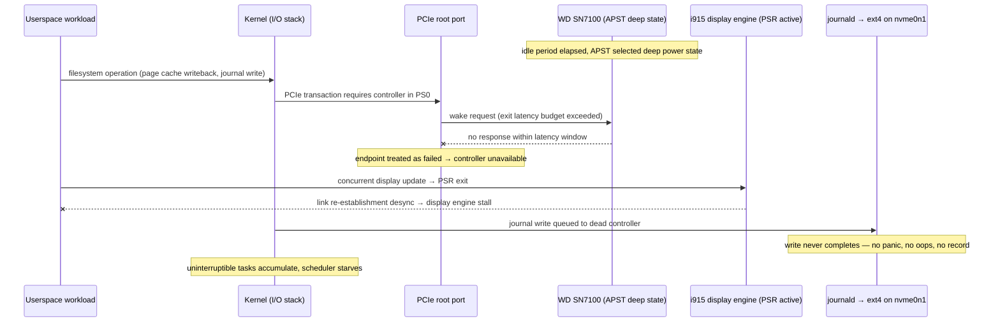

# Deep Dive: Diagnosing a Logless Hard Freeze on Linux — Tiger Lake i915 PSR and NVMe APST

This note preserves the complete forensic analysis of a hard freeze that occurred on the Framework 13 workstation (hostname `f`) on 2026-10-28 at 15:11:36 EDT, together with the reusable diagnostic method that identified the cause. The machine froze during active use with zero evidence written to any persistent log, and the cause was reconstructed entirely from indirect evidence: the shape of the missing data, the recovery actions of the *next* boot, and a recurring pattern of NVMe controller resets visible in earlier boots.

The analysis concludes that the freeze was a dual power-state failure: the WD_BLACK SN7100 NVMe controller dropped off the PCIe bus while in an APST deep-sleep power state, at the same time as an i915 Panel Self Refresh (PSR) display-pipeline wake failure on the Intel Iris Xe graphics controller. Because the root filesystem lives on the same NVMe controller that dropped, the kernel lost its write path at the instant of the fault and could record nothing.

> [!summary]
> - An abrupt mid-transaction journal cutoff with no kernel panic record means the *storage path* died, not merely a process. The recovery messages of the following boot (journald file replacement, ext4 journal recovery) are the primary evidence.
> - Two firmware power-saving features failed simultaneously on this hardware: NVMe APST deep-sleep wake timeouts (drive drops off the PCIe bus) and i915 PSR wake desynchronization (display engine stall). Each had left independent evidence in earlier boots.
> - The fix is two kernel parameters that disable the failing transitions: `nvme_core.default_ps_max_latency_us=0` and `i915.enable_psr=0`. Pre-existing workarounds in `/proc/cmdline` (`nvme.noacpi=1`) show this machine had NVMe power-state incidents before.
> - `powertop.service` running `--auto-tune` on every boot *and* every sleep transition re-applies aggressive device power management and is a plausible aggravator of the resume-time AER resets.

## Why this note exists

On Wednesday 2026-10-28 at 15:11:36 EDT, the machine stopped responding during normal interactive use. The screen froze, input stopped working, and no keyboard shortcut had any effect. Approximately 23 minutes later the machine was power-cycled by holding the power button. The investigation needed to answer two questions: what happened, and why was there nothing in the logs.

The system under analysis:

| Component | Value |
|---|---|
| Platform | Framework Laptop 13 (Intel Tiger Lake, `cros_ec` embedded controller) |
| CPU / GPU | 11th-gen Intel Core, integrated Iris Xe (`TigerLake-LP GT2`, i915 driver) |
| RAM | 62 GiB (no memory pressure at time of freeze; 54 GiB free in the following boot) |
| Storage | WD_BLACK SN7100 2TB NVMe (DRAM-less, host memory buffer), root ext4 via LVM |
| OS / kernel | Ubuntu, `6.8.0-147-generic` |
| Suspend mode | S3 deep sleep (`mem_sleep_default=deep`) |
| Kernel cmdline | `quiet splash module_blacklist=hid_sensor_hub nvme.noacpi=1 mem_sleep_default=deep loglevel=6` |

The kernel command line already contains `nvme.noacpi=1`. This parameter disables NVMe ACPI power management, and its presence means someone previously diagnosed and worked around an NVMe/ACPI power interaction on this exact machine. Prior incidents are therefore not a hypothesis; they are documented in the boot configuration itself.

## How kernel logs reach disk — and why their absence is informative

Before interpreting the evidence, it is necessary to understand the write path that produces persistent logs, because the failure signature of a storage-path death is different from every software failure class.

`systemd-journald` collects kernel messages (`/dev/kmsg`), stdout/stderr of services, and structured journal entries, and writes them to `/var/log/journal/<machine-id>/system.journal` on the root filesystem. Under normal operation these writes are small, frequent, and asynchronous. When the kernel detects a fault it can control — an oops, a BUG(), a panic — it attempts to emit a stack trace through the printk ring buffer, which journald persists. Several mechanisms exist specifically to preserve evidence across catastrophic events: the pstore subsystem (EFI variable storage), the panic notifier chain, and explicit `kmsg`-dump callbacks. That is why even a kernel panic usually leaves a record.

This persistence chain has one critical dependency: a functioning write path to non-volatile storage. Every element of the chain — journald's writer, the filesystem, the block layer, the device driver — sits *above* the storage controller in the I/O stack. A failure that removes the storage controller itself removes the evidence-recording mechanism together with the workload it was serving. The kernel does not detect that its logging destination has vanished; the writes simply never complete, and no later message can be written to announce the fact.

Different failure classes therefore leave distinguishable on-disk signatures:

| Failure class | What the journal shows at the end | What the *next* boot shows |
|---|---|---|
| Clean shutdown | Ordered service stop, "Reached target Power-Off/Reboot" | No recovery; wtmp has a shutdown record |
| Kernel oops/panic (software fault) | Stack trace, oops text, possibly truncated | pstore may hold the panic record |
| OOM kill | `oomd` or kernel OOM messages, "Killed process" | Nothing unusual |
| Storage I/O stall (recoverable) | `task ... blocked for more than 120 seconds` soft-lockup messages | fsck may run; messages from *before* the stall exist |
| Power loss | Clean end — journal was flushed up to the last completed write | journald may recover cleanly; wtmp lacks shutdown record |
| **Storage controller bus dropout** | **Abrupt stop mid-transaction; arbitrary last line** | **"system.journal corrupted or uncleanly shut down, renaming and replacing"; ext4 "recovering journal"** |

The last row is the signature of this incident. It is important to read the table in the right direction: an abrupt cutoff alone proves only that writes stopped; the *combination* of an abrupt cutoff with the next boot's journal-replacement and filesystem-recovery messages identifies the storage controller as the component that went away. The next section walks the evidence in order.

## The evidence trail

### Boot timeline

`journalctl --list-boots` and `last` establish the timeline:

| Boot | Kernel | First entry | Last entry | End signature |
|---|---|---|---|---|
| -5 | 6.8.0-139 | Sep 24 21:32 | Sep 28 21:41 | ends at "Performing sleep operation 'suspend'" |
| -4 | 6.8.0-139 | Oct 1 21:29 | Oct 18 11:40 | ends at suspend entry |
| -3 | 6.8.0-147 | Oct 18 16:05 | Oct 24 10:47 | ends at suspend entry |
| -2 | 6.8.0-147 | Oct 24 23:50 | Oct 25 01:29 | abrupt; last lines are containerd log traffic |
| -1 | 6.8.0-147 | Oct 25 01:31 | **Oct 28 15:11:36** | **abrupt, mid-activity — the freeze under analysis** |
| 0 | 6.8.0-147 | Oct 28 15:34:54 | (running) | — |

Three observations follow from this table. First, boots -5 through -3 end at a suspend entry with no resume messages, meaning the machine was last suspended and its journal was never written again in that boot — consistent with battery depletion during multi-day suspension, or with a failed wake. Second, `last shutdown` returns no records at all since the wtmp epoch (Jul 29): this machine essentially never shuts down cleanly; it is suspended, and reboots follow forced power-offs. Third, boot -1 — the incident boot — was suspended and resumed at 12:34:25 on the crash day and then ran normally for 2 hours 37 minutes before the freeze.

### The freeze signature

The last messages of boot -1 are ordinary, high-frequency log traffic, not error output:

```text
Oct 28 15:11:36 f containerd[2814]: ... level=info msg="loading plugin \"io.containerd.event.v1.publisher\"..."
Oct 28 15:11:36 f systemd[1]: Started docker-6647db01....scope - libcontainer container 6647db01....
Oct 28 15:11:36 f containerd[2814]: ... level=info msg="shim disconnected" id=6647db01...
Oct 28 15:11:36 f systemd[1]: var-lib-docker-overlay2-5253969d...-merged.mount: Deactivated successfully.
```

This is a routine Docker container lifecycle transaction — the same message group recurs every 60 seconds throughout the boot, which provides a precise heartbeat: the journal stops inside one such transaction. There is no oops, no soft-lockup warning, no I/O error, no thermal event, and no shutdown sequence. The system did not *decide* to stop logging; logging stopped because the destination stopped accepting writes.

### Next-boot recovery confirms an unclean cutoff at the storage level

Boot 0 begins at 15:34:54 and contains the decisive evidence:

```text
Oct 28 15:34:54 f systemd-journald[719]: File /var/log/journal/6e08.../system.journal
    corrupted or uncleanly shut down, renaming and replacing.
Oct 28 15:34:54 f systemd-fsck[992]: /dev/nvme0n1p2: recovering journal
```

The journald file needed replacement because its tail was truncated mid-write — the write was in flight when the power was removed. The ext4 filesystem on the NVMe partition required journal recovery for the same reason. `/sys/fs/pstore/` is empty, so the platform recorded no panic; EFI-pstore had nothing to save because the kernel never reached a panic path. The absence of a panic record is *not* evidence that the kernel survived; it is evidence that the kernel's recording channel shared the fate of the system.

### The recurring NVMe controller resets

The NVMe controller had been failing — and recovering — at every suspend/resume cycle for days before the freeze. Each resume in boot -1 and its predecessors logged:

```text
kernel: OOM killer disabled.
kernel: nvme nvme0: 8/0/0 default/read/poll queues
kernel: nvme nvme0: resetting controller due to AER
kernel: nvme nvme0: Identify namespace failed (-4)
kernel: nvme nvme0: 8/0/0 default/read/poll queues
kernel: OOM killer enabled.
```

| Resume (boot -1) | Event |
|---|---|
| Oct 25 01:39:40 | AER controller reset; `Identify namespace` fails with `-4` |
| Oct 25 02:38:43 | same |
| Oct 26 19:28:30 | same |
| Oct 27 13:58:27 | same |
| Oct 28 12:34:25 | same — final resume before the freeze |

`-4` is `-EINTR`, an interrupted system call: the first identify request after the reset was interrupted and retried successfully. The important fact is not the recovery but the pattern: after every transition out of a low-power platform state, the controller required an AER (Advanced Error Reporting) reset before it would enumerate. AER resets are the PCIe subsystem's response to a controller that has become unresponsive or reported an error condition — a device that was healthy before the power transition and healthy after the reset, but not healthy across the transition itself.

### Display-pipeline instability in the hour before the freeze

The Firefox window in the active GNOME session logged repeated WebGL context loss beginning at 13:25, roughly every three minutes, continuing through 15:10:33 — one minute and three seconds before the journal stops:

```text
Oct 28 15:07:43 f /usr/libexec/gdm-x-session[561104]: JavaScript warning:
    ... challenge.js, line 1: WebGL context was lost.
Oct 28 15:10:33 f /usr/libexec/gdm-x-session[561104]: JavaScript warning:
    ... challenge.js, line 1: WebGL context was lost.
```

A single WebGL context loss on a page that recreates contexts is unremarkable. A context loss recurring on a fixed cadence for 105 minutes, ending one minute before a total system freeze, is a display pipeline that was repeatedly losing and re-establishing its GPU execution state. This is the observable surface of the second failing mechanism described below.

## The NVMe power-state stack: APST

To interpret the resume resets, the NVMe power model has to be made explicit. An NVMe device advertises a set of *power states* (PS0 … PSn) in its controller identification data. PS0 is fully operational; higher-numbered states progressively reduce power consumption at the cost of increased *exit latency* — the time the device needs to return to PS0 when an I/O request arrives.

*Autonomous Power State Transitions* (APST) is the mechanism by which the device moves itself between these states without operating-system involvement: the driver configures transition timeouts, and the controller demotes itself to a deep state after an idle period. The Linux NVMe driver constrains which states APST may use with a single tunable: `nvme_core.default_ps_max_latency_us`, the maximum exit latency (in microseconds) the driver is willing to accept. States whose exit latency exceeds the cap are excluded from APST.

On this machine, the value was the stock default:

```bash
$ cat /sys/module/nvme_core/parameters/default_ps_max_latency_us
100000
```

A 100 ms exit-latency budget permits APST to select the drive's deepest advertised states. The WD_BLACK SN7100 is a DRAM-less controller design that uses a host memory buffer (HMB) and — like the other WD and SanDisk DRAM-less models reported with this failure — advertises aggressive low-power states with exit latencies near the configured ceiling. The failure mode, as documented for this exact hardware class (Tiger Lake platform + WD/SanDisk DRAM-less NVMe), is that the controller in a deep APST state sometimes fails to complete its PCIe wake transition within the expected latency window. The PCIe root port then treats the endpoint as failed. If no I/O was in flight to the device, the AER reset at the next power transition recovers it — which is precisely the resume-time pattern in the table above. If the dropout occurs *while* the device holds the root filesystem, every process touching the filesystem blocks in the kernel in an uninterruptible state, the scheduler has nothing runnable, and the machine stops with nothing recorded.

Two local configurations amplified this exposure. First, `powertop.service` runs `powertop --auto-tune` at every boot and — because of its unit's `WantedBy=` — again at every sleep transition:

```ini
# /etc/systemd/system/powertop.service
[Service]
Type=oneshot
ExecStart=/usr/local/sbin/powertop --auto-tune
[Install]
WantedBy=multi-user.target sleep.target
```

`--auto-tune` enables aggressive runtime power management on every tunable device it finds, including PCI endpoints and their suspend/resume behavior. Re-applying that configuration immediately before every suspend maximizes the chance that the NVMe controller enters a deep state as the platform drops into S3. Second, the platform firmware does not grant the operating system full AER control to the root port — `acpi PNP0A08:00: _OSC: platform does not support [AER]` appears in every boot — so error handling falls back to the driver-level reset path.

## The display power-state stack: PSR

Panel Self Refresh (PSR) is a display power-saving feature of the Intel i915 driver for eDP panels. When the screen contents are static, the display engine powers down the main display link and instructs the panel to self-refresh from its internal framebuffer. On the next content change — mouse movement, a keypress, any frame update — the driver must power the link back up, re-establish the transmission, and resume scanning out from the GPU framebuffer within the panel's refresh window.

On Tiger Lake hardware this wake transition is implemented with tight timing requirements, and a desynchronization between the display engine and the panel during the re-establishment phase produces a visible flicker followed, in the failing case, by a display engine hang. The kernel exposes control through module parameters:

```bash
$ ls /sys/module/i915/parameters/ | grep -i psr
enable_psr
enable_psr2_sel_fetch
psr_safest_params
```

With no override on the kernel command line, PSR is enabled by default. The repeated `WebGL context was lost` events in the final 105 minutes of boot -1 — each one a GPU context destroyed and recreated — are consistent with the display pipeline repeatedly re-initializing after failed PSR exits. A PSR exit failure in progress at the moment the storage controller dropped would combine a stalled display engine with a stalled storage stack: a screen showing a frozen frame and a system with no write path.

## Failure synthesis

The two mechanisms are independent, but on this platform they fail together, and the combination removes every recovery channel at once:



The sequence explains each observed artifact precisely:

- **The journal stops mid-transaction** because the write in flight at 15:11:36 targeted the controller that had just dropped.
- **The journald file is corrupted and ext4 needs journal recovery** because in-flight writes were lost when power was removed from a hung system.
- **No panic or pstore record exists** because the recording path (journald on ext4 on the NVMe) was itself dead, and the platform never reached a controlled panic.
- **The AER resets after every resume** are the same dropout mechanism observed at a moment when the system was still functional enough to recover: the suspend/resume path forces the controller through its deep power states on every cycle.
- **The WebGL context losses** are the display engine's half of the failure, visible in the last hours of the boot.

A frozen display alone would leave the machine reachable over the network (Tailscale was connected); a dead storage controller alone would still allow input and switching consoles. The simultaneous loss of both, with total silence in the logs, is the fingerprint of the dual power-state failure.

## The fix and its verification

The fix disables the two firmware transitions that fail on this hardware. Both are kernel command line parameters, so they apply at the earliest possible point in boot and survive module reloads.

Edit `/etc/default/grub` and extend `GRUB_CMDLINE_LINUX_DEFAULT`:

```bash
sudo sed -i \
  's/^GRUB_CMDLINE_LINUX_DEFAULT="\(.*\)"/GRUB_CMDLINE_LINUX_DEFAULT="\1 nvme_core.default_ps_max_latency_us=0 i915.enable_psr=0"/' \
  /etc/default/grub
sudo update-grub
```

The resulting line on this machine:

```text
GRUB_CMDLINE_LINUX_DEFAULT="quiet splash module_blacklist=hid_sensor_hub nvme.noacpi=1 mem_sleep_default=deep loglevel=6 nvme_core.default_ps_max_latency_us=0 i915.enable_psr=0"
```

After reboot, verify that both parameters took effect:

```bash
cat /proc/cmdline
cat /sys/module/nvme_core/parameters/default_ps_max_latency_us   # must print 0
cat /sys/module/i915/parameters/enable_psr                        # must print 0
```

`nvme_core.default_ps_max_latency_us=0` sets the APST exit-latency cap to zero, which excludes every non-operational state from autonomous transitions: the controller remains in PS0 whenever powered. `i915.enable_psr=0` disables panel self refresh entirely: the display link stays powered whenever the panel is on. The cost of both is measurable but small — on the order of a few percent of idle battery drain — and on this machine the stability trade is unambiguous given that the controller was already failing to enumerate after every suspend.

Two accompanying changes reduce residual risk:

- **Remove `sleep.target` from `powertop.service`'s `WantedBy=`** (leaving `multi-user.target`), or disable the service entirely. Re-tuning every device into aggressive runtime power management immediately before each suspend maximizes exposure to the exact transition that was failing. After the GRUB change, observe whether the resume-time AER resets disappear; if they persist, the powertop unit is the next variable to eliminate.
- **Check the drive and firmware state**, which requires sudo on this machine:

```bash
sudo smartctl -a /dev/nvme0        # critical_warning, media_errors, percentage_used, unsafe_shutdowns
sudo nvme error-log /dev/nvme0 | head -60
sudo fwupdmgr get-updates          # Framework ships BIOS and NVMe firmware via LVFS
```

## Working rules for logless-freeze forensics

The method generalizes beyond this machine. When a Linux system freezes and the logs contain nothing, the absence of evidence is itself the evidence, and it must be read systematically.

- **An abrupt journal cutoff is a measurement, not a gap.** Identify a recurring high-frequency log pattern before the cutoff (cron jobs, container lifecycle events, keepalives) and establish whether the cutoff falls inside one such transaction. A cutoff inside routine work means writes stopped unpredictably; a cutoff after escalating errors means a different investigation.
- **Always read the next boot before the dead boot.** The recovery messages — journald file replacement, ext4/f2fs journal recovery, `fsck` activity — tell you whether the cutoff was a power event, a storage-path death, or a clean shutdown. This single check separates the three most common classes.
- **Cross-reference boot ends with suspend state.** A boot whose journal ends at "Performing sleep operation" never wrote again after suspending; the possibilities are battery depletion during suspend, or a wake failure that required a forced power-off. Distinguish them by checking whether the next boot starts hours later (depletion) or immediately (forced reset).
- **Read `/proc/cmdline` as an incident history.** Workarounds like `nvme.noacpi=1` are records of earlier diagnoses on the same machine. Any investigation should start from the assumption that every existing workaround marks a component with a known failure history.
- **Search for the recurring near-miss before searching for the cause.** The AER resets recovered on every resume for three days before the unrecoverable event. Recovered faults of the same subsystem, adjacent in time to the fatal one, are usually the same fault with more witnesses.
- **Check what shared resource the silent component and the dead component have in common.** A display freeze plus a log freeze points at platform-level power transitions, not at either subsystem individually. Components that fail simultaneously usually fail through a shared mechanism.
- **Treat aggressive power-management tooling as a first-class suspect.** `powertop --auto-tune`, USB autosuspend, and runtime PM re-tuning applied at boot or sleep time interact with firmware power states in ways that are invisible in per-component logs. The unit's `WantedBy=` list describes exactly when the configuration gets applied.
- **Preserve a recording channel that does not share fate with the system under test.** If freezes recur, set up netconsole (network syslog) or a serial console before the next incident, and check `/sys/fs/pstore` after every unexplained reboot. A log sink that lives on the machine can only record failures the machine survives.

## Open questions

- Whether the resume-time AER resets disappear entirely after the APST/PSR fix, or persist and implicate the powertop unit or drive firmware. The next suspend/resume cycles answer this directly.
- The drive's SMART health and firmware version — the `smartctl` and `fwupdmgr` checks above require sudo and had not been run when this note was written.
- Whether earlier boots -2 through -5 also ended in wake failures rather than battery depletion; the wtmp record cannot distinguish them, but a forced power-off after a failed wake would produce the same missing-resume signature.

## Related notes

- The external postmortem that matched this exact hardware class (Tiger Lake + WD NVMe, identical zero-log freeze signature): `t.mkhonta.com/blog/postmortem_system_freeze_fix`
- Framework community threads on NVMe loss after resume: `community.frame.work` ("NVMe is lost after resuming from sleep", tracking threads on suspend resume failures)
