# Implementation Diary — CC5 Godprompt Computer: Beat by Beat Through the Spore Session

This note reconstructs the session that built **CC5 Godprompt Computer** one beat at a time. A beat is the smallest unit that changed the work: a person's message, a design decision recorded in reasoning, a file written, a test run, a publish, or a seeded turn. For each beat the note gives the recorded time, the trigger, what the agent did, the evidence the tools returned, and what changed as a result. Failures are quoted rather than summarised away.

The companion technical report explains the finished system. This note explains how it was made, in the order it was made, including the occasions when the work went backwards.

> [!summary]
> - The session contains seven distinct requests in eight prompt messages (four build requests, two design questions, one packaging request sent twice), eight screenshots sent instead of prose, two interrupted messages, and one stray paste. Everything else was autonomous execution: 149 tool calls and 109 reasoning records across 7 hours 5 minutes of wall time, of which about 63 minutes were active.
> - Work proceeded in three implementation acts: a 54-operation document editor (2 min 50 s of tool activity), the Spore language and studio (38 min 54 s, 86 tool calls), and the creature studio (8 min 21 s, 21 tool calls). Two design consultations and one packaging pass followed.
> - The engine was written and tested headlessly before any pixels existed. The first browser run came after all six Spore modules, the stylesheet, and the textbook were complete, which is why the language errors were already precise when the interface first rendered.
> - Seven setbacks are recorded: two test-harness defects (a charset mismatch and an invalid selector), one stale local server, one rejected publish manifest, one host stylesheet collision, one field-geometry bug, and one final command whose result was never written to the log. The model error at Beat 26 is a deliberate test fixture, not a setback.

## How this reconstruction was made

The session log is `session.jsonl` in the repository: 1,043 raw JSONL records from Claude Code 2.1.312, model `claude-opus-5-5`, entrypoint `remote_cowork`. It was converted with `go-minitrace convert claude-code` and queried through the normalized `turns`, `tool_calls`, `files`, and `sessions` tables.

| Fact | Value |
|---|---|
| First recorded event | 2026-10-28 08:18:50 UTC (09:18:50 Zurich) |
| Last recorded event | 2026-10-28 15:24:04 UTC (16:24:04 Zurich) |
| Wall span | 25,514 s (7 h 5 min 14 s) |
| Active time | 3,759 s (62.6 min), excluding gaps longer than five minutes |
| Normalized turns | 336 |
| Tool calls | 149 |
| Reasoning records | 109, of which 60 contain substantial design text |
| Person-labelled entries | 19: 8 prompt messages (7 distinct requests), 8 screenshots, 2 interrupted messages, 1 stray paste. Two further skill texts were injected and are labelled separately. |
| Files created by `Write` | 9 under `/home/claude/spore`, 1 scratch Hypha turn |

Three caveats apply to everything below. Times are UTC; the session ran in Zurich, one hour ahead. Assistant prose is quoted verbatim where it is short enough to quote and paraphrased otherwise. Tool results are abridged, but no quoted diagnostic has been altered. The last tool call has no recorded result, which is discussed in Beat 43.

## Timeline at a glance

| Act | Window (UTC) | Tool calls | Output |
|---|---|---:|---|
| I. Start a computer | 08:18:50–08:19:31 | 8 | A fresh CC5 desktop with its own empty log, plus a first turn |
| II. The document editor | 08:23:52–08:26:42 | 22 | 54 Hypha operations defining the Docs app; one frame adjustment |
| III. The god prompt and Spore | 09:57:58–10:36:52 | 86 | Six modules, a stylesheet, a textbook, a studio, an agent, v1 published, one seeded turn |
| IV. Creatures | 10:40:57–10:49:18 | 21 | `$.pointer`, the animal program, v2 published, a second seeded turn |
| V. Two design questions | 12:25:57–12:39:41 | 7 | Backup and connector designs, no code |
| VI. Packaging | 15:21:55–15:24:04 | 5 | The export folder: sources, screenshots, tests, transcript, README |

The three implementation acts account for 129 of the 149 tool calls. The gaps between acts are 1 h 33 min, 1 h 37 min, and 2 h 43 min; they are the person reading, trying the page, and taking the screenshots that open the next act.

```mermaid
gantt
  dateFormat HH:mm
  axisFormat %H:%M
  section Act I
  Start a computer      :08:18, 2m
  section Act II
  Document editor       :08:23, 4m
  section Act III
  Spore                 :09:57, 39m
  section Act IV
  Creatures             :10:40, 9m
  section Act V
  Two design answers    :12:25, 15m
  section Act VI
  Packaging             :15:21, 3m
```



The chart is drawn from the recorded timestamps, not from estimates. The long empty intervals between acts are the person's review time and are not drawn.

## Act I — Start a computer

### Beat 1 · 08:18:50 · The instruction is a link and a verb

The first message is one line:

> `@https://claude.ai/artifact/1GUrJcDp2YMTx641RQ4yV6 start a new claude computer`

Two reads follow in the same second. The first returns the first 16,000 characters of a 73,537-character page. The second saves the full `index.html` (73,610 bytes). A `Grep` of the saved page for `first turn` returns its embedded README lines, including the statement that window frames are cells (`desk.<app> = {x, y, w, h}`) and that the page is the main way to build or change apps.

The agent then launches the `artifact-capabilities` skill, which is the host's own documentation for what a published page may ask for: database, room, user, sample, MCP, assets, downloads. The decision recorded in the reasoning is to copy the page and its scripts into a new artifact with its own log, which is exactly what the README prescribes.

### Beat 2 · 08:19:09 · Publish the copy before writing anything

The first publish creates `5U5ctT7cXHmR6jiT65XQWy` with an explicit capability declaration:

| Capability | Declaration |
|---|---|
| `assets` | empty object |
| `db` | empty object |
| `downloads` | `true` |
| `mcp` | server `host:claude_browser` with tools `preview_start`, `navigate`, `computer`, `get_page_text`, `read_page`, `find` |
| `room` | topic `ops` with interaction enabled |
| `sample` | images enabled |
| `user` | profile scope |

The artifact is published before any content is added. That ordering matters: the log is per artifact, so a new publish starts empty, and everything after this beat is written into a store that did not exist two minutes earlier.

### Beat 3 · 08:19:22–08:19:28 · Speaking to the page through its turn channel

`ToolSearch` loads `ArtifactData`. A `get` on `data/users/me` returns one document named `cc5` with `"apps":[]`, confirming the new desk is empty. A `set` then writes to `data/users/me/cc5/turns` a document whose body is:

```
" Fresh desktop, empty log. Tell me what to build and it'll appear here.
```

This is the external write channel. The page watches that collection, leases each document, streams its text into a Hypha `Stream`, and marks the document applied. The agent has just used the same channel that will later seed two whole studios.

### Beat 4 · 08:19:31 · Hand back with one caveat

The reply states that the desktop is up, that a first line has been said on its canvas, and that the in-page browser only works when the page is opened in the Claude desktop app. No further work is attempted. The act is eight tool calls long and ends with the system in a state the person can open.

## Act II — The document editor

### Beat 5 · 08:23:52 · A one-sentence product request

> can you make me a great doc editor app on the computer

The request is small and the design space is not. The agent's first action is not to write, but to read the view kit.

### Beat 6 · 08:24:02–08:25:35 · Read the element library before designing

Thirteen inspection calls follow in ninety-three seconds. They cover the input elements (`R.field`, `R.area`, `R.toggle`, `R.choice`, `R.select`, `R.button`), the text area wrapper, the residual and error types (`isRes`, `isErr`), string and escape handling in the lexer, the formula function list (`sumby`, `where`, `match`, `pluck`, and others), the Pratt operator table, `parseNode` for view elements, and `replay`.

The reasoning summaries explain the order: check how the word count handles newlines, check how list items spread into table cells, check how `split` handles newlines, check how markdown headings survive inside Hypha strings, check escaped characters and which built-ins a formula may call. Each check removes one way the app could fail to express what it needed.

### Beat 7 · 08:25:55 · One file, 54 operations

`turn.hypha` is written in a single `Write` and applies as 54 operations. Its structure is the whole design:

| Part | Content |
|---|---|
| Functions | `fn.words(t)` splits after replacing newlines and tabs; `fn.mins(t)` derives reading time |
| State | `query`, `sel`, `next_id`, `mode`, `goal`, and a `files` list with two seeded documents |
| Derived | `shown = match(files, query)` and `total_words` over `pluck(files, "body")` |
| Layout | `split 0.28` with a library column and an editor column |
| List | `each d in shown` with a nested `each d in files` and `when d.id == sel` |
| Editor | `field d.title`, `choice d.status`, `tabs of: mode`, `area d.body`, `scroll` + `md` for preview, and a side-by-side split |
| Metrics | `stat` for words, reading time, characters; `progress` toward the 800-word goal |
| Actions | Four `ask` buttons (Polish, Continue, TL;DR, Outline), a delete, and a free-form `ask` line |

Nothing in this file is code in the JavaScript sense. It is all Hypha: path writes, formulas, a view block, and inline actions.

### Beat 8 · 08:26:05 · The first micro-fix

A single `sed` replaces the reading-time formula:

```diff
- fn.mins(t) = max(1, ceil(words(t) / 230))
+ fn.mins(t) = ceil((words(t) + 1) / 230)
```

The command prints `55`, the file's line count after the edit; the applied operation count stays at 54, as Beat 9 confirms. The change is small and it is recorded because the diary should record the first moment the design was corrected by arithmetic rather than by taste.

### Beat 9 · 08:26:10–08:26:28 · Apply, then read the log back

The turn is committed with `ArtifactData set`, followed by an eight-second sleep, a state fetch, and a read of the applied turn. The returned metadata is:

```json
{ "at": 1793175971925, "errors": [], "id": "t1793175700119", "ops": 54 }
```

Fifty-four operations, zero errors. The agent also reads the next turn document's text, which is how the following frame fix is prepared. Verification is done against the page's own applied metadata, not against the write acknowledgement.

### Beat 10 · 08:26:32–08:26:38 · Width is a data problem

The fetched state shows the Docs window at 420 pixels wide, at `x=284`, while its measured content is 1,035 by 1,458 pixels. A 420-pixel column cannot hold a split editor. The fix is a single turn document:

```
desk.docs = {x: 0, y: -360, w: 1000, h: 820}
```

This is the pattern that recurs throughout the session: when the interface is wrong, the correction is data written through the same channel as everything else, not a patch to the renderer.

### Beat 11 · 08:26:42 · Report the result and its caveat

The reply describes the library, the three editor modes, the metrics, the five model-backed actions, and the seeded content. It ends with the frame change and one sentence of permission: "drag it wherever you like." The act is complete in under three minutes of tool activity.

## Act III — The god prompt and Spore

### Beat 12 · 09:57:58 · The request that defines the rest of the session

The message begins with the person's framing and then contains a numbered brief. The parts that constrained every later decision:

> Turn the idea above into a small JS DSL with an IDE, agent and textbook. Deliver everything as one self-contained HTML file. No external libraries, CDNs, fonts or network assets. […] Fluent builder API over a minimal grammar of composable components. Builder calls produce an IR (a DAG), evaluated separately. Components accept lambdas: build-time (generate structure) or runtime (evaluated per frame/tick). Make the distinction explicit. Plain JS as host language, no parser/interpreter, no sandboxing needed.

It continues with requirements for examples from simple to complex, parameters as controls, a hand-rolled editor with highlighting and line numbers, presets, a parameter panel, visible errors, a coding agent with three model providers and automatic fallback, a window API, a textbook stored once and used by both the Book tab and the agent, two audiences, responsive layouts, and a Swiss visual style in Arial with 1px hairlines and 2.5px corners.

The reply at 10:00:20 is one sentence of intent: build it as a new self-contained artifact, with an IDE, agent, and textbook.

### Beat 13 · 10:00:21–10:00:45 · Reconnaissance

Four checks run before the first line of Spore exists:

1. `Artifact list` shows at least 200 published artifacts, including the CC5 desktop from Act I.
2. The `artifact-design` skill loads, supplying the page contract and design guidance.
3. The compound check exits 2 because the Playwright cache directory is missing, but it prints `pw ok`: Playwright is importable, and no browser is on `PATH`.
4. `claude.d.ts` and `sample.d.ts` are read, a filesystem search finds Chromium-related directories under `/etc` and `/usr/share`, and the test scripts later point Playwright at `/opt/pw-browsers`.

Two design questions are settled in reasoning here. The first is where the tool should live: as a standalone page or as a CC5 element. The second is how the agent should be wired: a tool-calling loop or a single fenced-code reply. The reasoning at 10:00:44 weighs both and chooses fenced code, which is the decision that later makes the repair loop testable with a mock.

### Beat 14 · 10:04:37–10:04:45 · Six tasks

Six tasks are created in nine seconds, and the first is marked in progress:

1. Design the Spore DSL and write its engine.
2. Write example programs, simple to complex.
3. Build the IDE: editor, canvas desk, params, errors, IR.
4. Add the coding agent and window API.
5. Write the textbook and render the Book tab.
6. Check in a headless browser and publish.

The session follows this list almost exactly. Five of the tasks are closed at 10:35:01–03, half an hour after they were created and immediately before the first publish attempt; the sixth moves to in progress at 10:35:04 and closes at 10:36:34, after the seeded turn verifies.

### Beat 15 · 10:06:52 · The engine first

`core.js` is written before any renderer or page integration. The file contains the builder classes, the runtime, the IR serializer, and the error taxonomy. A check at 10:11:26 confirms the module's exports:

```
build, load, Runtime, SporeError, KINDS, BUILDER_METHODS, RESERVED, CLOCK, plain, lineOf, didYouMean
```

That export list is the module's whole contract with the rest of the system.

### Beat 16 · 10:12:18–10:12:35 · Examples before pixels

`presets.js` is written with ten programs, from one cell to a five-app home. `test-core.js` then loads every preset, ticks each 300 times, presses every button, evaluates every view slot, and serialises the IR. Two representative lines from the output:

```
OK hello: 1 apps, 4 nodes, 3 edges, ticking=false, errors=[]
OK wild: 3 apps, 14 nodes, 19 edges, ticking=true, errors=[]
```

The same script runs thirteen invalid programs and prints a kind, a line where one is known, and a message for each. This is the beat where the language is proven to work before any canvas exists. It is also where the error surface is designed by reading its own output.

### Beat 17 · 10:12:47 · Wording, then line numbers

A `sed` replaces three occurrences of the phrase `reads "…"` with `uses "…"` in link errors, because a data slot does not necessarily read a cell. A small Node check follows that throws inside a program and prints `[4, "TypeError: Cannot read properties of undefined (reading 'bar')"]`, confirming that the reported line is the program's line and not the wrapper's.

Both changes are about the same thing: an error message is part of the language's interface, and it must be true.

### Beat 18 · 10:16:03–10:19:50 · Renderer, editor, agent

In order, `paint.js`, `ui.js`, and `agent.js` are written. Between them, two inspections read the host: CC5's global key handler and launcher, and Hypha's `exists` and `valueAt`. A patch to `core.js` at 10:19:50 adjusts how values, defaults, and param controls are cloned so that live coding can carry a person's settings across a rebuild.

The ordering is deliberate. The renderer depends on the runtime, not on CC5. The editor depends on the tokenizer, not on the studio. The agent depends on a provider interface, not on the page.

### Beat 19 · 10:22:09–10:26:21 · Host, styles, textbook, bundle

`host.js` (programs, loop, elements, studio, bridge, API), `style.css`, and `docs.md` complete the source set. The first bundle prints:

```
170019 bytes 2436 lines
syntax ok
```

A documentation fix precedes the build: a text-slot example containing nested backticks is rewritten as a plain concatenation, removing the ambiguity. `build.py` is created in the same command as the build, so the bundler is part of the test loop from its first use.

### Beat 20 · 10:26:30–10:27:05 · Copy CC5 and edit the page

The published CC5 modules are copied into `/home/claude/spore/cc5/`, and `index.html` is edited to add the credit, the script tag, and the textbook inside `script#spore-docs`. The edit prints `ok 102769`, the new page size.

### Beat 21 · 10:27:22 · First browser contact, and a false alarm

A local server starts, and a Playwright script creates a studio through `spore.create`, then loads every preset through `spore.load`. The result is ten `True` rows with empty error lists. One console error appears:

```
PAGEERROR: Invalid regular expression: /[̀-ͯ]/g: Range out of order in character class
```

The reasoning at 10:27:47 identifies the cause as a character-encoding mismatch: the local server serves scripts without a UTF-8 charset, and a character range in the host code is corrupted. The rerun at 10:27:50 writes a `test.html` with the platform's charset and viewport skeleton, and the error disappears. The product was never broken; the reproduction environment was.

### Beat 22 · 10:28:11 · The person answers with a screenshot

An image arrives with no text. The next reasoning record names the problem: the primary buttons render without text. A specificity clash in the page's own stylesheet overrides the Spore rule. The fix at 10:28:42 changes the primary-button rule, and the rebuild is verified at 10:29:00.

From this beat onward, the review loop changes shape. The person does not describe visual defects in prose; they paste the screen, and the agent traces the cause in CSS.

### Beat 23 · 10:29:19–10:29:48 · Preview height and container queries

A second screenshot follows. A measurement script returns the studio's grid at 1,346 by 758 pixels with columns `421.188px 595.172px 329.625px`, and a preview body of 594 by 758. The preview canvas is present but small, because the parameters panel and the grid rows compete for height at the container breakpoint.

The fix changes `.sp-paramwrap` to sit below the canvas with `max-height: 34%` inside the container query, and the rebuild verifies the wide and narrow layouts. This is the beat where the studio stops being a fixed three-column page and becomes a container-measured grid.

### Beat 24 · 10:30:08–10:31:36 · Four phone screenshots and a design decision

Four more images arrive within seventeen seconds. The reasoning at 10:30:36 diagnoses a blank studio body in phone mode. Two checks follow: CC5's own media rules and the camera's level-of-detail threshold below `z < 0.45`, which stops rendering window bodies when the desk is zoomed out.

The decision recorded at 10:31:36 is not to make the studio smaller. It is to give the studio a **full-screen mode at 1:1**, with an overlay on `document.body`, a Close button, an Escape handler, and a small call-to-action shown when the studio is rendered below 0.66 zoom on a phone. The implementation lands at 10:32:08.

This is the most consequential interface decision of the act, and it came from a person's screenshot rather than from a specification.

### Beat 25 · 10:32:19–10:33:02 · Verify the narrow layout, then fix the details

The phone test prints `['narrow', 390, 390]`: the size class is narrow, the studio is 390 pixels wide, and the document's scroll width is also 390, so there is no horizontal overflow. Four phone captures are combined into one contact sheet with PIL. Two smaller fixes follow: the studio's height inside a CC5 window, and the graph's minimum scale, raised from 0.45 to 0.75 so the graph pans instead of shrinking into illegibility.

### Beat 26 · 10:33:22 · The model loop, tested against a mock

The agent cannot be tested against a live model in a reproducible way, so a mock OpenAI-compatible endpoint is written. It returns a deliberately broken program on the first request and a corrected one on the second. The test configures the studio to use it and sends "A pomodoro timer".

The transcript of the panel is the evidence:

```
chip: OpenAI-compatible · mock-model
I made a pomodoro timer.
OPENAI-COMPATIBLE · MOCK-MODEL
Loaded. 1 error.
Asking the agent to fix it (attempt 1 of 2).
Fixed: the element is stat, not stats.
OPENAI-COMPATIBLE · MOCK-MODEL
Loaded and running. 7 lines.
```

The mock logs two requests. The first carries a 28,573-character system prompt and no errors; the second carries the same prompt plus the error `build line 4: Unknown view element "stats". Did you mean "stat"?`. The repair loop is therefore proven end to end, including the wording of the error that drives it.

### Beat 27 · 10:33:40–10:33:58 · Nine book examples and an invalid selector

A script extracts and runs every runnable book block. The output lists nine programs, all `ok`, from `hello` to `words`. A follow-up test navigates the Book to a heading with `a.querySelector('#3-views')` and fails, because a CSS id selector cannot start with a digit. The fix replaces it with `document.getElementById('3-views')`, and the test passes.

This is a test defect, not a product defect, and it is recorded because the two are easy to confuse when a selector silently returns `null`.

### Beat 28 · 10:34:06 · The host stylesheet is part of the contract

A screenshot arrives showing a red bar and a pink tint on a runnable example. The reasoning at 10:34:17 traces it to a class-name collision: CC5 already styles `.run`. A scan of the host stylesheet counts `run: 3` and `on: 6` rules. The fix renames the Spore figure classes to the prefixed `.sp-ex` and `.sp-runnable`, and the page is rebuilt with the updated textbook.

The lesson is stated in the reasoning and is worth keeping: an embedded stylesheet must assume nothing about the host's class namespace.

### Beat 29 · 10:35:12 · The publish gate rejects the credit line

The first publish attempt fails:

```
deploy 400: manifest entry "spore.js" is declared text/javascript but begins
with markup; remove the leading '<' or declare it text/html [content_refused]
```

The credit comment required by the brief begins with `<!--`, and it had been placed at the very top of `spore.js`. The fix at 10:35:24 keeps the sentence verbatim but wraps it in `/* … */` for the script, while the HTML page keeps the HTML comment. The publish at 10:35:32 succeeds as version 1, contract 0.2.92.

### Beat 30 · 10:35:46–10:36:34 · Seed the first turn and verify the bridge

The new artifact has no `cc5` document, which is expected. The agent reads the turns channel implementation and then writes `first-turn.hypha`: a studio running the five-app Home computer example, plus the Docs app from Act II, so the "Reading the desk" example has real data.

A verification script applies the turn and reports:

```
[105, []]
[{"key":"studio.code","apps":["clock","weather","thermostat","house","energy"],"errors":0,"playing":true}]
[122, ["Welcome to Docs", "Untitled draft"], []]
```

105 operations, no errors; five Spore apps running; the desk read returns two documents and 122 words; the export writes back to the desk. The turn is committed, listed back, and task 6 is closed.

### Beat 31 · 10:36:52 · Report the result and the limits

The reply is the longest in the session. It describes the two elements, the studio's modes, the desk bridge, live coding, the seeded turn, and the tests. It then states four limits without softening them: the built-in Claude path could not be tested outside Claude; direct API calls are blocked inside an artifact; the credit line is wrapped in the JS file; and this is not the single self-contained file the brief asked for, because the person asked for it to sit inside CC5. It offers to produce the single-file version.

## Act IV — Creatures

### Beat 32 · 10:40:57 · A new request, eight minutes after the publish

> can we make a studio in side computer that allows us to make procedural animations of animals

The reply at 10:43:35 states the plan and the one gap it expects: "a draw canvas can't read the pointer, and 'drag the animal around' is half the fun." That sentence predicts the only grammar change of the act.

### Beat 33 · 10:43:36–10:44:51 · One grammar change, then the program

The agent reads `core.js` around the syntax-line recovery code, then applies a multi-part edit, whose script prints `10`, adding `$.pointer`: a pointer map, `setPointer`, a `$pointer` dependency, a scope branch, and an IR node. The program file follows: a field app, an `animal` factory, and three animals, with build-time helpers for chains, outlines, and two-bone legs.

### Beat 34 · 10:45:06 · Verify behaviour before pixels

A headless Node run of the program ticks it 400 times and prints:

```
errors []
target [ 92, 100 ] snake head [ 92, 100 ] feet [[207,79,0],[238,80,1],[190,85,0],[176,64,1]]
snake joints now 60
ticking true nodes 41 1
```

The head reaches its target, four feet exist with two in a stepping state, the snake can be resized to 60 joints, and the program ticks. The gait state machine is verified numerically before it is ever drawn.

### Beat 35 · 10:45:33–10:45:54 · Preset 11, the bundle, and a server that was not running

The program is embedded as example 11, the textbook gains a pointer section and a pond example, and the build reports:

```
10 examples checked | 188124 bytes 2684 lines | pointer in README: True
```

The first creature browser test fails immediately:

```
playwright._impl._errors.Error: Page.goto: net::ERR_CONNECTION_REFUSED at http://localhost:8765/test.html
```

The local server from the previous act had been stopped. The rerun starts it again and the test proceeds. This is the second harness failure in the session, and like the charset error it is diagnosed from the exact transport message.

### Beat 36 · 10:46:08–10:47:18 · A picture of the animals, then the field fix

A screenshot of the creatures arrives. The measurements show the field window at `{'x': 37, 'y': 114, 'width': 728, 'height': 720}`. The reasoning at 10:47:02 identifies two problems: the dot grid is drawn in field coordinates but not clipped to the letterboxed drawing, and the animals can drift outside the field because their targets are not clamped.

The fix is a single edit with five parts:

| Change | Why |
|---|---|
| `g.clear("paper")` replaces a filled rect at the field origin | The old fill did not cover the letterboxed area |
| The grid is anchored to `ox % step` and `oy % step` in canvas space | The grid must move with the field, not with the window |
| A new `field.inside` cell holds a clamping function | Targets need one shared boundary rule |
| Koi and gecko targets call `$.field.inside(...)` | Offsets could leave the field |
| Leg length and stride defaults rise (15/24), hip offset falls to 0.55 | The gecko's legs were barely visible |

A Node check returns `[] [132, 129]`: no errors, target inside bounds. The bundle is rebuilt and the preset check passes.

### Beat 37 · 10:48:15–10:49:07 · Publish v2 and seed the creature turn

Version 2 publishes with the new module. The state fetch shows the `cc5` document at 24,771 bytes and the studio and Docs frames still null, because frames are written by the turn rather than by the page. The creature turn is then built and tested: 194 operations, zero errors, and the program's apps are `field`, `snake`, `koi`, `gecko`. The turn is committed, the page is given twelve seconds to apply it, and the state is fetched again to confirm.

### Beat 38 · 10:49:18 · Report, plus an extension path

The reply lists the three animals, the shared controls, the pointer behaviour, the new textbook chapter, and the test results. It ends with an invitation that is also a design claim: "To add another animal, ask the studio's agent, for example 'add a centipede with twenty pairs of legs.' The program is built from small helpers (`chain`, `follow`, `outline`, `leg`) that make that a short change."

## Act V — Two questions, two designs

### Beat 39 · 12:25:57 · Backup and durability

> how can i have a backupable secure data store for this.

Two greps establish the facts before any recommendation: the export path in the window menu, the claims lease in `cc5.js`, and the replay/time code. The answer describes the current store (artifact database, append-only log, periodic checkpoints, private until shared), names two gaps (no copy outside the artifact, no tamper protection for later contributors), and proposes three additions: a one-click log backup and restore, a nightly Google Drive copy, and store write rules. It also states the cost of end-to-end encryption: the studio's agent and the chat Claude would lose the ability to read the desk.

### Beat 40 · 12:39:03 · Connectors

> what if we use connectors?

The agent searches the connector surface before answering: `ListConnectors` returns installed services including Gmail; `SearchMcpRegistry` returns Supabase and Neon; `SuggestConnectors` returns Supabase. The answer recommends a mirror of the log rather than making the connector the live store, for two stated reasons: connector calls are slower than the desk's write rate, and a connector acts as the person who has the page open, so every collaborator would need their own account. It then proposes a Storage panel, a Drive mirror, a Postgres mirror with append-only rows, and a nightly task.

No code is written. The person asked how, and the reply is a design with a question at the end.

## Act VI — Packaging

### Beat 41 · 15:21:55 · The export request

> share me transcript and the zip and all links

The first action is `read_conversation`, which returns the chat URL `https://claude.ai/chat/625cb73d-a6ca-4fa8-bceb-01ce4123ccc8` with 14 turns, and the agent notes that the chat link already contains every tool call. A directory is created and populated:

```
/home/claude/share/cc5-godprompt-computer/
  artifact/  spore-src/  desk-turns/  tests/  screenshots/
```

### Beat 42 · 15:23:01–15:23:27 · Two interruptions and a stray paste

The request is interrupted twice. Between the interruptions the person sends a line that reads:

> metric of, label, pre, unit, trend, subagent transcript and workspace

This is a fragment of CC5's own component reference, not an instruction, and it is not acted on. The final message at 15:23:27 restates the request with two additions: the workspace, and the transcript of any subagents.

### Beat 43 · 15:23:34–15:24:04 · Build the archive and the readable transcript

The agent checks whether any subagents were used, finds none, inspects the native project directory, and counts raw record types (`assistant`, `attachment`, `user`, `last-prompt`, and others). It then writes a Python script that converts the JSONL into a readable markdown transcript: person messages, Claude prose, tool names with abridged inputs, and collapsible results. The script writes `transcript.md`, copies the native log to `session.jsonl`, and prints a count of person sections.

The log ends at that tool invocation. No result is recorded. The exported folder nevertheless contains the artifacts the script was meant to produce: `transcript.md` begins with the exact header string from the script and contains 19 person sections, 51 Claude sections, and 149 tool entries, and the README records that no subagents were used. The command therefore ran; the session record simply stops before its result was stored. That is the one process gap in the session, and it is visible only because this reconstruction checked the artifacts rather than the acknowledgement.

A small count discrepancy follows from the same boundary. The in-session counter run at 15:23:50 saw 305 assistant and 169 user records; the archived file holds 307 and 170. The extra records are the three written after the counter ran: the final assistant tool call, its user-side tool result, and the packaging exchange itself.

## What the timeline shows

### The shape of the work

| Phase | Active span | Tool calls | Character |
|---|---:|---:|---|
| Start a computer | 41 s | 8 | Copy, publish, seed one turn |
| Docs app | 2 min 50 s | 22 | Read the view kit, write one Hypha file, fix one formula, fix one frame |
| Spore | 38 min 54 s | 86 | Six modules, a stylesheet, a textbook, five test scripts, two publishes, one seeded turn |
| Creatures | 8 min 21 s | 21 | One grammar change, one program, one field fix, one publish, one seeded turn |
| Design questions | 13 min 44 s | 7 | Two answers, no code |
| Packaging | 2 min 9 s | 5 | Archive and transcript |

Three observations follow.

**The agent front-loads verification.** The engine was tested with Node before `paint.js` existed. The presets were tested before the page was assembled. The agent loop was tested with a mock before a real model was available. Each of these decisions moved a class of defect earlier, where the diagnostic is a string rather than a screenshot.

**The person reviews visually and in batches.** Eight screenshots drove six distinct changes: invisible button labels, a small preview canvas, a blank phone studio, a full-screen mode, a stylesheet collision, and the creature field. None of these were described in words, and all of them were diagnosed from CSS, layout measurements, or geometry.

**The work is mostly one long autonomous stretch.** The seven requests occupy a few lines; the 39-minute Spore act runs on the brief alone. The task list created at 10:04 is the only explicit plan, and it matches what was delivered.

### Failure ledger

| Beat | Symptom | Actual cause | Detection | Resolution |
|---|---|---|---|---|
| 21 | `Invalid regular expression: /[̀-ͯ]/g` | Local server served scripts without UTF-8 | Console error in headless Chromium | Serve with the platform's charset skeleton; error disappears |
| 27 | `querySelector('#3-views')` raised an invalid-selector exception | CSS id selectors cannot begin with a digit | Playwright exception | Use `getElementById` |
| 28 | Red bar and pink tint on a book figure | CC5 already styles `.run` | Screenshot plus a class scan (`run: 3`) | Rename to `.sp-ex` |
| 29 | `deploy 400 … begins with markup` | `spore.js` began with an HTML comment | Publish response | Wrap the credit in a JS block comment |
| 35 | `net::ERR_CONNECTION_REFUSED` | The local server had been stopped between acts | Playwright traceback | Start the server, rerun |
| 36 | Animals drew outside the field | Targets were not clamped; grid not clipped | Screenshot plus geometry | Add `field.inside`, clamp, anchor the grid |
| 43 | No result for the final command | The log ends at the invocation | Archive inspection | Proven by the generated transcript and README |

The deliberately induced model error at Beat 26 belongs in a separate category: it is a test fixture, not a defect, and it is the only way the repair loop could be exercised deterministically.

### The reasoning as a design log

The 109 reasoning records are where the alternatives are visible. Three examples show the pattern.

At 10:00:44, before any code: "Considering built-in tool options for the agent. Weighing a tool loop versus fenced code replies." The choice of fenced code is what makes the mock test at Beat 26 possible, because the only artifact to validate is a program.

At 10:07:09, on placement: "Deciding where the DSL tool should live inside CC5. Weighing whether to build the tool as a CC5 app. Weighing a canvas-based IDE against embedding in CC5." The answer is both: the runtime becomes an element, and the IDE becomes a second element over the same program.

At 10:30:36, after the phone screenshots: "Checking how the single-app view looks on a phone. Diagnosing the blank studio body in phone mode." The resulting full-screen overlay is not in the brief. It exists because the screenshots showed a real failure.

### What was not verified

The final report to the person names some of these, and the timeline confirms them. The built-in `sample` path was never exercised because the page only has it inside Claude. The Anthropic and OpenAI-compatible providers were not called against live services; only the mock endpoint was. Multi-page convergence through the room topic was not tested with two browser contexts. Firefox and Safari were not tested. The store in these runs was the in-memory fallback, because the test page was served outside the artifact host.

These are not omissions in the diary; they are the boundary of the evidence.

### Practices worth carrying forward

- Probe the host before designing for it. The capability declarations, the Playwright install, and the Chromium path were checked before a line of Spore was written, and each one changed a decision.
- Test the engine without a renderer. The Node harness found the grammar and error-message defects while the only output was text.
- Make the reproduction environment match the deployment environment. The charset false alarm cost one run and taught the difference between a product defect and a harness defect.
- Treat the host's stylesheet and publish manifest as interfaces. Both rejected the work once, and both rejections were precise.
- Mock the model to test the repair loop. A deterministic wrong answer is more valuable than a live right one.
- Verify seeded state by reading it back. The 54, 105, and 194 operation counts came from the page's applied metadata, not from the write calls.
- Record the result of the last command. The only gap in the archive is the final tool result, and it is invisible unless someone checks the artifacts.

### Evidence ledger

| Claim | Evidence |
|---|---|
| The Docs turn applied cleanly | `{"errors": [], "id": "t1793175700119", "ops": 54}` |
| Ten presets built and ran before the first browser run | `OK hello … OK wild` lines from `test-core.js`, each with node and edge counts |
| The first browser run loaded ten presets | Ten `[id, True, []]` rows from `t1.py` |
| The phone layout has no horizontal overflow | `['narrow', 390, 390]` from `t4.py` |
| The agent repairs its own error | Two mock requests; `Loaded. 1 error.` then `Loaded and running. 7 lines.` |
| The publish rejected the credit | `deploy 400: manifest entry "spore.js" … begins with markup` |
| The first desk turn applied 105 operations | `[105, []]`; apps `clock, weather, thermostat, house, energy`; desk read 122 words |
| The creature turn applied 194 operations | 194 ops, apps `field, snake, koi, gecko`, zero errors |
| No subagents were used | No `Agent` or subagent tool calls; only task bookkeeping (`TaskCreate`/`TaskUpdate`) is present. The README states it. |
| The final command ran | `transcript.md` header and counts (19 person, 51 Claude, 149 tool entries) |

## Related notes

- [[PROJECT REPORT - CC5 Godprompt Computer - Spore, a Live-App DSL Inside a Collaborative Desk - A Technical Deep Dive]] — the architecture and implementation analysis this diary accompanies.
- [[ARTICLE - Playbook - Self-Contained Go Wasm and JavaScript Browser Applications]] — constraints for self-contained browser applications.
- [[PROJECT REPORT - Hyperslop Plot - Semantic Interaction, Responsive Hosting, and Accessible Grammar Reading]] — a comparable grammar-driven interface with agent-facing surfaces.
