# Implementation Diary — CC5 Godprompt Computer: An Independent Reconstruction of the Spore Session

This note reconstructs, from the raw session log, how one Claude Code session turned a request for "a small JS DSL with an IDE, agent and textbook" into **Spore**, a live-app language embedded in Ramon Marc's CC5 desktop, and then extended it with procedural animals. It is a second, independent analysis: it was produced from the transcript and the exported sources without reference to the earlier notes on the same session, and where its findings differ from those notes, the difference is stated in the section on method.

The companion report, [[PROJECT REPORT - CC5 Godprompt Computer - Hypha, Fruit and Spore - An Independent Technical Deep Dive]], explains the finished system. This note explains how it was made: what the person asked, what the agent read, decided, wrote, tested, and published, in what order, and where the work changed direction.

> [!summary]
> - The session spans 7 hours 5 minutes of wall time but only about 63 minutes of activity, in seven acts separated by long idle gaps. Two acts produced almost everything: Spore itself (38 min 54 s, 86 tool calls, about 207,000 output tokens) and the creature studio (8 min 21 s, 21 tool calls).
> - The person's long "god prompt" asked for one self-contained HTML file. Sixty-five seconds into writing the engine, a nine-word message — "it should sit insinde of cc5 itself so we can make them super fast" — arrived mid-turn and changed the deliverable from a standalone page to a module inside CC5. The engine survived the change unmodified except for a desk bridge; everything after it was designed for CC5.
> - The work followed a strict order: engine and error messages tested in Node before any rendering existed, then renderer, editor, agent, host, styles, and textbook, then a headless-browser loop that found seven layout and integration defects from screenshots, then publication.
> - Every image in the log is a screenshot the agent took and then read. The person sent no images; their messages carried only text and the CC5 page's live view context.

## How this reconstruction was made

The source is `session.jsonl` in the repository: 1,043 raw records from Claude Code 2.1.312, entrypoint `remote_cowork`, model `claude-opus-5-5`, working directory `/home/claude` in a cloud sandbox. It was converted with `go-minitrace convert claude-code --source-session` and queried through the normalized `sessions`, `turns`, and `tool_calls` tables. Verbatim messages, the mid-turn message, token usage, and cost records were taken from the raw JSONL, because the normalized archive misclassifies several record types (see "Method notes" at the end).

| Fact | Value |
|---|---|
| Session id | `a654a983-73bc-57e7-9158-1caa03287aa6` |
| Origin | Hand-off from claude.ai chat `625cb73d…` ("Doc editor app"); first message marked `handedOff: true` |
| First / last record | 08:18:50 / 15:24:04 UTC (09:18 / 16:24 Zurich) |
| Wall span / active time | 25,514 s / 3,759 s (62.6 min, gaps over 5 min excluded) |
| Compaction | None |
| Subagents | None |
| Person's messages | 9 records: 7 distinct requests, one mid-turn message, one apparent mis-paste; plus 2 interruptions |
| Tool calls | 149: Bash 76, Read 17, ArtifactData 12, Artifact 10, Write 10, TaskUpdate 8, TaskCreate 6, ToolSearch 3, Skill 2, and five single calls (Grep, ListConnectors, SearchMcpRegistry, SuggestConnectors, read_conversation) |
| Output tokens | 267,019 deduplicated by API message id (114,298 of them thinking) |
| Cache read / write | 50.6 M / 1.35 M tokens |
| Last cost record | USD 23.01, after the fifth act; none for the last act |

Times below are UTC. Tool calls are numbered #1–#149 in log order. "Reasoning" quotes are the redacted thinking headlines, which are the only visible form of the agent's deliberation.

## Timeline at a glance

| Act | Window (UTC) | Duration | Calls | Request | Output |
|---|---|---:|---:|---|---|
| 0 | 08:18:50–08:19:31 | 41 s | 8 | "start a new claude computer" | A fresh CC5 desktop artifact with its own log |
| 1 | 08:23:52–08:26:42 | 2 m 50 s | 22 | "a great doc editor app on the computer" | A Docs app as 54 Hypha operations |
| 2 | 09:57:58–10:36:52 | 38 m 54 s | 86 | The god prompt, then "it should sit insinde of cc5 itself" | Spore: engine, examples, renderer, studio, agent, textbook, CC5 integration; version 1; a seeded desk turn |
| 3 | 10:40:57–10:49:18 | 8 m 21 s | 21 | "procedural animations of animals" | `$.pointer`; the creature program; version 2; a second desk turn |
| 4 | 12:25:57–12:26:35 | 38 s | 2 | "a backupable secure data store" | A design answer, no code |
| 5 | 12:39:03–12:39:41 | 38 s | 5 | "what if we use connectors?" | A design answer, no code |
| 6 | 15:21:55–15:24:04+ | ≥2 m 09 s | 5 | "share me transcript and the zip and all links" | An export folder; the log ends during it |

```mermaid
gantt
  dateFormat HH:mm
  axisFormat %H:%M
  section Acts
  0 Setup          :08:18, 1m
  1 Docs app       :08:23, 3m
  2 Spore          :09:57, 39m
  3 Creatures      :10:40, 9m
  4 Storage Q      :12:25, 1m
  5 Connectors Q   :12:39, 1m
  6 Share          :15:21, 3m
```



## Act 0 — A new computer (08:18:50–08:19:31)

### Beat 1 · 08:18:50 · A link and four words

The first message is a link to the CC5 source artifact and "start a new claude computer". It arrived as a hand-off from a claude.ai chat, and the first two assistant records were relayed from that chat: they are tagged `claude-sonnet-4-6` with zero token usage and share one timestamp. They read the artifact and said: "This is your CC5 desktop page, and its README describes exactly how to start a fresh one: copy the page and its scripts into a new artifact with its own log. Doing that now."

### Beat 2 · 08:18:51–08:19:09 · Follow the page's own instructions

CC5's page begins with a README addressed to Claude, and its SET UP section is a procedure: save the page, publish it as a new artifact, copy the seven scripts from the source artifact server-side, declare a fixed list of capabilities. The agent saved `index.html` (#2), found the section with a search for "first turn" (#3), loaded the capabilities skill (#4), and published (#5): `https://claude.ai/artifact/5U5ctT7cXHmR6jiT65XQWy`, with `db`, `user`, `room` with an `ops` topic, `sample` with images, `assets`, `downloads`, and an `mcp` grant for a browser server. The host warned that the browser interface was unobserved and that live subscription is not supported from remote sessions.

### Beat 3 · 08:19:22–08:19:28 · The turn protocol

CC5 talks to a chat Claude through two database operations. The agent read `data/users/me` document `cc5` (#7), whose `how` field describes the protocol and whose `next` field supplies a turn id, then wrote one turn to `data/users/me/cc5/turns` (#8) containing a single Hypha "say" line: `" Fresh desktop, empty log. Tell me what to build and it'll appear here.`

## Act 1 — A Docs app in Hypha (08:23:52–08:26:42)

### Beat 4 · 08:23:52–08:24:41 · Read the language before writing it

"can you make me a great doc editor app on the computer." The reasoning opens with "Planning a document editor app build" and "Checking the Fruit source for richer editor elements." The agent read the desk state (#9), then `fruit.js`, `fruit-kit.js`, and `hypha.js` from the artifact (#11, #14) and searched them for input renderers, positional argument maps, and the built-in function list (#12–#22). Eleven tool calls in 45 seconds were spent reading before a line was written.

### Beat 5 · 08:25:55–08:26:05 · Fifty-four operations, one correction

`turn.hypha` (3,879 bytes, 56 lines) defined an app `docs`: two functions (`fn.words`, `fn.mins`), a search query, a selection, a mode, an 800-word goal, two seed documents, and a split view with a library, a "+ New doc" button, Write/Preview/Side-by-side modes, a status choice, and four Claude buttons (Polish, Continue, TL;DR, Outline). Before sending, the agent replaced `max(1, ceil(words(t) / 230))` with `ceil((words(t) + 1) / 230)` (#24); the reasoning headline is "Checking which built-in functions the expression can call", and the inference is that Hypha has no `max`.

### Beat 6 · 08:26:10–08:26:42 · Apply, read back, widen

The turn was written (#25), and after eight seconds the state was read back (#27–#28): `{"errors": [], "id": "t1793175700119", "ops": 54}`, with the tree showing `total_words … # → 122`. The window frame was 420 pixels wide; a second turn set `desk.docs = {x: 0, y: -360, w: 1000, h: 820}` (#30). The reply ends: "All 54 lines applied with no errors."

## Act 2 — Spore (09:57:58–10:36:52)

### Beat 7 · 09:57:58 · The god prompt

After a 91-minute gap, the person sent a 3,463-character message. Its first line connects it to CC5: "this is our god prompt. so we want to fold this into cc5-godprompt-computer artefact. so essentially that building things like this but they are allso malleable, composable and interoperable is easy." The rest is a specification in five numbered parts:

1. A DSL as a "fluent builder API over a minimal grammar of composable components", producing "an IR (a DAG), evaluated separately", with build-time and runtime lambdas made explicit, and "Plain JS as host language, no parser/interpreter, no sandboxing needed".
2. Examples from simple to complex, with parameters that become controls — and "If the examples read awkwardly or are hard to write, redesign the grammar rather than patching it."
3. An IDE with a hand-rolled editor, presets, live visualization, parameters, and visible errors.
4. A coding agent with three model providers in order (Claude built in, the Anthropic API, any OpenAI-compatible endpoint) and a window API (`load`, `run`, `getIR`, `setParam`).
5. A textbook stored once as markdown, rendered as a Book tab and fed raw to the agent.

It adds requirements for two audiences ("An agent reading only the source should be able to understand, use and extend everything without running it"), responsive behaviour from phone to wide desktop, a design brief (Swiss, Arial only, dark `#1a1a1a`, 1 px hairlines, 2.5 px radius), and a credit comment to place verbatim at the top. It also says "Deliver everything as one self-contained HTML file."

### Beat 8 · 09:57:58–10:00:19 · Two minutes of design before any output

The first visible output came 2 minutes 21 seconds later. The reasoning headlines in that span describe the language before any file was read: "Settling the DSL's build-time and runtime lambda split. / Deciding how runtime and build-time lambdas are marked. / Settling how formulas track time and dependencies. / Deciding how simulations keep state across ticks. / Deciding how view components take their data arguments. / … Planning how errors are located and reported." The first text to the person: "I'll build this as a new self-contained artifact … First, a quick check of what already exists and what the page runtime offers."

### Beat 9 · 10:00:19–10:00:45 · Check the environment and the model API

The agent listed artifacts (#31), loaded the design skill (#32), checked for a browser (#33 exited 2: no `chromium` on the path, but Python Playwright present), and read the `claude` and `sample` capability typings (#34–#35). One headline from this step decided the agent's output contract: "Weighing a tool loop versus fenced code replies." Fenced replies won: the agent answers with one complete program in a code block.

### Beat 10 · 10:00:46–10:04:45 · Name the language, plan six tasks

A second think lasted 3 minutes 50 seconds. Its headlines include "Choosing a name for the new language", "Mapping the dependency graph and evaluation order", "Writing the sourceURL and line-offset handling for error reporting", and "Designing the view builder and component proxy". The name was **Spore**, which fits CC5's existing biology: Hypha is the log, Fruit is the view layer. Six tasks were created (#37–#42): engine, examples, IDE, agent and window API, textbook, and "Check in a headless browser and publish".

### Beat 11 · 10:04:46–10:06:52 · The engine, and a message during it

`core.js` (37,331 bytes, 626 lines) took about two minutes to compose. Its header states the design in one paragraph: BUILD runs the program once and records a description; LINK evaluates every formula once with a tracking scope and turns what was read into edges; RUN owns the values. "Plain JavaScript is the host language: no parser, no interpreter, no sandbox."

While it was being written, at 10:05:43, the person typed a second message: "it should sit insinde of cc5 itself so we can make them super fast". It was delivered into the running turn at 10:06:52, as the write finished.

### Beat 12 · 10:07:09–10:11:27 · The pivot

The reasoning immediately after reads: "Deciding where the DSL tool should live inside CC5. / Weighing whether to build the tool as a CC5 app. / Weighing a canvas-based IDE against embedding in CC5. / Checking how CC5 renders its windows to share the desk." The agent read the rest of CC5 (#45: `cc5.js`, `computer.js`, `lego.js`, `browser.js`) and searched it for the script order, the extension hooks other modules use (`CC5Lego`, `CC5Browser`, `CC5Computer`), the host API, the built-in Claude's prompt, the launcher, and Hypha's text-block syntax (#46–#50). The next headlines settle the integration: "Planning a spore.js module to extend CC5 / Deciding how a Spore program embeds in a CC5 window / Mapping the host API onto the existing window.cc5 interface / Settling how exports write to the tree."

After a further 1 minute 54 seconds of thought, one patch (#51) adapted the engine: `desk` became a reserved name, `.export(...names)` was added to the builder, and the runtime gained a `bridge` option. Nothing else in the engine changed. The decision visible here is that the language stays independent of CC5, and CC5 is reached only through a narrow bridge object.

### Beat 13 · 10:11:30–10:12:35 · Ten examples, then a Node test

`presets.js` (12,165 bytes) held ten programs in increasing order: a counter, a coffee budget with parameters, an inbox with actions, two apps reading each other, components, build-time structure, a clock and tide, a predator–prey simulation, a five-app home computer, and a program that reads the desk. `test-core.js` then built each program, ran 300 ticks, pressed every button, evaluated every view slot, and printed the IR's size, followed by twelve deliberately broken programs:

```text
OK home: 5 apps, 27 nodes, 34 edges, ticking=true … house.temp=17.29…
ERR build L2 Unknown view element "stats". Did you mean "stat"? Elements: h, text, note, stat, …
RT [["link",1,"a.x","Cycle: a.x → a.y → a.x. A formula cannot depend on itself. Break the loop with a state(…) …"]]
RT [["runtime",2,"a.y","$.set() writes, and only actions write. The formula \"a.y\" only reads. …"]]
ERR build L1 each() repeats structure over a build-time array, … To show a list that changes while running, use list("cellName").
```

The agent's note: "The engine works: all ten presets build, run and tick, and the error messages name the line, the cell and a fix. One wording fix, then the canvas renderer." The wording fix (#54) changed "reads" to "uses" in three messages, and a line-number check confirmed that a runtime `TypeError` was reported at the exact source line.

### Beat 14 · 10:13:41–10:22:09 · Renderer, editor, agent, live coding, host

The next eight minutes produced four files with only small reads between them.

| # | Time | File | Bytes | Content |
|---|---|---|---:|---|
| 55 | 10:16:03 | `paint.js` | 37,158 | The canvas: desk with windows and wires, single-app mode, the DAG as a layered graph |
| 56 | 10:17:04 | `ui.js` | 15,404 | Editor (textarea over a highlighted `<pre>`), tokenizer, Markdown renderer, parameter controls |
| 58 | 10:18:45 | `agent.js` | 5,673 | Three providers with automatic fallback; extraction of the last fenced block |
| 62 | 10:22:09 | `host.js` | 38,857 | Program registry, one animation loop, the `spore` and `spore_ide` elements, the studio, the desk bridge, `window.spore` |

Between them, call #61 added `carry(old)` to the runtime: after an edit, any value, parameter, or state whose default in the code did not change keeps its current value. This is what lets a simulation continue running through a code change.

### Beat 15 · 10:24:00–10:27:10 · Styles, textbook, build, and three edits to CC5

`style.css` (17,305 bytes) and `docs.md` (27,493 bytes, sixteen chapters) followed. The first build (#65) failed the book renderer on a double-backtick span, which was rewritten; `build.py` then produced `spore.js` at 170,019 bytes, "syntax ok". The agent copied CC5 into a working folder and edited it (#67): the credit comment and the new title at the top of `index.html`, a "SPORE" section in the README for Claude, the textbook in `<script type="text/markdown" id="spore-docs">` (namespaced from the requested `id="docs"`), the setup instructions extended to copy `spore.js`, and four lines in `cc5.js` — a Spore brief in the built-in Claude's prompt, a "New Spore studio" launcher entry, `CC5Spore.init(Host)` at boot, and `window.cc5.spore = window.spore`.

### Beat 16 · 10:27:15–10:27:51 · A false alarm from the test server

The first headless run (#69, `t1.py`) created a studio and loaded all ten examples: ten times `True, []`. It also reported `PAGEERROR: Invalid regular expression: /[̀-ͯ]/g: Range out of order in character class`. The agent's diagnosis: "That page error is only my local server serving without a UTF-8 charset (the publish skeleton adds it). I'll test with the same skeleton the artifact gets." Wrapping the page in the host's own document skeleton (`test.html`) removed the error (#70). The lesson the agent applied is that a test must reproduce the hosting environment, not only the page.

### Beat 17 · 10:28:07–10:29:48 · Seven defects from screenshots

From here, most fixes came from reading screenshots.

| # | Observation | Fix |
|---|---|---|
| 71–72 | Primary buttons rendered without visible text: "Tracing the button color override to a specificity clash." | `.sp-primary` scoped under `.sp-root`; wide breakpoint raised from 1,080 to 1,240 px; desk window height formula corrected |
| 74–76 | "The stage is squeezed because the parameters stacked under it even at full width." A measuring script printed the stage at 594 × 124 px. | "The auto row ignores a percentage max-height, so the parameters took the whole height. A fixed cap fixes it": `max-height: 34%` → `210px` |
| 77 | "Now it reads well: five apps on one clock, wired by their reads, with the boiler heating the house." | — |

### Beat 18 · 10:30:08–10:32:47 · The phone

The phone screenshot showed a blank studio body ("Diagnosing the blank studio body in phone mode"). The agent read how CC5 handles narrow screens (#82–#84: a zoom at widths under 700 px, a 640 px media query, a level-of-detail threshold at zoom 0.45) and added a full-screen mode with a tab bar, a call-to-action button when the studio is too small to read, and Escape to close (#85). A phone test in dark mode (#86) then showed the full-screen height being lost when CC5 re-rendered, which #89 fixed by remembering the height across renders. The large-program graph was "shrinking too far", so its minimum scale went from 0.45 to 0.75 with a "Drag to see more" hint (#91).


*Figure 1 — The four phone screenshots the agent stitched together and read (#87–#88): the desk with the predator–prey studio, then the full-screen Preview, Code, and Book tabs, with the bottom tab bar.*

### Beat 19 · 10:33:22 · The agent loop, against a scripted endpoint

The built-in model cannot be reached from a sandbox, so the agent wrote `mock.py`, an OpenAI-compatible server whose first answer is deliberately broken (`v.stats(...)`) and whose second is correct, and `t5.py`, which asked the studio's agent for "A pomodoro timer" (#92):

```text
chip: OpenAI-compatible · mock-model
I made a pomodoro timer.
Loaded. 1 error.
Asking the agent to fix it (attempt 1 of 2).
Fixed: the element is stat, not stats.
Loaded and running. 7 lines.
--- 2 msgs, system 28573 chars; last ends: '…<program>…</program>\n<errors>\nnone\n</errors>\n<apps>…</apps>\n<desk>…</desk>\n\nA pomodoro timer'
--- 4 msgs, system 28573 chars; last ends: '…The program you wrote reports 1 error:\n- build line 4: Unknown view element "stats". Did you mean "stat"? … Reply with the complete program.'
```

The server's log confirms the two design decisions: the 28,573-character system prompt contains the textbook, and the repair request contains the runtime's own error message.


*Figure 2 — The repair loop as the studio showed it: a broken first answer marked "Loaded. 1 error.", the automatic second attempt, and the running timer.*

### Beat 20 · 10:33:40–10:34:59 · Book examples and two class names

Every runnable block in the textbook was executed in Node (#93): nine of nine ran. A browser test of the "every element" example then failed in its own selector (`'#3-views' is not a valid selector`; "That's my test script, not the page"), was fixed with `getElementById` (#95), and its screenshot showed the book's example tinted red: "CC5's own stylesheet has a `.run` class." A scan of Spore's short class names against CC5's stylesheet found `run` three times and `on` six times; both were renamed with the `sp-` prefix (#97–#98). A final regression (#99) loaded all ten examples again.

### Beat 21 · 10:35:01–10:35:46 · A refused publish

The first publish of the new artifact (#106) was refused:

```text
deploy 400: manifest entry "spore.js" is declared text/javascript but begins with markup;
remove the leading '<' or declare it text/html [content_refused]
```

The credit comment was required "at the very top of the source, verbatim", and `build.py` had placed it at the top of `spore.js` as an HTML comment. The agent's resolution: "The credit stays verbatim at the top of the page source; in `spore.js` I'll wrap the same line in a JS comment." Fourteen seconds later (#108) the artifact was published: `https://claude.ai/artifact/BTv4E3T3wvqs8BxY1KHqED`, version 1.

### Beat 22 · 10:35:48–10:36:34 · Seed the desk before anyone opens it

The new artifact had no `cc5` document yet, because no page had been opened (#109). The agent read CC5's turn listener (#110–#111), established that "Unapplied turns are picked up when the page opens, so I can write it now", composed a first turn (#112: a `studio` app holding the home-computer program in a `code = |` block with `spore_ide code, h: 760`, the Docs app from Act 1, and frames for both), and verified it against a local copy first (#113): 105 operations, none rejected, five Spore apps running with no errors, and the desk-reading example counting 122 words across the two seed documents. Only then was the turn written to the live artifact (#114).

### Beat 23 · 10:36:52 · The report, and the stated trade-off

The reply describes the elements, the studio, the desk bridge, live coding, and what was tested, and ends with four caveats. The last one names the change of plan: "This isn't the single self-contained HTML file the original spec asked for, because you asked for it to sit inside CC5. `Spore.mount` can already run the studio on a plain page, so I can produce that single-file version too if you want it." Task 6's description still said "send the standalone HTML"; it was marked complete regardless.

## Act 3 — Creatures (10:40:57–10:49:18)

### Beat 24 · 10:40:57–10:43:34 · One missing primitive

"can we make a studio in side computer that allows us to make procedural animations of animals." The view context shows the person's focus on the `studio` app. A 2-minute-37-second think covered the whole program ("Designing procedural animal animations via inverse kinematics. / Weighing a pointer input for creature targets. / … Checking which feet may step next to the other side. / Drawing the leg with a bent knee joint."), and the reply that opened the act names the one grammar change: "One gap in the DSL: a draw canvas can't read the pointer, and 'drag the animal around' is half the fun. So I'll add `$.pointer` to Spore, then write the creature program."

### Beat 25 · 10:43:36–10:45:06 · `$.pointer`, then the program

The core patch (#118) reserved `pointer`, added a per-app pointer map carried across live edits, exposed `$.pointer` in the scope, and added `setPointer`, which invalidates a pseudo-node `$pointer` exactly as the clock invalidates `$clock`. The painter and host were changed so that dragging inside a drawing no longer pans the desk. `creatures.js` (11,145 bytes) followed (#119): build-time helpers (`chain`, `follow`, `outline`, `leg`), a `field` app, and three animals — a snake, a koi, and a gecko — each an app with its own parameters, state, and camera. A Node simulation checked behaviour before any pixels (#120): the snake's head reached the target, the gecko's four feet reported positions and step phases, and resizing the snake to 60 joints worked.

### Beat 26 · 10:45:33–10:47:18 · A stopped server, then the field

`t8.py` failed with `net::ERR_CONNECTION_REFUSED` (#122): "The local test server stopped since last time; restarting it." The re-run drove the pointer along a figure-eight over the pond canvas. Screenshots showed the field letterboxed and animals drifting outside it ("Tracing creatures that drift outside the field's bounds"), fixed with a full-bleed background and a clamp on targets (#127). The gecko's legs were then lengthened and its toes splayed (#130), and all eleven examples were checked once more.


*Figure 3 — The close-up the agent captured after 160 pointer moves with skeletons on: the field with all three animals, and the snake and koi camera windows below, each following its animal.*

### Beat 27 · 10:48:15–10:49:18 · Version 2, and a turn that did not land

Version 2 was published with only `spore.js` replaced (#131). The agent read the desk (#132–#133) and found the person's own activity in its `recent` list — windows moved, the "Hello, cell" and "Coffee budget" examples loaded — and placed the new studio and a large `pond` window below the existing one. The turn (`creatures` with `spore_ide`, `pond` with `spore creatures.code, app: "field", params: false`) was verified locally first (185 operations, four apps, no errors) and written (#135). Twelve seconds later the desk state was unchanged (#137): the open page was still running version 1. The reply says so: "Since the version you have open is the old one, reload the page and the studio appears."

## Acts 4 and 5 — Two design questions (12:25:57–12:39:41)

### Beat 28 · 12:25:57 · "a backupable secure data store"

Ninety-seven minutes later the view context shows the person on the `creatures` app; the creature turn had therefore been applied after a reload. Two greps of `cc5.js` (#138–#139) established the existing storage: an append-only log in `chunks/`, checkpoints every 3,000 operations, operations relayed live on the room's `ops` topic, and per-app `.hypha` export. The answer described this and proposed three additions — one-file backup and restore of the whole log, nightly backups to Google Drive, and database write rules — and argued against browser-side encryption because "Claude, in chat or in the studio's agent, could no longer read or build on the desk". This single answer cost USD 3.96, almost all of it rebuilding a prompt cache that had expired during the gap.

### Beat 29 · 12:39:03 · "what if we use connectors?"

The agent checked what was available (#140–#144): Gmail and Google Drive connected, Calendar not; the registry offered Supabase, Neon, and Dropbox, among others, and install cards were suggested for three of them. The answer kept the artifact database as the live store and proposed connectors as mirrors, for two stated reasons: latency ("the desk writes on almost every keystroke") and identity ("a connector acts as whoever has the page open").

## Act 6 — Packaging (15:21:55–15:24:04)

### Beat 30 · 15:21:55–15:24:04 · An export, interrupted twice

"share me transcript and the zip and all links." The agent read the conversation to obtain its link (#145) and assembled the export folder (#146). The person interrupted, sent what looks like a mis-paste ("metric of, label, pre, unit, trend, subagent transcript and workspace"), interrupted again, and restated the request with "workspace, and transcript of subagents". The agent located the raw log (#147), confirmed there were no subagent records (#148), and started a script to render a readable transcript (#149). That call has no result; it is the last record. The README, `transcript.md`, and the copied `session.jsonl` in the repository were produced after the log ends.

## What the timeline shows

### The shape of the work

| Phase of Act 2 | Window | Minutes | Calls | Main output |
|---|---|---:|---:|---|
| Design before reading | 09:57:58–10:00:19 | 2.4 | 0 | The language, in reasoning |
| Environment and API | 10:00:19–10:04:45 | 4.4 | 12 | Tasks; the decision for fenced replies |
| Engine | 10:04:46–10:11:27 | 6.7 | 8 | `core.js`; the pivot to CC5; the bridge |
| Examples and Node test | 10:11:30–10:13:41 | 2.2 | 3 | 10 presets; 12 error cases |
| Renderer to build | 10:13:41–10:27:10 | 13.5 | 14 | Six files, the textbook, the CC5 edits |
| Browser loop | 10:27:15–10:34:59 | 7.7 | 31 | Seven defects fixed |
| Publish and seed | 10:35:01–10:36:52 | 1.9 | 18 | Version 1, the first desk turn |

The structure is front-loaded and layered. Language decisions came first and were made in reasoning, before a single file was read. The engine was proven in Node, including its error messages, before any interface existed, so that when the interface first rendered, a broken program already produced a precise, located message. The browser phase found only problems that require a browser: stylesheet specificity, a grid row ignoring a percentage height, a phone layout, and class-name collisions with the host page. None of the defects found in the browser was a language defect.

### What changed the plan

Three external events changed the work, and each was handled by narrowing scope rather than adding layers.

- The mid-turn message moved Spore into CC5. The engine needed one patch — a bridge object and an `export` method — because it had been written without any dependency on its host.
- The refused publish showed that an artifact's script files must not begin with markup. The fix kept the credit verbatim where the person asked for it (the page) and used the host language's own comment syntax elsewhere.
- The creature request exposed a missing input. The language gained one primitive, `$.pointer`, modelled on the existing clock: a pseudo-node that readers depend on and that invalidates them when it changes.

### Failure ledger

| Time | Call | What happened | Resolution |
|---|---|---|---|
| 08:25:55 | #24 | `max(…)` in a Hypha formula | Rewritten without `max` before sending |
| 10:00:23 | #33 | `which chromium` exit 2 | Playwright's browsers found under `/opt/pw-browsers` |
| 10:26:21 | #65 | Book renderer could not parse a double-backtick span | Text rewritten |
| 10:27:51 | #69 | Regex page error from a missing charset | Tests run inside the publish skeleton |
| 10:28:07 | #71 | Primary buttons without visible labels | Selector specificity |
| 10:29:19 | #75 | Stage 124 px high | Fixed `max-height` |
| 10:30:30 | #81 | Blank studio on a phone | Full-screen mode and tab bar |
| 10:31:36 | #88 | Full-screen height lost on re-render | Height remembered |
| 10:32:08 | #90 | Graph unreadable on a large program | Minimum scale 0.75, pan hint |
| 10:33:54 | #94 | Invalid selector in a test script | `getElementById` |
| 10:34:20 | #96 | `.run` and `.on` collided with CC5's CSS | `sp-` prefix everywhere |
| 10:35:18 | #106 | `content_refused`: `spore.js` began with `<` | Credit wrapped in `/* */` |
| 10:45:51 | #122 | Test server not running | Restarted with `nohup` |
| 10:46:30 | #124–#126 | Animals outside the field; letterboxing | Full-bleed field, clamped targets |
| 10:49:00 | #137 | Creature turn not applied by the open page | Person asked to reload |
| 15:24:04 | #149 | No result recorded | Log ends |

### What was not verified

The built-in model path (`sample`) and the browser MCP server were never exercised; the publish results warned that both were unobserved interfaces, and the agent's final report said the built-in path "only exists inside Claude, so I couldn't test it here". The Anthropic and OpenAI-compatible providers were tested only through the mock, and the agent noted that an artifact page cannot reach outside servers, so they work only when the page runs outside Claude. The application of the creature turn is inferred from a later view context, not observed.

### Practices worth carrying forward

- Design the language in reasoning before reading any code, then read the host only to place it. The language's shape did not depend on CC5, which is why the pivot cost one patch.
- Test error messages as product output. The Node test printed twelve deliberately broken programs alongside the working ones, and the wording was revised before the interface existed.
- Reproduce the host's environment in tests, down to the document skeleton and character set; one apparent defect was an artefact of the local server.
- Test a model loop with a scripted endpoint that fails first. It verifies the repair path, the context blocks, and the system prompt size without depending on a live model.
- Seed state through the same channel users receive it from, and verify the seed locally before writing it to the live artifact.

### Method notes

Several properties of this log matter for anyone analysing it again, and two of them bear on earlier analyses of the same session.

- **Images.** All eleven image reads in the log are the agent reading its own screenshots with the `Read` tool. The person's messages contain no images; each carries only text plus an `artifact-view-context` block published by the CC5 page (cursor position and focused app).
- **Mid-turn message.** The message that moved Spore into CC5 exists only as a `queued_command` attachment and a `queue-operation` record with reason `absorbed_mid_turn`. The normalized archive has no turn for it.
- **Classification.** The archive labels every real prompt as framework input, because each begins with a system reminder, and labels the two injected skill bodies and the screenshot placeholder lines as human input.
- **Tokens.** Summing `output_tokens` over normalized rows gives 857,256, about 3.2 times the true 267,019, because multi-block assistant records repeat their message's usage. Deduplicate by API message id.
- **Hand-off prefix.** The first two assistant records were relayed from the chat and carry a different model tag and zero usage; their shared timestamp is not a latency.

### Evidence ledger

| Claim | Evidence |
|---|---|
| Hand-off | L6 `handedOff: true`; L7 `upgrade_relay_marker`; L8, L10 tagged `claude-sonnet-4-6` with zero usage |
| Mid-turn pivot | L262 `queue-operation remove`, reason `absorbed_mid_turn`; L263 `queued_command` typed 10:05:43 |
| Docs app applied | #28 result `{"errors": [], "ops": 54}` |
| Node test output | #53 result |
| Charset diagnosis | #69 result; L471 |
| Stage height | #75 result `'sw': [594, 124]`; L521 |
| Agent repair loop | #92 result and mock request log |
| Publish refusal | #106 result `content_refused`; #108 version `1793183737-7202` |
| First desk turn | #113 `[105, []]`; #114 set `t1793184000000` |
| Version 2 | #131 version `1793184496-824d` |
| Creature turn pending | #135 set; #137 state unchanged |
| Token and cost figures | Raw usage deduplicated by message id; cost-state records L69–L989 |
| No subagents | #148; zero sidechain records |

## Related notes

- [[PROJECT REPORT - CC5 Godprompt Computer - Hypha, Fruit and Spore - An Independent Technical Deep Dive]] — the finished system, analysed from the sources.
- [[DIARY - CC5 Godprompt Computer - Beat by Beat Through the Spore Session]] — the earlier reconstruction of the same session.
- [[PROJECT REPORT - CC5 Godprompt Computer - Spore, a Live-App DSL Inside a Collaborative Desk - A Technical Deep Dive]] — the earlier report on the same system.
- [[DIARY - Pinup - Beat by Beat Through the Pinup Session]] — a session by the same person later the same day, using the same artifact runtime.
