# Implementation Diary — Pinup: Beat by Beat Through the Pinup Session

This note reconstructs the session that built **Pinup** one beat at a time. A beat is the smallest unit that changed the work: a message from the person, a decision visible in the agent's reasoning, a file written, a test run, a publish, or a database operation. For each beat the note gives the recorded time, the trigger, what the agent did, the evidence the tools returned, and what changed as a result. Failures are quoted rather than summarised away.

The companion report, [[PROJECT REPORT - Pinup - A Shared Design File Inside a Claude Artifact - A Technical Deep Dive]], explains the finished system. This note explains how it was made, in the order it was made, including the points where the plan changed.

> [!summary]
> - The session lasted 76 minutes of wall time (62 active) and contains six messages from the person: a founding request handed off from a claude.ai chat, a screenshot with "bg needs to match", a request for an annotation and comment tool, two short messages typed mid-turn that redefined that tool, and an export request. Everything else was autonomous execution: 153 tool calls, 12 builds, 11 Playwright scripts, three publishes.
> - The handed-off context was so large that the session compacted automatically after 11 minutes, when only one file existed. The agent's first action after compaction was to re-read the capability type definitions that the summary had compressed away.
> - After the stylesheet and the compaction, the markup and twelve modules (311 KB) were written in 27 minutes before the first build. The build-test-fix loop that followed took six minutes and found one syntax error, five behavioural or visual defects, and one unsafe `eval`.
> - The feedback system was not in the original plan. The agent had researched annotation tools and was about to build an annotation layer when the person wrote "we can reverse all small steps individually" and "thats what the log is for". The next eight minutes produced the feedback items, step documents, and revertible history that the report describes as Pinup's central review mechanism.

## How this reconstruction was made

The session log is `transcript/e970d799-7411-5408-9781-e59b88b7f647.jsonl` in the export: 830 raw JSONL records from Claude Code 2.1.312, model `claude-opus-5-5`, entrypoint `remote_cowork`, working directory `/home/claude` in a cloud sandbox. It was converted with `go-minitrace convert claude-code --source-session` and queried through the normalized `sessions`, `turns`, and `tool_calls` tables. Verbatim user messages, the compaction summary, and token accounting were extracted directly from the raw JSONL, because two of the six user messages are not represented as turns in the normalized archive (they were absorbed into a running turn) and because the archive's token metrics count multi-block messages more than once.

| Fact | Value |
|---|---|
| First recorded event | 2026-10-28 19:42:49 UTC (20:42:49 Zurich) |
| Last recorded event | 2026-10-28 20:59:07 UTC (21:59:07 Zurich) |
| Wall span | 4,578 s (76 min 18 s) |
| Active time | 3,727 s (62.1 min), excluding gaps longer than five minutes |
| Normalized turns | 254 (239 assistant records, 4 human `user_input` turns, the rest framework and system records) |
| Person's messages | 6, of which 2 were absorbed mid-turn and appear only as queue operations |
| Tool calls | 153: Bash 62, Read 19, Write 16, TaskUpdate 12, WebSearch 10, ArtifactData 9, TaskCreate 8, WebFetch 8, Artifact 6, Skill 2, ToolSearch 1 |
| Output tokens | 384,654, deduplicated by API message id across 110 unique assistant messages |
| Cost record | One record, after the first turn: USD 16.26 |
| Files created with `Write` | 16 under `/home/claude/pinup/src`, 377,543 bytes in total |

Four caveats apply to everything below. Times are UTC; the person was in Zurich, one hour ahead. The agent's reasoning is visible only as short summary headlines, so "reasoning" quotes below are those headlines, not full text. The claude.ai conversation that preceded the hand-off is not in the log; its only description is the compaction summary. And the final tool call has no recorded result, because the export was produced while that call was running. Tool calls are numbered #1–#153 in the order they occur; "L" numbers are zero-based line numbers in the JSONL.

## Timeline at a glance

| Act | Window (UTC) | Tool calls | Output |
|---|---|---:|---|
| I. Hand-off and reconnaissance | 19:42:49–19:51:23 | 23 | Three artifacts read, the capability contract studied, five tasks, icons installed, architecture settled |
| II. Compaction | 19:53:08–19:59:05 | 7 | `head.html`; a 60-second compaction; the typings re-read |
| III. Fourteen modules | 19:59:36–20:26:45 | 18 | `body.html` and modules 01–12, three self-review fixes |
| IV. Build and test | 20:26:53–20:32:56 | 29 | `build.js`, 9 builds, t1–t7, seed data, 7 fixes |
| V. Publish v1 | 20:33:05–20:35:19 | 16 | Version 1, 105 documents seeded and verified, first report |
| VI. The background | 20:44:21–20:44:59 | 5 | Neutral dark theme, version 2 |
| VII. Feedback and the log | 20:44:59–20:57:56 | 53 | Research, the pivot, `13-feedback.js`, `14-log.js`, fb1, fb2, version 3 with access rules, permission probes |
| VIII. Packaging | 20:58:50–20:59:07 | 2 | The export archive |

```mermaid
gantt
  dateFormat HH:mm
  axisFormat %H:%M
  section Person
  Request            :milestone, 19:42, 0m
  bg needs to match  :milestone, 20:44, 0m
  annotation request :milestone, 20:44, 0m
  step-by-step / log :milestone, 20:47, 0m
  export             :milestone, 20:58, 0m
  section Agent
  Reconnaissance     :19:42, 9m
  Compaction         :19:53, 6m
  Modules            :19:59, 27m
  Build and test     :20:26, 7m
  Publish v1         :20:33, 2m
  Dark theme v2      :20:44, 1m
  Research           :20:45, 3m
  Feedback and log   :20:47, 8m
  Tests, v3, probes  :20:55, 3m
```



## Act I — Hand-off and reconnaissance

### Beat 1 · 19:42:49 · The request arrives from another conversation

The first message is marked `handedOff: true` and is followed by an `upgrade_relay_marker`: the person had been talking to Claude on claude.ai and moved the conversation into a Claude Code cloud session. The message links three artifacts and carries a file from the earlier chat, `no_shade_final1.html` (1,044,747 bytes, described in the later summary as the person's "shader website IDE"). The request reads, verbatim:

> okay so we need to have a great tool as artefact that allows us to easily design apps and screens and website as part of a claude conversation. so we need to have feature parity with tools like figma to design screens and flows etc. but we also want to make it easy so we have the same benefit as in figma or paper for critique when we share it so i can codesign it with you here, we have an easy way for code handover but also we have a way to invite others to leave comments etc that i then can give to you

The request names four requirements: parity with Figma for screens and flows, critique when shared, code handover, and outside comments that can be passed to Claude. Every module in the finished code traces to one of them.

### Beat 2 · 19:42:49 · Read the three linked artifacts

The first two assistant records carry the model `claude-sonnet-4-6` and zero token usage; they were relayed from the chat side. They read the three artifacts with `Artifact action:"read"` (#1–#3) and load the `artifact-capabilities` skill (#4). The artifacts were CC5 Godprompt Computer ("a desktop inside Claude, grown on Hypha, with Spore for live JavaScript apps", by Ramon Marc) and two shop prototypes whose CSS comment reads "Look: black and white, Arial, #1a1a1a ink, 1px light-grey hairlines, flat surfaces". The CC5 artifact begins with a README comment addressed to Claude; Pinup's `body.html` would later follow the same pattern. The uploaded HTML file was never opened with a tool.

### Beat 3 · 19:43:44–19:43:49 · Five tasks

From here on every record is `claude-opus-5-5`. The first reasoning headlines are "Planning a Figma-style design tool build", "Weighing how design data should be stored for co-editing", and "Deciding how per-node documents and comments fit together". Five tasks were created (#5–#9): design the data model and capabilities; build the editor; add collaboration ("Comment pins via comments capability, room presence, roles, in-page Claude, HTML import inbox for conversation Claude"); add prototyping and handoff; publish, seed, and verify. The phrase "HTML import inbox for conversation Claude" already appears here, four minutes before any code.

The first Opus call already carried about 685,000 tokens of context (664,919 cache-read plus 19,839 cache-creation). The visible log before this point is about 1.2 MB of JSON, so the inference is that the handed-off chat, including the large uploaded file, was in context without being in the log.

### Beat 4 · 19:43:51–19:44:26 · Read the contract before designing

The skill points at type definitions for capability contract 0.2.92. The agent counted them (#10: thirteen `.d.ts` files, 5,053 lines) and then read `db.d.ts` and `comments.d.ts` in full and skimmed `room`, `user`, `downloads`, `sample`, and `assets` (#11–#16). The reasoning in these 35 seconds is about two specific problems: "Working out how comment anchors get placed on the page. / Weighing how anchor names stay readable yet durable." and "Working out a 'Send to Claude' button for the page." Both became features: the anchor format `"<Frame> › <Layer> #<id>@dx,dy"` is readable to a person and parseable by Claude, and "In chat" sends the selection to the conversation.

### Beat 5 · 19:44:26–19:47:15 · The page contract, a look, and a name

Loading the `artifact-design` skill (#17) brought the page contract: no doctype, theme tokens with dark-mode redefinitions, a CDN allow-list, no `alert`, downloads only through the capability, seed the database after publishing rather than in the page source. A long reasoning block at 19:47:15 then covers the whole product: "Choosing a monochrome interface look. / Weighing a single accent color against blue. / Naming the design tool and its data model. … Planning how HTML elements become editable canvas nodes." The compaction summary records the result: the name **Pinup**, after the design-school crit pin-up; Arial UI with IBM Plex Mono for numbers; cobalt `#2B59FF` for selection and magenta `#D6336C` for prototype wiring; a matching of the person's black-and-white artifacts.

### Beat 6 · 19:47:16–19:47:34 · Can a browser run here, and how many icons

`which chromium …` exited with status 2 (#18), the session's first failed call; nothing named chromium was on the path. The next call (#19) launched Playwright's own Chromium successfully, which settled the testing strategy: local browser tests against a fallback database. `npm install lucide-static@0.454.0` (#20) installed 1,534 icons; #21 measured them as inner SVG markup at 276,437 characters. The reasoning headline "Weighing how many icons to bundle" ended in bundling all of them, because the asset panel offers icon search by name and an artifact cannot fetch icons at runtime.

### Beat 7 · 19:51:22 · The architecture, in one reasoning block

The block at 19:51:22 lists the architecture in the order it would be written: "Structuring the code into shared-scope modules. / Setting up the central state object and node schema. … Working out how node styles map to CSS. … Laying out the canvas DOM and hit testing. … Writing the write-queue that syncs commits to the server." The compaction summary preserves the details: one document per node, echo suppression for documents with queued writes, a `cssFor` shared by canvas, present mode, and export, flexbox for auto layout, and modules `01-util` to `12-boot` concatenated into one IIFE. Task 1 was marked complete at 19:51:23.

## Act II — Compaction

### Beat 8 · 19:53:08 · The first file

`head.html` (26,944 bytes, 310 lines) was written first: the theme tokens, the grid, the panels, and the narrow-screen rules.

### Beat 9 · 19:54:08 · Compaction at 794,751 tokens

Fifty-one seconds later the context was compacted automatically: 794,751 tokens before, 28,077 after, 60.3 seconds. The summary is the only record of the first eleven minutes' decisions, and it is unusually specific. It contains the full node schema, the database layout, the selection rules, the keyboard map, the export formats, the planned template, and the publish plan, including a contingency: "if publish refuses customAnchors, remove only that flag". It also records a planned in-page tool set (`get_context … link`) and a file `12-boot.js`, both of which changed later.

### Beat 10 · 19:54:11–19:59:05 · Re-read what the summary compressed

The summary described the capability APIs in one dense paragraph but did not keep the type definitions themselves. The agent's first action after compaction was to re-list the files and re-read the exact signatures (#25–#30): the comment controller, the `customAnchors` documentation (lines 330–560 of `comments.d.ts`), and `sendToClaudeSession`. A 4.5-minute reasoning block followed ("Planning the modules for the app. … Working out how comment anchors map to canvas positions. … Choosing the chat-send and comment payloads for Pinup."), the longest silence before writing in the session.

## Act III — Twelve modules and the markup in 27 minutes

### Beat 11 · 19:59:36 · `body.html` and the README for Claude

`body.html` (7,827 bytes) contains the application markup and, at its top, an HTML comment titled "PINUP — README FOR CLAUDE". It documents the database collections, the node schema, and the importer's `data-*` conventions. Its purpose is that Claude in any later conversation can read the page source and know how to edit the file.

### Beat 12 · 20:00:20–20:03:13 · Utilities, store, render

`01-util.js` (10,370 bytes), `02-store.js` (14,665), and `03-render.js` (17,157) were written in under three minutes. The reasoning between them checks one edge case ("Checking how the deleted node's parent lookup behaves") and then moves straight to "Working out how each node's CSS gets computed".

### Beat 13 · 20:08:59–20:09:20 · The canvas, and the first self-correction

`04-canvas.js` is the largest single output of the session: 64,238 bytes in one message of 39,411 output tokens. Fifteen seconds after writing it, the reasoning reads "Simplifying the drop-target logic for nested nodes. / Checking whether dropped nodes should reparent to the canvas. / Simplifying the drop logic so pointer target decides the new parent." Call #36 replaced a helper named `insideParent` with the rule that the frame under the pointer is the new parent, and made the render loop skip the subtree that contains a layer being text-edited. Both fixes were found by reading, not by testing; no build existed yet.

### Beat 14 · 20:14:55–20:17:20 · Panels, prototype, export

`05-panels.js` (80,820 bytes), `06-proto.js` (7,962), and `07-export.js` (19,893). Two reasoning headlines in this stretch flag defects before they could be tested: "Flagging a missing datalist reference in the code" and "Routing present-mode keys through the global handler".

### Beat 15 · 20:18:42–20:20:59 · The importer, and a context bug

The reasoning for `08-import.js` walks the conversion in order: "Setting up the iframe measurement for HTML import. / Mapping the HTML tree into design nodes. / Deciding how each child sizes itself along both axes. / Mapping text nodes to font, size and alignment." The file (29,223 bytes) was written at 20:20:39. Eleven seconds later: "Spotting a property access problem. / Restructuring how the block context is passed down." Call #41 moved a stray `_blockStack` property into the recursion context as `ctx.block`, and changed exported token colours to plain `var(--name)` without fallbacks.

### Beat 16 · 20:23:47–20:26:57 · Collaboration, Claude, templates, boot

`09-collab.js`, `10-claude.js`, `11-templates.js`, and `12-boot.js` followed in three minutes. The example app was written as HTML for the importer ("Writing Welcome screen layout for the sample app. / Building the Home screen from stat cards and run cards."). Call #45 introduced `CUR_GROUP` so that a whole in-page Claude turn becomes one undo entry, and sized instance placeholders from their main component before measurement. Calls #47–#48 checked every icon name used by the interface against the Lucide set and found two that do not exist, `square-round-corner` and `line-squiggle`; they were replaced by `radius` and `minus`.

## Act IV — Build and test

### Beat 17 · 20:27:05–20:27:10 · `build.js` and the first syntax error

The build script was written and run in one call (#49): `built 651 KB 1534 icons`, then `node --check dist/check.js` failed:

```text
/home/claude/pinup/dist/check.js:621
  const sh = [], fl = [];
        ^
SyntaxError: Identifier 'sh' has already been declared
```

In `cssFor`, `sh` already held the vertical sizing mode. Four seconds later (#50) the shadow list was renamed `shs`, and the check printed `SYNTAX OK`. The separate `check.js` output exists for exactly this purpose: a syntax error inside an inline script in an HTML page is harder to locate.

### Beat 18 · 20:27:20 · First smoke test

`t1.js` loaded the page, clicked "Start with an example app", and printed `{"nodes":126,"layers":3}` along with eleven `net::ERR_FAILED` lines from the deliberately blocked font requests; later scripts filter them. From the screenshot the agent saw that the distance and pace badges on the run cards did not take their overrides ("Tracing the tag override for the distance and pace badges"). The fix let override matching descend from a named frame into its single text child.

### Beat 19 · 20:27:47–20:28:48 · Double-click selected the wrong layer

`t2.js` printed `selected after dbl: Hero`; the double-click should have reached the headline text inside the Hero frame. The reasoning first compares with the intended behaviour ("Reviewing observed Figma selection behavior. / Tracing why the double-click left Hero selected.") and then finds the cause ("Checking how pointer capture affects double-click targeting."). Two fixes followed. #58 moved double-click handling from `e.detail === 2` in `pointerdown` to a `dblclick` listener and fixed a flex-wrap test in the importer (`/wrap/` also matched `nowrap`). #59 used `document.elementFromPoint` instead of `e.target`, because pointer capture retargets events to the stage. The next script printed `after dbl: Headline`.

### Beat 20 · 20:28:48 · A test that fails in its own selector

`t3.js` confirmed text editing, undo, drawing, moving, and resizing, then exited with status 1:

```text
page.evaluate: TypeError: Cannot read properties of undefined (reading 'getBoundingClientRect')
    at …/t3.js:54:23
```

Line 54 looks for the Welcome screen's "Find a run" button in present mode. The agent reviewed the screenshots instead of the stack trace ("Diagnosing why the thumbnails render blank.") and fixed the asset panel's component thumbnails, which were scaled from stale stored sizes (#63). The script was not re-run. A local re-run for the companion report reproduces the same failure and explains it: the rectangle dropped into Home earlier in the script is still selected, so Present starts on Home.

### Beat 21 · 20:29:34–20:30:00 · The React export, read as text

`t4.js` printed the generated React component for the run card. The output had four visible defects: props named `18Km` and `easy600Km` (invalid identifiers, derived from text content), Tailwind classes `pr-[0px] pb-[0px] pl-[0px]`, pill radii exported as `rounded-[49.1px]` and `rounded-[102px]`, and a missing HTML tab button, which the reasoning traced to "a CSS class that restyles the button": `.btn.sel` collided with an input style named `sel`. Call #64 fixed all four: props are named after the parent layer and prefixed with `text` when they start with a digit, zero paddings are dropped, radii of at least half the short side import as 999, and the class became `.btn.on`.

### Beat 22 · 20:30:39 · The whole collaboration surface in one script

`t5.js` was the first script to use `mock.js`, which implements the capability surface in memory. One run exercised every channel to Claude:

```text
docs written 105 file doc true
inbox after {"remaining":0,"profile":["▶ Join a runWelcome","Home","Run detail","Profile"]}
viewer2 frames ▶ Join a runWelcome | Home | Run detail | Profile
composed {"a":"Profile #PxfVcfdyfn@192,375","at":{"x":700,"y":400},"o":{"label":"Profile"}}
ask out Added a Settings screen. ▶ Join a runWelcome | Home | Run detail | Profile | Settings
after undo ▶ Join a runWelcome | Home | Run detail | Profile
saved {"f":"pace-club-handoff.md","n":22660, …}
```

The lines show, in order: the example written as 105 documents; an HTML document dropped into `inbox/` imported as a Profile screen and deleted; a second viewer seeing the same frames; a comment anchor composed in the agreed format; the mock model adding a Settings screen through `write_html`, and one Undo removing it; and the handoff saved through `downloads`.

### Beat 23 · 20:31:07–20:31:36 · Phone width and structure operations

`t6.js` ran at 390×844 with touch and a device pixel ratio of 2 and printed `scrollWidth 390`: no horizontal overflow. `t7.js` exercised auto layout, components, instances, detach, group, and ungroup through the keyboard and checked which inspector sections appeared after each.

### Beat 24 · 20:32:17–20:32:49 · Remove `eval`, read the error codes

Reviewing a screenshot, the reasoning noted "Reviewing a safe replacement for the eval-based arithmetic." The number fields had evaluated input with `Function('"use strict";return (' + s + ')')()`. Call #73 replaced that with a recursive-descent parser for `+ - * /` and parentheses, checked with five inputs (`48 33.333333333333336 20 -3 NaN`). The same call made the comment tool take precedence over frame-label clicks and shortened the prompt placeholder below 600 px. Then the agent re-read the database's error and permission semantics (#74–#75) — "Mapping storage write errors to user-facing responses. / Checking the permission rules for commenters." — and added a `quota_exceeded` message and removed a viewport meta tag (#76).

### Beat 25 · 20:32:56 · Seed data from the real importer

`seed.js` built the example through the actual importer against the mock and dumped the mock database: `nodes 104 file 983 bytes total 43262`. Seeding from the importer's output, rather than hand-writing documents, guarantees that the published seed is exactly what a person gets from "Start with an example app".

## Act V — Publish version 1

### Beat 26 · 20:33:08 · Seven capabilities, accepted

The publish (#82) declared `db`, `user` with the `profile` scope, `room`, `comments` with `customAnchors: true`, `sample`, `assets`, and `downloads`. The contingency in the summary was not needed: the platform accepted custom anchors. The result: version 1 at `https://claude.ai/artifact/UVDCAmJEaKWj1eeP9QHB9P`, readable only by the owner, with the note "Live subscription: not supported yet from remote sessions", which is why the session could never observe the page running in the viewer.

### Beat 27 · 20:34:04–20:34:47 · Seed and verify

The seed was split into three atomic batches of 50, 50, and 5 writes (#86–#88), ending with "105 of 25000 documents used". Verification listed each written collection once (#89 `meta`, #90 `nodes` with limit 200), returning one file document and 104 nodes. `final.js` then rendered the seeded file with the Prototype tab open: `no errors`.

### Beat 28 · 20:35:18 · First report

The first report to the person describes the features under four headings — designing, co-designing, critique, handoff — and ends with limits: images from other sites will not display, PNG export uses system fonts, there is no pen tool and no edge constraints, and "It hasn't been opened inside Claude yet, so check it once there." The turn took 52.5 minutes. Its cost record shows USD 16.26, 315,997 output tokens, 103,783 thinking tokens, and 30.1 million cache-read tokens.

## Act VI — The background

### Beat 29 · 20:44:21–20:44:59 · "bg needs to match"

Nine minutes later the person sent a 126×280-pixel screenshot and three words: "bg needs to match". The message also carried an `artifact-view-context` payload, `{"file":"Pace Club","page":"p1","pageName":"App","sel":[],"tab":"design",…}`, which is Pinup's own presence payload arriving in the conversation: the person had the seeded file open. The agent measured the screenshot (#94): the most common pixel value was `(25, 25, 25)`. The host's dark background is `#191919`; Pinup's dark canvas was `#1B1B1F` and its panels `#232328`, both slightly blue. Call #95 replaced both dark-mode blocks (asserting exactly two occurrences) with neutral greys based on `#191919`, `final.js` was re-run in dark mode, and version 2 was published (#98) with the capability declaration carried forward. Thirty-four seconds from message to publish, thirty-eight to the reply. The reply explains the reading of the screenshot and offers the alternative interpretations.

## Act VII — Feedback and the log

### Beat 30 · 20:44:59 · "a great annptation and comment tool"

The next message arrived 0.3 seconds after the reply: "and we need to have a great annptation and comment tool research othr tools that do similar things". Three more tasks were created (tasks 6–8, calls #99–#101): research Figma, FigJam, Paper, Framer, Penpot, Miro, Zeplin, Frame.io, Markup.io, BugHerd, Marker.io, Ruttl, Pastel, Vercel comments, and accessibility annotation kits; "Design and build annotation layer in Pinup" with "callouts, drawing/markup, stamps, persistent measurements and spec annotations"; test and publish.

### Beat 31 · 20:45:20–20:45:58 · Ten searches, eight fetches

The searches covered Figma Dev Mode annotations, Figma's redesigned comments, Frame.io annotation tools, visual-feedback products (Markup.io, BugHerd, Marker.io, Ruttl), Paper, accessibility annotation kits, Vercel preview comments, Zeplin annotations, BugHerd's task board, and FigJam stamps. The search for Paper's review features returned nothing about Paper. The fetched pages supplied concrete patterns: Figma's four annotation categories with colours; Frame.io's annotation objects stored as `{tool, color, size, coords}`; Zeplin's typed annotations; BugHerd's pins that become tasks on a board.

### Beat 32 · 20:46:15–20:47:51 · An annotation plan

The agent re-read the database access rules (#120) and reasoned about what the platform's comment threads can and cannot show ("Mapping which comment features the shell can and cannot render."). At 20:47:51 the plan was still an annotation layer: "Planning which annotation types to add to the design spec. … Adding annotation badges, measurements and the selected-note card. / Setting up the annotate tool and its sub-tools."

### Beat 33 · 20:47:54 · Two messages change the design

Two messages typed while the research was finishing were delivered into the running turn:

> the idea is that we can leave feedback very easily that we can then hand to you and you do it step by step but also we can reverse all small steps individually.

> thats what the log is for

The first arrived at 20:46:57 and the second at 20:47:04; both were absorbed at 20:47:54 with the instruction to address them in the current turn. The reasoning at 20:49:04 shows the new design complete in one block:

> Setting up a reversible change log for feedback. / Mapping feedback items to status and revertible log entries. / Designing per-step revert log entries for Claude's edits. / Sketching a role model where reviewers leave feedback without editing design. / Scoping inbox write access to admins. / Sketching a feedback tool with revertible change history. / Designing the feedback tool's sketch and composer flow. / Planning the feedback panel's send-to-Claude and fix-all paths.

The annotation layer's stamps, persistent measurements, and spec annotations were dropped. What remained of the research was the attachment of feedback to its target (Figma, BugHerd), sketches attached to items (Frame.io), and categories (Figma Dev Mode, Zeplin). The phrase "Scoping inbox write access to admins" in this block is the origin of version 3's access rules.

### Beat 34 · 20:49:05–20:50:06 · Make room in the build order

The build concatenates modules by filename, and the boot module had to stay last. Call #124 renamed `12-boot.js` to `99-boot.js` so that two new modules could load before it. #125 connected undo entries to a shared log with generic document keys (`log:<id>`, `feedback:<id>`) and introduced key-order-independent equality, which revert conflict detection needs because database round trips reorder keys. #126 moved feedback pinned to a deleted layer to its nearest surviving ancestor and separated write-error handling by collection.

### Beat 35 · 20:53:14–20:53:48 · `13-feedback.js` and `14-log.js`

The two modules were written in 34 seconds: 31,356 and 8,619 bytes. Their header comments state the design in the person's terms: "Claude works through items one at a time; every change it makes is its own history step that can be reverted" and "every change is a step anyone can revert on its own".

### Beat 36 · 20:53:50–20:55:44 · Wire it in

Five calls (#130–#135) added the N tool and pins to the canvas, the Feedback and History tabs to the left rail, snapshot listeners for `feedback` and `log`, ordered processing of inbox steps under a lease, documentation of the step protocol in the README comment, open feedback in the in-page Claude's context, and open feedback in the handoff. The reasoning headline "Unifying the legacy inbox import with the step logic" describes the result: a plain HTML inbox document is now a step with one `html` operation. Build: `built 705 KB 1534 icons`, `SYNTAX OK`.

### Beat 37 · 20:56:08 · fb1: pin, sketch, step, revert, restore

`fb1.js` pressed N, pinned an item to a run card, typed "Cards feel cramped — add more space between them", drew an arrow, posted, dragged an area over the header for a second item, and then wrote a step document into `inbox/` as Claude would:

```text
after step {"gap":20,"inbox":0,"logs":[{"label":"#1 More space between run cards","by":"claude",…}],
            "fb1":[{"status":"done","log":["Lmvslguxq…"],"reply":"Raised the gap between cards from 12 to 20px."}]}
after revert {"gap":12,"fb1":"open","logs":[{"label":"#1 More space between run cards","revertedBy":null,"revertOf":null}]}
after restore gap 20
```

The reasoning noticed the one anomaly ("Checking why the revert log entry is missing."): after the revert, the log listed only the original step, still with `revertedBy: null`. No fix followed. The code shows why none was needed: log documents are written 450 ms after their last change, and that write is what sets `revertedBy` on the original, but the script waited 400 ms. The restore, which depends on the revert entry, worked.

### Beat 38 · 20:56:48–20:57:13 · fb2: the in-page fix and a conflict

The fb1 screenshots showed the left tab bar overflowing with four tabs, so the same call that ran `fb2.js` first made the tabs scroll horizontally and shortened a filter label. `fb2.js` patched the mock model to lower a card's opacity, ran "Fix with Claude", changed the card again by hand, and tried to revert Claude's step:

```text
after fix {"status":"done","reply":"Lowered the card opacity slightly.","log":["Lmvslhp8…"],…}
conflict shown 1 of 1 layer changed after this step.Revert anywayCancel
opacity now 1 fb status open
```

The share sheet's text was then rewritten to describe the three roles (#143).

### Beat 39 · 20:57:17–20:57:41 · Version 3, and a probe that was meant to fail

Version 3 (#146) declared database rules: `nodes`, `meta`, `inbox`, and `log` writable only at level `admin`. The reasoning asked the question directly — "Checking whether contributors can write feedback but not edit nodes." — and the agent answered it against the live database by writing at level `interact`, the level of a person with "can use" access:

| Call | Operation at `interact` | Result |
|---|---|---|
| #147 | `set nodes/ruleprobe` | Refused: "db write failed (invalid_argument): no such artifact, collection, or document (or no access — the two are deliberately indistinguishable)" |
| #148 | `set feedback/ruleprobe` | Committed; 106 documents |
| #149 | `list log` | No documents |
| #150 | `delete feedback/ruleprobe` | Committed; back to 105 |

The refusal is the session's only failed `ArtifactData` call, and it is the intended outcome.

### Beat 40 · 20:57:56 · Second report

The report explains leaving feedback, handing it to Claude, and the History tab, then states the role change: "I checked this on the live file: a 'can use' account could add feedback but was refused when it tried to change a layer." It lists what was borrowed and from where, what was left out ("measurements you can pin for developers, accessibility focus-order numbering, and commenting while presenting the prototype"), seven source links, and the same caveat as before: "Nobody has run it inside Claude yet." The turn took 13 minutes.

## Act VIII — Packaging

### Beat 41 · 20:58:50 · "make a zip"

The last message is "make a zip with workspace files, agent transcript incl subagents." Its attached view context is the first evidence of Pinup used in the real viewer: `"feedbackOpen":2` and `"feedbackSelected":{"id":"FmvslirqewgBp","n":1,"text":"YO"}`. The feedback tool exists only in version 3, so between that publish at 20:57:21 and this message at 20:58:50 the person had opened version 3 and created two feedback items.

### Beat 42 · 20:59:05 · An archive without a result

The agent listed the transcript directory (#152; the JSONL was 16,426,076 bytes at that moment) and ran one command (#153) that copied the workspace without `node_modules`, the transcript, the test scripts and seed, wrote the README that is in the export, and zipped it. No result was recorded, because the transcript in the archive was copied while this command was still running. The export's README notes that no subagents were spawned.

## What the timeline shows

### The shape of the work

The session has a front-loaded structure. Nine minutes of reading and planning preceded any code, and that reading was specific: the capability type definitions, not documentation summaries. The architecture was then written in one pass of 27 minutes with no build, and the build-test loop that followed was short because the first pass was largely correct. Of the defects found by tests, one was a syntax error, and the rest were behaviour that only a browser shows: pointer-capture retargeting, a CSS class collision, export naming.

The second implementation phase had the opposite structure. Research produced a broad plan, and two sentences from the person replaced most of it within a minute. The replacement was implemented, tested, and published with access rules in ten minutes, because it reused existing machinery: the history entries already existed and only needed a shared log, the inbox already existed and only needed an ordered step format, and the in-page Claude already existed and only needed a per-item prompt.

| Phase | Minutes | Tool calls | Defects found |
|---|---:|---:|---:|
| Reconnaissance and planning | 8.6 | 23 | 0 |
| Compaction and re-reading | 6.0 | 7 | 0 |
| Writing modules | 27.1 | 18 | 3 (self-review) |
| Build, test, fix | 6.1 | 29 | 7 |
| Publish, seed, verify | 2.2 | 16 | 0 |
| Dark theme | 0.6 | 5 | 1 (reported by the person) |
| Research | 2.6 | 22 | — |
| Feedback and log | 7.9 | 15 | 0 |
| Feedback tests, v3, probes | 2.1 | 16 | 1 (layout) |

### Failure ledger

| Time | Where | What happened | Resolution |
|---|---|---|---|
| 19:47:16 | #18 | `which chromium …` exit 2 | Playwright's bundled Chromium used instead |
| 19:54:08 | Context | Automatic compaction, 794,751 → 28,077 tokens | Typings re-read (#25–#30) |
| 20:27:06 | #49 | `SyntaxError: Identifier 'sh' has already been declared` | Renamed to `shs` |
| 20:27:27 | t1 | Run-card badges ignored overrides | Override matching descends into single-text frames |
| 20:27:55 | t2 | Double-click selected `Hero` instead of the headline | `dblclick` listener and `elementFromPoint` |
| 20:28:18 | t2 | HTML tab button missing | `.btn.sel` → `.btn.on` |
| 20:28:58 | t3 | Exit 1 at the test's own present-mode selector | Not re-run; test assumption, not a page defect |
| 20:29:24 | t3 screenshots | Blank component thumbnails | Thumbnails from measured size |
| 20:29:40 | t4 | Props `18Km`, zero paddings, fractional pill radii | Naming, padding, and radius rules |
| 20:32:06 | Review | `Function(...)` evaluation of field input | Recursive-descent parser |
| 20:32:47 | Review | Unhandled `quota_exceeded` | Message added |
| 20:44:21 | Person | Dark theme tinted against the host's `#191919` | Neutral greys, version 2 |
| 20:56:16 | fb1 | `revertedBy: null` after revert | No change; a 450 ms write delay against a 400 ms wait |
| 20:56:31 | fb1 screenshots | Left tab bar overflowing | Scrollable tabs, shorter label |
| 20:57:26 | #147 | Write to `nodes` refused at `interact` | Intended: proves the access rule |
| 20:59:05 | #153 | No result recorded | Transcript copied during the command |

### The reasoning as a design log

Because reasoning is visible only as headlines, the headlines work as a log of what the agent was deciding at each moment. Three patterns recur. Questions are posed against the platform before they are posed against the code: anchor durability, the send-to-Claude path, and permission levels were each read in the type definitions before being designed. Self-review happens immediately after a large write: the canvas, importer, and collaboration modules each received a fix within a minute of being written, before any test. And test results are interpreted by looking at screenshots rather than only at assertions: of the 19 `Read` calls, 17 are screenshots, and three fixes (thumbnails, tab overflow, the run-card badges) came from images, not from printed values.

### What was not verified

The agent stated twice that the tool had not been run inside Claude, and that remained true at the end of its work. Specifically untested were: the in-page `sample` capability with a real model and the real tool schema; two editor tabs competing for an inbox lease; the real document size limit for images; comment threads rendered by the real host; and presence arriving in the conversation, which the person's own messages demonstrated only incidentally. The t3 failure was never re-run, and the fb1 anomaly was not explained in the session.

### Practices worth carrying forward

- Read the platform's type definitions, not only its guides, before designing against a capability; the session's anchor format, role model, and error handling all came from specific lines in them.
- Write a README for the agent into the artifact itself. Pinup's `body.html` comment is the only documentation Claude in a later conversation needs to edit the file correctly.
- Seed published data from the same code path users exercise. The seed was dumped from the real importer, so it cannot drift from "Start with an example app".
- Test access rules by acting at the restricted level against the live database, and treat a refusal as the success condition.
- When the person's message changes the plan mid-turn, rebuild on existing mechanisms rather than adding parallel ones: the feedback system reused history entries, the inbox, and the in-page Claude.

### Evidence ledger

| Claim | Evidence |
|---|---|
| Hand-off from claude.ai | L19 `handedOff: true`; L20 `upgrade_relay_marker`; L21, L23 model `claude-sonnet-4-6` |
| Context size before compaction | L41 usage: 664,919 cache-read + 19,839 creation; L135 `preTokens 794751`, `postTokens 28077`, `durationMs 60297` |
| Six messages, two absorbed mid-turn | L19, L518, L563, L650–L653 (`absorbed_mid_turn`), L818 |
| File sizes as written | `Write` inputs #24, #31–#35, #37–#40, #42–#44, #46, #127, #128 |
| Syntax error and fix | #49, #50 results |
| Test outputs | Results of #51, #53, #59, #63, #65, #68, #71, #77, #91, #136, #140; local re-runs in the companion report |
| Publishes | #82, #98, #146 results with version ids `1793219592-aab7`, `1793220296-78a2`, `1793221040-480a` |
| Seeding and verification | #86–#90 |
| Access rule probes | #147–#150 |
| Real-viewer use | L818 `artifact-view-context` with `feedbackOpen: 2` |
| Token and cost figures | Raw JSONL usage deduplicated by message id; L514 cost-state record |

## Related notes

- [[PROJECT REPORT - Pinup - A Shared Design File Inside a Claude Artifact - A Technical Deep Dive]] — the finished system.
- [[DIARY - CC5 Godprompt Computer - Beat by Beat Through the Spore Session]] — the same person's earlier session that produced one of the artifacts linked in Pinup's founding request.
- [[PROJECT REPORT - CC5 Godprompt Computer - Spore, a Live-App DSL Inside a Collaborative Desk - A Technical Deep Dive]] — the CC5 system whose README-for-Claude pattern Pinup adopted.
