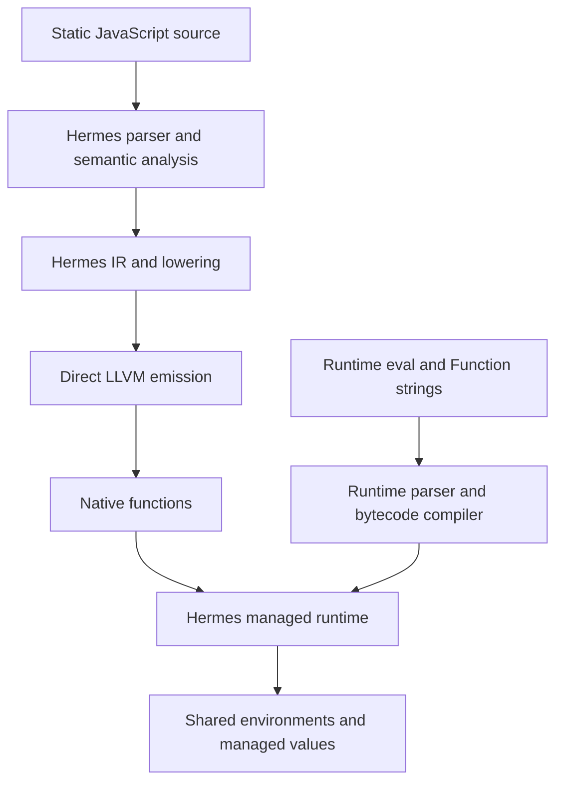

# Direct LLVM JavaScript: Measuring Conformance and Repairing Dynamic Evaluation

A JavaScript compiler needs both an execution architecture and evidence that its observable behavior agrees with the language. This project compiles statically available JavaScript through Hermes intermediate representation into LLVM IR and native machine code. It retains the Hermes managed runtime for values, objects, garbage collection, exceptions, and runtime compilation of strings. The work described here makes the conformance experiment reproducible and repairs several places where dynamic evaluation crossed those implementation boundaries incorrectly.

The repository is `/home/manuel/code/wesen/2026-10-28--llvm-js`. This report describes the completed baseline and eval milestones through implementation commit `fb560e2`, with delivery bookkeeping in `04777c3`. It follows the earlier release reports without replacing them. The broad baseline used the earlier runtime at `20fd0f6`; later repairs have separate targeted evidence. Keeping those revisions distinct is necessary to interpret every count below.

> [!summary]
> The full pinned-suite experiment recorded 102,992 variants with unchanged inputs. Subsequent eval repairs pass 22 core contracts and 65 extension contracts. The project now admits strict evaluated source from sloppy callers, preserves non-string eval passthrough in derived constructors, and preserves UTF-16 code units in runtime source. General sloppy declaration injection, several global-environment rules, richer eval contexts, and the module host remain unfinished.

## 1. The execution architecture

An intermediate representation describes a program in operations suitable for analysis and transformation. Hermes first parses JavaScript, resolves declarations and references, and lowers language constructs into its IR. The LLVM backend translates admitted IR operations into LLVM instructions and calls to the runtime bridge. LLVM then verifies, optimizes, and lowers the resulting module into machine code.

The managed runtime remains responsible for operations whose meaning depends on JavaScript values and object state. A generic property read can invoke an accessor or Proxy trap; an addition can convert operands; a call can allocate or throw. Emitting a machine instruction for each apparent source operator would not preserve these behaviors. The bridge provides the operations and the ownership conventions necessary to use Hermes values from generated native functions.



The static and dynamic compilation paths share a runtime but produce different executable representations. Static program functions become native code. Strings passed to `eval` and `Function` become Hermes bytecode. The latter path does not invoke LLVM at runtime. This distinction allows dynamically supplied text to execute without making native code generation part of every eval call.

The native driver, `hermes/utils/shllvm.py`, coordinates this process. It selects a configured compiler and runtime, emits LLVM IR into temporary files, invokes `llvm-as` and verifier passes, and publishes verified artifacts. For native execution it links against the runtime bridge and Hermes libraries. For JIT execution it invokes real `lli` with the shared bridge. There is no generated per-program C file in this pipeline.

## 2. Bindings, cells, and why lexical eval is difficult

A binding associates an identifier with storage and access rules. A `let` binding has a temporal dead zone before initialization. A `const` binding cannot be assigned after initialization. A closure can retain a binding after the surrounding call returns. An implementation must preserve all three facts even when it rearranges storage or optimizes ordinary expressions.

Direct eval uses the lexical environment of its caller. Consider this example:

```javascript
function make() {
  'use strict';
  let value = 1;
  const read = () => value;
  eval('value = 7');
  return read;
}
print(make()()); // 7
```

The assignment performed by bytecode must modify the same storage later read by the native closure. Copying the value into a temporary eval scope would produce an incorrect result. Copying it back afterward would still fail for escaping eval-created closures and for interactions during execution. The existing native eval bridge therefore describes visible bindings in terms of their physical environment locations and maps runtime compilation onto those cells.

The bridge also carries semantic information that cannot be inferred from a slot address: constness, initialization checks, caller strictness, receiver context, and `new.target`. Its inputs point into rooted native value storage. This matters because runtime compilation and execution can allocate, and allocation can trigger collection. A raw movable pointer retained across such an operation would violate the runtime's memory-management contract.

`hermes/lib/BCGen/SH/LLVMNative/eval_extensions.cpp` is the principal native integration point. The VM side in `hermes/lib/VM/Interpreter-slowpaths.cpp` provides corresponding behavior for bytecode callers and nested evaluation. Both sides need to agree about shared cells and caller context; implementing only the native entry point would leave eval-created functions inconsistent with their callers.

## 3. Defining the conformance experiment

A source file is not always one executable test. Test262 metadata can require strict execution, sloppy execution, module execution, an expected parse failure, or an expected runtime failure. A variant is one source file under one such required execution mode. Fixture files can be dependencies rather than standalone tests. Counting all files as successful programs would therefore produce a misleading result.

The runner at `hermes/utils/test_shllvm_test262.py` reads the pinned suite's metadata and constructs the required variants. Negative tests are genuine contracts: an expected syntax error passes only when the corresponding phase produces the expected error category. A crash or timeout cannot satisfy that expectation. Runtime exceptions use a structured exception marker rather than relying on a diagnostic phrase that might occur in arbitrary output.

The suite revision is `0b4e0812022b18236b5276d2804948fdd9f71603`. Its entire `test` directory contains 53,615 executable source files and 294 fixture files in this selection, producing 102,992 variants. The suite lock also identifies the captured specification artifact. This is an exploratory pinned-suite baseline, not an edition-qualified conformance percentage: the checkout contains Intl, Annex B, staging tests, and features requiring explicit edition review.

The experiment used Linux x86-64, LLVM/Clang 18.1.3, frontend O0 and LLVM O0, sixteen workers, a 60-second compilation-stage timeout, and a ten-second runtime-stage timeout. The compiler/runtime implementation itself was built in Release with `-O1 -DNDEBUG`. Compiler build optimization and tested-program optimization are separate settings.

This local build disables Intl and address, undefined-behavior, and thread sanitizers. Historical ASan evidence from the imported release does not apply to it automatically. It uses Hades garbage collection and 64-bit heap values. Node 24.18.0 supplies an independent script oracle for targeted regression comparisons. None of these host experiments demonstrates physical PicoCalc execution.

## 4. Bounded concurrency and reproducible publication

The runner schedules a bounded number of independent variants with a thread pool. Bounded scheduling avoids retaining an unbounded set of futures or starting more compiler processes than the requested concurrency. Each invocation captures output into files, limits the amount retained in the report, and starts a process group. A timeout terminates the process group so a linker child does not continue running after its parent has been abandoned.

Deterministic partitioning assigns a suite-relative source path to a shard using SHA-256 modulo the shard count. All variants of that source remain together. This supports parallel experiments without depending on filesystem enumeration order. The report aggregator verifies partition identity, uniqueness, selected-file coverage, and agreement between declared counts and actual records.

```text
select pinned source files
inventory fixtures and expand executable variants
fingerprint compiler, runtime, tools, configuration, runner, and inputs
execute at most N variants concurrently
publish partial checkpoints with complete = false
verify all planned records and unchanged input fingerprints
publish the final report with complete = true
```

Completion and success are different properties. A report with all tests executed and thousands of failures is a complete experiment. A report containing only passing results from an interrupted run is incomplete. The runner returned exit status 1 for the full baseline because failures exist, while the final report correctly records `complete: true`.

The completed run retained 53,968 input fingerprints, all unchanged. The suite checkout remained clean. The publication script refuses incomplete or inconsistent inventories. Git contains every variant's identity and status, the complete input hash set, fixture inventory, summary, and representative failure commands. The full raw report is retained as a compressed local build artifact with a digest recorded in the receipt.

## 5. Reading the results without overstating them

| Final baseline classification | Variants |
|---|---:|
| Pass | 76,801 |
| Semantic failure | 19,598 |
| Unsupported | 6,584 |
| Timeout | 9 |
| Total | 102,992 |

A pass establishes the individual test contract under the recorded configuration. It does not establish complete support for every feature mentioned in that file. A semantic failure is an observed mismatch that may come from engine semantics, an unavailable builtin, a missing host service, or harness completion behavior. The unsupported category includes explicit host boundaries and compiler admission failures; it is not a list of exclusions permitted by the specification.

The failure grouping exposes several different engineering problems. There are 843 explicit module-host rejections and 1,699 rejections at the backend's 1,024 combined root/argument-slot limit. The latter can occur before a large fixture reaches the builtin it intends to test. Such a result provides evidence about compiler admission, not the eventual builtin operation.

Temporal and Intl-related families account for many mismatches. Intl is disabled in this build, so those failures do not prove that the Hermes source tree lacks an Intl implementation. Likewise, the pinned Test262 catalog's `standard` label is not proof that a feature belongs to the captured ECMAScript edition. The feature ledger retains `edition_membership: unreviewed` separately from catalog provenance.

The analysis in `LLVM-ECMA-002/analysis/01-broad-baseline-results-and-failure-attribution.md` ranks families and observed failure stages. This is an investigation index rather than an automatic root-cause determination. Reviewers can follow each category into representative commands and then into the complete per-variant inventory.

## 6. Strict source evaluated by a sloppy caller

The earlier bridge rejected every direct string eval from a sloppy caller. That was too restrictive when the evaluated source itself contains a genuine strict directive. Strict source does not require the general sloppy declaration-injection behavior that motivated the original boundary.

```javascript
function caller() {
  let value = 1;
  eval('"use strict"; value = 9');
  return value;
}
```

The admission decision cannot be made by searching the source for the text `use strict`. A comment, parenthesized expression, escaped spelling, or string appearing after a non-directive statement does not establish the relevant directive prologue. `evalSourceIsStrict` parses the source and inspects parser-produced directive nodes, preserving their raw spelling. It does not perform global semantic resolution during this preliminary check because evaluated code can inherit valid caller context, including constructor `new.target`.

Admitting the source exposed a second defect. Nested functions created while compiling eval inherited the caller's non-strict semantic state instead of the evaluated program's directive. The resolver now derives eval strictness from both the enclosing semantic context and the evaluated program's directive prologue. Admission and semantic propagation are separate responsibilities; repairing only the first would leave nested bytecode behavior incorrect.

The exact 474-variant eval selection improved from 381 passes to 390, with nine failure-to-pass transitions and no passing regressions. Seventy-six semantic failures and eight unsupported variants remained. Positive fixtures exercise shared mutation, captured values, nested bytecode, const and TDZ behavior, and collection. Separate boundary fixtures prove that directive lookalikes are not admitted accidentally.

## 7. Non-string eval in derived constructors

The language returns a non-string eval argument unchanged. It does not convert the argument to text. This rule applies even when compiling string source in the caller's context is unsupported.

The backend previously rejected a derived-constructor DirectEval instruction during LLVM emission. That prevented valid `eval(value)` calls from compiling even when `value` was an object or number. The repair adds a derived-context flag to the existing caller-flags interface and moves the string-context rejection into the runtime bridge after the non-string return rule.

```text
if input is not a string:
    return the identical tagged value
if caller has unsupported derived-constructor source context:
    raise SyntaxError
otherwise:
    compile admitted source in the caller environment
```

Ordering matters before `super()`. A derived constructor's receiver is not initialized yet, and an ordinary read of `this` would throw. The existing IR path loads the captured receiver cell without introducing that read; the passthrough branch does not inspect its contents. Tests cover direct calls, arrows, escaped arrows after collection, missing arguments, primitive values, and object identity. An object with a throwing `toString` verifies that no conversion occurs. A throwing argument verifies that argument evaluation still precedes eval's own behavior.

The two existing derived string fixtures now expect runtime SyntaxError rejection instead of compilation rejection. This is a deliberate change in the boundary contract. It enables valid non-string behavior without claiming support for strings requiring derived-constructor syntax and receiver state.

## 8. Preserving UTF-16 source strings

JavaScript strings contain UTF-16 code units. A high surrogate or low surrogate can occur without its matching partner. The previous runtime source conversion replaced such units with U+FFFD, changing the source before compilation. The diagnostic probe made this visible: code unit 55296 became 65533, and code unit 56320 became 65533, while ASCII remained unchanged.

`convertUTF16ToUTF8PreservingSurrogates` now converts valid surrogate pairs to their scalar code point and preserves unmatched units in an internal extended UTF-8 representation. Combining valid pairs is essential. An astral identifier must be classified as one Unicode code point, rather than two invalid identifier characters.

```text
read one UTF-16 unit
if it is a high surrogate followed by a low surrogate:
    combine and consume the pair
else:
    retain the individual unit
encode the resulting value in the runtime source buffer
```

The lexer receives an explicit `allowSurrogatesInSource` setting. Consuming, slow-path, and peeking decoders all use it. The flag propagates through native-context eval, VM direct eval, indirect eval, and Function compilation. Runtime source uses eager parsing in this mode so a later parser cannot silently lose the encoding policy.

Ordinary source files retain scalar-value UTF-8 validation. Dedicated probes containing directly encoded high and low surrogate bytes both fail with exit status 1 and the expected `Invalid UTF-8 code point` diagnostic. The runtime repair therefore preserves already-existing JavaScript string values without relaxing the source-file input contract.

The positive fixture covers literals, cooked and raw templates, RegExp literals, Function bodies, astral identifiers, rejected lone-surrogate identifiers, nested bytecode, and escaping eval closures after GC. These cases test more than the conversion routine in isolation: they exercise its consumers and the lexical interpretation of the reconstructed source.

## 9. Separating time budgets from semantic changes

The full baseline recorded nine strict variants as timeouts. Several repeatedly compile generated source over the BMP character range. A ten-second timeout under concurrent load does not establish an infinite loop or a semantic failure.

Before rebuilding, the same nine source files were rerun with one worker and a 120-second runtime limit. Expanding each file into strict and sloppy variants produced eighteen executions: three passes and fifteen semantic failures. Among the nine originally timed-out strict variants, three passed and six failed semantically. This experiment identified behavior that the original timeout had concealed.

After the UTF-16 repair, the same larger-budget selection produced nine passes and nine semantic failures. All nine originally timed-out strict variants passed. The six strict RegExp variants changed from semantic failure to pass; the sloppy variants still encounter unsupported non-strict direct evaluation. The original full baseline remains unchanged. There is no full-suite result for the newer build hidden inside these targeted comparisons.

## 10. Regression qualification and practical commands

The completed repair passes 22/22 core source contracts and 65/65 extension contracts. The extension gate performs 256 native executions over frontend O0/O and LLVM O0/O2, plus 64 real lli executions. Positive programs, expected language errors, and explicit unsupported-context rejections remain separate categories. The 474-variant eval selection retains exactly the same statuses as the strict-source milestone, so the later input repairs introduce no observed regression in that family.

Run the relevant commands from the repository root:

```bash
cmake --build hermes/build-llvm \
  --target shermes shllvm_runtime shllvm_runtime_shared --parallel 4

python3 hermes/utils/shllvm.py run \
  --build-dir hermes/build-llvm --llvm-bin /usr/lib/llvm-18/bin \
  hermes/test/LLVMNativeExtensions/eval_utf16_source.js

python3 hermes/utils/test_shllvm_extensions.py \
  --build-dir hermes/build-llvm --llvm-bin /usr/lib/llvm-18/bin --jobs 3

python3 hermes/utils/test_shllvm_test262.py \
  --suite /tmp/llvm-test262 --build-dir hermes/build-llvm \
  --llvm-bin /usr/lib/llvm-18/bin --jobs 8 --compact \
  --output /tmp/eval-results.json test/built-ins/eval test/language/eval-code
```

The suite directory must contain the pinned checkout. A different checkout is a different experiment. The driver and runner record tool and artifact identities; retaining a command line without those identities is insufficient when the compiler and runtime are changing.

## 11. Remaining environment and host work

General sloppy eval can introduce bindings into the caller's variable environment. Native references compiled before the eval must then resolve those new bindings correctly, including references inside closures created before declaration injection. The current fixed-slot environment representation and native lookup rules do not provide this behavior. Supporting it requires coordinated storage, tracing, declaration-instantiation, and compiler changes.

The global-eval probe establishes three further defects: newly introduced indirect-eval vars have incorrect configurability, native top-level lexical bindings are not visible to indirect eval, and strict indirect-eval vars remain visible globally. Changing a property flag globally would not solve this safely because ordinary script declarations and eval declarations have different rules. Global lexical storage also needs a runtime owner shared across compilation units.

Private names, `super`, and derived-constructor string evaluation require more source context than the current admitted path supplies. Their rejection contracts remain explicit. They must be implemented as semantic context features, with tests for inherited receiver state, brand checks, and syntax restrictions.

The module host is the next separate work area. Resolution maps a specifier and referring module to a module identity. Linking creates environments and connects imports to exports before executing bodies. Live bindings require reads to observe the exporting binding's current value. Cycles require initialization and execution ordering that preserves hoisted functions, uninitialized lexical bindings, and errors. Dynamic import returns a Promise, while top-level await makes evaluation completion depend on asynchronous work. These operations need a coherent host design rather than a syntax-only import/export rewrite.

## 12. Source-reading guide and review questions

| Source | Responsibility |
|---|---|
| `hermes/utils/shllvm.py` | LLVM verification, linking, execution, and artifact manifests |
| `hermes/utils/test_shllvm_test262.py` | Metadata expansion, bounded execution, checkpoints, and fingerprints |
| `hermes/utils/summarize_shllvm_test262.py` | Partition validation, failure grouping, and feature provenance |
| `hermes/lib/BCGen/SH/LLVMNative/LLVMBackend.cpp` | Native eval call emission and caller flags |
| `hermes/lib/BCGen/SH/LLVMNative/eval_extensions.cpp` | Native environment mapping and runtime source admission |
| `hermes/lib/VM/JSLib/eval.cpp` | Strict-source detection and runtime compilation policy |
| `hermes/lib/VM/Interpreter-slowpaths.cpp` | Direct eval from bytecode callers |
| `hermes/include/hermes/Parser/JSLexer.h` | Runtime-source decoding policy |
| `hermes/lib/Support/UTF8.cpp` | Surrogate-preserving runtime source conversion |

The ticket directory is `ttmp/2026/10/28/LLVM-ECMA-002--test262-conformance-baseline-and-dynamic-evaluation`. Its intern guide explains the implementation plan, the analysis contains the completed measurements, and the chronological diary preserves failed probes and decisions. The revised guide and baseline analysis were uploaded to `/ai/2026/10/28/LLVM-ECMA-002` on reMarkable; that receipt proves cloud delivery rather than physical device synchronization.

A reviewer should be able to answer four questions after following these sources. Which storage cell does a native closure share with an eval-created closure? Which operation establishes strictness for nested evaluated functions? At what point is a non-string eval argument returned? Which input policy permits a surrogate in runtime source while rejecting it in an ordinary file? These questions connect externally visible behavior to the actual compiler and runtime contracts.

## Related notes and primary references

- [[PROJ - Direct LLVM JavaScript - Original Release Deep Dive]]
- [[PROJ - Direct LLVM JavaScript - ECMAScript Extensions Implementation]]
- [[ARTICLE - Direct LLVM JavaScript - Engineering the ECMAScript Extensions]]
- The captured language reference is [ECMAScript 2026](https://tc39.es/ecma262/2026/); eval semantics are specified by PerformEval and EvalDeclarationInstantiation.
- [Test262 interpretation guidance](https://github.com/tc39/test262/blob/main/INTERPRETING.md) explains metadata and execution contracts. The project uses a pinned checkout rather than treating the moving main branch as its experiment identity.

The immediate engineering rule is to preserve the distinction between measured behavior, implemented architecture, and proposed work. That distinction allows each later module or environment repair to demonstrate progress against a stable baseline without turning a targeted success into an unsupported conformance claim.
