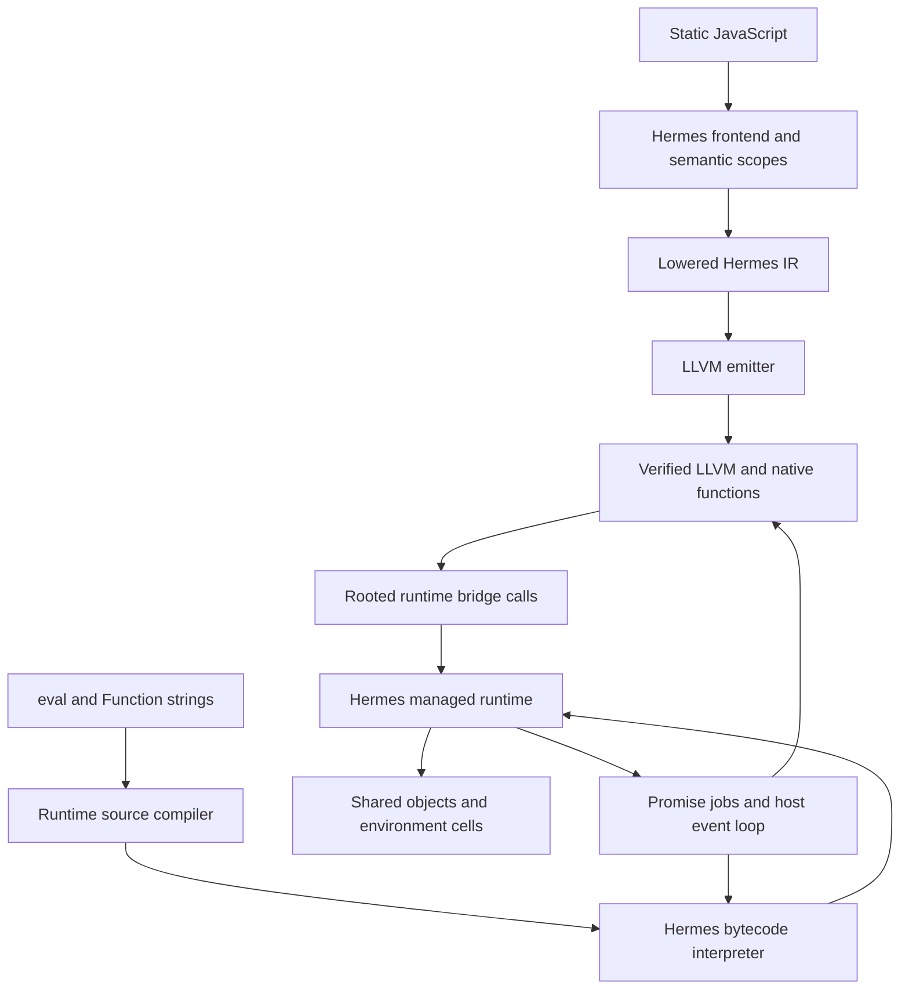
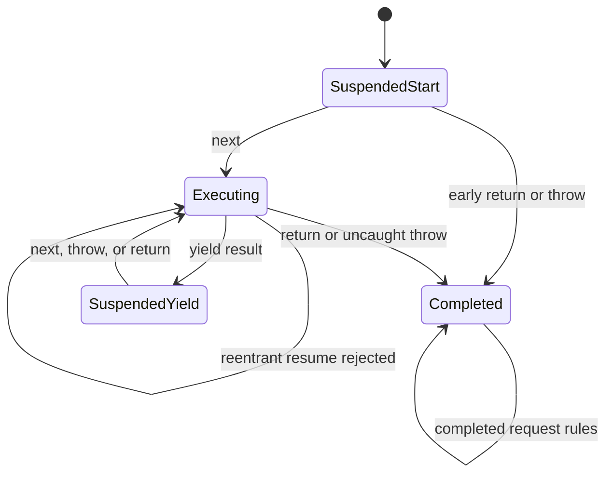
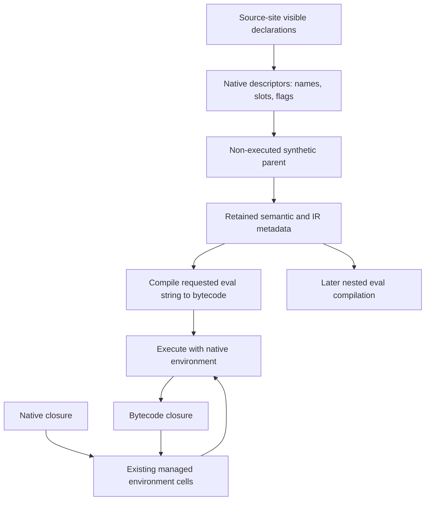

# Direct LLVM JavaScript: ECMAScript Extensions Implementation

A native JavaScript compiler must preserve more than the result of an arithmetic expression. A generator can return to its caller while keeping an unfinished computation alive. An asynchronous function can resume only after a particular Promise reaction. A string evaluated at runtime can mutate a variable that native code will read later. These behaviors require agreement between source analysis, generated code, heap storage, runtime scheduling, and compiler metadata. This release extends the direct LLVM backend by making that agreement explicit.

The implementation has one managed runtime and two code representations. Statically known JavaScript passes through Hermes's frontend and lowered intermediate representation, then becomes LLVM IR and native code. Dynamically supplied `eval` and `Function` strings pass through Hermes's runtime compiler and become bytecode. Both representations use the same managed values and environments. A native closure and an eval-created closure can therefore refer to the same mutable binding.

This article explains the delivered code in detail. It follows the original-release analysis, [[PROJ - Direct LLVM JavaScript - Original Release Deep Dive]], and pairs with [[ARTICLE - Direct LLVM JavaScript - Engineering the ECMAScript Extensions]]. The companion article reconstructs how the implementation developed; this one explains the final mechanisms and their contracts.

> [!summary]
> The release adds generator creation and iteration to the LLVM emitter, repairs shared async and Promise behavior, exposes rich-value runtime operations, corrects typed-array property handling, and implements strict lexical eval through shared native environments. Its validation distinguishes successful programs, expected language errors, and deliberately unsupported contexts. The dynamic runtime remains a host implementation; the separate RV32 integer-world prototype is unchanged.

## 1. Exact release identity and what changed

The inspected archive is `/home/manuel/Downloads/PicoCalc-LLVM-ECMAScript-Extensions-VERIFIED.zip`, 34,705,175 bytes, with SHA-256 `805b6dd6be63b94c22a8fa001d8f730238436ccdb36de85fea2ed1dad79b8a02`. It contains 13,192 regular files. All 13,191 entries in the top-level checksum manifest matched, and ZIP CRC verification found no damaged member. The duplicate download with `(1)` in its name has the same archive hash.

The upstream base remains Hermes `static_h` commit `f837b9dd8396ebf5c4e8115412417d273565f0fe`. The supplied patch now covers 124 paths, with 7,262 insertions and 169 deletions against that base. Those numbers are cumulative: they include the original direct backend. Relative to the previous imported release at `b1f3757493a2edbe449978cb0ebf0dd4101b705d`, the archive adds 141 files, changes 46, and removes two. The larger archive delta includes documentation and historical evidence that are deliberately outside the compact implementation patch.

The removed files are `hermes/test/LLVMNative/unsupported_eval.js` and `unsupported_generator.js`. Keeping them after extraction would leave obsolete negative contracts in a suite that discovers fixtures by filename. The import therefore reconciles the two release inventories, rather than merely placing new files over old ones. The original release remains recoverable in Git and in its separate vault report.

The implementation changes fall into four categories:

| Category | Main files | Responsibility |
|---|---|---|
| LLVM emission and ABI | `LLVMBackend.cpp`, `runtime.c`, `value_extensions.c` | Translate admitted IR and invoke managed runtime operations |
| Shared frontend and optimizer | `AsyncGenerator.cpp`, IRGen, IR definitions, scalar passes | Preserve suspension, scope, visibility, and mutation semantics before code generation |
| Shared runtime | `01-Promise.js`, `04-AsyncIterator.js`, `JSObject.cpp`, eval paths | Schedule jobs, drive generators, enforce exotic properties, compile dynamic source |
| Validation and tooling | `shllvm.py`, `test_shllvm_extensions.py`, fixtures and evidence | Build direct code, compare observable behavior, verify publication and input identity |

This classification explains why a discrepancy reproduced through both the C and LLVM backends could require a change outside LLVM emission. Both backends consume the same frontend transformations and runtime implementations.

## 2. The execution model, defined in dependency order

An intermediate representation records operations in a form suitable for compiler analysis. Hermes IR retains language-oriented instructions such as environment creation and property access. Lowering transforms complex constructs into simpler operations; generator lowering, for example, converts suspension into explicit state and control flow. The LLVM emitter translates the resulting admitted instructions into typed LLVM functions, loads, stores, branches, and helper calls.

A managed environment is a heap object containing variable cells and a link to an enclosing environment. A cell is a storage location, not a snapshot of its current value. A closure associates executable code with the environment needed by that code. Garbage collection keeps the reachable environment alive after the function that created it has returned.

A continuation is the information needed to resume an unfinished computation. In this compiler, a suspended generator's continuation is represented by a generated resumption function plus heap state identifying the next block, its saved values, and relevant exception state. It is not a retained native stack activation.

A Promise reaction is work scheduled after fulfillment or rejection. Its job determines when a suspended async computation resumes. Preserving the final value while changing that job's position relative to other jobs is still an observable semantic change.



The arrows from the job queue denote resumed execution, not a second compiler. `lli` supplies another way to execute the LLVM representation on the host; it does not make dynamically evaluated strings take the LLVM route. Likewise, LLVM's ability to produce RV32 instructions does not supply the managed runtime required by these features.

## 3. The rooted ABI remains the foundation

Generated functions retain the original shape `i64 function(ptr runtime)`. The returned integer carries tagged `SHLegacyValue` bits; its type does not mean all source values are integers. JavaScript arguments and receivers travel through the Hermes register-stack protocol. Runtime helpers typically receive addresses of rooted operand slots and an output-slot address.

A root is storage the collector knows to inspect and update. If an allocating operation moves an object, generated code must load the updated value from a root rather than keep using a stale address held in an LLVM temporary. The bridge initializes the function's `SHLocals` storage, registers it with the runtime, and obtains the root-array address through a helper. Generated code does not guess the internal header offset.

The new value wrappers preserve this discipline. RegExp patterns and flags are identified by symbols in a registered unit. Private operations receive rooted objects and private-name values. Eval borrows the caller's rooted source, environment, receiver, and construction target. Immutable BigInt byte arrays and eval descriptors are native metadata without GC pointers; they require unit/code lifetime, not tracing as managed objects.

The host ABI is checked with assertions. Values and pointers are eight bytes. Eval binding and scope descriptors are each sixteen bytes, with member offsets checked explicitly. These assertions detect incompatible builds; they do not establish a 32-bit port.

### Root storage now distinguishes used and discarded results

The original emitter gave every instruction a separate slot. The extension allocates unique slots for instructions that have users and for encountered constants. An unused produced value uses `%discard`, while temporary helper work uses a separate `%scratch`. This distinction is visible in `FunctionEmitter`'s constructor and `slot` method.

The new admission condition is:

```text
unique used-value and constant slots
+ 2                         // scratch and discard
+ max(1, maximum outgoing explicit arguments)
<= 1,024
```

An instruction whose result is unused still executes. Its side effects, exceptions, and temporary allocation remain observable. Discard storage is rooted because a helper can construct a managed object, perform additional initialization, and allocate again before finishing that instruction. Treating an unused result as unrooted would confuse lack of later source use with lack of immediate runtime use.

The shared discard slot belongs to one generated activation. Reentrant JavaScript receives another frame. Used operands, including address-like stack instructions with users, retain separate storage. The change is not a general liveness allocator and does not merge arbitrary temporaries across instructions.

The historical admission probes report maximum combined counts of 642 and 826 for two large unoptimized async fixtures that previously exceeded the limit. At eight bytes per slot, the explicit payload bound remains approximately 8 KiB. Exception buffers, native headers, LLVM spills, runtime frames, and recursion add further memory use.

## 4. Generators: returning while computation remains live

The new emitter does not introduce LLVM coroutine intrinsics. It completes the existing Hermes generator-lowering path. `lib/Optimizer/Scalar/LowerGeneratorFunction.cpp` creates persistent environments and a resumption function before LLVM instruction selection. A high-level save-and-yield instruction is lowered into stores of continuation state followed by a normal return.

A small excerpt from `generator_protocol.js` makes the contract concrete:

```javascript
function* sequence(start) {
  let n = start;
  const delta = yield n;
  try {
    n += delta;
    yield n;
    return n * 2;
  } finally {
    print("sequence-finally", n);
  }
}
const a = sequence(10);
a.next(999);
a.next(5);
a.next();
```

The packaged execution record prints these corresponding observations:

```text
first {"value":10,"done":false}
sent {"value":15,"done":false}
sequence-finally 15
done {"value":30,"done":true}
after {"done":true}
```

Creating `a` does not execute the body. The first `next` starts it; its argument is not the result of a previously suspended yield. The second `next(5)` supplies the value of the first yield expression, so `n` becomes fifteen. The third invocation completes the try body, executes finally, and returns thirty. JSON omits the undefined value property in the completed follow-up result.

The saved state has four conceptual phases:

| State | Meaning | Important behavior |
|---|---|---|
| Suspended start | Body has not begun | Early return/throw does not execute the body |
| Executing | Resumption is currently active | Reentrant resume raises TypeError |
| Suspended yield | A value was returned with unfinished work | Next, throw, or return resumes the saved continuation |
| Completed | Body finished or failed | Further requests follow the completed-generator rules |

`CreateGeneratorInst` is the remaining object-creation operation. The emitter passes the native resumption address, managed environment, unit, and function ID to `shllvm_generator`. The bridge checks the environment and uses `_sh_ljs_create_generator_object`, preserving Hermes's object and prototype behavior. The compilation unit owns native function metadata; managed reachability owns the environment.

The following state diagram is a conceptual view of the lowered protocol. A request can execute multiple blocks before returning a yielded or completed result; the diagram does not claim one native instruction per transition.



### Pending completion is part of continuation state

A return request can enter `finally`, and that finally block can yield. The eventual return must remain pending while cleanup suspends. A thrown value can similarly remain pending or be replaced by a new failure during cleanup. Remembering only a program counter and local variables would omit part of the language state.

Shared lowering creates resumption and exception dispatchers. The saved handler information identifies the appropriate destination after resumption. Each native invocation also needs an ordinary live exception frame. Those two structures have different lifetimes: heap state survives suspension; a native `_setjmp` buffer belongs only to its current activation.

The original backend's volatile-root and try-state dispatch remain relevant. A generated function calls `_setjmp` itself with `returns_twice`; a helper may link and expose the buffer but cannot own a returned stack activation that later receives the jump. Catch preparation restores runtime root/frame/register-stack state. Generator support builds on this exception protocol rather than retaining obsolete jump buffers in the heap.

### Iteration is a managed protocol

Delegation and cleanup require iterator operations beyond generator allocation. `yield*` can invoke user-defined `next`, `throw`, and `return` methods. Breaking from `for...of` and partially consuming an iterator during destructuring can require closing it.

The bridge adds `shllvm_iterator_begin`, `shllvm_iterator_next`, and `shllvm_iterator_close`. Their operands include mutable slots because the runtime can replace a source slot with a cached next-method value or advance an iterator/index representation. Property enumeration uses `shllvm_pnames` and `shllvm_pname_next`, which update base, list, index, size, and current-property storage and return a branch condition.

The emitter takes each successor through the existing phi-edge mechanism. Phi assignments are simultaneous: all source values are loaded before any destination is stored. That rule continues to matter inside generated state machines and enumeration loops, where several live values change together.

## 5. Ordinary async functions reuse generator execution

The existing `02-AsyncFn.js` runtime implements async functions through a generator and a result Promise. Conceptually, a fulfilled awaited value resumes the generator with `next(value)`, a rejected value resumes it with `throw(error)`, a completed generator resolves the result, and an uncaught exception rejects it. This description is a control-flow sketch, not literal emitted source.

The driver separates continuation execution from scheduling. It can run synchronously until it reaches an await boundary, but continuation after that boundary is driven through Promise reactions. The runtime captures internal Promise operations so that the implementation can manage its own reaction objects without accidentally exposing additional public constructor/species observations. The source comments describe reuse of a reaction pair across awaits within one invocation.

The host console already enables and drains the microtask queue. Its event loop drains jobs before timer processing and after timer callbacks. `shllvm_run` uses that established lifecycle for both native and JIT execution. The extension does not create a separate event loop or put scheduling into the LLVM emitter.

An async test therefore needs to prove both execution and completion. Exiting with status zero before a queued continuation prints anything is not success. The fixtures print explicit lines such as `done: async_basic`; the harness requires the completion line and compares the entire output. Rejection handlers in successful fixtures print `FAIL` on unexpected errors, and the harness rejects those lines even if the host exits normally.

## 6. Promise corrections: observable jobs and public identity

The major Promise changes live in `lib/InternalJavaScript/01-Promise.js`. They affect both C and LLVM programs because both use the patched runtime. Each correction preserves an observable distinction that a fast path previously removed.

### Fulfilled inputs to Promise.all still schedule reactions

The old ordinary path directly invoked an element resolver for an already-fulfilled core Promise. A test262 option selected a more faithful path, but ordinary execution could collapse a reaction step. The minimal recorded probe produced `tick` then `all` in Node and the reverse order in the old Hermes runtime.

The new loop always calls `nextPromise.then(resolveElement, capReject)`. This preserves the input's observable `then` access and lets its reaction execute through the queue. The aggregate result may be numerically identical in both versions, but relative output order is part of the tested contract.

### Reading a thenable and invoking it happen at different stages

A thenable is an object with a callable `then` property. The property getter can run synchronously when resolution inspects the object, while invocation of the returned method is deferred. The implementation captures `Reflect.apply` and queues the invocation through `HermesInternal.enqueueJob` or its existing fallback. It does not read user-controlled `.call` or `.bind` properties from the returned function.

The packaged `promise_thenable_jobs.js` result begins:

```text
thenable-order get|sync|then|tick|resolved:4
adoption-order tick-1|tick-2|adopted
```

This output identifies property access, surrounding synchronous execution, thenable invocation, another reaction, and final observation separately. The reference algorithm likewise constructs a job and enqueues it after obtaining the callable method. [ECMAScript 2026 Promise resolution jobs](https://tc39.es/ecma262/2026/multipage/control-abstraction-objects.html#sec-newpromiseresolvethenablejob)

### Public resolve must not expose private cached wrappers

The old core `Promise.resolve` reused cached Promise objects for primitive values. That made two public calls observably identical. The extension allocates a fresh public wrapper for non-Promise values and resolves it through the ordinary machinery. Existing same-constructor Promise identity behavior remains distinct from primitive wrapping. Private caches used internally by await are not returned as public results.

This distinction also protects mutable state associated with the returned object and preserves negative-zero handling. A cache can be safe for an internal operation only if no public identity or mutation observation exposes its reuse.

### Species selects the result constructor once

`speciesConstructor` reads the receiver's `constructor`, then its `Symbol.species`, handles null/undefined fallback, and validates constructibility. `HermesInternal.isConstructor` exposes the runtime's existing constructor predicate without executing the candidate constructor merely to test it. The native wrapper reads an already-rooted argument and does not introduce allocation.

The selected constructor supplies a Promise capability: the result Promise and its resolve/reject functions. The old subclass path routed the result through an extra core Promise before settling that capability. The new handler records the capability directly and settles it in the original reaction job. Removing the extra intermediate job preserves tested ordering between core and subclass reactions.

### Finally uses an internal resolution operation

The revised `finally` selects species and resolves the cleanup result through the internal `promiseResolve` helper. Reading `C.resolve` would consult an overridable public property and introduce a different observable operation. The helper creates the appropriate capability or preserves an already matching Promise. Tests exercise getter counts, invalid constructors, subclass selection, reaction order, and generic finally behavior.

These corrections are concrete targeted improvements. They do not establish complete Promise branding, cross-realm behavior, or every conformance case. The report's claims follow the supplied fixtures and implementation, not an assumption that all shared runtime behavior is now complete.

## 7. Async generators require a queue and three distinct await decisions

An async generator accepts requests whose results are Promises. The driver in `04-AsyncIterator.js` keeps a linked request queue, a current request, and a completed flag. An internal yielded marker distinguishes an await from an externally visible yield or delegation operation. Conflating those states caused several of the recorded failures.

### Internal await during cleanup resumes normally

Suppose `return("closed")` enters a generator's finally block, which contains `await 0`. The generator already retains the pending return. When the internal await fulfills, the driver must resume with `next(0)` so cleanup continues. Reusing the external request's return operation would inject `return(0)`, abandoning the remaining cleanup and changing the pending result.

The final source implements the normal internal continuation as `resume("next", resolvedValue)`. Await rejection still resumes with `throw`. The packaged finally fixture records `cleanup-events start|awaited|end` before completing with `"closed"`; separate cases allow finally to override the return, throw, or yield while keeping cleanup live.

### External return arguments are awaited before injection

An external `generator.return(promise)` is a new request. Its argument must settle before the driver chooses whether to inject a return or a throw into the suspended body. A rejected argument can be caught around the suspended yield. Closing the generator first and noticing rejection afterward removes that opportunity.

`startRequest` performs this normalization. If the generator is already completed, it concludes the queued request directly after normalization. Otherwise it calls the appropriate resume operation. Exceptions while accessing or resolving the argument follow the rejection path as well.

### Source return expressions await inside their original region

The following source illustrates why the transformation location matters:

```javascript
async function* returning() {
  try {
    return Promise.reject(new Error("return expression"));
  } catch (error) {
    print("caught-return", error.name, error.message);
    return Promise.resolve(42);
  } finally {
    print("return-finally");
  }
}
```

The frontend rewrites the return operand to an internal await while it is still inside the source try/catch/finally region. The recorded output includes `caught-return Error return expression`, then `return-finally`, and a completed iterator result containing 42. Awaiting only the final iterator value after the synchronous generator had returned would be too late for the catch to run.

Because source return expressions and external return arguments already receive their required awaits, a completed iterator result is concluded without another unconditional await. That avoids an extra reaction job and preserves the tested delegated-return case whose value is itself a Promise.

### Completed queues drain without recursive native calls

After completion, ordinary next requests resolve with an undefined completed result, and throw requests reject with their argument. The driver drains such requests iteratively. A return request still needs its argument awaited, so it reenters the request-start path. The queue regression creates 2,052 requests and collects before settlement; this specifically exercises retained queue state and avoids making queue length proportional to recursive native stack depth.

Empty async generators are also wrapped. An empty body does not remove the requirement for Promise-returning iterator methods and `Symbol.asyncIterator`.

## 8. AST traversal preserves function context

The async-generator transformation is a tree rewrite in `lib/AST/AsyncGenerator.cpp`. Its context flag records whether the current operation belongs to an async generator. A nested function must establish its own context, even when it appears inside an expression or default parameter.

The final visitor processes await and yield operand roots, not only their children. Visiting only children would miss an operand that is itself an await or an async-generator function expression. Return operands are traversed before the return-specific wrapper is added. The original operand is visited once, avoiding accidental repeated transformation of generated helper calls.

Arrow functions temporarily clear the enclosing async-generator context and visit all children. Declarations and function expressions visit parameter nodes before transforming or moving their parameters, using a fresh context, then process their bodies with the appropriate function state. Existing handling for lazy bodies remains in place.

This matters for code such as an ordinary function whose default argument is `async function* () { yield 1; }`. The outer function is not async, but the nested generator still requires transformation. The final fixture covers declarations, expressions, async functions, and async generators as enclosing forms. Native optimization is a separate dimension: both unoptimized and optimized frontend output must preserve the same nested context.

## 9. Rich values reuse the managed representation

The new `value_extensions.c` is a small adaptation layer. It calls existing Static Hermes operations through a rooted-slot ABI rather than introducing a second representation for BigInt, RegExp, or private fields. The compiler and runtime still have different responsibilities: the compiler preserves exact literal data and operation identity, while the runtime allocates objects and enforces conversions and errors.

### BigInt literals are serialized without floating-point conversion

The emitter adds `LiteralBigInt` to the rooted constant set and uses `ParsedBigInt` to obtain the same serialized representation used by the C backend. Immutable byte arrays are emitted separately from string pools. `shllvm_bigint` passes the byte address and logical byte count to `_sh_ljs_create_bigint`.

The distinction between storage size and logical count handles a zero encoding without inventing a different integer. If an empty logical encoding needs a harmless physical storage byte, the count passed to the runtime remains the true count. Signed representation is preserved by the serialization facility, rather than reconstructed from a rounded Number.

For a literal such as `123456789012345678901234567890n`, a preliminary conversion through `double` would lose information before managed allocation. Calling the mutable global `BigInt` constructor would also introduce an unintended dependency on user code. Exact bytes and a runtime literal operation avoid both mistakes.

Arithmetic and conversion remain dynamic runtime operations. The fixture set covers alternate radices, values beyond 64 bits, signed division and remainder, shifts, exponentiation, mixed Number/BigInt errors, and BigInt typed-array conversions. Supporting the literal format is necessary but not sufficient; these operations test how the literal participates in the rest of the value system.

### RegExp literals allocate fresh runtime objects

`CreateRegExpInst` interns pattern and flag strings in the unit, then invokes `shllvm_regexp`. The helper resolves the registered symbols and calls `_sh_ljs_create_regexp`. Executing the literal twice creates distinct objects, including distinct mutable `lastIndex` state.

The path deliberately avoids looking up the public global `RegExp` binding. Replacing that binding should not intercept literal creation. Tests exercise captures, global and sticky behavior, Unicode, dotAll/multiline handling, replacement callbacks, and fresh identity. This uses Hermes's RegExp machinery; it is not a new regex compiler implemented in LLVM emission.

### Private fields preserve private-name identity

Private fields are indexed by runtime private names with brand checks. A public property whose string begins with `#` cannot substitute for that identity. Classes with the same source spelling for a private name still have different private-name identities.

The bridge supports creation, add, get, set, and membership. Shared lowering already expands private-brand checks. A notable representation detail is that `BinaryPrivateInInst` is a value-kind case handled through `BinaryOperatorInst`, not an independent C++ instruction class. Its bridge arguments preserve private-name/object operand order.

The wrappers use the supported null-cache path. Private membership and private field access assign different meanings to the cache slot field: membership can cache a boolean, whereas access can cache an offset. A shared cache between those operations would encode incompatible facts. Choosing the uncached path avoids adding cache ownership and layout assumptions before a correct registered-cache design exists.

The tests include fields, methods, accessors, inheritance, static state, same-spelling names in independent classes, failed receiver checks, duplicate branding, and stamping a non-extensible object. Combined GC tests retain private BigInt and RegExp state through closures, connecting feature correctness to lifetime rather than checking isolated constructor calls.

## 10. Typed arrays require exotic property operations

Ordinary JavaScript typed arrays already enter through generic constructor, call, and property IR. Their implementation does not require the LLVM emitter to produce vector instructions. Their special behavior resides in `JSObject.cpp` and the typed-array runtime.

An exotic object has internal operations that differ from ordinary object behavior. For typed arrays, certain property keys identify numeric indexes even when they do not identify a valid element. Falling back to an ordinary property dictionary in those cases is incorrect. The historical symptom was simple: after `a[-1] = 8`, Hermes read eight back, while Node read undefined.

### Classifying keys before ordinary fallback

`canonicalNumericIndexString` uses a fixed-size buffer, special cases for `-0`, NaN, and infinities, and a parse/format round trip. A string is admitted as a numeric index spelling only when it has the required canonical form. `canonicalNumericIndex` preserves the distinction between numeric primitives and strings; numeric negative zero becomes property zero, while the literal string `"-0"` remains an invalid numeric index. BigInt keys take the exact decimal-string route instead of rounding to Number first.

| Input key | Interpretation in the implementation | Resulting category |
|---|---|---|
| Numeric `-0` | Property key zero | Valid element zero when in range |
| String `"-0"` | Canonical negative-zero index | Invalid element; no ordinary property |
| `"-1"`, `"1.5"`, `"NaN"` | Canonical numeric forms | Invalid elements |
| `"01"`, `"1.0"` | Noncanonical numeric spellings | Ordinary named properties |
| In-range nonnegative integer spelling | Canonical valid index | Typed element access |
| Exact BigInt key | Decimal string then canonical classification | Avoids premature rounding |

The change reaches descriptor lookup, reads, membership, named and computed writes, deletion, and property definition. Named-property bytecodes can contain numeric strings too, so guarding only the computed-property path would leave a second route to incorrect behavior. `isTypedArrayNumericSymbol` redirects relevant named operations to the corresponding exotic path.

### Invalid writes can still convert the value

A same-receiver indexed write reaches `setOwnIndexed`, even for an invalid index. `typedArrayIndexOrInvalid` uses `UINT32_MAX` as a sentinel outside the runtime's admitted element range. Passing that sentinel through the setter preserves required Number/BigInt conversion and its observable effects or exceptions before the invalid write is discarded.

Property definition has a different sequence. It validates element existence and descriptor attributes before performing a value conversion. A getter/setter descriptor or incompatible attributes must fail through the definition path, rather than being treated like an assignment. The fixture records conversion counts as well as values and boolean return results.

### Target and receiver are independent inputs

`Reflect.set(target, key, value, receiver)` exposes the distinction between the object whose property operation is selected and the receiver that may receive a new property. The implementation handles three relevant cases:

| Target and receiver | Invalid canonical index behavior under the implemented contract |
|---|---|
| Same typed array | Use the element setter, including value conversion |
| Typed-array target, different receiver | Return success for an invalid element without value conversion |
| Ordinary target, typed-array receiver | Use receiver's exotic definition; invalid definition returns false without conversion |

The second branch is explicit in the ECMAScript typed-array `[[Set]]` algorithm: the same-receiver path invokes element setting, while an invalid index with a distinct receiver returns before ordinary setting. [ECMAScript 2026 typed-array Set](https://tc39.es/ecma262/2026/multipage/ordinary-and-exotic-objects-behaviours.html#sec-typedarray-exotic-objects-set-p-v-receiver)

The third case required an additional guard later in ordinary setting. Checking only whether the target is a typed array cannot protect a typed-array receiver. The final code routes canonical numeric definitions on that receiver through `defineOwnComputedPrimitive` before ordinary property addition.

The packaged specification-directed probe also documents a Node v24.22.1 difference. Its expected first line is `invalid true 0 false`; that Node build printed `invalid true 1 false`, revealing an extra conversion. Symbol and Number-to-BigInt cases differed similarly. The ordinary differential fixture uses a value without observable conversion effects for that disputed branch, and a separate record preserves the disagreement. This is a carefully scoped oracle limitation, not a general reason to disregard Node mismatches.

## 11. Lexical eval begins with cell identity

Global or indirect eval can use the runtime's existing source compiler without a native caller's local scope. Direct lexical eval is different: the source string can read and change variables visible at the call site, including variables with no ordinary static uses. An eval-created closure can escape and retain those cells after the native caller returns.

`eval_lexical_bindings.js` demonstrates bidirectional sharing. An outer native function initializes `value = 5`; an inner function evaluates a string that adds two and returns read/write closures. The recorded trace includes:

```text
read-write 7 7 10 2
native-to-dynamic 20
dynamic-to-native 31
type-change string changed type
```

The first line shows that native state and the dynamic reader agree after eval writes. The next lines show mutation in both directions and a change from numeric to string value. Copying variables into an object before eval and copying them back afterward would not preserve this behavior once closures escape. Sharing actual environment cells does.

The architecture therefore requires three preserved identities: the source binding selected by name, its physical environment and slot, and the runtime/compiler metadata needed to compile later nested eval against that location.

## 12. Recording the exact source scope in IR

A lexical scope describes name visibility in the source. A physical `VariableScope` describes storage organization after compiler transformations. Several lexical blocks may share one physical environment. Enumerating every variable in that environment would expose declarations outside their source block or select the wrong shadowed name.

`ESTreeIRGen::genCallEvalExpr` walks lexical scopes from the eval site outward. A set of seen names ensures that the nearest declaration wins. Ordinary variables become explicit operands of `DirectEvalInst`; private names are excluded from this supported path. Implicit arguments are represented by the caller's captured arguments variable and later exposed under the source name `arguments`.

The instruction also carries source-site facts: strict caller, global caller, derived-constructor context, current variable scope, actual environment, receiver, and new target. Saving context at the original site matters when inlining or other transformations move the instruction into a different containing function. Inferring legality from its final owner would allow optimization to change source syntax rules.

The emitter groups selected variables by physical scope in outer-to-inner order. Empty binding groups are retained when necessary to describe the real environment chain. A binding outside that chain produces an explicit compilation diagnostic. Each binding records its UTF-8 name, slot index, and TDZ/constness flags; each scope records its binding array, count, and total slot count.

```c
typedef struct SHLLVMEvalBinding {
  const char *name;
  uint32_t slot;
  uint32_t flags;
} SHLLVMEvalBinding;

typedef struct SHLLVMEvalScope {
  const SHLLVMEvalBinding *bindings;
  uint32_t binding_count;
  uint32_t slot_count;
} SHLLVMEvalScope;
```

These descriptors contain no managed pointers. Rooted runtime arguments carry the actual heap references. Descriptor lifetime follows the compiled unit, while the current environment can continue to live through ordinary heap reachability.

## 13. Reconstructing compiler context without executing synthetic code

The runtime compiler normally obtains lexical compilation context from a bytecode parent with retained semantic and IR information. An ahead-of-time LLVM function has no such bytecode parent. `compileInNativeEnvironment` constructs one for metadata purposes, then maps it to the native environment.

The procedure is explicit:

1. For global callers, validate the requested source in a genuine global syntactic context.
2. Construct nested anonymous functions, one per physical environment, declaring the selected names with `var`.
3. Compile that synthetic source with metadata retained, strictness temporarily disabled for the scaffold, and lazy compilation disabled.
4. Collect non-global parent functions and sort them by lexical depth.
5. Map every synthetic variable to its native slot, restore TDZ and constness, and validate slot bounds.
6. Install exactly the selected visible declarations into the semantic binding table, including the intentional arguments alias.
7. Mark the selected real eval context strict and compile the requested string using `compileEvalModule`.
8. Execute the resulting bytecode with the original native environment, receiver, and new target.

The synthetic parent never executes. Its `var x = void 0` text therefore does not initialize or overwrite a native variable. Its purpose is to create semantic declarations and retained compiler structures that can be reassigned to native storage.

Using `var` in the scaffold is also deliberate. Directly declaring a native constant as synthetic `const` could trigger a compile-time rejection when eval assigns to it, whereas the intended dynamic operation needs a catchable runtime TypeError. The implementation restores constness on the Variable metadata and enables the existing deferred-check mode for evaluated source. It also permits inherited identifiers that would be awkward in a strict synthetic declaration.

Implicit arguments must not leak from the synthetic functions. When the original lexical view has no arguments binding, the helper places an undeclared-global-property interpretation into the binding table. Otherwise it aliases the existing native capture. The scaffold is an implementation artifact and must not introduce extra source-visible names or function context.

The metadata and runtime paths meet at the physical environment. The synthetic source establishes compiler declarations; remapping connects those declarations to existing slots, and runtime execution receives that same environment.



Compilation produces bytecode; execution receives the existing environment. No synthetic initializer executes to populate those native cells.

## 14. Optimizer changes preserve dynamic reads and writes

A direct-eval operation is a potential read and write of its captured bindings. The metadata is part of executable semantics, not merely diagnostic information. The extension makes multiple optimizations respect that fact.

| Pass | New handling | Incorrect assumption prevented |
|---|---|---|
| Store-once analysis in `Utils.cpp` | Eval use prevents store-once classification | Treating a dynamically written cell as constant |
| `SimpleStackPromotion.cpp` | Eval-visible variables cannot be copied into a persistent stack cache | Reading a stale native value after eval |
| `FrameLoadStoreOpts.cpp` | Registers eval-visible variables as captured loads and stores | Reusing frame knowledge across unknown mutation |
| `FunctionAnalysis.cpp` | Declines analyzability for variables with eval users | Propagating a closure/value under incomplete use information |
| `ScopeHoisting.cpp` | Retains parents of captured variables and arguments | Removing physical environments needed only by dynamic source |
| `TypeInference.cpp` | Unions ordinary Any and continues scanning stores | Erasing Empty/Uninit states needed by TDZ checks |

The last change is particularly subtle. “Any JavaScript value” does not include every compiler-internal state. A variable that has not been initialized can contain Empty. If type inference sees eval and immediately returns Any, it can discard evidence from an initialization store and remove a necessary temporal-dead-zone check. The final implementation widens the ordinary value possibilities while retaining internal states found through other users.

A suitable review question is whether every pass that reasons about environment contents understands the new user category. The delivered changes address the passes exercised by the regression suite, but introducing another transformation that assumes only `LoadFrameInst` and `StoreFrameInst` use variables would require the same audit.

## 15. Nested eval and metadata ownership

After the first eval, execution can enter bytecode that performs another direct eval. Updating only the native bridge would leave that second operation using the inherited global-only path. The interpreter's `caseDirectEval` now obtains the current code location's `DebugScopingInfo`, selects the environment from a frame register or spilled closure slot, roots it in a typed `PinnedValue<Environment>`, and calls `evalInEnvironment` with the current receiver and new target.

Missing lexical metadata produces an explicit error. The runtime does not silently substitute a global environment. Dynamic compilation retains scope information even when the interactive debugger is disabled. It is eager and avoids the full runtime optimization pipeline until that pipeline has an equivalent metadata-preservation contract.

IR generation for eval also establishes the current lexical scope and restores captured arguments alongside receiver and new-target state. Arrow contexts preserve inherited capture state instead of initializing an ordinary ES5 function context over it. These details allow an escaped arrow from a Function-created function to perform nested eval after collection and still see its intended `this` and `arguments`.

### A shared Module is not sufficient ownership

The synthetic bytecode provider and the actual evaluated provider can share a compiler Module. However, `BytecodeFunction` destruction can separately delete its associated `FunctionIR`. Keeping the Module alive therefore does not automatically keep every retained semantic parent alive.

After successful eval compilation, the bridge clears the synthetic bytecode functions' `FunctionIR` links. The Module's owning compiled-functions collection then controls those metadata-only nodes. The actual eval provider retains normal ownership of its real functions. On compilation failure, ordinary cleanup remains intact.

This is a transfer of destruction responsibility, not a leak-by-design workaround. The key invariant is that nested eval and escaping closures retain valid parent semantic/IR data for as long as they can request another compilation.

### Synthetic functions must not make global new.target legal

A first-level global syntax check catches direct use of `new.target` in a script. It does not by itself prevent a later nested eval from seeing the synthetic functions as real enclosing function contexts. For a global caller, the implementation marks every synthetic parent's retained semantic information as a program node. The nearest-non-arrow walk can then reach the actual global context.

Real native constructors and functions introduced inside evaluated source keep their real function contexts. The final regression checks both invalid nested global uses and valid native/dynamic constructor controls. Fixing the rejection by forbidding all nested `new.target` would reject supported programs and would not preserve the intended distinction.

## 16. Crossing the C++ exception boundary safely

The eval helper uses compiler and VM implementation APIs whose symbols are intentionally hidden from ordinary shared-library clients. It is compiled inside the full Hermes VM and exports a narrow C entry point, `shllvm_eval_direct`. Its containing static archive must be position-independent because it contributes to a shared library.

Inside `evaluate`, C++ strings, compiler providers, stack-executor work, and RAII guards have ordinary C++ lifetimes. The outer exported entry checks its returned `CallResult`. Only after `evaluate` has returned and those local owners have been destroyed does it call `_sh_throw_current` for Static Hermes's nonlocal exception propagation. Jumping out while those destructors were still pending would violate cleanup assumptions.

Managed references are borrowed from existing root slots or placed in typed local roots before an allocating operation. The distinction is important: native RAII preserves C++ resource ownership, while GC roots preserve managed-object reachability and relocation correctness. One does not replace the other.

## 17. Explicit boundaries are part of the interface

The supported direct-string-eval path requires a strict caller. Adding a strict directive only inside a string does not bypass that check. General sloppy eval can introduce caller bindings dynamically; the current native environment and lookup strategy do not implement that operation. Non-string eval arguments pass through before the strictness check.

Evaluated strings do not receive enclosing class-private or home-object/super context. Direct eval in a derived constructor, including its captured arrow context, is rejected during LLVM emission. The emitter uses saved source-site context for that decision. These programs can be valid JavaScript even though this implementation deliberately rejects them.

Specialized internal typed-object and fast-array instructions remain outside the admitted subset. Supporting JavaScript typed-array objects or ordinary class private fields does not establish support for every optimized internal representation with a similar name. The pinned frontend also retains compile-time diagnostics for static const reassignment and some obvious TDZ cases.

The root/argument admission bound remains enforced. Generated code and unit metadata must remain alive while the runtime can reach associated closures. Native host execution is not an isolation boundary. Physical PicoCalc/ESP32-P4 execution, dynamic heap migration, and general heap rollback remain unimplemented.

## 18. Validation is a matrix of different contracts

The authoritative packaged records are in `hermes/docs/llvm/feature-work/`. Their final extension run is complete, unfiltered, and unchanged-input. It covers two Hermes frontend settings, O0 and O, crossed with LLVM O0 and O2. Every executable fixture also takes the real `lli` route at frontend O / LLVM O2.

| Extension category | Source cases | Native executions | lli executions | Meaning |
|---|---:|---:|---:|---|
| Positive programs | 44 | 176 | 44 | Full successful output matches Node |
| Expected language errors | 3 | 12 | 3 | Required error class and exit contract |
| Explicit runtime boundaries | 3 | 12 | 3 | Intended rejection of valid unsupported programs |
| Compiler errors/boundaries | 3 | Separate publication checks | None | Diagnostic and preservation of prior outputs |
| Total | 53 | 200 | 50 | All declared contracts passed |

The 188 native Node-contract matches comprise 176 successful outputs and twelve matching language errors. The remaining twelve native runs are expected boundary rejections, not Node semantic matches. Similarly, 47 lli Node-contract matches and three boundary rejections produce fifty checked lli executions.

The core suite remains 22 cases but now has seventeen positive programs, three runtime-error cases, and two compiler-rejection cases. Its 68 positive native comparisons reflect the added generator smoke program and the reclassification of former unsupported behavior. Counts from the old and new releases must be read with their category definitions rather than compared only by headline totals.

Forty extension cases matched the required C oracle at both frontend levels. Ten executable fixtures explicitly limit the inherited C oracle because its native direct-eval helper lacks the necessary caller environment or context. A documented C limitation does not skip LLVM or Node validation. For shared Promise and typed-array behavior, the C comparison remains required.

### The harness protects the meaning of a pass

`test_shllvm_extensions.py` executes Node as a script with `vm.runInThisContext`, avoiding the extra CommonJS wrapper introduced by `require`. It supplies `print` and enables explicit GC. Fixture metadata records family, kind, completion marker, frontend flags, runtime flags, expected diagnostics, and any C-oracle limitation.

A normal success requires status zero, no recognized sanitizer failure, the completion marker when declared, no `FAIL` line, and full expected stdout. A language-error case requires the declared error class; native/JIT exit status must be one. A runtime-boundary case first establishes that Node accepts the source, then checks the declared native rejection.

Compiler rejection is stricter than any nonzero exit. A signal, assertion, timeout, or sanitizer report cannot count as the intended rejection. The raw compiler must return its expected diagnostic status without partial stdout, and existing sentinel files must survive. The driver test preserves executable, LLVM, and bitcode outputs on rejected source.

Before and after a run, the harness fingerprints compiler/runtime binaries, fixtures, relevant source trees, configuration, and harnesses. It also discovers all fixture files at both points so a test added mid-run cannot silently escape an apparently complete gate. Incremental results are marked incomplete until all cases and the final identity comparison finish. The packaged final freeze tracked 679 identities.

The wrapper's repeatable `--hermes-arg=-X...` option carries frontend features such as async generators and records them in manifests. Rejecting backend/output switches prevents a fixture from accidentally selecting a different compilation route while claiming direct LLVM validation. Build manifests explicitly record `program_c_generation: false`.

## 19. Reproduction and local evidence

The imported repository is `/home/manuel/code/wesen/2026-10-28--llvm-js`. The existing local configuration uses Clang/LLVM 18.1.3, Release `-O1 -DNDEBUG`, and the complete GCC 13 C++ installation selected through `--gcc-install-dir`. This reproduction does not enable AddressSanitizer; the packaged ASan result remains separately qualified. The historical sandbox required disabled leak inspection, which is not a general recommendation for other machines.

From the repository root, representative commands are:

```sh
cmake --build hermes/build-llvm \
  --target shermes shllvm_runtime shllvm_runtime_shared --parallel 4

python3 hermes/utils/shllvm.py run \
  --build-dir hermes/build-llvm --llvm-bin /usr/lib/llvm-18/bin \
  hermes/test/LLVMNativeExtensions/generator_protocol.js

python3 hermes/utils/shllvm.py run \
  --build-dir hermes/build-llvm --llvm-bin /usr/lib/llvm-18/bin \
  --hermes-arg=-Xasync-generators \
  hermes/test/LLVMNativeExtensions/async_generators.js

python3 hermes/utils/shllvm.py jit \
  --build-dir hermes/build-llvm --llvm-bin /usr/lib/llvm-18/bin \
  hermes/test/LLVMNativeExtensions/eval_lexical_bindings.js

python3 hermes/utils/test_shllvm_extensions.py \
  --build-dir hermes/build-llvm --llvm-bin /usr/lib/llvm-18/bin \
  --jobs 3 --output /tmp/extensions-validation.json
```

Fresh import evidence belongs in `ttmp/2026-10-28/extensions-validation/`, separate from the archive's historical records. `import.json` identifies the archive, original commit, additions, modifications, and removals. `validate.sh` coordinates the completed build, a Ninja dry run, and the four validation suites. The completed local build ran all 458 scheduled steps, and its subsequent dry run reported `ninja: no work to do.` All four validation harnesses exited zero:

| Fresh local check | Result |
|---|---:|
| Core source contracts | 22 / 22 |
| Core positive native comparisons | 68 |
| Extension source contracts | 53 / 53 |
| Extension native executions matching their declared contracts | 200 / 200 |
| Extension native Node-contract matches | 188 |
| Extension native boundary rejections | 12 |
| Extension real lli executions matching their declared contracts | 50 / 50 |
| Publication checks | 6 / 6 |
| Raw lexical-default checks | 5 / 5 |
| Local extension-harness input fingerprints | 654 unchanged |

There were no filtered, quick, skipped-JIT, or oracle-only shortcuts. The local Node version was v24.18.0; Python was 3.13.2, CMake 3.28.3, and Ninja 1.11.1. These results independently reproduce the targeted release contracts with a non-sanitized local build. The 654-file local harness inventory and the historical 679-entry coordinated freeze have different scopes and identify different machine builds; the counts should not be interpreted as byte-identical environments.

The unchanged RV32 subtree retains the earlier fresh local 24/24 result under `ttmp/2026-10-28/import-validation/`. It was not rerun merely because the separate host implementation was imported.

## 20. Review priorities and productive extensions

The largest correctness-sensitive areas are shared environment aliasing, retained compiler metadata, continuation completion state, and observable property/job ordering. Changes to any of these should begin with a small source example whose output distinguishes the intended behavior from the plausible incorrect implementation.

A root-slot liveness optimization would need to preserve all values across helper allocation, reentrancy, and nonlocal exception transfers. An eval cache would need a key covering lexical layout, source context, and lifetime, not merely the source string. Sloppy eval would need dynamic binding introduction and lookup. Class-context eval would need private-name and home-object metadata rather than reusing the ordinary-name descriptor indiscriminately.

Performance claims require measurements that this release does not provide. The absence of per-program C emission does not establish faster compilation or execution. Runtime eval reconstructs compiler context on each call and intentionally avoids lazy/full optimized dynamic compilation. Those choices favor an auditable semantic contract and can increase time or memory use.

The RV32 prototype remains a separate restricted i32 system with a fixed sixteen-byte state, bounded instruction execution, staged effects, and two prelinked code slots. None of the host extensions automatically adds managed objects, promises, or dynamic source compilation to it. A future integration would need explicit runtime ownership, serialization/migration, scheduling, executable-memory, and effect-rollback designs.

### Exercises grounded in the delivered code

1. Trace `generator_protocol.js` through the first three next requests. Identify which values must survive each return and which native frame can disappear.
2. Extend a finally fixture to yield twice during a pending return. Predict the result of every request before inspecting the output.
3. Add observable getters to a thenable and its returned method. Separate the property-read phase from queued invocation and explain why `.bind` must not be consulted.
4. Compare an invalid typed-array write with an invalid typed-array definition using an object with `valueOf`. Explain why the conversion counts differ.
5. Return both a native closure and an eval-created closure over one binding. Change the binding's type through each side and collect before reading it again.
6. Trace a nested global eval of `new.target` through synthetic semantic parents. Identify the metadata that prevents a fictitious function context.
7. Inspect an unused object result that still allocates and initializes properties. Explain why discard storage remains rooted even though no later instruction reads the result.
8. Read a compiler-boundary fixture's records and distinguish raw compiler rejection, wrapper rejection, old-output preservation, and runtime semantic success.

### Source-reading order

Start with `hermes/lib/BCGen/SH/LLVMNative/LLVMBackend.cpp`, especially `FunctionEmitter`, `emitEval`, and module data emission. Read `runtime.c`, `value_extensions.c`, and `eval_extensions.h/.cpp` next to their callers. Then follow `LowerGeneratorFunction.cpp`, `AST/AsyncGenerator.cpp`, `InternalJavaScript/02-AsyncFn.js`, `01-Promise.js`, and `04-AsyncIterator.js` to separate frontend transformations from runtime jobs.

For lexical eval, read `ESTreeIRGen-expr.cpp`, `ESTreeIRGen-func.cpp`, `ESTreeIRGen.cpp`, the changed scalar optimizer passes, `Interpreter-slowpaths.cpp`, and `JSLib/eval.cpp` as one path. For typed arrays, inspect every new canonical-index branch in `JSObject.cpp`, not only the first helper. Finish with `test/LLVMNativeExtensions/README.md`, the fixtures, `utils/test_shllvm_extensions.py`, and `docs/llvm/feature-work/extension-final-validation.json` to connect each mechanism to its actual evidence and limits.
