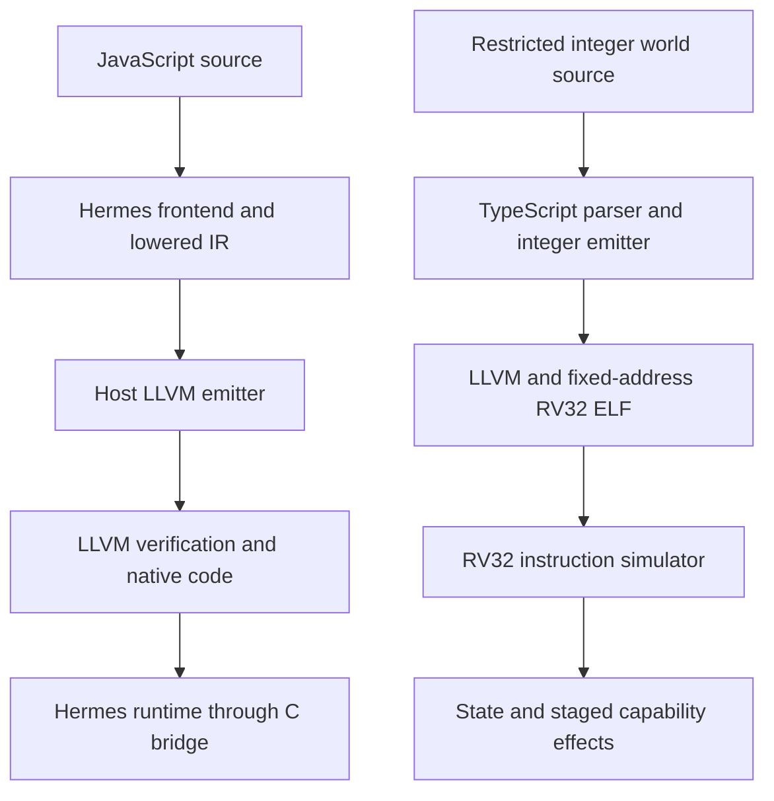
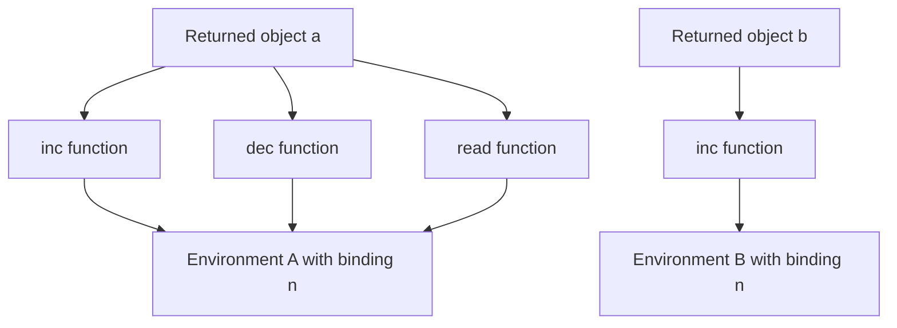
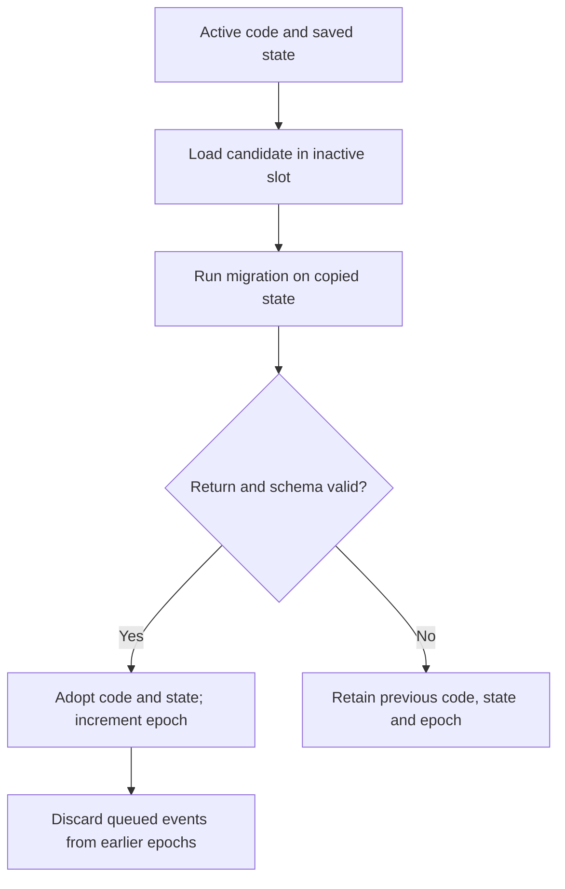

# Direct LLVM JavaScript: Original Release Deep Dive

Compiling JavaScript to native instructions requires two kinds of implementation. A compiler translates control flow and operations into executable code. A runtime supplies the representations and operations that make those instructions behave like JavaScript: values, objects, mutable lexical bindings, calls, exceptions, and garbage collection. This project explores that division through a direct LLVM backend for Static Hermes and a separate, restricted JavaScript compiler for a simulated RISC-V device.

An intermediate representation, or IR, is a language used inside a compiler to express operations independently of their original source syntax. LLVM IR describes typed operations, branches, functions, and calls from which LLVM can produce machine code. “Direct LLVM” in this repository means the compiler emits that representation without first generating a C program for each input. It does not mean the runtime disappears, and it does not mean JavaScript has become a language of machine integers.

> [!summary]
> The imported release contains a working host backend for dynamic values, functions, closures, ordinary classes, and exceptions. A separate RV32 simulator executes restricted integer programs and implements bounded turns, staged effects, and transactional reload. The two systems establish different results and do not yet form a dynamic JavaScript runtime on PicoCalc hardware.

Source import commit: `b1f3757493a2edbe449978cb0ebf0dd4101b705d`. This note is the original-release baseline; a later release will receive a separate analysis.

## Release identity and the scope of this analysis

This report studies `/home/manuel/Downloads/direct-llvm-release`, imported into `/home/manuel/code/wesen/2026-10-28--llvm-js`. The release pins the `static_h` branch of `facebook/hermes` to base commit `f837b9dd8396ebf5c4e8115412417d273565f0fe`. It includes the complete Hermes source, its upstream licenses and bundled dependencies, the separate PicoCalc prototype, a patch, provenance metadata, historical validation records, and an engineering diary. The patch describes 40 changed files and 3,111 inserted lines.

The user confirmed that the local ZIP is an older release. There is a material version discrepancy between this baseline and the colleague’s final handoff. The colleague's subsequent handoff describes a newer 124-file patch, 53 extension contracts, generators, async functions, richer values, and lexical eval. Both the named directory and the ZIP currently in Downloads contain the earlier release. In particular, the imported tree lacks `utils/test_shllvm_extensions.py`, `test/LLVMNativeExtensions/`, and the described `docs/llvm/feature-work/` records. Its tests still classify generators and eval as unsupported. The newer handoff is useful design context, but it is not implementation evidence for this checkout.

All 13,052 entries in the supplied SHA-256 manifest matched their files before copying. This establishes that the imported files agree with the supplied manifest; it does not independently authenticate the author or prove semantic correctness. The original source and evidence are preserved so that later work can compare a newer release without losing this baseline.

## Two execution systems with different contracts

The host system starts with the real Hermes frontend. A frontend parses source, resolves names, and constructs an IR expressing the language's operations. Hermes then lowers higher-level constructs into a smaller set of instructions. The new backend translates those instructions into LLVM text and calls a separately compiled runtime bridge when an operation requires managed-language behavior. LLVM tools verify and compile the result. Native executables link the bridge and Hermes libraries; `lli` executes bitcode while loading the shared bridge.

The device experiment has a much smaller source language. It uses TypeScript's parser on the host, accepts selected JavaScript syntax, and emits integer-oriented LLVM IR. Clang produces RV32IM instructions, and LLD links them at a fixed address. An independent C++ process loads the resulting ELF image and interprets its instructions. That process also controls persistent state, capability calls, instruction budgets, and code replacement.



The distinction can be expressed as a set of explicit obligations:

| Property | Host Hermes backend | RV32 integer-world prototype |
|---|---|---|
| Source values | Hermes tagged values and managed objects | Restricted 32-bit integer expressions |
| Captured state | Heap environments and mutable bindings | Fixed 16-byte state record |
| Execution | Host native process or `lli` | RV32IM instruction interpreter |
| Memory management | Existing Hermes managed runtime | Explicit guest segments and stack |
| Failure recovery | JavaScript exceptions and runtime cleanup | Discard tentative state and effects |
| Reload | No implemented dynamic-world migration protocol | Two code slots, migration, epoch change |
| Proven physical target | Host only | Host simulation only |

The host can express substantially richer programs, while the simulator has stronger explicit control over each guest instruction and each effect. Neither implementation alone supplies the other's guarantees.

## Where the Hermes backend begins

The entry point for direct emission is `sh::generateLLVM`, reached through the `-emit-llvm` driver path. Shared lowering in `lib/BCGen/SH/SH.cpp` handles transformations such as arguments, scopes, object literals, switches, and constant loading. The direct path stops before the C backend's register-oriented transformations. That boundary gives LLVM responsibility for its own optimization and machine register allocation.

`LLVMNative/LLVMBackend.cpp` separates module-wide and function-local responsibilities. `ModuleEmitter` numbers functions, interns strings, records helper signatures, and emits module data. `FunctionEmitter` assigns value storage, labels blocks, translates instructions, and constructs exception dispatch. Keeping helper declarations centralized prevents two emitted calls from silently disagreeing about a helper's LLVM signature.

Textual emission avoids linking the compiler directly against LLVM's C++ APIs. The cost is that validation occurs in a separate tool invocation, and the emitter must carefully construct valid text. `utils/shllvm.py` runs `llvm-as`, verifies the resulting bitcode with `opt`, applies the selected optimization pipeline, and verifies again. A structural verifier catches malformed IR, but cannot determine whether a valid sequence implements JavaScript coercion, property behavior, or exception ordering correctly. Those questions require execution tests.

## Values, roots, and the generated function ABI

An application binary interface, or ABI, specifies how compiled components exchange data and control. Generated functions in this backend have a compact LLVM signature:

```llvm
define internal i64 @shllvm_f7(ptr %shr) {
  ; Body omitted: this is the function signature shape.
}
```

The pointer identifies the runtime. The return value contains the bits of a Hermes `SHLegacyValue`. Although its LLVM type is `i64`, it can represent a number, boolean, null, undefined, or a managed reference. Explicit JavaScript arguments travel through the Hermes register stack, rather than through extra LLVM function parameters.

The bridge in `runtime.c` asserts that values and pointers are eight bytes and that its function descriptor is sixteen bytes. These are deliberate host ABI restrictions. They prevent accidental compilation against a layout the emitter does not understand. Removing the pointer assertion would not implement a 32-bit port: every representation, callback, layout, and runtime dependency would still need review.

A garbage-collector root is a location the collector scans to find reachable objects. If a collector moves an object, references to that object must be updated. An LLVM temporary containing an old address is therefore insufficient storage for a managed value that survives an allocating operation.

The current emitter gives every Hermes instruction a root slot, including instructions whose result is unused, and allocates additional slots for constants. A scratch slot supports helper operations. `shllvm_enter` initializes the slots to undefined, associates the unit, enters the Hermes frame, and initializes outgoing call storage. This explicit initialization ensures the collector never treats uninitialized stack bytes as valid tagged references.

The central invariant is that a value needed after a potentially allocating helper has an authoritative copy in traced storage. Generated code subsequently reloads that storage. A property getter or numeric conversion can invoke user code, so apparently simple operations can allocate or reenter JavaScript. Incorrectly declaring these helper calls pure would allow LLVM transformations that violate the invariant.

The admission calculation is visible in `FunctionEmitter::generate`:

```text
instruction and constant slots
+ one scratch slot
+ max(1, outgoing argument count)
<= 1,024 slots
```

At eight bytes per slot, the admitted explicit payload is at most 8 KiB. This is not a total stack bound. Native frame headers, exception storage, LLVM spills, runtime stack entries, and recursion consume additional memory. The newer handoff describes sharing a discard slot for unused results; the imported constructor still assigns separate slots to those instructions.

## Following a mutable closure through the runtime

A closure combines executable code with access to the lexical bindings it needs. A lexical binding is a named storage location determined by source scope. When two closures mutate the same captured variable, they must refer to the same location, rather than separate copies of its initial value.

The supplied `test/LLVMNative/closures.js` includes this example:

```javascript
function counter(start) {
  let n = start;
  return {
    inc: () => ++n,
    dec: function () { return --n; },
    read: () => n
  };
}
const a = counter(40), b = counter(100);
print(a.inc(), a.inc(), a.dec(), a.read(), b.inc(), a.read());
```

The expected output is `41 42 41 41 101 41`. The first two calls increment the binding associated with `a`; decrement and read observe that same binding. The call through `b` modifies an independently created environment. The last read demonstrates that the first environment has not changed.

After scope lowering, environment variables have indices. `CreateScopeInst` reaches `shllvm_env_create`; stores and loads reach `shllvm_env_store` and `shllvm_env_load`. The store follows Hermes's write-barrier protocol so that the collector can track heap references written into an existing environment. Closure creation records the generated function pointer, its metadata, the unit, and the environment. The callee recovers that environment when invoked.



The native frame that originally executed `counter` can return because the binding lives in the managed environment. The returned object retains its functions, which retain that environment. This also explains why garbage collection and code unloading are separate lifetime problems. A reachable closure can keep its environment alive, but its native function pointer is only valid while the corresponding code remains mapped. The imported unit contract requires associated metadata, string pools, and code to remain available until the runtime is destroyed.

## Calls and property operations preserve language behavior

A JavaScript call carries a callee, a receiver (`this`), explicit arguments, and sometimes a construction target (`new.target`). `shllvm_call` copies the arguments into the outgoing Hermes frame and invokes the runtime's established call machinery. Parameter zero denotes `this`; missing explicit arguments yield undefined. Calling `object.method()` and calling an extracted function value can therefore have different receivers even when the underlying function object is identical.

Construction requires additional checks. An arrow function cannot be used as a constructor, and a class constructor cannot be invoked as an ordinary function. The function metadata and generated prologue preserve those restrictions. Construction helpers also select between the allocated receiver and an explicit object result returned by the constructor.

Property access remains a runtime operation because lookup can encounter inherited values, getters, setters, and receiver-sensitive behavior. Assignment is different from defining an own property: assignment may invoke an inherited setter. The emitter selects the corresponding helper instead of reducing both operations to a raw memory write.

Array holes demonstrate another representation-sensitive distinction. The expressions `[,]` and `[undefined]` both create length-one arrays, but only the latter owns property zero. The emitter skips `LiteralEmpty` elements while defining actual undefined-valued elements. A useful semantic test compares `0 in array`, because merely reading index zero produces undefined for both examples.

## Control flow: simultaneous assignments and exceptions

A basic block contains sequential operations ending in a branch, return, or other transfer. A phi node selects a value according to the incoming control-flow edge. Because this backend stores results in root slots, it implements phi transfers as loads and stores in generated edge blocks.

Those transfers must behave simultaneously. For example, a loop iteration that swaps two values cannot store the first destination before reading the second source. `emitEdges` first gathers every incoming value into a temporary and only then writes destinations. The following is explanatory pseudocode for its two-phase operation:

```text
for each phi at the destination:
    temporary[phi] = load incoming root for this predecessor
for each phi at the destination:
    store temporary[phi] into the phi result root
branch to destination
```

No allocating call occurs between these loads and stores. The temporary raw values are therefore safe during the transfer. The same mechanism supports edges entering catch destinations.

Exceptions require restoring runtime state as well as changing control flow. Functions with try regions allocate handler storage, initialize a volatile region identifier, and invoke `_setjmp` with LLVM's `returns_twice` attribute. The initial return enters ordinary execution. A later exceptional return enters `catch.dispatch`, which calls `shllvm_catch_prepare` and selects a catch destination from the active region identifier. The bridge repairs runtime frame state after deeper calls have unwound.

Try-start instructions install their region number. Try-end and catch entry restore the enclosing region. With no matching local handler, the generated path removes its handler and rethrows. Root accesses in these functions use volatile operations where needed to preserve values across nonlocal transfers. These details are essential because ordinary optimization assumptions about local temporaries do not automatically describe `setjmp`/`longjmp` behavior.

## The RV32 language and a complete turn

The separate frontend deliberately restricts both syntax and values. Its state has four fields: schema, score, ticks, and flags. Arithmetic is represented as 32-bit integer operations. Wrapping addition uses LLVM `add i32` without promises such as `nsw` or `nuw`, which would give signed or unsigned overflow different optimization consequences. Shifts and signedness require explicit treatment; the compiler cannot rely on general JavaScript Number semantics because that is not the admitted language.

Consider `worlds/counter_v1.js`. Event 1 adds `arg` to `state.score`, increments `state.ticks`, and requests `cap.emit(state.score)`. Starting with score zero and ticks zero, `dispatch 1 3` should produce score three, ticks one, and an emitted value of three. The compiler emits addresses into the fixed state structure, loads the old values, performs integer operations, stores the tentative results, and invokes the capability ABI.

Clang receives the emitted module with `-x ir --target=riscv32-unknown-elf -march=rv32im -mabi=ilp32`. LLD produces a prelinked ELF image for one of two addresses, `0x100000` or `0x200000`. The driver checks ELF class, endianness, machine ID, entry range, segment bounds, exported entry points, and unresolved symbols. The simulator separately validates the image before execution. There is no guest dynamic linker and no guest libc.

The simulator maps the 16-byte state at `0x30000000` and an 8 KiB stack at `0x80000000`. Code and data segments have simulated access permissions. Each interpreted instruction consumes one unit of fuel; exhaustion fails the turn. Fuel measures interpreted instructions, not physical processor cycles, and therefore provides a deterministic execution bound without claiming hardware timing accuracy.

The execution transaction is implemented by `World::dispatch` and `Machine`:

```text
create a Machine with a copy of saved state
execute the entry point with event and argument
if execution succeeds and the schema is unchanged:
    adopt the resulting state
    apply validated staged effects
else:
    preserve saved state
    discard staged effects
```

Capability calls are mediated through `ecall`. A requested panel rectangle or log value is staged during execution; it does not immediately change the persistent panel or deliver a visible effect. An abort after drawing therefore leaves the panel unchanged under the tested failure model. This transaction applies to the simulator's explicit state and effects. It is not a general rollback mechanism for a Hermes heap, nor a claim of crash-atomic external I/O under arbitrary host failures.

## Reload is a state transition with an epoch

Hot reload must preserve a coherent relationship between code and state. Loading new instructions while retaining an incompatible state record can create a program that never existed in either version. The prototype addresses this with two fixed code slots and an explicit migration entry point.

`World::reload` validates that the candidate occupies the inactive slot, copies the saved state, and runs the candidate's migration function. Migration runs with ordinary emit and display capabilities disabled. The runtime checks its return code and the requested schema. Only after those checks succeed does it adopt the candidate and its migrated state, then increment the epoch.

An epoch is a generation number attached to queued work. `queue` records the current epoch with each event. `drain` discards an event when its recorded epoch differs from the current one. Consequently, work accepted under old code cannot silently execute under a replacement generation after successful migration. Failed migration leaves the old code, state, and epoch active.



This design is practical because state is a small explicit record. Managed closures, promises, object graphs, and callbacks would require a different migration contract. Copying raw `SHLegacyValue` bits between runtimes would not establish ownership or repair embedded references. An initial dynamic-world design could serialize explicitly supported application data into a fresh runtime, but that is future integration work.

## What the newer handoff would change

The colleague describes extensions that would substantially enlarge the host backend. Generator suspension requires heap-resident state that survives the returning native invocation. Async functions additionally depend on promise settlement and job scheduling. Rich values require exact BigInt serialization, RegExp construction, private-name checks, and typed-array property rules. These are managed-runtime obligations in addition to emitter instruction coverage.

The described lexical-eval implementation is especially significant. A dynamically compiled closure must share the caller's actual mutable bindings with native closures. That requires preserving visible declarations, environment locations, constness, temporal-dead-zone information, receiver context, and compilation metadata. A runtime bytecode compiler can then compile the string against those locations. The colleague reports strict-caller and class-context restrictions; those restrictions should remain visible if the newer release is imported.

This gives a precise future architecture: static source takes the LLVM route, while eval and Function strings take a runtime bytecode route into the same managed runtime. It would be inaccurate to describe the dynamically supplied strings as directly compiled to LLVM based on that handoff. It would also be inaccurate to attribute its 53/53 extension result or root-slot optimization to the current files. The immediate next versioning task is to obtain that archive and verify its source and evidence before extending this report's implementation claims.

## Validation, reproduction, and engineering priorities

The packaged authoritative host record is `hermes/docs/llvm/evidence/final-validation.json`. It reports 22 source cases, 64 native comparisons, three JIT comparisons, six expected runtime-error executions, and three compile rejections. Publication and raw lexical-default checks are recorded separately as six and five passing checks. These counts describe the supplied release's historical run. They must not be replaced with the newer handoff's totals or treated as complete ECMAScript conformance.

The evidence has several independent roles. LLVM verification checks representation structure. Node comparison checks selected observable results against a separate engine. C-backend comparison isolates some code-generation differences, but shares Hermes frontend and runtime behavior. Runtime-error cases verify failure contracts. Publication tests verify that rejected translations do not destroy an existing output. Historical sanitizer results apply to the runtime and bridge; generated LLVM bodies are not claimed to have comprehensive sanitizer instrumentation.

The driver's publication protocol also has a useful limit. Verified `.ll` and `.bc` files are renamed individually, and the executable is published after successful linking. Individual replacements avoid publishing partial files, but do not create one atomic transaction covering the entire collection of IR, bitcode, executable, and manifest. Tooling consuming those artifacts should identify a completed build explicitly rather than assume every adjacent file always belongs to one generation.

The imported source is useful now for investigating compiler/runtime boundaries and for experimenting with integer-world supervision. Before a dynamic physical-device port, the required work includes a supported 32-bit value ABI, managed allocation, root and write-barrier validation, exception services, executable-memory handling, cache synchronization, capability bindings, and a code-retention policy. Heap rollback and scheduling require their own designs. A collector safepoint alone does not impose instruction fuel, and suppressing effects does not undo object mutations.

### Fresh import validation on 2026-10-28

The imported source was built and tested again on this workstation. The build completed all 456 Ninja steps for the requested compiler and runtime targets. The host matrix ran without quick mode, case filtering, or JIT skipping. Its 22 cases comprise 16 positive programs, three expected runtime-error programs, and three compiler-rejection programs. The 64 positive native comparisons cover both Hermes optimization settings and both LLVM settings; three separate `lli` runs passed as well.

| Fresh check | Result |
|---|---:|
| Release manifest entries, before copy and in staged Git blobs | 13,052 / 13,052 matched |
| Host source contracts | 22 / 22 passed |
| Native LLVM comparisons against Node and C | 64 passed |
| Actual `lli` executions | 3 passed |
| Expected native runtime-error executions | 6 passed |
| Output-publication checks | 6 / 6 passed |
| Raw lexical-default checks | 5 / 5 passed |
| RV32 integration tests, including the compiler service | 24 / 24 passed |

Fresh logs and JSON records are retained in `ttmp/2026-10-28/import-validation/`. The first RV32 attempt failed because `ld.lld` was absent; extracting the matching LLVM 18.1.3 linker package into `/tmp` allowed the complete suite to pass. No imported implementation files were modified. Git text conversion was disabled to retain exact parser-fixture line endings and preserve the supplied checksums. This local run is a successful non-sanitized reproduction; the historical AddressSanitizer evidence remains a separate result.

### Reproducing the original release locally

The import validation uses Clang/LLVM 18.1.3 and an ordinary Release build. On this machine, Clang initially selected an incomplete GCC installation and could not link `libstdc++`. Selecting `/usr/lib/gcc/x86_64-linux-gnu/13` for the C++ toolchain resolved configuration. The exact commands and environment repair are recorded in `IMPORT.md`; this is a local toolchain adjustment, with no change to the imported compiler sources.

From the repository root, a configured compiler can be exercised as follows:

```sh
cmake --build hermes/build-llvm \
  --target shermes shllvm_runtime shllvm_runtime_shared --parallel 4

python3 hermes/utils/shllvm.py run \
  --build-dir hermes/build-llvm --llvm-bin /usr/lib/llvm-18/bin \
  hermes/examples/llvm/counter.js

python3 hermes/utils/shllvm.py jit \
  --build-dir hermes/build-llvm --llvm-bin /usr/lib/llvm-18/bin \
  hermes/examples/llvm/counter.js

python3 hermes/utils/test_shllvm.py \
  --build-dir hermes/build-llvm --llvm-bin /usr/lib/llvm-18/bin \
  --jobs 3 --output /tmp/original-release-validation.json
```

The explicit output path keeps a new run from overwriting packaged historical evidence. The same rule applies when running the publication and language-default harnesses: select their `--evidence` paths explicitly. New evidence should state its build configuration, because this local validation does not enable AddressSanitizer and cannot replace the earlier sanitizer-specific result.

### Source-reading guide

All paths below are relative to `/home/manuel/code/wesen/2026-10-28--llvm-js`.

| File | Question it answers |
|---|---|
| `hermes/tools/shermes/compile.cpp` | How does the driver publish direct LLVM output? |
| `hermes/lib/BCGen/SH/SH.cpp` | Which lowering is shared before backend selection? |
| `hermes/lib/BCGen/SH/LLVMNative/LLVMBackend.cpp` | How are slots, control flow, helpers, and module data emitted? |
| `hermes/lib/BCGen/SH/LLVMNative/runtime.c` | How are generated operations adapted to the existing runtime? |
| `hermes/include/hermes/VM/static_h.h` | What are the runtime's units, roots, and value contracts? |
| `hermes/utils/shllvm.py` | How are tools, verification, linking, and manifests coordinated? |
| `hermes/utils/test_shllvm.py` | Which output and error contracts are compared? |
| `picocalc-llvm-poc/compiler/js2llvm.js` | Which source constructs and integer rules are admitted? |
| `picocalc-llvm-poc/compiler/compile.py` | How is RV32 code linked and audited? |
| `picocalc-llvm-poc/kernel/pico_sim.cpp` | How are instructions, capabilities, rollback, and reload executed? |
| `picocalc-llvm-poc/tests/` | Which simulator and differential behaviors have executable checks? |
| `PROVENANCE.json` and `SHA256SUMS.txt` | Which packaged inputs and historical qualifications identify this release? |

### Exercises for extending the implementation carefully

1. Modify the closure example to retain only an extracted increment function. Predict which environment remains reachable after its creator and returned object are no longer referenced, then compare native and JIT results.
2. Write a loop rotating three values. Inspect the generated edge blocks and demonstrate why all incoming loads must precede destination stores.
3. Add a simulator program that updates state, requests a rectangle, and then exhausts fuel. Verify both state retention and unchanged panel output.
4. Queue an event, perform successful migration, and drain. Repeat with a failing migration. Explain the different outcomes from the epoch transition.
5. When the newer release becomes available, compare slot allocation, extension fixtures, and lexical-eval metadata against this baseline. Keep output comparisons, expected errors, and unsupported-context rejections in separate evidence categories.
