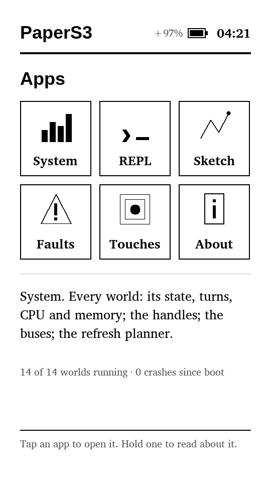
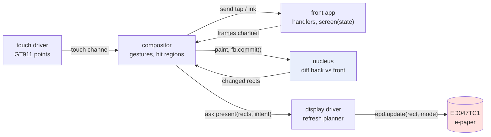
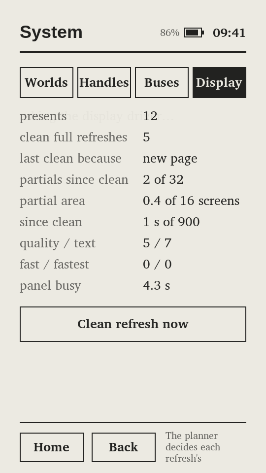
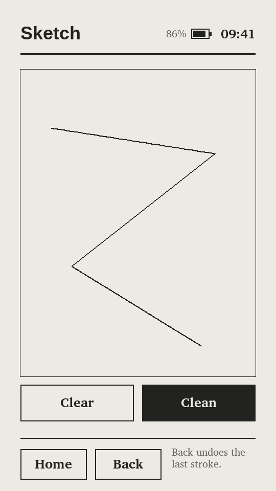
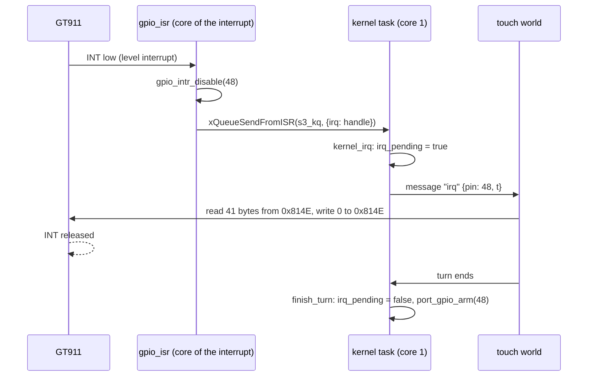
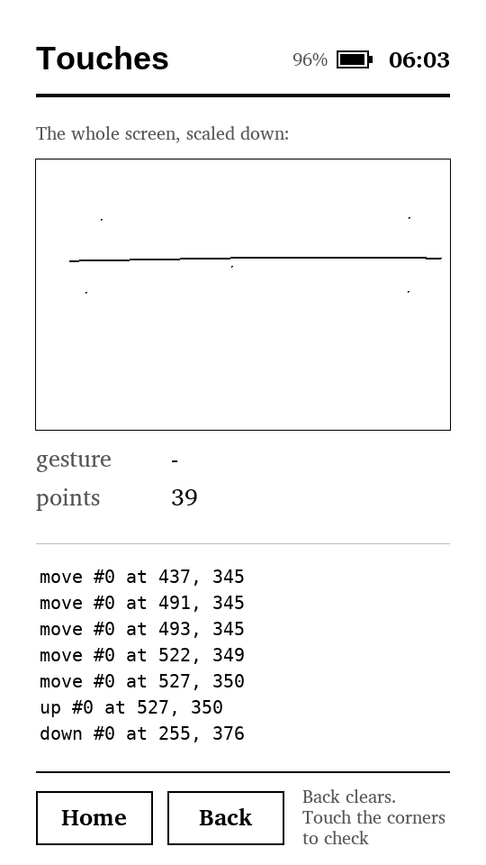
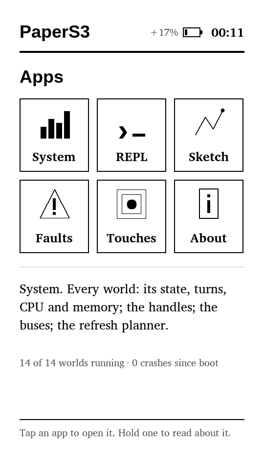

# picocalc-os on the M5Stack PaperS3: E-Paper, MicroQuickJS and an Idle Tablet

picocalc-os is a small operating system in which drivers, services and applications are separate
JavaScript programs. A C core, the *nucleus*, runs them one at a time and supervises them. The system
was first written against a simulated PicoCalc and then moved onto an ESP32-P4 (see
[[PROJ - picocalc-os on the ESP32-P4 - From Simulator to Hardware - Technical Project Report]]). This
report covers its second port: the M5Stack PaperS3, a 4.7-inch e-paper tablet with a capacitive touch
panel and an ESP32-S3. The port changed three things at once. The JavaScript engine changed from
QuickJS to MicroQuickJS. The display changed from an LCD that refreshes in milliseconds to an e-paper
panel that needs about a second. The input changed from a keyboard to a finger.

The work ran as two tickets over three days. PAPERS3-PORT made the same nucleus host a second engine and
a second board, wrote the PaperS3's fourteen worlds and brought them up on the device. PAPERS3-IDLE then
asked what the device does while nobody touches it. The answer at the start was "a great deal": the
idle home screen kept the JavaScript lane 23% busy and woke the kernel 97 times a second. At the end the
kernel woke about 0.4 times a second, touch input arrived through the touch controller's interrupt line,
and the chip spent its idle time in light sleep on battery.

> [!summary]
> - **One nucleus, two engines, three boards.** The nucleus gained an engine seam, a board seam and a
>   pixel seam. The PicoCalc build still produces byte-identical screenshots, and the PaperS3 build runs
>   the same kernel, handle and graphics code on MicroQuickJS with 8-bit gray pixels.
> - **E-paper inverts the dirty-rectangle rule.** A waveform pass costs about the same whatever its
>   size, so the display driver sends one update per present over the union of the damage, and chooses
>   between clean and partial refreshes by counting ghosts.
> - **Idle cost was needless work, not slow code.** A profiler showed that a 20 ms touch poll and
>   off-screen applications' timers took seven eighths of the idle lane. Stoppable timers, rendering
>   only the front world, and interrupts delivered as messages took the idle lane from 23.2% to 0.4%.
> - **Light sleep needed three board-specific fixes.** The USB console blocks sleep while connected, a
>   sleeping chip cannot be enumerated by a newly attached host, and sleep isolation floated the
>   PaperS3's power-latch pin. With those fixed, the board sleeps on battery and reconnects when plugged in.



The image above is not a photograph. It is the device's framebuffer, sent over the USB console by the
`shot` command and decoded on the host. The battery reads `+97%` because the charger reported charging
over USB. The clock reads `04:21` because it comes from the board's real-time clock chip, which had never
been set.

## Why this project exists

picocalc-os tests an idea: that every part of an embedded system above the bus level can be an ordinary
JavaScript program, isolated from the others by a separate interpreter instance rather than by an MMU,
and supervised so that any one of them can crash and restart without taking down the rest. The ESP32-P4
port showed the idea works on one board with one display technology. A second, very different board
tests whether the design is general or whether it only fits the PicoCalc.

The PaperS3 differs from the PicoCalc in every dimension the OS touches:

| Property | PicoCalc (ESP32-P4) | M5Stack PaperS3 |
|---|---|---|
| CPU | ESP32-P4, RISC-V, 360 MHz | ESP32-S3, Xtensa LX7, 240 MHz, two cores |
| Memory for worlds | 32 MB PSRAM | 8 MB PSRAM |
| Display | 320 × 320 RGB565 LCD, SPI, milliseconds per update | 540 × 960 e-paper (ED047TC1), 16 grays, 8-bit parallel, about 1 s per clean update |
| Input | keyboard behind an STM32, polled over I2C | GT911 capacitive touch, I2C plus an interrupt line |
| Engine | QuickJS (ES2020) | MicroQuickJS (strict ES5) |
| Power | always on | battery, power latch, charger status pin |

The second reason is power. An e-paper screen holds its image without power, so a tablet whose software
also does nothing while idle can run for a long time on a battery. That makes the idle behaviour of the
OS a first-class property, not a later optimisation. The user's question at the start of PAPERS3-IDLE
was whether the OS could be made "interrupt driven (does the language allow for that?) so we can save on
power if the device is idle." The second half of this report answers it.

## The system in five concepts

The rest of the report uses five terms in the precise sense the code gives them.

A **world** is one JavaScript engine context created from one file listed in the manifest
`js-papers3/system.json`. The manifest gives each world a memory limit (`mem_kb`), a time budget per turn
(`budget_ms`) and a list of **claims**, the hardware and privileges it may open. The PaperS3 runs
fourteen worlds:

```json
{ "name": "touch",      "file": "drivers/touch.js",     "claims": ["i2c1:0x5d", "gpio:48"], "budget_ms": 20,  "mem_kb": 64 },
{ "name": "display",    "file": "drivers/display.js",   "claims": ["epd0"],                 "budget_ms": 40,  "mem_kb": 64 },
{ "name": "compositor", "file": "system/compositor.js", "claims": ["dma"],                  "budget_ms": 400, "mem_kb": 448 },
{ "name": "system",     "file": "apps/system.js",       "claims": ["sys.read"],             "budget_ms": 80,  "mem_kb": 160 },
...
```

Four are drivers (touch, clock, power, display), three are services (compositor, sandbox, flaky) and
seven are applications (launcher, system, repl, faults, touches, sketch, about). Worlds share no memory.
They exchange JSON messages: `send` delivers one, `ask` delivers one and returns a promise for the
answer, and `publish` delivers to every world that `needs` a channel.

There is one **lane**: at most one world runs at any moment. A **turn** is one message handled to
completion. A handler that returns a promise keeps its turn open until the promise settles, so a turn
consists of one or more **segments**, each a period in which the world holds the lane. Every effect of a
segment (messages, replies, bus transfers) is deferred until the segment ends, and a segment that throws
is discarded with all its effects. That is what makes supervision safe: a crashed world is torn down,
its hardware **handles** are released, and it restarts after a backoff.

A **handle** is an integer that stands for a piece of hardware: an I2C device, a GPIO pin, the e-paper
bus, a framebuffer. The kernel checks the handle on every use, and releasing a world releases its handles.

Applications never draw. After each turn the nucleus calls the application's `screen()` function, and if
the returned tree of plain objects changed, publishes it on the `frames` channel. The compositor lays out
the front application's tree, paints it into a framebuffer and asks the display driver to present the
changed rectangles.



On Linux the system runs on a **virtual clock**. A segment's cost is computed from engine steps and host
calls, not measured, so a scripted session replays exactly and produces byte-identical PNG screenshots.
Those screenshots are the project's main regression test. On the device, the kernel runs in
`K.realtime` mode, where segment start times and costs come from the hardware timer.

## Part I: the port

### Three seams in the nucleus

The PicoCalc nucleus was written against QuickJS and against one simulated board. Before anything
PaperS3-specific could be written, those two dependencies had to become interfaces. The rule for this
phase was strict: after every commit, `make shots` on the PicoCalc build had to leave every `out/*.png`
byte-identical. The refactor was therefore checked by the same captures that check the OS itself.

**The engine seam** (`d2bb7f5`). `world_t` held QuickJS's runtime, context and pending-promise fields
directly. They moved behind an opaque `struct vmw *vm`, and the manifest parse moved into the engine
binding (`vm_read_manifest`), because each engine has its own JSON parser and a third one in C would
have been redundant. `kernel_boot` calls it with an `add_world` callback that applies the same defaults
in the same order, so the kernel's sequence numbering, and therefore every capture, was unchanged.

**The board seam** (`db0a452`). Buses became names supplied by the port (`port_bus_names()`): the
PicoCalc returns `{"i2c0", "spi2"}`, the PaperS3 `{"i2c1", "epd0"}`. A fixed enum of every bus on every
board would have changed the PicoCalc System app's Buses tab, and therefore its screenshots. Host-board
commands (`key`, `tap`, `battery`, `panel`) moved from the generic host runner into `sim/board.c` and
`sim/papers3/board.c`.

**The pixel seam** (`016f9a1`). `pixel_t` is RGB565 by default and `uint8_t` gray under
`NUCLEUS_GRAY8`. Fonts gained per-glyph advance tables, and `gfx.c` gained `gfx_measure` and
`gfx_wrap_json`, because the paper UI uses proportional serif text and has to wrap paragraphs. A NULL
advance table means monospace, so the PicoCalc's font initializers did not change.

One regression was caught by review before it reached a capture. The new `gfx_text` used `room = -1` to
mean "do not truncate". When the available width is narrower than one glyph, `room` becomes negative by
arithmetic, and the text was drawn uncut where the old code drew only an ellipsis. An explicit `cut` flag
replaced the sentinel.

### MicroQuickJS under the nucleus

MicroQuickJS (`bellard/mquickjs`, vendored at `84d793e` in `third_party/mquickjs`) is Fabrice
Bellard's QuickJS variant for microcontrollers. Three of its properties drove the decision to use it on
the PaperS3:

- **Each context lives in one caller-supplied arena.** The engine allocates nothing outside it. A
  world's memory limit is therefore exact: it is the arena size, not a counter that the allocator
  consults.
- **Contexts are cheap.** Creating one takes about 0.6 ms on the host, so restarting a crashed world is
  fast.
- **The collector compacts.** Objects move. A C pointer to a JavaScript value is valid only until the
  next allocation.

Its costs are the dialect and the API. MicroQuickJS is strict ES5 with no `Promise`, no `async`, no
arrow functions and no classes. The design guide recorded 60 probed language features. A selection of
the surprises:

| Probe | Result in mquickjs |
|---|---|
| `JSON.stringify(v, replacer)` | the replacer and reviver are ignored |
| `e.stack` | `""` (the engine keeps the backtrace internally) |
| `new Date(2026, 9, 26)` | throws `only Date.now() is supported` |
| object-literal getters | parse, but do nothing |
| writing into an array hole | throws |
| assigning an undeclared global | throws |
| C functions | bound in a ROM table generated at build time, not added at run time |

Every existing JavaScript file in the OS was ES2020, so the whole `js-papers3` tree is new code. That
was accepted because the paper UI had to be new code anyway.

#### Promises without Promise

The OS's world API is built on promises: `ask` returns one, bus transfers return one, `sleep` returns
one. Without a native `Promise`, the prelude (`js-papers3/prelude.js`) implements an 80-line `Task` with
the same `then`/`catch` contract:

```js
function Task() { this.state = 0; this.value = undefined; this.cbs = []; this.handled = false; }
Task.prototype.then = function (ok, bad) {
  var t = new Task();
  this.cbs.push([ok, bad, t]);
  this.handled = true;
  if (this.state) ready.push(this);
  return t;
};
function settle(t, state, v) {
  if (t.state) return;
  if (state === 1 && v && typeof v.then === "function") {   // adopt a thenable
    v.then(function (x) { settle(t, 1, x); }, function (e) { settle(t, 2, e); });
    return;
  }
  t.state = state; t.value = v;
  ready.push(t);
}
```

The important decision is where pending tasks live. The kernel issues a numeric promise id for each
asynchronous operation (an ask, a transfer, a sleep). The prelude keeps a table from that id to the
`Task`, and the kernel later calls `__settle(id, ok, json)`. C never holds a JavaScript value across a
turn. With a moving collector this removes a whole class of bugs: there are no rooted references to
keep consistent, and a crashed world's pending callbacks disappear with its arena, which matches how the
QuickJS build drops pending promises when a world dies.

The same rule governs every host operation. Structured results, even `handle_info`, come back to
JavaScript as JSON text and are parsed with `JS_Parse(..., JS_EVAL_JSON)`. Arguments are pushed in the
order the moving collector requires: `call_global` creates each argument string immediately before
pushing it, so every earlier value is already on the engine's stack where the collector updates it, and
the function itself is looked up last.

#### Patches to the engine

The binding needed five changes to mquickjs, each recorded in `third_party/mquickjs/PATCHES`:

1. `JS_INTERRUPT_COUNTER_INIT` from 10000 to 1000, so the time budget is checked often enough. The
   interrupt exception is uncatchable in mquickjs, so `try { for (;;); } catch (e) {}` cannot evade a
   budget.
2. Getters the binding needs: `JS_GetContextOpaque`, `JS_GetInterruptCounter`, `JS_GetMemoryUsage`.
3. A `CONFIG_NUCLEUS` hook in the stdlib generator that replaces `print`, `console`, timers and `load`
   with the nucleus's two entry points, `__k` and `__ka`.
4. **Live size after compaction.** mquickjs collects only when the arena fills, so the arena is mostly
   garbage between collections. A world doing nothing read "94 of 96 KB". The patch records the live
   size after each compaction, and the binding reports that figure. Baseline worlds are about 30 KB.
5. **Counted out-of-memory errors.** mquickjs's out-of-memory error is an ordinary catchable
   exception. The sandbox world wraps `eval` in `try`/`catch`, so a script that exhausted its arena was
   caught and the world carried on, where QuickJS's allocator would have flagged the world as out of
   memory. `JS_ThrowOutOfMemory` now increments a counter, and the binding marks the world as crashed
   with `ran out of memory (its limit is 128 KB)` when the counter moves during a segment.

The first run of the binding dumped core in `op_seed`, with a world pointer truncated to 32 bits. The
newly added `JS_GetContextOpaque` had been called through an implicit declaration returning `int`,
because the Makefile did not list `mquickjs.h` as a dependency of `vm_mqjs.o`, so the object was never
recompiled after the header changed. After the dependency fix, a conformance manifest of five test
worlds (`js-papers3/test/`) produced exactly the expected supervision log: budget overruns, out-of-memory
crashes, timeouts, rejected asks, restarts and the fifth-crash stop.

### A simulator that is honest about e-paper

The PaperS3 simulator (`sim/papers3/`) models the GT911 touch controller, the BM8563 real-time clock and
the e-paper glass. The glass model is the part that changed the UI design. It keeps, per pixel, the
level the panel shows and a ghost residue; it charges each update a busy time by mode; and it leaves
ghosts after partial updates. That made the host screenshots show the habits that e-paper punishes and
an LCD forgives, before any device was involved.

Two examples from the first tour of the simulated tablet:

- **Placeholder ghosts.** A world that has no `onStart` publishes no frame until its first message. The
  compositor's clean "page" refresh therefore showed the placeholder "starting repl…", and the real frame
  arrived as a partial update over it, leaving the placeholder's text faintly behind the REPL. The fix
  was for `focus()` to hold the page refresh until the application's frame arrives.
- **Panel backlog.** The first display driver sent each damaged rectangle as its own update. The
  System app's world table changes in about five places a second, and each update cost 300 ms of
  simulated panel time, so taps on its tabs took effect one or two screens late.

The second example led to the refresh planner.

### The refresh planner

On an LCD the cost of an update is proportional to the pixels sent, so the right policy is to send as
little as possible. On e-paper the dominant cost is the waveform pass: the controller drives every pixel
in the updated rectangle through a sequence of voltage frames, and that sequence takes about the same
time whatever the rectangle's size. Pixels inside the rectangle that did not change are driven to the
level they already have and do not ghost. The cheaper policy is therefore one update covering the union
of all the damage.

The display driver (`js-papers3/drivers/display.js`) implements this as a policy over four **intents**
that the compositor attaches to each present:

| Intent | Used for | Waveform | Ghosting |
|---|---|---|---|
| `page` | a new screen | clean, full-screen, 16 grays (`quality`) | clears all ghosts |
| `text` | content changed within a screen | 16 grays | a little |
| `quick` | the clock, the battery icon | black and white (`fast`) | more |
| `ink` | pen strokes in Sketch | the fastest mode (`fastest`) | most |

Partial updates accumulate ghosts, so the planner converts a present into a clean full refresh when any
of three limits is reached:

```js
policy: { maxPartials: 32, maxAreaScreens: 16, maxAgeMs: 15 * 60000, align: 8 },
...
if (m.intent === "page" || m.clean) why = m.clean ? "asked" : "new page";
else if (s.partials >= p.maxPartials) why = s.partials + " partial updates";
else if (s.partialArea >= p.maxAreaScreens * s.w * s.h) why = "partial area";
else if (t - s.lastClean >= p.maxAgeMs) why = s.lastClean < 0 ? "first frame" : "age";
if (why) return update(s, 0, 0, s.w, s.h, "quality");
var mode = MODE[m.intent] || "text", r = union(m.rects, p.align);   // one update, the union widened to 8 px
```

On the simulated tour, the union policy took the panel's busy time from 13.8 s to 6.3 s and removed the
tab-switch lag. A `page` token on a frame's root handles the remaining case: when an application
switches tabs, the token changes and the compositor asks for a clean refresh instead of a partial one.



The policy lives in a JavaScript driver, not in C. That is the OS's thesis applied to the display: the
driver sees every update, so it is the right place for the policy, and changing the policy is an `ask`
to the display world (`policy`) rather than a firmware rebuild.

### Touch as points, gestures in the compositor

The touch driver publishes raw points: `{id, x, y, phase: "down" | "move" | "up", t}`. Gestures are
recognised in the compositor, because the compositor is the only world that knows where things are on
screen. It records hit regions while it paints, and classifies a contact when the finger lifts:

- a **tap** is shorter than 300 ms and moves less than 16 px;
- a **hold** lasts at least 600 ms;
- a **swipe** moves at least 64 px with an off-axis ratio under one half.

A drag that starts inside an application's `ink` node is never classified. The compositor streams it to
the application with coordinates clamped to the node, which is how Sketch draws strokes while the
finger moves. The REPL's on-screen keyboard records one hit region per key with a structured argument
(`{ch: "a"}` or `{key: "return"}`), so the REPL's handler never deals in coordinates.



### The firmware

`port/esp32s3-papers3` is an ESP-IDF 5.3.4 project that compiles the same nucleus with `vm_mqjs.c`,
`BOARD_PAPERS3`, `NUCLEUS_GRAY8` and the paper fonts, and bundles the `js-papers3` tree into flash. The
structure follows the ESP32-P4 port:

- **The kernel task** is pinned to core 1 and is the only thread that touches the nucleus or any
  engine context. It blocks on one FreeRTOS queue, `s3_kq`, which carries console lines, finished bus
  transfers and (later) pin interrupts.
- **One worker task per bus.** `i2c1` uses M5GFX's `lgfx::i2c` on SDA 41 and SCL 42, so the OS and the
  panel library do not compete through ESP-IDF's two incompatible I2C drivers. `epd0` drives the panel
  through M5GFX's `Bus_EPD` and `Panel_EPD`, configured as M5GFX configures this board. Each worker posts
  its result to `s3_kq`, and the kernel task settles the world's promise.
- **Worlds' arenas** are allocated in PSRAM.
- **A framebuffer outlives its handles.** A world can release its framebuffer handle while a
  waveform pass is still reading it, so the EPD worker takes a reference on the buffer and the kernel
  task drops it when the worker's result arrives.

M5GFX was used for the panel because the ED047TC1's waveform tables and parallel-bus timing are the
hard part of this board, and M5GFX already drives this exact board correctly.

### Running the firmware before the device was reachable

The board enumerated on USB at the start, but the host had no `cdc_acm` driver loaded and loading it
needed a password, so the firmware could not be flashed for the first day. The waiting time went into
running the firmware itself in Espressif's QEMU (`machine esp32s3`). It was the closest available
target: the real kernel, binding and mquickjs on a 32-bit Xtensa core under FreeRTOS, with a real clock.
A `S3_QEMU` build variant stubs the panel and the I2C devices and boots the conformance worlds instead of
the system.

QEMU found one real bug and produced one false alarm.

The real bug was in the binding's temporary contexts. The manifest reader and the boot-time calibration
each created a context with a bare `malloc` (256 KB for the calibration) and did not check it. QEMU
does not model the S3's PSRAM, so the allocation failed, and `JS_NewContext` wrote through NULL:
`Guru Meditation Error: Core 1 panic'ed (StoreProhibited)` in `JS_NewContext2 ← count_steps ←
vm_calibrate`. On the device the same `malloc` would have succeeded from PSRAM through
`SPIRAM_USE_MALLOC`, which is exactly why the bug had stayed hidden. The contexts now come from the arena
allocator and are checked.

The false alarm looked like heap corruption. The `heap` console command faulted inside
`tlsf_walk_pool`, but heap poisoning reported no damaged canary. The heap checked clean on core 0 through
all of `app_main` and failed at the first check on core 1, before any JavaScript ran. A task that
printed the same memory words from both cores settled it: at `0x600FE000`, RTC fast memory and the last
region registered as heap, core 0 read data and core 1 read zeros. QEMU models RTC fast memory as
visible to core 0 only, as on the original ESP32; on the S3 both cores reach it. The QEMU variant does
not use RTC fast memory as heap.

### First run on the device

Once `cdc_acm` was loaded, `idf.py flash` failed in esptool's reset sequence with
`OSError: [Errno 5] Input/output error`, and the board dropped off USB for about two minutes. A flash
script modelled on an earlier PaperS3 project worked on the next attempt. It writes with
`--before usb_reset --after no_reset`, then boots the application with a second esptool call,
`--before no_reset --after watchdog_reset read_mac`. The watchdog reset avoids the DTR/RTS sequence that
can latch this board into the ROM downloader.

The firmware booted all fourteen worlds with no crash, found the GT911 (`touch: touch controller
GT911`), read the clock and the battery, and the framebuffer read back as the same home screen the
simulator draws. The first device measurements replaced three of the simulator's estimates:

| Quantity | Simulator model | Device |
|---|---|---|
| 100k-iteration loop | 250 ms | 415.5 ms |
| `fib(20)` | 68.4 ms | 84.7 ms |
| live size of a driver world | 29–33 KB (host size ÷ 1.7) | 31–34 KB |

The 32-bit size estimate held within about 3%. The engine is about 1.7 times slower than modelled. The
third finding was the idle cost, which became the second ticket.

## Part II: an idle tablet

### The measurement that started it

With the home screen showing and nobody touching the panel, the console's `stats` over an 11 s window
showed the lane 23% busy: 546 touch turns, 135 compositor turns and 546 I2C transfers. A tablet that
spends a quarter of its CPU doing nothing visible cannot sleep.

The ticket's design guide asked first whether the change was possible within the OS's model at all:
"does the language allow for interrupt-driven code?" The answer is that the language is not the
constraint. An interrupt service routine (ISR) cannot run JavaScript: the engine is single-threaded on
core 1, an ISR runs in interrupt context on whichever core takes the interrupt, and a world preempted in
the middle of a segment would break the rule that a segment's effects are applied atomically or not at
all. But worlds are already event loops: a world is a set of handlers that run when messages arrive.
An interrupt can therefore become one more kind of message. Nothing in ES5 or mquickjs had to change;
the work was in the kernel, the port and the simulator.

The plan had seven phases: P0 a profiler, P1 and P2 removing idle work, P3 interrupts, P4 light sleep,
P5 faster turns and P6 real panel timing. P5 has not started.

### P0: measuring before changing

The profiler (`f4f6d2d`) adds per-world counters to the kernel, active only in real-time mode so the
deterministic host captures cannot change: engine time, render time, segments, engine steps and
garbage collections. The device's `prof` command prints a window:

```text
prof over 10.0 s: the kernel task woke 974 times (97.1/s) and was blocked 74% of the time; worlds ran 2328 ms (23.2%)
  world        segs  segs/s    cpu ms  engine ms  render ms  other ms  ms/seg  steps/seg  gcs
  touch         996    99.3    1450.7     1420.3       15.3      15.1    1.46         68   26
  compositor    125    12.5     290.1      286.3        1.7       2.1    2.32        155    0
  system         10     1.0     199.4      140.4       58.9       0.2   19.94        370    3
  faults         20     2.0     308.9      236.7       71.8       0.3   15.44        298   10
  ...
```

Three findings came out of this table and a `callgrind` profile of the host build:

- **Touch took 62% of the idle lane.** The driver polled the GT911 every 20 ms, and the answer was
  "no new report" almost every time.
- **Off-screen applications took 25%.** System, Faults and About ran their refresh timers and
  re-rendered their screens while nobody could see them. Inclusive cost in the host profile showed
  `op_sys_worlds` (39 calls) at about 39% of all idle instructions: the off-screen apps asked the kernel
  for the full world table as JSON and parsed it.
- **The compositor took 12%**, through a 100 ms timer that only mattered for 500 ms after an app
  switch and a 1 s timer for the clock and banners.

The profile also showed that **steps are a poor measure of work** in this engine. A touch segment
executed 68 interrupt-counter steps but cost 1.42 ms of engine time. The cost was allocation, string
interning, string concatenation, JSON and collection; `js_string_compare` alone was 8.8% of idle
instructions. Most of the idle cost was needless work rather than slow code, which set the order of the
phases: remove the work first, then make what remains cheaper.

### P1 and P2: no work when nothing happens

Three kernel mechanisms and one compositor change removed the background work (`6ce54c4`).

**Stoppable timers.** A world's `every()` timers were fixed for its lifetime. They can now be declared
paused and started and stopped from JavaScript:

```js
// js-papers3/apps/system.js
  .on("focus", function (s) { timers.start(0); sample(s); })
  .on("blur", function () { timers.stop(0); })
  ...
  .every(1000, function (s) { sample(s); if (s.tab === 3) return refreshDisplay(s); }, { paused: true })   // timer 0: only while on screen
```

Stopping a timer whose next tick is already in the kernel's event heap is the subtle part. The kernel
does not search the heap. Each timer has a generation number, each scheduled tick carries the
generation it was scheduled under, and stopping the timer increments the generation. A tick whose
generation is old is dropped when it fires. Starting the timer again begins a new chain one period
later.

**Rendering only the front world.** `sys.front(name)` tells the kernel which world is on screen.
After a turn, the kernel renders a world only if it is the front world or has never published a frame.
The operation is restricted to the world that `needs` frames, which is the compositor.

**A compositor that does not poll.** The page-refresh hold, the crash banners and the clock became
one-shot sleeps. The clock sleeps until just after the next minute boundary and re-arms itself. This
relied on a property of the prelude's dispatch that the guide had flagged as uncertain: a `sleep()`
started inside a synchronous handler and then dropped does not hold the turn open. `__dispatch` makes a
turn asynchronous only when the handler *returns* a thenable; a detached sleep settles later in a
segment of its own.

**A kernel task that blocks.** The device's kernel loop used to cap its wait at 50 ms. It now blocks
until `kernel_next_wake()`, or indefinitely when nothing is scheduled.

The first version of this phase broke a rule the old code had depended on without stating it. The
compositor used to show an application's cached frame immediately when it came to the front, then
correct it with a partial update. With background rendering stopped, cached frames are stale as a rule,
and the host captures showed it: the Touches app came up with a ghost of an older stroke. The fix was
that `sys.front` also clears the new front world's last frame, and `focus()` always waits for the fresh
frame before the clean refresh. **Whoever stops background rendering must make the foreground's first
frame fresh.**

On the device the idle lane fell from 23.2% to 15.2%. What remained was the touch poll.

### P3: interrupts as messages

The GT911 signals a waiting report on its INT line, which the PaperS3 wires to GPIO48. M5GFX's own
driver configures that pin as an input with a pull-up and reads the controller when the pin is low, so
INT is active low and level-signalled: the controller holds it low until the host writes 0 to the
status register `0x814E`.

The design (`a33628d`) delivers an interrupt as an ordinary message named `irq` to the world that holds
the pin's handle:



Three decisions shape it.

**Level-triggered, masked in the ISR, re-armed when the turn ends.** An edge interrupt could be lost
if the controller produced a second report while the first was being read: the line would stay low and
never produce another falling edge. A level interrupt fires as long as the line is low, so it must be
masked until the world has handled it, otherwise the ISR would fire continuously. The kernel re-arms
the pin in `finish_turn`, after the handling turn's effects (including the I2C write that releases INT)
have been applied:

```c
static void finish_turn(world_t *W) {
  ...
  handle_t *h = W->turn_irq ? handle_find(W->turn_irq) : NULL;
  if (h && h->irq_mode) { h->irq_pending = false; port_gpio_arm(h->addr, h->irq_mode); }   // the next interrupt may come
  W->turns++; K.turns++;
  clear_turn(W);
}
```

**At most one pending interrupt per handle.** `kernel_irq` returns early when `irq_pending` is set, so
a burst of interrupts cannot fill a world's mailbox.

**Interrupts follow handles.** `handle_release` unwatches the pin. A world that crashes loses its
handles, so its interrupt is disabled with no special case; the restarted world watches the pin again in
its `onStart`.

The touch driver became an interrupt handler plus a guard:

```js
.onStart(function (s) {
  s.dev = hw.i2c("i2c1:0x5d", 400000);
  s.int = hw.gpio("gpio:48");
  ...
  try { s.int.watch("low"); s.mode = "interrupt"; }
  catch (e) { s.mode = "poll"; timers.start(0); }      // a board whose pin cannot interrupt
})
.on("irq", function (s) { s.irqs++; s.liftCheck++; return read(s); })
.every(20, function (s) { s.polls++; return read(s); }, { paused: true })
```

The guard is a 40 ms lift check that runs only while a finger is down. If the controller pulses INT
instead of holding it, a missed final report would leave a finger "down" forever. While a finger is
down, the driver reads once more if no report has arrived for 40 ms.

The simulator's GT911 model needed the same line. Before, it produced reports lazily when read; with
an INT line it has to produce them on its own schedule, on every finger change and every 10 ms while a
finger is down, as events on the virtual clock. Its 10 ms chain stops when no finger is down and no lift
is unreported, otherwise the virtual clock would carry an event every 10 ms forever and the simulated
system would never be idle.

The first host run crashed the touch world with `out of handles`. The prelude's `__dispatch` selects a
handler by message kind: 0 is `on`, 1 is a timer, and anything else is `onStart`. `M_IRQ` is kind 3, so
every interrupt re-ran `onStart`, which opened new handles until all 128 were used. To JavaScript an
interrupt is now delivered as an ordinary `on` message of type `irq`.

On the device, an idle 10 s window then read:

```text
prof over 10.0 s: the kernel task woke 5 times (0.5/s) and was blocked 100% of the time; worlds ran 35 ms (0.4%)
```

Real touches were verified afterwards with the Touches app, which shows the driver's raw points:



The four dots are taps near the corners of the drawn pad, and the line is a drag. The coordinates
matched the screen with no transform, so the driver's `MAP` stays the identity. During 94 s of touching,
the touch driver cost 2.32 ms per segment; afterwards the window was idle again, with no finger left
"down".

### P4: light sleep, and three things the board did not tell us

With the kernel task blocked nearly all the time, the remaining cost was the chip running at 240 MHz
while waiting. ESP-IDF's power management can lower the clock to 40 MHz when no task needs full speed,
and enter **light sleep** when every task is blocked: the CPUs stop, RAM is retained, and the chip wakes
on a timer or a configured pin. Light sleep needs **tickless idle**, which suppresses the FreeRTOS tick
while sleeping.

The firmware (`bed309e`) enables it with `CONFIG_PM_ENABLE`, `CONFIG_FREERTOS_USE_TICKLESS_IDLE` and
`esp_pm_configure(240 MHz max, 40 MHz min, light sleep on)`. Work that needs the CPU or the clocks
holds a **power-management lock** for exactly as long as it runs:

| Lock | Type | Held |
|---|---|---|
| `kernel` | `CPU_FREQ_MAX` | from the kernel task's wake until just before it blocks again |
| `epd` | `CPU_FREQ_MAX` + `NO_LIGHT_SLEEP` | for a whole panel update, from push to `waitDisplay()` |
| `i2c` | `APB_FREQ_MAX` | around each I2C transfer (the I2C clock derives from APB) |

The panel lock covers the whole update because M5GFX times the waveform in software, in its own task,
scanning every line through the parallel bus for each frame. A clock change or sleep in the middle of
it would distort the waveform. Holding the lock until the waveform ends required the EPD worker to wait
for it, with `panel->waitDisplay()`, because `display()` only queues the update. That also fixed P6: the
driver's reported update time had been the 1.8 ms it took to queue an update. It is now the panel's real
time, about 0.9–1.1 s for a clean refresh.

Every pin that a world watches is also a light-sleep wake source (`gpio_wakeup_enable`), so a touch
wakes the chip.

The `pm` console command prints `esp_pm_dump_locks`, which with `CONFIG_PM_PROFILING` shows each lock's
held time and the time spent in each clock mode. That turned out to be the most useful instrument of
the phase, because it shows *who* keeps the chip awake, not only whether the kernel is busy.

#### First obstacle: the USB console keeps the chip awake

On the bench, with USB connected, light sleep did not happen. The lock dump over 40 s of idle on the
home screen:

| Lock / mode | Time held | Share | Count |
|---|---|---|---|
| `kernel` CPU_FREQ_MAX | 0.33 s | 0.8% | 25 |
| `epd` (both) | 0.62 s | 1.6% | 2 (the minute clock) |
| `usb_serial_jtag` NO_LIGHT_SLEEP | 33.6 s | 84% | (the host's console) |
| `rtos1` CPU_FREQ_MAX | 11.8 s | 29.5% | 32,660 (816/s) |
| `rtos0` CPU_FREQ_MAX | 4.9 s | 12.3% | 55,726 (1,393/s) |

The OS's own costs were small: the kernel held full speed 0.8% of the time and the panel 1.6%. The USB
Serial/JTAG peripheral cannot operate in light sleep, and with `CONFIG_USJ_NO_AUTO_LS_ON_CONNECTION` its
driver holds a `NO_LIGHT_SLEEP` lock while a host is connected, so the console survives. With sleep
blocked, tickless idle has nothing to skip to, so each core takes the 1 kHz tick, and each tick raises
the core to 240 MHz for about 360 µs. That is where the `rtos0` and `rtos1` counts come from. This is
a property of the bench setup, not the firmware; it means the real measurement has to happen on battery,
where the console is gone and the dump can only be read afterwards.

#### Second obstacle: a sleeping chip cannot be enumerated

The first battery test ended with the host unable to see the board after it was plugged back in:

```text
usb 3-6: device descriptor read/64, error -71
usb 3-6: Device not responding to setup address.
usb usb3-port6: unable to enumerate USB device
```

The cause is an ordering problem in ESP-IDF's design. Light sleep disables the USB pads. The lock that
keeps the chip awake for a host is driven by start-of-frame (SOF) packets, and a host sends SOF only
after enumeration. A host plugged into a sleeping board sees the pull-up appear on each wake and starts
enumeration, but the chip goes back to sleep within the 3 ms idle threshold, long before enumeration
completes. The board can stay in that state indefinitely.

The fix needs a signal that external power is present, independent of USB traffic. M5Stack's PaperS3
demo firmware names GPIO5 as `PIN_USB_DET // USB DET 1: USB-IN`. On this unit, a new `gpio N` console
command read `gpio 5: 0` with USB connected, so that line could not be used. The charger's status pin,
GPIO4, reads 0 while charging, which happens only on external power. The firmware (`064bbab`) holds a
`power_in` lock while GPIO4 is low, and while it is high makes the low level a wake source, so plugging
in wakes the chip and keeps it awake for the host:

```c
static void power_in_isr(void *arg) {
  if (gpio_get_level(PIN_POWER_IN) == 0) {                   // charging: external power is present
    esp_pm_lock_acquire(power_lock);
    gpio_wakeup_disable(PIN_POWER_IN);
    gpio_set_intr_type(PIN_POWER_IN, GPIO_INTR_HIGH_LEVEL);  // wait for unplug
  } else {
    esp_pm_lock_release(power_lock);
    gpio_wakeup_enable(PIN_POWER_IN, GPIO_INTR_LOW_LEVEL);   // plugging in wakes the chip
  }
}
```

The interrupt always watches for the opposite level, so it fires once per transition. Once the host has
enumerated the chip, IDF's own SOF-driven lock also holds it awake, so a board that is already connected
stays connected even after the battery is full and the charger stops. The remaining gap is plugging a
cable into a sleeping board whose battery is full; the power button reboots it in that case.

#### Third obstacle: sleep isolation and the power latch

The second battery test re-enumerated at once, but the board's uptime showed that it had booted from
USB power: on battery it had switched itself off. The PaperS3 holds its own power through a latch on
GPIO44, which the firmware drives low at boot; the port's header says it plainly:
`PIN_PWROFF 44 // the power latch's off pulse: held low, or the board turns itself off`.

ESP-IDF's `CONFIG_PM_SLP_DISABLE_GPIO` isolates every pin during automatic light sleep, disabling
outputs and pulls to save 200–300 µA. Isolated, GPIO44 floats, and on battery the board turned itself
off at its first sleep. The panel's power and control pins floated the same way. Setting the option to
`n` in `sdkconfig.defaults` had no effect, because another option selects it:
`CONFIG_ESP_SLEEP_GPIO_RESET_WORKAROUND`, enabled by default on the S3, exists because input-only pins
that receive a small electrostatic pulse during light sleep can reset the chip on wake. Turning
isolation off globally would trade one failure for another. The fix keeps isolation and exempts the
pins that must hold their level, with `gpio_sleep_sel_dis`:

```cpp
static const int KEEP[] = { PIN_PWROFF, 46, 45, 17, 18, 13, 15, 16, 6, 14, 7, 12, 9, 11, 8, 10 };
for (size_t i = 0; i < sizeof KEEP / sizeof *KEEP; i++) gpio_sleep_sel_dis((gpio_num_t)KEEP[i]);
```

Wake pins did not need this: `gpio_wakeup_enable` already exempts its pin.

A `boot` console command (uptime and `esp_reset_reason()`) was added for this investigation. Without a
console on battery, each test left only cumulative statistics since boot. Comparing the board's uptime
with the host's USB log was what separated "asleep and could not enumerate" (test 1) from "switched off
and booted when plugged in" (test 2).

#### On battery

The third test ran 53 s on battery. The board slept 18 times for 24.5 s in total and re-enumerated the
moment the cable returned:

```text
Mode stats:
SLEEP     40 M        24540523    37%
...
light_sleep_counts:18  light_sleep_reject_counts:0
```

The 37% is measured since boot and includes boot itself, the clean refreshes, a stretch on USB and
deliberate taps, so it is a lower bound on the idle sleep fraction, not a measurement of it. Two further
unplug and replug cycles left the board up for 330.8 s with 24 light sleeps and no reboot.

### Where the idle cost went

The idle home screen at each phase, measured on the device:

| Phase | Commit | Kernel wakeups | Idle lane | What changed |
|---|---|---|---|---|
| Baseline | `b709ebf` | 97.1/s | 23.2% | |
| P1, P2 | `6ce54c4` | 102.4/s | 15.2% | stoppable timers, front-only rendering, compositor without polling |
| P3 | `a33628d` | 0.5/s | 0.4% | touch on the interrupt line |
| P3, 113 s window | `ba398e9` | 0.2–0.5/s | 0.2% | |
| P4 | `bed309e`, `064bbab` | 0.4/s | kernel at full speed 0.8% | 40 MHz between wakes, light sleep on battery |

The remaining idle activity is the minute clock (one `quick` refresh a minute) and the power driver's
sample every 60 s.

## Implementation details worth keeping

### The deterministic host build as a gate

Every change in both tickets ran three host gates before a commit:

```text
make shots                 # PicoCalc on QuickJS: out/*.png byte-identical
make BOARD=papers3 shots   # PaperS3 on mquickjs: out-papers3/*.png byte-identical, or reviewed
make BOARD=papers3 SAN=1   # AddressSanitizer and UBSan: no reports, identical captures
```

A capture that changed was a question, not a failure. Every intentional re-baseline was reviewed image
by image. The method found the stale-frame rule in P2, the `onStart` re-entry in P3, and the
placeholder ghost in the port, each before the device was involved. The device profile in P0 and the
host profile disagreed in detail, because virtual timing differs from real timing, but agreed on which
worlds did the work.

### Keeping instrumentation out of the deterministic path

The profiler's timing counters are updated only when `K.realtime` is set, so they exist on the device
and are inert on the host. Counters that change no output (`prof_segments`, `prof_steps`) are updated
everywhere. A profiler that changed the host captures would have disabled the main regression test for
the duration of the work it was meant to guide.

### Interrupts and supervision

The interrupt path inherits the supervision model without special cases:

- An interrupt is a message, so it is delivered between segments and its handler's effects are
  deferred and atomic like any other turn's.
- The pin is re-armed only when the handling turn ends. A handler that crashes never re-arms it; the
  world's handles are released, which unwatches the pin, and the restarted world watches it again.
- `irq_pending` bounds the mailbox to one interrupt per handle.
- Boards without the capability return -1 from `port_gpio_watch` (the PicoCalc simulator and the
  ESP32-P4 port), and `watch()` throws, which the touch driver catches by starting its poll timer.

### Console tools

`tools/s3cap.py` drives the device's console: it opens the port once, sends timed commands
(`-c "16 prof"`), decodes `#SHOT` framebuffer dumps (base64 run-length records with a CRC) into PNGs, and
reopens the port if the board re-enumerates. `port/esp32s3-papers3/qemu.sh` runs the same tool against
the QEMU build through a socat pty, with QEMU waiting on its socket so no boot output is lost.

The device console's commands as of this report: `stats`, `worlds`, `handles`, `heap`, `prof [reset]`,
`pm`, `gpio N`, `boot`, `tap X Y`, `hold X Y MS`, `swipe X0 Y0 X1 Y1 [MS]`, `send W T [JSON]`, `clean`,
`crash W`, `restart W`, `shot`, `bench`, `trace on|off`.



## Current project status

- The PaperS3 runs all fourteen worlds on the device with no crashes; touch, clock, battery, panel and
  console work.
- PAPERS3-IDLE: P0–P3 and P6 are done. P4 is done except for a long untouched battery window and a
  current measurement. P5 (faster turns) has not started.
- The repository is pushed to `git@github.com:wesen/2026-10-20--ds-js-os.git`; the last PaperS3 commits
  are `064bbab` (sleep on battery, wake for USB) and `4f5c435` (diary).

## Important project files and docs

- Repository: `/home/manuel/code/wesen/2026-10-20--ds-js-os/picocalc-os`
- Nucleus: `nucleus/kernel.c` (`kernel_irq`, `finish_turn`, `kernel_timer_set`, `run_segment`),
  `nucleus/vm_mqjs.c` (the MicroQuickJS binding), `nucleus/hw.c`, `nucleus/gfx.c`
- Engine: `third_party/mquickjs/` and its `PATCHES`
- PaperS3 JavaScript: `js-papers3/prelude.js`, `js-papers3/system.json`, `js-papers3/drivers/`
  (`touch.js`, `display.js`, `clock.js`, `power.js`), `js-papers3/system/compositor.js`,
  `js-papers3/apps/`
- Simulator: `sim/papers3/` (`gt911.c`, `bm8563.c`, `epd.c`, `board.c`)
- Firmware: `port/esp32s3-papers3/main/` (`main_s3.c`, `port_s3.c`, `bus_s3.cpp`, `s3.h`),
  `sdkconfig.defaults`, `sdkconfig.qemu`, `flash.sh`, `qemu.sh`
- Tools: `tools/s3cap.py`, `tools/gen_paper_font.py`, `tools/contact_sheet.py`
- Captures and device logs: `out-papers3/` (host), `out-s3/` (device, including `out-s3/p4/`)
- Tickets:
  - `ttmp/2026/10/26/PAPERS3-PORT--port-picocalc-os-to-the-m5stack-papers3-e-paper-touch-mquickjs/`
    (design guide and an eight-step diary)
  - `ttmp/2026/10/26/PAPERS3-IDLE--faster-turns-interrupt-driven-input-and-light-sleep-on-the-papers3/`
    (design guide and an eight-step diary)

## Open questions

- **How long does the idle board sleep?** The 37% sleep fraction on battery included boot and taps.
  An untouched window of several minutes, read back with `pm`, would give the idle figure; a USB power
  meter would give the current.
- **Plugging into a sleeping board with a full battery.** The charger pin is the only working
  external-power signal on this unit. Whether GPIO5 is a USB-detect line on other PaperS3 revisions,
  or needs a different configuration, is unknown.
- **Edge-mode pin watches.** `gpio_wakeup_enable` rewrites a pin's interrupt type to a level. The only
  watched pin today is level-low, so this is latent; an edge watch would need its wakeup enabled only
  around sleep.
- **Does the GT911 hold INT or pulse it?** Both work, through the lift check. A long press while
  asleep would wake the chip repeatedly if INT is held, which costs power only while touching.
- **Simulator panel timings.** The simulator's waveform busy times are still estimates. The device now
  reports real update times, so the model can be calibrated against them.

## Near-term next steps

- P5, faster turns. The System app's repaint costs about 34 ms per paint. The P0 profile points at
  allocation in `__dispatch` and `__settle`, string interning and JSON on settles, in that order.
  mquickjs's `JS_PrepareBytecode` and `JS_LoadBytecode` would also let worlds start from precompiled
  bytecode instead of parsing source on every restart.
- Replace the simulator's `loop_ms = 250` estimate with the measured 415 ms, together with the other
  calibration figures.
- Watch the charger pin from the power driver instead of sampling it every 60 s.

## Project working rule

Measure on the device before changing anything, and keep the host captures byte-identical unless a
change is meant to alter them. Every phase in both tickets followed that order. The profiler came
before the optimisations, the captures came before the device, and each unexplained number (a
reboot, an uptime, a lock count) was traced to its cause before the next change.
