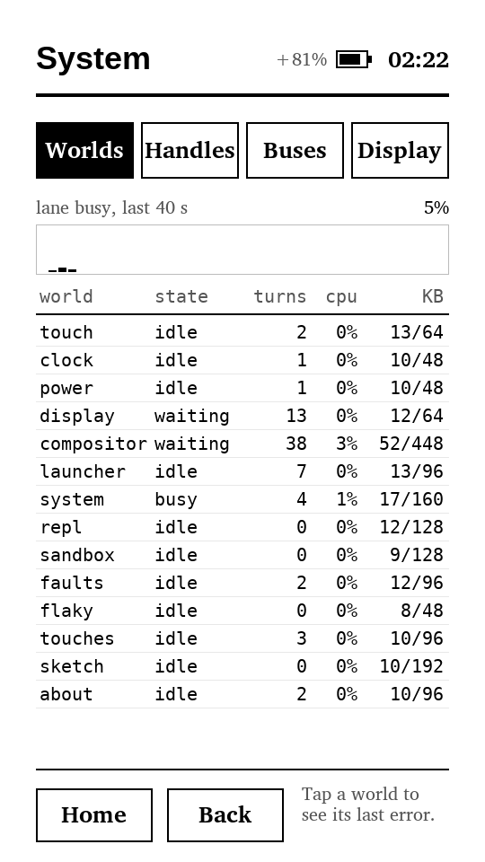

# picocalc-os on the M5Stack PaperS3, follow-up: faster turns on a PSRAM-bound tablet

This note continues [[PROJ - picocalc-os on the M5Stack PaperS3 - E-Paper, MicroQuickJS and an Idle Tablet - Technical Project Report]]. That report ended with P4: the tablet idles at 0.4 kernel wakeups a second and light-sleeps on battery. It
listed P5, "faster turns", as not started. P5 has since run its course, in five steps on the device, and was closed by choice once the
remaining cost was mostly interpreter time. This note records what the steps found. The order is the order of the measurements,
because each finding decided the next step.

> [!summary]
> - **Time host calls separately from the interpreter.** A per-operation profiler showed that a System-app repaint cost the
>   compositor 109 ms. That was 29 ms of text, 22 ms comparing framebuffers, 16 ms of fills and about 37 ms in the interpreter.
> - **On this board, the caches and PSRAM bandwidth are the cost model.** A 32 KB instruction cache and 64-byte data-cache lines cut
>   a repaint from 94 to 58 ms. Touching the full 518 KB framebuffer three times per repaint was the rest of the bill.
> - **Retained painting, with an oracle.** The compositor redraws only the nodes that changed. A host-only check compares every
>   retained paint with a full paint of the same state: 119 checks, no difference. A repaint now costs 31 ms.
> - **Compile the prelude once.** Parsing the 341-line prelude was 143 ms of every world's start. Loading it as bytecode cut a world's
>   restart to 10–25 ms. It also exposed an mquickjs bug: an image string in the RAM atom table was dropped by the collector.

The unplug reboot left open in the first report turned out to be a one-off: a power dip or an accidental press of the power button.
The board then stayed up for 330.8 s through two more unplug and replug cycles, with 24 light sleeps.



## The question P5 asked

A **turn** is one message handled to completion by one world. While the System app is on screen, it samples the kernel's world
table once a second and returns a new tree of UI nodes. The compositor lays that tree out, paints it into the back half of a 540 × 960
8-bit gray framebuffer, compares back with front (`commit`), and asks the display driver to present the changed rectangles. Before
P5 this cycle kept the lane 11.2% busy. The P0 profiler could say which world spent the time. It could not say whether that time was
interpretation, C drawing, or the kernel's JSON, because all three were counted as "engine".

## Step 9: profile host operations

Every call from JavaScript into C passes through one function, `js_nucleus_k` in `nucleus/vm_mqjs.c`: it copies the operation's
name, finds it in a table of 45 entries, and calls it. Timing that function per operation, in real-time mode only so that host
captures cannot change, splits a segment's engine time into named C work and the interpreter:

```text
  host op          calls   total ms   us/call      (16 s, System in front, 14 repaints)
  gfx.text          1232      406.8     330.2
  gfx.commit          14      305.0   21786.3
  gfx.fill           482      231.2     479.6
  sys.worlds          16      163.0   10188.9
  gfx.measure       1176       47.3      40.2
```

Text was the largest item, and its inner loop had an obvious defect. A glyph cell is sized to the font's largest glyph (31 × 25 px
for the small font), and the loop visited every pixel of the cell with two bounds checks and a nibble decode. Most cells are mostly
empty. Each glyph now gets an ink bounding box, computed the first time it is drawn, and drawing visits only that box, clipped once.
The 8-bit gray blend's division by 15 became `(v * 2185) >> 15`, exact for every input up to 255 × 15. Text dropped to 181 µs per call, and
every host capture stayed byte-identical.

Two other changes did not help. Fills became `memset`s and commit compared whole words, and neither moved, because both are bound
by PSRAM bandwidth rather than by their loops. The full-screen clear writes 518 KB and the commit reads twice that, every repaint.

## Step 10: the caches

The profile had a second, odd feature: host calls that do almost nothing cost tens of microseconds. `now` took 73 µs and
`gfx.measure` 36 µs, about 17,000 cycles at 240 MHz. The firmware ran with ESP-IDF's default caches: 16 KB for instructions, in
front of flash, where all code executes, and 32 KB with 32-byte lines for data, in front of PSRAM, where the arenas and
framebuffers live. Four configurations were measured on the device:

| I-cache / D-cache (line) | compositor, 16 s | lane | commit | internal RAM free |
|---|---|---|---|---|
| 16 KB / 32 KB (32 B), default | 1315 ms | 11.2% | 19.2 ms | 87.5 KB |
| 16 KB / 64 KB (64 B) | 1081 ms | 9.6% | 14.3 ms | 49.9 KB |
| 32 KB / 32 KB (64 B), kept | 816 ms | 7.1% | 13.9 ms | 66.4 KB |
| 32 KB / 64 KB (64 B) | 845 ms | 7.2% | 14.0 ms | 34.3 KB |

The instruction cache decides what a host call costs, because a turn alternates between the interpreter, the binding and the
drawing code, which together are far larger than 16 KB. The data-cache line size decides the framebuffer passes. A larger data
cache added nothing and would have taken 32 KB more internal RAM. The 100k-iteration calibration loop moved only from 415.7 to
408.8 ms: a tight loop already fits in the small cache, so the calibration figure predicts nothing about this workload.

## Step 11: retained painting

After the caches, a repaint still cleared, redrew and compared the whole screen, although only a few table cells, a bar graph and
a percentage change each second. **Retained painting** keeps the previous paint in the back buffer and redraws only what changed.

The C side is small. Every write to a framebuffer (`gfx_fill`, `gfx_line`, a glyph) marks its 16-row bands in a 64-bit mask, and
`gfx_commit` compares only marked bands. Commit leaves back equal to front, so an unmarked band is equal by construction.
`gfx_invalidate` and allocation mark every band.

The JavaScript side is in `js-papers3/system/compositor.js`. `draw(fb, n, x, y, w, h, o, bg)` receives the node drawn in the same
box by the previous paint (`o`) and the background behind it (`bg`):

```text
draw(n, box, o, bg):
  if o and same(n, o):          keep o's pixels; replay o's hit regions          # nothing drawn
  elif o is the same container/table with equal own properties
       and every child keeps its box:   recurse into the children (tables: per row)
  else:                         fill o._e with bg; draw n from scratch
  record on n: _b (box), _r (regions made), _e (box its pixels can reach), _ink
```

Three details make the result exact:

- **Pixels outside a node's box.** A list draws its scroll bar 8 px right of its rows. An ink pad draws a 1 px border around itself.
  `_e` records how far a node's pixels reach, including its children's, and the clear uses `_e`, not the box.
- **Hit-region order.** `hit()` takes the last region drawn, so kept nodes replay their regions in tree order. The footer's Home and
  Back chips are registered after the body even when the footer is not repainted.
- **A border under the children.** A container with a border and padding under 2 px is always redrawn whole, because its children's
  boxes cover its border.

Correctness rests on an oracle rather than on inspection. In a host-only check mode (`send compositor paintcheck {}`), each retained
paint is followed by a full paint of the same state, and the FNV-1a hashes of the back buffer are compared. All four capture tours
and a stress script, which covers ticking table rows, a row pick that moves the layout, every tab, swipes, a crash banner, ink
strokes and a clock-minute update, ran 119 retained paints with no difference. The deterministic captures could not serve as
the oracle here, because the simulator charges virtual time per glyph and per pixel. Drawing less legitimately changed the
displayed CPU figures, and in the ink tours it moved a stroke's last sampled point closer to the finger.

On the device a System repaint went from 58 to 33 ms and text calls per 16 s from 1232 to 238. Step 12 then replaced a single
dirty-row range with the band mask described above: a range from the graph near the top to a table row near the bottom had spanned
most of the screen. It also let `sys.worlds` return only the fields a caller asks for. With System in front, the lane went to 4.5%.

## Step 13: the prelude as bytecode, and an engine bug

Every world runs the same prelude before its own file. A temporary timing of `vm_create` on the device was unambiguous:

```text
BOOT touch      prelude 143.3  file  20.8  init 1.3  gc  6.0 ms
BOOT compositor prelude 132.8  file 254.5  init 1.8  gc 14.0 ms
BOOT launcher   prelude 142.6  file  10.5  init 1.0  gc  7.3 ms
```

mquickjs can compile to a bytecode image (`JS_PrepareBytecode`), relocate it (`JS_RelocateBytecode`) and run it in place
(`JS_LoadBytecode`, `JS_Run`). The binding now compiles the prelude once, before the first world starts, in a 128 KB scratch arena
in compile mode. Each world copies the unrelocated image, relocates the copy with its own fresh context, and runs it.

Two constraints shaped the design, and both were found by failure:

1. **One image cannot serve several contexts.** With a single shared image, the first world worked and every later one failed with
   `ReferenceError: variable 'service' is not defined`. Comparing the image with a copy taken after relocation found three changed
   bytes. In each, a string header's `is_unique` bit was now set: the first world had interned the image's own string
   constant into its RAM table and marked it unique in place. Hence one relocated copy per world, made from an unrelocated
   master. A relocated image cannot be copied, because relocation adds an offset to every pointer, including the ones already swapped
   for stdlib atoms.
2. **The collector dropped image strings from the atom table.** With per-world copies the home screen stalled at "starting
   launcher…". The compositor read `f.app` from a decoded message as `undefined`. A probe read the same key three ways: `.app`
   failed, while `['app']` and a key comparison succeeded. A temporary dump of the image's atom table showed 223 sorted, unique entries,
   with no "app" in them. So the prelude's property names reach the world as image strings outside the image's table. The first
   intern puts the image string itself into the context's RAM table. That table holds weak references, and `gc_mb_is_marked`
   reads the object's own mark bit, which the collector never sets outside the heap. The first collection dropped the entry, and
   the name interned later became a second atom. The patch keeps table entries that point outside `[heap_base, stack_top)`; it is
   recorded as item 4 in `third_party/mquickjs/PATCHES`.

On the device a world restart went from about 150–180 ms to 10–25 ms. Boot finishes with 0.84 s of lane time instead of about
3.5 s, and each world's live arena use fell by about 23 KB, because the prelude's code no longer sits in the arena. The 14 image
copies take about 30 KB of PSRAM each. Lowering the manifest's `mem_kb` limits would more than repay that.

## Where the repaint cost went

| | before P5 | after step 9 | step 10 | step 11 | step 12 |
|---|---|---|---|---|---|
| compositor per System repaint | 109 ms | 94 ms | 58 ms | 33 ms | 31 ms |
| lane, System in front | 11.2%* | 11.2% | 7.1% | 5.0% | 4.5% |

\* measured at step 9's baseline window; P0's earlier figure with the System app open was 35%, before P1–P3 removed the idle work.

What remains per repaint is mostly the interpreter: about 14 ms of layout and comparison in the compositor, and about 4 ms to decode
the app's frame JSON. That is where P5 stopped.

## Working rules this phase confirmed

- Measure each change on the device. None of these effects (caches, PSRAM bandwidth, per-call cost) is visible in the host
  simulator or in QEMU.
- When an optimisation can change pixels, build an oracle that compares it with the unoptimised path in the same run. Do not rely on
  inspecting screenshots.
- When a shared resource misbehaves after first use, compare it byte for byte before and after use. That found the shared-image bug
  in one run.

## Important files

- `nucleus/vm_mqjs.c`: `op_prof`, `compile_prelude`, `run_prelude`, `op_sys_worlds`
- `nucleus/gfx.c`: `ink_box`, `glyph`, `touch`, `gfx_commit`, `gfx_invalidate`, `gfx_hash`
- `js-papers3/system/compositor.js`: the retained painting block, `stack`, `drawTable`, `paint`
- `third_party/mquickjs/mquickjs.c` (`JS_GC2` unique-string sweep) and `PATCHES`
- `port/esp32s3-papers3/sdkconfig.defaults` (the cache block)
- Ticket: `ttmp/2026/10/26/PAPERS3-IDLE--faster-turns-interrupt-driven-input-and-light-sleep-on-the-papers3/`, diary steps 9–13,
  `scripts/02-paintcheck.sh`

## Next

The next ticket turns the tablet fully off when idle. E-paper keeps its image without power, so a tablet that has been idle for a few minutes can save
anything worth keeping and switch itself off. The power button, or the real-time clock's alarm, then brings it back. A start-up
of under a second of lane time makes a cold boot on wake affordable.
