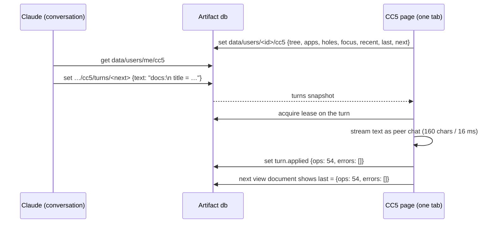
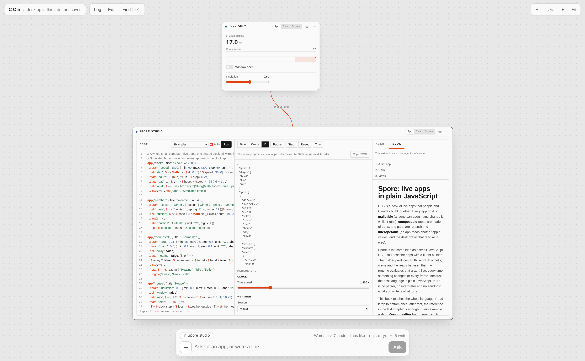
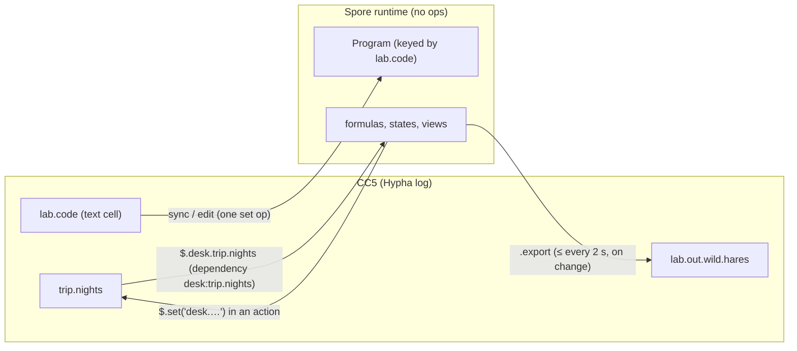
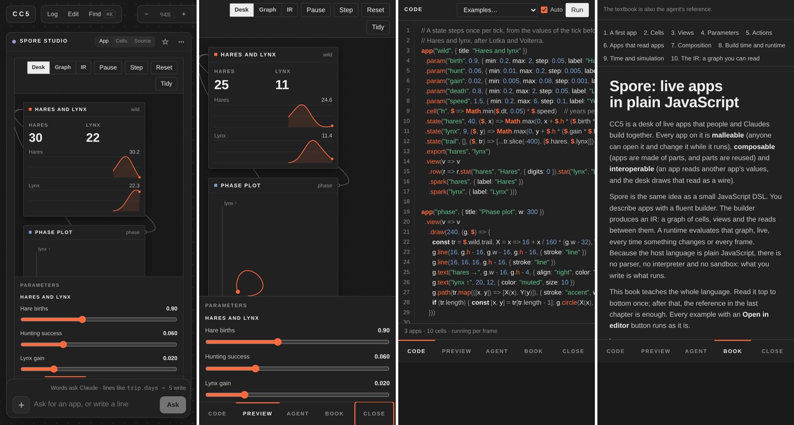
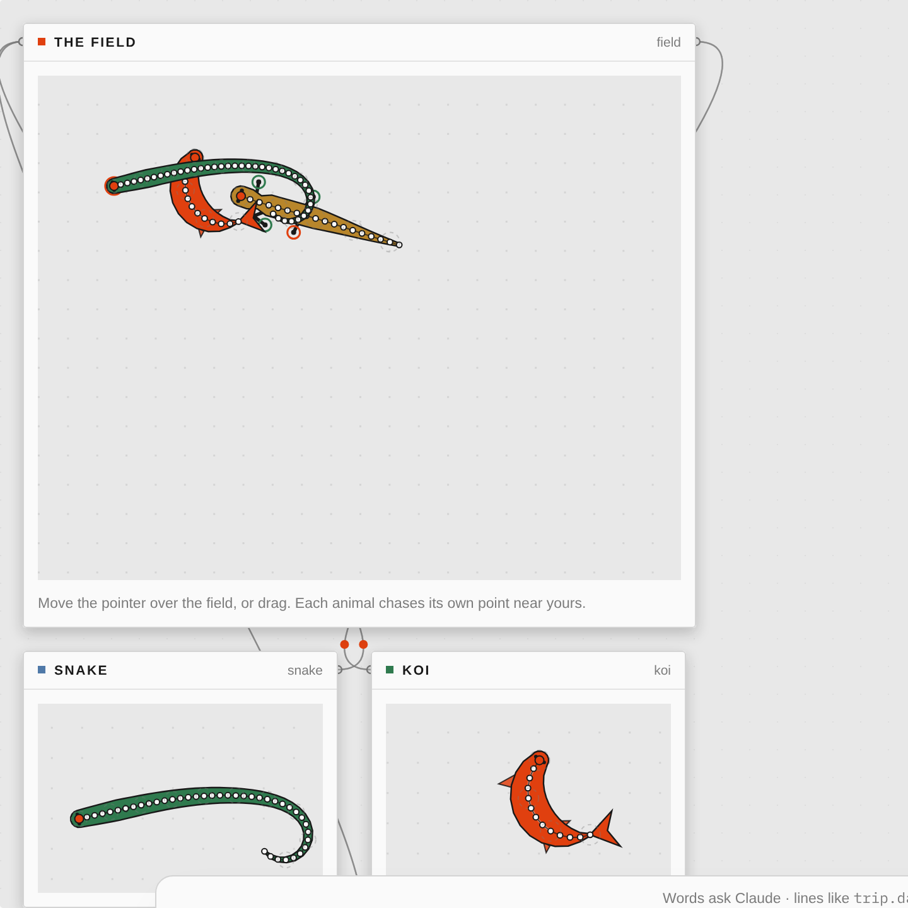

# CC5 Godprompt Computer: Hypha, Fruit and Spore — An Independent Technical Deep Dive

**CC5 Godprompt Computer** is a single claude.ai Artifact that contains a shared desktop, two programming languages, a view language, a coding studio, a textbook, and several cooperating instances of Claude. The desktop and its languages, **CC5**, **Hypha**, and **Fruit**, are the work of Ramon Marc. The second language, **Spore**, and its studio were added to CC5 by a Claude Code session on 28 October 2026.

This report explains how the whole system works, from the bottom up. It was written independently of the earlier notes on the same system, from the published sources, the session log, and local re-runs of the session's tests. It is organised in dependency order. Section 2 introduces the platform the page runs on. Sections 3 to 5 explain CC5's substrate: Hypha, the language in which every state change is a line of text; Fruit, the view layer whose elements are themselves Hypha cells; and the desktop that turns one Hypha tree into a canvas of windows shared by people and Claudes. Sections 6 to 12 explain Spore, a second evaluation model for programs that move or compute heavily, and how it was attached to CC5. The final sections cover the build, verification, and the strengths and limits of the design. The session that produced Spore is reconstructed in [[DIARY - CC5 Godprompt Computer - Independent Reconstruction of the Spore Session]].

> [!summary]
> - **Hypha** stores the entire desktop as an append-only log of one-line operations folded into a tree of leaf cells. A line applies the moment it ends, so every prefix of a stream is a valid state. Formulas evaluate around missing values and leave residual terms, which turns "not written yet" into a first-class value called a hole.
> - **Fruit** makes views part of the same tree: an element is a subtree of cells with a kind, props that are formulas, and an action that is stored as text. Gestures produce Hypha lines, so a click is an operation in the same log as a keystroke by Claude.
> - **CC5** projects the tree onto a canvas. Windows are cells, reads between apps are drawn as wires, the log persists in chunks with checkpoints, and four kinds of writers — people, the in-page Claude, parallel hole-filling Claudes, and the chat Claude — are all peers with stamped, scoped writes.
> - **Spore** is a JavaScript builder DSL with no parser: a program runs once to record a description, runs its formulas once more with a tracking scope to discover the dependency graph, and then a runtime re-evaluates only what a change or a clock tick invalidates. It reaches CC5 through two view elements and a three-call bridge, and it carries its own studio, coding agent, and textbook.

## 1. What exists, and where

| Artifact | Role |
|---|---|
| `https://claude.ai/artifact/1GUrJcDp2YMTx641RQ4yV6` | The CC5 source artifact the session started from. |
| `https://claude.ai/artifact/5U5ctT7cXHmR6jiT65XQWy` | A fresh CC5 desktop created at the start of the session, used for the Docs app. |
| `https://claude.ai/artifact/BTv4E3T3wvqs8BxY1KHqED` | CC5 Godprompt Computer: CC5 plus `spore.js`, published as version 1 (Spore) and version 2 (creatures and `$.pointer`). |

The repository `/home/manuel/code/others/ramon/cc5-godprompt-computer` holds the published files in `artifact/`, the Spore sources in `spore-src/`, the Hypha text Claude wrote onto the desks in `desk-turns/`, tests in `tests/`, screenshots, and the raw session log.

| File | Bytes | Lines | Author | Responsibility |
|---|---:|---:|---|---|
| `index.html` | 104,489 | 1,296 | Ramon Marc, edited | Page chrome and tokens; the README for Claude; script order; the Spore textbook as `script#spore-docs` |
| `hypha.js` | 65,166 | 1,058 | Ramon Marc | The kernel: parser, operations, tree, evaluation, log, checkpoints, streams |
| `fruit.js` | 32,538 | 492 | Ramon Marc | Virtual DOM, binding, actions, layout and text elements |
| `fruit-kit.js` | 62,231 | 600 | Ramon Marc | Inputs, records, charts, drawing, holes, the cells projection, overlays |
| `cc5.js` | 124,655 | 1,662 | Ramon Marc, 4 lines added | The desktop: camera, windows, wires, network, Claudes, composer, undo, time |
| `computer.js` | 30,281 | 378 | Ramon Marc | Clock, scheduled jobs, files, media, programs in workers |
| `lego.js` | 15,740 | 220 | Ramon Marc | Components stored as Hypha, a starter library |
| `browser.js` | 12,960 | 172 | Ramon Marc | A browser element and web tools over MCP |
| `spore.js` | 188,540 | 2,687 | Built in the session | Spore: engine, examples, painter, UI parts, agent, host, styles |

The scripts load in this order, and only the last one starts anything:

```html
<script src="hypha.js"></script>      <!-- window.Hypha: pure kernel, no DOM -->
<script src="fruit.js"></script>      <!-- window.Fruit: vdom and the core elements -->
<script src="fruit-kit.js"></script>  <!-- more elements, registered into Fruit.R -->
<script src="browser.js"></script>    <!-- window.CC5Browser -->
<script src="computer.js"></script>   <!-- window.CC5Computer -->
<script src="lego.js"></script>       <!-- window.CC5Lego -->
<script src="spore.js"></script>      <!-- window.Spore, window.spore, window.CC5Spore (added) -->
<script src="cc5.js"></script>        <!-- the desktop; calls boot() -->
```


*Figure 1 — CC5 Godprompt Computer with a Spore studio window. The CC5 chrome is the top bar (file state, Log, Edit, Find), the zoom controls, and the composer at the bottom. Inside the window, the studio shows the program on the left, five live Spore apps wired by their reads in the centre, parameters below them, and the coding agent on the right.*

## 2. The platform: an Artifact with capabilities

A claude.ai Artifact is a web page published from a conversation. The page receives services from its host through **capabilities**, objects obtained with `window.claude.use(name)`. CC5's README instructs a chat Claude to publish the page with these declarations:

```js
{ db: {}, user: { scopes: ["profile"] }, room: { topics: { ops: "interact" } },
  sample: { images: true }, assets: {}, downloads: true,
  mcp: { servers: [{ server: "host:claude_browser",
         tools: ["preview_start", "navigate", "computer", "get_page_text", "read_page", "find"] }] } }
```

| Capability | Used for |
|---|---|
| `db` | The persistent log (`chunks/`), checkpoints (`meta/snap`, `snaps/`), leases (`meta/compact`, `claims/`, `leases/`), the chat Claude's view document and turns (`data/users/<id>/cc5`, `…/turns`) |
| `user` | The viewer's id (hashed into a peer prefix), name, write permission |
| `room` | Live operations on the `ops` topic, presence (cursors, focused app, half-written lines, hole claims, running programs) |
| `sample` | The in-page Claude, its hole fillers, Spore's built-in coding agent |
| `assets`, `downloads` | Dropped files stored as blobs; exports saved to disk |
| `mcp` | A browser driven through the Claude desktop app's browser server |

Without `window.claude`, or without `db` and `user`, CC5 runs in memory mode and labels itself "a desktop in this tab · not saved". This is how the session's tests ran it locally.

## 3. Hypha: the desktop is a log of lines

### 3.1 One line, one operation

Hypha's design is stated in four sentences at the top of `hypha.js`:

```text
- A line is an op. Ops apply the moment their line closes, so every prefix of a stream is a state.
- A hole (?) is a value. Formulas evaluate around holes and leave a residual: an unfinished term.
- A guess (≈) is a value that a slower, better peer can confirm (=). Guesses taint what reads them.
- Every write carries a stamp [clock, peer]; the newest stamp wins per path (an LWW map).
```

A **path** is a dotted name such as `trip.days` or `costs.items.3.amount`; numeric segments are list indices. A **statement** is one line, and `parseStmt` recognises it by shape:

| Line | Operation |
|---|---|
| `trip.days = 5` | set a value (records and lists are spread into child cells) |
| `trip.total = stay + extra` | set a formula |
| `trip.extra = ?"cost of the museum"` | set a hole with an intent |
| `trip.km ≈ 412` | set a guess, to be confirmed later with `=` |
| `trip.notes = \|` then indented lines | a text block |
| `trip.items += {text: "Tickets"}` / `trip.notes &= "more"` | append to a list / append text |
| `trip.days -` | delete |
| `trip.days :: range 1 14 1` | attach a type, which input elements use |
| `fn.words(t) = len(split(t, " "))` | define a function |
| `trip.ui.2 is stat total, label: "Total"` | write a view element (section 4) |
| `trip:` | open a scope; indented lines below are relative |
| `" Building the trip planner…` | say something into the log |

Expressions use a Pratt parser with the usual precedence, `%` as a suffix that divides by 100 (`74%` is `0.74`), and a library of 65 functions: aggregates (`sum avg min max count`), list operations (`where match sort take pluck uniq tally sumby range`), text (`split replace upper slice money`), dates (`today days adddays weekday`), maths (`sin cos atan2 pow lerp`), and `hsl`. There is no `max(1, …)` trick available for single numbers beyond these functions, which is why the session's first Docs formula was rewritten before sending.

The log does not store the line as typed. `canon()` reprints each statement canonically with an absolute path, and that text is the only authoritative part of an operation. On the wire and in the store an operation is a five-element row:

```js
[id, peer, clock, text, at]      // e.g. ["o…", "u1x2y3:claude", 42, "trip.days = 5", 1793175971925]
```

### 3.2 The tree holds only leaves

The kernel's state is a map from leaf paths to cells, a map from branch paths to child names, and per-path stamps. Records and lists never exist as cells: writing `files = [{id: 1, title: "Welcome"}]` writes `files.0.id` and `files.0.title`. Reading `files` reassembles the branch into an array or an object. This has two consequences that recur throughout CC5. Any part of a structure can be addressed and edited by path, which is how a text field can edit `docs.files.0.title` directly. And every write is small, which keeps concurrent writes to different parts of a record independent.

### 3.3 Evaluation around what is missing

A formula is evaluated by `ev`, which walks its syntax tree. Names resolve outward through scopes: inside `trip`, the name `costs.total` is tried as `trip.costs.total` and then as `costs.total`. The important detail is what the resolver records:

```js
const r = this.resolve(n.p, ctx.base, ctx.self);
for (const c of r.cands) ctx.deps.add(c);          // watch every candidate, existing or not
if (!r.found) return new Res({ k: "ref", p: n.p, miss: true });
ctx.reads.add(r.found);                              // the actual read: used to draw wires
```

A formula watches every path its names *could* resolve to, including paths that do not exist. When one of them is written later, the formula recomputes and binds. A name that resolves to nothing is not an error; it evaluates to a **residual**, an unfinished term. Binary operations with one unfinished side fold what is known and keep the rest symbolic. The following example traces the code by hand:

```text
trip:
  days = 5
  nightly = 120
  stay = nightly * (days - 1)        # → 480
  extra = ?"cost of the museum"      # a hole
  total = stay + extra               # → … 480 + ?extra   (a residual)
```

Writing `trip.extra = 30` changes `trip.extra`; the kernel finds `trip.total` among its watchers, and `total` becomes 510. Aggregates behave the same way: `sum` over a list with two holes returns `done + ?a + ?b`, while `count` still counts.

Recomputation is push-invalidate and pull-evaluate. `propagate(changed)` walks from each changed path upward through its ancestors, collects the watchers at every level, marks their transitive closure dirty, and computes them; any formula that reads a dirty input computes that input first. Walking ancestors is what makes `sum(items.*.amount)`, which watches `costs.items`, recompute when `costs.items.3.amount` changes. Cycles are detected during computation and become an error value, "cycle: it reads itself".

### 3.4 Holes and guesses

A **hole** is a cell whose value is "to be written", with a stated intent, for example `?"three small tascas in Alfama"`. Formulas over holes stay residual, views show them as placeholders with "Fill" and "Write it" buttons, and anyone may fill one, because filling is an ordinary write. CC5 uses holes as a unit of parallel work (section 5.6). A **guess**, written with `≈`, is a value marked as provisional; formulas that read it are marked as derived from a guess, and the cells view offers to confirm it.

### 3.5 Streams: text arriving token by token

A `Stream` is one peer's text arriving in pieces. `feed(chunk)` appends to a buffer and applies every complete line inside one batch, so a formula affected by several lines recomputes once. The incomplete last line is published as the peer's **intent**, which CC5 draws as a ghost of the half-written line where it will land. Indentation opens and closes scopes. A text block (`code = |`) writes an empty string and then one append operation per indented line, so a 100-line block is 101 operations. Lines beginning with a code fence or `#` are skipped, which tolerates model output wrapped in Markdown.

A scope whose path contains `ui` opens a view block. Every line inside it is an element written at the next index (`docs.ui.0`, `docs.ui.0.0`, …), and when the block closes, every numeric child the block did not write is deleted. The source comment states the rule: "a block always leaves exactly the view it describes". A model can therefore rewrite a whole view by writing it again.

### 3.6 Peers, stamps, and authority

Every write comes from a **peer**, an id of the form `<userPrefix>:<role>`. The prefix is `"u"` plus a 32-bit FNV hash of the user id; the roles are `you`, `claude` (in-page Claude), `f1`–`f4` (hole fillers), `chat` (conversation Claude), `ex` (the example seed), `clock`, `p-<app>` (programs), and, since the session, `spore`. A peer has a list of permitted path globs, `can`, and `apply` rejects a write outside it with "may only write …".

Each operation carries a Lamport stamp `[clock, peer]`. An operation is stale, and rejected, if the path or any ancestor already holds a newer stamp. Same-path writes therefore converge regardless of arrival order. `commit` also **coalesces**: a set to the same path by the same peer within 900 ms, among the last six log entries, replaces the earlier entry, so dragging a slider leaves one operation rather than hundreds.

### 3.7 Reading the tree back as Hypha

`toHypha()` prints the tree in the language it was written in, with formula values as comments and, optionally, each view element's path:

```hypha
docs:
  shown = match(files, query)  # → [{id: 1, title: "Welcome to Docs", …}, …]
  total_words = words(join(pluck(files, "body"), " "))  # → 122
  ui:   # docs.ui
    split 0.28, gap: 18   # docs.ui.0
      col gap: 8   # docs.ui.0.0
```

The code comment reads "what an agent reads is what it writes". Every Claude in CC5 receives the desktop in this form and answers in the same form, so no translation layer exists between what a model sees and what it produces. `toHyphaWithin(budget, focus)` shrinks long lists while keeping rows that hold holes or the focused element.

`checkpoint()` writes one operation per cell plus every stamp, including the stamps of deletions, so a fresh kernel restoring it converges with the live one. `replay(n)` builds a new kernel from the first `n` operations; CC5 uses it for the time scrubber and for undo.

## 4. Fruit: views are cells

### 4.1 An element is a subtree

A view element is written as one line, `kind args -> action`, inside a `ui:` block:

```hypha
docs.ui:
  field query, placeholder: "Search docs…"
  button "+ New doc" -> files += {id: next_id, title: "Untitled"}; sel = next_id; next_id = next_id + 1
  each d in shown, gap: 4, empty: "No docs match"
    button d.title, tone: if(d.id == sel, "accent", "ghost") -> sel = d.id
```

The kernel stores an element as ordinary cells. `docs.ui.1.k` holds the kind `"button"`, `docs.ui.1.label` holds the label, and `docs.ui.1.do` holds the action's source text. Props that are not literals are formulas, and they resolve names from the app (`viewBase` returns the part of the path before `ui`), so a view that reads another app produces a wire exactly as a data formula does. Changing one prop is one line: `docs.ui.1.label = "New"`.

### 4.2 The element library

| Group | Kinds |
|---|---|
| Layout | `col box stack row grid card section split scroll spacer divider tab tabs when each embed` |
| Text | `h1 h2 h3 text code quote kbd badge note md` |
| Numbers | `stat progress gauge` |
| Inputs | `slider num field area toggle check choice select date stars color button ask` |
| Records | `table list checklist board cards timeline calendar json` |
| Charts | `bars trend pie donut spark` |
| Drawing | `draw rect circle ellipse line arrow path poly text group` |
| Overlays | `disclosure accordion dialog sheet popover menu item avatar breadcrumb skeleton radio combobox carousel` |
| Other modules | `hole cells browser jobs file image video audio upload camera program library spore spore_ide` |

An alias table maps names from other component kits (`switch` → `toggle`, `textarea` → `area`, `modal` → `dialog`), which tolerates a model's habits. A kind that matches a component in `lib` renders that component; anything else renders a box that names the problem.

### 4.3 Binding: where a hand's change goes

`bind` decides what an input shows and where its changes are written. A literal prop is owned by the element. A bare name, such as `field query`, binds two-way to the cell it resolves to, but only if that cell is a literal, a hole, or does not exist yet; an input pointed at a formula is read-only, because inputs "do not overwrite logic". Inside `each d in shown`, the alias `d` refers to a path. When the list is computed, as `shown = match(files, query)` is, Fruit recovers each item's source path by comparing items with the children of the formula's reads, so a filtered list remains editable.

### 4.4 Actions take values at the moment of use

`runAction` splits the action text at top-level semicolons. A few verbs are handled by the view layer (`ask`, `open`, `go`, `play`, `toast`, `speak`). Every other part is parsed as a Hypha statement whose right-hand side is **evaluated immediately** and written as a literal:

```js
out.push(`${path} = ${H.showLit(v)}`);     // values taken at that moment
```

`next_id = next_id + 1` therefore writes `docs.next_id = 4`, not a formula that would refer to itself. All lines of one action go out as one stream, so they apply as one batch.

### 4.5 Rendering

Fruit's virtual DOM is small: `h(tag, props, ...children)`, a keyed or index diff, and a rule that an input's value is not overwritten while it has focus, so echoes do not disturb typing. CC5 re-renders per app: every changed or recomputed path marks its app as touched, and on the next animation frame each touched app's whole view is rebuilt and diffed into its window.

## 5. CC5: the desktop

### 5.1 A canvas of windows

CC5 shows one infinite plane, moved with a CSS transform: pan by dragging, pinch, or scroll; zoom with the modifier and wheel between 0.15 and 2.5. Every top-level branch of the tree that is not reserved (`desk sys clock spaces theme fn`) is an **app**, and every app is a window. A window's frame is itself a cell, `desk.<app> = {x, y, w, h}`, so moving a window is a Hypha write and appears in the log. Apps without a frame are placed by a deterministic search, so every viewer sees the same layout. Below zoom 0.45 windows stop rendering their bodies and show a one-line glance, the first `stat` value of the app.

A window has three faces: **App** (the rendered view), **Cells** (a generated projection of the app's data with editable values, hole buttons, and guess confirmation), and **Source** (the app printed as Hypha in an editor; Apply streams the text back and deletes what it no longer mentions). Cells that recompute flash briefly, which shows the flow of a change through the desktop.

### 5.2 Wires

A wire is drawn for every formula, including view props, whose actual reads belong to another app. The edge runs from the read app's window to the reading app's window, labelled with up to two read paths. When a change in app B causes recomputation in app A, a dash travels along the wire. Because wires come from `reads` rather than from parsing, they reflect what a formula actually consulted on its last evaluation.

### 5.3 Persistence and live synchronisation

| Store path | Content |
|---|---|
| `chunks/c-<U>-<tab>-<seq>` | `{by, tab, at, n, ops: [[id, peer, clock, text, at], …]}`; each tab appends to its own chunk; a new chunk after 500 operations, 150 KB, or 5 minutes idle |
| `meta/snap`, `snaps/<id>-<i>` | The latest checkpoint and its parts (≤ 180 KB each), taken every 3,000 operations |
| `meta/compact` | A lease so one tab checkpoints |
| `claims/<path>` | A lease so one filler works on each hole |
| `leases/<key>` | Leases for jobs and programs that must run on one page |
| `data/users/<id>/cc5`, `…/turns/<tid>` | The chat Claude's view document and its turns |

Loading restores the checkpoint, subscribes to chunks newer than it, skips rows already folded in, sorts the rest by `(clock, peer)`, and applies them in one batch. Writing appends each successful local operation to the tab's open chunk, which is saved whole after 250 ms. Live delivery does not wait for the store: operations are also sent on the room's `ops` topic in batches under 3,600 bytes every 50 ms, and the store deduplicates by operation id. Checkpoints are built from the store's own chunks, "never from what the room said". A row is accepted only if its peer prefix matches the hash of the chunk's or message's author.

### 5.4 The composer, edit mode, the launcher, undo, and time

The **composer** at the bottom is one text box for two purposes. Before sending, it parses the text in a throwaway kernel; if every line parses and applies, the button reads "Write" and the text becomes operations; otherwise it reads "Ask" and the text goes to the in-page Claude. **Edit mode** (E) turns clicks into element selection and opens an inspector that shows the element as a line and each prop as editable source. The **launcher** (⌘K) searches apps, components, saved views, and cells, writes Hypha if the query parses, and otherwise offers to ask Claude. **Undo** cannot mutate an append-only log, so it replays the log to the mark and writes the old values of the touched paths as new operations. The **time scrubber** in the Log drawer shows the desktop as the fold of the first `n` operations, read-only.

### 5.5 The chat Claude: two calls per turn

A Claude in the conversation has no live connection to the page. CC5 gives it a protocol of two database calls, documented in the README:

```text
1. READ   ArtifactData get, collection "data/users/me", doc_id "cc5"
2. WRITE  ArtifactData set, collection "data/users/me/cc5/turns", doc_id <next>, data { "text": "<Hypha lines>" }
```

The page keeps the view document current, rewriting it 1.5 seconds after changes. It contains the desktop as Hypha within a 120 KB budget (with element paths and formula values), the apps with their frames and reads, the holes, the focused app and element, the visible screen rectangle, the last thirty operations, the people present, the next turn id, and `last`: the result of the previous turn, with its errors. When a turn document appears, one open tab takes a 60-second lease on it, streams its text as peer `chat` at 160 characters every 16 ms so the person can watch it arrive, and marks it applied with the operation count and up to twelve rejected lines.



The session used this protocol six times; the Docs app arrived as 54 operations with no rejected lines.

### 5.6 The in-page Claude and parallel hole filling

`Claude.ask` builds a prompt from a compact language card, the user's functions, the component library, the desktop as Hypha (60 KB around the focus), the visible screen, and the request, and calls `sample` with `onText`. Each streamed delta is fed to a Hypha stream, so **operations apply while the model is still generating** and apps appear line by line. When the request is scoped to an app, the peer may write only that app's paths, and the kernel rejects anything else.

The card instructs the model to "SHAPE FIRST": write the structure and leave the long parts as holes with precise intents, and not to fill them. When the stream ends, `fillHoles` starts four workers. Each claims a hole through a local map, a presence broadcast, and a database lease, so two tabs or two people never fill the same hole; is restricted to that hole's paths (and, for a view hole, its app); receives the 24 KB of desktop around the hole; and calls `sample` at the quick model tier. Holes tagged `@web` or `@browser` ask for consent once and receive `web_search` and `web_read` tools backed by the browser server.

### 5.7 The supporting modules

`computer.js` adds a page-local clock (cells that update every second without writing operations), scheduled jobs (`every 15 min`, `daily 08:00`, `weekdays 09:00`) run under a lease by exactly one page, file ingestion (CSV to rows, JSON to data, Markdown to text, PDF through pdf.js, `.hypha` files installed as code), media elements and speech, and **programs**: JavaScript in a text cell, run in a Web Worker with a small API (`read`, `set`, `write`, `watch`, `every`, `ask`), leased to one page, and gated by "I read it: run it" when someone else wrote the code. `lego.js` stores components as Hypha (`lib.NAME: about, takes, example, ui:`), can turn any element into a component by collecting the names it reads as inputs, and exports an app with its components as one `.hypha` file. `browser.js` provides a shared browser element whose address is a cell.

## 6. Why a second language

Hypha builds apps one line at a time, and every line is an operation in a shared log. That property is what makes the desktop collaborative, replayable, and streamable, and it is also what makes Hypha unsuitable for programs that change sixty times a second: every change would be an operation. The session's brief asked for a language in which "building things like this but they are also malleable, composable and interoperable is easy", delivered as "a small JS DSL with an IDE, agent and textbook". The textbook's own summary of the division is precise:

> Use Hypha for documents, lists and forms that people edit together; use Spore for anything that moves, simulates, draws or computes a lot.

Spore keeps CC5's three properties at a different granularity. A Spore program lives in one Hypha text cell, so it is malleable in the same way as any cell; its apps are composed from cells and views; and it reads and writes the desk, so it interoperates. Inside the program, however, values change without producing operations, and the program runs at frame rate.

## 7. Spore's three stages

### 7.1 Build, link, run

The header of `core.js` divides the language into three stages:

```text
1. BUILD   run the program once. Builder calls (app, .cell, .view …) record a description.
           Build-time lambdas (view, row, each, component, app factories) run here and only here.
2. LINK    resolve names, evaluate every formula once with a tracking scope, and turn what was
           read into the edges of a DAG. The result is the IR: plain JSON.
3. RUN     the runtime owns values. Runtime lambdas (formulas, state steps, view readers, draw,
           actions) run here, per change or per tick.
Plain JavaScript is the host language: no parser, no interpreter, no sandbox.
```

**Build** compiles the program text with `new Function("app", "component", "range", "clamp", "lerp", code + "\n//# sourceURL=spore-program.js")` and calls it. The only names in scope are the builder entry points and three helpers. Each builder call records a description and returns the builder, so calls chain.

**Link** turns the description into a graph. It resolves every name a view element or export uses, rejects references to missing cells or actions with an error that names the line, and then evaluates every formula once. Evaluation happens inside a tracking scope, and every cell the formula reads is recorded as an edge. The graph is therefore discovered by observing the program rather than by analysing its source.

**Run** keeps values. A change invalidates the readers of the changed cell; a tick advances time; a view reads what it needs and records its reads in turn.

### 7.2 The grammar

A program is any number of `app(...)` chains.

```js
app("trip", { title: "Trip" })
  .param("nights", 4, { min: 1, max: 14 })
  .param("rate", 120, { min: 40, max: 400 })
  .cell("stay", $ => $.nights * $.rate)
  .cell("total", $ => $.stay + $.food.total)
  .view(v => v.stat("total", "Total"))
app("food").cell("perDay", 45).cell("total", $ => $.perDay * $.trip.nights)
```

Cells have four kinds, and the kind is decided by the declaration:

| Declaration | Kind | Changes when |
|---|---|---|
| `.cell("n", 4)` | value | an action writes it |
| `.cell("total", $ => $.a + $.b)` | formula | something it read changes |
| `.param("rate", 120, { min: 40, max: 400 })` | param | someone moves its control, or an action writes it |
| `.state("x", 0, ($, x) => x + $.dt * $.v)` | state | every tick, by its step lambda |

A parameter's control is inferred from its default: a number becomes a slider (with a step of 1 when the range is integral and at least 10 wide, otherwise a hundredth of the range), a boolean a checkbox, a string with `options` a menu, any other string a text field. `.action(name, $ => …)` defines a named action; `.export(...names)` puts values on the CC5 desk (section 9.3).

The view builder has seventeen methods: `h text note stat meter spark bars list draw button toggle stepper divider row each when use`. Data slots (`stat`, `meter`, `spark`, `bars`, `list`) take a cell name such as `"total"` or `"food.total"`, or a runtime lambda. `component(name, (v, props) => …)` registers a new element; the view builder is a JavaScript `Proxy`, so `v.kpi({...})` finds the component by name, and an unknown name throws an error that lists the elements and suggests the nearest one.


*Figure 2 — The textbook's "every element" example: one app whose view uses each kind of element once, with the Book tab showing the same program as a runnable example.*

### 7.3 Build-time and runtime lambdas

The brief asked for the distinction between lambdas that generate structure and lambdas evaluated per frame to be explicit. Spore makes position decide it: a lambda passed to `view`, `row`, `each`, `use`, or `component` runs once, while building; a lambda in a formula, a state step, a data or text slot, a `when` condition, `draw`, `button`, or `action` runs at runtime and receives the scope `$`. The textbook's example shows both in one app:

```js
const days = ["Mon", "Tue", "Wed", "Thu", "Fri", "Sat", "Sun"]
const week = app("week", { title: "Habit week" })
  .param("goal", 5, { min: 1, max: 7, label: "Days a week" })
days.forEach(d => week.cell(d, false))               // build time: seven cells
week
  .cell("done", $ => days.filter(d => $[d]).length)  // runtime: reads seven cells
  .view(v => v
    .each(days, (v, d) => v.toggle(d, d))            // build time: seven toggles
    .when($ => $.done >= $.goal, v => v.note("Goal reached for this week.")))
```

The consequence is that structure is fixed while the program runs. `each` repeats over an array known at build time, and the error raised when it receives anything else teaches the alternative: "To show a list that changes while running, use list("cellName")."

### 7.4 The scope `$` and dependency tracking

Every runtime lambda receives `$`, a `Proxy` built per call by `Runtime.scope`. A property read resolves in a fixed order: a cell of the same app, then the clock (`$.t`, `$.dt`, `$.now`, `$.frame`), then another app (`$.food.total`), then the CC5 desk (`$.desk.trip.nights`), then the pointer (`$.pointer`). Each read passes through `read(id, track)`, which adds the id to the current tracking set and computes the cell if it is a dirty formula. The clock and the pointer are pseudo-nodes `$clock` and `$pointer`; reading `$.t` makes a formula depend on time.

Writes are restricted by mode. In an action, `$.set`, `$.push`, `$.toggle`, and `$.inc` write; anywhere else they throw: "$.set() writes, and only actions write." Assigning to a property of `$` throws in every mode.

The runtime's core is three short functions:

```js
read(id, track)  { if (track) track.add(id); const c = this.cells.get(id);
                   if (c.kind === "formula" && c.dirty) this.compute(c); return c.value; }
compute(c)       { /* cycle check on this.computing; run c.fn with a fresh tracking set;
                      setDeps(c.id, track) rewrites the reverse edges; c.dirty = false */ }
invalidate(id)   { /* breadth-first over rdeps: every reachable formula becomes dirty */ }
```

Dependencies are recomputed on every evaluation, so a formula that reads `a` or `b` depending on a condition depends on exactly what it read last time. Values are compared structurally before a write invalidates anything, so writing an equal value does nothing.

A real run makes this concrete. For the two-app program above, the runtime's `ir()` reports these edges and this evaluation order:

```json
[{"from":"trip.nights","to":"trip.stay"}, {"from":"trip.rate","to":"trip.stay"},
 {"from":"trip.stay","to":"trip.total"},  {"from":"food.total","to":"trip.total"},
 {"from":"food.perDay","to":"food.total"},{"from":"trip.nights","to":"food.total"},
 {"from":"trip.total","to":"trip.view"}]
["$clock","trip.nights","trip.rate","food.perDay","food.view","trip.stay","food.total","trip.total","trip.view"]
```

`trip.total` is 660. After `setParam("trip.nights", 5)`, `invalidate` marks `trip.stay`, `food.total`, and `trip.total` dirty, and the next reads produce 825 and 225.

### 7.5 Time

`tick(dt)` advances the clock, invalidates readers of `$clock`, and steps every state in two phases: all step lambdas run against the current values, and only then are the new values written. No state therefore sees another state's value from the same tick. `ticking()` reports whether anything needs time at all: if no state exists and nothing reads the clock, the program runs only on change. The status line in the studio shows the difference ("runs on change" or "running per frame"). The host's loop caps `dt` at 0.1 s, so a background tab does not make a simulation jump.

### 7.6 The IR

`Runtime.ir()` returns the whole program as plain JSON: version and stages; apps with their cells, exports, actions (as source text), and views (as trees with line numbers); nodes for the clock, every cell (with kind, line, value, source text, reads, and whether it ticks), desk reads, the pointer, and each app's view; the edges; a topological order; the clock; and the errors. The trip program's `trip.total` node, as produced:

```json
{ "id": "trip.total", "app": "trip", "name": "total", "kind": "formula", "line": 5,
  "value": 660, "fn": "$ => $.stay + $.food.total",
  "reads": ["trip.stay", "food.total"], "ticks": false }
```

The IR serves three readers. The studio's IR tab prints it, the Graph tab draws it, and `window.spore.getIR()` returns it to anything outside the page. When the program does not build, the host returns the IR of the last version that did, with a note saying so.


*Figure 3 — The Graph view of the five-app home computer: sources on the left (the clock, params, values), formulas and states in later columns, each line a read. Clicking a node jumps to its line in the editor.*

### 7.7 Errors as a designed surface

Every error is a `SporeError` with a kind (`syntax`, `build`, `link`, `runtime`), a line, a location, a message, and often a hint. Three techniques produce the line numbers:

- The program is compiled with `//# sourceURL=spore-program.js`, so stack frames name the program. At load, a probe compiles a two-line function, throws from it, and measures how many lines `new Function` adds before the body (`LINE_OFFSET`); every line number is corrected by that amount.
- Builder methods call `callerLine()`, which reads the line of the current call from a fresh stack trace, so a builder error is reported at the call that caused it.
- V8 gives no line for a syntax error inside `new Function`. `syntaxLine` compiles successively longer prefixes of the program until one reproduces the same message, ignoring "end of input" errors that every incomplete prefix produces.

Messages name the problem, the context, and a fix, and suggest the nearest valid name by Levenshtein distance. These are the engine's own outputs from a local run of the session's test:

```text
ERR build L2 Unknown view element "stats". Did you mean "stat"? Elements: h, text, note, stat, meter, …
RT  link  L1 a.x  Cycle: a.x → a.y → a.x. A formula cannot depend on itself. Break the loop with a
                  state(…) that steps per tick, or store one side in a cell(…).
ERR link  L1 button() runs the action "launch", but app "a" has no such action. Define it with .action("launch", $ => …).
RT  runtime L1 a.y  $.totl is not defined in app "a". Did you mean "total"? Cells here: "total", "y". …
ERR build L1 "t" is reserved in $ (t, dt, frame, now, set, push, toggle, inc, get, desk, pointer). …
```

Runtime errors do not stop the program. A formula that throws keeps an error value and its record; the rest of the graph continues; the view shows the message in place; and the error clears when the formula next succeeds. A program that fails to build leaves the last runtime in place, so the canvas stays live while the person types.

### 7.8 Live coding

When the code changes, the host builds a new runtime and calls `carry(old)`. The clock and pointer carry over, and every value, param, or state whose kind and declared default did not change keeps its current value; a param also requires the same control. Editing the code therefore keeps slider positions, list contents, and the running state of a simulation, and only what the edit actually changed restarts. The studio's Reset button restarts time and states explicitly.

## 8. Painting

Spore draws on a `<canvas>`, not in the DOM. A `Paint.Stage` renders one of three things: **desk**, every app as a window with wires between apps that read each other; **app**, one app's view without chrome; and **graph**, the dependency graph. The canvas is sized for `devicePixelRatio` and for CC5's zoom, so text stays crisp in a zoomed window.

`paintApp` measures and draws in a single function that runs twice: once with `drawing = false` to compute heights, once to paint. Each element evaluates its slot through the runtime with a tracking set, which records the view's reads; this is how `trip.view` acquires its edges in the IR. A failing slot draws its error message in place of the element. Buttons, toggles, steppers, and drawings register hit rectangles, and pointer events are dispatched to them.

The desk layout packs apps into columns of 276 pixels, placing each in the column span with the lowest current height, unless the person has dragged it. Wires are derived from the runtime: for every cell and view, each dependency in another app produces an edge. The graph view assigns each node a layer equal to one plus the deepest layer among its predecessors, so sources sit on the left and views on the right.

A `draw(height, (g, $) => …)` element receives a small drawing API: `clear`, `line`, `rect`, `circle`, `path`, `poly`, `text`, and `map(v, a, b, c, d)` for linear mapping, with colours given as theme token names (`"ink"`, `"accent"`, `"line"`) or CSS colours. The painter reads CC5's CSS variables for its tokens, so Spore apps follow the desktop's theme and dark mode.

## 9. Spore inside CC5

### 9.1 Two elements, one program per code cell

A CC5 app holds a Spore program in a text cell and shows it with one of two Fruit elements:

```hypha
lab:
  title = "Lab"
  code = |
    app("wild", { title: "Hares and lynx" }) …
  ui:
    spore code              # the program's apps on a canvas, with parameters
    # spore code, app: "wild"      one Spore app, no chrome: a Spore app as a CC5 window
    # spore_ide code, h: 760       the studio
```

`spore.js` registers both kinds with Fruit (`Fruit.R.spore`, `Fruit.R.spore_ide`) and adds their positional argument (`of`) to Hypha's table, so CC5 needed no changes to parse or render them. The element binds its `of` prop like any input: the program is keyed by the code cell's path, and every view of the same cell shares one `Program` instance in a registry. An edit in the studio is therefore running at once in every window that shows the same code. The editor's changes are written back to the code cell as one `set` operation, debounced to 450 ms.



*Figure 4 — One program, two CC5 windows. The upper window shows a single Spore app (`spore studio.code, app: …`); the lower is the studio. CC5 draws the wire labelled `studio.code` because the upper window's element reads the studio's code cell.*

### 9.2 One loop

All live Spore views share one `requestAnimationFrame` loop. Each frame it synchronises desk reads, ticks every playing program that needs time, writes exports, and asks each view to draw. A view redraws only when its program's version changed, the clock is running, an input is pending, or a second has passed. Views whose elements left the page are dropped after 30 seconds.

### 9.3 The bridge

Spore reaches CC5 through a `Bridge` object with five functions over CC5's kernel: `exists(path)`, `apps()`, `children(app)`, `read(path)`, and `version()`. In a program:

- `$.desk.trip.nights` reads the desk cell `trip.nights`. The read is recorded as a dependency on the pseudo-id `desk:trip.nights`, and when the desk's version changes (the log length plus the current second), every desk dependency is invalidated.
- `$.set("desk.trip.nights", 5)` in an action writes the Hypha line `trip.nights = 5` through CC5's `writeText`, as the person who pressed the button.
- `.export("hares", "lynx")` writes `<hostApp>.out.<sporeApp>.<cell> = <literal>`, for example `lab.out.wild.hares`, as peer `spore`. Exports are written at most every two seconds and only when the printed value changes, because each write is an operation in the shared log; numbers are rounded to six significant digits, and values over 4,000 characters are skipped.

Desk values are cleaned before Spore sees them: Hypha residuals and errors become `undefined`, so a Spore formula never receives a Hypha-internal object.



### 9.4 What changed in CC5

The integration changed `cc5.js` in exactly four places, each guarded so that the page works without `spore.js`:

```diff
- "You are Claude, one peer in CC5: …", "", REF(), "",
+ "You are Claude, one peer in CC5: …", "", REF(), "", window.CC5Spore ? CC5Spore.prompt() : "",
+ ["New Spore studio", "live JavaScript apps, an agent and a textbook", () => { … CC5Spore.create("studio") … }],
+ if (window.CC5Spore) CC5Spore.init(Host);
+ if (window.spore) window.cc5.spore = window.spore;
```

The first gives the in-page Claude a Spore card: when a request involves "simulations, animation, drawing, games, physics, timers, or logic with many interacting parts", write a program in a `code = |` block and show it with `spore code`. The second adds a launcher command. The third hands Spore CC5's `Host` object, the set of functions through which modules write the tree. The fourth exposes the window API. The other six CC5 modules are byte-identical to the originals. `index.html` gained the credit comment and title, `spore.js` in the README's setup recipe and script list, a 24-line SPORE section in the README for Claude, and the textbook as `<script type="text/markdown" id="spore-docs">`.

`CC5Spore.create(name, code)` writes a new studio app as Hypha — a title, the program in a text block, and `spore_ide code, h: …` — and a frame sized for the device that created it: 1,380 × 830 on a desk, 390 × 780 on a phone.

## 10. The studio

### 10.1 Panels

The `spore_ide` element is a studio with four panels:

| Panel | Contents |
|---|---|
| Code | An examples menu, Undo load, Auto (rebuild 320 ms after typing), Run (⌘/Ctrl+Enter), the editor, a status line, and the error list |
| Preview | Desk / Graph / IR modes; Pause, Step (one 1/30 s tick), Reset, Tidy; the canvas; parameters grouped by app |
| Agent | The active model, the conversation, suggestion chips, an input, and model settings |
| Book | The textbook rendered from the page's markdown, with "Open in editor" on every runnable example |

The editor is a `<textarea>` laid over a highlighted `<pre>` with a line-number gutter. Its tokenizer highlights JavaScript and also knows the Spore grammar, so builder methods and `$` are coloured distinctly. Clicking an error or a graph node moves the editor to its line.

### 10.2 Layout from the studio's own width

The studio sizes itself from its own width, measured with a `ResizeObserver`, not from the viewport, because a studio inside a CC5 window can be narrow on a wide screen. At 1,240 pixels or more it shows Code, Preview, and one of Agent or Book side by side; from 660 pixels it shows Code and one other panel; below that it shows one panel with a tab bar. When the studio is displayed too small to read — a phone looking at a desk-sized window — it offers a full-screen mode, which Escape closes and which survives CC5's re-renders.



*Figure 5 — The studio on a phone in dark mode: inside the desk, then full screen on the Preview, Code, and Book panels, with the bottom tab bar (Code, Preview, Agent, Book, Close).*

Spore's stylesheet follows the brief (Arial, 1 px hairlines, 2.5 px radius, soft shadows) and uses CC5's colour tokens with its own fallbacks. Every class carries an `sp-` prefix; that rule was adopted during the session after CC5's own `.run` and `.on` classes restyled studio elements.

## 11. The coding agent

### 11.1 Three providers

`agent.js` tries providers in order, skipping any that is not set up, and reports which one answered:

| Provider | Call | Ready when |
|---|---|---|
| `builtin` | `sample(messages, { cache: false, modelTier: "default", signal, onText })` | The page runs inside Claude |
| `anthropic` | `POST https://api.anthropic.com/v1/messages` with `anthropic-dangerous-direct-browser-access` | An API key is set (default model `claude-sonnet-5-5`) |
| `openai` | `POST <base>/chat/completions` | A base URL and model are set |

Settings are stored in the browser. The settings panel states the platform's constraint: inside Claude, the page cannot reach other servers, so the two API providers work only when the page runs outside Claude.

### 11.2 One complete program per reply

The agent's contract is narrow. The system prompt is a short brief followed by the entire textbook, and the brief requires: to build or change something, "one or two plain sentences on what you did, then the COMPLETE program in one ```js block. Never a fragment or a diff." Each request carries four context blocks:

```text
<program> … the current code … </program>
<errors> - runtime line 4 in a.y: … </errors>
<apps> hello "Hello, cell": count (value) = 0; double (formula) = 0 </apps>
<desk> This studio runs inside CC5. The desk around it has the apps: docs. $.desk.<app>.<cell> reads them. </desk>
```

The reply's last fenced block is loaded into the editor. Seven hundred milliseconds later the studio checks the program's errors. If there are any, and fewer than two repair attempts have been made, it sends them back automatically: "The program you wrote reports 1 error: - build line 4: Unknown view element "stats". Did you mean "stat"? … Reply with the complete program." The narrowness is what makes this loop reliable: the runtime validates every answer, and the repair request contains exactly what the runtime said.


*Figure 6 — The repair loop against the session's scripted endpoint: the first answer reports "Loaded. 1 error.", the studio asks for a fix (attempt 1 of 2), and the second answer loads and runs.*

## 12. One textbook, three readers

The textbook is one Markdown source of sixteen chapters stored in the page as `script#spore-docs`: a first app, cells, views, parameters, actions, apps that read apps, composition, build time and runtime, time and simulation, the IR, errors, Spore inside CC5, the window API, the coding agent, extending Spore, and a reference. It states its audience in its opening: "The book is written for two readers. People learn by changing the examples and watching the preview. Agents read this same text, raw, as their reference."

There are in fact three readers. The Book tab renders it for people. The studio's agent receives it raw as its system prompt. CC5's chat Claude reads the README, which points to it, and the in-page Claude receives a condensed card. Because there is one source, the grammar the agent is taught cannot drift from the grammar people are taught.

The window API, `window.spore` (also `cc5.spore`), drives the studio from outside: `load(code)`, `run()`, `getIR()`, `setParam(id, value)`, `get(id)`, `act("app.action")`, `errors()`, `create(name, code)`, `mount(target)`, `presets()`, `programs()`, `use(key)`, `full()`, and `on(type, fn)`. Every call acts on the last-used program unless a key names another. `Spore.mount` runs a studio on any page, which is the route back to the standalone file the original brief asked for.

## 13. Case study: procedural animals

The creature program, added as the eleventh example, shows how far the grammar reaches with one addition. It needed the pointer. `$.pointer` returns `{x, y, w, h, over, down}` in the pixels of the app's `draw()` element and depends on the pseudo-node `$pointer`, exactly as `$.t` depends on `$clock`; dragging inside a drawing no longer pans the CC5 desk.

The program defines plain JavaScript helpers at build time and uses them in runtime steps. A body is a chain of joints:

```js
function follow(pts, target, len, speed, bend, dt) {
  const out = pts.map(p => p.slice())
  const d = dist(out[0], target)
  if (d > 2) out[0] = along(out[0], ang(out[0], target), Math.min(d, speed * dt))   // the head chases
  for (let i = 1; i < out.length; i++) {
    let a = ang(out[i - 1], out[i])
    if (i > 1) { const prev = ang(out[i - 2], out[i - 1]); a = prev + clamp(wrap(a - prev), -bend, bend) }
    out[i] = along(out[i - 1], a, len)                                               // keep distance, limit bend
  }
  return out
}
```

Each animal is an app built by a factory, with parameters for joints, spacing, width, speed, maximum bend, and skin, and a state whose step is `follow(...)` toward a target the `field` app computes from the pointer. The gecko adds a second state for its feet: each foot stays planted until its home position, beside the hip, is a stride away, and the two feet of a pair never lift at once. Each animal's window is a camera that follows it over a dot grid. In the session's test the program built with four apps, 42 IR nodes, and 38 edges; the local re-run reproduces those numbers.



*Figure 7 — The field with the snake, koi, and gecko after a pointer path, skeletons shown; below, the snake and koi camera windows. The text under the field reads "Move the pointer over the field, or drag. Each animal chases its own point near yours."*

## 14. Build and publish

`build.py` concatenates `core.js`, `presets.js`, `paint.js`, `ui.js`, `agent.js`, and `host.js` into one IIFE, inlines `style.css` as a string injected once, appends the exports (`window.Spore`, `window.spore`, `window.CC5Spore`), and prefixes a header comment that describes the file's sections for an agent reading it. The publish declares the same capabilities as CC5, copies the six unchanged modules from the source artifact server-side, and sends `cc5.js` and `spore.js` from local files.

The first publish was refused: "manifest entry "spore.js" is declared text/javascript but begins with markup". The brief required the credit comment "at the very top of the source, verbatim", and the build had placed it at the top of `spore.js` as an HTML comment. The resolution keeps it verbatim at the top of the page and wraps the same line in `/* */` in the script.

## 15. Verification

The session tested in layers: the engine in Node (every example built, ticked 300 times, every button pressed, every view slot evaluated, then twelve broken programs), the textbook's nine runnable examples in Node, the studio in headless Chromium against a local CC5 inside the host's document skeleton, the phone layout in dark mode, the agent loop against a scripted OpenAI-compatible server, and each desk turn against a local copy before writing it to the live artifact.

For this report two checks were re-run locally on 2026-10-28. The Node engine test on the exported `core.js` and `presets.js` built and ran all eleven examples with no errors (from `hello` with 4 IR nodes to `creatures` with 42), and printed the error messages quoted in section 7.7. A browser test against a page assembled from the published `index.html` and scripts created a studio with `spore.create` and loaded each of the eleven examples through `spore.load`: all eleven reported `ok` with no errors and no page errors.

The parts that cannot be tested outside Claude remain untested: the built-in `sample` provider, the browser MCP server, and the real-time behaviour of several tabs sharing one log.

## 16. What the design provides, and where it strains

| Decision | What it provides | Where it strains |
|---|---|---|
| Every change is a Hypha line in one log | Replay, time travel, streaming, auditing, one write path for people and models | Undo and scrubbing replay the log from the start; a Claude-written 100-line program is 101 operations |
| Formulas resolve around missing names | Later-written data binds automatically; holes are values; partial results are visible | A misspelled name is a residual rather than an error, so it is silent until someone looks |
| Last-writer-wins per path, checked against ancestors | Concurrent writes to different paths are independent; same-path writes converge | By inspection, an older whole-record write that arrives after a newer child write is not rejected, so replicas that receive live operations in different orders may differ until a checkpoint |
| Path-scoped peers | The in-page Claude and its fillers cannot write outside their app or hole | Scopes are enforced on the page that runs the Claude; remote replicas accept the operation; the chat Claude is unscoped |
| Chunk authorship from the chunk's `by` field | Rows are attributed to users | `by` is written by the client; whether the store authenticates it is not visible in the code |
| Holes filled by four parallel Claudes | Large apps appear quickly; each part has its own context | Each filler sees only the 24 KB around its hole |
| Spore as host-language JavaScript | No parser to maintain; full JavaScript; precise line numbers | No sandbox: a program in the shared tree runs in every viewer's page, while CC5's own programs run in workers behind "I read it: run it" |
| Graph discovered by evaluation | Edges are exact and follow conditional reads | A branch not taken during link contributes no edge until it is taken |
| Exports throttled to two seconds | Spore cannot flood the log | Desk readers see Spore values with up to two seconds of delay |
| One textbook as documentation and prompt | Humans and agents learn the same grammar | Every agent request carries about 28,600 characters of system prompt |

The trust asymmetry deserves emphasis because it is the one place where the two languages disagree. CC5 treats JavaScript written by another person as untrusted: programs run in a Web Worker and need explicit consent. A Spore program is also JavaScript written into the shared tree, possibly by a collaborator or a Claude, and it runs on the page of everyone who opens a window showing it. The textbook states the design plainly — "no parser, no interpreter and no sandbox: what you write is what runs" — and the consequence for shared desks is that write access to a code cell is equivalent to running code in other viewers' pages.

## 17. How the work was done

The session ran on 2026-10-28 from 08:18:50 to 15:24:04 UTC, with about 63 minutes of activity in seven acts and 149 tool calls. After starting a fresh CC5 desktop and writing a Docs app as 54 Hypha operations, it received the brief at 09:57:58. The language was designed in reasoning before any code was read; the engine was written and tested in Node before rendering existed; and while the engine was being written, the message "it should sit insinde of cc5 itself so we can make them super fast" moved the deliverable from a standalone file into CC5, which cost the engine one patch for the bridge. Version 1 was published at 10:35 after a browser loop that fixed seven layout and integration defects, and version 2, with `$.pointer` and the animals, at 10:48. The full reconstruction is in [[DIARY - CC5 Godprompt Computer - Independent Reconstruction of the Spore Session]].

## Key points

- Hypha makes the line the unit of state: a line applies when it ends, every write is stamped and attributed, and the tree prints back in the language that wrote it, so people and models read and write one format.
- Missing values are values. Holes and residuals let structure be written before content, which CC5 turns into parallel work for several Claudes with claims and path-scoped permissions.
- Fruit stores views as cells and actions as text evaluated at the moment of use, so every interaction is an operation in the same log, and views produce wires exactly as data does.
- Spore is a second evaluation model for programs that run at frame rate: build once to record a description, link by observing reads, run by invalidating only what changed. The IR is the observed graph, available as JSON, as a drawing, and through an API.
- Spore's integration with CC5 is three calls wide (read the desk, write the desk, export to the desk) plus two view elements, and it required four guarded lines in CC5.
- The coding agent works because its contract is narrow: one complete program per reply, validated by the runtime, with the runtime's own error message sent back for at most two repairs.

## Evidence and sources

- Repository: `/home/manuel/code/others/ramon/cc5-godprompt-computer`; published files in `artifact/`, Spore sources in `spore-src/`, desk turns in `desk-turns/`, tests in `tests/`, screenshots in `screenshots/` and `workspace/spore/`.
- CC5 module analysis: a line-referenced study of `hypha.js`, `fruit.js`, `fruit-kit.js`, `cc5.js`, `computer.js`, `lego.js`, and `browser.js`, including `diff` of `cc5.js` and `index.html` against the originals saved during the session. Statements marked "by inspection" in section 16 were derived from reading the code, not from executing it.
- Spore analysis: direct reading of `spore-src/`; the IR, change trace, and error messages in section 7 were produced by running the exported `core.js` under Node 24.
- Local re-runs (2026-10-28): `tests/test-core.js` against the exported sources; a Playwright run loading all eleven examples into a page assembled from `artifact/index.html` and the published scripts.
- Figures: screenshots captured by the session's own tests, copied unmodified.
- Session transcript: `session.jsonl`, analysed with `go-minitrace convert claude-code` and `go-minitrace query run`, with verbatim content and token figures taken from the raw JSONL.

## Related notes

- [[DIARY - CC5 Godprompt Computer - Independent Reconstruction of the Spore Session]] — how this system was built, beat by beat.
- [[PROJECT REPORT - CC5 Godprompt Computer - Spore, a Live-App DSL Inside a Collaborative Desk - A Technical Deep Dive]] — the earlier report on the same system.
- [[PROJECT REPORT - Pinup - A Shared Design File Inside a Claude Artifact - A Technical Deep Dive]] — another system built on the same Artifact runtime the same day.
