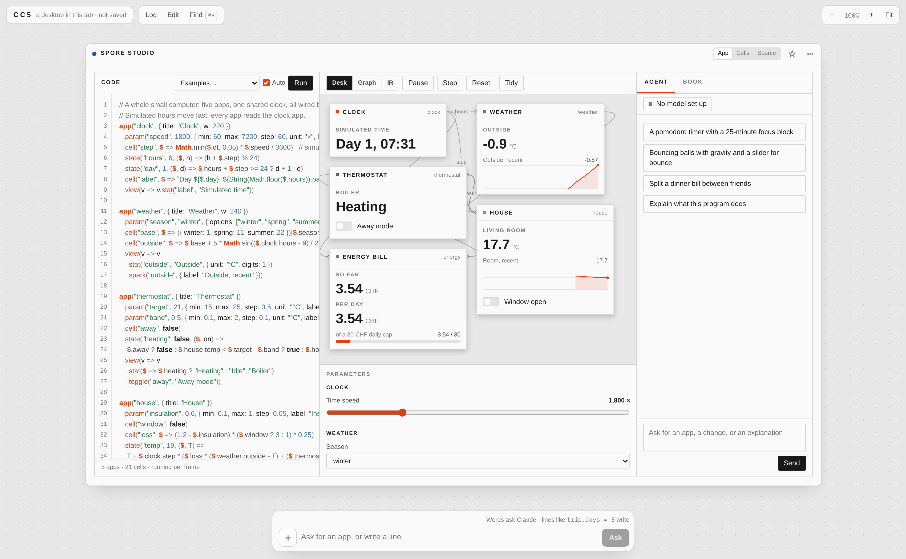
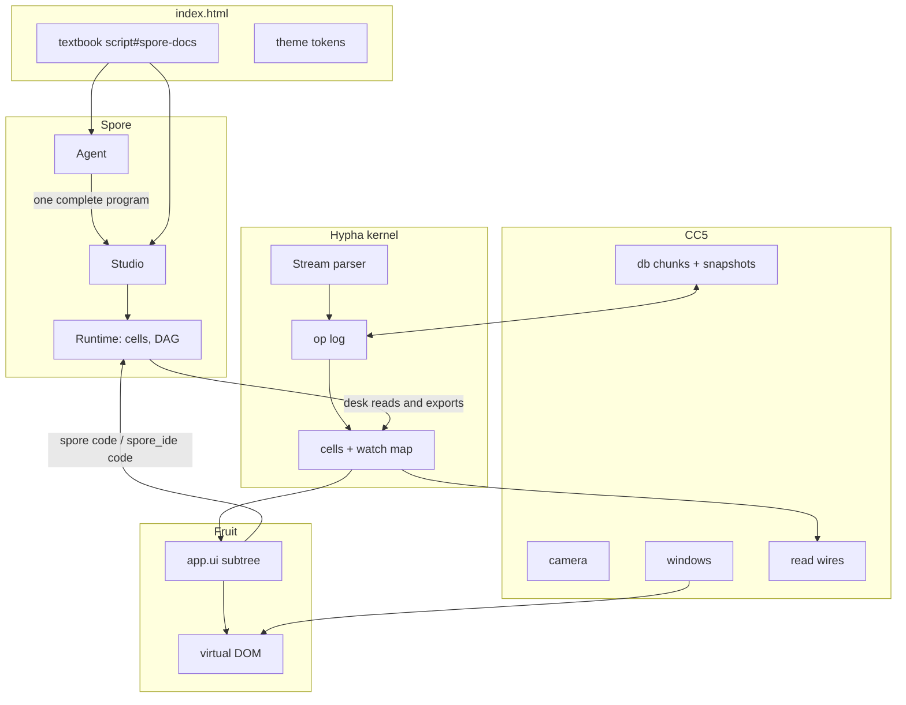
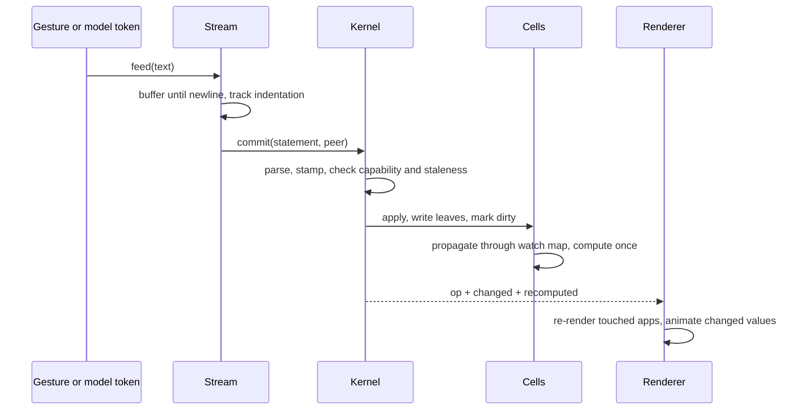
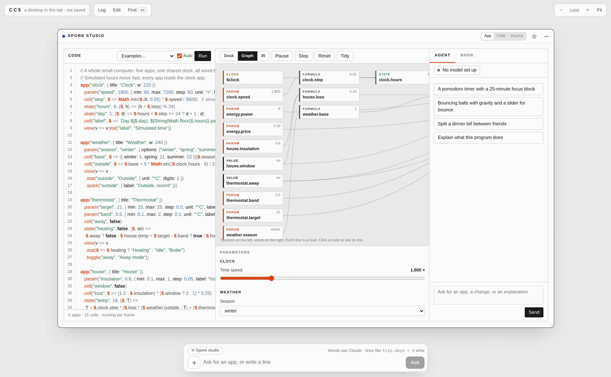
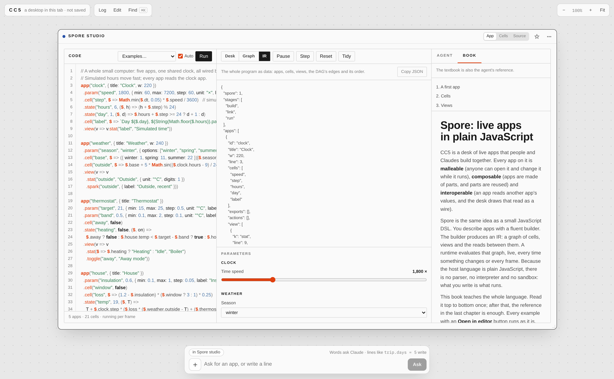
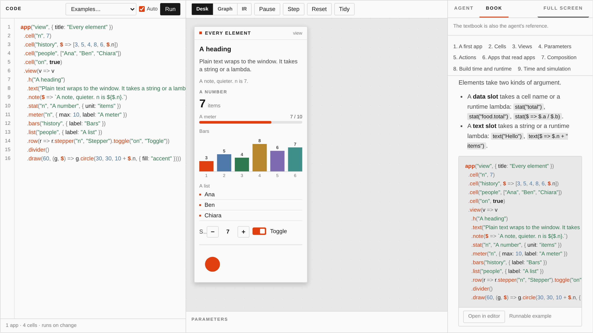
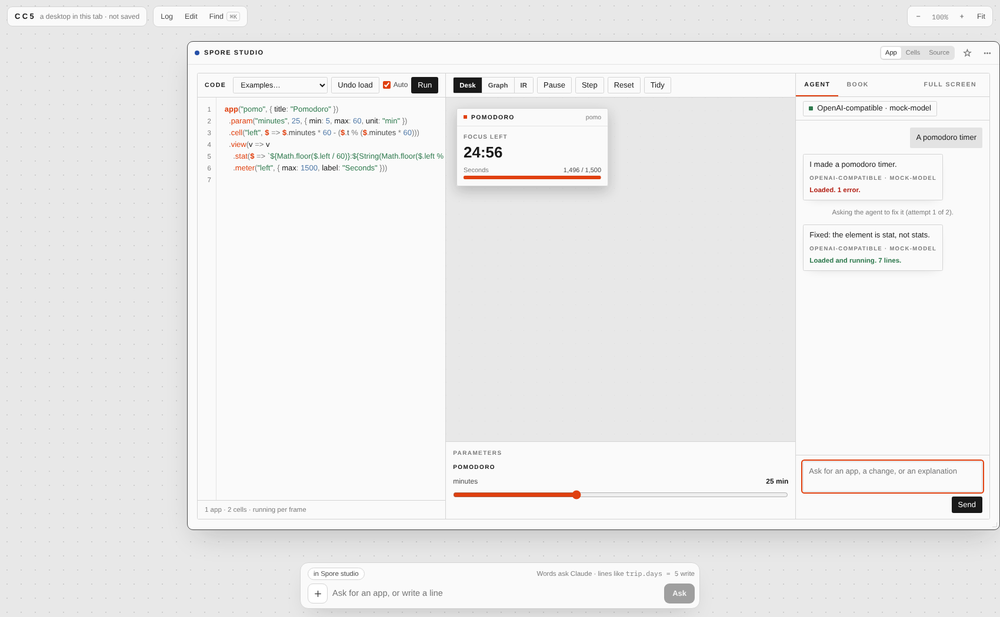
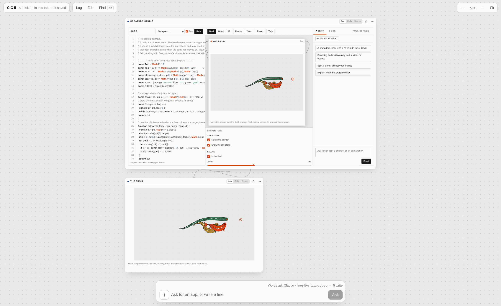
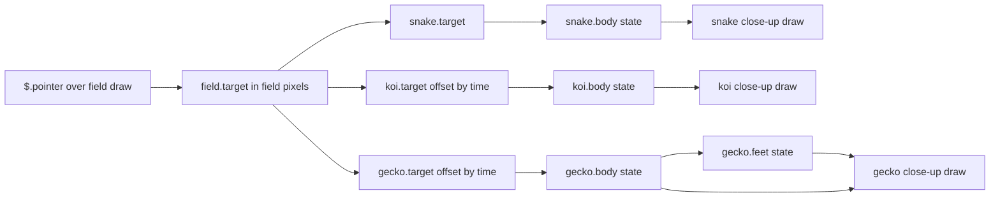

# CC5 Godprompt Computer: Spore, a Live-App DSL Inside a Collaborative Desk

On 28 October 2026, a single Claude Code session produced a self-contained web page that is, at the same time, a desktop environment, a programming language, an editor, a runtime, a coding agent, and a textbook. The page is called **CC5 Godprompt Computer**. The desktop is CC5 by Ramon Marc; the language added to it is **Spore**. Both live in one HTML page with eight JavaScript files (seven of them CC5's, one added), no libraries, no CDN, and no build step at runtime.

This report explains how that system is implemented and why it is built the way it is. The material is organised so that a reader who has never seen the code can follow it in dependency order: first the shared substrate that stores every application as a log of applied operations, then the view layer that renders applications from that log, then the desktop that arranges them, then Spore's own three-stage language pipeline, then the studio and agent that write Spore programs, and finally the integration points that let Spore applications read and write the surrounding desktop. Where a design decision has a cost, the cost is stated.

> [!summary]
> - CC5 stores every application as cells in one append-only log of parsed operations. Applications are projections of that log; a change is an operation, and any prefix of the log is a valid state.
> - Spore is a second, independent evaluation model inside the same page: a fluent builder records a program description, a single evaluation with a tracking scope turns it into a dependency graph, and a runtime re-evaluates only the formulas downstream of a change. There is no parser and no interpreter; the host language is JavaScript itself.
> - The studio exposes the whole pipeline: editor, live canvas, parameter controls, the IR as JSON, the dependency graph, an error list with line numbers, and a coding agent whose only output contract is one complete program in a fenced block.
> - The textbook is stored once in the page as markdown and serves three consumers: the Book tab, the agent's reference, and a plain-text reference injected into CC5's own Hypha agent.
> - Extension is deliberate and small: one builder method, one entry in the kind table, one paint case, one IR field, one documentation section.

## 1. What exists, and where

The work involves three published artifacts and one repository export. The repository is the authoritative source for this report.

| Artifact | Role |
|---|---|
| `1GUrJcDp2YMTx641RQ4yV6` | The original CC5 page. Its README documents how to start a fresh desktop from the same page and scripts. |
| `5U5ctT7cXHmR6jiT65XQWy` | A fresh CC5 desktop with its own log, created at the start of the session and then used as a working desk. |
| `BTv4E3T3wvqs8BxY1KHqED` | CC5 Godprompt Computer: the same desktop with `spore.js` added, the textbook embedded in the page, and two seeded desk turns. Published as version 1 and version 2 (the second added `$.pointer` and the Creatures example). |

The export under `/home/manuel/code/others/ramon/cc5-godprompt-computer` has four useful parts:

| Directory | Content |
|---|---|
| `artifact/` | The published files exactly as served: `index.html` (104,489 bytes, including the 28,961-byte textbook), `spore.js` (188,540 bytes), the edited `cc5.js`, and the unchanged modules `hypha.js`, `fruit.js`, `fruit-kit.js`, `computer.js`, `lego.js`, `browser.js`. |
| `spore-src/` | The Spore sources before bundling: `core.js`, `presets.js`, `paint.js`, `ui.js`, `agent.js`, `host.js`, `style.css`, `docs.md`, `creatures.js`, and `build.py`. |
| `desk-turns/` | The exact Hypha text written onto the desks: the Docs app, the first Spore studio, and the creature studio. |
| `tests/` | A Node engine test, five Playwright scripts, and a mock OpenAI-compatible endpoint used to test the agent's repair loop. |

Figure 1 shows the result in its wide layout: the studio inside a CC5 window, with the editor on the left, the running program on a canvas in the middle, parameters below it, and the Agent and Book panels on the right.



*Figure 1 — CC5 Godprompt Computer running the "Home computer" example: five Spore apps sharing one simulated clock, the editor with error-marked lines, the canvas with live values, parameter controls, and the agent panel. The outer window chrome belongs to CC5; the tab bar and panels belong to the studio.*

## 2. The system in one view

The page has eight cooperating layers. Each layer has one responsibility, and the boundaries are enforced by data shape rather than by module systems.

| Layer | File | Responsibility |
|---|---|---|
| Page | `index.html` | Static chrome, design tokens, the Spore textbook as `script#spore-docs`, script ordering. |
| Substrate | `hypha.js` | Parse lines into statements, apply them as operations, fold the log into a tree of cells, evaluate formulas, replay any prefix. |
| Views | `fruit.js`, `fruit-kit.js` | Read the tree, build a virtual DOM, bind props to paths, run actions as more operations, provide the element library. |
| Desktop | `cc5.js` | Camera, windows, frames, wires between apps, log replay, presence, theme application, store synchronisation, the in-page Claude, the composer. |
| Computer | `computer.js` | Files ingested as apps, local clock cells, scheduled jobs, sandboxed worker programs, audio and speech. |
| Library | `lego.js` | Reusable components stored in the tree with declared inputs, examples, dependencies, export and install. |
| Web | `browser.js` | A live browser view driven through an MCP server exposed by the Claude desktop app. |
| Spore | `spore.js` | A second language and runtime, two view elements, a studio, a model-access layer, and a window API. |



The important structural fact is that CC5 and Spore use **two different evaluation models** and neither replaces the other. CC5 evaluates text that arrives line by line, stores the result as cells, and recomputes formulas through a watch map keyed by path. Spore compiles a JavaScript program into closures, evaluates it once to discover dependencies, and then calls those closures on demand. The bridge between them is narrow: a Spore program can read a desk path with `$.desk.app.cell`, write one with `$.set("desk.app.cell", v)`, and publish selected cells with `.export(...)`.

That narrowness is the central architectural decision of the integration, and the rest of this report explains what it makes possible and what it forbids.

## 3. The substrate: one log, folded into cells

### 3.1 A line is an operation

Hypha has no separate API for creating applications. Everything is a line of text with a path on the left and a value, formula, block, or element on the right. The statement parser recognises a small set of forms.

| Line | Statement | Effect |
|---|---|---|
| `trip.days = 5` | `set` | Writes a literal at that path. |
| `trip.total = stay + food.total` | `set` with a formula AST | Stores a formula; it recomputes when anything it read changes. |
| `trip.notes = \|` with indented lines below | `block`, then `text` | Writes a text block; each indented line appends one line to it. |
| `trip.tags += "new"` | `append` | Appends a value to a list, or one line to a text block. |
| `docs.files += {id: 3, title: "New"}` | `append` | Appends a record; the record is spread into cells under the next index. |
| `docs.query = ?"search the library"` | hole | Stores an unfinished value with an intent, to be filled later. |
| `trip.days :: range 1 14 1` | `type` | Records a type used by views to choose a control. |
| `trip -` | `del` | Removes a subtree. |
| `" a short note` | `say` | Adds a line to the log that changes no state. |
| `app.ui:` … indented lines | scope + `node` | Writes an element and its props as cells. |

`Kernel.commit(text, peer)` parses the line, stamps it with `[clock, peer]`, applies it, and appends it to the log. The clock is monotonic per page and the peer is an identity string such as `u1a2b3:you`, `u1a2b3:claude`, or `u1a2b3:f2`. Because each write carries a stamp, a write that arrives after a newer write to the same path is rejected as stale rather than silently reordering history:

```js
if (this.isStale(path, st)) return { ok: false, stale: true, err: "a later write already replaced this", ... }
```

The log is also the undo mechanism. Undo does not mutate history; it writes back the value that was there before, as another operation. Dragging a window produces a write every 70 ms, and these coalesce: `commit` looks back at most six of the same peer's operations, and if the same path was written in the last 900 ms, the earlier log entry is spliced out and the new operation records `replaces`.

### 3.2 Formulas, dependencies, and holes

Formula evaluation is a Pratt parser over a deliberately small expression language, with pure functions only (`sum`, `avg`, `where`, `match`, `pluck`, `sumby`, `lerp`, `money`, and similar). Each formula stores its AST and its source text. When it computes, the evaluator records every path it read into `ctx.reads`, and the kernel converts those reads into entries in a reverse index:

```js
c.deps = ctx.deps;
for (const d of c.deps) {
  if (!this.watch.has(d)) this.watch.set(d, new Set());
  this.watch.get(d).add(c.path);
}
```

A write collects the changed paths and walks `watch` upward through parent paths, marking every dependent formula dirty, then recomputes each dirty formula exactly once:

```js
propagate(changed) {
  const affected = new Set(), q = [];
  for (const p of changed) { /* seed formulas at p */ }
  while (q.length) {
    const p = q.pop(); let a = p;
    for (;;) {
      const w = this.watch.get(a);
      if (w) for (const f of w) if (!affected.has(f)) { affected.add(f); q.push(f); }
      if (!a) break; a = parentOf(a);
    }
  }
  for (const f of affected) { const c = this.cells.get(f); if (c && c.kind === "formula") c.dirty = true; }
  for (const f of affected) { const c = this.cells.get(f); if (c && c.dirty) this.compute(c); }
  return this.recomputed;
}
```

Three properties follow from this design, and each is used by the interface. First, dependency edges are **observed**, not declared: a formula's edges are exactly the paths it read on its last successful evaluation, so a conditional branch that stops reading a cell also stops depending on it. Second, the recomputation set is available to the renderer, which uses it to flash the values that just changed and to animate reads across application boundaries. Third, a cycle is detected during computation and reported with the full loop, not with a stack trace.

Holes are the mechanism that lets the desktop accept an incomplete program. A hole is a cell of kind `hole` that carries an intent string and optional connector hints. Formulas that read a hole receive a residual value (`Res`), and the residual propagates through arithmetic instead of throwing, so the rest of the application continues to compute. The interface later asks a model to fill each hole, and the residual disappears when the hole becomes a literal.

### 3.3 Streams, peers, and authority

Text does not arrive in whole documents. It arrives in tokens from a model, in keystrokes from a person, or in chunks from a store. `Stream` accepts arbitrary text fragments, buffers partial lines, tracks indentation scopes, and commits each statement the moment its line closes. This is why a model's output becomes visible on the canvas while it is still being written, and why an interrupted response leaves a consistent, if incomplete, state.

Every peer can be given a write capability set. `allowed(peer, path)` checks glob patterns, negative patterns win, and a rejected write becomes a log entry with an error rather than an exception. The in-page Claude is restricted to the application it was asked to edit:

```js
ensurePeer(K, id, { can: app ? [app, app + ".*"] : ["*"] });
```

The local clock (`clock.now`, `clock.time`, `clock.date`) is written through `Kernel.local`, which bypasses the log entirely. A value that changes every second would otherwise add an operation every second; keeping it local preserves the log as a record of intent.



## 4. Views as data: Fruit

### 4.1 An application is a scope with a view subtree

A CC5 application is a top-level path. Its data cells live directly under it; its interface lives under `app.ui`. Each element is itself a path whose `.k` cell holds the element kind and whose other children are props. A minimal application therefore has an unambiguous textual form:

```hypha
tally:
  title = "Tally"
  count = 0
  step = 1
  ui:
    h1 "Count: " + count
    row
      slider step, min: 1, max: 10
      button "+" + step -> count = count + step
```

The renderer is a pure read of that subtree. `Fruit.node` looks up `.k`, resolves every prop through the same formula evaluator, and constructs a virtual DOM node. Props that name a path are **bindings**: a slider bound to `step` shows the current cell and writes back one operation per change, as the person. A prop bound to a formula is read-only, and the field is marked with a small `ƒ` so the interface can explain why it cannot be edited.

Actions are Hypha lines stored in a `.do` cell. When a button is used, the lines are parsed and committed as the person who pressed it. This means an action is data, inspectable in the tree and serialisable back to text, rather than a closure that exists only while the page is alive.

`each` and `when` are structural elements whose children repeat or conditionally show. When an alias can be resolved to a real path, `each` rewrites the child props to point at that path, so edits inside a repeated row write the underlying record. The `cells` projection is the fallback face for any application: a table of every path and value, editable in place. It requires no view to have been written.

### 4.2 Interaction surfaces

| Gesture | Operation |
|---|---|
| Type in a field | One `set` on the bound path, coalesced while typing. |
| Drag a slider | One `set` per input event, coalesced by the same rule as window drags. |
| Press a button | Parse and commit every line in its `.do` cell, attributed to the pressing peer. |
| Press Edit, then click an element | Select the element path; the inspector edits its props as cells. |
| Switch a window to Source | Render `K.toHypha({root: app})`; Apply diffs the text against the live tree and writes the difference. |
| Drag a window | `desk.app = {x, y, w}` every 70 ms, coalesced. |
| Scrub the log | `K.replay(n)` produces a read-only tree at operation `n`; the desktop re-renders from it. |

The Source face deserves attention because it is the round-trip test of the whole substrate. The app is rendered to text, edited as text, and applied by streaming the text back through the same parser used for every other write. Paths that existed before and are no longer mentioned are deleted. If any line fails, the failures are counted and the first error is shown, but the successful lines remain applied.

## 5. The desktop: arrangement, reads, and time

CC5 adds the parts that make a set of applications a workspace.

**Camera.** One CSS transform on a world container: `translate(x, y) scale(z)`. The dot grid's background size and position follow the same values, so the grid and the content move together. Zoom is clamped to 0.15–2.5. Below 0.45 the windows enter a "far" mode: bodies are not rendered, and each title bar shows its first statistic instead. This keeps a large desk interactive when it is zoomed out.

**Windows.** Each application gets a frame. Frames come from `desk.app` when present, otherwise from a deterministic free-spot search that places new applications where nothing else is, identically on every screen for the same tree. New applications written by the local user are queued and placed in the current viewport.

**Wires.** A wire is drawn for every cross-application read discovered in a formula's `reads` list. The geometry picks the nearest pair of window sides, labels the wire with the read names, and animates a dash offset along the path when a value changes. Wires are suppressed below the far threshold, where they would be unreadable.

**Time.** The log is the state, so past states are read from it directly. Scrubbing sets `S.view` to a replayed kernel and marks the desktop read-only; "Back to now" restores the live kernel. This is a genuine prefix reconstruction, not an undo stack of diffs.

**Theme.** `theme.*` cells are compiled into CSS custom properties. Named colours become `--accent`, `--ink`, and so on; `theme.dark.*` overrides them under `prefers-color-scheme: dark` and an explicit dark attribute. Application-level `app.theme.*` scopes the same mechanism to one window. Spore reads these same properties for its canvas palette, so a single token change recolours both DOM and canvas.

**Store.** When the page runs inside Claude, operations are persisted as chunks of at most 500 operations or 150 KB, one chunk per open tab, with periodic checkpoints every 3,000 operations. Live operations also travel over a room topic, so open pages converge in roughly 60 ms; the store deduplicates by operation id when the chunk arrives.

**Presence and intent.** Each peer publishes cursor position, focused application, and the line it is currently writing. The interface shows other cursors, a live status inside the window being written to, and ghost log lines for operations that have not closed yet.

**Composer and in-page Claude.** The composer accepts either Hypha lines or a request in prose. In prose mode, the page sends the model a grammar reference, the current tree (truncated to 60,000 characters around the focus), the screen bounds, and the focused element. The model is instructed to write structure first and to leave holes for the parts that need research or long prose. When it finishes, up to four further model calls fill the holes in parallel, each taking a lease on its hole so two fillers cannot write the same path.

**Turns.** An agent outside the page writes into the desk by creating a document in `data/users/<id>/cc5/turns` with `{text: "…"}`. The page watches that collection, leases the document, streams the text at 160 characters per 16 ms so the person sees it grow, marks it applied, and fills any holes it created. This is how the session seeded both the Docs application and the two Spore studios.

The first turn written this way is the Docs application, and it is a compact demonstration of what the substrate can express in 54 lines. Two pure functions compute word count and reading time over a string. A query cell and a derived `shown = match(files, query)` drive the library list. The layout is a `split` of a library column and an editor column, with `each` and nested `when` for the selected document, a `tabs of: mode` control over Write, Preview, and Side by side, and `progress words(d.body), max: goal` under the editor. Four buttons issue `ask` actions whose text names the document by id and states the edit precisely, and a fifth `ask` element below them opens a free-form request. Because the request is scoped to one application, the model's write capability is scoped the same way. The whole application is data: the same text can be read back, edited, and re-applied.

## 6. The brief that produced Spore

Spore exists because of one message in the session, quoted here in the parts that constrained the design:

> Turn the idea above into a small JS DSL with an IDE, agent and textbook. Deliver everything as one self-contained HTML file. No external libraries, CDNs, fonts or network assets. […] Fluent builder API over a minimal grammar of composable components. Builder calls produce an IR (a DAG), evaluated separately. Components accept lambdas: build-time (generate structure) or runtime (evaluated per frame/tick). Make the distinction explicit. Plain JS as host language, no parser/interpreter, no sandboxing needed.

Five constraints follow, and each shaped a specific part of the implementation.

1. **No parser.** The program must be JavaScript. Therefore the builder is a set of JavaScript objects and the "syntax" is method chaining. Errors are JavaScript exceptions with added metadata, not parse diagnostics.
2. **An IR, evaluated separately.** The program must be runnable as data. Therefore the builder records plain object nodes, and the runtime produces a serialisable graph with explicit edges.
3. **Two lambda positions.** Build-time and runtime code must be distinguishable without annotation. Therefore the position — which method the lambda is passed to — decides when it runs.
4. **One file.** All modules must concatenate. Therefore each module is an IIFE that attaches one global, and the bundler is 41 lines of Python that also injects the stylesheet.
5. **Two audiences.** The same artifact must be usable by people and legible to agents. Therefore the textbook is stored as markdown in the page, the IR is exposed as JSON, errors carry line numbers and fixes, and the HTML uses landmarks and stable ids.

The design consequence that matters most is the third constraint. Because JavaScript is the host language, a runtime lambda is a real closure over the program's top-level scope. It can call any function the program defined, keep any state it closes over, and use any JavaScript expression. The price is that formulas cannot be serialised as data (only their source text can) and cannot be moved to another process. Spore accepts that price: the IR records `fn` as source text for inspection, while execution always uses the original closure.

## 7. Build, link, run

Spore's core is 714 lines organised around three stages, stated at the top of the file and enforced by the code.

### 7.1 Build: record a description

`build(code)` compiles the program text with five injected names and runs it once:

```js
fn = new Function("app", "component", "range", "clamp", "lerp", code + "\n//# sourceURL=" + SRC);
fn(app, component, helpers.range, helpers.clamp, helpers.lerp);
```

`app(id, opts)` returns an `App` builder. `.cell`, `.cells`, `.param`, `.state`, `.action`, `.export`, and `.view` record declarations. `.view(fn)` calls the lambda with a `View` builder; every element method appends a node and returns the builder, which is what makes chaining work.

The `View` object is wrapped in a `Proxy` so that a component name can be used as a method. When a name is not a builder method but exists in the component registry, the proxy returns a function that appends a `group` node carrying the component name and runs the component's build-time lambda into that node. When the name is unknown, the proxy throws with a suggestion computed by Levenshtein distance:

```
Unknown view element "stats". Did you mean "stat"?
Elements: h, text, note, stat, meter, spark, bars, list, draw, button,
toggle, stepper, divider, row, each, when, use.
```

Slot validation happens at build time, which is why most mistakes surface before anything runs. A data slot accepts a cell name matching `name` or `app.name`, or a function; a text slot accepts a string or a function. The error messages state the accepted form and show the offending value, for example:

```
stat() takes a cell name like "total" or "food.total", or a runtime lambda
like $ => $.total. Got {"of":"total"}.
```

Parameter controls are inferred from the default value, so the author does not choose a widget:

| Default | Control |
|---|---|
| number | range from `min(0, init)` to `init * 2` (or 10), step 1 for integer spans of 10 or more, otherwise span/100 |
| boolean | checkbox |
| string with `options: [...]` | select, default must be one of the options |
| string | text field |

Duplicate names, reserved names, a `max` not greater than `min`, a `button` naming a nonexistent action, a `toggle` pointing at a formula, and a missing `view` or `app` are all rejected during build or link with a line number and, where possible, the line of the conflicting declaration.

### 7.2 Link: discover the graph

Linking does two things. It resolves every static reference — data slots, toggle and stepper cells, button action names, exports — and it evaluates every formula once under a tracking scope so that its reads become edges. State steps are probed once as well, with a clone of the current value, so their dependencies are known before the first tick.

The tracking scope is a `Proxy` over the app. A property read resolves in a fixed order: a cell of the same app, one of the runtime functions (`set`, `push`, `toggle`, `inc`, `get`), the clock (`t`, `dt`, `frame`, `now`), another app's scope, `desk`, or `pointer`. Every read adds its cell id to the tracking set, including the pseudo-cells `$clock`, `$pointer`, and `desk:app.cell`.

```js
read(id, track) {
  if (track) track.add(id);
  const c = this.cells.get(id);
  if (c.kind === "formula" && c.dirty) this.compute(c);
  return c.value;
}
```

Cycles are found here, during the first evaluation, and reported with the whole loop:

```
Cycle: a.x → a.y → a.x. A formula cannot depend on itself. Break the loop
with a state(…) that steps per tick, or store one side in a cell(…).
```

### 7.3 Run: change, tick, read

The runtime holds values. A write invalidates everything downstream and bumps a version counter; nothing recomputes until a value is read. Reading a dirty formula computes it, records its reads, and clears its error. This is demand-driven evaluation with memoisation, not a scheduler.

Time is a separate path. `tick(dt)` updates the clock, invalidates the clock pseudo-cell, then steps every state in two phases: every step lambda reads the values from before the tick and returns a candidate, and only after all candidates exist are they applied. Declaration order therefore cannot affect a simulation. The body, abridged:

```js
tick(dt) {
  this.clock.dt = dt; this.clock.t += dt; this.clock.frame++; this.clock.now = Date.now();
  this.invalidate(CLOCK);
  const next = [];
  for (const c of this.cells.values()) {
    if (c.kind !== "state") continue;
    const track = new Set();
    try { next.push([c, c.step(this.scope(c.app, "read", track, ...), c.value)]); }
    catch (e) { this.fail("step:" + c.id, e, ...); }
    this.setDeps(c.id, track);
  }
  for (const [c, v] of next) if (!same(c.value, v)) { c.value = v; this.invalidate(c.id); ... }
  this.version++;
}
```

`ticking()` answers whether a frame is needed at all: it is true when any state exists, when any cell or view read the clock, or when something read the pointer. A static calculator program therefore runs on change only, and the studio reports that state in its status line ("runs on change" versus "running per frame").

Live coding is handled by `carry(old)`. When the program text changes, the new runtime is built and then inherits values from the old one: a param, value, or state whose declaration is unchanged keeps the value the person set. Comparison is structural (`JSON.stringify`), and a param whose control definition changed is not carried, because its range may no longer contain the old value. The clock is carried too, so a running simulation does not restart on every keystroke.

Writes are restricted by construction. `scope(app, "read")` installs functions that throw on `set`, `push`, `toggle`, or `inc`, with a message that names the offending lambda and the fix. Only `scope(app, "action")` provides writers. A formula that attempts a write produces a runtime error attached to that formula; the rest of the program keeps running.

## 8. The IR, and what it is for

The IR is the program after build and link, as plain JSON. It is the contract between the runtime, the graph view, the JSON inspector, and any external agent.

```json
{
  "spore": 1,
  "stages": ["build", "link", "run"],
  "apps": [
    { "id": "trip", "title": "Trip to Lisbon",
      "cells": ["nights", "rate", "stay", "total"],
      "exports": [],
      "actions": [],
      "view": [{ "k": "stat", "of": "trip.total", "line": 7 }] }
  ],
  "components": [],
  "nodes": [
    { "id": "$clock", "kind": "clock" },
    { "id": "trip.nights", "kind": "param", "value": 4,
      "control": { "type": "range", "min": 1, "max": 14 } },
    { "id": "trip.stay", "kind": "formula", "fn": "$ => $.nights * $.rate",
      "reads": ["trip.nights", "trip.rate"], "ticks": false, "line": 4 },
    { "id": "trip.view", "kind": "view", "reads": ["trip.total", "trip.stay"] }
  ],
  "edges": [{ "from": "trip.nights", "to": "trip.stay" }],
  "order": ["$clock", "trip.nights", "trip.rate", "trip.stay"],
  "clock": { "t": 0, "frame": 0 },
  "errors": []
}
```

Node kinds are `value`, `param`, `formula`, `state`, `view`, `clock`, `pointer`, and `desk`. A formula node carries its source text, its observed reads, and whether it ticks. A state node carries its initial value and step source. A param node carries the control descriptor. View nodes carry the cells and views their last paint actually read.

Two properties of the IR are worth stating precisely because they surprise readers.

First, **`reads` is a record of observation, not a declaration.** A formula that tests a boolean and reads one of two branches lists only the branch it took. The graph therefore changes shape as the program runs, and the IR is a snapshot of the last evaluation.

Second, **view reads exist only after a paint.** Views are evaluated by the renderer, not by the linker. Until the canvas has drawn once, `viewReads` is empty and view nodes have no incoming edges. This is visible in the graph view: after the first frame, reads from cells to views appear. The dependency is recorded by `noteViewReads`, which merges the paint's tracking set into a per-application set.

The IR's `order` is a topological order computed by Kahn's algorithm. The graph view does not use it directly; it layers nodes by longest path from the sources, sorts each layer by id, and draws bezier edges between layers. Clicking a node calls back into the studio with its `line`, which switches to the Code tab and moves the caret to that line. That is the whole navigation contract between the visual graph and the source.



*Figure 2 — The Graph mode of the preview: cells in kind-coloured layers, each node showing its current value. Views occupy the rightmost layer, off-screen at this pan position; the graph is wider than the panel and pans horizontally, and the footer states the reading direction.*



*Figure 3 — IR mode beside the Book tab. The JSON is the same object that `spore.getIR()` returns, and the textbook beside it is the same markdown the agent receives.*

## 9. Errors as a first-class surface

The error model has four kinds and one required shape. Every error carries `kind`, `line` when known, `where` (the cell or application), `message`, and sometimes `hint`.

| Kind | Raised when | Example message |
|---|---|---|
| `syntax` | The text is not valid JavaScript | `missing ) after argument list` at line 2 |
| `build` | A builder call is invalid | `App "a" already has a cell "x" (line 1). Each name holds one cell.` |
| `link` | A name does not resolve, or a cycle exists | `stat() uses "food.total", but there is no app "food". Apps: "a".` |
| `runtime` | A lambda throws while running | `$.z is not defined in app "a". Did you mean "x"?` |

The first engine test produced the link message with the wording `stat() reads "food.total"`, and the session changed `reads` to `uses` because a data slot does not necessarily read a cell of another application. The table shows the current wording. Two implementation details make the line numbers trustworthy. V8 reports no line for a syntax error raised inside `new Function`, so `syntaxLine` finds the shortest prefix of the program that produces the same message and reports that length; messages that only occur at end of input are excluded. For runtime errors, the program is compiled with `//# sourceURL=spore-program.js`, and a one-time probe measures the offset between the reported line and the user's line:

```js
(function probe() {
  try { new Function("x", "\nthrow new Error('probe')\n//# sourceURL=spore-probe.js")(); }
  catch (e) { const m = /spore-probe\.js:(\d+)/.exec(e.stack || ""); if (m) LINE_OFFSET = Number(m[1]) - 2; }
})();
```

Runtime errors do not stop the program. `compute` catches, stores the error on the cell, and sets the value to `undefined`; the renderer shows a red message in place of the failed element and continues with its siblings. The error list under the editor marks the line in the gutter and in the text, and each entry jumps to its line. A program that fails to build keeps the last runtime that did build, so the canvas never goes blank during editing; the status line says which version is being shown.

## 10. Painting: one pass that measures and draws

The canvas renderer is a single recursive function, `paintApp`, with one `case` per element kind. Each case both draws and returns the height it consumed. There is no layout pass separate from painting, because the element set is small enough to measure directly: text is wrapped with `measureText`, `stat` reserves 46 pixels, `meter` 23, `spark` its configured height plus 17, `draw` exactly its declared height.

That one-pass contract has a visible consequence. When content changes height, the frame is drawn with the previous height, the new height is stored, and the stage requests another frame. The settle takes one frame and avoids a second layout algorithm. Window heights in the desk mode are the measured content height, so a window grows when a list grows.

Hit regions are collected during the same pass, in paint order, and searched in reverse so the topmost element wins. A hit carries its key, rectangle, kind, and a click closure. Buttons, toggles, and steppers are press-highlighted and executed on release only if the pointer is still inside; draw elements capture the pointer and report coordinates; title bars drag windows.

The canvas is sized for both device pixel ratio and CC5's zoom:

```js
fit(w, h) {
  const r = c.getBoundingClientRect();
  const zoom = c.offsetWidth ? r.width / c.offsetWidth : 1;
  const scale = (window.devicePixelRatio || 1) * Math.max(0.5, Math.min(4, zoom || 1));
  ...
  this.ctx.setTransform(scale, 0, 0, scale, 0, 0);
}
```

The `draw()` API is a thin, chainable wrapper over Canvas 2D: `line`, `rect`, `circle`, `path`, `poly`, `text`, `clear`, `map`. It accepts theme token names (`ink`, `muted`, `accent`, `line`, `card`, `paper`, and the palette entries `p2`–`p7`) and resolves them through computed CSS custom properties, so a Spore canvas follows light and dark mode without any code of its own. `g.w` and `g.h` are the element's CSS size, not its device size, so drawing code is resolution-independent.

There are three stage modes with different layout rules. `desk` packs application cards into columns of 276 pixels, using each app's declared width to decide how many columns it spans, and draws wires beneath the cards. `app` renders one application with no chrome, at its natural height, for embedding in a CC5 window. `graph` lays out the IR and scales it to fit, with pan enabled when it does not.

## 11. The studio

The studio is a grid whose shape is a function of its own width, not the viewport's. That choice matters because a studio can live in a 390-pixel phone window, a 700-pixel CC5 window, or a full-screen overlay.

| Own width | Layout | Visible panels |
|---|---|---|
| ≥ 1240 px | Three columns: code, preview, side | Code, Preview, and Agent or Book |
| ≥ 660 px | Two columns: code, side | Code plus whichever of Preview, Agent, or Book is selected |
| < 660 px | One column with a bottom tab bar | One panel at a time |

The layout is implemented twice, deliberately. CSS grid areas (`data-size="wide|medium|narrow"`) place the panels; a `ResizeObserver` measures the studio and sets the attribute. Inside the preview and the book, container queries take over at 640 pixels, moving parameters below the canvas and the table of contents above the article. Neither mechanism depends on media queries against the viewport, so an embedded studio behaves correctly inside a resized desktop window.



*Figure 4 — The "Every element" preset: headings, text, notes, statistics, meters, bars, lists, stepper, toggle, divider, and a draw element, each rendered by the same canvas pass that measures it.*

**Editor.** A transparent `<textarea>` sits exactly over a highlighted `<pre>`, with a sticky line-number gutter. The textarea owns the caret, selection, and input methods; the `<pre>` owns the colour. Scrolling is shared because both live in the same grid cell and the container scrolls. The highlighter is a single regular-expression tokenizer that knows JavaScript keywords, the Spore grammar names, and grammar names that follow a dot, so `v.stat` and `stat` are coloured differently from user functions. A separate pass marks error lines in both the gutter and the text.

Keyboard behaviour is implemented rather than inherited: Tab indents or outdents the selected block by two spaces, Enter preserves indentation and adds two spaces after an opening bracket or arrow, Escape blurs, and ⌘/Ctrl+Enter runs. `goto(line)` sets the selection and scrolls four lines above the target.

**Parameters.** Controls are grouped by application and chosen from the param descriptor. A signature check avoids rebuilding the DOM on every frame; a sync pass updates values without disturbing the focused input. Units are appended to the displayed value, and step size determines the number of decimals.

**Book.** The markdown renderer handles headings with generated slugs, fenced code, ordered and unordered lists with continuation lines, tables with escaped pipes, blockquotes, rules, links, and a two-level table of contents. A fenced block tagged `run` becomes a figure with an "Open in editor" button carrying the source in a `data-code` attribute. Pressing it loads that program and switches to Code (or Preview on a narrow layout).

**Errors and status.** The error region is an ordered list of kind, line button, location, message, and hint. The status line reports applications, cells, and whether the program ticks.

**Full screen.** The studio can detach into a fixed overlay on `document.body`, keeping the same DOM node, restoring its original height on close. Escape closes it unless a text field has focus. When a studio embedded in a scaled CC5 window is rendered below 0.66 zoom on a phone, a button offers full screen, counter-scaled so it stays legible.

## 12. The coding agent

The agent panel is a conversation with one hard output contract: to change the program, reply with one or two sentences of prose and then the **complete** program in a single fenced block. No diffs, no fragments, nothing after the block. The studio extracts the last fenced JavaScript block, loads it, runs it, waits 700 ms, reads the resulting errors, and if there are any, sends them back with a request to fix them — at most twice.

Model access is layered with automatic fallback.

| Provider | Ready when | Call |
|---|---|---|
| Claude, built in | The page runs inside Claude and exposes a `sample` capability | `sample(messages, { cache: false, onText })`, with the system prompt prepended to the first user turn |
| Anthropic API | A key is stored in settings | `POST https://api.anthropic.com/v1/messages` with `x-api-key`, `anthropic-version: 2023-06-01`, `anthropic-dangerous-direct-browser-access: true`, `max_tokens: 8000` |
| OpenAI-compatible | A base URL and model are stored | `POST {base}/chat/completions`, optional bearer token, standard `{role: system}` message |

The chip above the conversation shows which provider is active and which model answered. If the preferred provider fails, the next configured one is tried and a note is appended to the conversation. Keys live in `localStorage` under `spore.agent.v1` and never leave the browser. The settings panel states the constraint that follows from the artifact sandbox: inside Claude the page cannot reach other hosts, so the two direct-API providers are useful when the page is served elsewhere.

The prompt has three parts. The first is behavioural: keep what the person built, keep cell and parameter names stable so values survive an edit, use data slots correctly, and put writes only in actions. The second is the complete textbook. The third is per-request context assembled from the live program:

```
<program> …current source… </program>
<errors> …kind, line, where, message, or "none"… </errors>
<apps> …each app's cells with kind and truncated value… </apps>
<desk> …the CC5 applications visible around the studio… </desk>
```

Conversation history is capped at the last eight turns. Streaming text is shown with fenced blocks replaced by `[writing the program…]`, so the panel does not scroll through code that is about to be replaced. A Stop button aborts the request through an `AbortController`.



*Figure 5 — The repair loop, run against a mock OpenAI-compatible endpoint. The first answer uses `stats` instead of `stat`; the studio reports "Loaded. 1 error.", sends the error back, and the second answer runs. The badge under each message names the provider and model that answered.*

This is a deliberately narrow agent. It cannot patch the program incrementally, cannot run commands, cannot browse, and cannot inspect the IR. It receives the source, the errors, and a summary, and it must return a whole program. The narrowness is what makes the loop reliable: there is exactly one artifact to validate, and validation is the runtime itself.

## 13. One textbook, three readers

The textbook is a single markdown document stored in the page:

```html
<script type="text/markdown" id="spore-docs">
# Spore: live apps in plain JavaScript
…
</script>
```

It is 4,925 words in 16 chapters, with 10 runnable examples and a compact reference at the end. Three consumers read it.

1. The **Book tab** renders it with the markdown renderer, including runnable figures and a table of contents.
2. The **agent** receives it verbatim as its reference, inside `<textbook>` tags, on every request.
3. **CC5's own Hypha agent** receives the reference section through `CC5Spore.prompt()`, which extracts from the heading containing "Reference" onward. That is how the desktop's general-purpose agent learns that a program can be stored in a text cell and shown with `spore code`.

The same text therefore teaches a person, constrains a model that writes Spore, and informs a model that writes Hypha. No part of it depends on rendering, which was an explicit requirement: an agent reading only the page source must be able to understand and extend the system.

## 14. Integration with CC5

Spore registers two view kinds with Fruit:

```js
H.POS.spore = ["of"];
H.POS.spore_ide = ["of"];
F.R.spore     = (K, p, env) => element(K, p, env, false);
F.R.spore_ide = (K, p, env) => element(K, p, env, true);
```

`F.bind(K, p, "of", env)` resolves the `of` prop to the path of the code cell. That path is the program key. Every view of the same code cell shares one `Program` object, so an edit in a studio appears immediately in a `spore code` window elsewhere on the desk, and two studios editing the same cell stay in sync.

| Prop | Effect |
|---|---|
| `of` (positional) | The code cell path; also the program key. |
| `app: "name"` | Render one Spore application with no chrome. |
| `h: 480` | Fixed canvas height; otherwise the content height is used. |
| `params: false` | Hide the parameter controls. |

The bridge to the desk is small and explicit.

| Direction | Mechanism |
|---|---|
| Read | `$.desk.app.cell` resolves through `Bridge.read`, is tracked as a `desk:` dependency, and invalidates when the desk version changes. |
| Write | `$.set("desk.app.cell", v)` calls `Bridge.write`, which writes a Hypha line attributed to the peer `spore`. |
| Publish | `.export("cell", …)` writes `<host>.out.<sporeApp>.<cell>` at most every two seconds, only when the literal text changed, with numbers rounded to six significant digits and objects over 4,000 characters skipped. |

The version check is a poll, not a subscription:

```js
version: () => K().log.length + ":" + Math.floor(Date.now() / 1000)
```

The log length catches every logged write; the second-resolution timestamp catches local cells such as `clock.time`, which never enter the log. The consequence is that a desk-dependent formula can be up to one second stale, and the program's version counter bumps once per second while such reads exist. This is the one place in Spore where a dependency is approximated rather than observed.



*Figure 6 — The creature studio at 65% desk zoom, next to a separate `spore code, app: "field"` window rendering the same program. Both windows are projections of one code cell.*

The window API exposes the same machinery to scripts and external agents.

| Call | Effect |
|---|---|
| `spore.load(code, key?)` | Replace the text, rebuild, return `{ok, errors}`. |
| `spore.run(key?)`, `spore.code(key?)` | Rebuild; read the source. |
| `spore.getIR(key?)` | The full IR object. |
| `spore.setParam(id, v, key?)`, `spore.get(id, key?)` | Write a param; read any cell. |
| `spore.act("app.action", key?)` | Run a named action. |
| `spore.errors(key?)`, `spore.play(bool, key?)` | Errors; pause or resume ticking. |
| `spore.full(bool, key?)` | Open or close full screen. |
| `spore.programs()`, `spore.use(key)`, `spore.create(name, code, opts)` | List, select, and create studios on a CC5 desk. |
| `spore.presets()`, `spore.docs()`, `spore.on(event, fn)` | Examples, textbook, change events. |

## 15. The Creatures case study

The Creatures example is the strongest evidence that the grammar is expressive enough for real work, because it was written after the grammar was frozen and it required only one addition.

The brief was a studio that makes procedural animals. The program contains four applications: a field that holds a shared target and paints all three animals, and three animal applications generated by one build-time factory that also declares their shared parameter set. Each animal is a chain of joints. The head moves toward a target; each following joint maintains a fixed distance from its predecessor and may turn only within a bounded angle. The gecko adds four two-bone legs whose feet stay planted until the body has moved a stride away.

The chain update is a build-time helper called from a runtime state step, which is the intended composition: build-time code creates the function, runtime code calls it with current values.

```js
function follow(pts, target, len, speed, bend, dt) {
  const out = pts.map(p => p.slice())
  const d = dist(out[0], target)
  if (d > 2) out[0] = along(out[0], ang(out[0], target), Math.min(d, speed * dt))
  for (let i = 1; i < out.length; i++) {
    let a = ang(out[i - 1], out[i])
    if (i > 1) {
      const prev = ang(out[i - 2], out[i - 1])
      a = prev + clamp(wrap(a - prev), -bend, bend)
    }
    out[i] = along(out[i - 1], a, len)
  }
  return out
}
```

The leg solver is two equal bones with a knee that always bends to one side:

```js
function leg(g, hip, foot, len, side, M, s) {
  const d = Math.min(dist(hip, foot), len * 1.96)
  const bend = Math.acos(clamp(d / (2 * len), -1, 1))
  const knee = along(hip, ang(hip, foot) - side * bend, len)
  ...
}
```

The gait is a state machine over four feet, expressed as a state step that returns new foot records. A foot begins to step when its home position is farther than the stride, and only if the opposite foot of its pair is not already stepping; during a step it moves toward a goal ahead of the home position at a fixed speed.

```js
.state("feet", [], ($, feet) => LEGS.map(([j, side], k) => {
  const pts = $.body, a = facing(pts, j)
  const home = along(along(pts[j], a + side * 1.15, $.leg * 1.75), a, $.leg * 0.3)
  const f = feet[k] || [home[0], home[1], 0]
  let stepping = f[2]
  if (!stepping && dist(f, home) > $.stride && !(feet[k ^ 1] && feet[k ^ 1][2])) stepping = 1
  ...
}))
```

Three details connect the program to the runtime in ways that are easy to miss.

The field's target formula reads `$.pointer` and converts the pointer from canvas pixels to field coordinates by inverting the letterbox transform. That conversion exists because a `draw` element preserves aspect ratio and centres the field, so the pointer coordinates and the field coordinates differ by a scale and an offset.

The field also stores a function as a cell value: `.cell("inside", $ => p => [...])`. Spore permits this because cells hold any JavaScript value; the IR serialises it as `{fn: "p => …"}`. The animals call `$.field.inside(...)`, which keeps the clamping rule in one place.

The animals' close-up windows are separate `draw` elements, each with its own camera that centres on a joint a third of the way along the body and applies a fixed scale. There is no second rendering path: the same paint functions receive a coordinate mapping and draw into a smaller rectangle.



The one grammar addition was `$.pointer`. Before it, a `draw` element could paint but could not receive input; the animals could follow a wandering point but not the person's pointer. Adding it touched five places: a pointer map and `setPointer` in the runtime, a `$pointer` pseudo-dependency that invalidates on movement, a branch in the scope proxy, pointer reporting in the stage's pointer handlers, and a `pointer` node in the IR plus a chapter in the textbook. That is the extension cost the grammar was designed for.

## 16. Build, publish, and the failures along the way

The bundle is produced by `spore-src/build.py`, which concatenates seven sources, injects the stylesheet as a JSON-encoded string, and wraps everything in one function scope with a fixed header that documents the section order. The output is 2,687 lines. Rebuilding requires changing the hard-coded `/home/claude/spore` path at the top of the script, which is noted in the repository README.

Three real failures in the session are worth preserving, because each identifies a constraint that is not obvious from the code.

**The publish manifest rejected a leading `<`.** The credit comment required by the brief begins with `<!--`, and it was placed verbatim at the top of `spore.js` as instructed. The publish API refused:

```
deploy 400: manifest entry "spore.js" is declared text/javascript but begins
with markup; remove the leading '<' or declare it text/html [content_refused]
```

The fix keeps the same sentence, verbatim, wrapped in a JavaScript block comment in `spore.js`, while the HTML page keeps the HTML comment at the top. The constraint is that a `.js` file must begin with JavaScript, regardless of the intent behind its first bytes.

**A short CSS class name collided with CC5's stylesheet.** The runnable example figure originally used a `.run` class. CC5 already styles `.run` for log entries, so the book's examples inherited a red bar and a tinted background. The fix renamed the Spore classes to a prefixed namespace (`.sp-ex`, `.sp-runnable`) and checked the remaining short names against the host stylesheet. The general rule is that an embedded stylesheet must assume nothing about the host's class namespace.

**A page error was a test harness artifact.** Headless Chromium reported `Invalid regular expression: /[̀-ͯ]/g: Range out of order in character class`, which appears to be a library bug. It came from serving the page without a UTF-8 charset declaration, which corrupted a character range in a regular expression in the host code. Rerunning behind the same skeleton the artifact platform applies removed it. The lesson is that a reproduction environment must match the deployment environment's encoding, or the test measures the harness.

## 17. Verification

The repository's tests are layered by what they can prove.

| Check | What it does | Result |
|---|---|---|
| `tests/test-core.js` | Loads all 11 presets, ticks each 300 times, presses every button, evaluates every view slot, serialises the IR, then runs 13 deliberately invalid programs. | Every preset printed `OK …, errors=[]`, with node and edge counts. Every invalid program produced a kind, a line, and a fix-oriented message. |
| `tests/t1.py` | Serves the page, launches headless Chromium, calls `spore.create`, loads every preset that existed at that point through `spore.load`, screenshots. | 10 of 10 presets returned `ok` with no errors; the only page error was the charset artifact above. |
| `tests/t2.py` | Wide light layout, the Home preset, Graph, IR, Book, a single-application view, then a 390×844 dark layout. | Produced `s-wide`, `s-graph`, `s-book`, and `s-two`; printed the studio's size class and document width for the phone layout. |
| `tests/t4.py` | Phone layout, the Wild preset, full screen, each tab, and a desktop graph view. | Produced the four phone captures later composited into `p-all.png`, plus `d-graph.png`. |
| `tests/t5.py` + `tests/mock.py` | Points the agent at a mock OpenAI-compatible endpoint that first returns a program using `stats`, then a corrected one. | Two requests; the panel showed "Loaded. 1 error." followed by "Loaded and running. 7 lines." |
| `tests/t8.py` | Drives the creature studio and the field with pointer movement and drags. | Produced the creature screenshots. |

The Node test is the one that matters most for language design, because it exercises the failure surface, not only the happy path. Its output is the source of the exact error messages quoted in section 9. The mock endpoint is the only way to test the repair loop deterministically, since it requires a model that is wrong in a specific, recoverable way.

## 18. What the design provides, and where it strains

The system is unusually small for what it does, and the reasons are specific.

- **One grammar, one evaluation model per layer.** CC5 never parses Spore; Spore never writes the log directly except through the two documented bridge calls. Each layer can be understood and tested alone.
- **Observed dependencies instead of declared ones.** The graph is always the truth of the last run, which removes a class of stale-metadata bugs common in reactive systems.
- **Position decides time.** Build-time and runtime are distinguished by which method receives the lambda, so there is no annotation to forget and no second syntax to learn.
- **Errors carry the fix.** Line recovery, name suggestions, and the "last good build" policy make editing survivable without a debugger.
- **Human and agent surfaces are the same data.** The IR, the source text, and the textbook are all readable without executing the page.
- **Embedding is a prop, not a fork.** `app:`, `h:`, and `params:` change presentation only; the program and its runtime are shared.

The strains are equally specific, and a future maintainer should know them before extending the system.

| Limit | Cause | Practical consequence |
|---|---|---|
| Structure is fixed while running | Build-time lambdas run once; there is no reconciliation of a changing node tree | Growing collections must be rendered by `list`, `bars`, or `draw`, not by `each` |
| Formulas cannot be serialised as values | The host language is JavaScript and formulas are closures | The IR stores `fn` as source text; moving a program to another process requires re-running its source |
| View edges appear only after a paint | Views are evaluated by the renderer | A freshly built program's IR shows no view reads until the first frame |
| Desk reads are polled | The bridge has no change subscription in the artifact runtime | Desk-dependent values can lag by up to one second, and the program re-renders once per second while they exist |
| Exports are rate-limited | Every desk write is a log entry | A fast-changing exported value updates at most every two seconds |
| Text is painted, not laid out as DOM | The canvas is the single renderer | Screen readers receive one labelled image per canvas; the IR and parameters are the accessible representations |
| The agent rewrites the whole program | One fenced block is the only accepted output | Large programs cost more tokens per edit and can lose local edits the person made outside the agent's view |
| `carry` compares by JSON | No identity or schema is tracked across rebuilds | Reordering keys in a default value can drop a user's current value |
| Two measurement implementations | Canvas measures and draws; DOM fields size themselves | A new element must return a correct height or the window will oscillate by a few pixels |

None of these is accidental. Each follows from a decision that also produces a benefit listed above, and the report states them together so that the trade is visible rather than discovered later.

## 19. Extending Spore

Adding one view element is a five-step change, and the textbook documents the sequence at the end of the tool's own instructions.

1. Add a method to `View` in `core.js` that validates its slots and records a node with `_add`.
2. Add the name and its slot list to `KINDS` and `BUILDER_METHODS`, so the proxy and the suggestions know it.
3. Add a `case` in `paintApp` in `paint.js` that draws the element, registers a hit if it is interactive, and returns its height.
4. Add any new fields to `viewIR` in `core.js` so the JSON exposes them.
5. Document it in `docs.md`, in the element table and in the reference chapter.

The source is organised to make this safe: the core has no drawing code, the painter has no parsing code, and the host has no grammar. Section headers name the boundary, and the build header lists them in order.

| File | Lines | Bytes | Role |
|---|---:|---:|---|
| `spore-src/core.js` | 714 | 42,879 | Grammar, runtime, IR, errors |
| `spore-src/paint.js` | 589 | 38,927 | Canvas renderer and stage |
| `spore-src/host.js` | 574 | 41,513 | Programs, loop, elements, studio, bridge, API |
| `spore-src/presets.js` | 430 | 23,593 | 11 example programs |
| `spore-src/ui.js` | 252 | 15,412 | Editor, highlighter, markdown, params, errors |
| `spore-src/style.css` | 192 | 18,618 | Studio styles and responsive rules |
| `spore-src/agent.js` | 94 | 5,673 | Provider selection and fallback |
| `spore-src/docs.md` | 519 | 28,961 | The textbook |
| `spore-src/creatures.js` | 182 | 11,371 | The creature program source |
| `spore-src/build.py` | 41 | 2,268 | Bundle assembly |

## 20. How the work was done

The session that produced this system is itself evidence about how a small language gets designed under a hard constraint. It ran for 7 hours 5 minutes of wall time on 2026-10-28, with about 63 minutes of active work, and produced 336 turns and 149 tool calls.

| Metric | Value |
|---|---|
| Wall span | 08:18:50–15:24:04 UTC (09:18–16:24 Zurich), 25,514 s |
| Active time | 3,759 s (62.6 min) |
| Turns | 336 normalized turns; the raw transcript holds 170 user records, 307 assistant records, and 251 attachment records (images) |
| Tool calls | 149: 76 Bash, 17 Read, 12 ArtifactData, 10 Write, 10 Artifact, 8 TaskUpdate, 6 TaskCreate, 3 ToolSearch, 2 Skill, and 5 single calls (Grep, ListConnectors, SearchMcpRegistry, SuggestConnectors, read_conversation) |
| File creations | 10 new files: 9 under `/home/claude/spore`, 1 scratch file |
| Published artifacts | 2 artifacts, 3 successful publishes (the desktop copy; Godprompt v1 and v2) and 1 rejected attempt |
| Model and harness | `claude-opus-5-5`, Claude Code 2.1.312, `remote_cowork` |

The sequence of work is visible in the prompts and the tool timeline. At 08:18 the agent read the original CC5 artifact and published a fresh copy with its own log. At 08:23 the request was a document editor; the result was 54 Hypha lines defining a library, a Markdown editor with three modes, word and reading-time functions, and five model-backed writing actions, applied with no rejected lines. At 09:57 the god prompt arrived; between 10:00 and 10:12 the engine, presets, and error taxonomy were written and tested; at 10:27 the first browser test ran; at 10:35 the artifact was published and the first desk turn seeded. At 10:40 the creature studio was requested; that work added `$.pointer`, wrote the animal program, and published version 2. The remaining prompts asked about durable storage and connectors, which produced design answers rather than code.

Two habits in that timeline are worth naming because they explain the quality of the result. The engine was tested before it was rendered, so grammar and error-message problems were found without a browser. And the browser tests were run against the page's own hosting constraints, which is how the charset artifact was distinguished from a real defect. The one test that could not be done without infrastructure was the agent loop, which is why it was tested against a mock endpoint rather than a live model.

## Key points

- CC5 and Spore are two evaluation models in one page: an operation log folded into cells, and a closure-based dependency graph built by running a program once. The bridge between them is three calls wide, and that is what keeps the integration comprehensible.
- Spore has no parser. The builder is the syntax, the position of a lambda decides whether it runs at build time or per frame, and the IR is produced by observing what the program actually read.
- The IR is the shared artifact for humans and agents: the Graph tab draws it, the IR tab prints it, `spore.getIR()` returns it, and every node carries the source line that declared it.
- Errors have a designed surface rather than a raw stack trace: four kinds, line recovery through `sourceURL` and prefix search, name suggestions, in-place rendering, and a last-good-build policy that keeps the canvas alive.
- The studio is a responsive grid measured from its own width, with a purpose-built editor, a canvas that measures and paints in one pass, and a Book tab rendered from the same markdown the agent receives.
- The agent's contract is one complete program per reply, validated by the runtime, with at most two repair attempts. The narrowness is what makes the loop testable and reliable.
- The creature program demonstrates the grammar's reach: chains with bounded bending, two-bone legs, a gait state machine, per-animal cameras, and one grammar addition (`$.pointer`) that touched five places.

## Evidence and sources

- Repository: `/home/manuel/code/others/ramon/cc5-godprompt-computer`. Published files in `artifact/`, sources in `spore-src/`, desk text in `desk-turns/`, tests in `tests/`, screenshots in `screenshots/`.
- Artifacts: `https://claude.ai/artifact/BTv4E3T3wvqs8BxY1KHqED` (CC5 Godprompt Computer), `https://claude.ai/artifact/5U5ctT7cXHmR6jiT65XQWy` (desktop copy), `https://claude.ai/artifact/1GUrJcDp2YMTx641RQ4yV6` (original CC5).
- Session transcript: `session.jsonl` (1,043 raw lines) and the readable `transcript.md`. Session id `a654a983-73bc-57e7-9158-1caa03287aa6`.
- Transcript analysis: converted with `go-minitrace convert claude-code --source-session ./session.jsonl --output-dir <tmp>/minitrace`, then queried with `go-minitrace query run` against the normalized `turns`, `tool_calls`, `files`, and `sessions` tables. Metrics in section 20 come from that conversion. The conversion output was scratch data and is not committed to the source repository.
- Caveat on that analysis: the conversion was performed on the exported JSONL, not on the native store, and `go-minitrace validate` reports one informational `source-unavailable` diagnostic caused by tilde expansion of the recorded source path. It concerns the archive's self-reference, not the transcript contents. The turn and tool counts are from the adapter's normalized rows.
- Figures are screenshots produced by the session's own Playwright runs and copied into `_assets/` unmodified.

## Related notes

- [[PROJ - Resume OS - A Macintosh System 1 Desktop as a Résumé]] — a smaller desktop metaphor built as a single page.
- [[ARTICLE - Playbook - Self-Contained Go Wasm and JavaScript Browser Applications]] — constraints and patterns for self-contained browser applications.
- [[PROJECT REPORT - Hyperslop Plot - Semantic Interaction, Responsive Hosting, and Accessible Grammar Reading]] — a comparable study of a grammar-driven interface with agent-facing surfaces.
