# Pinup: A Shared Design File Inside a Claude Artifact

On 28 October 2026, a single Claude Code session produced **Pinup**, a screen-design tool that runs as one published claude.ai Artifact. Pinup has the parts a reader expects from an interface design application: an infinite canvas of frames, auto layout, components and instances, colour and text tokens with light and dark modes, a prototype player, a developer inspect panel, and code export. It also has three parts that only make sense inside the Artifact runtime: every layer is a document in a database that Claude in the surrounding conversation can read and write; reviewers can pin feedback items to layers and sketch on them; and every change, whether made by a person or by Claude, is recorded as a step that anyone with edit access can revert on its own.

This report explains how Pinup is implemented and why it is built that way. It proceeds in dependency order: first the data model and how it is stored, then the history system built on top of it, then rendering and interaction, then the HTML importer that serves as Claude's main writing interface, then the three channels through which Claude participates, and finally collaboration, prototyping, export, the user interface, the build, and verification. A companion note, [[DIARY - Pinup - Beat by Beat Through the Pinup Session]], reconstructs the session that produced the code.

> [!summary]
> - Pinup stores a design file as one `meta/file` document plus one `nodes/<id>` document per layer in the Artifact's shared database. Every client renders from that collection and writes back individual layers, so people in the page and Claude in the conversation edit the same data with the same schema.
> - The canvas is real DOM, not a `<canvas>` bitmap. Each node is converted to CSS by one function, `cssFor`; auto layout is flexbox; tokens are CSS custom properties switched by a mode class. The same function feeds rendering, the prototype player, image export, and the CSS/React/HTML exporters.
> - Claude writes designs as plain HTML with a handful of `data-*` conventions. A sandboxed iframe lays the HTML out, and an importer turns computed boxes and styles into editable layers, recovering auto layout from flexbox and from evenly stacked blocks.
> - Review is a first-class data type. A feedback item is pinned to a layer or an area, can carry sketch marks, and becomes a task: Claude resolves it as one "step" document, the open editor applies the step as one history entry linked to the item, and that entry can be reverted later with conflict detection.

## 1. What exists, and where

The work exists as one published artifact and one local export.

| Item | Location | Content |
|---|---|---|
| Published artifact | `https://claude.ai/artifact/UVDCAmJEaKWj1eeP9QHB9P` | The running tool, published three times (v1 20:33, v2 20:44, v3 20:57 UTC), with its database seeded with the example file "Pace Club" (105 documents). |
| Source | `/home/manuel/code/others/ramon/pinup-export/workspace/pinup/src/` | Fourteen numbered JavaScript modules, `head.html` (styles), and `body.html` (markup plus a README comment addressed to Claude). |
| Build | `/home/manuel/code/others/ramon/pinup-export/workspace/pinup/build.js` | A 16-line Node script that concatenates the modules and inlines the Lucide icon set. |
| Output | `/home/manuel/code/others/ramon/pinup-export/workspace/pinup/dist/pinup.html` | The published page: 722,583 bytes, 5,523 lines. |
| Tests | `/home/manuel/code/others/ramon/pinup-export/tests/` | Eleven Playwright scripts, `mock.js` (a local stand-in for the Artifact runtime), `seed.js` and `seed.json` (the example file as database documents). |
| Transcript | `/home/manuel/code/others/ramon/pinup-export/transcript/` | The session log as Claude Code JSONL (830 records, 16.4 MB). |

The source modules are numbered so that a lexical sort gives the concatenation order. The numbers also give a rough dependency order: later modules call into earlier ones, and only `99-boot.js` runs code at load time.

| Module | Lines | Responsibility |
|---|---:|---|
| `01-util.js` | 183 | DOM builder `h()`, menus, sheets, toasts, the arithmetic field parser, colour parsing and contrast, icon lookup |
| `02-store.js` | 291 | State `S`, node normalisation, the tree index, `commit()` and history, the database write queue, remote-change application, dirty tracking |
| `03-render.js` | 306 | Fonts, tokens, `cssFor()` (node → CSS), SVG sanitising, instance expansion, `buildEl()`, the render loop |
| `04-canvas.js` | 1,103 | View transform, hit testing, selection, the overlay, pointer tools (move, resize, draw, marquee, wire), structure actions, clipboard, images |
| `05-panels.js` | 960 | Top bar, pages, layers tree, assets, the Design/Prototype/Inspect panels, context menu, shortcuts |
| `06-proto.js` | 127 | The prototype player: flows, transitions, back stack, hotspots |
| `07-export.js` | 299 | HTML, React + Tailwind, CSS tokens, handoff Markdown, SVG/PNG rendering, `saveFile()` |
| `08-import.js` | 406 | HTML → layers |
| `09-collab.js` | 333 | Capability access, database wiring, the inbox, presence, sending to the conversation, comment anchors, the share sheet |
| `10-claude.js` | 143 | The in-page Claude prompt bar, its tools, and its brief |
| `11-templates.js` | 168 | The "Pace Club" example file, written as HTML |
| `13-feedback.js` | 410 | Feedback items, sketch marks, the composer, the Feedback panel, "fix with Claude", step application |
| `14-log.js` | 117 | The shared history log, revert with conflict detection, the History panel |
| `99-boot.js` | 131 | Keyboard handling and `boot()` |

There is no framework, no module system, and no runtime dependency. The only external resources the page loads are Google Fonts stylesheets, which is also the only kind of external stylesheet the Artifact host permits.

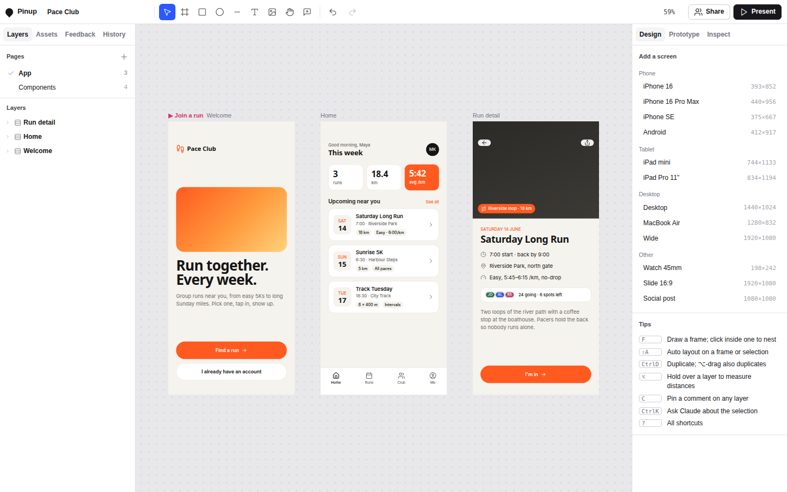

*Figure 1 — Pinup with the example file loaded. Left rail: pages and the layer tree. Centre: three phone frames on the canvas; the pink label "▶ Join a run" marks the start of a prototype flow. Right rail: the Design panel with no selection shows frame presets and tips. Fonts appear as fallbacks because the test harness blocks Google Fonts.*

## 2. The Artifact runtime that Pinup is written against

Pinup cannot be understood without the platform it runs on, so this section introduces it before anything else. A claude.ai Artifact is a web page published from a conversation. The viewer hosting the page can grant it **capabilities**: named objects that give the page access to services it could not reach as static HTML. A page obtains a capability by calling `window.claude.use(name)`, which resolves to an object or to `null` when the capability is unavailable. Pinup wraps that call once and caches the promise:

```js
const CAPS = {};
function cap(name) {
  if (!(name in CAPS)) CAPS[name] = (window.claude && typeof window.claude.use === 'function')
    ? Promise.resolve(window.claude.use(name)).catch(() => null)
    : Promise.resolve(null);
  return CAPS[name];
}
```

Every feature that depends on a capability checks for `null` and degrades. That rule is the reason Pinup also runs as a plain local HTML file, which the test suite relies on. The capabilities Pinup uses, and the calls it makes on each, are listed below. The call shapes are taken from Pinup's code and from `tests/mock.js`, which implements the same surface locally.

| Capability | Calls used | What Pinup does with it |
|---|---|---|
| `db` | `doc(path).set/delete/onSnapshot/acquire`, `collection(path).onSnapshot` with `docChanges()` | Stores the file, layers, feedback, history, and the inbox; receives live changes from other viewers and from Claude. `acquire` takes a short lease on a document. |
| `room` | `presence(payload)`, `onPeers(handler)`, `canSendToClaudeSession()`, `sendToClaudeSession(data, {deliver})` | Publishes what each tab is looking at; shows avatars; hands a selection or a feedback list to the conversation beside the page. |
| `user` | `me()`, `canEdit()`, `can('data.write')`, `profiles(ids)` | Identifies the viewer, decides between editor, contributor, and read-only modes, and resolves names for avatars and feedback authors. |
| `comments` | `customAnchors({mode, threads, reveal, composing, move})` returning a controller with `compose`, `placed`, `areas` | Lets the platform's comment threads be pinned to layers using Pinup's own anchor strings. |
| `sample` | `sample(messages, {tools, signal, onText, cache})` | Runs Claude inside the page with Pinup's own tool definitions. |
| `downloads` | `save({filename, data})` | Saves exports; when absent, text is copied to the clipboard instead. |
| `assets` | `upload(file)` | Stores dropped images; when absent, images are downscaled into JPEG data URLs that fit a layer document. |

Two terms from this table recur throughout the report. A **document** is one JSON object at a path such as `nodes/abc123`; a **collection** is the set of documents under a prefix such as `nodes`. A snapshot listener on a collection receives the initial documents and then every addition, modification, and removal as a list of `docChanges()`.

## 3. The data model

### 3.1 One document per layer

A Pinup file is a tree of **nodes**. Each node is one layer: a frame, rectangle, ellipse, line, text, icon, SVG vector, or component instance. The file-level data — the name, the list of pages, and the tokens — lives in a single document. The database layout is documented in a README comment at the top of `body.html`, which is addressed to Claude as much as to human readers:

```text
meta/file           { name, pages:[{id,name}], tokens:{ colors:{<id>:{name,light,dark}},
                      type:{<id>:{name,font,size,weight,lh,ls}} }, v:1 }
nodes/<id>          one doc per layer
inbox/<id>          HTML or a step for the first open editor tab to apply
feedback/<id>       a review item
log/<id>            one history step with before/after for every changed layer
```

The decision to store one document per layer, rather than the whole file in one document, has three consequences. Concurrent edits to different layers never overwrite each other, because each write replaces only its own document. Claude can read one page by querying `nodes` where `page == <pageId>` and can edit a single layer without rewriting the file. And the size limit on a document bounds a layer rather than the file, which matters for images (section 4.4).

The tree is expressed by a `parent` field on each node (null for a top-level frame on the canvas) and a `z` field that orders siblings, ascending from bottom to top. There is no children array. The client derives children by grouping all nodes by parent key and sorting by `z`:

```js
function pkey(n) { return n.parent ? n.parent : 'page:' + n.page; }
function index() {
  if (_kids) return _kids;
  _kids = new Map();
  for (const n of S.nodes.values()) { const k = pkey(n); (_kids.get(k) || _kids.set(k, []).get(k)).push(n); }
  for (const a of _kids.values()) a.sort((p, q) => p.z - q.z || (p.id < q.id ? -1 : 1));
  return _kids;
}
```

The index is a cache cleared by `invalidate()` after every change. Storing only the parent pointer means that moving a layer is a change to one document, not to two parents' child lists, which again keeps concurrent edits independent.

### 3.2 The node schema

The node schema is small enough to state completely. The table groups fields by purpose.

| Group | Fields | Notes |
|---|---|---|
| Identity and tree | `id`, `type`, `page`, `parent`, `z`, `name` | `type` is one of `frame`, `rect`, `ellipse`, `line`, `text`, `icon`, `svg`, `instance`. |
| Geometry | `x`, `y`, `w`, `h`, `rot` | Relative to the parent. For hug or fill sizing, `w`/`h` hold the last measured value. |
| State | `visible`, `locked`, `opacity` | |
| Paint | `fills`, `stroke`, `radius`, `effects` | `fills` is a bottom-to-top list of `{t:'solid', c, o}`, `{t:'gradient', css}`, or `{t:'image', src, fit}`. A colour `c` is either `#RRGGBB` or `$tokenId`. |
| Layout | `layout`, `sw`, `sh`, `abs` | `layout` is `{dir, gap, pad:[t,r,b,l], align, justify, wrap}` or null. `sw`/`sh` are `fixed`, `hug`, or `fill`. `abs` takes a child out of its parent's auto layout. |
| Frame options | `clip`, `group`, `mode`, `component`, `flow` | `mode` is `light` or `dark` and selects token values for the subtree. `group: true` makes a frame behave as a group. |
| Text | `text`, `font`, `size`, `weight`, `lh`, `ls`, `talign`, `italic`, `deco`, `tcase`, `tstyle` | `lh` at or below 4 is a multiplier; above 4 it is pixels. `tstyle` binds a text style token. |
| Icon / vector | `icon`, `svg`, `iw`; `markup` | Icons are Lucide names with inner SVG markup in a 24×24 view box. |
| Instance | `of`, `ov` | `of` is the main component's id; `ov` maps main-descendant ids to overrides of `text`, `fills`, `visible`, or `icon`. |
| Prototype | `link: {to, on, tr, dur}` | `to` is a frame id or `'back'`; `tr` names one of eight transitions. |

Any writer may omit fields. Every node passes through `norm()` when it enters the client, whether from the database, from the importer, from Claude's tools, or from a paste. `norm()` fills defaults by type (white fill for frames, `#D9D9DE` for shapes, Inter 16/1.4 for text), coerces numbers, clamps opacity, normalises layout padding to four values, and converts unknown types to rectangles. The comment above it states the purpose: "so data written by anyone (people, Claude, older versions) renders." This is the single most important robustness rule in the code. Claude writes documents without seeing the client's internal invariants, and `norm()` is what makes a partially specified document safe.

A minimal example makes the schema concrete. The following document, written by Claude to `nodes/k9TzQ`, is a complete and valid layer:

```json
{ "type": "text", "page": "p1", "parent": "Ns6rEQC2JB", "text": "This week",
  "font": "Space Grotesk", "size": 22, "weight": 700, "fills": [{ "t": "solid", "c": "$ink" }] }
```

`norm()` adds `x: 0, y: 0, z: 0, w: 0, h: 0`, `sw: 'hug'`, `sh: 'hug'`, `lh: 1.4`, `ls: 0`, `talign: 'left'`, and a name taken from the text. Because the parent has auto layout, the zero position is irrelevant, and because sizing is `hug`, the zero size is replaced by the measured size after the first render.

### 3.3 Sizing: fixed, hug, fill

Three sizing modes per axis decide how a node's width and height are computed. **Fixed** uses `w` or `h`. **Hug** sizes the node to its content; it is only meaningful for text and for frames with auto layout, and `cssFor` silently downgrades it to fixed elsewhere. **Fill** takes the remaining space in the parent's auto layout; outside an auto layout parent it also falls back to fixed. These rules translate directly into flexbox, as section 6.2 shows.

## 4. Persistence and synchronisation

### 4.1 The write queue

Every local change ends in `queueWrite(id, data)`, which schedules the document for writing. The queue has three properties worth understanding.

First, writes coalesce per document. If a layer is already pending, the new data replaces the pending data and the entry is marked dirty; there is never more than one queued write per layer. Dragging a layer for two seconds therefore produces a handful of writes, not one per pointer event.

Second, at most twelve writes are in flight at once (`MAX_INFLIGHT = 12`). When a write finishes and its entry was marked dirty in the meantime, it is re-queued with the latest data.

Third, a pending document shields the local state from echoes. When a snapshot arrives for a document that is still pending locally, it is ignored:

```js
function applyRemoteNode(id, data) {
  if (DB.pending.has(id)) return; // our newer local state wins until our write lands
  ...
}
```

Without this rule, a slow round trip would briefly roll a dragged layer back to an earlier position when the database echoed an older write. With it, the local client is authoritative for the documents it is currently writing, and the database is authoritative for everything else. The model is last-writer-wins per document. Two people editing the same layer at the same moment will see one of the two edits survive; two people editing different layers never conflict.

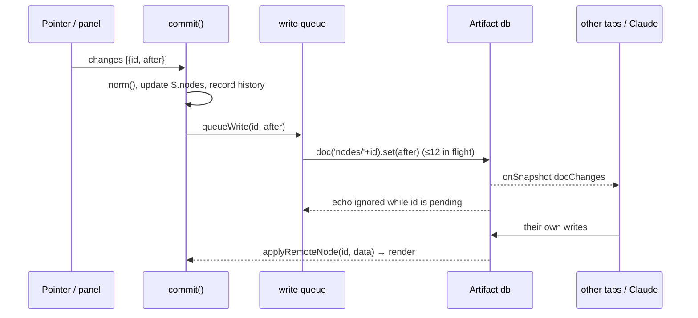

### 4.2 Error handling as a permission signal

The database reports failures with codes, and Pinup maps each code to a behaviour rather than a generic error. A write rejected with `not_granted`, `revoked`, or `capability_disabled` switches the page into read-only mode with the explanation "You can view, present and comment." A `quota_exceeded` code asks the user to delete layers or images. An `invalid_argument` code whose message mentions size names the most likely cause: an image too large for one document. `resource_exhausted` and `unavailable` are retried with linear backoff up to five times, after which the user is told to keep the tab open. History writes are best-effort and their failures are ignored. Feedback writes that fail with `invalid_argument` disable the feedback tool for that viewer, because the most likely reason is that the viewer may not write data at all.

### 4.3 Loading

`initData()` opens five snapshot listeners: `meta/file`, `nodes`, `feedback`, `log`, and `inbox`. The page is considered loaded when both the file document and the first nodes snapshot have arrived, or after eight seconds, whichever comes first. If the file document does not exist yet — an empty database — the first node written also writes the file document, so that Claude can always read the page list:

```js
const _qw = queueWrite;
queueWrite = function (id, data) {
  if (DB.kind === 'remote' && !DB.fileExists && id !== '__file') { DB.fileExists = true; _qw('__file', S.file); }
  return _qw(id, data);
};
```

When no `db` capability exists, Pinup uses a local backend with the same shape: the whole file, nodes, feedback, and the last 150 history entries are saved to `localStorage` under `pinup.local.v1`, debounced by 250 ms. Inside the Artifact viewer this fallback displays a toast saying that changes stay in this browser.

### 4.4 Images

An image dropped on the canvas becomes a rectangle with an image fill. If the `assets` capability exists, the file is uploaded and the fill stores the returned URL. Otherwise the image is drawn into a canvas at most 1,200 pixels on its longest side and encoded as JPEG, lowering quality in steps from 0.85 until the data URL is under 180,000 characters, and finally downscaling if quality alone is not enough. The 180,000-character target exists because the data URL lives inside a single layer document.

## 5. History: undo, steps, and revert

Pinup has two related history mechanisms, and the difference between them is the key to understanding review in Pinup.

### 5.1 Local undo

Every change goes through `commit(changes, opts)`. A change is `{id, after}`, where `after` is the full new node, or null to delete. `commit` captures the `before` value, normalises `after`, updates the in-memory map, queues the write, marks the render dirty, and records an undo entry. Undo and redo apply the stored `before` or `after` values with `history: false`, so they are themselves ordinary writes to the database.

Entries merge in three situations. Inside a transaction (`begin`/`end`, or `txn(label, fn)`), all changes collect into one entry; loading the example file is one transaction. With a `group` key, consecutive commits sharing the key merge; every tool call Claude makes during one prompt shares the group `claude-<n>`, so one request is one undo step. With a `coalesce` key, commits with the same key less than 1.2 seconds apart merge; numeric fields in the inspector use this so that scrubbing a value is one step. The undo stack holds 200 entries.

### 5.2 Shared steps

Local undo belongs to one tab. Review needs something different: a history that everyone sees, in which Claude's changes are labelled and can be undone by someone who did not make them. Each undo entry therefore also gets a `logId`, and 450 ms after its last modification the entry is written to `log/<logId>`:

```json
{ "t": 1761672012345, "by": "claude", "label": "#1 More space between run cards",
  "feedback": "Fmvsmclhaseep", "revertOf": null, "page": "p1", "count": 1,
  "names": ["Upcoming"],
  "changes": [{ "id": "83vCCmagxe", "before": { "...": "layout.gap 12" }, "after": { "...": "layout.gap 20" } }] }
```

The `by` field is `claude` when the change was made while `CUR_META.by === 'claude'`, which is set during in-page fixes and during inbox steps. Documents larger than 200,000 characters keep their metadata but drop `changes` and are marked `big`; they appear in History but cannot be reverted. The log is pruned to the newest 400 entries, with a 50-entry margin before pruning starts.

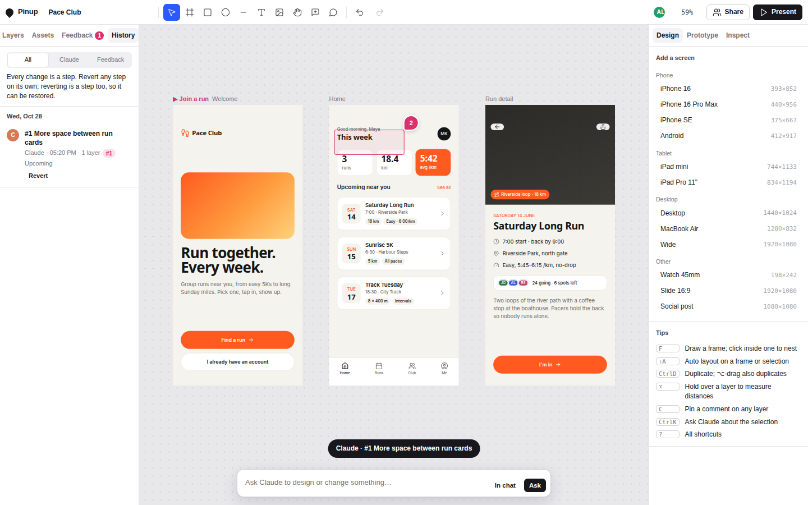

*Figure 2 — The History tab after Claude applied a step from the conversation. The entry names the feedback item it resolves (`#1`), the actor, the time, and the layer it changed. The toast at the bottom announces the step as it lands.*

### 5.3 Reverting one step out of order

Reverting a step means writing each changed layer's `before` value back. The problem is that later steps may have changed the same layers. Pinup detects this by comparing each layer's current value with the step's `after` value. The comparison must ignore key order, because a database round trip can reorder object keys, so it uses a canonical serialisation:

```js
function stable(v) {
  if (Array.isArray(v)) return '[' + v.map(stable).join(',') + ']';
  if (v && typeof v === 'object') return '{' + Object.keys(v).filter(k => v[k] !== undefined).sort()
    .map(k => JSON.stringify(k) + ':' + stable(v[k])).join(',') + '}';
  return JSON.stringify(v === undefined ? null : v);
}
function logConflicts(it) { return (it.changes || []).filter(c => !stableEq(normFor(c.id, curOf(c.id)), normFor(c.id, c.after))); }
```

If no layer conflicts, the revert proceeds. If some do, the History row shows how many of the step's layers changed afterwards and offers three choices: **Revert anyway** (write all `before` values), **Only unchanged** (revert only the layers nobody touched since), and **Cancel**. A revert is itself a step whose `revertOf` points at the original; the original receives `revertedBy`. The History row of a reverted step then offers **Restore**, which reverts the revert. Reverting a step that closed a feedback item reopens that item.

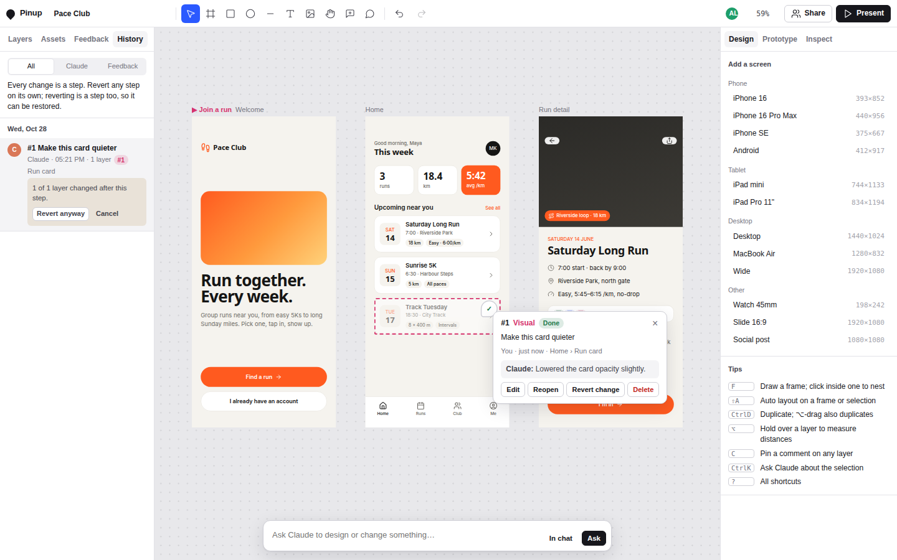

*Figure 3 — Reverting a step whose layer was changed afterwards. The row reports "1 of 1 layer changed after this step" and offers to revert anyway or cancel. The feedback card on the canvas shows Claude's reply and the item's own "Revert change" action.*

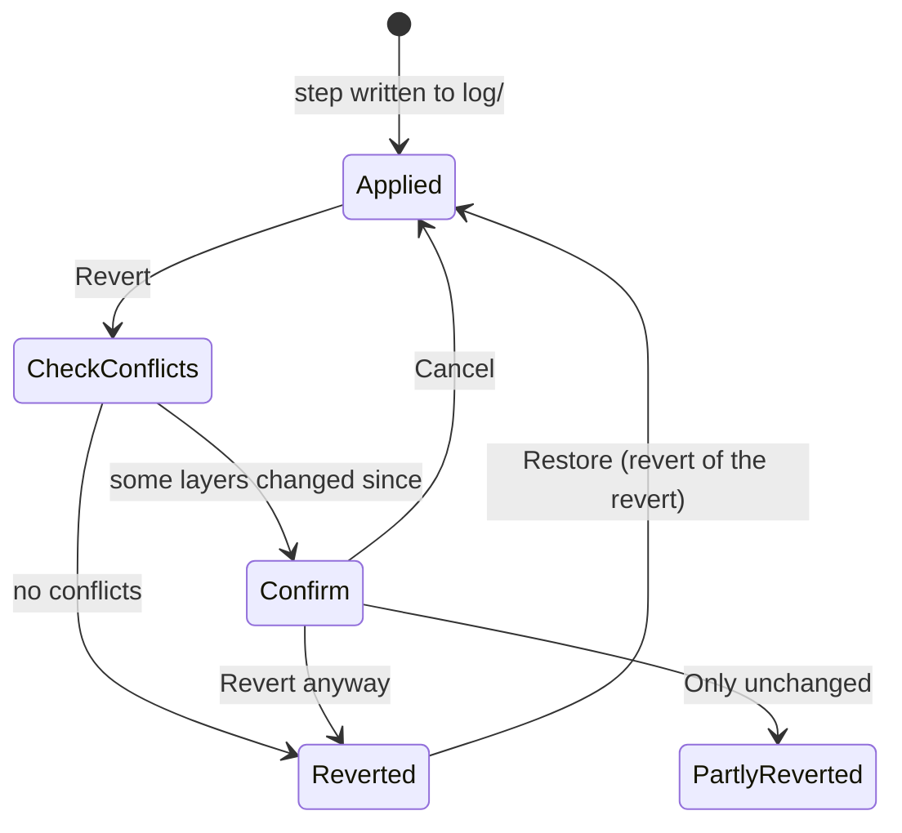

## 6. Rendering

### 6.1 The canvas is DOM

Pinup renders every layer as an absolutely or relatively positioned `<div>` inside `#world`, which carries one CSS transform for pan and zoom:

```js
$('#world').style.transform = `translate(${v.x}px, ${v.y}px) scale(${v.z})`;
```

Choosing DOM over a `<canvas>` bitmap has decisive advantages for this application. Text layout, font loading, flexbox, gradients, shadows, backdrop blur, and SVG are all done by the browser, so Pinup does not reimplement a layout engine. Hit testing uses `document.elementsFromPoint`. Measurement of hug and fill sizes uses `getBoundingClientRect`. And the same element tree that is displayed is the one exported, so export fidelity follows from rendering fidelity. The cost is performance on very large files, since every layer is a live element.

### 6.2 `cssFor`: one function from node to CSS

`cssFor(n, P, o)` takes a node, its parent, and options, and returns a plain object of CSS properties. It is used for the canvas, the prototype player, the inspect panel's CSS, and every exporter. The core of its layout logic is short:

```js
const L = P && P.layout && !n.abs ? P.layout : null;   // am I in auto layout?
if (!L) { c.position = 'absolute'; c.left = px(n.x); c.top = px(n.y); }
else {
  const row = L.dir === 'row';
  const ms = row ? sw : sh, cs = row ? sh : sw;      // main-axis and cross-axis sizing
  if (ms === 'fill') { c.flex = '1 1 0px'; c['min-' + (row ? 'width' : 'height')] = '0'; }
  else { c['flex-shrink'] = '0'; if (ms === 'fixed') c[row ? 'width' : 'height'] = px(...); }
  if (cs === 'fill') c['align-self'] = 'stretch';
  else if (cs === 'fixed') c[row ? 'height' : 'width'] = px(...);
}
if (n.type === 'frame' && n.layout) {
  c.display = 'flex'; c['flex-direction'] = l.dir === 'row' ? 'row' : 'column';
  if (l.gap === 'auto') c['justify-content'] = 'space-between'; else c.gap = px(l.gap);
  c.padding = l.pad.map(px).join(' ');
}
```

The mapping is one-to-one: an auto layout frame is a flex container; a child's main-axis fill is `flex: 1 1 0`; a cross-axis fill is `align-self: stretch`; hug means no size is set; gap `auto` means `space-between`. Strokes are drawn with `outline` and a negative `outline-offset`, which places them inside the box without affecting layout, matching the schema's "drawn inside" rule. Multiple fills become stacked `background` layers, with solid fills expressed as single-colour linear gradients so they can be stacked.

### 6.3 Tokens and modes

A colour token has an id, a name, and a light and a dark value. A fill that references a token stores `$id`. `paintCSS` turns that into `var(--tk-id, <fallback>)`, and `updateTokenStyle` writes one stylesheet that defines each variable twice:

```css
#world, #world .m-light { --tk-paper:#F5F3EE; --tk-ink:#151514; … }
#world .m-dark          { --tk-paper:#111110; --tk-ink:#F2F0EA; … }
```

A frame with `mode: 'dark'` receives the class `m-dark`, and every token-bound colour beneath it switches through normal CSS inheritance of custom properties. A design can therefore show a light and a dark version of the same screen side by side with no duplicated colour values. The same stylesheet is generated for the prototype player (`#pvclip`) and for off-screen export roots (`.tokroot`).

### 6.4 Components and instances

A main component is a frame with `component: true`. An instance is a node with `type: 'instance'` and `of: <mainId>`. Rendering an instance means rendering the main's subtree with the instance's own geometry (`instRoot`) and applying overrides to individual descendants (`withOv`): `ov[mainChildId]` may replace text, fills, visibility, or icon. Overrides propagate through nested instances by merging the outer instance's `ov` with the inner one. The rendered elements carry both `data-nid` (the instance id) and `data-mid` (the main descendant id), which is how selection, prototype links, and feedback pins can address a part of an instance.

Because instances read their main at render time, a change to a main component must re-render every instance of it on every page. The dirty tracker handles this by escalating to a full re-render whenever the changed node is, or is inside, a component.

### 6.5 Incremental rendering

A full rebuild of `#world` would discard text editing state and is wasteful for small edits. `markDirty(id, before, after)` instead records the top-level frame containing the changed node in `DIRTY.roots`. `renderNow`, scheduled once per animation frame, rebuilds only those top-level subtrees and inserts each in its correct z position. Three cases force a full rebuild: a change to the file document (pages or tokens), any change inside a component, and the initial load. The subtree that contains a layer being text-edited is skipped and kept dirty until editing ends.

## 7. The canvas as an interaction surface

### 7.1 Coordinates

Three coordinate systems are in play. **Client** coordinates come from pointer events. **Stage** coordinates are relative to the canvas element. **World** coordinates are the design's own units. Two functions convert between them, and zooming about a point keeps that point's world position fixed:

```js
function toWorld(cx, cy) { const r = stageRect(), v = view(); return { x: (cx - r.left - v.x) / v.z, y: (cy - r.top - v.y) / v.z }; }
function zoomAt(z, sx, sy) { const v = view(); const wx = (sx - v.x) / v.z, wy = (sy - v.y) / v.z;
  v.z = clamp(z, 0.02, 64); v.x = sx - wx * v.z; v.y = sy - wy * v.z; applyView(); }
```

Each page remembers its own view in `localStorage`.

### 7.2 Hit testing and what a click selects

`chainAt(cx, cy)` asks the browser which elements are under the pointer and walks from the topmost element up to `#world`, collecting node ids. The result is a **chain**, deepest first. Locked nodes are removed together with their descendants.

Which entry of the chain a click selects is a design decision rather than a geometric fact, and `pickFrom` encodes the conventions of screen design tools. A modifier-click selects the deepest layer. If any layer in the chain is already selected, it stays selected, so a drag starts from the current selection. If a sibling of the current selection is in the chain, the sibling is chosen, so clicking across a row of cards moves between cards. Otherwise a click on a top-level screen selects the screen's direct child rather than the screen, because the screen itself is normally selected through its label. Double-click descends one level, and on a text layer starts editing.

### 7.3 Moving, snapping, and dropping into auto layout

A move begins by lifting the selected elements into a temporary `#dragLayer` at the same world positions. This removes them from their parent's clipping and from flexbox flow, so the pointer moves them freely. During the drag:

- Snapping compares the dragged box's left, centre, and right (and top, middle, bottom) with the same values of every sibling and of the parent, within 6 screen pixels. The nearest match wins and draws a guide.
- Shift constrains to the dominant axis; holding the modifier disables snapping; Alt at the start duplicates in place and drags the copy.
- The frame under the pointer becomes the drop target. If the target has auto layout, `insertionFor` finds the insertion index by comparing the pointer with each child's midpoint along the layout axis and draws an insertion line between children.

On release, a drop into an auto layout frame rewrites the target's children with new `z` values that place the dragged layers at the insertion index. A drop onto a plain frame reparents with coordinates converted to the new parent. A layer leaving auto layout keeps its measured size, and its fill sizing becomes fixed. Groups whose children moved are refitted to their new bounds.

### 7.4 Prototype wiring on the canvas

With the Prototype tab active, a selected layer shows a handle on its right edge. Dragging from the handle to a frame creates a `link`; existing links are drawn as curves in the overlay, and links to `back` are drawn as a short stub with a "← Back" tag. Figure 4 shows both in dark mode.

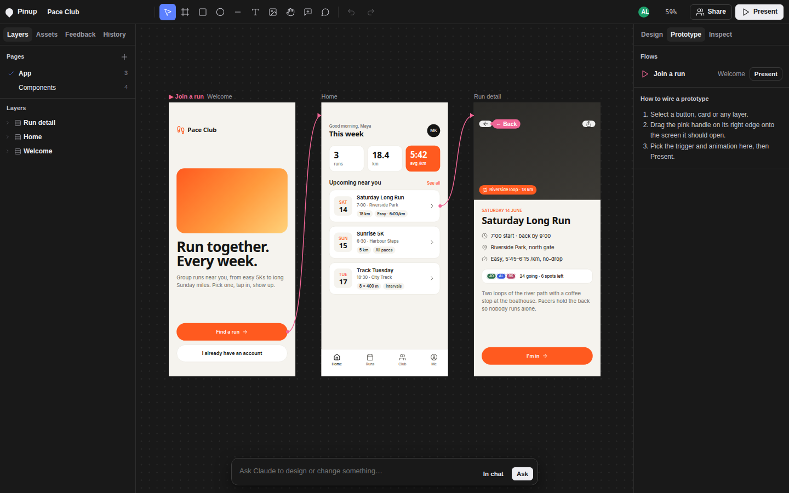

*Figure 4 — The Prototype tab in dark chrome. Curves connect the Welcome button to Home and a run card to Run detail; the Run detail back button carries a "← Back" tag. The panel lists the flow "Join a run" with a Present button.*

## 8. HTML as Claude's design language

### 8.1 Why HTML

The most consequential design decision in Pinup is how Claude creates designs. Claude could write node documents directly, but the schema has many fields, the geometry must be consistent with auto layout, and a full screen is dozens of nodes. HTML with inline styles is a language Claude already writes well, it has a layout engine attached (the browser), and its layout model, flexbox, is the same as Pinup's auto layout. Pinup therefore accepts HTML and converts it into layers.

### 8.2 Conventions

The importer understands a small set of attributes, documented in the README comment and repeated in the in-page Claude's brief:

| Attribute | Effect |
|---|---|
| `data-name="Card"` | Layer name. Falls back to `aria-label`, then a short `id`, then the tag (`Button`, `Nav`, `List`, …). |
| `data-icon="arrow-right"` | An icon layer from Lucide, coloured with the CSS `color`. |
| `data-component="Button/Primary"` | Makes this element a main component. |
| `data-instance="Button/Primary"` | Places an instance; descendants with a matching `data-name` and different text become overrides. |
| `data-link="Run detail"` / `"back"` | Prototype link to the frame with that name. `data-transition` chooses the animation. |
| `data-flow="Onboarding"` | Marks a root frame as the start of a flow. |
| `var(--tk-<id>)` | Uses a colour token. Literal colours that equal a token's light value are also bound to it. |

### 8.3 The conversion

`importHTML(html, opts)` works in four stages.

1. **Sanitise.** `sanitizeHTML` parses the string, removes `script`, `iframe`, `object`, `embed`, `base`, `meta`, and non-Google-Fonts `link` elements, strips `on*` attributes and `javascript:` URLs, and extracts `<style>` blocks.
2. **Lay out.** The sanitised document is written into an off-screen `<iframe sandbox="allow-same-origin">` (no `allow-scripts`) whose body width is the target width: the replaced layer's width, the parent's content width, a `width:` found in the HTML, or 390. The document defines every token as a CSS variable. The importer waits for fonts, up to 2.5 seconds.
3. **Convert.** `convert(el, ctx, z)` walks the laid-out DOM and creates nodes from computed styles and bounding boxes. Elements that hold only inline text become text layers; a text element with padding or a background becomes a frame with auto layout around a text layer, which is how buttons and badges come out as editable layers. `` becomes a rectangle with an image fill; inline `<svg>` becomes a vector with `currentColor` resolved. Borders of equal width become a stroke; unequal borders become inset shadows. Percent radii become pixels, and radii of at least half the box become 999.
4. **Recover layout.** A container with `display:flex` becomes an auto layout frame with direction, gap, padding, alignment, and `space-between` mapped back. A container whose children are block elements stacked vertically with equal gaps also becomes a vertical auto layout frame, because that is what a person would have meant. Anything else keeps absolute positions.

After conversion, links are resolved by frame name against both the imported batch and the existing file, and a `replace` import gives the new root the replaced node's id. The last rule matters: comments, feedback, and prototype links that point at the replaced layer keep working.

The example file is built with the same importer. `11-templates.js` contains the Pace Club tokens and four HTML strings — the components page and three screens — and `loadExample()` imports them inside one transaction. The comment states the intent: "Written as HTML on purpose: it goes through the same importer Claude uses, so the example shows the conventions." The example is therefore also an integration test of the importer and a reference for Claude.

## 9. Three ways Claude participates

Claude can act on a Pinup file through three separate channels. They differ in where the model runs, how it receives context, and how its changes are applied.

| Channel | Where Claude runs | Context | How changes arrive | Capability |
|---|---|---|---|---|
| Prompt bar ("Ask") | Inside the page | `fileContext()` JSON plus a brief | Tool calls executed in the page | `sample` |
| Conversation | In the chat beside the page | Presence, a sent selection or feedback list, and database reads | Documents written with ArtifactData: `nodes/`, `inbox/` HTML, or `inbox/` steps | `db`, `room` |
| Comments | In the chat | Comment threads read with the comments tool | As for the conversation, plus thread replies | `comments` |

### 9.1 The prompt bar and its tools

When `sample` is available and the viewer can edit, the prompt bar at the bottom of the canvas runs Claude in the page. `runAsk()` builds one message from `CLAUDE_BRIEF`, the current file context (truncated to 60,000 characters), and the request; it keeps the last six messages of history; and it passes seven tools whose `execute` functions run against the live file.

| Tool | Purpose |
|---|---|
| `get_file` | Pages, screens on the current page, tokens, text styles, components, the selection as compact trees, and open feedback. |
| `get_nodes` | Compact trees for given ids, `box = [x, y, w, h]` relative to the parent, up to depth 8. |
| `write_html` | `importHTML` with `parent`, `replace`, `x`, `y`; returns the created ids and selects them. |
| `update_nodes` | Field updates filtered through an allow-list of 38 keys; an `icon` name also refreshes its SVG. |
| `delete_nodes` | Removes layers and their descendants. |
| `set_tokens` | Adds or replaces colour tokens and text styles. |
| `make_component` | Marks a frame as a main component. |

The brief is short and procedural: start with `get_file`; use `write_html` for new screens and `update_nodes` for small changes; write HTML with flexbox so it becomes auto layout; use the file's tokens; use real content, a 4/8 px spacing scale, accessible contrast, and 44 px touch targets; when asked for critique, change nothing. Every tool call made during one prompt shares the undo group `claude-<n>`, so one Undo removes the whole response. Suggestion chips above the input change with the selection ("Make a dark version", "Critique this screen", "Tighten the spacing").

### 9.2 The conversation and the inbox

The second channel connects Pinup to the Claude conversation in which the artifact is open. In one direction, the page tells Claude what the person is looking at. Each tab publishes a presence payload containing the file, page, frame, and the selected layers' names and ids, and the conversation receives it as context; the README comment explains that this is how "this" and "the selected card" can be resolved. The **In chat** button and the Share sheet send an explicit payload with `room.sendToClaudeSession`, either staged into the person's next message or sent immediately.

In the other direction, Claude writes to the database. It may write `nodes/<id>` directly, but the preferred route is the **inbox**. An inbox document carries HTML to import, or a **step**: an ordered list of operations linked to a feedback item.

```json
{ "kind": "step", "seq": 1, "feedback": "#1", "label": "More space between run cards",
  "reply": "Raised the gap between cards from 12 to 20px.",
  "ops": [{ "op": "update", "id": "83vCCmagxe", "data": { "layout": { "dir": "col", "gap": 20, "pad": [0,0,0,0] } } }] }
```

The supported operations are `update` (merge fields through the same allow-list), `set` (replace a node), `delete`, `html` (import), and `tokens`. Every open editor tab sees inbox documents through its snapshot listener, but only one may apply each. Pinup coordinates this with a lease:

```js
const lease = await DB.db.doc('inbox/' + job.id).acquire({ holder: S.me.peer, ttlMs: 30000 }).catch(() => ({ acquired: false }));
if (lease.acquired) { await applyStep(job.id, d); await ref.delete(); await sleep(500); }
```

The tab that acquires the lease applies the step inside one history group, records the resulting log ids on the feedback item, marks the item done with Claude's reply, deletes the inbox document, and waits half a second before taking the next one so that people watching can follow the changes. Steps are sorted by `seq`, so Claude can write a sequence of steps at once and they will land in order.

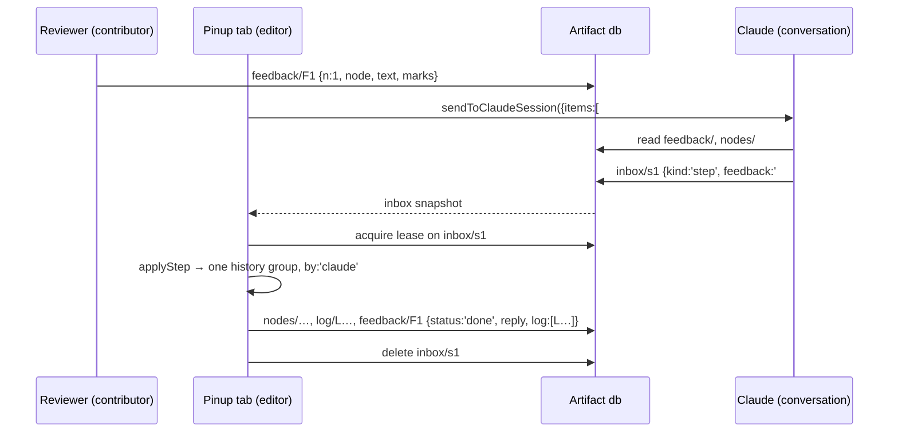

### 9.3 Comments

The third channel uses the platform's own comment threads, which commenters can use even when they cannot write data. `comments.customAnchors` lets Pinup decide what a comment is attached to. Pinup's anchors are strings of the form `"Home › Run card #83vCCmagxe@120,34"` or `"area Home #Ns6rEQC2JB@0,0,120,40"`: a readable label, then `#`, the node id, and an offset or rectangle in that node's coordinates. The platform stores the string; Pinup computes where each thread's pin should appear (`reportPins`) on every render and reports the positions with `placed`, returning null for anchors that are off-page or off-screen. Claude reads the same threads with its comments tool and parses the id after `#` to find the layer. The anchor is limited to 128 bytes, and long labels are shortened before the `#` so the id survives.

## 10. Feedback as data

### 10.1 The item

Comments are conversation; feedback items are tasks. A feedback item is a document in `feedback/`:

| Field | Meaning |
|---|---|
| `n` | Sequential number, shown as `#n` on the pin. |
| `text`, `cat` | What should change, and a category: visual, layout, copy, interaction, a11y, question. |
| `node`, `dx`, `dy` | The layer the pin is attached to, and the pin's offset in that layer's coordinates. |
| `area` | Alternatively, a rectangle in the layer's coordinates. |
| `marks` | Sketches: pen, highlighter, arrow, or box strokes, each a colour, width, and flat list of points in the same coordinates. |
| `status` | `open`, `doing`, `done`, or `wontfix`. |
| `by`, `at`, `reply`, `doneBy`, `log` | Author, time, the resolver's one-line reply, who resolved it, and the history steps that resolved it. |

Storing every coordinate relative to the pinned layer is what keeps pins and sketches attached when the layer moves or the screen is rearranged. When a pinned layer is deleted, `removeNodes` moves its feedback to the nearest surviving ancestor and records the original id in `was`.

### 10.2 The tool

The Feedback tool (N) has two gestures. A click pins the item to the layer under the pointer (Alt-click pins to its parent). A drag marks an area of the screen under it. Either gesture opens the composer beside the pin with category chips, a text box, and the sketch tools. While a sketch tool is active, dragging on the canvas draws marks into the draft; pen and highlighter collect points more than 2 screen pixels apart, arrows and boxes keep only start and end. Mark widths are divided by the zoom, so a mark drawn at 50 % zoom has the same on-screen weight as one drawn at 100 %. Ctrl/⌘+Enter posts.

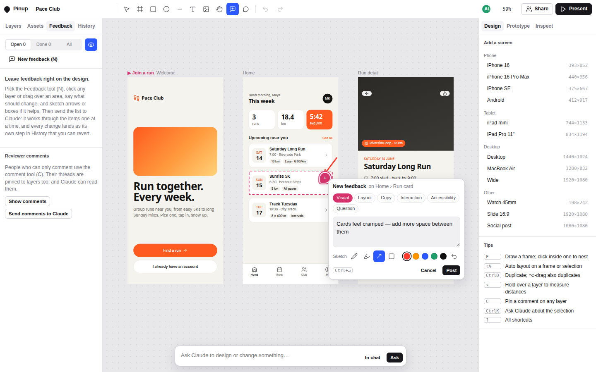

*Figure 5 — The feedback composer pinned to a run card, with an arrow sketched on the canvas. The dashed outline shows the pinned layer. Category chips, the sketch tools (pen, highlighter, arrow, box), and five colours sit below the text.*

Marks are rendered into an SVG layer (`#fbLayer`) that shares the world transform, so they scale with the design. Pins, area outlines, and the selected item's card are drawn in screen space in the overlay, so they stay readable at any zoom.

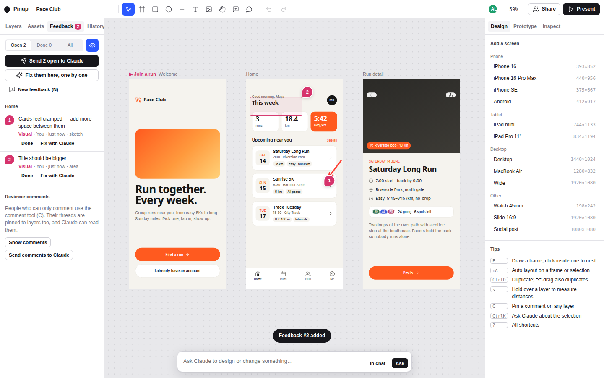

*Figure 6 — Two open items: #1 pinned to a run card with an arrow sketch, #2 an area over the "This week" header. The Feedback panel groups items by screen and offers "Send 2 open to Claude" (to the conversation) and "Fix them here, one by one" (the in-page Claude).*

### 10.3 Resolving items

Items can be resolved in three ways. A person can mark an item done. **Send to Claude** posts a compact list (`fbBrief`: number, category, text, layer and screen names, area, and a textual summary of the sketch such as `arrow 40,-60→10,-20`) to the conversation together with instructions for writing step documents; the payload is capped at about 3,600 characters and reports how many items did not fit. **Fix them here** runs the in-page Claude once per item, in number order, with a prompt that asks for "the smallest set of changes that fully addresses it, and nothing else" and with the screen (depth 5) and the pinned layer (depth 3) as context. Each item becomes its own history group, so each can be reverted alone. An item is marked done only if Claude's run produced at least one history step, or if the item was a question.

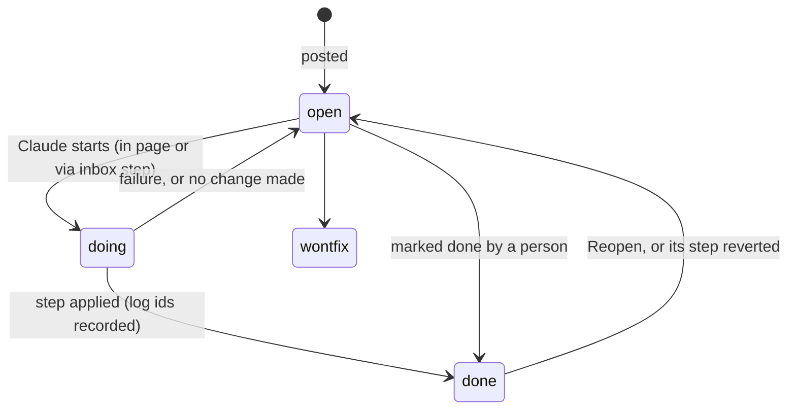

## 11. People, roles, and presence

Pinup distinguishes three roles using the `user` capability. An **editor** (`canEdit()` true) changes the design. A **contributor** can write data (`can('data.write')`) but not edit the design, and uses the Feedback tool. A **commenter** can only use comment threads. `setReadOnly()` hides drawing tools and undo, switches the right panel from Design to Inspect, and leaves Move, Hand, and Comment available.

The client-side checks are a convenience; the enforcement is in the database's access rules, declared when the artifact is published. Version 3 declares:

```json
{ "db": { "rules": [
  { "path": "nodes", "write": "admin" }, { "path": "meta",  "write": "admin" },
  { "path": "inbox", "write": "admin" }, { "path": "log",   "write": "admin" } ] } }
```

`admin` is the level of people with edit access. `feedback` keeps the default write level, `interact`, which is what a person given "can use" access holds. The consequence is the role split above: a contributor can create and update feedback items but cannot write a layer, the file, the history, or an inbox step. Restricting `inbox` matters as much as restricting `nodes`, because an inbox document is applied by an editor's tab and would otherwise be a way for a contributor to change the design indirectly. The session verified these rules against the live database by writing as level `interact`: a write to `nodes/ruleprobe` was refused ("no such artifact, collection, or document (or no access — the two are deliberately indistinguishable)"), and a write to `feedback/ruleprobe` was committed and then deleted.

The `room` capability lists peers. Pinup shows up to five avatars, with the Claude agent always shown as "Claude" in the colour `#D97757`. Clicking an avatar jumps to that person's page and zooms to their selection or cursor. Cursor positions are sent at most every 70 ms; the rest of the presence payload is debounced by 150 ms.

## 12. The prototype player

Present mode renders one frame at a time into `#pvclip`, scaled to fit, fit width, or 100 %. The start frame is, in order of preference, an explicit start, the screen containing the selection, a flow start on the current page, a flow start anywhere, or the first frame. A click is resolved by `linkFor`, which walks up from the clicked element to the first layer with a link; inside an instance it checks the instance's override layer, then the main component's layer, so a link set on a component applies to every instance. Following a link pushes the current frame on a back stack. Eight transitions are implemented with the Web Animations API: instant, dissolve, slide left/right/up, push left/right (both screens move), and scale. Going back plays the mirrored transition. A click on a non-interactive area flashes every hotspot for one second. `prefers-reduced-motion` turns every transition into an instant switch. A link ending in `#present` opens the file directly in the player, and `#comments` opens it in comment mode.

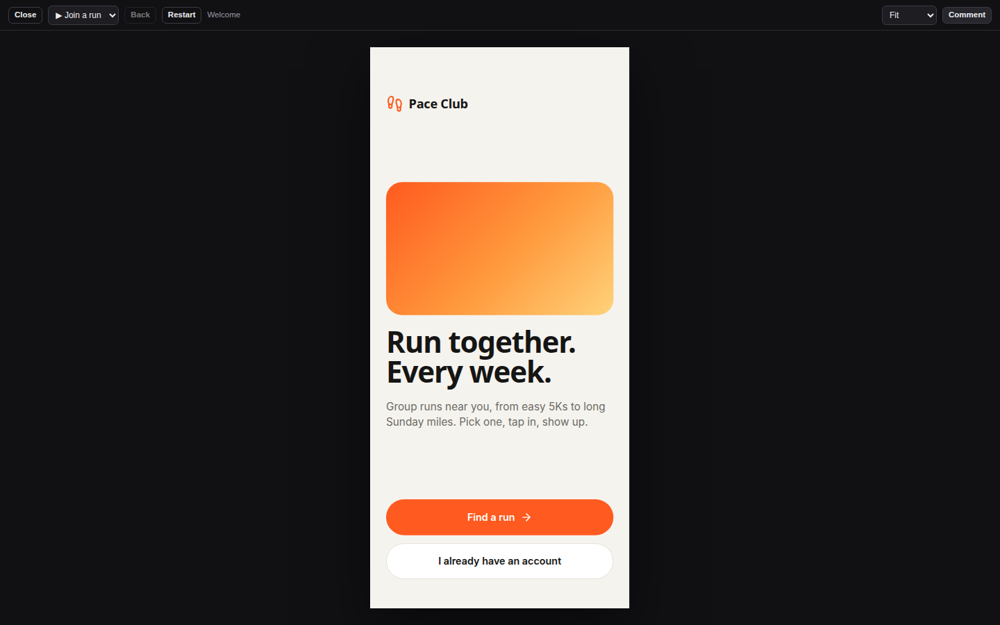

*Figure 7 — Present mode on the Welcome screen at the start of the "Join a run" flow. The bar offers Close, the flow and screen selector, Back, Restart, and the scale mode.*

## 13. Inspect, export, and handoff

The Inspect panel serves developers. With a layer selected it lists size, position, layout, radius, fills with token names and resolved hex values, stroke, text properties, and the link target. For text it computes the WCAG contrast ratio against the nearest opaque ancestor fill and labels the result "AA ✓", "AA large ✓", "below AA", or "fails AA". It then shows the layer's CSS, produced by `cssFor` with `export: true` so token colours become plain `var(--token-name)`, and the layer as React with Tailwind classes or as HTML.

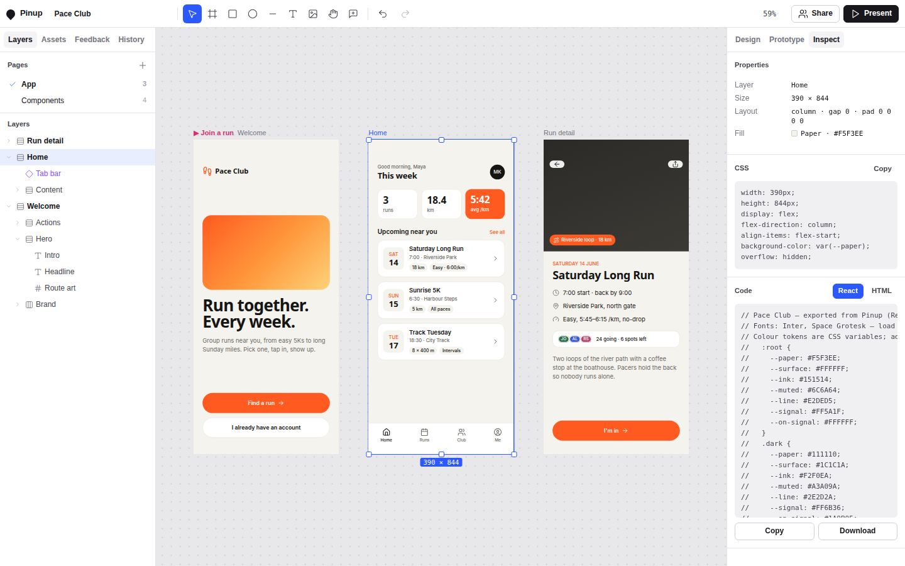

*Figure 8 — Inspect on the Home screen: properties, CSS, and the React export with token variables documented in the header comment.*

The exporters share one walk, `expand()`, which produces the tree as it renders, with instances expanded and overrides applied. The React exporter goes further: each main component becomes a function component whose props are derived from its text layers (named after the layer, or after a single-child parent), and instances become JSX elements passing their overrides as props. Tailwind classes are produced by `twFor`, which maps each CSS property to an arbitrary-value class such as `w-[390px]` or `bg-[var(--paper)]`.

With nothing selected, Inspect offers whole-file outputs: the **handoff** Markdown (build notes, colour tokens as CSS, a text style table, components as JSX, every screen with its interactions and JSX, open feedback, and open comment anchors), the page as standalone HTML, and the whole file as `.pinup.json`. The handoff is explicitly written for "Claude Code" as its reader. Image export renders a layer into an SVG `foreignObject`, inlines background images as data URLs, and rasterises it through a canvas for PNG at a chosen scale; if the browser refuses, it saves the SVG instead.

## 14. The user interface

### 14.1 Layout

The application is a CSS grid with three columns (248 px, flexible, 284 px) and two rows (a 44 px top bar and the workspace).

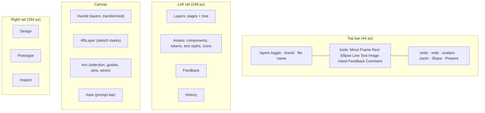

The canvas has three stacked layers. `#world` holds the design. `#fbLayer` holds sketch marks and shares the world transform. `#ov` is redrawn in screen space on every render and holds selection handles, the size badge, snap guides, insertion lines, drop highlights, measurement lines (hold Alt), prototype wires, frame labels, and feedback pins.

The chrome uses quiet greys so that colour belongs to the designs, with cobalt (`#2B59FF`) for selection and rose (`#D6336C`) for prototype wiring, as a comment in `head.html` records. The Arial interface type and thin hairline borders follow the black-and-white look of the requester's earlier artifacts, which the session read before designing. The dark theme's `#191919` was chosen later to match the claude.ai host's own dark background exactly, after a screenshot showed a visible seam between the two. All chrome colours are custom properties redefined for dark mode under `prefers-color-scheme: dark` and under an explicit `data-theme`.

### 14.2 Narrow screens

Below 860 px wide, the grid collapses to one column, both rails become off-canvas drawers toggled from the top bar, and the less common tools are hidden. The prompt bar shortens its placeholder.

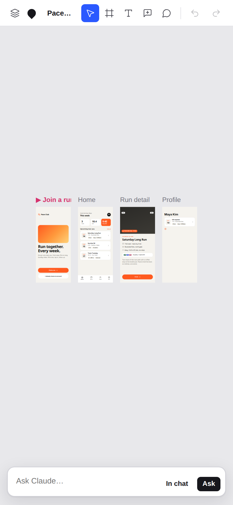

*Figure 9 — The phone layout (390 px viewport at 2×). The top bar keeps the layers toggle, Move, Frame, Text, Feedback, Comment, Undo, and Redo; both rails are hidden; the prompt bar remains.*

### 14.3 Keyboard

The single-key tools follow conventions familiar from design applications: V move, F or A frame, R rectangle, O ellipse, L line, T text, H hand, C comment, N feedback. With the modifier: Z/⇧Z undo and redo, D duplicate, G group, ⌥G frame selection, ⇧G ungroup, ⌥K make component, ⌥B detach instance, K focus the prompt bar, ↵ present, ] and [ reorder. ⇧A toggles auto layout, ⇧1 and ⇧2 zoom to fit all or the selection, Enter descends into children, ⇧Enter selects the parent, Tab cycles siblings, and arrow keys nudge by 1 or 10. Numeric fields accept arithmetic ("24*2", "+8", "50%") through a small recursive-descent parser rather than `eval`.

## 15. Build

The build concatenates and inlines. It reads `vendor/node_modules/lucide-static/icon-nodes.json`, converts each icon's element list into inner SVG markup, and writes:

```text
head.html + body.html
<script type="application/json" id="icons">{ …1,534 icons… }</script>
<script>(function () { 'use strict'; …01-util.js … 99-boot.js… })();</script>
```

It also writes `dist/check.js`, the concatenated JavaScript alone, which can be passed to `node --check` for a syntax check. The icon JSON is 328,005 bytes, 45 % of the 722,583-byte page; the JavaScript is about 351 KB and the stylesheet about 33 KB. Inlining the icon set was a consequence of the host rules: an Artifact may load scripts only from a few CDNs with pinned versions, and Pinup's icon picker needs every icon available by name, so the build resolves them once and embeds them. The icons are referenced from a JSON script element rather than a JavaScript literal so that they are parsed with `JSON.parse` on demand. All code runs inside one IIFE, and the modules share its scope, which is why they can call each other without imports.

## 16. Verification

The tests run the built page in Chromium through Playwright. Most of them inject `mock.js`, which implements `db` (documents in a `Map`, snapshot listeners, a 262,144-byte document limit, `acquire` that always succeeds), `room`, `user`, `comments`, `sample` (a fake model that calls `write_html` to add a Settings screen), and `downloads`. Several also seed the mock database from `seed.json`, the Pace Club file as 104 node documents and one file document. Google Fonts requests are aborted.

For this report the suite was re-run locally on 2026-10-28 against the exported `dist/pinup.html`, with Playwright installed into a scratch directory and pointed at a cached Chromium. The only changes to the scripts were the path to the built page and the browser executable.

| Script | What it exercises | Local result |
|---|---|---|
| `t1.js` | Empty state, loading the example (local backend) | 126 layer elements, no page errors |
| `t2.js` | Selection by click and double-click | Selection reaches `Headline` |
| `t3.js` | Text edit and undo, draw, move, drag into a frame, resize, assets, present | Passes through resize; fails at the final present step (see below) |
| `t4.js` | React/HTML export | Component code with props and token classes printed |
| `t5.js` | Database writes, presence, inbox import, a second viewer, comment anchors, the in-page Claude, undo of a Claude turn, sending to chat, handoff download | 106 documents written; the inbox import added a Profile screen; the mock Claude added Settings and one Undo removed it; a 22,660-character handoff was saved |
| `t6.js` | Phone viewport | Page scroll width 390 (no horizontal overflow) |
| `t7.js` | Auto layout, component, instance, detach, group, ungroup | Each panel transition as expected |
| `fb1.js` | Pin + arrow sketch, area feedback, a Claude step via `inbox/`, revert, restore | Gap 12 → 20 → 12 → 20; item #1 done → open |
| `fb2.js` | In-page "Fix with Claude", conflict on revert | Item done with reply; conflict "1 of 1 layer changed"; "Revert anyway" reopens the item |
| `final.js` | Dark chrome, Prototype tab | No errors |

`t3.js` fails because of a stale assumption in the script, not a defect in the page, and it failed at the same line in the original session, which did not re-run it. Earlier in the script a rectangle is dropped into the Home frame and stays selected; Present then starts at the screen containing the selection (Home), as section 12 describes, and the script's search for the Welcome screen's "Find a run" button finds nothing. A separate capture that opens Present with nothing selected starts at Welcome, follows the button, and arrives at "Home · 1 back".

One `fb1.js` line looks like a defect and is a timing artifact. After the revert, the script lists the log documents and shows only the original step, with `revertedBy: null`. The session noticed this and moved on without a fix. The code explains it: log documents are written 450 ms after an entry's last change (`logTouch`), and only that write marks the original's `revertedBy`, but the script waits 400 ms. The subsequent "Restore" succeeds, which requires the revert entry to exist.

What the suite does not cover is equally clear. It never runs against the real Artifact runtime, so lease contention between two editor tabs, real document size limits, and real model behaviour with the tool set are untested. The evidence of behaviour against the real `db` comes from the session's own database calls: the 105 seeded documents were written in three atomic batches and read back with one list per collection, and the access rules were probed at level `interact` as described in section 11. The agent's last report states the remaining gap directly: "Nobody has run it inside Claude yet." The only evidence of use in the real viewer arrived after that report: the presence payload attached to the person's final message shows the "Pace Club" file open with two open feedback items, one of them reading "YO".

## 17. What the design provides, and where it strains

The architecture has a small number of load-bearing decisions, and each has a cost.

| Decision | What it provides | Where it strains |
|---|---|---|
| One document per layer, parent pointers | Independent concurrent edits; Claude edits a layer without touching the rest | Last-writer-wins per layer; no merge of simultaneous edits to the same layer; a large paste is many writes |
| Local pending writes shadow remote echoes | No flicker during drags; simple model | A remote change to a layer that is pending locally is lost until the next remote change |
| DOM rendering through `cssFor` | Browser does text, flexbox, effects; export equals rendering | Very large files mean many live elements; rotation and measurement depend on the browser's layout |
| HTML as Claude's input | Claude writes a language it knows; flexbox maps to auto layout | Layout inference is heuristic: grids and absolutely positioned designs import as fixed positions |
| Steps through the inbox with a lease | Exactly one tab applies each step; each fix is one revertible entry; order by `seq` | Requires an open editor tab; with no editor present, steps wait in the inbox |
| Shared log with before/after | Revert of any step, by anyone, with conflict detection | Log documents can exceed 200,000 characters and lose revertability; log bounded to 400 entries |
| Capability checks everywhere | Runs locally, read-only, or without the model | Many code paths; behaviour differs between hosts in ways the mock cannot reproduce |

## 18. How the work was done

The session that produced Pinup is analysed in detail in the companion diary. This section summarises its shape.

The session ran on 2026-10-28 from 19:42:49 to 20:59:07 UTC (76 minutes of wall time, 62 minutes active) in a Claude Code cloud sandbox, with `claude-opus-5-5`. It began as a hand-off from a claude.ai chat: the first request linked three earlier artifacts by the same person (CC5 Godprompt Computer and two shop prototypes in a black-and-white, Arial, hairline style) and asked for "feature parity with tools like figma", critique "like in figma or paper", "an easy way for code handover", and a way "to invite others to leave comments etc that i then can give to you". The handed-off context was large enough that the session compacted automatically eleven minutes in, from 794,751 to 28,077 tokens, after only one source file had been written.

| Metric | Value |
|---|---|
| Wall span / active time | 4,578 s / 3,727 s |
| Person's messages | 6 (founding request, "bg needs to match" with a screenshot, research request, two mid-turn messages, export request) |
| Tool calls | 153: Bash 62, Read 19 (17 of them screenshots), Write 16, TaskUpdate 12, WebSearch 10, ArtifactData 9, TaskCreate 8, WebFetch 8, Artifact 6, Skill 2, ToolSearch 1 |
| Output tokens | 384,654 (deduplicated by message id) |
| Builds | 12; bundle 651 KB → 653 KB → 705 KB |
| Publishes | 3 versions of one artifact; 105 database documents seeded |

The work fell into three implementation phases. In the first (19:43–20:35), the agent studied the capability type definitions, settled the data model, wrote fourteen modules in 27 minutes, then spent six minutes in a build-test-fix loop with seven Playwright scripts and a hand-written mock runtime, and published version 1. In the second (20:44, 38 seconds), a screenshot showing the host's dark background led to a neutral `#191919` dark theme and version 2. In the third (20:45–20:57), a request for "a great annptation and comment tool" led to a survey of Figma, Frame.io, Zeplin, BugHerd, and others; two messages typed while that research was finishing — "the idea is that we can leave feedback very easily that we can then hand to you and you do it step by step but also we can reverse all small steps individually" and "thats what the log is for" — redirected the planned annotation layer into the feedback items, inbox steps, and revertible log described in sections 5, 9, and 10. Version 3 added the database access rules. The full reconstruction, including every failure and fix, is in [[DIARY - Pinup - Beat by Beat Through the Pinup Session]].

## Key points

- Pinup's data model is a flat collection of layer documents with parent pointers, normalised on every read by `norm()`. That one function is what lets people, Claude, and older versions write the same file safely.
- Rendering is DOM with one node-to-CSS function. Auto layout is flexbox, tokens are custom properties switched by a mode class, and every exporter reuses the same function, so the exported code matches what is on the canvas.
- Claude's main writing interface is HTML with a few `data-*` attributes. A sandboxed iframe performs the layout and the importer turns the computed result back into layers, recovering auto layout and component instances.
- Claude participates through three channels: in the page with tools (`sample`), from the conversation through the database and an inbox of step documents (`db`, `room`), and through layer-anchored comment threads (`comments`).
- Feedback items are tasks with coordinates relative to a layer, optional sketches, and a status lifecycle. Each resolution is one history step linked to the item, and any step can be reverted alone, with conflict detection that ignores key order.
- Every capability is optional. The same page runs as a local file with `localStorage`, read-only, without a model, or fully connected, which is also what makes it testable with a mock runtime.

## Evidence and sources

- Source: `/home/manuel/code/others/ramon/pinup-export/workspace/pinup/src/` (modules cited by filename in each section) and `build.js`; output `dist/pinup.html`.
- Tests: `/home/manuel/code/others/ramon/pinup-export/tests/`. Local re-run results in section 16 were produced on 2026-10-28 in a scratch copy with only the page path and browser path changed.
- Figures: screenshots from the session's own Playwright scripts, re-run locally (Figures 1–6, 8, 9), and one additional capture of Present mode with nothing selected (Figure 7). Fonts render as fallbacks because the scripts block Google Fonts.
- Published artifact: `https://claude.ai/artifact/UVDCAmJEaKWj1eeP9QHB9P`.
- Session transcript: `/home/manuel/code/others/ramon/pinup-export/transcript/e970d799-7411-5408-9781-e59b88b7f647.jsonl`, converted with `go-minitrace convert claude-code --source-session` and queried with `go-minitrace query run`. The analysis is in the companion diary.

## Related notes

- [[DIARY - Pinup - Beat by Beat Through the Pinup Session]] — the session that produced Pinup, reconstructed from the transcript.
- [[PROJECT REPORT - CC5 Godprompt Computer - Spore, a Live-App DSL Inside a Collaborative Desk - A Technical Deep Dive]] — another single-page system built on the same Artifact runtime on the same day.
- [[ARTICLE - Playbook - Self-Contained Go Wasm and JavaScript Browser Applications]] — constraints and patterns for self-contained browser applications.
