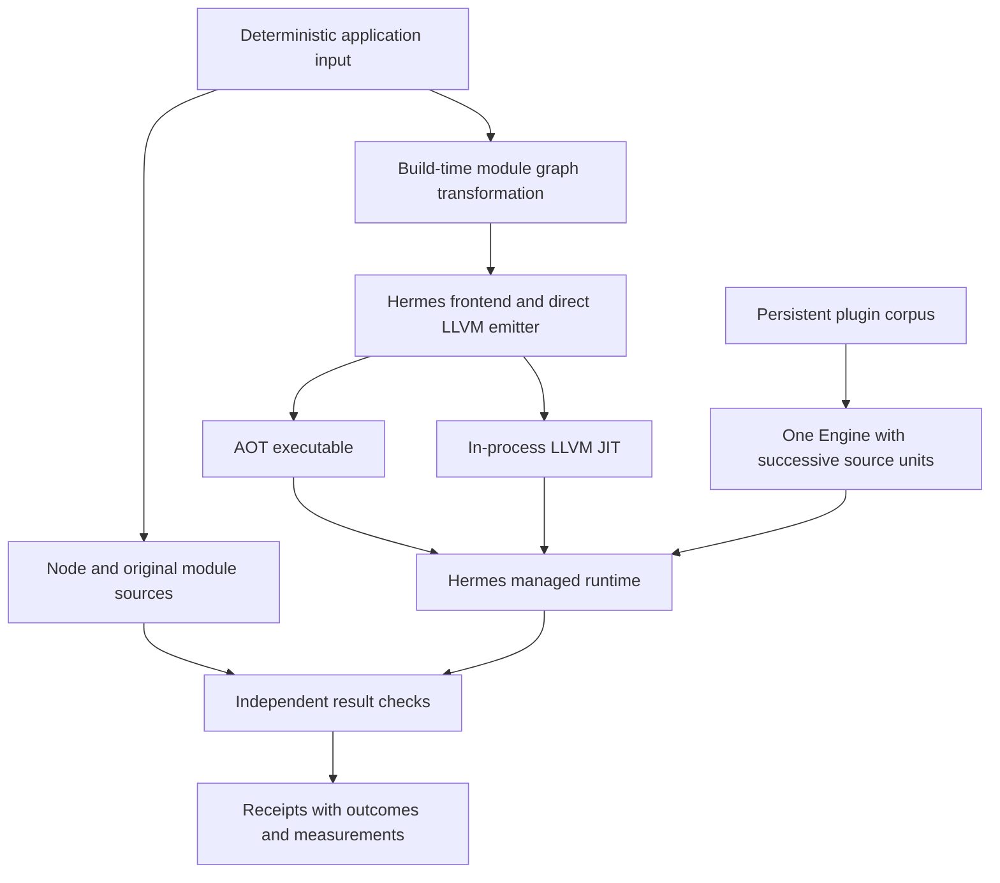

# Direct LLVM JavaScript: application qualification and backend limits

The native JavaScript engine now runs four application workloads: order processing, an asynchronous job queue, a persistent plugin host, and an archive application using the unmodified fflate library. The completed campaign produced 96 successful executions and nine explicit compilation rejections, with no unexpected failures remaining. The rejections all concern one unoptimized library module factory whose required root storage exceeds the backend's current admission bound.

This report explains what the applications establish, how their checks work, and what the remaining boundaries imply about the design. It distinguishes a compiler implementation choice that can be improved locally from a runtime contract whose modification requires coordinated changes. The distinction is essential when deciding whether the next step should be a focused allocator improvement, a new host feature, or a broader architecture change.

> [!summary]
> The application campaign is complete within its stated profile. The backend remains useful with its present ownership and execution model. Its immediate practical limit is conservative per-function root allocation; longer-term questions concern retained code, module registry lifetime, host scheduling, and portability. None of the observed results requires replacing LLVM or implementing a speculative optimizing JIT.

## Project status and evidence

The implementation is in `/home/manuel/code/wesen/2026-10-28--llvm-js`, at report checkpoint `d715f43`. Commit `dc4ca9d` introduced the four runnable workloads and comparison runner. Commit `0e3a448` corrected fixture loading and added root/argument counts to admission diagnostics. Commit `d715f43` archived qualification evidence and recorded the remaining boundary in the module/backend backlog.

LLVM-APPS-001 is complete. LLVM-MODULES-002 M08 remains open for root-storage improvements. This report follows [[PROJ - Direct LLVM JavaScript - Persistent Engine and Application Qualification]], which described the engine implementation and the application plan before execution. It also builds on [[PROJ - Direct LLVM JavaScript - ECMAScript Module Host Implementation]]. Those historical notes remain unchanged.

The final run covered three input sizes and two repetitions. It recorded 19 unchanged source/build fingerprints and identities for 536 generated fixture and bundle files. The 96 passes count process executions, not 96 different programs or independent language features. The nine rejections count two JIT compilation attempts and one AOT build attempt per archive input size; an AOT executable cannot be run when its build is rejected.

The authoritative receipt is `final-application-campaign.json.gz` under the LLVM-APPS-001 ticket's `reference/evidence/` directory. Earlier small and scaled runs are retained separately, including the queue-input failure corrected during implementation. This document explains those receipts rather than introducing a new validation run.

## The execution model before the applications

An ahead-of-time compilation produces an executable before the application process runs. The in-process JIT instead compiles source during the lifetime of the process that will execute it. Both paths use the Hermes frontend, the direct LLVM emitter, and Hermes's managed runtime. They differ in how native code is materialized and how long the containing process retains it.

A managed runtime provides JavaScript values, objects, environments, exception machinery, and garbage collection. A native compilation unit contains generated functions and metadata registered with that runtime. The persistent Engine owns one runtime and one LLVM JIT instance, allowing separately compiled units to communicate through explicitly shared global objects and functions.



The graph transformation is a separate preparation stage. It packages modules into a generated host representation that implements binding and evaluation behavior. The Engine does not itself resolve arbitrary new module files at runtime. That distinction later explains both the convenience of the current module system and the limitations of incremental loading.

## One application result through the system

Consider a queue job with payload 4 and a transient first-attempt failure. The runner generates the input, passes the same serialized JSON to each execution mode, and computes the expected terminal result independently. JavaScript claims the job, increments the active count, awaits a timer, fails once, awaits its retry delay, and finally computes `4 * 3 + 1`.

The expected result has status `completed`, value 13, and two attempts. Its cleanup runs once when the job leaves the active state. A correct payload alone is insufficient: an extra cleanup, missing decrement, or wrong attempt count also violates the contract. This is how the application checks interactions among promises, timers, closures, exceptions, and control flow.

For native module execution, completion must be established separately from initialization. A module initializer can return while its top-level await is still pending. The JIT uses the existing host completion tokens; Node and AOT runs require an explicit completion marker. The runner then parses the application JSON and compares its fields, rather than treating exit status zero as proof of completion.

## The qualification runner

`hermes/utils/qualify_shllvm_apps.py` generates fixtures, builds module bundles, invokes the relevant engines, retains process evidence, and checks results. It uses Python expectations for order processing and queue outcomes. The persistent host combines a Node replay with native lifecycle assertions. The archive application supplies actual compressed bytes for independent Python decoding, alongside a Node comparison.

```text
for each application and input size:
    generate deterministic input and independent expected results
    execute the original source in Node
    for each native frontend profile:
        prepare the application graph
        compile and run through the JIT
        compile once to an AOT executable and run it repeatedly
    check completion, structured results, and application invariants
    retain timings, diagnostics, fingerprints, and failure categories
```

The persistent host replaces the AOT branch with a C++ embedding executable because repeated source compilation inside one runtime is its defining requirement. Starting a new process for every plugin would remove the lifetime behavior under test.

The runner distinguishes unexpected process failure, missing completion, result mismatch, timeout, and the specifically recognized unoptimized fflate admission boundary. Timeouts terminate the process group. A successful campaign exit means that every outcome was either a passing execution or that named boundary; the summary retains both categories. Six harness tests verify that plausible JSON does not rescue a failed, incomplete, duplicated, or incorrect result.

## Application contracts

### Data pipeline

The application parses JSON orders, validates identifiers and duplicate identities, rejects invalid amounts and quantities, normalizes customer identifiers, and aggregates integer totals by region. Fixtures contain deliberately invalid rows with independent expected rejection reasons. The Python fixture generator computes expected totals directly from intended record generation; the JavaScript implementation performs its own validation and aggregation through objects, sets, maps, arrays, and exceptions.

The campaign runs 32, 2,048, and 16,384 rows. Each size runs twice in Node, JIT O0/O, and AOT O0/O. All 30 executions pass. The same JSON input is provided to each mode. Amounts use integer minor units, so comparison does not depend on floating-point summation order.

### Asynchronous queue

Four workers process 12, 96, or 256 jobs. Work includes timers, successful payload calculation, one-time transient failures, terminal failures after three attempts, cancellation before starting, and cancellation after suspension. Cleanup runs in `finally`, and the final output records sorted terminal results, attempts, peak concurrency, and cleanup counts.

The independent expectation checks completed values and every terminal state. No fixed ordering of independent timer completions is required. All 30 executions pass after correcting input loading. Cancellation is cooperative application state; the engine does not gain a native execution interrupt API.

### Persistent embedding

The native application creates one Engine and reads a source corpus. Each successful plugin retains a private value, publishes a callable closure, updates the shared ledger, and schedules a callback. Every seventh-plugin interval injects a parse error and an initializer that publishes a closure before throwing. Later submissions verify that state and execute successfully. Forced collection occurs after each admitted submission, including throwing initializers, before later submissions and delayed callbacks use retained values.

The sizes contain 12, 80, and 240 plugin definitions. The largest corpus contains 344 submissions: 310 admitted units, 34 expected parse errors, and 34 expected initializer errors. Its final ledger contains 240 plugins with matching accumulated and callback totals. Node replays the same corpus for semantic comparison, while the C++ host checks native admission/error counts. All 18 executions pass across Node and both frontend profiles, with two repetitions per size.

The final report is scheduled after earlier callbacks. A successful initializer alone is insufficient; the host drains jobs and verifies the final JSON result. This application demonstrates retained native code and values within one engine. It does not establish bounded memory for unlimited units, concurrency, interruption, or a stable public host-value API.

### Third-party archive application

The application imports the unmodified fflate 0.8.2 browser ESM source. Four files cover empty content, repeated Unicode, JSON records, and deterministic patterned text. It exercises per-document gzip round trips, ZIP creation/extraction, streaming gzip callbacks, UTF-8 restoration, and malformed ZIP rejection. Fixed archive metadata makes output deterministic for the local comparison.

The runner independently decodes actual ZIP and gzip output with Python's standard library and checks restored bytes. It also compares normalized output with Node. This is stronger than accepting only same-library round trips. The largest input contains 238,191 bytes; the ZIP contains 24,877 bytes, with rolling checksum 3302722266. Node, optimized JIT, and optimized AOT agree. All 18 admitted executions pass across three sizes and two repetitions.

The unoptimized library module factory needs 1,084 roots and three argument slots. Its combined requirement exceeds the existing 1,024-slot bound, so nine recorded unoptimized attempts are rejected. The library was neither trimmed nor patched. The synchronous profile does not require Workers; Worker APIs remain untested and unsupported by this host.

## The scaled failure and its correction

The first scaled campaign recorded 92 successful executions, nine known library boundaries, and three unexpected queue failures. The counted diagnostic showed that the 256-job setup script required 2,329 root slots plus one argument slot. The queue body had not started: its input was emitted as a large object literal, so fixture construction itself became a compiler admission test.

The correction writes `APP_INPUT = JSON.parse(serializedInput)` uniformly across Node, AOT, and JIT. This preserves the intended data and exercises runtime parsing/allocation without creating thousands of AST expressions solely for fixture transport. The final campaign admits and executes every queue scenario. This correction does not alter the backend cap and does not resolve the separate fflate module-factory limit.

The earlier receipt is retained as `first-scaled-campaign.json.gz`; the initial small receipt is `small-initial.json.gz`. Historical failures remain visible rather than being overwritten by the successful rerun.

## Measurements and interpretation

The table below gives median wall time over two large-case executions and the maximum observed process peak RSS. Native JIT and embedding process times include compilation/materialization, execution, and host lifecycle. AOT rows measure the already-built executable; AOT compilation commands are retained separately in the receipt. Node includes its own startup and import costs. These scopes differ, so this is operational workload evidence, not a controlled speed comparison.

| Large workload | Mode/profile | Median process ms | Maximum RSS KiB |
|---|---|---:|---:|
| data-pipeline | aot/O | 219.3 | 29,480 |
| data-pipeline | aot/O0 | 190.0 | 29,860 |
| data-pipeline | jit/O | 1541.2 | 102,880 |
| data-pipeline | jit/O0 | 1564.0 | 103,052 |
| data-pipeline | node/- | 157.6 | 84,100 |
| async-queue | aot/O | 98.7 | 9,216 |
| async-queue | aot/O0 | 101.5 | 9,600 |
| async-queue | jit/O | 1435.4 | 76,464 |
| async-queue | jit/O0 | 1524.3 | 78,184 |
| async-queue | node/- | 247.2 | 49,440 |
| persistent-host | embedding/O | 3725.7 | 72,828 |
| persistent-host | embedding/O0 | 5527.2 | 72,916 |
| persistent-host | node/node | 117.0 | 52,000 |
| archive-library | aot/O | 1144.1 | 20,196 |
| archive-library | jit/O | 5466.6 | 107,972 |
| archive-library | node/- | 184.4 | 77,212 |

The persistent host additionally reports summed compile and execute durations separately. Compiler activity dominates this corpus because every plugin is a fresh source submission. Code is intentionally retained until close. Peak RSS cannot establish live retained heap size or leak freedom, and two repetitions do not establish stable performance distributions.

## Regression checks and evidence

The existing native lifecycle suite reports `engine-lifecycle-ok`, covering shared state, repeated engines, GC, exception recovery, invalid LLVM inputs, thread checks, and teardown. Existing driver publication checks pass 6/6, including preservation of existing output after oversized-frame rejection. The six new harness checks demonstrate rejection of incomplete or incorrect results even when a process prints plausible JSON or exits zero. No broad conformance rerun was necessary for the diagnostic-only compiler change.

Authoritative evidence is in `reference/evidence/final-application-campaign.json.gz`. It retains process commands and complete output including binary transport arrays. `receipt-hashes.json` checks the stored receipt bytes. Generated executables are not committed; deterministic fixtures and source bundles can be regenerated by the runner. Build and dependency identities are recorded in the receipt.


## What root-slot pressure means in this implementation

A root is a location from which the garbage collector can discover a managed value that must remain reachable. A root slot is concrete storage registered with the runtime for that purpose. Native code cannot assume that an object held only in an ordinary register is visible to the Hermes collector.

```javascript
const object = makeObject();
doSomething();
return object;
```

If `doSomething()` triggers collection, the returned object must remain reachable throughout the call. The emitter therefore represents values in runtime-visible storage. This requirement follows from the managed-runtime integration; the number of separately allocated slots is an implementation choice.

`FunctionEmitter` currently gives every instruction result with users its own slot, including address-like `AllocStack` operands. It adds slots for constant operands, reserves scratch/discard storage, and tracks the largest outgoing argument requirement. Unused produced values can share a discard slot. The policy is simple to reason about but allocates according to accumulated intermediate values rather than the maximum number simultaneously needed.

The runtime bridge's `shllvm_enter` initializes the local slots to undefined, registers the local frame, establishes outgoing frame storage, and associates the frame with its compilation unit. `shllvm_leave` restores the previous state. Those operations define the collector-visible lifetime of the storage.

The unoptimized fflate module factory requires 1,084 roots and three argument slots, totaling 1,087 against the 1,024 limit. These slots are not a count of live heap objects or source variables. Compiler-generated temporaries, constants, and scratch values contribute. The optimized frontend produces a representation that fits. We have measured the admitted/rejected outcomes and exact rejected counts; we have not established which individual optimization accounts for every removed slot.

The bound keeps explicit tagged payload around 8 KiB, but it is not a bound on the complete native stack. Native frame headers, spills, runtime calls, exception machinery, and recursion consume additional storage. The emitter explicitly connects its conservative bound to the stack-overflow guard. Changing 1,024 to a larger number would change that relationship, so it needs evidence beyond passing one library test.

## Improving root allocation without replacing the runtime

The first candidate is slot reuse based on liveness. A value is live at a program point if a future execution path can use its current value before it is replaced. Two values can share a slot only when their required lifetimes do not overlap and their storage semantics permit sharing.

For ordinary control-flow values, a compiler can compute live sets to a fixed point:

```text
live_out(block) = union of successor live_in sets,
                  adjusted for values used on individual edges
live_in(block)  = uses_before_definition(block)
                  union (live_out(block) minus definitions(block))
```

This is a proposed analysis, not implemented behavior. The emitter would then assign separate slots to values whose live ranges interfere and reuse storage for compatible nonoverlapping values. It must still retain roots across calls that can collect.

Several details prevent a simple last-textual-use algorithm from being correct. Loops can carry values back to earlier blocks. Phi nodes select values according to incoming edges. The current emitter loads all phi inputs before storing destinations to preserve parallel-copy behavior, including swaps. A new slot assignment must preserve that property rather than overwriting an input too early.

Exception paths require special treatment. The emitted code uses `_setjmp` with `returns_twice`, runtime jump buffers, a catch dispatcher, and volatile storage where needed. Values observed by a catch or finally path remain live even when normal-path analysis would consider them dead. Address-like stack allocations also need conservative lifetime rules because their storage can be used through other instructions.

A bounded first implementation could reuse eligible temporaries while reserving constants, address-like storage, and difficult exception-region values. That would reduce the proof obligation, but whether it saves enough slots is a measurement question. It must not promise that every large function will then fit. Some programs genuinely need more simultaneous roots or arguments.

If reuse is insufficient, a second design can address frame capacity directly. A larger stack allocation needs an explicit stack-budget strategy and tests for recursion and large outgoing calls. Heap-backed overflow roots need registration and cleanup that survive nonlocal exception transfer; freeing memory only on normal return would be incorrect. Full LLVM GC stack-map integration is a larger alternative, not a prerequisite for improving this backend.

The acceptance test should include the unmodified fflate factory at both frontend profiles, the retained oversized fixtures, forced collection while values remain live, phi transfers, exceptions, and recursion. The goal is correct admission of the real program, with a documented bound for programs still outside the profile.

## Classifying the remaining limits

An architectural constraint is a consequence of a representation, ownership, or execution contract shared across multiple components. It is changeable, but usually requires coordinated work. An implementation limit is a narrower missing case or conservative algorithm within those contracts. A host policy defines what the product chooses to expose. A qualification boundary marks behavior not established by the evidence.

| Boundary | Classification | Practical effect | Bounded response |
|---|---|---|---|
| One root per used intermediate and a 1,024-slot cap | Conservative allocator over a stack/GC contract | Some valid large functions are rejected | Measure and reuse eligible slots; revisit overflow storage only if required |
| Code retained until engine close | Deliberate lifetime architecture | Native memory grows with admitted units | Measure long sessions; use bounded engine lifetimes where suitable; design unloading only if required |
| Process-global unit indices | Inherited registration design | New runtimes can reflect old index high-water marks | Audit identity uses and introduce runtime-local registration or safe reuse |
| One owner thread; blocking drain | Runtime/embedding contract | No concurrent access or integrated nonblocking host loop | Serialize engine access; add explicit polling and interruption contracts for real host needs |
| Build-time module graphs and per-bundle registries | Module host architecture | New source files and shared incremental module identity are unavailable | Introduce an engine-owned registry and loader hooks if needed |
| Exact paths and narrow module options | Host policy plus missing cases | No general package/URL resolution or nonempty attributes | Add explicit resolution/module-type contracts without changing LLVM |
| Eval restrictions and bytecode compilation of strings | Mixed execution design plus missing context semantics | Some caller contexts are rejected; dynamic strings remain bytecode | Preserve binding metadata; extend required contexts separately from native eval |
| Typed-object/fixed-slot internal IR gaps | Backend coverage boundary | Some specialized frontend IR is rejected | Add lowering or bridge support for observed instruction forms |
| Host64 and Linux x86-64 JIT profile | ABI/target integration and qualification | Other targets are not established | Port bridge layout, callbacks, runtime and target checks together |
| Eager compilation and helper-based dynamic operations | Performance design choice | Startup and runtime costs may be material | Profile workloads, then optimize proven hot operations or repeated compilation |
| Generated source locations and private host API | Tooling and embedding completeness | Errors are harder to map; values cannot be passed through a general handle API | Add source mapping and rooted handles as separate bounded features |

These categories overlap. The existence of a root frame is architectural, while allocating a new slot for every used intermediate is a replaceable allocator decision. A narrow module resolver is policy, while a per-bundle registry is a structural limitation for incremental loading. Changing either is possible without abandoning native compilation.

## Code retention and unit identity

The engine deliberately retains native code until its runtime is destroyed. An initializer can publish a closure and then throw. The closure remains reachable even though initialization failed, so the engine cannot safely unload the unit merely because `execute` returned an error. The persistent application exercises exactly this case.

A resource tracker can release LLVM allocations, but knowing how to release memory does not establish when no function can call it. Individual unloading requires a reachability/lifetime contract that includes closures, module records, pending jobs, and runtime metadata. A simpler operational option is a bounded engine lifetime when an application's state can be discarded or explicitly reconstructed. That option is not transparent to applications that require persistent object identity.

Unit indexing is a separate issue. The table now grows beyond the old eight-entry bound, but indices still increase at process scope. Destroying one runtime does not reset that counter. A fresh runtime can therefore allocate storage based on prior activity. The 240-plugin application demonstrates useful growth, not unlimited stability.

The next experiment should distinguish live managed objects, native code, compiler allocations, and unit-table capacity over thousands of submissions and repeated engine instances. Runtime-local unit identity or safe index reuse may address table overhead without solving code retention. These changes should not be conflated.

## Scheduling, concurrency, and host APIs

The Engine is owned by its creating thread. Result-returning operations reject wrong-thread calls; destroying a live engine on another thread is a programming error. This is a useful explicit rule for a managed runtime. It does not prevent multiple independent engines from existing, but it does prevent callers from assuming simultaneous access to one engine is valid.

`drain` blocks through the configured jobs and timers. The queue application's cancellation flags are ordinary JavaScript state checked at defined points; they do not interrupt arbitrary native execution. A server that needs bounded work slices or cancellation would require a separate host integration design: nonblocking pumping, deadlines or interruption checkpoints, and a policy for outstanding jobs after cancellation.

The public shape is still a private C++ API returning phase/status metadata. It exposes no general rooted value handle. Adding host object exchange requires rules for rooting, owner-thread access, exception representation, and invalidation at close. These are embedding features rather than missing JavaScript arithmetic or LLVM instructions.

## Modules and dynamic evaluation

Module graph preparation uses generator factories to establish bindings and control evaluation. This approach permits live bindings, cycles, and asynchronous evaluation over a known graph. It also means the registry belongs to generated graph code. Compiling a second bundle does not automatically merge its module identities with the first bundle.

A runtime loader would require stable canonical module identities, per-engine records, linking and evaluation state, cached errors, and consistent behavior when dynamic imports race or revisit a cycle. Package name resolution can be added as a policy layer, but doing so alone would not create a shared incremental registry. Ordinary-script dynamic import also needs a loader and referrer context.

The new JIT's instrumented bundles report pending, fulfilled, and rejected entry states through private host notifications. This addresses completion for that path. Uninstrumented bundles and older execution paths must not inherit that claim automatically. The notifications assume trusted generated code and are not a security boundary against arbitrary mutation of the protocol globals.

Direct eval has another context requirement. The current source path supports strict caller evaluation and a genuine strict directive in the evaluated string, sharing native environment cells. General sloppy direct eval, evaluated `super` or class-private contexts, and derived-constructor string-eval contexts retain explicit restrictions. Direct eval in transformed modules is rejected because rewritten imported bindings are not yet supplied to its lexical compiler context.

The fact that eval strings compile to Hermes bytecode is a deliberate mixed-execution choice, not itself a semantic defect. Replacing it with native compilation would not automatically solve missing binding or caller-context rules. Extend semantics by preserving and supplying the correct environment metadata first; decide whether native dynamic compilation is worth its cost separately.

## Representation coverage, portability, and optimization

The emitter explicitly rejects some specialized typed-object and fixed-slot IR forms. These are not equivalent to ordinary JavaScript typed arrays or static private fields, which already have supported runtime paths. A missing internal instruction can often be handled by lowering it to existing operations or adding an appropriate bridge helper. The important work is preserving its semantics, not assuming that LLVM lacks the operation.

The runtime bridge asserts eight-byte tagged values and eight-byte pointers. The in-process Engine additionally restricts its initial target to Linux x86-64 host64. LLVM supporting another target does not port the runtime ABI, native callbacks, exception machinery, pointer assumptions, or host integration. Portability is a real coordinated task, but it is a consequence of the chosen initial implementation profile rather than an intrinsic LLVM restriction.

The JIT eagerly compiles units and has no adaptive tiering or deoptimization. Many dynamic operations call Hermes helpers. That preserves the runtime's semantic implementation while potentially leaving optimization opportunities unavailable across the boundary. The application timings establish observable costs but do not identify the precise hot helpers or prove that a tiered optimizer is needed.

Start with measured compile phases and runtime profiles. Repeated compilation might justify caching with explicit ABI/source/configuration identity and fresh runtime registration. Proven hot arithmetic or property paths might justify narrow specialization with correct fallback behavior. Speculative optimization and deoptimization are larger projects and should follow evidence, not the presence of the word JIT in the executable's name.

## Source map and evidence boundaries

Generated module locations are not original-module source maps. The reported fflate rejection points into the generated factory, which was sufficient to identify root pressure but is less useful than a diagnostic that maps back to the original module and function. Propagating provenance through transformation, Hermes IR, emitted code, and runtime reporting is a tooling improvement with direct developer value.

The existing current build is not sanitizer-qualified by this application campaign. Earlier release instrumentation claims do not transfer automatically. Broad language coverage, browser APIs, Node host behavior, and hostile mutation of every host-used intrinsic also remain outside the demonstrated profile. These are evidence boundaries; they should not all be relabeled as proven compiler defects.

## Implementation priorities

The next concrete change should investigate root-slot reuse using the retained fflate factory. It is a measured rejection in ordinary third-party code and affects AOT and JIT equally. Keep the runtime-visible rooting contract, measure storage categories, implement a conservative allocation improvement, and validate difficult control-flow cases before changing the cap.

After that, stress long-lived compilation to separate expected retained code from avoidable index/table growth. Source-location improvements can proceed as a bounded usability task. Runtime module loading, nonblocking scheduling, value handles, and other host capabilities should be driven by the next application's requirements. No current result requires discarding the managed runtime integration or replacing LLVM.

## Reproduction and reading references

From the repository root:

```sh
pnpm --dir hermes/examples/llvm-apps install --frozen-lockfile --ignore-scripts
pnpm --dir hermes/utils/module-host install --frozen-lockfile --ignore-scripts
cmake -S hermes -B hermes/build-llvm -DHERMES_BUILD_LLVM_JIT=ON
cmake --build hermes/build-llvm \
  --target shllvm-jit shllvm-app-host shermes shllvm_runtime --parallel 4
python3 hermes/utils/qualify_shllvm_apps.py --output /tmp/application-results.json
```

The operational entry point is `hermes/examples/llvm-apps/README.md`. Start source reading with `hermes/utils/qualify_shllvm_apps.py` and the four application directories. For root allocation, read `FunctionEmitter` construction, `generate`, and `emitEdges` in `hermes/lib/BCGen/SH/LLVMNative/LLVMBackend.cpp`, followed by `shllvm_enter`, `shllvm_leave`, and the try helpers in the adjacent `runtime.c`.

Read `hermes/lib/LLVMJIT/Engine.cpp` for code ownership and target checks, `hermes/tools/shermes/JITHost.cpp` for runtime/job lifetime, and `hermes/lib/VM/StaticHUnit.cpp` for unit registration. Current execution and semantic boundaries are documented in `hermes/docs/llvm/JIT.md`, `DRIVER.md`, and `MODULES.md`.

The detailed application diary, design, analysis, and compressed receipts are under `ttmp/2026/10/29/LLVM-APPS-001--application-driven-native-compiler-and-jit-qualification/`. The module and frame-storage backlog is under the adjacent `LLVM-MODULES-002--module-host-follow-up-backlog-and-bounded-improvements/` ticket. These are local project sources; the prospective remedies in this report are design recommendations, not completed implementation claims.
