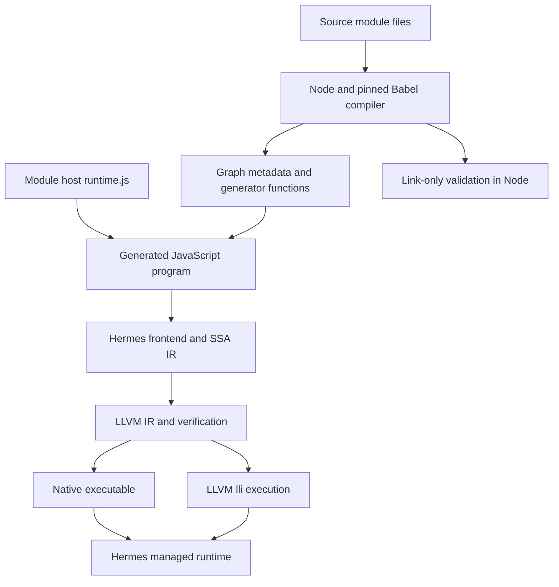
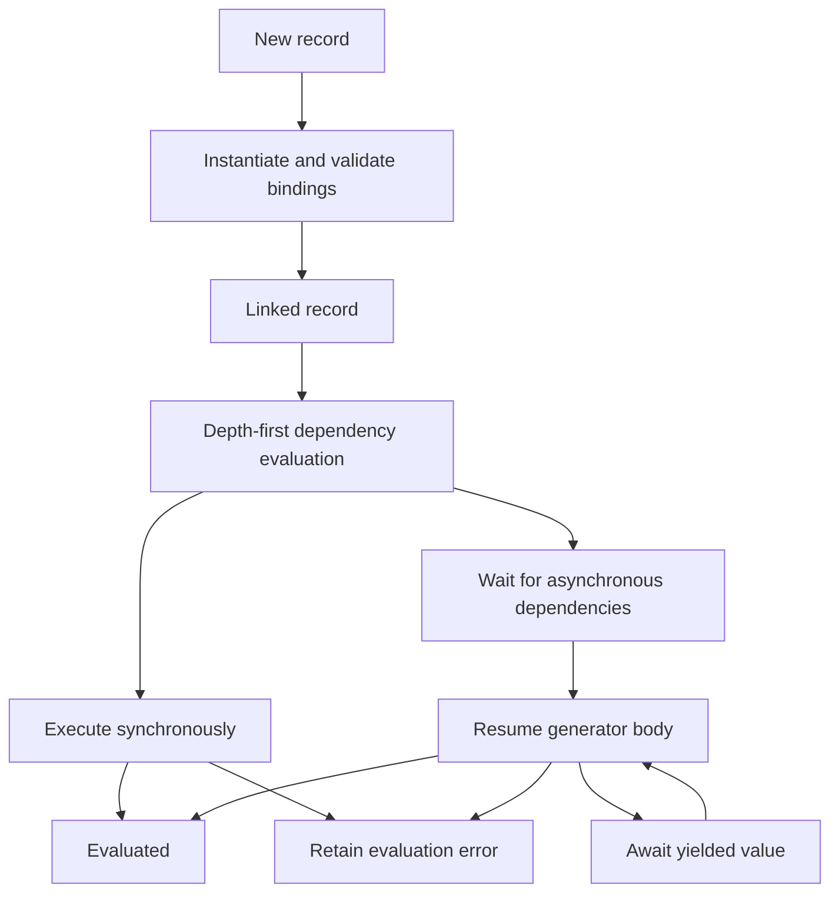
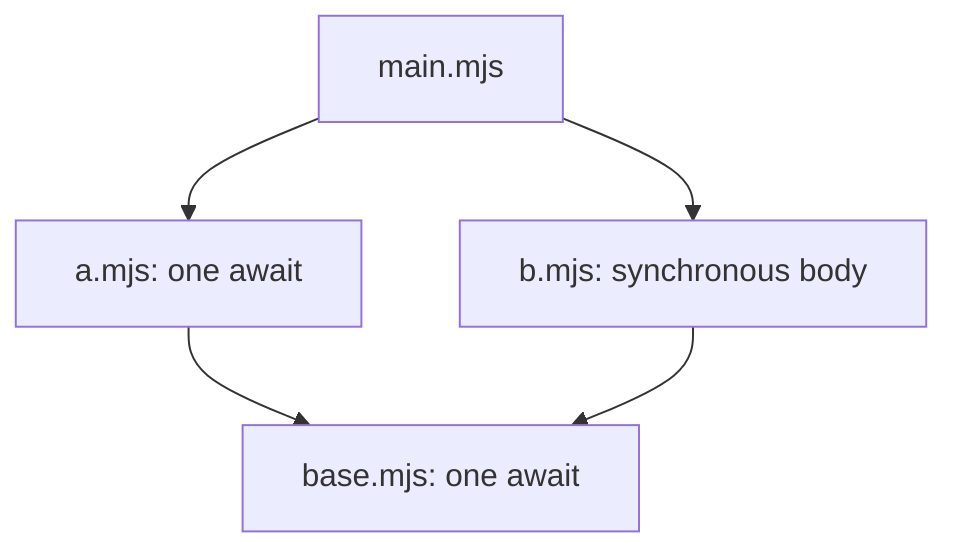

# Direct LLVM JavaScript: Implementing an ECMAScript Module Host

The direct LLVM JavaScript project now compiles a filesystem graph of ECMAScript source modules into a native program. The module host resolves dependencies, connects imported names to live exported bindings, initializes cyclic graphs, creates namespace objects, and coordinates dynamic import and top-level await. This report explains how those operations are implemented, why they require more than parsing `import` and `export`, and what the recorded validation establishes.

A **module graph** consists of source files and their dependency relationships. A **binding** is the storage associated with a declared name; importing a binding must continue to observe changes made by its exporter. **Linking** establishes these relationships before source statements execute. **Evaluation** executes the statements, possibly suspending on asynchronous operations. These distinctions determine the implementation described below.

> [!summary]
> The module host and application bodies compile through Hermes IR and LLVM. Node and Babel provide build-time source transformation; Node also supplies an independent execution oracle for most graph tests.
>
> The qualified checkpoint passes 14 graph contracts across 56 native executions and 14 real `lli` executions. The selected Test262 module-code suite records 585 passes and 17 unsupported variants. Two graph contracts use explicit specification expectations because the tested Node version disagrees.
>
> The implementation has an explicit closed-graph loading policy and remaining language-integration limits. It does not establish full ECMAScript conformance.

This is a follow-up to [[PROJ - Direct LLVM JavaScript - Conformance Baseline and Dynamic Evaluation]]. That earlier report covers the baseline and dynamic-evaluation work preceding modules. The present report reconstructs the module work from the ticket design, implementation diary, committed source, regression fixtures, and retained qualification receipts. It describes the completed checkpoint rather than treating every proposal in the original design as implemented behavior.

## 1. Why a separate module path was necessary

The existing backend already provided generators, Promises, lexical environments, temporal-dead-zone checks, exceptions, and garbage-collector roots for native execution. Those mechanisms made a module implementation possible, but they did not constitute a module host.

The inherited import/export lowering in `hermes/lib/IRGen/ESTreeIRGen-stmt.cpp` expects CommonJS mode. Its imported-property reads populate local variables, and exported values are assigned onto an ordinary exports object. That representation is insufficient for the new host because an imported local must continue to refer to the exporter's binding after the exporter assigns a new value.

Consider this simplified version of the committed live-binding fixture:

```javascript
// counter.mjs
export let count = 1;
export function increment() { count++; }
export default function receiver() { return this; }

// main.mjs
import receiver, { count, increment } from './counter.mjs';
import * as ns from './counter.mjs';

increment();
if (count !== 2 || ns.count !== 2) throw Error('live count');
if (receiver() !== undefined) throw Error('import receiver');
```

The importer needs access to the current `count` binding. Copying its initial value into another variable would make the assertion fail. The call to `receiver` introduces a separate constraint: the imported function is called with an undefined receiver. Rewriting it as an ordinary namespace property call would supply the namespace object as `this` and change the result.

The implemented path therefore gives module relationships an explicit representation. `compiler.cjs` transforms module syntax using lexical binding information, while `runtime.js` manages records, export resolution, namespaces, and evaluation. The generated host becomes part of the program compiled by Hermes and LLVM.

## 2. Compilation architecture and execution ownership

The system has a build-time compiler and a deployed runtime. The build-time compiler reads files, parses syntax, discovers dependencies, rewrites binding references, and emits a generated JavaScript program. The deployed runtime executes the resulting module state machine and module bodies as LLVM-generated code using Hermes's managed runtime.



The Node validation branch is deliberately limited. It instantiates generated module environments and checks imports and exports without executing application source statements. Node's native ESM loader is used separately by the graph test harness to generate comparison traces. Neither use means the deployed application delegates its module bodies to Node.

The four Babel packages—parser, traversal, generator, and types—are pinned to version 7.28.5. The dependency lock and loaded build-dependency files contribute to artifact fingerprints. Pinning the parser alone would leave traversal or generation changes unaccounted for, even though those components determine the emitted program.

The public build function is `compileGraph(entryPath, options)`. It returns generated source, a `check()` function, and a manifest. The public host interface is smaller: `check(id)` performs linking, and `run(id, onComplete, onError)` links and evaluates an entry. The Python driver activates this path with `--module` for `emit`, `build`, `run`, and `jit`.

## 3. Resolution, discovery, and source identity

Resolution maps a requesting module and a source specifier to a module identity. This implementation uses exact relative filesystem paths within a configured root. There is no extension search, package-name lookup, CommonJS fallback, network fetch, or implicit runtime compilation of new files. This is the host's loading policy, separate from the behavior of live bindings and evaluation.

`compileGraph` canonicalizes the entry and root with `realpathSync`. Each identity is a root-relative path with normalized separators. The compiler retains an alias map so discovered symlink spellings can refer to the same canonical module record. Repeated discovery of an identity returns its existing definition. A definition is inserted before traversing dependencies, which lets discovery terminate when files import one another.

Source bytes are decoded using fatal UTF-8 validation. Invalid byte sequences therefore become an error rather than silently changing the source through replacement characters. A successfully read source file contributes its SHA-256 digest to the manifest.

There are three ways for a module to enter the compiled graph:

| Discovery route | Inclusion behavior | Evaluation behavior |
|---|---|---|
| Static import or reexport | Recursively discovers the dependency | Participates in entry linking and dependency evaluation |
| Literal `import('./target.mjs')` | Discovers the target at build time | Remains deferred until requested |
| Explicit `--module-include` | Adds a discovery root | Makes computed requests possible without executing it eagerly |

The distinction between discovery and linking matters for failures. A malformed source file reachable only through dynamic import must not invalidate an unrelated entry merely because the compiler found it. The compiler retains an error definition for that target; the dynamic request later rejects. Errors in the entry's static graph fail validation before the executable is accepted.

The build resolver and runtime resolver have different capabilities. The build resolver reads the filesystem and establishes canonical identities. The runtime resolver normalizes a request and looks it up in the compiled records and alias map. It does not inspect the filesystem for newly created modules.

## 4. A suspended generator supplies module lexical storage

Linking must create bindings without executing ordinary source statements. The implementation uses an initial suspension in a generated generator function to separate those operations. A generator retains its local environment while suspended, allowing getter closures to refer to the same bindings later used by the module body.

The following is explanatory pseudocode, with simplified names, corresponding to the generated structure:

```javascript
function* moduleFactory(context) {
  'use strict';
  context.bind('count', () => count);
  context.bind('increment', () => increment);
  yield context.instantiated;

  let count = 1;
  function increment() { count++; }
}
```

Advancing this function to its first yield registers getter closures without reading `count`. The lexical declaration has not executed, so reading that binding through the getter still throws a temporal-dead-zone error. A function declaration is already available through ordinary function initialization. A `var` binding would contain `undefined` until its initializer executes.

The private instantiation marker distinguishes the deliberate first suspension from later suspensions caused by top-level await. `link` checks that the first generator result is neither completed nor an unexpected value. That check detects a malformed generated function before treating it as a linked module.

Each runtime cell contains a `read` closure. The cell is an object used for identity and access; the actual mutable variable remains in the generator's lexical environment. This arrangement reuses the existing compiler's handling of declarations, closures, and lexical initialization instead of implementing an unrelated storage system for modules.

For the live-binding example, the operational sequence is:

1. Instantiate the importer and exporter to their markers, registering the exporter's cells.
2. Resolve the importer's names to those cells and validate that the required exports exist.
3. Resume the exporter, initializing `count` to one.
4. Resume the importer and call the exported `increment` function.
5. Read the same binding through both the named import and namespace; both observe two.

The committed fixture also checks descriptors, namespace mutation failures, shadowing, top-level receiver behavior, and integrity operations. Its recorded successful output is `live-ok`.

## 5. Binding-aware transformation and observable expression behavior

Identifier text alone is insufficient for import rewriting. A parameter named `count` inside another function can shadow the imported `count`; rewriting both would corrupt the local function. The compiler compares Babel binding identities and rewrites only references belonging to the import binding.

The transformation first moves export declarations into their final statement positions while retaining import declarations. It then rebuilds scope information with `program.scope.crawl()`. Import binding references are collected from this updated tree. After the rewrites, import declarations are removed and module metadata supplies their runtime meaning.

This ordering was a correction discovered during implementation. An earlier transformation retained stale AST nodes while introducing top-level `for await` lowering, eventually producing `error: '(' expected after 'for'`. Rebuilding scopes after declaration movement ensures the reference paths describe the nodes that will actually be emitted.

A named import read becomes a call equivalent to `context.read(moduleId, exportName)`. Calling the result of that expression preserves the undefined receiver expected by the live-binding fixture. Namespace references use `context.namespace(moduleId)` and retain object identity.

Imported assignment needs a different transformation because the observable behavior includes operand evaluation before the write fails. The compiler rewrites assignment targets to an internal accessor reference:

```javascript
// Structural sketch of the runtime operation.
context.target(moduleId, exportName).value

// The returned object's getter reads the current export.
// Its setter throws TypeError.
```

This lets ordinary assignment machinery preserve right-hand-side effects, compound-assignment reads, update expressions, destructuring, and loop assignment targets. The implementation diary records an early mistaken assumption that imported assignment should be rejected as syntax. The design was corrected to represent the runtime failure.

The generated function must also preserve module context. Top-level `this` becomes `undefined`, including uses captured by arrows, while ordinary nested functions and class contexts retain their own behavior. An unbound top-level `arguments` reference cannot accidentally access the generated function's arguments object. The compiler routes those accesses through global lookup helpers, including a separate `typeof` operation.

Anonymous default exports introduced another observable detail. Anonymous function defaults require a `default` name, but blindly assigning a class's `name` after creation can overwrite a legitimate static member. The corrected class transformation uses name inference through a `default` property expression, allowing class initialization to establish an explicit static name normally. The regression suite includes both declaration and expression cases.

## 6. Linking and export resolution

A runtime record separates its immutable definition from mutable execution state. The definition contains dependencies, imports, explicit exports, star exports, and whether module-level suspension is needed. The record adds cells, a generator iterator, namespace state, lifecycle state, dependency counters, evaluation order, and completion information.

`link(entry)` first instantiates every reachable new record to its marker. It then validates named imports and explicit exports after the cells exist. This order permits cyclic relationships without requiring any module body to execute during validation.

Export resolution can return a binding cell, no binding, or an ambiguity marker. Its essential structure is:

```text
resolve(module, exportedName, visitedPairs):
    if (module, exportedName) was already visited:
        return missing
    extend visitedPairs for this traversal branch

    if explicitly exported from a local:
        return the local cell
    if explicitly reexported from another module:
        resolve that target and name
    if exported as a namespace:
        return the target's canonical namespace cell
    if exportedName is default:
        return missing

    resolve the name through each star export
    ignore missing routes
    if distinct cells remain: return ambiguous
    otherwise return the unique cell or missing
```

Cell identity is essential. Two export routes can identify the same binding even when their paths through the graph differ. Treating different paths as different bindings would report false ambiguities. The implementation originally made this mistake for namespace reexports by allocating separate namespace cells. It now retains one `namespaceCell` on the target record and reuses it.

Visited pairs prevent infinite recursion through reexport cycles. The name is part of the pair because revisiting a module while resolving a different name is a different query. A repeated pair is not proof that a binding exists; the traversal must still find a concrete declaration through another route.

Failed linking also requires deliberate state handling. Marking every partially instantiated dependency as failed would prevent a later valid importer from using an otherwise valid dependency. The implemented rollback clears unfinished iterators, cells, and namespace objects, returning those records to the new state. The failing entry retains its error. A regression checks that a valid dependency remains usable after another importer fails linking.

## 7. Namespace objects and the shared Proxy corrections

A namespace presents exported bindings through an object interface. In this host it has a null prototype, a fixed set of exported names, a `Module` string tag, live property values, and failed assignment operations. Its descriptors report writable data properties even though assignment through the namespace is prohibited. That combination requires more care than freezing an object containing initial export values.

`namespace(module)` builds a non-extensible target with non-configurable, writable data properties and wraps it in a Proxy. The `get` and `getOwnPropertyDescriptor` traps read the current cells. The `set` trap fails. `defineProperty` accepts requests that leave the relevant descriptor and current value unchanged, while rejecting incompatible redefinitions. The writable target descriptors allow the reported live values to vary without violating the underlying Proxy restrictions.

This design exposed defects below the module host. The inherited `Object.freeze` handling could update the Proxy object's hidden-class state without performing the required target/trap operations. The module fixture then observed incorrect namespace integrity behavior. The correction in `JSObject.cpp` dispatches Proxy sealing and freezing through internal operations: prevent extensions, enumerate keys, inspect descriptors where freezing requires it, and define the required property attributes. `JSLib/Object.cpp` similarly checks Proxy integrity through actual descriptors and extensibility.

The standalone `proxy_integrity.js` regression checks these operations outside the module implementation. That matters because the repair affects ordinary JavaScript objects mediated by Proxies, not only namespace objects.

A second shared defect appeared with numeric-looking export names. Hermes's internal snapshot of an ordinary target could contain a numeric key, while the Proxy trap returned the corresponding string. Comparing the two representations directly caused the error `ownKeys target key is non-configurable but not present in trap result`. `JSProxy.cpp` now normalizes numeric target keys to strings before the invariant comparison.

The source compiler also had to preserve the name `__proto__` as data. Emitting arbitrary metadata as a JavaScript object literal can accidentally give that key prototype-setting semantics. Metadata and aliases are reconstructed through `JSON.parse`, and generated function values are attached separately. The special-names fixture covers this representation issue together with numeric export names.

## 8. Cycles and asynchronous evaluation

A strongly connected component is a set of modules in which every member is reachable from every other member through dependency edges. Such components prevent evaluation from being described as a simple recursive wait for all dependencies. A back edge to a module currently being evaluated must not create a new wait that can never complete.

The runtime's `inner` function performs a depth-first traversal. It assigns an index, maintains an ancestor index and stack, and assigns a cycle root when a component closes. Dependencies are visited in their recorded order. A module with no pending asynchronous dependencies and no top-level suspension executes synchronously; otherwise it receives an asynchronous evaluation order and starts only when its pending count reaches zero.



The diagram summarizes behavior rather than reproducing every internal state string. In particular, the code uses a separate `failed` flag alongside lifecycle state for retained evaluation errors. Reviewers should not infer error absence solely from a record being marked evaluated.

For an asynchronous body, `executeAsync` resumes the generator with `next` on fulfillment and `throw` on rejection. The latter injects the rejected value at the suspended expression, allowing the original source's `catch` and `finally` regions to act on it. Top-level await lowering therefore depends on preserving the source control-flow structure around the yield.

When a module fulfills, the host decrements pending counts of asynchronous parents, gathers newly runnable ancestors, and sorts them by evaluation order. Synchronous parents released by that completion can themselves release additional ancestors. Rejection propagates through parent relationships while retaining the original error; the corrected implementation rejects the module's own completion before propagating to parents.

The recorded async-diamond fixture makes this behavior concrete. Both `a.mjs` and `b.mjs` depend on `base.mjs`; the entry depends on both. The base awaits once, and `a.mjs` awaits again after the base completes.



Node and all five LLVM executions recorded the same output:

```text
base-start
base-end
a-start
b
a-end
main 11 12
```

The base completes before either dependent body uses its exported value. Starting `a` does not prevent `b` from executing while `a` is suspended. The entry waits until both exports are initialized. This trace distinguishes dependency completion from simply awaiting each source file in sequence.

## 9. Top-level for-await and cleanup precedence

A top-level `for await` loop needs more than changing `await` into `yield`. It must acquire the correct iterator, await results, create per-iteration bindings, preserve labels and control transfers, and close the iterator when an abrupt body completion requires cleanup.

The compiler emits an explicit loop and `try`/`catch`/`finally` structure. Its close-needed flag is reset before requesting the next result and set after a value has been obtained for the body. This placement distinguishes failure while advancing the iterator from a break or exception after entering the body. The runtime helper supplies async-from-sync behavior when the source exposes only a synchronous iterator, including awaiting yielded values.

Cleanup has its own failure behavior. If a body is already throwing and iterator closing also throws, the original body exception must remain the propagated completion for the handled path. The generated cleanup records whether a throw is in progress and suppresses a secondary closing failure in that branch. A normal break does not have that same precedence rule, so a closing error must remain observable.

The retained engineering experiment combined six loop contracts into one module function. After the AST correction, that large transformed function exceeded the existing 1,024 combined root/argument-slot limit. The successful fixture splits independent contracts into separate module frames, covering sum, break, continue, closure capture, advancement errors, and body errors. The original oversized probe remains in the ticket's scripts directory. Splitting the fixture did not remove the backend limit, and the report does not count the oversized source as supported.

## 10. Dynamic import and intrinsic Promise reactions

Each dynamic import call creates a new public Promise, even when it requests an already known module. The module record, evaluation state, and namespace remain shared. This distinguishes request identity from module identity.

The runtime converts the specifier, validates the options object, and schedules the import work in a Promise job. The job resolves the included target, links it if needed, joins or begins evaluation, and fulfills the request with the target namespace. A failure rejects the request. A namespace with a callable exported `then` participates in ordinary Promise resolution, because the fulfillment value is not treated as an opaque internal object.

Options can be absent or contain an empty `with` object. Invalid option types and throwing getters produce rejections. Non-empty attributes remain an unsupported host contract. Literal dynamic imports are available because discovery included their targets; computed requests require their possible targets to have been explicitly included.

Scheduling those operations through public `Promise.prototype.then` would make module execution depend on user replacement of that property and on public constructor/species behavior. The implemented host calls a private `$SHBuiltin.moduleThen` operation instead. Its implementation in `lib/InternalJavaScript/01-Promise.js` attaches an internal handler to an intrinsic Promise and returns an intrinsic result Promise.

This required coordinated registration across the compiler and runtime:

| Location | Role |
|---|---|
| `include/hermes/FrontEndDefs/Builtins.def` | Declares the builtin identity |
| `include/hermes/VM/PredefinedStrings.def` | Registers the runtime name |
| `lib/InternalJavaScript/01-Promise.js` | Implements intrinsic reaction attachment |
| `lib/IRGen/ESTreeIRGen-expr.cpp::genSHBuiltin` | Lowers the three-argument source operation to a builtin closure call |

The first build failed because the predefined string registration was missing. After that was added, source compilation still rejected the operation as `unknown SH builtin call`. The IR-generation case was a separate requirement. These failures show why a runtime helper cannot be considered integrated merely because its function body exists.

The intrinsic-jobs fixture checks public `then` mutation during await and restores it before separately checking dynamic import. The diary records why: leaving the mutation active through Node's dynamic import also failed inside Node's loader. That failure could not establish agreement between the native host and an independent oracle. The final fixture retains a comparison that both systems can execute while still checking the intended internal-await behavior.

This protects the tested Promise operations. It does not establish robustness against arbitrary mutation of every built-in used by the JavaScript host.

## 11. Artifact safety and reproducibility

A multi-file compiler must protect all input sources from accidental publication over them. The driver extends its output checks from the entry file to the complete read graph. The compiler also rejects output aliases, including hardlinks whose filenames differ but whose device and inode identify the same file. Tests cover source overwrite through a hardlink and deterministic repeated graph compilation.

The build manifest records source identities and hashes, module metadata, aliases, compiler and runtime-host hashes, dependency-lock hash, loaded build-dependency hashes, and the Node version. The Python driver adds the Node executable hash and generated-bundle identity. These records explain which inputs produced an artifact; they are not a general claim that executables are byte-for-byte reproducible across machines.

Generated module functions are emitted as argument expressions outside the host function's lexical scope. This avoids granting source modules accidental access to the host's local variables merely because both appear in the generated file. Generated identifiers are selected through the parser's scope facilities to avoid collisions with source names.

The build-tool tests check that link-only validation does not execute source statements, that missing exports are detected during linking, that imported-source parse failures are attributed correctly, and that invalid deferred sources do not fail an unrelated entry. These tests validate the build path separately from native execution.

## 12. Engineering progression and corrections

The chronological diary contains useful failures that a final architecture description would otherwise omit. The following progression preserves the distinction between a working checkpoint and a fully qualified result.

| Checkpoint | Evidence and resulting change |
|---|---|
| Design, `98aac5f` | Established the explicit graph, generator environment, live-cell representation, and asynchronous dependency algorithm. |
| Initial implementation, `8b88615` | Ten graph contracts passed the quick native/lli gate after correcting an invalid parse-error identity expectation and link rollback behavior. |
| Expanded loop support | Eleven graphs passed 44 native and 11 lli executions. AST reconstruction and the retained oversized-loop probe exposed transformation and frame-admission issues. |
| Initial selected Test262 run | 564 passes, 24 semantic failures, and 14 unsupported variants. Failures exposed namespace identity, default class naming, error-phase attribution, Proxy behavior, and async reporting/scheduling gaps. |
| Final qualification, `185923d` | Fourteen graph contracts passed; the selected suite reached 585 passes and 17 unsupported variants. Shared runtime repairs and retained evidence were committed. |
| Documentation checkpoint, `8db50e0` | Recorded qualification commits and the earlier vault publication in the detailed diary. |

The first error fixture incorrectly required repeated parse failures to use the same error object. Node rejected that assertion with `Error: cached error: ./syntax.mjs`. The corrected fixture limits identity expectations to the relevant retained linking and evaluation errors. Fixing a mistaken test is a different action from fixing implementation semantics, and the diary records the distinction.

The selected suite comparison is equally explicit. Of the 24 initial semantic failures, 21 became passes and three became unsupported source-phase cases. The latter were not implemented successfully; their classification became accurate. `initial-to-final.json` verifies identical variant identities and source hashes between the two runs and shows no previously passing variant becoming a failure or unsupported result.

### Asynchronous exception reporting

Negative tests can throw from a timer or microtask after the initial native entry returns. The event loop previously lacked the structured reporting needed to classify those failures reliably. `ConsoleBindings.cpp::run_event_loop` now receives a Test262 flag and reports a validated constructor-name field from the actual thrown value under that mode. All C and LLVM call sites were updated together.

This avoids inferring an error type by searching a user-controlled stack string. The implementation handles throwing property access and invalid names, and the native probes exercise ordinary errors, forged strings, hostile constructors, completion mistakes, and `Test262Error` names containing digits. The mechanism is a test protocol with explicit behavior, not a claim that arbitrary user-modified error objects carry an immutable native type identity.

## 13. What the validation establishes

The graph suite executes fourteen multi-file fixtures at all four combinations of Hermes optimization `O0` or `O` and LLVM optimization `0` or `2`. Each also runs through real `lli` at Hermes `O` / LLVM `2`. That yields 56 native executions and 14 lli executions.

Twelve graph contracts compare output with Node's native ESM loader. Two use specification-directed expected output while retaining Node's disagreement. Both distinctions remain present in the receipts rather than being hidden in a single matching-engine count.

| Validation layer | Recorded result | Interpretation |
|---|---:|---|
| Module graph contracts | 14/14 | Twelve Node-matched and two specification-directed contracts |
| Native graph executions | 56/56 | Four optimization combinations per graph |
| Real lli graph executions | 14/14 | One additional execution configuration per graph |
| Selected Test262 runtime contracts | 396 passes | Executable bodies evaluated through LLVM |
| Selected Test262 parse contracts | 166 passes | Entry parsing attributed to Babel |
| Selected Test262 resolution contracts | 23 passes | Link-only validation attributed to the shared host in Node |
| Selected Test262 unsupported variants | 17 | Retained boundaries, not passes |
| Existing core source contracts | 22/22 | Regression gate for the preexisting path |
| Existing extension source contracts | 66/66 | Includes the new standalone Proxy integrity regression |
| Exception protocol probes | 19/19 | Expected outcomes for positive and hostile probe inputs |
| Compiler unit tests | 8/8 | Build-time transformation and safety contracts |

The selected Test262 revision is `0b4e0812022b18236b5276d2804948fdd9f71603`, restricted to `test/language/module-code`, with Hermes `O`, LLVM `2`, and eight workers. The selection produced 602 variants. Its 585 passes include expected errors in their appropriate phases, not just successful application executions.

The seventeen unsupported variants comprise eight import-attribute cases, three source-phase module cases, four ordinary-script variants outside this module path, and two frame-slot rejections. The aggregate runner intentionally returns a nonzero exit when unsupported variants remain. No claim of complete selected-suite conformance is made from that command.

The graph, selected Test262, and extension receipts report unchanged inputs during their runs. The broad historical 102,992-variant baseline was not rerun. There is also no new claim here about physical PicoCalc execution, sanitizer completeness, performance gains, or arbitrary ECMAScript programs outside the measured profile.

### The two Node discrepancies

The namespace-identity fixture reaches one target namespace through two reexport routes. The recorded Node 24.18.0 run treated the routes as ambiguous. The implemented expectation follows the target namespace binding identity used in the pinned [ResolveExport algorithm](https://tc39.es/ecma262/2026/multipage/ecmascript-language-scripts-and-modules.html#sec-source-text-module-records-resolveexport).

The special-names fixture exposes names `10` and `2`. The recorded Node run enumerated them in numeric-index order; the implementation expects `10` before `2`, following the lexicographic export ordering in [ModuleNamespaceCreate](https://tc39.es/ecma262/2026/multipage/ordinary-and-exotic-objects-behaviours.html#sec-modulenamespacecreate).

Each fixture contains an `oracle.json` explaining its expected stdout and qualification. The failed numeric-order comparison is retained separately as `numeric-key-oracle-mismatch.json`. These are observed differences for the tested version and fixtures, not a statement about every Node version or every namespace operation.

## 14. Remaining boundaries and their architectural causes

The remaining restrictions are mostly missing integration or host policy. They do not imply that LLVM or JIT compilation cannot support the relevant semantics. Two areas—dynamic lexical environments and native root-frame storage—do require substantial compiler/runtime work.

**Direct eval inside transformed modules is rejected.** An eval string does not undergo the static import-reference rewrite, so it cannot automatically find the module's imported bindings. Supporting it requires the dynamic compiler to access the module's actual binding cells and initialization state. Existing script-level eval support is useful infrastructure, but it does not solve that connection by itself.

**Dynamic imports are restricted to included source.** The host has no runtime file discovery or module compiler. Adding one would require loading policy, identity and cache integration, and an execution strategy for new source. It could use Hermes bytecode, runtime LLVM compilation, or another supported execution path. Dynamic import does not inherently require an LLVM JIT.

**Attributes, additional import phases, and script-mode dynamic import remain unimplemented.** Non-empty attributes need loader interpretation and potentially additional module types. Source/deferred phases need their corresponding lifecycle semantics. Ordinary script execution needs an attached module loader and referrer context before its `import()` expressions can use this host.

**Large functions can exceed 1,024 combined root/argument slots.** This is the current backend's explicit managed-value storage limit, not an LLVM limit. More efficient slot reuse or a different frame allocation strategy could change it. Increasing the constant alone changes stack consumption and requires a separate analysis.

**Pending evaluation and process shutdown are not fully connected.** An entry awaiting a Promise that never settles can remain incomplete after the console loop has no more queued tasks. The process may exit without reporting that incomplete evaluation. The conformance runner requires a completion marker, preventing that exit from counting as a positive test pass. A deployment embedding still needs an explicit shutdown policy connected to `onComplete` and `onError`.

**Source maps and full intrinsic-mutation robustness remain tooling and hardening work.** Generated-source positions are not original module locations. Although Promise reactions use a private builtin, the JavaScript host still depends on other public operations whose arbitrary mutation is outside the qualified contract.

A useful next implementation sequence would first define the pending-entry shutdown policy and extend negative tests for it, then connect script referrers to the loader, and separately design module eval's environment interface. Runtime loading and additional module types should follow explicit host requirements. This is a proposed work order, not a set of features already delivered by the ticket.

## 15. Reproducing the implemented path

The commands below assume the existing configured `hermes/build-llvm` directory and an LLVM 18 installation at `/usr/lib/llvm-18/bin`. They are run from the repository root, `/home/manuel/code/wesen/2026-10-28--llvm-js`.

```sh
pnpm --dir hermes/utils/module-host install --frozen-lockfile --ignore-scripts

cmake --build hermes/build-llvm \
  --target shermes shllvm_runtime shllvm_runtime_shared --parallel 4

python3 hermes/utils/shllvm.py run --module \
  --build-dir hermes/build-llvm --llvm-bin /usr/lib/llvm-18/bin \
  hermes/test/LLVMModules/live/main.mjs

python3 hermes/utils/shllvm.py jit --module \
  --build-dir hermes/build-llvm --llvm-bin /usr/lib/llvm-18/bin \
  hermes/test/LLVMModules/await-diamond/main.mjs
```

The compiler and runtime must come from a compatible build because the generated host uses the private `moduleThen` builtin. For a computed import, pass each additional discovery root with `--module-include`. Set `--module-root` explicitly when the entry directory is narrower than the intended graph.

The validation entry points are:

```sh
pnpm --dir hermes/utils/module-host test

python3 hermes/utils/test_shllvm_modules.py \
  --output /tmp/module-graphs.json

python3 hermes/utils/test_shllvm_test262.py \
  --suite /tmp/llvm-test262 --build-dir hermes/build-llvm \
  --llvm-bin /usr/lib/llvm-18/bin --modules --hermes-opt O --llvm-opt 2 \
  --jobs 8 --compact --output /tmp/module-test262.json \
  test/language/module-code
```

The last command assumes the pinned Test262 checkout already exists at the specified path. It does not fetch or pin the suite automatically merely because that path is supplied. A reproduction should compare the checkout revision with the recorded revision before interpreting count changes.

## 16. Source-reading guide and evidence provenance

All repository-relative paths in this report resolve beneath `/home/manuel/code/wesen/2026-10-28--llvm-js`. The core implementation is compact enough to read in dependency order: discovery and metadata, lexical transformation, runtime linking, then evaluation scheduling.

| Source | What to inspect |
|---|---|
| `hermes/utils/module-host/compiler.cjs` | `compileGraph`, `discover`, binding rewrites, top-level await/for-await lowering, `check`, and output protection |
| `hermes/utils/module-host/runtime.js` | `exportCell`, `namespace`, `link`, `inner`, `fulfilled`, `rejected`, `evaluate`, and the context helpers |
| `hermes/utils/shllvm.py` | Module-mode bundling, manifest integration, and graph-wide artifact safety |
| `hermes/lib/InternalJavaScript/01-Promise.js` | Private intrinsic reaction implementation |
| `hermes/lib/IRGen/ESTreeIRGen-expr.cpp` | `$SHBuiltin.moduleThen` lowering |
| `hermes/lib/VM/JSObject.cpp` and `JSLib/Object.cpp` | Proxy integrity mutation and inspection |
| `hermes/lib/VM/JSProxy.cpp` | Numeric target-key normalization for ownKeys checks |
| `hermes/tools/shermes/ConsoleBindings.cpp` | Asynchronous exception reporting under the Test262 protocol |
| `hermes/utils/test_shllvm_modules.py` | Node comparisons, native/lli matrix, specification-directed qualifications |
| `hermes/utils/test_shllvm_test262.py` | Module variants, parser/link attribution, completion checks, unsupported classification |
| `hermes/utils/module-host/compiler.test.cjs` | Build-tool safety and linking invariants |
| `hermes/docs/llvm/MODULES.md` | Operational contract and current documented boundaries |

The ticket directory is:

```text
ttmp/2026/10/28/LLVM-MODULES-001--ecmascript-module-host-resolution-linking-and-asynchronous-evaluation/
```

Its `design-doc/01-module-host-architecture-and-implementation-guide.md` explains the proposed architecture and includes an implemented-checkpoint section. Its `reference/01-implementation-diary.md` preserves the chronological decisions, failed experiments, corrections, commands, and commits. Earlier diary statements such as unsupported top-level for-await describe historical checkpoints; the later entries and final source establish current support.

The evidence directory contains `initial-ten-graphs.json`, `eleven-graph-matrix.json`, `fourteen-graph-matrix.json`, `core-final.json`, `extensions-final.json`, `exception-probes-final.json`, and the preserved numeric-oracle mismatch. Full initial and final selected Test262 results are stored as `test262-module-code-initial.json.gz` and `test262-module-code-final.json.gz`. Compression is lossless with a deterministic gzip timestamp; `receipt-hashes.json` identifies the uncompressed bytes. `initial-to-final.json` provides the bounded comparison used in this report.

The main source checkpoints are `98aac5f` for design, `8b88615` for the initial compiler and host, `185923d` for the qualified semantic and runtime corrections, and `8db50e0` for the recorded milestone. This report does not rerun those suites or describe the historical receipts as new executions.

## 17. Exercises for reviewing or extending the implementation

1. Trace `count` from the live-binding fixture through export metadata, the registered cell, an imported read, and a namespace descriptor. Identify which object provides binding identity and where the mutable value is actually stored.
2. Construct two star-export routes to the same binding, then change one route to a distinct declaration with the same current value. Explain why the first resolution is unambiguous and the second is ambiguous despite value equality.
3. Use the recorded async-diamond trace to identify when each parent's pending count can become zero. Explain why `b` executes between `a-start` and `a-end`.
4. Compare a body exception in `for await` with a failure from the iterator's `next` operation. Locate the flag transition that gives the two cases different cleanup behavior.
5. Inspect an unsupported Test262 variant and identify whether its limitation belongs to parsing, module-host integration, or backend frame admission. Do not turn the unsupported status into an expected language-error pass.
6. Design a pending-entry shutdown contract for an embedded application. Specify how it distinguishes an unresolved Promise with no future work from an entry still waiting on an external operation, and where that information enters the host.

These exercises target the boundaries between source transformation, runtime state, and evidence. Those boundaries are where the implementation's most consequential defects were found and where future extensions will need equally explicit contracts.
