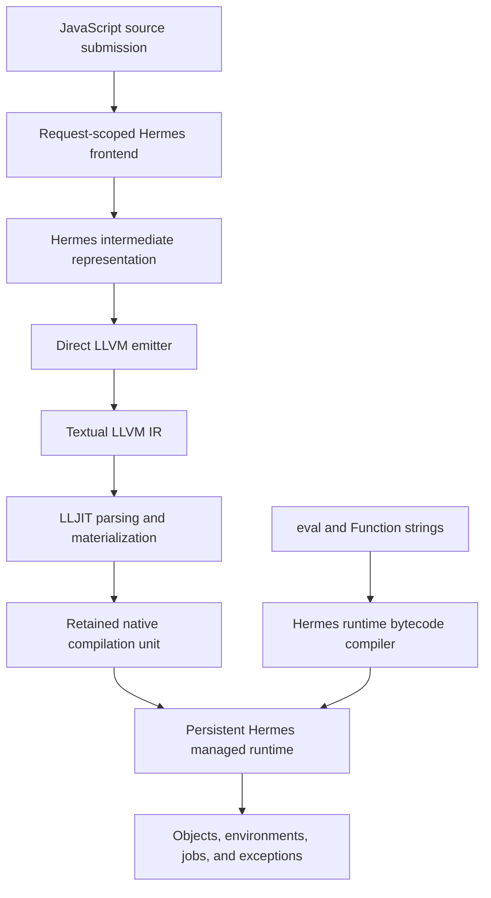
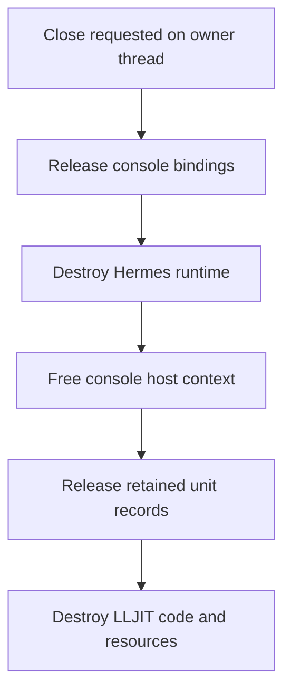

# Direct LLVM JavaScript: persistent execution and application qualification

The project now compiles JavaScript to native code and executes successive source submissions inside one process and one managed runtime. The completed engine and JIT milestones establish that native functions can remain callable after their original submission returns, after garbage collection, and after later compilation. The next milestone uses four applications to determine which remaining limitations matter in practical use.

This report explains the implemented engine, its ownership rules, its interaction with the existing module host, and the evidence supporting its current scope. It then develops the application qualification design recorded in **LLVM-APPS-001**. The application campaign remains future work: exploratory data, queue, and archive sources exist, and one small archive probe has run, but all four applications have not been implemented and qualified.

> [!summary]
> The new `shllvm-jit` executable performs source compilation and native materialization in-process. The completed focused JIT gate passed 48/48 contracts; existing native gates passed 22/22 core and 66/66 extension contracts. These are bounded validation results, not a full language-conformance claim. A pinned fflate probe already identifies a practical distinction: optimized frontend compilation succeeds, while unoptimized compilation reaches the existing frame-slot admission limit.

## 1. What a persistent native engine provides

A compiler translates a program into another representation. A runtime supplies the objects, values, calls, exceptions, and memory management required while that program executes. A JIT compiler generates executable code during the lifetime of the process that will execute it. These responsibilities are related, but completing one does not complete the others.

The project already had a direct LLVM backend. Statically supplied JavaScript passed through the Hermes frontend and intermediate representation, then through an LLVM emitter. A driver could build a native executable or invoke LLVM's separate `lli` process. That established native execution, but it did not provide an application with a persistent in-process compilation service.

The new engine separates source submission from runtime lifetime. A host creates an engine once, compiles a unit, initializes it, then submits another unit using the same managed heap. A compilation unit is a native program fragment with an exported creator function and a runtime initializer. Each admitted unit receives an engine-local identifier; initialization is attempted at most once.

Consider two submissions:

```javascript
// first.js
globalThis.account = { balance: 10 };
globalThis.credit = amount => account.balance += amount;
```

```javascript
// second.js
credit(7);
print(account.balance);
```

Executing both files in one engine prints `17`. The second unit finds the object and function through the shared global object. The function body originated in the first native unit, so its executable code must still exist. Its managed references must also remain visible to the collector. This example requires code lifetime and object lifetime to agree.

The example deliberately uses `globalThis`. Separate submissions do not establish a general interactive lexical environment in which every top-level `let` declaration automatically becomes visible to later files. The implemented contract is explicit shared runtime state, not an unrestricted REPL environment.

## 2. Architecture and responsibility boundaries

Hermes handles source analysis and JavaScript runtime semantics. LLVM handles native compilation of the emitted intermediate representation. The engine coordinates these components and owns their lifetimes.



LLJIT is LLVM's high-level in-process JIT facility. Materialization is the operation that turns an admitted module into executable code and resolves its external symbols. The engine uses a creator-symbol lookup to obtain the native entry needed for runtime unit registration. It does not invent a second calling convention for JavaScript functions.

Textual LLVM IR forms the boundary between the existing compiler and the installed LLVM library. Hermes includes its own `llvh` support infrastructure; the engine links system LLVM 18. Passing a textual buffer avoids treating their internal C++ object types as interchangeable. This choice introduces a parse step, but it keeps the integration concrete and inspectable.

The runtime bridge supplies helpers referenced by generated code. It is located from the already linked `shllvm_frame_size` symbol using `dladdr`, then exposed to LLJIT through a dynamic-library symbol generator. Its dependency closure supplies the existing runtime functions. The design requires one shared managed runtime implementation rather than independently loading incompatible runtime copies.

Dynamic source evaluation remains a separate path. Strings passed to `eval` or `Function` still use the Hermes runtime bytecode compiler. The new native source API does not replace lexical-eval machinery or imply that every dynamically produced string becomes native code. Both execution paths can use the same managed objects and environments without using the same code representation.

## 3. Request-scoped source compilation

`hermes/lib/LLVMJIT/Frontend.cpp` implements `compileSource`. Each request constructs fresh compiler context and semantic state. This is necessary because an embedding API cannot rely on repeatedly resetting a process-wide command-line parser as if every compilation were a new compiler process.

The frontend configures temporal-dead-zone checks, block scoping, dynamic evaluation support, and the chosen optimization profile. Async generators remain an explicit source option. It loads the built-in global declarations, parses the supplied source with its filename, transforms the syntax tree, resolves names, generates Hermes IR, verifies it, runs the appropriate native optimization pipeline, and emits LLVM IR.

```text
compileSource(source, filename, unitName, options):
    create fresh compiler context and diagnostic collector
    load runtime global declarations
    parse source under filename
    transform and resolve syntax
    generate and verify Hermes IR
    run native backend passes
    run selected frontend optimization pipeline
    emit LLVM IR without an executable main
    return IR or a phase-specific diagnostic
```

The filename is part of the request, so errors can identify the submitted source rather than a temporary compiler file. The output is creator-only IR: it defines the unit creator needed by the engine, not a process entry point that would initialize and shut down an independent runtime.

`-O` on `shllvm-jit` selects the Hermes optimized pipeline. Without it, the frontend uses its no-optimization pipeline. This flag should not be described as the old driver's independent LLVM O0/O2 matrix. LLJIT uses its configured default native code-generation behavior. Recording the frontend profile is therefore essential when comparing results.

The initial library experiment demonstrates why this distinction matters. Optimization changes the amount and shape of IR reaching the root-slot allocator. A program can be rejected under one frontend profile and admitted under another even though its intended JavaScript behavior is identical.

## 4. Admitting a native unit

The public shape of the private embedding API is intentionally small:

```cpp
struct Result {
  bool ok;
  std::string phase;
  std::string message;
  size_t unit;
};

Result compile(source, filename, options);
Result loadIR(ir, creator);
Result execute(unit);
Result drain();
Result collect();
Result close();
```

`compile` creates a unique engine-local unit name, produces IR, and delegates to `loadIR`. `loadIR` parses the module using a fresh LLVM context, checks its target and data layout against the engine, checks the exported creator, verifies the module, adds it to LLJIT, and looks up the creator symbol.

The creator must be a defined exported function using the C calling convention, returning a pointer and taking no arguments. An executable `main` is rejected. Explicit incompatible triples or data layouts are rejected before execution. These checks catch incorrect generated inputs; they do not make arbitrary native IR safe to execute. This is a trusted-code API.

Each successful unit stores its creator address, whether execution has been attempted, and an LLVM resource tracker. A failed symbol lookup removes the corresponding resources where possible and returns an LLVM-link error. A successful load returns a unit identifier without running JavaScript initialization.

Separating loading from execution is useful for diagnostics and ownership. A parser failure has no executable unit. A materialization failure has no valid creator to call. An initializer failure happens after a unit has already been admitted and can have externally observable effects. Treating these cases as one generic “compile failed” state would obscure recovery requirements.

## 5. Why code survives failed initialization

JavaScript initialization is not transactional. A program can publish a function and then throw:

```javascript
globalThis.saved = (() => {
  const value = 41;
  return () => value + 1;
})();
throw new Error("initialization stopped");
```

A later valid submission can call `saved()`. Its native body belongs to the failed initializer's compilation unit, and its captured environment remains reachable from the global object. Unloading that unit when initialization throws would invalidate a live function.

`Engine::execute` marks the unit as executed before calling the guarded runtime initialization path. An exception returns a failed execution result, but the unit remains retained. Repeating the same unit is rejected because earlier side effects may already have occurred. Later units can still execute and observe the state that survived the exception.

The runtime reports exceptions through its existing guarded, handle-based path. The C++ `Result` carries a phase and summary rather than exporting an unrooted tagged JavaScript value. This keeps the first API small and avoids creating a value-handle contract before one is required by an application.

A future API that returns arbitrary JavaScript objects would need to define rooting, owner-thread use, engine closure, and handle invalidation. Those requirements are not supplied merely by adding a pointer field to `Result`.

## 6. Runtime lifetime, threads, and shutdown

Each engine owns one runtime and one LLJIT instance. Operations belong to the creating thread. Methods returning `Result` report a state error when called from another thread; destruction of a live engine on the wrong thread aborts as a programming error. The metadata getter also requires owner-thread use, even though it does not return a checked result.

This contract avoids implying concurrent runtime execution. The host must arrange serialization externally. There is also no general reentrant embedding contract or interruption facility. The asynchronous queue proposed later in this report uses cooperative application cancellation, which is different from interrupting arbitrary native code.

Shutdown preserves code until runtime destruction has finished:



The runtime may still hold references to native functions during teardown. Releasing executable memory first would violate their lifetime. `close` is idempotent, but it is not an implicit request to finish pending jobs. A host requiring completion must call `drain` before `close`. Explicit closure abandons pending work under the documented contract.

Retaining all units simplifies correctness at the cost of memory growth. The engine does not support individual code unloading, speculative tiering, or deoptimization. Those features would require additional ownership and reachability mechanisms. They are not prerequisites for the current bounded applications.

## 7. Removing the eight-unit table limit

The architecture probe found a fixed `SHUnit *units[8]` table and a process-global increasing unit index. That combination limits persistent execution even when each individual script is small. It also affects repeated engine instances: destroying a runtime does not reset the global identity counter.

The implementation replaces the fixed table with growable storage and an explicit capacity. This change extends beyond allocation. Strong-root traversal, weak-root traversal, destruction, bounds checks, and memory accounting must all use the new capacity. A larger allocation with an unchanged collector loop would leave later units incompletely traced.

The tests cover growth beyond eight units and force collection after growth. They also exercise repeated and simultaneous engine instances. These checks connect the storage change to its semantic purpose: functions and unit-associated managed state must remain usable after the table expands.

The global index scheme remains. A newly created runtime can allocate according to a previous process-wide high-water index. The completed work therefore removes the immediate fixed-capacity failure without claiming bounded memory under unlimited compilation and runtime recreation. The persistent application should measure this behavior before any index-recycling design is introduced.

## 8. The separate per-function root-slot boundary

The unit table counts compiled units known to a runtime. Root slots count tagged values protected during a single native function's execution. They solve different lifetime problems and have different limits.

The direct LLVM emitter currently assigns distinct root storage to instruction results that have users. Unused results can share a discard slot. Literal operands and scratch state also contribute storage, and the outgoing argument area contributes to the admission total. The existing bound is 1,024 combined root/argument slots.

At eight bytes per tagged payload, that bound corresponds to roughly 8 KiB of explicit payload storage. It is not a complete native stack bound: frame headers, spills, runtime calls, exception state, and recursion add other costs. The emitter's comments connect the conservative admission policy to the native stack-overflow guard.

The archive probe reached this diagnostic:

```text
backend: /tmp/archive-app.js: 424:2482:direct LLVM backend:
function exceeds 1024 combined root/argument-slot admission limit
```

With `-O`, the same logical input and bundle completed. This is evidence that profile-dependent IR size matters for this library. It does not establish which specific optimization removed the pressure; that requires inspecting the offending function and emitted slot counts.

A future correction should start from that measurement. Slot reuse based on proven lifetime information, or a revised frame policy with explicit stack checks, could be considered. Merely increasing the constant would require stack-safety analysis. Moving roots to heap storage would also require exception-unwinding cleanup because a nonlocal exception path may skip ordinary returns. The ticket records the problem without prematurely choosing a larger runtime redesign.

## 9. Module completion is separate from unit completion

The existing module compiler resolves and transforms a graph at build time. The resulting JavaScript bundle can be compiled as a native unit. An initializer can return after starting asynchronous module evaluation, while a top-level await remains unresolved. Successful initialization alone cannot establish successful application completion.

The JIT host provides two private functions for instrumented bundles: `__shllvmModuleBegin` creates a pending entry token, and `__shllvmModuleEnd` marks that token fulfilled or rejected. The module compiler emits these calls only with `--host-completion`.

After the console event loop drains, the host checks entry states. Rejected entries produce failure. Pending entries produce a distinct pending result. Only completed entries allow module completion to be reported successfully.

```text
initialize native unit
run configured microtasks, timers, and tasks
if an entry rejected: return failure
if an entry is still pending: return pending
return completed
```

A Promise that never settles may have no scheduled work left. The pending token therefore captures information that queue emptiness cannot supply. The CLI uses exit code 2 with a pending diagnostic for this case; usage errors also use exit code 2, so the diagnostic distinguishes them.

This protocol assumes trusted generated bundles. Its global function names are not a tamper-proof isolation mechanism. Ordinary scripts do not automatically acquire module completion semantics, and a bundle produced without instrumentation cannot be judged complete merely because its initializer returned.

Separate graph bundles retain separate registries. The JIT does not add runtime module source loading, package resolution, or arbitrary incremental graph extension. Babel remains build-time tooling. These boundaries are recorded in the existing module follow-up ticket, **LLVM-MODULES-002**.

## 10. Engineering sequence and observed integration failures

The engine work began with a two-unit linkage probe. It established shared runtime state and runtime-before-code teardown before the full embedding API was added. That probe uncovered the fixed unit table and confirmed that creator-only emission already supplied the required entry contract.

The first C++ probe build could not find `cstdint`. The working build selected GCC 13 standard-library headers through Clang's `--gcc-install-dir` option. This was a local toolchain configuration issue, not a JavaScript language restriction.

System LLVM integration exposed another boundary. Importing LLVM's CMake package introduced tool targets named `FileCheck`, `count`, and `not`, which collided with targets already supplied by bundled llvh. The implementation instead discovers LLVM 18 headers and the shared library through `llvm-config`, with an explicit major-version check. Ordinary AOT builds can leave the JIT option disabled and avoid this discovery.

Subsequent build corrections included qualifying the intended Hermes namespace, moving code-generation settings into the frontend context, and applying Hermes's C++ flags to preserve the expected RTTI policy. The RTTI mismatch produced undefined type information for `llvh::FoldingSetBase`; treating the new target as an ordinary unrelated C++ executable had missed a compiler-library requirement.

The first repeated timing command reused a fixture designed to assert exactly one increment. Its second execution correctly threw. A dedicated repeated-increment workload replaced that command. This correction matters when interpreting measurements: a fixture's own state contract can invalidate a benchmark without exposing an engine defect.

The implementation and qualification history is retained in commits `5932980` (architecture probe), `999c830` (engine implementation), `1401960` (qualification and documentation), and `d0037da` (compressed raw configuration evidence). The ticket diaries preserve failed commands and decisions, rather than presenting only the successful final sequence.

## 11. What the completed validation establishes

The focused JIT gate contains multiple kinds of contracts. Its total must not be read as 48 unrelated applications:

| Layer | Recorded result | Meaning |
|---|---:|---|
| Lifecycle suite | 1 passing suite | Repeated engines, unit growth, GC, exceptions, invalid inputs, thread checks, teardown |
| Language-extension sources | 16 passing contracts | Eight sources at two frontend profiles |
| Module graphs | 28 passing contracts | Fourteen graphs at two frontend profiles |
| Entry completion outcomes | 3 passing contracts | Fulfilled, rejected, and pending entry behavior |
| Focused JIT total | 48/48 | Combined bounded gate |
| Existing core gate | 22/22 | Native regression contracts |
| Existing extension gate | 66/66 | Extended native regression contracts |
| Module compiler unit tests | 8/8 | Build-time module tooling checks |

The final focused receipt records unchanged fingerprinted inputs. A retained execution trace shows the host executable without launching `shermes` or `lli` during source compilation. Link inspection shows one shared Hermes VM library. These observations support the in-process and shared-runtime claims directly.

The module comparisons preserve two previously documented specification-directed qualifications against Node. Node output is useful independent evidence, but it is not silently substituted for every specification contract. Earlier broad conformance inventory work was not rerun as part of this milestone.

The qualification build was not sanitizer-enabled. Optional-off behavior was checked by successful configuration with a deliberately invalid LLVM discovery path; that was not a second complete runtime build. Historical release ASan claims therefore should not be transferred to this local JIT qualification.

Small repeated-increment smoke runs measured median compilation/materialization times around 4.23 ms for one increment, 2.69 ms for twenty, and 2.63 ms for one hundred. Final process peak RSS values were 66,772, 67,200, and 68,436 KiB. These observations include compiler and runtime state, arise from a small workload, and do not establish throughput superiority, stable long-running memory, or absence of leaks.

## 12. Application-driven qualification

The new ticket asks a more practical question: which ordinary applications fail, and why? Four workloads cover different interactions without first requiring a complete browser or Node host.

| Application | Main behavior | Defects it can reveal |
|---|---|---|
| Data pipeline | JSON validation, normalization, grouping, totals | Object and collection behavior, exceptions, allocation pressure |
| Async queue | Bounded concurrency, timers, retries, cancellation, cleanup | Promise scheduling, retained state, lost cleanup, completion errors |
| Persistent host | Repeated script plugins, shared ledger, GC, recovery | Native lifetime, unit registration, escaped closures, host error handling |
| Archive library | Pinned fflate gzip/ZIP and streaming | Large compiler inputs, typed arrays, callbacks, binary data, admission limits |

The three module applications should run under Node, AOT, and the in-process JIT using identical logical inputs. The runner generates inputs and records process behavior; JavaScript performs the actual algorithms. Inputs can be supplied through `APP_INPUT`, avoiding an immediate filesystem host API project.

The data application uses integer minor-unit amounts and independently computed expected aggregates. The queue compares sorted terminal outcomes and cleanup invariants instead of prescribing an artificial order for independent timers. Cancellation remains cooperative and testable at named application points.

The persistent application needs a C++ embedding executable. Launching a fresh CLI process per plugin would discard the state whose lifetime it must test. The corpus should publish functions, force GC, inject syntax errors, publish a closure before throwing, and then execute valid later work. Node replay can check ledger semantics; only the native host can check native ownership and registration behavior.

Each scenario should record correctness separately from performance. A timeout, compile rejection, semantic mismatch, pending module entry, and unexpected runtime exception are different outcomes. Expected-error scenarios must check the intended phase and recovery; an arbitrary crash is not a passing error test.

## 13. The initial third-party probe

The exploratory archive application imports the unmodified browser ESM distribution of **fflate 0.8.2**, pinned in `hermes/examples/llvm-apps/package.json` and its pnpm lock. The pin establishes a reproducible dependency identity, not a claim that it is the newest release. Exact relative import avoids making a package resolver a prerequisite.

The source compresses and restores each document with gzip, builds and extracts a ZIP archive, streams concatenated document content through `Gzip` and `Gunzip`, and checks rejection of malformed ZIP bytes. Fixed metadata removes clock-dependent archive changes. It exercises synchronous APIs; no browser Worker host is supplied or claimed.

The retained small input contains repeated ASCII text and repeated `café λ 😀` text. Its optimized execution reported:

```json
{"application":"archive-library","version":"fflate@0.8.2","files":["hello.txt","unicode.txt"],"inputBytes":1430,"archiveBytes":269,"checksum":3522948978,"streamBytes":1430,"corruptRejected":true}
```

The native library unit took approximately 3,379 ms to compile/materialize and 31 ms to execute in that single probe, with peak process RSS of 103,032 KiB. Those numbers describe this run only. They should not be compared with the tiny increment workload as if the programs had equivalent complexity.

The same bundle was rejected with the unoptimized frontend because of root-slot admission. Both outputs are retained. The experiment has not yet established a complete Node/AOT comparison, independent archive decoder verification, repeated measurements, or large-input reliability. The future campaign should add those checks. Round trips using one library are useful, but a matching compressor and decompressor could share an error; an independent standard-library decoder provides a stronger binary-format check.

## 14. Reproduction and source-reading guide

From the repository root, the existing configured build can enable the optional JIT target:

```sh
cmake -S hermes -B hermes/build-llvm \
  -DHERMES_BUILD_LLVM_JIT=ON \
  -DSHLLVM_CONFIG=/usr/lib/llvm-18/bin/llvm-config
cmake --build hermes/build-llvm \
  --target shllvm-jit shllvm-jit-test shermes shllvm_runtime --parallel 4
hermes/build-llvm/bin/shllvm-jit -O --gc-between --stats first.js second.js
```

The operational guide is `hermes/docs/llvm/JIT.md`. The original `python3 hermes/utils/shllvm.py jit` command still uses the separate lli path; its name does not identify the new persistent engine.

For a new contributor, read these files in order:

| Source | What to understand |
|---|---|
| `hermes/include/hermes/LLVMJIT/Engine.h` | API results, ownership, and operation boundaries |
| `hermes/lib/LLVMJIT/Frontend.cpp` | Fresh compiler state and creator-only emission |
| `hermes/lib/LLVMJIT/Engine.cpp` | LLVM admission, materialization, execution state, shutdown |
| `hermes/tools/shermes/JITHost.cpp` | Managed runtime creation, jobs, collection, module status |
| `hermes/lib/VM/StaticHUnit.cpp` | Unit registration and growable storage |
| `hermes/lib/BCGen/SH/LLVMNative/LLVMBackend.cpp` | Root slots, calls, and admission |
| `hermes/test/LLVMJIT/engine.cpp` | Executable lifecycle contracts |
| `hermes/utils/test_shllvm_jit.py` | Focused integration gate |

The authoritative completed JIT receipts are under `ttmp/2026/10/29/LLVM-JIT-001--minimal-in-process-llvm-jit/reference/evidence/`. The architecture decisions and early probe are under the adjacent `LLVM-ENGINE-001` ticket. The application design, task list, diary, and small archive evidence are under `ttmp/2026/10/29/LLVM-APPS-001--application-driven-native-compiler-and-jit-qualification/`.

This report continues [[PROJ - Direct LLVM JavaScript - ECMAScript Module Host Implementation]]. It preserves that earlier report rather than rewriting its historical scope.

## 15. Next implementation decisions

The next useful deliverable is a complete small data application running through a common result-comparison command. That establishes fixture identity, completion checks, and receipts once. The async queue then adds asynchronous outcomes; the persistent host adds native lifetime assertions; the archive workload adds substantial third-party code and binary-format verification.

The root-slot failure should remain an explicit unoptimized-profile outcome until investigated. The successful optimized probe permits useful library exploration immediately, while the design preserves the rejected profile as a concrete follow-up. Neither outcome should be generalized to all programs or all fflate APIs.

The practical completion criterion is four reproducible applications with explicit contracts, retained failures, measured execution, and a disposition for each unexpected result. Package loading, speculative optimization, code unloading, richer host value APIs, and broader module behavior remain decisions driven by those results. The completed engine supplies enough functionality to obtain that evidence now.
