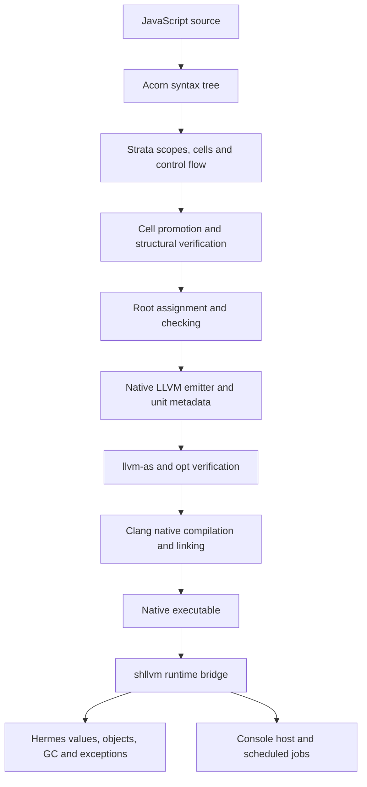
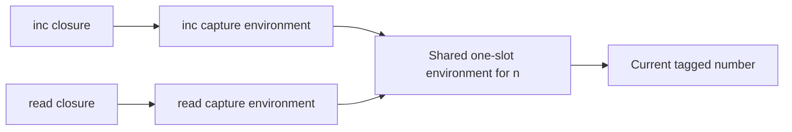
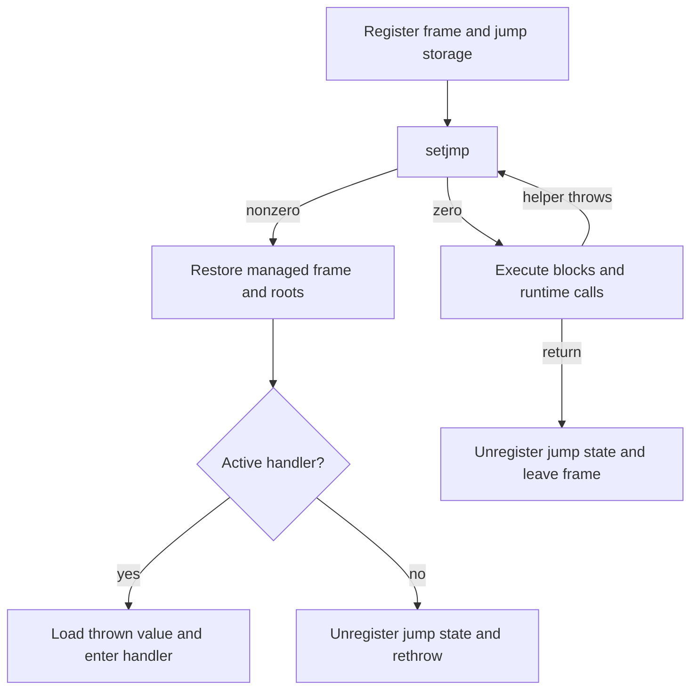

# Strata First: An Independent JavaScript Compiler on LLVM and Hermes

Strata now translates a defined JavaScript subset into native machine code through its own intermediate representation and LLVM emitter. It uses Acorn for parsing and Hermes for managed execution, including objects, closures, garbage collection, exceptions, and scheduled jobs. The Hermes frontend does not participate in this translation path. This report explains how that division was implemented, which correctness obligations it creates, and what the recorded execution evidence establishes.

The project is in `/home/manuel/code/wesen/2026-10-28--llvm-js`. This article describes the implementation through commit `3e86de2`, following the first native milestone at `62ee096`, on October 29, 2026. It is a project report grounded in the design document, chronological diary, delivered source, and retained test receipts. Proposed future work is identified separately from implemented behavior.

> [!summary]
> Strata owns source lowering, intermediate representation, cell promotion, root allocation, and LLVM emission. Hermes supplies the managed runtime without source changes for this milestone.
>
> The final qualification passed 76 checks on the normal runtime and 76 on an aggressive-GC/AddressSanitizer runtime. Each campaign includes 72 successful executions and four expected language-error executions.
>
> Full-lifetime root reuse reduced a generated function with 1,201 SSA values to two SSA storage locations, within 12 total roots and one outgoing argument slot. This is a storage result, not a performance benchmark or a removal of the frame bound.

## 1. Why a separate compiler path exists

Earlier work in this repository extended the Hermes-to-LLVM compiler and its runtime integration. That path already handled a substantially larger JavaScript feature set, and later work added an engine, JIT-related infrastructure, module hosting, and application qualification. The Strata milestone asks a different implementation question: can the project own a small, inspectable compiler representation and emission path while continuing to use the existing runtime?

The answer is now demonstrated by native execution. Strata does not generate JavaScript for Hermes to compile, and it does not call the Hermes compiler as an internal compilation step. Its emitted functions, control-flow transfers, calls, root storage, and unit metadata become actual LLVM input. The runtime bridge remains a dependency because implementing a JavaScript object model and collector is separate from implementing a frontend and code generator.

This separation also changes how feature claims must be read. Async functions and modules supported by the earlier compiler do not automatically become supported by the Strata frontend. Conversely, reusing Hermes means Strata does not need to implement the internal Promise machinery to call an existing Promise method. Syntax translation, runtime operations, and execution hosting are distinct responsibilities.

The imported Strata workspace contained an educational compiler, an interpreter, analysis and rewriting machinery, examples, documentation, and illustrative backend work. The selected direction preserves that material while introducing a concrete native backend. Working code lives in `strata/`; the original documents and source remain under the ticket's `source/` tree. The archived ZIP and import manifest preserve the complete release and its 1,083 regular-file identities. Reference preservation matters because corrected implementation decisions should not silently rewrite the evidence about what was originally delivered.

## 2. The execution model, from source to an observable result

A frontend translates source syntax into operations with explicit inputs, outputs, and control flow. Strata groups operations into basic blocks. A basic block executes its operations in order and finishes with a terminator, such as a branch, jump, return, or throw. Successor blocks can receive parameters, which represent values transferred along control-flow edges.

A value in static single assignment form, abbreviated SSA, has one defining instruction or parameter position. A mutable JavaScript variable cannot always be represented by a single such value. Strata therefore also has cells: storage locations whose contents can change. Cell promotion removes unnecessary local storage when the transformation can express the variable's behavior directly through values and block parameters. Captured mutable variables retain shared storage.

The following source was used for the first native probe:

```javascript
let x = 1;
print(x + 2);
```

The initial frontend representation includes a cell and its initialization. After promotion, the essential computation can be described by this schematic IR. This is explanatory notation, not an exact dump format:

```text
entry:
    a = number_constant(1)
    b = number_constant(2)
    sum = js.add(a, b)
    host.print(sum)
    return undefined
```

The emitter materializes runtime values for the constants, invokes the runtime's JavaScript arithmetic helper, resolves the host print operation, and calls it with the result. LLVM assembles and verifies the generated module; Clang links it against the existing bridge and runtime libraries. The resulting executable prints `3`. Its first recorded configuration used 11 registered homes and one outgoing argument slot, before the final reuse work.



The native function signature is `i64 function(ptr runtime)`. Its result is a tagged runtime word. JavaScript arguments do not appear as additional LLVM parameters; the function reads them from the managed call frame. The emitter also produces a unit constructor and a `main` function. The constructor registers metadata, while `main` calls `shllvm_run` to execute within the existing host.

## 3. Code ownership and the small native interface

The implementation separates language translation, runtime contracts, root assignment, emission, and tool execution. These are different kinds of correctness work. A parser change should not need to modify process invocation, and a link-option correction should not change the semantics of a closure.

| File or directory | Responsibility |
|---|---|
| `strata/src/core/` | Imported IR, interpreter, analyses, transformations, and model pipeline |
| `strata/src/frontend.js` | Source lowering, scope handling, and native-profile semantic corrections |
| `strata/native/frontend.js` | Select the native mode, promote cells, and structurally verify the result |
| `strata/native/abi.js` | Read actual runtime helper declarations and operation enums |
| `strata/native/roots.js` | Compute lifetime conflicts, assign homes, and check the assignment |
| `strata/native/emitter.js` | Emit LLVM functions, runtime calls, unit data, and exception paths |
| `strata/tools/build-engine.js` | Assemble the source pieces into Node-loadable modules |
| `strata/tools/strata-native.js` | Verify, compile, link, execute, and record artifact provenance |
| `strata/test/` | Differential execution, rejection contracts, allocator checks, and negative controls |

The native frontend entry point is intentionally short. Its essential sequence is `frontend.compile(source, {name, native: true})`, `promoteCells` for each function, and module verification. It does not enable speculative rewrites or rely on inferred primitive types to remove collector roots. Those choices narrow the initial proof obligations: values keep the runtime's tagged representation, and the backend preserves their storage explicitly.

The command surface contains `emit`, `build`, and `run`. Emission includes real LLVM assembly and verification. Building adds native linking, and running executes the result. Explicit options select the runtime build, LLVM tool directory, optimization level, and root policy. The implementation does not require a package installation step because the pinned Acorn source and its license are included.

## 4. The runtime ABI is more than a list of C prototypes

An application binary interface, or ABI, specifies how independently compiled components exchange control and data. Here it includes function signatures, tagged-value representation, frame registration, unit metadata, call argument layout, and exception state. The bridge header at `hermes/lib/BCGen/SH/LLVMNative/runtime.h` is the declaration authority. The corresponding implementations establish behavior that a C signature alone cannot express.

`strata/native/abi.js` extracts helper declarations and enum values from that actual header. The emitter's checked call builder rejects unknown helpers and wrong argument counts, then uses the extracted types when printing LLVM calls. This avoids maintaining a second handwritten table of prototype types. The header identity is included in emitted metadata.

Prototype checking cannot establish whether a helper collects, invokes arbitrary JavaScript, borrows an input pointer, aliases its output with an operand, or throws. Those properties govern whether rooted values remain valid during a call. The initial backend therefore uses conservative storage and call ordering rather than treating a successful signature lookup as a complete semantic contract.

A useful source-reading sequence follows these operations:

| Bridge operation | Compiler obligation |
|---|---|
| `shllvm_constant` | Request the correct kind and payload; use runtime encoding rules |
| `shllvm_frame_size`, `shllvm_enter` | Allocate and register a sufficiently large root frame |
| `shllvm_call` | Supply a rooted callee and receiver and correctly prepared argument storage |
| `shllvm_env_create/load/store` | Preserve environment identity and managed references |
| `shllvm_catch_prepare` | Restore execution state after nonlocal exception transfer |
| `shllvm_leave` | Remove the current frame before returning |

A tagged value occupies eight bytes, but those bytes cannot be interpreted uniformly as an integer, floating-point number, or pointer. Numerical constants and exceptional floating-point values use the bridge's conversion rules. The backend does not invent a parallel NaN-boxing implementation. This keeps numerical representation coupled to the runtime that actually interprets the word.

### Exact string and function metadata

Strings are emitted into ASCII or UTF-16 pools with offsets, lengths, and hashes. JavaScript strings are sequences of UTF-16 code units; a serializer that replaces unpaired surrogates would change the language value before execution begins. The native serializer preserves those code units.

The hash uses the character-wise Jenkins update implemented by Hermes. Adding a final mixing operation from a different algorithm with the same family name would produce incompatible metadata. This is a concrete example of why a familiar algorithm name is insufficient to specify an ABI field.

Function descriptors contain four 32-bit fields describing the name, parameter count, kind, and invocation restrictions. Native symbols and unit identifiers are generated identifiers rather than raw source names. Metadata and function bodies are emitted together so that runtime closure construction can locate the correct native entry point.

## 5. Roots, authoritative homes, and lifetime interference

A garbage-collector root is a location registered for tracing. When collection moves an object, registered references can be updated. A value retained only in an unregistered native location can become stale even though the program still intends to use it. The emitter consequently treats registered storage as the authoritative home of tagged values across runtime operations.

The initial policy, `distinct`, assigns each SSA value its own home. That is easy to inspect, but the number of definitions can be much larger than the number of values needed simultaneously. A function that repeatedly updates an accumulator may create many SSA definitions while retaining only a small live set. The `reuse` policy assigns the same storage location to values whose required lifetimes do not overlap.

This is a graph-coloring problem. Each SSA value is a vertex. An edge means that the two values require different homes. A color identifies a storage slot. The implemented deterministic greedy allocator visits values in order and chooses the first slot not already used by an assigned neighbor. It aims for a small, reproducible assignment; it does not claim to find a minimum coloring.

The crucial design decision is how the conflict graph is built. Safepoint-only interference is insufficient when roots are also the permanent storage for ordinary execution. Two values can be needed simultaneously between collections. A helper can read operands while writing its result. Block parameters can overwrite storage during a transfer. Each of these creates a conflict even if no collection occurs at that exact point.

The analysis solves backward liveness to a fixed point. Liveness describes which values must remain available for future uses. Normal successor requirements are translated through block arguments. Exceptional successor requirements are conservatively incorporated at every operation, rather than trusting imported effect annotations to exclude throws.

```text
repeat until block live-in sets stop changing:
    for each block in reverse order:
        live = required terminator and successor values
        for each operation in reverse order:
            live += exceptional successor requirements
            record conflicts among live, operands, and result
            live -= result
            live += operands
        record block-parameter write conflicts

assign deterministic nonconflicting slot numbers
recompute requirements and check the assignment
reject missing homes or conflicting values in one home
```

The assignment checker provides a useful boundary: allocation policy may change without weakening the check that its output satisfies the recorded conflicts. However, both allocation and checking use the same requirements function. Passing this checker is not an independent proof that those requirements capture every native lifetime obligation. The report retains that distinction because a shared analysis bug could affect both paths.

### Parallel transfers and outgoing arguments

Block arguments have simultaneous assignment semantics. Suppose one edge conceptually transfers `(a, b)` into destinations that currently store `(b, a)`. Writing the first destination before reading the second source can destroy a needed value. The emitter loads all source values before storing any destination. This implements the parallel transfer explicitly.

Calls impose a second lifetime constraint. Callee lookup, receiver evaluation, argument evaluation, and nested helper calls can allocate or execute JavaScript. Their intermediate values stay rooted. Only immediately before `shllvm_call` does the emitter copy arguments into contiguous outgoing storage. No collecting helper is inserted between that copy and the bridge operation that moves the arguments into the managed call frame.

The fixed admission rule remains 1,024 combined root and argument slots. Literals, scratch storage, and the global object home remain separately assigned. The wide-function probe created 1,201 SSA values through 1,200 sequential additions. Distinct storage exceeded the bound; reuse required two SSA homes, 12 total roots, and one argument slot. Native execution printed `1200`.

This result establishes that definition count need not determine frame size. It does not show that every large function fits. Many simultaneous live values, numerous constants, or large call argument requirements can still exceed the bound. Nor does the slot bound describe total stack consumption: frame headers, native spills, runtime frames, and recursion add memory use.

## 6. Cells and closures preserve shared state

A closure combines executable code with access to its captured environment. Capturing a mutable binding requires preserving the binding's storage identity. Copying its current value into each closure would make later mutations invisible to the other closures.

The native mapping uses a one-slot Hermes environment for each Strata cell. A closure's environment holds references to its captured cells. At entry, the native function obtains the closure environment from its managed frame and loads the capture slots into the homes corresponding to Strata's leading capture parameters. Remaining parameters describe the receiver and ordinary JavaScript arguments.

The closure fixture contains this program:

```javascript
function counter(start) {
  let n = start;
  return {inc: () => ++n, read: () => n};
}
let c = counter(10);
print(c.inc(), c.read(), c.inc());
```

The expected printed values are `11 11 12`. Both closures refer to the same cell, even after `counter` has returned. The mutation performed by `inc` changes the location read by `read`.



Cell initialization also encodes a language distinction. An uninitialized lexical binding must throw when read during its temporal dead zone, while an initialized binding containing `undefined` must be readable. The initial implementation review found that the inherited `SHLLVM_UNINIT` convention mapped to `undefined` and did not represent the required state. The corrected native path stores `SHLLVM_EMPTY`, constant kind 4, and uses TDZ check mask 1. This separates initialization state from a legitimate JavaScript value.

## 7. Exceptions and completion through finally

A runtime operation can throw across several native calls. Hermes's bridge uses setjmp/longjmp machinery for this transfer. A generated function with handlers therefore needs an explicit restoration path; an ordinary LLVM branch cannot represent the entire behavior.

The emitter registers jump storage and declares `_setjmp` with `returns_twice`. A normal return from setjmp enters the function's blocks. A nonzero return indicates an exception transfer. The function maintains a volatile handler index identifying the currently active catch destination. The exceptional path calls `shllvm_catch_prepare` before reading the thrown value or resuming a handler, restoring the managed frame and local-root state.



The handler index must survive optimization and the nonlocal transfer, which explains its volatile storage. Values needed by a handler must likewise remain in registered homes. A normal return removes jump registration before releasing the frame. A throw originating in a catch or cleanup region must select the appropriate enclosing handler, rather than reentering the handler that has already caught the exception.

A `finally` block requires preserving a pending completion. A completion identifies why control is leaving a region and carries a value where needed. For example, a return can be pending while cleanup executes, and cleanup can itself return or throw, replacing that pending result.

The first native implementation represents these internal records as two-slot Hermes environments: one slot for the kind and one for the value. The imported design discussed splitting records into independent kind/value components, but doing so requires consistent rewriting of operations, block parameters, and transfers. Managed environments implement the existing IR directly. Removing these allocations remains a possible measured optimization; it was not required to establish correct native execution.

The tests exercise nested handlers, return through finally, cleanup overriding a return, thrown object identity, and mutable state around throws. O2 execution is especially useful here because incorrect setjmp annotations or state placement can survive an unoptimized test and fail after optimization.

## 8. Frontend corrections exposed by native execution

Moving a frontend from a model environment to an existing JavaScript runtime makes evaluation order and execution context observable. Several fixes were therefore frontend semantic work rather than LLVM instruction-selection work.

Method property lookup must happen before argument evaluation. A getter that returns the called function can have side effects, and an argument expression can observe them. Delaying the property read until after evaluating arguments changes program behavior even if the final native call has the correct receiver and argument values. The corrected lowering preserves the source evaluation sequence before emission begins.

Receiver handling distinguishes ordinary sloppy functions, strict functions, and arrows. Sloppy ordinary calls use runtime receiver coercion. Strict calls retain the supplied receiver. Arrow functions use their captured lexical receiver. Script-level `this` needs the global object, so native mode includes an explicit `js.global_object` operation. Treating all of these cases as one generic parameter conversion would erase language distinctions.

Unknown-global `typeof` also requires a runtime lookup with allow-missing behavior. Returning `"undefined"` for every syntactically unbound name would misdescribe an existing runtime global such as `Math`. This is different from simply suppressing all lookup errors.

One implementation attempt placed strictness lookup on assignment targets through the frontend's scope map. Not every target node had an entry, producing a campaign with 36 of 72 checks passing and repeated `Cannot read properties of undefined (reading 'strict')` errors. The correction reads strictness from function metadata, where it belongs for this lowering. The failed receipt remains in the ticket, separate from final evidence.

Compiler-private storage identifiers were also changed to use names unavailable as source identifiers, such as `#scratch`, rather than names like `$scratch0` that valid JavaScript can declare. A regression now exercises `$scratch0` and `$global` as user parameters. Internal naming is part of correctness whenever the compiler uses strings to identify values or storage.

## 9. Host jobs and the limits of runtime reuse

The native subset can call host operations for printing, timers, microtasks, and Promises. Scheduled closures are still Strata-generated native functions. The existing console host drains its jobs while retaining the native unit, so no second scheduler was needed for this milestone.

This does not imply support for async function syntax. Promise methods can be called through runtime objects while `async` and `await` remain unsupported frontend constructs. Generator syntax similarly requires a resumable-state lowering that this path has not implemented, even though the earlier Hermes-based compiler has generator support.

Several frontend host forms assume normal host globals, including `print`, `queueMicrotask`, `setTimeout`, `Promise.resolve`, and Error construction. Replacing these bindings or installing observable getters is outside the admitted profile. Ordinary standard-library method calls can execute in Hermes, but the frontend's specialized forms must not be advertised as unrestricted JavaScript lookup semantics.

The imported `for...of` lowering also retains an array-index interpretation. Its supported use is ordinary arrays with unmodified iteration behavior. It does not implement arbitrary iterators, string iteration, array subclass semantics, or iterator closing. That is a documented semantic boundary, not a claim that every out-of-profile case receives a compiler rejection.

## 10. Build orchestration and trustworthy artifacts

The driver emits LLVM, invokes `llvm-as`, runs `opt` verification, and links with Clang. Structural LLVM verification catches malformed modules but cannot prove JavaScript semantics, correct roots, or valid runtime calling sequences. Execution checks remain necessary.

Artifacts include the LLVM text, bitcode, Strata IR, a build manifest, and the executable for build/run. Compilation occurs through temporary output locations, with publication after successful compilation and verification. Driver tests demonstrate that a failed compilation preserves five previously published artifacts. The driver also rejects source/output collisions and invalid optimization levels. This is a tested failed-compilation property, not a claim of an atomic transaction across all artifact files during every possible filesystem failure.

The source engine is assembled into ignored `lib/` files. Concurrent compilation initially needed explicit publication discipline here as well. The assembler now writes process-specific temporary files and renames them into place, preventing another compiler process from reading a partially written generated module. The final normal and stress campaigns ran concurrently with this arrangement.

Build manifests record source hashes, compiler inputs, runtime library identities, configuration, commands, tool versions, and root counts. The selected CMake cache determines sanitizer link flags. Hashing only the static bridge would be insufficient: a changed shared runtime library can change collector behavior while leaving the bridge unchanged.

The default tool paths are the repository's `hermes/build-llvm` and `/usr/lib/llvm-18/bin`. Explicit overrides avoid relying on ambient environment variables to determine which runtime was tested. These recorded configurations make the evidence inspectable without claiming that a manifest is a hermetic build system.

## 11. Validation and its interpretation

The final corpus contains 19 fixtures. Each fixture is compiled with distinct and reused homes at LLVM O0 and O2, producing 76 checks per runtime configuration. Eighteen fixtures complete normally; imported J-07 deliberately throws `Error: missing field price`. Thus each matrix contains 72 normal executions and four expected language-error executions.

| Qualification component | Recorded result |
|---|---:|
| Normal runtime, both root policies and optimization levels | 76/76 |
| Aggressive handle sanitization plus ASan runtime | 76/76 |
| Successful executions in each matrix | 72 |
| Expected language-error executions in each matrix | 4 |
| Unsupported-context rejection contracts | 8 |
| Parse-error contract | 1 |
| Wide generated function | Prints `1200`; 12 roots + 1 argument slot |
| Deliberately colliding root assignment | Rejected |
| Failed-compilation publication checks | Passed |
| GC negative control | Valid program succeeds; mutated program fails under ASan |

The runner uses Node script execution as a differential reference and normalizes printed observations through string conversion. It compares preceding output and completion category, including the expected-error case. Node is an observation source, not a definition of language correctness, and normalized printing does not establish every detail of identity, negative zero, or object formatting. Dedicated assertions are needed when those distinctions are the subject of a test.

The final two campaigns used identical compiler-input fingerprints across all 152 checks. Delivered fixture hashes were also compared with the recorded sources. Earlier campaigns, including the 12-case initial subset, the 68-case expansion, and the strictness failure, remain historical evidence rather than being combined into the final totals.

### Aggressive collection and the negative control

The separate `hermes/build-strata-gcstress` runtime enabled `HERMESVM_SANITIZE_HANDLES` and AddressSanitizer. Each stress execution passed `-gc-sanitize-handles=1`, selecting aggressive handle sanitization rather than merely relying on the build-time default. The build required the actual managed runtime and console libraries; building only the static bridge did not complete the necessary configuration.

A targeted negative control used an object retained across an explicit `gc()` and subsequently read. The valid program printed `42`. A test-only LLVM mutation changed the registered root count to zero. The mutated executable failed with an AddressSanitizer SEGV/invalid-read report in `JSObject::defineOwnPropertyInternal`.

That exact diagnostic matters. It was initially described too specifically as a heap-use-after-free and then corrected after inspection. The retained stderr does not use that category. The experiment shows that this configuration detects this deliberately broken root setup. It does not prove that every missing root will fail deterministically or that every lifetime error is detectable.

The runtime and bridge are ASan-instrumented in this configuration; complete ASan instrumentation of generated LLVM bodies is not claimed. No leak-check disabling was required for the successful stress run. The results establish targeted Linux x86-64 host behavior, not physical PicoCalc execution, general portability, or complete ECMAScript conformance.

## 12. Reproducing and investigating the result

From the repository root, the following commands exercise the delivered path:

```sh
node strata/tools/strata-native.js run strata/test/fixtures/ledger.js -O 2
node strata/tools/strata-native.js emit strata/test/fixtures/closures.js -o /tmp/closures
node strata/tools/strata-native.js build strata/test/fixtures/ledger.js \
  --roots distinct -o /tmp/ledger

node strata/test/boundaries.test.js
node strata/test/roots.test.js
node strata/test/driver.test.js
node strata/test/native.test.js /tmp/strata-native-tests
node strata/test/native.test.js /tmp/strata-native-stress \
  hermes/build-strata-gcstress stress
node strata/test/gc-negative.test.js hermes/build-strata-gcstress
```

The selected runtime build must contain the bridge archive and the Hermes VM and console shared libraries. A normal runtime build is not equivalent to the handle-sanitizing build merely because a runtime flag is supplied. For a new machine, follow the ticket guide's build configuration and use `--build-dir` and `--llvm-bin` for explicit locations.

When a program fails, first determine the failing stage: source admission, Strata verification, LLVM assembly, LLVM verification, linking, or execution. Then inspect the emitted `.ir` and `.ll` together. A wrong evaluation order visible in Strata IR belongs to frontend lowering; correct IR with a broken native lifetime belongs to root assignment or emission. A correct call signature with an incorrect environment layout requires runtime ABI investigation.

The diary records an initial sandbox `EPERM` when spawning `llvm-as`; the same input succeeded when tool execution was permitted. This was an execution-environment failure, not evidence of invalid LLVM. Separating these categories avoids repairing compiler logic in response to a process permission problem.

## 13. What remains architectural, and what remains unimplemented

The present architecture deliberately retains Hermes's value representation, environment operations, collector, exceptions, and console host. Replacing any of these requires revisiting the runtime boundary. The handwritten LLVM text emitter is independent of the Hermes frontend, but independence from the runtime representation has not been achieved or claimed.

Other limits are missing translation or integration work. Classes, generators, async syntax, BigInt and RegExp literals, destructuring, direct lexical eval, named function expressions, implicit `arguments`, general construction, and source modules are outside the current native profile. Some are explicitly rejected; other constrained forms, notably array-only iteration and fixed host-global assumptions, require users to respect the documented subset.

| Boundary | Current cause | A concrete direction |
|---|---|---|
| Restricted source syntax | Missing frontend representations or lowering | Add one construct with source, IR, native, and failure-path tests |
| Array-only `for...of` | Inherited index-based lowering | Represent iterator operations and abrupt-completion cleanup explicitly |
| 1,024 combined slots | Existing bridge/frame admission rule | Measure simultaneous liveness and constant pressure before changing storage |
| Managed completion allocations | Simple initial representation | Consider kind/value decomposition with systematic edge rewriting |
| Runtime coupling | Concrete Hermes ABI and tagged values | Specify semantic helper contracts before introducing another runtime |
| No Strata JIT integration | Native command-line path is AOT | Integrate unit loading and lifetime management with the existing engine |
| No speculative tier | No guards, recovery state, or deoptimization | Add only after evidence justifies a specialized execution tier |

AOT means ahead-of-time native compilation in this command-line workflow. A JIT compiles during execution or within a running host; it need not be speculative. Existing repository JIT work remains separate from this milestone. Supporting in-process loading of Strata-generated units would be a concrete next integration task without requiring immediate deoptimization machinery.

The most direct next language improvements should come from application failures: proper iterators, ordinary construction, argument objects, and other constructs that block useful programs. Runtime replacement and a generic ABI negotiation system are larger design choices. Keeping these work items separate preserves the current benefit: an inspectable compiler that can already produce and execute native code.

## 14. Reading path and retained evidence

Start with `strata/README.md`, then read `native/frontend.js`, `native/roots.js`, and `native/emitter.js` alongside the actual bridge header. Use the fixtures to connect each emitted behavior to an observable program. The driver and its tests explain how compilation results become published artifacts.

The ticket directory is:

```text
/home/manuel/code/wesen/2026-10-28--llvm-js/ttmp/2026/10/29/
STRATA-PORT-001--strata-workspace-import-and-hermes-llvm-port-assessment/
```

Within that directory, the principal sources for this report are:

- `design-doc/01-strata-first-native-compiler-design-and-intern-implementation-guide.md`, including its implemented-status section.
- `reference/01-import-and-investigation-diary.md`, preserving successful experiments, failed campaigns, decisions, and corrections.
- `reference/02-imported-strata-hermes-llvm-intern-guide.md`, the revised working port guide.
- `reference/evidence/native-qualification-summary.json`, with the final counts and identities.
- `reference/evidence/final-native-normal.json.gz` and `final-native-stress.json.gz`, containing the detailed final receipts.
- `reference/evidence/gc-negative.stderr.txt`, retaining the exact negative-control diagnostic.
- `source/wb/src/`, `source/wb/content-src/`, `source/exports/`, and `source/strata-api/`, preserving imported source, authored documents, and examples separately from working code.

The validated intern guide was uploaded as `STRATA-PORT-001 Strata First Native Compiler Validated Guide.pdf` to `/ai/2026/10/29/STRATA-PORT-001` on reMarkable. This article is a separate explanation for the vault, organized around the implemented system rather than the implementation sequence.

For the preceding compiler work, read [[PROJ - Direct LLVM JavaScript - Application Results and Backend Limits]], [[PROJ - Direct LLVM JavaScript - Persistent Engine and Application Qualification]], and [[PROJ - Direct LLVM JavaScript - ECMAScript Module Host Implementation]]. Those reports describe the inherited repository context; their feature claims must not be transferred automatically to Strata's current frontend.

## 15. Exercises for a code review

1. Construct a block-argument swap and explain why sequential stores are incorrect. Locate the emitter's load-before-store transfer and identify the root conflicts required at that edge.
2. Extend the counter fixture so collection occurs between closure creation and mutation. Explain which environments must remain reachable and why copying the captured number would change the result.
3. Trace a pending return through a finally block that throws. Identify the completion record, active handler changes, and frame restoration operations.
4. Find a function whose constant roots dominate its frame size. Compare its root manifest under both policies and explain why SSA reuse alone does not solve that pressure.
5. Add a differential probe that distinguishes a method getter running before its argument expressions. Decide whether a failure belongs in the frontend, emitter, or runtime based on the Strata IR.
6. Review the requirements function independently of the allocator. Identify the assumptions shared by allocation and checking, then propose a test that challenges an exceptional-edge lifetime.

These exercises target the current correctness boundaries: source evaluation order, shared mutable state, nonlocal control flow, and managed-value lifetime. They provide a concrete basis for extending the compiler while keeping each new behavior connected to its representation and execution evidence.
