# Claude Blocks: Notion-Shaped Pages Over a Live Hypha Log — A Technical Deep Dive

**Claude Blocks** is a claude.ai Artifact that presents CC5's shared computer as a workspace of pages, in the form Notion made familiar: a sidebar of nested pages, a centred column of blocks, a slash menu, drag handles, properties under the title, and databases shown as tables, boards, and calendars. Underneath, nothing about CC5's model changes. Every page is a scope in one Hypha log, every block is an element stored as cells, and every keystroke, slider movement, and Claude reply is an operation in that log. What the project adds is a new front end, `blocks.js`, and a small kit of prose elements, `blocks-kit.js`. They decide how a tree of cells is held, edited, and read as documents.

This report explains how that front end is built. It assumes the reader knows nothing about CC5 and introduces the few Hypha concepts the design depends on before using them. The deeper mechanics of Hypha, Fruit, and Spore are covered in [[PROJECT REPORT - CC5 Godprompt Computer - Hypha, Fruit and Spore - An Independent Technical Deep Dive]]; this report refers to them where it needs them. The export contains only the published files, with no session log, so there is no companion diary. Statements about behaviour come from reading the code and from running it locally, and section 15 lists those runs.

> [!summary]
> - **A page is a scope, and a block is an element.** A page's `title`, `icon`, `cover`, and `parent` are ordinary cells; its other cells are its properties; its body is the view block `page.ui`, where prose blocks (`p`, `h2`, `todo`, `callout`) sit in the same list as live ones (`slider`, `table`, `board`, `spore`). A sentence can hold a formula, `{per_person}`, which stays true as the data changes.
> - **The editor writes Hypha lines.** Typing, splitting, indenting, dragging, and turning one kind of block into another are all expressed as short Hypha writes. Block order is a number with gaps of 1,024 between neighbours, so an insertion normally writes one block. Typing is debounced and coalesced, so a sentence typed in one go is one operation.
> - **Claude writes in place.** Pressing space on an empty line turns that line into a *Claude block*, a Hypha hole with an intent. Up to four Claudes fill holes in parallel, each restricted to its hole's paths, and their half-written lines appear as ghosts where they will land. A Claude in the conversation can write the same workspace through two database calls.
> - **The engine is CC5's, unchanged.** Seven of the nine scripts are byte-identical to the CC5 Godprompt Computer export; `blocks.js` replaces `cc5.js` and carries over its storage, synchronisation, undo, and time-travel code. The strains are the ones a renumbering scheme and a fork introduce: renumbering a page deletes and rewrites every block, which can drop or duplicate a concurrent edit, and a few adapted strings and exports are out of step with the engine.

## 1. What the export contains

The export is a zip of ten files, received on 2026-10-29 and unpacked into `/home/manuel/code/others/ramon/claude-blocks`. It contains no transcript, tests, or screenshots.

| File | Bytes | Lines | Relation to CC5 Godprompt Computer |
|---|---:|---:|---|
| `hypha.js` | 65,166 | 1,058 | byte-identical |
| `fruit.js` | 32,538 | 492 | byte-identical |
| `fruit-kit.js` | 62,231 | 600 | byte-identical |
| `browser.js` | 12,960 | 172 | byte-identical |
| `computer.js` | 30,281 | 378 | byte-identical |
| `lego.js` | 15,740 | 220 | byte-identical |
| `spore.js` | 188,540 | 2,687 | byte-identical |
| `blocks-kit.js` | 13,451 | 171 | new: prose block elements, rich text, colours, numbering |
| `blocks.js` | 195,383 | 2,381 | new: replaces `cc5.js`; 357 of its non-trivial lines (over 30 characters) are identical to lines of `cc5.js` |
| `index.html` | 131,457 | 1,658 | rewritten: new README for Claude, Notion-like layout and stylesheet; keeps the Spore textbook |

The script order is CC5's, with the desktop replaced:

```html
<script src="hypha.js"></script>      <!-- the kernel: ops, tree, formulas, log -->
<script src="fruit.js"></script>      <!-- views as cells -->
<script src="fruit-kit.js"></script>  <!-- the element library -->
<script src="browser.js"></script>
<script src="computer.js"></script>   <!-- clock, jobs, files, programs -->
<script src="lego.js"></script>       <!-- components -->
<script src="spore.js"></script>      <!-- the JavaScript app language -->
<script src="blocks-kit.js"></script> <!-- new: p, bullet, todo, callout, fold, columns, page, toc -->
<script src="blocks.js"></script>     <!-- new: the workspace; calls boot() -->
```

The header comment of `blocks.js` states the design in four sentences: "CC5's computer in Notion's form factor. The engine is CC5's, unchanged: one Hypha log that people and Claudes write together, Fruit views, programs, Spore, the browser. What changes is the shape you hold it by: a page is a top-level scope; its body (page.ui) is a list of blocks, prose and live ones in one flow; its other cells are its properties; a hole is a Claude block that a Claude writes in place." The page's own note to agents credits CC5 to Ramon Marc and says its parts are used unchanged. The files do not record who wrote `blocks.js` and `blocks-kit.js`.

## 2. The four Hypha ideas the design rests on

Claude Blocks is built from four concepts that come from Hypha, CC5's kernel.

1. **An operation is one line of text.** `lisbon.days = 5` sets a value, `lisbon.total = sum(costs.*.amount) + stay` sets a formula, `lisbon.days -` deletes. Each line applies the moment it ends and is appended to a shared log as `[id, peer, clock, text, at]`. The state is the result of applying the log in order. The `peer` names who wrote the line, such as `u1x2:you` for a person or `u1x2:f2` for the second hole-filling Claude.
2. **The tree holds only leaves.** A record written to `lisbon.costs.0` becomes the cells `lisbon.costs.0.what`, `.cat`, and `.amount`. Any part of a structure can therefore be read, written, or deleted by its path.
3. **A formula resolves names outward from its own scope.** Inside `lisbon`, the name `days` means `lisbon.days`; another page is reached by full path, such as `lisbon_prep.ready`. A name that resolves to nothing does not raise an error; the formula becomes *unfinished* and recomputes when the name appears. A **hole**, `?"an intent"`, is a cell whose value is "not written yet" and is unfinished in the same way.
4. **A view is a subtree of cells.** Inside a `ui:` scope, each line is an element written at the next index: `lisbon.ui.0 is p "…"` stores the kind in `lisbon.ui.0.k` and the text in `lisbon.ui.0.text`. An element's props are formulas that resolve from the element's page, which is why a block can show live values.

Everything that follows is a choice about how to map a document onto these four ideas.

## 3. The data model: pages, properties, and blocks

### 3.1 A page is a top-level scope

Every top-level branch of the tree that is not reserved is a page. The reserved names are `desk sys clock spaces theme fn lib jobs ws`; they hold machinery rather than documents. The example workspace's second page shows the whole model in one place:

```hypha
lisbon:
  title = "Lisbon in May"
  icon = "🇵🇹"
  cover = "ocean"
  days = 5
  people = 2
  nightly = 120
  budget = 2000
  costs:
    0 = {what: "Flights ZRH to LIS", cat: "travel", amount: 380}
    1 = {what: "Metro and tram passes", cat: "travel", amount: 48}
    …
  stay = nightly * (days - 1)
  total = sum(costs.*.amount) + stay
  per_person = round(total / people)
  per_day = round(total / people / days)
  ui:
    p "Five days in Alfama in May. The numbers here are live: …"
    columns
      col
        slider days, min: 2, max: 14, label: "Days"
      col
        choice people, options: "1|2|3|4", label: "Travellers"
    grid cols: 3
      stat total, label: "Trip", pre: "€"
      …
    p "{days} days for {people}: **€{total}** in all, €{per_person} each. …"
    when total > budget
      callout "Over the €{budget} budget by €{total - budget}. Trim a dinner, or a night.", icon: "⚠️", tone: "bad"
    h2 "Costs"
    table costs, cols: "what|cat|amount", total: true
    donut sumby(costs, "cat", "amount"), label: "spent", unit: "€"
    h2 "Getting ready"
    progress lisbon_prep.ready, label: "Ready to go"
    page "lisbon_prep"
    h2 "Where to eat"
    ?"three small tascas in Alfama worth a dinner, as bullet blocks: the name in bold, then what to order"
```

The children of a page fall into three groups, and the code names each one:

| Group | Cells | Shown as |
|---|---|---|
| Metadata (`META`) | `title icon cover parent full order ui serif small` | the page header: cover, icon, title; the sidebar tree; page options |
| Properties | every other cell of the page that is not page-local | a list under the title, each row typed by its value (`#` number, `ƒ` formula, `≡` list, `✳` hole, `▶` program) |
| Body | the view block `page.ui` | the column of blocks |

Sub-pages are made with a cell: `lisbon_prep.parent = "lisbon"`. The sidebar builds its tree by following `parent` cells, refusing a parent that does not exist or that would make a cycle (the walk stops after 24 hops), and orders siblings by the clock of the operation that first wrote their `title` or `ui`, unless an `order` cell overrides it. Deleting a page writes `page -` and re-parents its children to its own parent, so a deletion never orphans a subtree in the sidebar.

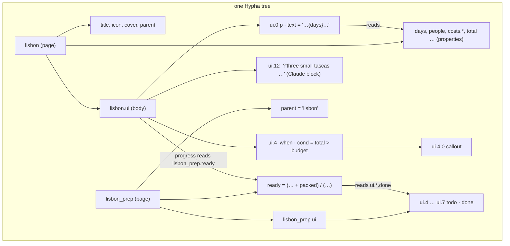

### 3.2 Prose and live blocks in one list

A block is any element in `page.ui`. Claude Blocks distinguishes two families only in how they are edited, not in how they are stored. **Prose blocks** — `p h1 h2 h3 bullet numbered todo quote callout code fold` — are edited in place as text. **Live blocks** are every Fruit element CC5 already had: inputs, numbers, records, charts, layout, media, programs, Spore apps, browsers. Both are written as `kind args`, both are cells, and both can read the page's properties. Because the to-do blocks of `lisbon_prep` are cells, the page can count them:

```hypha
lisbon_prep:
  ticks = ui.*.done                                   # → [true, false, false, true]
  packed = count(match(ticks, "true"))                # → 2
  ready = (count(where(tasks, "status", "done")) + packed) / (count(tasks) + count(ticks))   # → 0.444
```

In the local run, ticking the unticked "Walking shoes" checkbox wrote the single operation `lisbon_prep.ui.5.done = true` as the person's peer; `packed` went from 2 to 3 and `ready` from 0.444 to 0.556, and the progress bar on the parent page `lisbon`, which reads `lisbon_prep.ready`, followed.

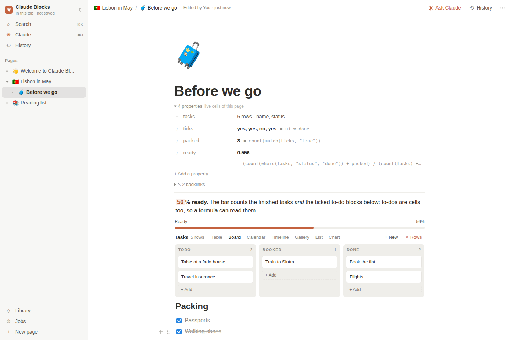

*Figure 1 — "Before we go", a sub-page of Lisbon. The properties list shows `ticks = ui.*.done`, a formula over the page's own to-do blocks. The opening sentence holds `{round(ready * 100)}`; the board is one view of the `tasks` list, with the view switcher above it.*

### 3.3 The block kit

`blocks-kit.js` registers nine element kinds with Fruit and makes them known to the parser:

```js
Object.assign(H.POS, { p: ["text"], bullet: ["text"], numbered: ["text"], todo: ["text"], callout: ["text"],
                       fold: ["title"], columns: [], page: ["of"], toc: [] });
for (const k of ["fold", "columns", "p", "bullet", "numbered", "todo", "callout", "quote"]) H.CONTAINERS.add(k);
```

`POS` gives each kind its positional argument, so `p "Hello"` stores `text`; `CONTAINERS` lets a kind hold child elements, which is how a bullet can hold indented bullets. The kit also supplies the prose behaviour that a document needs and CC5 lacked:

- **Rich text** is a light Markdown read by one tokenizer: `**bold**`, `*italic*`, `` `code` ``, `~~struck~~`, `[label](url)`, bare URLs, `[[page]]` mentions, and `{formula}`. Anything between braces is parsed as a Hypha expression and evaluated from the block's path, so names resolve from the block's page. A value that is an error renders as `!`, an unfinished one as `…` with the title "waiting for a hole to be filled".
- **Colours** follow Notion's ten (`gray brown orange yellow green blue purple pink red`) as `color:` and `bg:` props, each with a light and a dark value written into CSS variables.
- **Numbering** is computed, not stored: a `numbered` block counts the `numbered` blocks immediately above it, and switches to letters and then roman numerals by depth inside toggles.
- **`toc`** walks the page's headings, and **`page "other"`** renders a link card to another page.

The kit renders these kinds as Fruit elements "inside cards, embeds, the past, read-only pages", in its own words. On the live page the editor in `blocks.js` draws prose blocks itself, for reasons section 5 explains.

### 3.4 Sentences that compute

The design's most visible feature is a sentence with formulas in it. The Welcome page's line

```hypha
p "Put a formula between braces and it stays true: {cups} coffees at €{price} come to **€{bill}**."
```

renders with each value in a tinted chip. When the line is focused, the chips disappear and the source appears, exactly as typed. A block whose text begins with `=` becomes a formula as a whole: the editor parses the rest and, if it reads, writes `page.ui.N.text = <expression>` instead of a string. The parse happens on a throwaway kernel first, so a typo produces the notice "That formula does not read" rather than a broken block.

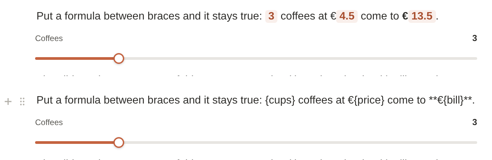

*Figure 2 — One prose block at rest (top) and focused (bottom). At rest, `{cups}`, `{price}`, and `{bill}` show as values; focused, the same element shows its source text, and the caret lands where it was clicked.*

There is one constraint here: prose has no escape for braces. Any `{…}` on one line is read as an expression, except inside inline code, which the tokenizer matches first. A Claude-written bullet containing the words "{formulas} in braces" rendered as "…" in the local run, because `formulas` is not a name on the page.

## 4. Block order: numbers with gaps

### 4.1 The scheme

A block's position is the numeric last segment of its path. Blocks are shown in numeric order, so `lisbon.ui.1024` comes before `lisbon.ui.2048`. New pages start their first block at 1,024 (`id.ui.1024 is p ""`), and new blocks take the integer halfway between their neighbours:

```js
const STEP = 1024;
slot(c, after) {
  const ns = kidsOf(S.K, c).map(q => +M.segOf(q));
  if (!ns.length) return STEP;
  if (after == null) return ns[0] >= 2 ? Math.floor(ns[0] / 2) : null;          // before the first block
  const a = +M.segOf(after), i = ns.indexOf(a);
  if (i < 0 || i === ns.length - 1) return ns[ns.length - 1] + STEP;            // after the last block
  const b = ns[i + 1]; return b - a >= 2 ? a + Math.floor((b - a) / 2) : null;  // between two blocks
}
```

When `slot` returns `null` there is no integer left between the neighbours. `relayout` then renumbers the whole list at multiples of 1,024, and `remap` translates old paths to new ones so that the caret and pending operations follow their blocks. The reason for the design is the cost of the common case. Inserting a block between two others writes one line, `lisbon.ui.1536 is p ""`, and leaves every other block untouched, which matters in a log that every viewer replays and that a Claude may be writing into at the same time.

### 4.2 What renumbering costs

Two facts make renumbering more frequent than the gaps suggest. First, blocks written as a `ui:` block — by the example workspace, by a Claude, or by pasted Hypha — receive Hypha's stream indices 0, 1, 2, …, which leave no gap at all. Second, renumbering is not a rename: Hypha has no move operation, so `relayout` deletes every block and writes each one again at its new index, children included. The local run measured both:

| Action on the 15-block Welcome page | Operations written |
|---|---:|
| First insertion after block 0 (indices 0–14, no gaps) | 34 (15 deletions, 18 rewritten blocks and children, 1 insertion) |
| Second insertion, after renumbering | 1 |
| Repeated insertions at the same place before the gap closes | 10 (1,024 halves ten times) |

Moving a block, by drag, by ⌘⇧↑/↓, or by Tab and Shift+Tab, uses the same mechanism on a smaller scale: `q -` followed by the block rewritten at its new path. In the typing test, pressing Tab on a new line wrote `reading.ui.2052 -` and `reading.ui.1028.1024 is p "Second line"`.

### 4.3 Renumbering and concurrent edits

Deleting and rewriting has a consequence for collaboration that a rename would not have. If one person's tab renumbers a page while another person is typing into one of its blocks, the second person's write targets a path that the first has just deleted. Hypha resolves this per path by stamp, `[clock, peer]`. A simulation with two Hypha kernels and the exact lines `relayout` writes produced two different outcomes, depending only on the second writer's clock:

```text
CASE 1: B edits concurrently
  B edit clock 5 | A delete of pg.ui.1 clock 6
  A receives B edit: rejected (a later write already replaced this)
  A: 1024:p "alpha" | 1536:p "new" | 2048:p "beta" | 3072:p "gamma"
  B: 1024:p "alpha" | 1536:p "new" | 2048:p "beta" | 3072:p "gamma"
CASE 2: B edits with a clock ahead of the delete
  B edit clock 17 | A delete of pg.ui.1 clock 6
  A receives B edit: applied
  A: 1:(no kind) "beta, edited by B" | 1024:p "alpha" | 1536:p "new" | 2048:p "beta" | 3072:p "gamma"
  B: 1024:p "alpha" | 1536:p "new" | 2048:p "beta" | 3072:p "gamma"
```

In the first case both replicas agree, and B's edit is lost. In the second case they disagree. A keeps B's text as a block with no kind at index 1, because B's write is newer than the deletion it arrives after. B discards its own edit, because the older deletion of `pg.ui.1` still removes the subtree under it. This is the per-path, last-writer-wins gap that the CC5 report notes for whole-record writes. A block editor reaches it through ordinary editing rather than through a rare pattern of writes. The window is small, a few hundred milliseconds of room latency and typing debounce, but every first insertion into a Claude-written page opens it.

## 5. The editor

### 5.1 One DOM element per block, kept in step with the tree

The editor does not render the page through Fruit's virtual DOM. `Ed.list` walks the numeric children of `page.ui` and, for each path, reuses the element it made last time if the kind is unchanged, or makes a new one. Elements are keyed by path, so a re-render after a remote write does not replace the element the person is typing in. Each block has a gutter (`+` to add a block below, `⋮⋮` to drag or open the block menu), a body, and a `.sub` container for child blocks. Prose blocks get a `contenteditable` text element, set to `plaintext-only` where the browser supports it, so the browser never inserts its own markup. Live blocks get a `.fr` container into which Fruit mounts the element, and database blocks get a bar of views above them.

### 5.2 Rich at rest, plain when typed

A prose block must show rich text at rest, and when clicked it must put the caret at the same character in the source. The editor solves this by making the DOM text equal the source text at all times. `liveHTML` wraps markup characters in `<span class="mk">`, which the stylesheet hides, and renders a formula as a chip whose visible value comes from CSS, not from text nodes:

```css
.mk { display: none; }
.b-val::after { content: attr(data-v); }
```

The `{cups}` source therefore stays in the DOM, invisible, while `3` is painted by `::after` and contributes no characters. `textContent` of the element is exactly the stored string, and a click's offset in the DOM is the caret's offset in the source. On focus the editor replaces the rich HTML with the plain source and restores the caret at that offset (`pointOffset` treats a click on a chip as a click just after it). In the local run the focused sentence read `{days} days for {people}: **€{total}** in all, €{per_person} each. …`, while its visible text at rest held the computed values.

### 5.3 From keystrokes to operations

Typing does not write a line per keystroke. Each input event schedules a save 260 ms later; the save writes `page.ui.N.text = "…"` with Hypha's coalescing flag, which replaces the person's previous write to the same path made within 900 ms. Undo marks are coalesced within 1.2 s. In the local run, typing a 42-character sentence at 60 ms per character produced one operation. Structural keys write explicit lines:

| Gesture | Operations |
|---|---|
| Enter in the middle of a block | save the first half; insert the second half as a new block after it (lists continue as lists; a block's children stay with the first half) |
| Enter on an empty list item | outdent it, or turn it into a paragraph |
| Backspace at the start | turn a non-paragraph into a paragraph; otherwise merge into the previous block: `prev.text = "…"` and `q -` |
| Tab / Shift+Tab | move the block into the previous block's children, or out of its parent |
| `# `, `## `, `- `, `1. `, `[] `, `> `, `" `, ```` ``` ```` at the start | turn the block into a heading, bullet, numbered item, to-do, toggle, quote, or code block |
| `---` | turn the block into a divider and open a paragraph after it |
| ⌘B, ⌘I, ⌘E, ⌘⇧S | wrap the selection in `**`, `*`, `` ` ``, `~~` |
| ⌘⌥0–8 | turn into paragraph, heading, to-do, bullet, numbered, toggle, or code; ⌘⌥9 makes the text a new sub-page |
| ⌘D, ⌘⇧↑/↓ | duplicate; move up or down |
| Escape | select the block; with blocks selected, Backspace deletes, ⌘C copies as Hypha, ⌘X cuts |
| space on an empty paragraph | open the Claude bar (section 7) |

Paste is interpreted in two ways. If the clipboard parses as Hypha view lines and starts with a block kind, it is inserted as those blocks. Otherwise Markdown is converted line by line: headings, to-dos, bullets, numbered items, quotes, fences, and rules become blocks, and other lines become paragraphs. "Copy as Hypha" puts a block's own lines on the clipboard, so blocks can move between pages, workspaces, and a chat with Claude as text.

### 5.4 Menus

The **slash menu** opens when `/` is typed at the start of a word. It lists every kind in one searchable list, grouped as Basic blocks, Claude, Live, Database, Media, and the workspace's component library. A prose kind turns the current block into that kind; anything else writes its data as properties of the page and inserts its blocks. Choosing **Board** on the Reading list page wrote four sample rows to a new `reading.tasks` property and the line `reading.ui.1028 is board tasks, by: "status", title: "name", cols: "todo|doing|done", meta: "owner"`. **Inline formula** inserts `{}` with the caret between the braces.

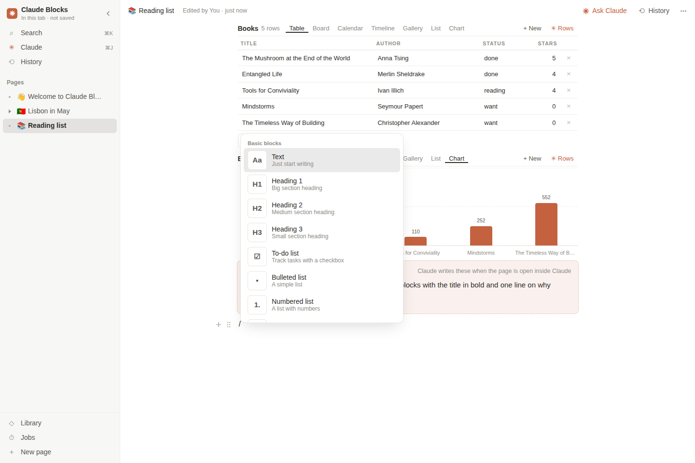

*Figure 3 — The slash menu opened on an empty line at the end of the Reading list page, below the table and chart views of the `books` list and the page's Claude block.*

Typing `[[` opens a page picker that inserts `[[page_name]]` or creates a new sub-page. The **block menu** (click on `⋮⋮`) turns a block into another kind, colours it, duplicates, moves it up, down, or to another page, deletes it, and shows it as Hypha: "Edit as Hypha" opens a dialog in which the block's lines can be rewritten and checked before they apply. Dragging a block by its handle places it before or after the block under the pointer; dropping it on the right edge of a top-level block (the last 14 % of its width) wraps both blocks in a new `columns` block.

## 6. Properties, databases, and the rest of the page

### 6.1 Properties are cells, edited like Notion's

The properties list under the title shows the page's cells with a type marker, the value, and, for formulas, the source. Editing a row follows one rule: text beginning with `=` is a formula, `?"…"` is a hole, numbers, `true`, `false`, lists, and records stay what they are, and anything else is text. Every edit is checked with a throwaway kernel before it is written. A property list longer than seven rows shows six and a "more" button; "+ Add a property" accepts `name = 42`, `name = = a formula`, or a word.

### 6.2 One list, many views

A **database** is a list of records in a property, `costs` or `tasks` or `books`. Seven block kinds can show it, and several may show one list at once, as the Reading list page does with `cards`, `table`, and `bars` over `books`. Above each, a bar offers Table, Board, Calendar, Timeline, Gallery, List, and Chart. Switching rewrites the block's own line with arguments guessed from the records: the title field is the first key named `name`, `title`, `what`, `text`, `task`, or `label`; the grouping field is a key named `status`, `stage`, `state`, `category`, `type`, `kind`, or `group`, or else a text field with few distinct values; the date field is the first whose values look like `YYYY-MM-DD`; the chart's y-axis is the first numeric field. "+ New" appends a record shaped like the first one, with today's date in date fields; "✳ Rows" asks Claude for more.

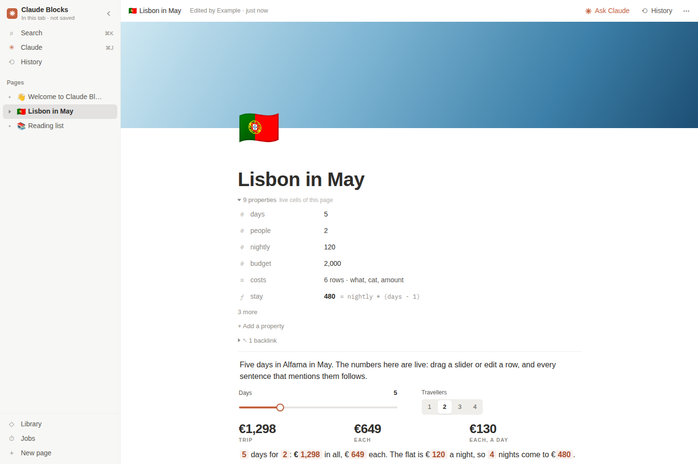

*Figure 4 — The Lisbon page: cover, icon, title, nine properties (three formulas folded under "3 more"), a backlink, and the body: a paragraph, a `columns` block holding a slider and a choice, three stats, and a sentence whose values are formulas.*

When `lisbon.days` was set to 12 in the local run, `stay` became 1,320, `total` 2,138, and `per_person` 1,069; the sentence followed, and the `when total > budget` block made its callout appear.

### 6.3 Backlinks, covers, and tokens

Backlinks are found by scanning every page's view cells for a literal string containing `[[page]]` or a `page` block naming it, and are listed under the properties. Covers are eight named gradients, an image URL, a hex colour, or a CSS gradient. `theme.*` cells become CSS variables: colour tokens must match a hex, `rgb()`, `hsl()`, or a colour keyword, and `radius`, `gap`, `font`, and `size` are clamped to safe ranges, so a theme cell cannot inject arbitrary CSS. `theme.dark` supplies the dark-mode surface colours.

## 7. Claude in the page

### 7.1 Space on an empty line

The central gesture is pressing space on an empty paragraph. It opens a bar with an input, suggestions ("Continue writing", "A table of the key numbers on this page", "Brainstorm ten ideas", "Summarize this page", "A checklist to get this done"), and a "web" checkbox. Asking writes one line, which turns the empty block into a hole:

```hypha
welcome.ui.3584 = ?"A table of what a week of coffee costs"
```

The hole renders as a **Claude block**: the label "Claude block", the intent, a status, and the buttons "Write it", "Edit intent", and "Write it myself". If a Claude is present the page immediately calls `fillHoles` on that path. Otherwise the block stays, with the status "Claude writes these when the page is open inside Claude", and any later Claude, including one in the conversation, can fill it. On a block that already has text, the same bar (⌘J) asks Claude to rewrite the block instead.

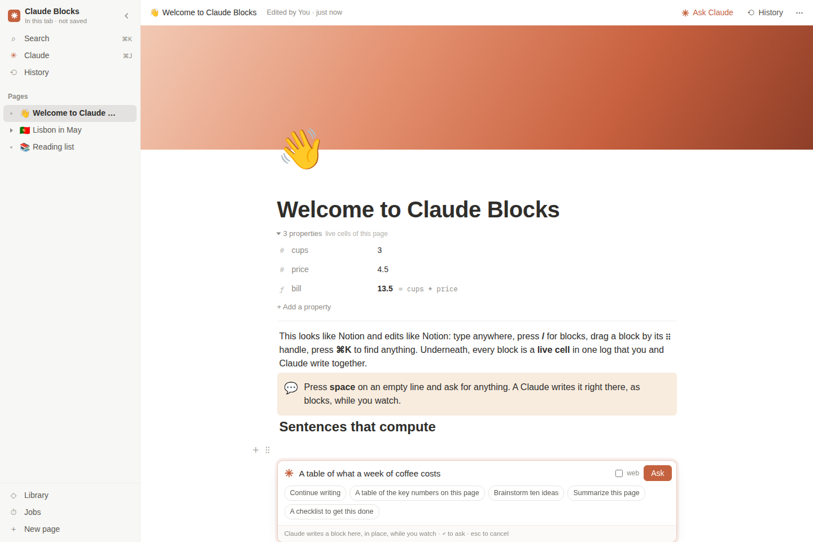

*Figure 5 — Space on an empty line opens the Claude bar in place, between a heading and the next block.*

### 7.2 Filling holes in parallel

`fillHoles` runs up to four workers over a queue of hole paths. Each worker:

1. claims the hole, through a local map, a presence broadcast, and a database lease `claims/<path>` with a two-minute time-to-live, so two tabs or two people never fill the same hole;
2. registers a peer `<user>:f<n>` that may write only the hole's path and paths below it, or, for a hole inside a view, also the rest of its page, so that it can add the data its blocks need;
3. builds a prompt: a role line, the language card, "WRITE EXACTLY ONE CLAUDE BLOCK: lisbon.ui.12", the intent, instructions to write `lisbon.ui.12:` followed by indented prose and live blocks, and the workspace printed as Hypha within 24,000 characters around the hole;
4. calls `sample` at the quick model tier (the default tier when the hole asks for the web) and feeds every streamed delta to a Hypha stream, so lines apply while the model is still writing.

The local run replaced the host's `sample` capability with a script that streamed a fixed reply nine characters every 12 ms. Pressing "Write it" on the Lisbon page's Claude block turned `lisbon.ui.12` from a hole into a group holding three bullets, written by peer `me:f1`. The filler's prompt was 15,511 characters long.

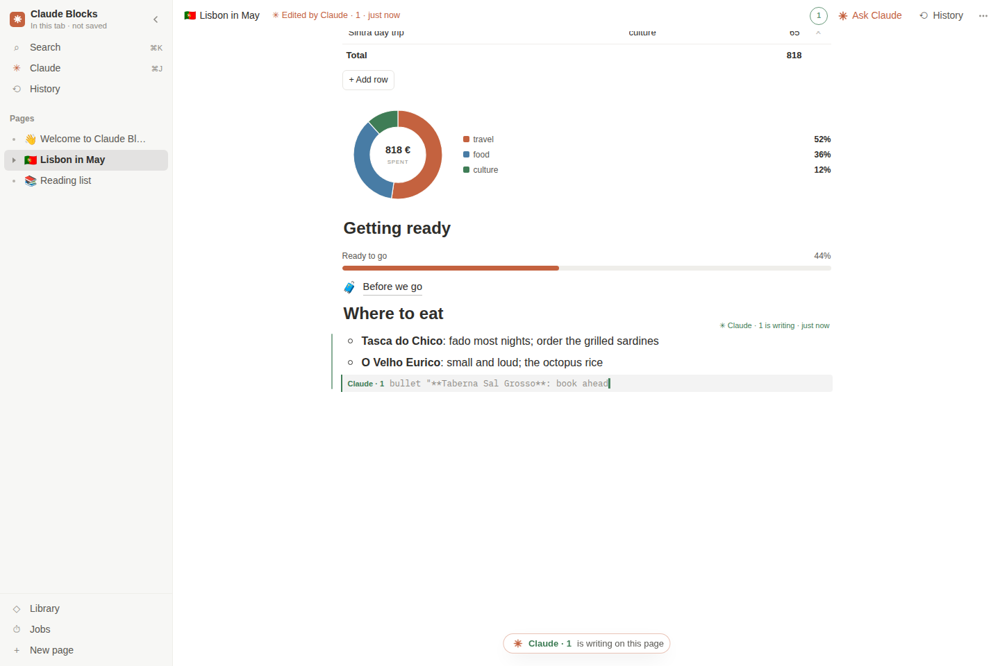

*Figure 6 — A Claude block being filled. Two bullets have landed; the third is a ghost, the half-written line `bullet "**Taberna Sal Grosso**: book ahead` drawn where it will go, labelled with its writer, "Claude · 1". The group is marked "Claude · 1 is writing", and a pill at the bottom of the page names who is writing on it.*

Ghosts come from Hypha's stream: the incomplete last line of each peer's stream is published as that peer's intent, and the editor draws every intent whose path falls inside the current page. A group that a Claude wrote keeps a small label, "✳ Written by Claude · 1", taken from the peer that wrote its `.k` cell.

### 7.3 The Claude panel

The right panel (⌘J with nothing focused) is a composer with three scopes: **This page**, **A new page**, and **Workspace**. Before sending, the panel decides whether its text is Hypha or a request. The text counts as Hypha if every line parses and applies on a throwaway kernel, and it does not look like an English sentence (`/^[A-Z][a-z]+\s+[a-z]/`). The second test exists because many short sentences happen to parse as Hypha. In Hypha mode the button reads "Write" and the lines are written directly; otherwise it reads "Ask" and the text goes to `Claude.ask`.

`Claude.ask` assembles a prompt in a fixed order: a role line; the language card `REF()` (Hypha, the block kit, Fruit's elements, rules); the Spore card; the user's functions; the component library; the instruction "SHAPE FIRST"; the workspace as Hypha within 60,000 characters around the focus, with each block's path as a comment; the page the person is on; a scope instruction; and the request. With the scope "This page" the peer may write only that page's paths; otherwise it may write anything. When the stream ends, any holes it wrote are filled in parallel.

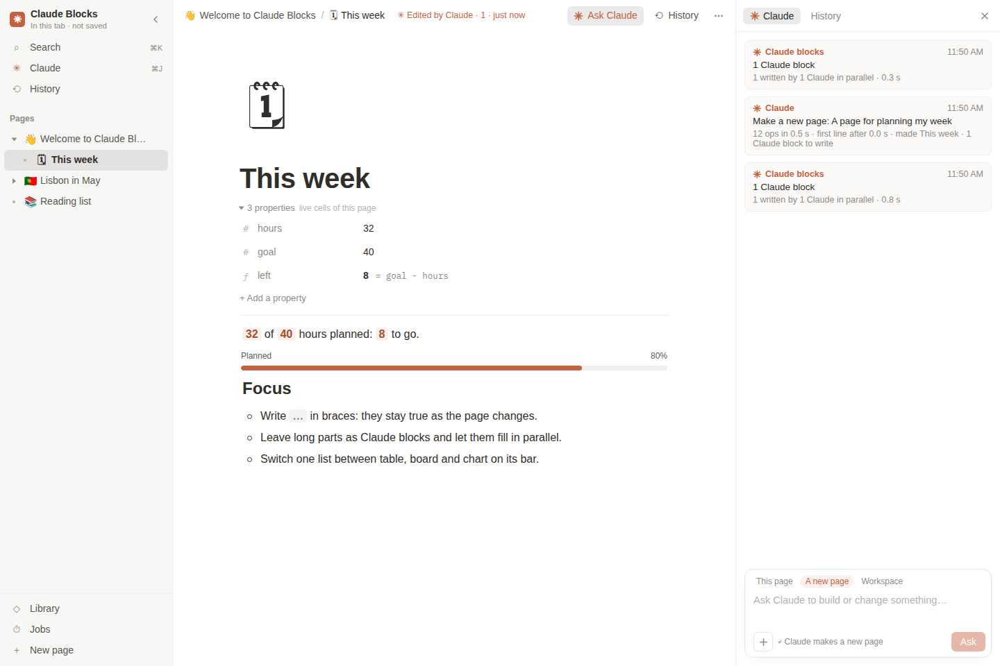

*Figure 7 — The scripted run of "A page for planning my week" with the scope "A new page". The run log reads "12 ops in 0.5 s · made This week · 1 Claude block to write", followed by "1 written by 1 Claude in parallel". The new page sits under Welcome in the sidebar because the reply wrote `parent = "welcome"`.*

The card's "SHAPE FIRST" rule tells the model to write a page's structure in one pass and leave paragraphs, research, and long lists as Claude blocks for other Claudes to fill. The rule matters more here than in CC5, because the person watches the page in reading order. A page whose skeleton arrives in a second and whose sections then fill concurrently is readable throughout, while one long answer would arrive top to bottom.

A hole whose intent carries `@browser` or `@web`, or one asked with the "web" box ticked, asks the person once per visit: "Let Claude browse the web to write this? It uses the browser in your Claude desktop app. What it finds goes into this workspace, and everyone who can open it will see that." If allowed, its filler receives CC5's `web_search` and `web_read` tools.

### 7.4 The Claude in the conversation

A Claude in the chat has no connection to the page, so Claude Blocks keeps CC5's two-call protocol and changes its collection names. The README for Claude in `index.html` describes it:

```text
1. READ   ArtifactData get, collection "data/users/me", doc_id "blocks"
2. WRITE  ArtifactData set, collection "data/users/me/blocks/turns", doc_id <next>, data { "text": "<Hypha lines>" }
```

The page rewrites the view document 1.5 s after changes. It contains the workspace as Hypha within 120,000 characters; the pages with their titles, parents, and block counts; the holes; the focus (page, block, and the block's line); the last thirty operations; the people present and their pages; the result of the previous turn with its errors; and the id for the next turn. One tab leases each new turn for 60 s and streams it as the peer `<user>:chat` at 160 characters every 16 ms. It then records how many operations applied and up to twelve rejected lines, navigates to any page the turn created, and fills any holes the turn wrote, if the tab has a Claude of its own.

## 8. Sharing, history, and undo

### 8.1 Inherited storage and synchronisation

The storage and synchronisation layer is CC5's, carried over with the same constants (500 operations or 150 KB per chunk, a checkpoint every 3,000 operations, parts of at most 180 KB, room batches under 3,600 bytes):

| Store | Content |
|---|---|
| `chunks/…` | each tab's operations, `{by, tab, seq, at, n, ops: [[id, peer, clock, text, at], …]}` |
| `meta/snap`, `snaps/…` | the latest checkpoint and its parts |
| `claims/<path>` | one filler per Claude block |
| `leases/<key>` | programs and jobs that must run on one page |
| `data/users/<id>/blocks`, `…/turns/<id>` | the chat Claude's view and turns |

Live operations also travel on the room's `ops` topic, and the store deduplicates them by id. A row is accepted only when its peer prefix matches the hash of the author the platform reports for the chunk or message. Presence carries each viewer's page, selected block, held claims, and running programs. The sidebar shows a coloured dot beside the page each person is on, the top bar shows faces, and a block another person is editing gets an outline in their colour. A viewer without `data.write` permission gets a read-only workspace, and every write path checks for it. Without `window.claude` the page runs in memory and labels itself "In this tab · not saved"; that is how it ran for this report.

### 8.2 Undo by replay

The log is append-only, so undo cannot remove an operation. `Undo.mark` records the clock before each of the person's actions. `Undo.undo` finds the person's own operations after the mark, replays the log up to the mark into a second kernel, and writes, for each touched path, what that kernel held: the old cell as a line, the old subtree as Hypha, or a deletion if the path did not exist. Undo therefore takes back only the person's own changes and leaves concurrent changes by others in place. Each undo is itself a set of new operations. Because renumbering and insertion are separate marks, ⌘Z after a first insertion removed the inserted block in the local run and left the renumbering in place.

### 8.3 Time

The History panel lists the log as it grows, coloured by peer, with the ghosts of half-written lines at the bottom. Its Time slider replays the log up to any operation into a separate kernel and shows the whole workspace as it was then, read-only, with a banner naming the operation, its time, and its author. Any write returns to the present first.

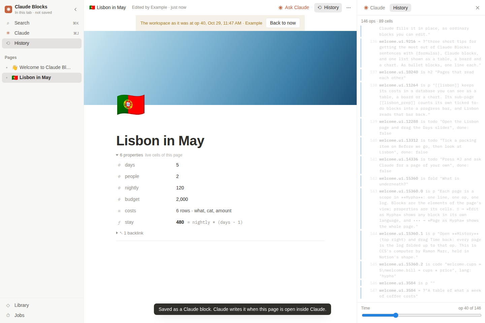

*Figure 8 — Time at operation 40 of 146. The workspace is shown as it was: the sidebar holds only the two pages written by then, and Lisbon has six of its later nine properties and no body yet. The History panel shows the most recent operations, including the renumbered Welcome blocks (`welcome.ui.9216`, `…ui.10240`) from an earlier insertion and the Claude block written from the ask bar.*

## 9. The rest of the computer, inside pages

`boot()` gives CC5's modules a `Host` object, the set of functions through which they read and write the tree: `write`, `stream`, `commit`, `env`, `ask`, `lease`, `save`, `install`, and others. Through it, every CC5 capability becomes a block:

- **Programs**: JavaScript in a text cell, run in a Web Worker under a lease. The slash item writes a counter program and the block `program run`.
- **Spore apps**: the slash item writes the first Spore example into a `code = |` property and the block `spore code`. The local run created such a block on the Reading list page; a program reading `$.desk.lisbon.days` built and ran.
- **Jobs**: `jobs.NAME = {every: "daily 08:00", run: "…" | ask: "…"}`, listed on the Jobs page.
- **Browser**: `browser url, text: page_text, h: 460` shows the person's own browser and captures a page's text into a cell.
- **Files**: dropped images, video, audio, and PDFs become `file` blocks after the drop point; tables and text become new sub-pages of the open page.
- **Library**: components (`lib.NAME`) appear in the slash menu under "Library" and in the Library page.

Every page can also be exported as Markdown and viewed or edited as Hypha from the page menu.

## 10. Layout, dark mode, and phones

The stylesheet describes the intended layout: "Notion's three columns. A quiet sidebar of pages; the page itself, a centred 708px column with a gutter for block handles; a right panel for Claude and History. Ink is a warm off-black on white; Notion blue marks you, Claude's clay marks Claude." Colours are tokens on `:root`, redefined for dark mode under both `prefers-color-scheme` and `data-theme="dark"`. At 860 px and below the sidebar becomes an overlay opened from the top bar, and navigating closes it.

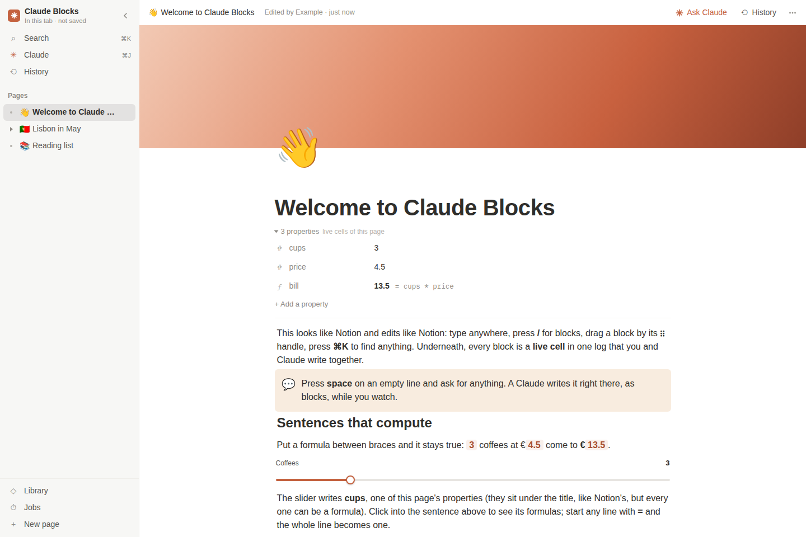

*Figure 9 — The Welcome page as the example workspace opens: sidebar with three root pages, the clay cover, three properties (`bill = cups * price`), and the first blocks.*

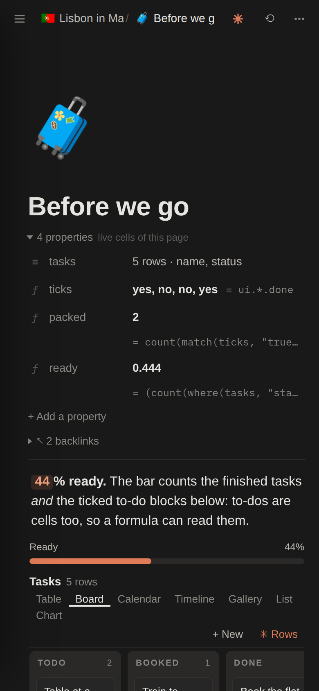

*Figure 10 — The same workspace at 390 px in dark mode. The sidebar is closed and its toggle sits at the top left; the Claude and History buttons are icons. The database view bar wraps onto two lines, and the board's third column runs past the right edge.*

## 11. Defects found while verifying

Four behaviours differ from what the code or its documentation intends. Each was observed in a local run.

**The in-page Claude is taught a Spore API that does not exist.** `Claude.ask` adapts CC5's Spore card with two replacements:

```js
CC5Spore.prompt().replace(/give its app desk\.[^.]*\./, "").replace(/desk/g, "workspace")
```

The first removes the sentence about window frames, which has no meaning without a desk. The second also rewrites the API names. The card the in-page Claude receives says `$.workspace.<app>.<cell>` and `$.set("workspace.<app>.<cell>", v)`. Neither name exists in `spore.js`, and a program using `$.workspace.lisbon.days` failed with `$.workspace is not defined in app "a"`. The same program written with `$.desk` worked. The Spore studio's own agent reads the unmodified textbook, so the two Claudes are taught different names for one API.

**The Markdown export ignores conditions.** `Markdown.page` walks every block's children without evaluating `when`. The Lisbon export therefore contained the callout "⚠️ Over the €2,000 budget by €-702. Trim a dinner, or a night." while the page, correctly, did not show it. The same export drops a stat's `pre:` ("**Trip** 1,298" without the euro sign) and prints a progress value as the raw fraction (`0.556`).

**A moved block reads a different page.** A block's formulas resolve from the page it sits on, and moving a block to another page rewrites it there. In the local run, the Lisbon sentence moved to the Reading list showed `{per_person}` as unfinished, while the full path `lisbon.per_person` still read 649. This follows from the scoping rule, and the move gives no warning.

**Renumbering can lose or duplicate a concurrent edit**, as shown in section 4.3.

## 12. What the design provides, and where it strains

| Decision | What it provides | Where it strains |
|---|---|---|
| A page is a scope; blocks are view cells | Prose, data, controls, and Claude output share one tree, one log, one undo, one history, and one language | A block's meaning depends on the page it sits on (section 11) |
| Formulas inside sentences | Numbers in prose cannot go stale; prose and computation are one artefact | No escape for literal braces outside inline code; a misspelled name renders as "…" rather than an error |
| DOM text equals the source; values drawn by CSS | Carets map exactly; no separate model of the text needs to be kept in step | Screen readers and `innerText` see the source without values (the sentence's `innerText` in the test read " days for : € in all") |
| Block order by numbers with gaps of 1,024 | One block per insertion in the common case | Claude-written and seeded pages have no gaps; renumbering deletes and rewrites the list (34 operations for 15 blocks) and races concurrent edits |
| Debounced, coalesced typing | A sentence typed in one go is one operation | The log records edits, not keystrokes, so the time slider cannot show a sentence half-typed |
| Claude blocks as holes | Structure first, content in parallel, visible while it streams; any peer, including a person, can fill one | Each filler sees only 24,000 characters around its hole |
| The fork of `cc5.js` | The storage, synchronisation, and Claude protocols arrive tested | 357 shared lines will drift from CC5 independently; adapted strings already have (section 11) |

The last row deserves emphasis because it describes how the project was made rather than how it runs. Claude Blocks reuses CC5 by copying its desktop module and replacing what does not fit. It does not extend that module through an interface. The kernel, views, and languages are shared unchanged and will stay compatible. The layer above them, which decides how operations are batched, stored, synchronised, and offered to Claudes, now exists twice. A fix to chunking or to the chat protocol in one copy will not reach the other.

## 13. How this report was verified

No transcript of the work that produced Claude Blocks was available, so the report rests on the code and on these local checks, run on 2026-10-29:

- `cmp` against `/home/manuel/code/others/ramon/cc5-godprompt-computer/artifact/` for the seven shared modules, and a line comparison of `blocks.js` with `cc5.js`.
- A headless Chromium run of the published `index.html` in memory mode: the example workspace loaded as 102 operations and 238 cells, with five branches (`clock` and four pages) and three Claude blocks. The run checked the Lisbon totals (1,298, 649, 130), the change of `days` to 12, the to-do count on "Before we go", the first insertion (renumbering to 1,024 steps), undo, the Markdown export, and the Hypha printout. There were no page errors.
- A second run for interactions: focus on a sentence, the slash menu and its Board item, space for Claude without a Claude present, the block menu, Edit as Hypha, the History panel and the time slider, the launcher, and a 390 px dark viewport.
- A run with a scripted `sample` capability standing in for the host: the parallel fill of a Claude block, the Claude panel creating a page with its own Claude block, recorded prompt sizes (15,511 and 15,975 characters for fillers at the quick tier, 19,501 for the in-page Claude at the default tier), and the operation cost of typing.
- Node simulations with `hypha.js`: the renumbering race of section 4.3, and the gap-exhaustion count.
- A Spore check: one program reading `$.desk.lisbon.days`, and the same program with `$.workspace`.

Nothing was tested inside Claude. The real `sample` provider, the database and room capabilities, several viewers editing at once, the browser server, and the chat Claude's turns remain unexercised.

## Key points

- Claude Blocks maps a document workspace onto Hypha without changing Hypha. A page is a top-level scope, its metadata and properties are cells, its body is a view block, and every block, prose or live, is an element stored as cells in the same log.
- The editor's main technique is to keep the DOM text equal to the stored source and draw computed values with CSS. Caret positions then map exactly, and a sentence can hold live formulas without a second text model.
- Every gesture becomes a short Hypha write. Block order uses numbers with gaps, so an insertion is usually one operation, but pages written by Claude or the seed start without gaps, and renumbering deletes and rewrites the list.
- Claude works in the page through holes. Space on an empty line writes a Claude block, up to four Claudes fill blocks in parallel within path-scoped permissions, and their unfinished lines are drawn as ghosts where they will land.
- The front end is a fork of CC5's desktop module. Its storage, synchronisation, undo, time, and chat protocol are CC5's, and its defects sit where the fork adapted CC5's text without adapting the engine: the Spore card, the Markdown export, renumbering under concurrency.

## Evidence and sources

- Export: `/home/manuel/code/others/ramon/claude-blocks` (unpacked from `~/Downloads/Claude Blocks.zip`); comparison baseline `/home/manuel/code/others/ramon/cc5-godprompt-computer/artifact/`.
- Code read in full: `blocks-kit.js`; `blocks.js` sections for state, kernel wiring, undo, pages, theme, Claude, claims, hole filling, history, time, the chat channel, presence, Host, structural operations, prose rendering, carets, the editor, typing, the slash menu, mentions, the block menu, drag, the source dialog, properties, navigation, the page view, the sidebar, the Markdown export, the Claude panel, the launcher, file drops, the seed, keys, and boot; the README comment and the head of the stylesheet in `index.html`.
- Local runs and their scripts: `/tmp/claude-1000/-home-manuel-code-others-ramon-pinup-export/216a84e6-1fd7-41b0-82f0-d169bca23349/scratchpad/run/blocks1.js` through `blocks7.js` and `relayout-race.js`; screenshots in the same scratchpad under `blocks/shots/`. Figures in this note are copies of those screenshots.
- The scripted `sample` replies in the run were written for the test; they demonstrate the mechanics, not model output.

## Related notes

- [[PROJECT REPORT - CC5 Godprompt Computer - Hypha, Fruit and Spore - An Independent Technical Deep Dive]] — the engine Claude Blocks runs on, explained from Hypha up.
- [[DIARY - CC5 Godprompt Computer - Independent Reconstruction of the Spore Session]] — how Spore, one of the modules shipped here unchanged, was built.
- [[PROJECT REPORT - Pinup - A Shared Design File Inside a Claude Artifact - A Technical Deep Dive]] — another shared editor built on the same Artifact capabilities.
