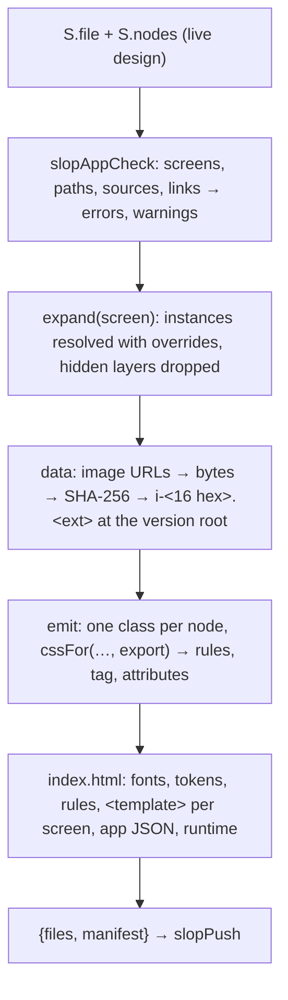
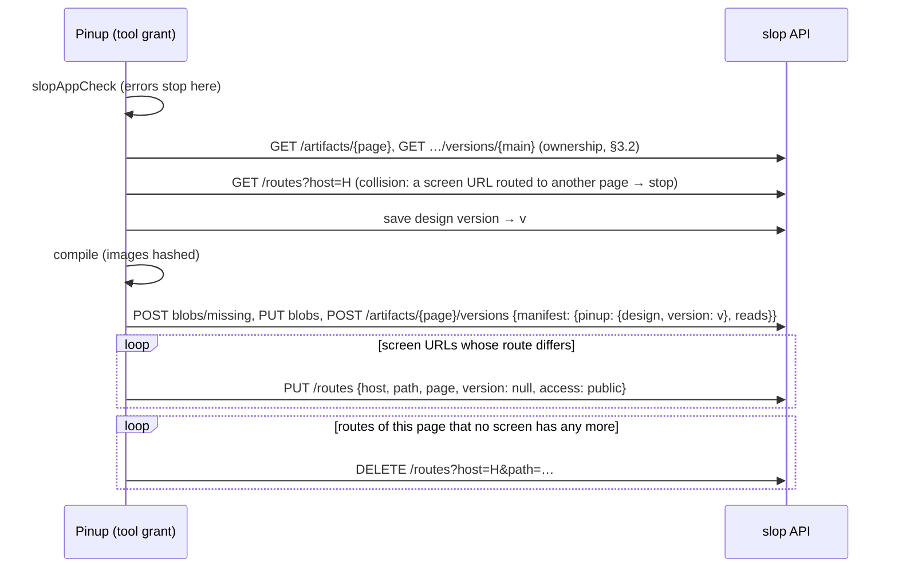
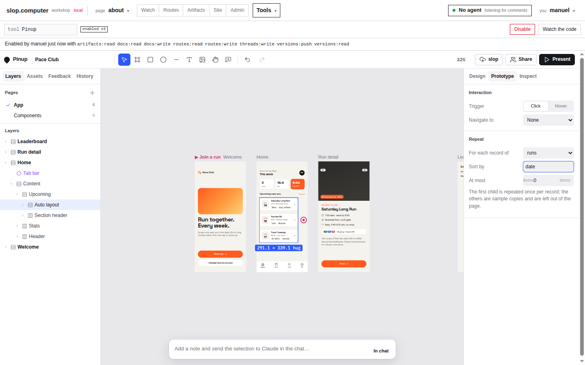
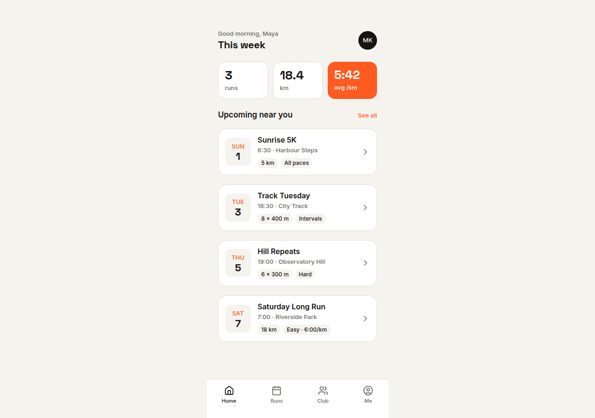
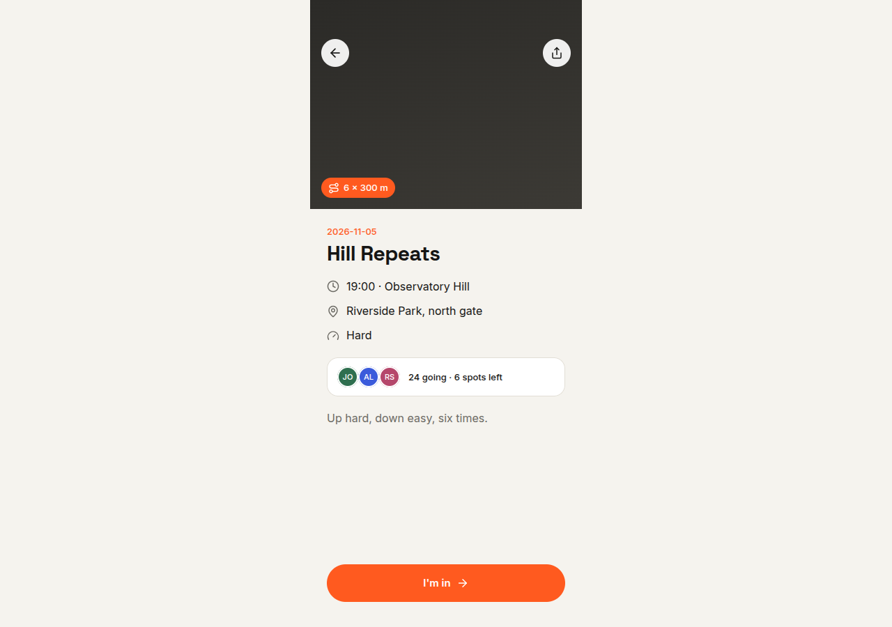
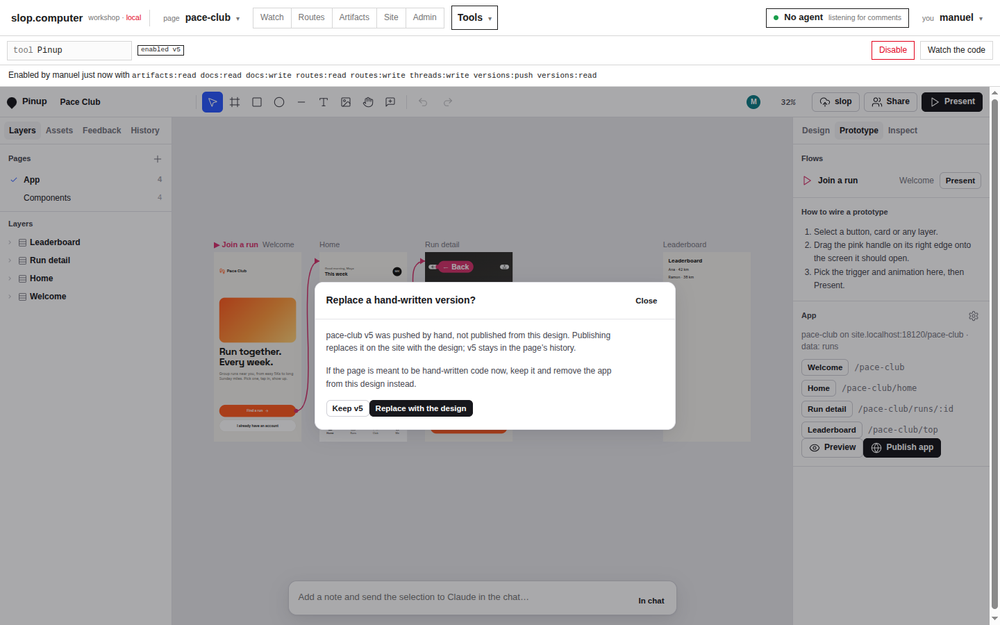
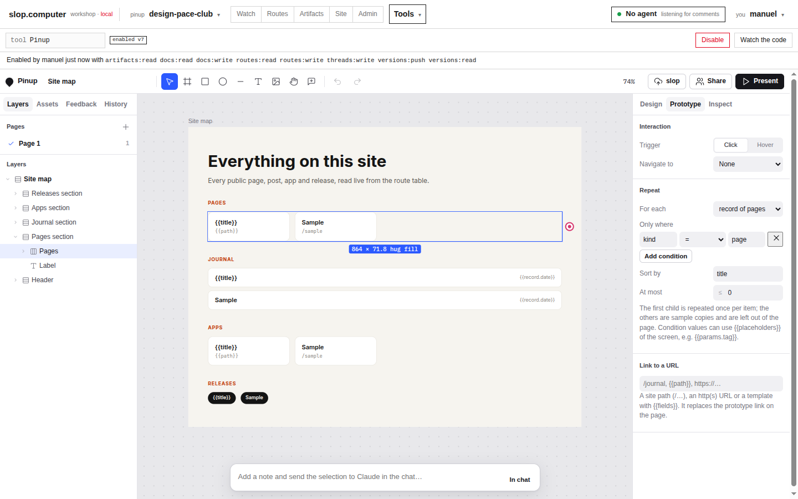
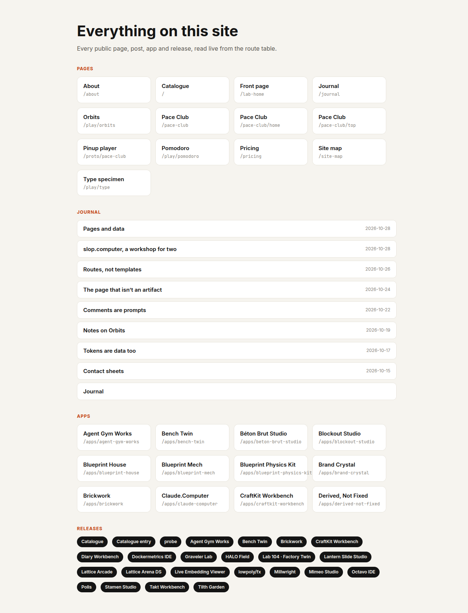
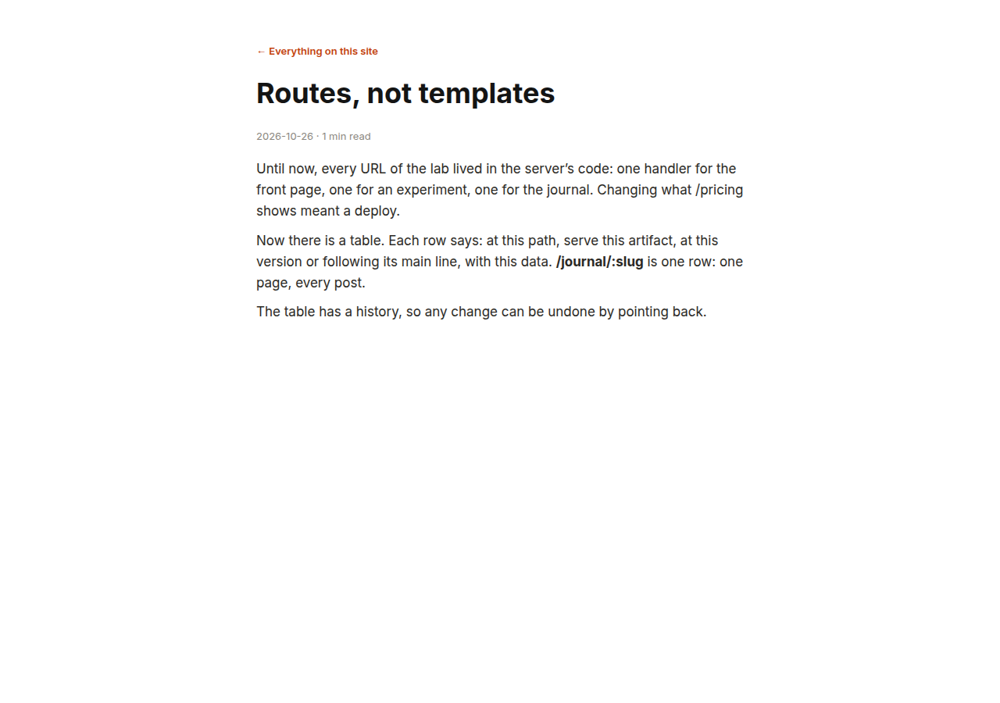

# Pinup Apps on slop: Compiling Designs into Routed Pages and Indexing a Site

Earlier on 29 October 2026, Pinup became a tool of slop.computer ("slop"). It could edit a shared design live, save it as versions, and publish it as a prototype. The prototype was the full editor running read-only in a device frame (see [[PROJECT REPORT - Pinup on slop - A Live Design Tool Inside a Versioned Page Server - A Technical Deep Dive]]). It could not produce a real page of a site.

This report covers the two tickets that followed:

- **SLOP-005, Pinup apps.** A design whose screens have paths is compiled into an ordinary slop page artifact and routed on a site host, one URL per screen. Screens can show data, and the design stays the only source.
- **SLOP-006, the site index.** The server gained a data source, `$site`, that lists every public URL of a host. Pinup apps gained links to any URL, filters, repeats over list fields, and rich text. With these, a Pinup app can be the navigation of the site that serves it.

The report proceeds in this order:

1. the starting point and the model (§2–3);
2. the compiler (§4) and the code it places in each page (§5);
3. data binding (§6), publishing (§7), the site index (§8) and the editor (§9);
4. verification (§10), the failures met (§11), and the costs of the design (§12).

> [!summary]
> - **A Pinup app is two artifacts.** The design is a live data artifact. The app page is a compiled page artifact whose manifest names the design. Publishing compiles every screen into one `index.html` (a `<template>` per screen, one stylesheet, a 9.5 KB inline runtime) and routes each screen. The compiled Pace Club page is 38 KB; the prototype player is 884 KB.
> - **The runtime matches the request path against the app's screens** using the same rules as the server's router, then binds data from the page's boot records: placeholders, repeats, filters, record screens, image fields, links and sanitized rich text.
> - **`$site` is computed at render time from the route table.** It lists static routes, each record a record route serves, and each page a page-from route admits. A URL is kept only if resolving it returns the route that produced it, and unlisted pages and records are left out. It is cached per host and invalidated in the server's single `publish` path. On the local data it lists 241 URLs, built in 0.2 s on a cache miss and served in 0.04 s from the cache.

## 1. What exists, and where

| Item | Location | Content |
|---|---|---|
| Repository | `/home/manuel/workspaces/2026-10-28/slop-computer/slop-computer`, branch `task/slop-computer` | slop server, CLI, Workshop; Pinup in `web/pinup` |
| SLOP-005 ticket | `ttmp/2026/10/29/SLOP-005--pinup-apps-…/` | intern guide (591 lines), diary steps 1–3, screenshots `s5-*` |
| SLOP-006 ticket | `ttmp/2026/10/29/SLOP-006--site-aware-pinup-apps-…/` | intern guide, diary steps 1–3, screenshots `s6-*` |
| Compiler, runtime, publishing, editor sections | `web/pinup/slop/js/96-slop-app.js` (690 lines) | spliced into Pinup's scope by `web/pinup/slop/build.js` |
| Browser test | `web/pinup/slop/tests/app.js` (161 lines) | 37 checks against the compiler and the runtime |
| Site index | `pkg/server/siteindex.go` (325), `siteindex_test.go` (137) | `$site`, `GET /api/site`, cache |
| Routing helpers | `pkg/routing/routing.go` | `RecordMatcher`, `FillPath` |
| Push warning | `pkg/server/kernel.go` (`compiledWarning`) | warns before a hand push replaces a compiled page |
| CLI | `cmd/slop/cmds/site.go` | `slop site ls` |
| Workshop | `WatchRight.tsx`, `WatchScreen.tsx`, `RoutesScreen.tsx` | Edit in Pinup, Open in Pinup, `$site` display |

Excluding the tickets, the two tickets changed 22 files with 1,626 inserted lines. The code commits:

- SLOP-005: `51fbeac` (compiler and runtime), `5b90016` (publishing, editor, Workshop, warning), `7e012b5` (hand-written pages);
- SLOP-006: `aecbd55` (site index), `409bb65` (visibility rule), `f9ba57f` (Pinup features), `f5e8662` (step keys, layout).

## 2. The starting point

After SLOP-004, a design and a page were unrelated:

- **A design** was a data artifact of type `pinup`, edited through the docs store.
- **The prototype player** served it by binding the design to a page artifact that held the whole Pinup editor.
- **Hand off** asked a coding agent to build a page from the design's `handoff.md`, and nothing recorded which page came from which design.

The question was how to edit real routed pages in Pinup. Two approaches were considered.

**A bridge to hand-written pages:** import a rendered page into Pinup, edit it, and hand the changes back to an agent. Pinup's HTML importer (`src/08-import.js`) lays HTML out in a script-free iframe. Most slop pages build their DOM in JavaScript from boot data, so their source HTML imports as an almost empty document. A bridge would need a capture of the rendered DOM, and two-way synchronization between a canvas and arbitrary code has no general solution.

**Pinup-only apps:** the design is the source, and the page is compiled from it. The user chose this one: "we could also just have apps that are pinup only, instead of trying to bridge directly. But basically I want to create/edit real routed pages in pinup."

## 3. The app model

### 3.1 Two artifacts and a link in each direction

```text
design-pace-club   data, type pinup     the source: live documents + saved versions
pace-club          page                 compiled output: index.html (+ image files)
                   manifest: {"pinup": {"design": "design-pace-club", "version": 3},
                              "reads": {"runs": "data-runs"}}
```

**The design records its app in the live file.** `S.file.app` holds:

- `page`: the app page artifact;
- `host`: one of the site hosts;
- `base`: the base path;
- `data`: source name → data artifact or `$site`.

Pinup's `applyRemoteFile` keeps unknown keys of `meta/file`, and its `norm` keeps unknown fields of a node. This is what allows the app fields to live in the design without changing Pinup.

**The page records its source in every version's manifest:** `pinup.design`, and the design version it was compiled from. The push handler stores manifest keys it does not interpret, so no schema change was needed.

### 3.2 Who owns a compiled page

The design owns the page. A version pushed by hand to a compiled page is treated as follows:

- **The server warns** (`compiledWarning`). When the current `main` manifest names a design and the incoming manifest does not, the response carries a warning, which the CLI prints: "pace-club is compiled from the Pinup design design-pace-club; this version is not, and Publish app in Pinup will ask before replacing it."
- **Pinup asks before overwriting.** When the page's `main` has no `pinup` key, Pinup looks for earlier versions compiled from this design:
  - if there are some, the main was changed by hand, and Pinup opens a confirmation ("Replace a hand-written version?");
  - if there are none, the page belongs to someone else, and publishing is refused;
  - a page compiled from a different design is refused as well.

A hand push is how an app becomes hand-written code. §11 records why the first version of this rule was inconsistent.

### 3.3 Screens and their paths

A **screen** is a top-level, visible, non-component frame with a `route` field, for example `/`, `/runs` or `/runs/:id`. The rules:

- Paths are normalized: leading slash added, trailing slash removed.
- Each segment is lowercase letters, digits, `-` and `_`, or `:name`.
- Two paths that differ only in parameter names are duplicates.
- A screen's URL is `join(base, route)`: `/pace-club` plus `/runs/:id` is `/pace-club/runs/:id`, and `/` maps to the base itself.
- Frames without a route stay in the design only.

*Make this an app* assigns paths once: `/` to the flow-start frame (or the first frame), and the slug of the name to the others.

## 4. The compiler

### 4.1 Pipeline



The compiler runs inside Pinup's scope. It reuses Pinup's own functions:

- `expand`: walks a subtree as rendered;
- `cssFor`: node to CSS, including auto layout as flexbox and the fixed/hug/fill sizing rules;
- `tagFor`, `iconSVG`, `cleanSVG`, `tokensCSS`, `usedFonts`, `fontLink`, `paintCSS`.

It does not reuse Pinup's `exportHTMLParts`. That function writes prototype links as `data-link="<frame name>"`: frame names are not unique, and the attribute carries no URL. Writing a 40-line emitter modelled on it was cheaper than post-processing its output.

### 4.2 The document

A route serves only a version's `index.html` (`renderPage` in `pkg/server/serve.go`). So every screen goes into one document, and a script chooses among them:

```html
<head> … fonts … <style> resets · tokensCSS() · one rule per node · .pinup-rich rules </style></head>
<body>
<template id="s-<frameId>" data-bg="<page colour>"><main class="…">…</main></template>   ← one per screen
<script type="application/json" id="pinup-app">{"name","base","start","screens":[{id,name,route,record?}]}</script>
<script>(slopAppRuntime source)()</script>
</body>
```

- **Screens sit inside `<template>`.** The browser parses them but does not render them or load their images. The runtime inserts one screen before first paint, because it runs at the end of `body`.
- **All screens are emitted in one pass,** so class names are unique across screens.
- **The screen root becomes the page.** `width: 100%`, `max-width` (the frame width) and `margin: 0 auto` replace the fixed width. `min-height: 100vh` replaces the fixed height for auto-layout frames; a frame with absolute children gets `min-height` of its own height instead.
- **The page colour.** The screen's first solid fill is applied to `body`, so the area beside a 390-pixel column has the screen's colour.

### 4.3 Images

On slop, Pinup has no asset store, so uploaded images are JPEG `data:` URLs of at most about 180 KB, stored in the fill. The compiler:

1. decodes each data URL;
2. hashes it with SHA-256;
3. writes it once as `i-<16 hex>.<ext>`;
4. references it from the CSS by bare name.

The bare name at the version root is required by how the site serves files. A relative URL from `/pace-club/runs/7` arrives as `/pace-club/runs/i-….jpg`. The server resolves it through the route to the app page, then looks the file up by path and finally by **base name at the version root** (`fileFor`).

### 4.4 A sizing case CSS cannot express

In Pinup's canvas, a layer can be set to fill the height of a parent that hugs its content. In CSS, such a layer gets the height of the content: a flex item with `align-self: stretch` in a container sized by its content has nothing to stretch to. The compiled run screen therefore drew its 40×40 back and share buttons as 40×20 pills.

The compiler now emits `min-height: <designed height>px` for a node with fill height inside a hugging auto-layout parent. Widths are deliberately left alone: a `min-width` would stop fill widths from shrinking on narrow screens. Pinup's own HTML export has the same defect.

## 5. The runtime

`slopAppRuntime` is an ordinary function in the bundle. The compiler copies its source into each page with `Function.prototype.toString`. As a result, it is syntax-checked with the bundle, the browser test exercises exactly the code that ships, and an old page version keeps the runtime it was compiled with.

### 5.1 Choosing the screen

```text
path   := request path relative to app.base                 // "/pace-club/runs/7" → "/runs/7"
best   := screen whose route matches path with the highest specificity (literal 3, :param 2)
if none:  site mode → "Not found";  preview or thumbnail → the start screen
if best.record: rec := row of data[best.record] whose id (or slug) = the first param
                 none → "Not found" on the site, the first row in previews
chain  := [rec?, {params, app: {name}}]
insert template "s-"+best.id, bound with chain; set body colour and title
```

Matching and specificity mirror `pkg/routing` (`Match`, `Specificity`). The server has already picked this page by the same rules; the runtime only picks among the app's own screens. That is why the routes of an app need no `--record` or per-screen bindings: every route points at the app page, and the page's `reads` supply all data.

### 5.2 Binding

```text
bind(root, chain):
  for template in root with data-repeat or data-repeat-field:
      rows := data[source].all   or   items(lookup(chain, field))   // primitives → {value, index}
      rows := rows where every condition holds                       // §6.2
      sort; limit
      for row: copy := template content; bind(copy, [row] + chain); insert
  text   [data-t]        textContent := fill(template, chain)
  links  [data-href]     href := fill(…); removed when a value is missing or the URL is not / http(s) mailto #
  rich   [data-html]     children := sanitize(lookup(chain, field))      // §6.4
  images [data-img]      background := url(field value)
  every bound attribute is removed after use
```

- **Lookups walk the chain.** `lookup(chain, "a.b")` uses the first scope that has `a`, which is the repeat row, then the screen's record, then `{params, app}`.
- **Copies are bound before insertion.** Removing each attribute after use is what stops an outer pass from re-filling a copy's `{{title}}` without the row in scope.
- **Values are inserted as text or as a CSS value, never as HTML,** except through the sanitizer (§6.4).

## 6. Data binding

### 6.1 Sources, placeholders, repeats and record screens

- **Sources.** The app's data sources become the page manifest's `reads`, so the server injects their records on every route of the app (`window.slop.data[name]`). Records come from `pkg/records`, one per file:
  - JSON keys;
  - Markdown front matter plus `body`, `html` and `minutes`;
  - for image files, a `src` URL under `/_d/`.
- **Placeholders.** Text containing `{{field}}` compiles with its template in `data-t`.
- **Repeats.** `repeat: {from, sort, limit}` on a frame compiles its first child into `<template data-repeat>`. The frame's other children are sample copies that keep the design readable, and they are dropped from the output.
- **Record screens.** A screen with `route: "/runs/:id"` and `record: "runs"` shows the row whose `id` is the parameter. `id` is the file's base name, so `runs/7.json` is `/pace-club/runs/7`.
- **Links.** A link to a screen with parameters compiles to a template (`/pace-club/runs/{{id}}`), filled from the row in scope.

### 6.2 Filters

`repeat.where` is a list of conditions that must all hold:

| op | holds when |
|---|---|
| `=`, `!=` | the string forms are equal (or not); for arrays, some element is equal (or none is) |
| `contains` | case-insensitive substring, or an array element equal to the value |
| `<`, `>` | numeric-aware comparison (`localeCompare` with `numeric`), the same one sorting uses |
| `exists`, `missing` | the value is non-empty, or empty (`null`, `""`, `[]`) |

**Two scopes are involved.** The field is looked up in the row. The value is filled from the *enclosing* scope, so a screen `/topics/:tag` can use `record.tags contains {{params.tag}}`. Mixing the two would let `{{title}}` in a condition mean the row's own title.

### 6.3 Links to any URL and list repeats

**Links to any URL.** A layer's `href` field holds a URL template: `/journal`, `{{path}}` or `https://…`. It wins over Pinup's prototype link.

- `href` is a separate field because Pinup's player and canvas treat `link.to` as a frame id.
- A static `href` must match `^(/|https?://|mailto:|#)`, or the compiler reports an error.
- A template is checked again after filling, because data can contain `javascript:`.

**List repeats.** `repeat: {field: "record.tags"}` iterates an array in scope. Object items are used as they are; other items become `{value, index}`.

### 6.4 Rich text

A text layer with `html: "html"` shows that field as formatted text. The runtime sanitizes before inserting:

```text
doc := DOMParser().parseFromString(value, "text/html")        // an inert document: no scripts run, no images load
for each element, depth first:
  script, style, iframe, object, embed, template, form, inputs, svg, math, media … → removed with content
  any other tag outside the allowlist (p br strong em … a ul ol li h1–h6 blockquote code pre hr img table … span)
      → replaced by its children
  attributes → removed, except a[href|title] and img[src|alt|title]; href/src must match / http(s) mailto #
adopt the cleaned nodes into the page
```

Cleaning happens in the parser's document, before adoption, so handlers such as `onerror` never get a chance to run. Markdown from slop's records is already rendered without raw HTML (goldmark without `WithUnsafe`), but JSON fields can carry any markup, so the sanitizer runs regardless of source.

## 7. Publishing



- **Checks before writes.** Ownership and collisions are checked before anything is saved or pushed, so a refused publish leaves nothing behind. In the local run, base path `/` was refused with "/ is routed to storefront", and the page, the design and the route were all unchanged.
- **Routes are written only when they differ.** Republishing an unchanged app adds nothing to the route log. After renaming one screen, the log showed exactly one addition and one removal.
- **Preview** pushes with `moveMain: false`. For a new page this leaves `main` at 0, so nothing serves it, and the Workshop shows the version.
- **The tool's permissions.** Pinup's manifest gained `versions:read` (records, for field names) and `routes:read` (reconciliation). The Workshop's update dialog marks both as new when an admin approves the version.

## 8. The site index

### 8.1 The problem

A slop page receives only the records of the data artifacts it reads, plus `$tokens`. It cannot see artifacts, routes or projects, and visitors have no API. The storefront at `/` lists apps only because the francois import wrote a curated data artifact (`francois-catalog`, 104 records). A page that lists the site therefore needs the server to provide the list.

### 8.2 Record shape

One record per public URL, sorted by path:

```json
{ "id": "/journal/routes-not-templates", "path": "/journal/routes-not-templates",
  "title": "Routes, not templates", "kind": "record", "route": "/journal/:slug", "page": "journal-post",
  "project": "lab", "projectName": "Lab site", "section": "journal", "depth": 2, "updated": "…Z",
  "record": { "id": "routes-not-templates", "date": "2026-10-26", "tags": ["routing"] } }
```

`record` appears only for record routes. It holds the record's fields without `body`, `html`, `text` and `csv`, which keeps the index smaller in every page that embeds it.

### 8.3 Enumeration

```text
siteEntries(host):
  public := routes(host) with access = public
  for rt in public, except the fallback "*":
    page-from (/r/:page, template release-{page}):
        for each page of the else page's project that admits(rt, page): params from TemplateMatcher → FillPath(rt.path)
    record route (/journal/:slug, record posts/{slug}.md):
        for each data binding of the route's page (reads + route bindings):
          for each record whose path matches RecordMatcher(rt.record) and is listed: FillPath(rt.path, params)
    other :param or * route: skipped (the server cannot enumerate it)
    static route: rt.path
  keep an entry only if Resolve(public, host, path) returns rt itself
  drop pages whose manifest says "listed": false; cap at 2000; sort by path
```

Two helpers were added to `pkg/routing`:

- `RecordMatcher` turns `posts/{slug}.md` into `^posts/([^/]+)\.md$` with the placeholder names, matching one path segment per placeholder because a route parameter is one segment;
- `FillPath` fills route parameters, escaping the values. It refuses a missing value, a value containing `/`, and a trailing `*`.

**The resolve check makes the index agree with the server.** On the local data, `/apps/:id` and `/apps/:slug` have the same specificity, and `/apps/:id` is earlier in the order, so it serves every `/apps/x`. The fourteen experiments behind `/apps/:slug` are therefore not listed under `/apps/`; they are listed under `/experiments/`, where they are reachable.

### 8.4 Unlisted content

The index lists only URLs a visitor can reach, but it makes them discoverable. Before, a hidden catalogue entry was reachable only by someone who knew its id. These are left out:

- **Records** with `draft: true`, `hidden: true`, `listed: false`, or a `visibility` of `hidden`, `private`, `draft`, `unlisted` or `internal`. The flags accept the strings `"True"` and `"False"` that the francois import wrote.
- **Pages** whose manifest says `"listed": false`.
- **Private routes, the fallback, and a page-from route's else page:** never listed.

### 8.5 Where it plugs in, and caching

**Rendering.** `renderPage` answers a binding whose value is `$site` with `siteIndex(siteHost(host))`, before its "no version, skip" rule. In a sandbox preview, the host is the one the Workshop passes, otherwise the first site host. Push warns about any other `$name` value.

**Caching:**

```text
siteCache {gen; entries[host] = {gen, at, rows}}
siteIndex(host): a cached entry with the current gen and age < 30 s is returned; otherwise rebuilt
publish(evs):    gen++ if any event is route.set, route.removed, ref.moved, version.created,
                 artifact.created, artifact.updated or project.updated
```

`publish` (`pkg/server/server.go`) is the one function every handler sends committed kernel events through. Bumping a counter there invalidates every cached index after any change that could alter one. The 30-second ceiling covers changes this process does not see. Doc and presence events go directly to the broker and do not touch the index.

**Access.** `GET /api/site?host=` (`routes:read`) serves the same rows to admins and tools, `slop site ls` prints them, and the Workshop shows a `$site` read as "site index" instead of a version selector.

## 9. The editor

`95-slop-ui.js` adds menu items: *Make this an app…*, *App settings…*, *Preview app* and *Publish app*. `96-slop-app.js` wraps Pinup's `protoPanel` function, which returns the Prototype tab's sections, and appends its own sections according to the selection:

| Selection | Section |
|---|---|
| nothing | **App**: screens with URLs, errors and warnings, Preview, Publish app, live link |
| top-level frame | **Page path**; for a path with a parameter, "Shows a record of" |
| frame in a screen | **Repeat**: record of a source, or item of a list field; conditions; sort; at most |
| any layer in a screen | **Link to a URL** |
| image fill | **Image from data** |
| text | **Data**: placeholder hint with the source's field names (`GET /api/site` for `$site`); **Rich text from** |

**Agent steps.** An agent changes a design by writing steps to its `inbox/`. Pinup's step code copies only fields listed in `ALLOWED_KEYS` (`src/10-claude.js:64`), so fields outside that list are dropped without an error. The slop module adds `route`, `record`, `repeat`, `href` and `html` to that `Set` when it loads, which leaves the upstream source unchanged. Pinup's own build still hashes to `531ef701b5c1417e`.

## 10. Verification

### 10.1 Automated tests

| Test | Checks |
|---|---|
| `web/pinup/slop/tests/app.js` (Playwright, 37 checks) | **Compile:** paths, joins, validation, duplicates, manifest, image file, `href`s, repeats, unique classes; refused `javascript:` link. **Runtime with injected boot data:** screens per path, record screens, not found on the site and fallbacks in previews, sorted repeats, filters, list repeats, links from `{{path}}`, a dropped `javascript:` link, sanitized rich text (`window.__pwned` stays unset), allowed step keys |
| `TestRecordMatcherAndFillPath` | placeholder matching, repeats, escaping, refusals |
| `TestPushWarnsOnPinupPages` | a compiled push does not warn; the first hand push does; a second hand push does not |
| `TestSiteIndex` | the exact index of a site with every route kind, every exclusion and a shadowed URL; embedding in a page's boot data; invalidation when a route is added; unknown `$` sources warn |

Two mutation checks confirmed that tests fail when the code under test is broken:

- **Without the resolve check,** `TestSiteIndex` lists `/journal/second record The second post` instead of the static page that serves that URL.
- **Without the sanitizer's attribute removal,** two browser checks fail: `onerror` survives, and a `javascript:` link remains.

Every change was also checked with `make lint` (0), `go test ./...` (0), the Postgres suites of `pkg/server`, `pkg/store` and `pkg/routing`, and the Workshop's TypeScript check (0).

### 10.2 Two applications on a local server

The local server used a Postgres copy of the francois data, on `127.0.0.1:18120` with site host `site.localhost:18120`.

**Pace Club** is Pinup's example design, made into an app with a data artifact of four club runs.

- The three run cards on Home were wrapped in an auto-layout frame, which repeats `runs` sorted by `date` (Figure 1).
- Run detail got the path `/runs/:id` with record `runs`.
- An agent step put placeholders into the card and the detail screen.
- On the site, `/pace-club/home` lists the four runs in date order (Figure 2), and each card opens its own run (Figure 3).
- The ownership rule was exercised: a hand push printed the warning, and Pinup then asked before replacing the version (Figure 4).

**Site map** is a new design read entirely from `$site` (Figures 5 and 6).

- The design was created in Pinup's picker. Its screen arrived as HTML through the inbox.
- Its four lists repeat `pages` with conditions:
  - Pages: `kind = page`, by title;
  - Journal: `section = journal`, newest first by `record.date`;
  - Apps: `section = apps` and `record.title` set, at most 12;
  - Releases: `kind = project-page`, newest first, at most 24.
- Every card links to `{{path}}`. Followed links returned their pages: a journal post, `/r/storefront` (200) and `/apps/agent-gym-works` (200).
- A second screen, `/site-map/read/:id`, shows a journal post's `html` as rich text (Figure 7).

| Page | Compiled file | Served |
|---|---|---|
| Prototype player `/proto/pace-club` | — (the editor) | 884 KB |
| Pace Club `/pace-club/home` | `index.html` 38 KB | 39 KB |
| Site map `/site-map` | `index.html` 20 KB | 418 KB, mostly the 241-row `$site` index and the journal records |



*Figure 1. The Repeat section of the Prototype tab, with the run list selected: repeat `runs`, sorted by `date`. The list frame was created by wrapping the three sample cards in an auto-layout frame (⇧A).*



*Figure 2. `/pace-club/home` on the site host. The four cards come from the data artifact `data-runs` in date order, and each card is a link to `/pace-club/runs/<id>`.*



*Figure 3. `/pace-club/runs/hill-repeats`: the Run detail screen with the record's title, date, meta, pace, distance and description filled in.*



*Figure 4. Publishing after a hand push: Pinup asks before replacing the hand-written version, which stays in the page's history.*



*Figure 5. The Repeat section in SLOP-006: the Pages list repeats the `$site` source `pages`, where `kind = page`, sorted by `title`.*



*Figure 6. `/site-map` on the site host, compiled from the design and read from `$site`: 13 pages, 9 journal posts, 12 of 101 apps and 24 of 106 releases, each a link to its URL.*



*Figure 7. `/site-map/read/routes-not-templates`: a journal post's rendered Markdown shown through the rich-text binding, with the post's bold `/journal/:slug` kept and Back linking to `/site-map`.*

## 11. Failures met during the work

- **A literal closing script tag ended the editor's own script.**
  - The compiler's HTML template contains `<script>…</script>`, and the whole Pinup bundle is inlined in one `<script>` element. The HTML parser ended that element at the first literal `</script>`, and the browser reported `Unexpected end of input`.
  - This would have broken the Pinup tool, not only the test.
  - The source now writes `<\/script>`, and the build refuses any module containing the literal.
- **The warning and the publish code disagreed.**
  - The first push warning said the next publish would replace a hand-written page, while the publish code refused to.
  - The refusal then advised setting `main` back in the Workshop, which has no such action.
  - The rule is now the one in §3.2: a confirmation for hand-written versions of this design's page, a refusal otherwise.
- **A visibility rule that excluded everything.**
  - The first site index treated any `visibility` other than `public` as hidden.
  - The francois catalogue marks its 100 public entries `listed`, so the index listed one `/apps/` URL instead of 101.
  - The rule now names the hiding values explicitly.
- **Fields dropped without an error.**
  - Agent steps that set `repeat` and `href` were consumed but had no effect, because Pinup applies only fields in `ALLOWED_KEYS`.
  - The same omission had made SLOP-005's help text wrong: it said agents could set screen paths and repeats with steps. That run had used only `text` and `ov`, which are allowed.
- **Smaller faults:**
  - a numeric field labelled "items" with the suffix "items", which displayed `items0 items`;
  - condition inputs that collapsed to a few pixels beside a full-width select, fixed by a grid layout;
  - `slop site ls --output json`, where the CLI's flag is `--format`.

## 12. What the design provides, and where it strains

| Decision | Provides | Strains |
|---|---|---|
| Design as the only source; compiled page | No two-way synchronization; the design's history explains each page version | Behaviour beyond navigation and data needs Hand off to code |
| All screens in one `index.html` | Works with slop's one-file-per-route rule; one stylesheet | Content needs JavaScript; crawlers without JS see nothing |
| Runtime matches paths itself | Routes are plain; data comes from `reads` | Every route injects every source |
| One route per screen | Correct 404s for unknown paths; visible in the Routes screen | An unknown record under a record screen answers 200 with "Not found" |
| Images as hashed files at the version root | Cacheable, deduplicated, served by the base-name rule | Depends on that rule of `fileFor` |
| `$site` computed at render time, cached by generation | No storage; consistent with routing; invalidated by `publish` | Embedded in full in every reader: 418 KB for the Site map page |
| Unlisted conventions | Hidden catalogue entries stay out | Correct only if teams use the documented values |
| Sanitizer in the page | Works for any data source | An allowlist to maintain; `data:` images are refused |

## 13. Open questions and next steps

- **Live preview inside Pinup** (SLOP-007, designed but not built):
  - compile in the browser after each edit and show the result in a sandboxed iframe beside the canvas, without pushing a version;
  - load the same records and `$site` rows the server would inject;
  - follow the selected screen and its links.
- **Per-reader filters** such as `$site?section=journal`, to keep boot data small.
- **Further compiler work:** self-hosted fonts, breakpoint variants of a screen, and a server-side choice of the screen template for clients without JavaScript.
- **Workshop:** an action that sets `main` to an earlier version, which would also make rolling back an app possible.
- **Deployment:** a new image, `make pinup-push` on the cluster, and an admin approving the new tool version.

## Evidence and sources

- **Repository** `/home/manuel/workspaces/2026-10-28/slop-computer/slop-computer`:
  - SLOP-005 commits `c5b3d3e`, `51fbeac`, `f6d60b6`, `5b90016`, `7e012b5`, `a3b5cc7`;
  - SLOP-006 commits `9b0ad4e`, `aecbd55`, `520b2f5`, `f9ba57f`, `409bb65`, `f5e8662`, `68a69e0`.
- **Ticket SLOP-005:** intern guide `design-doc/01-intern-guide-pinup-apps-compiling-designs-into-routed-slop-pages.md` with an as-built section; diary `reference/01-diary.md` (steps 1–3).
- **Ticket SLOP-006:** intern guide `design-doc/01-intern-guide-site-aware-pinup-apps.md` with an as-built section; diary `reference/01-diary.md` (steps 1–3).
- **reMarkable:** `/ai/2026/10/29/SLOP-005` and `/ai/2026/10/29/SLOP-006`.

## Related notes

- [[PROJECT REPORT - Pinup on slop - A Live Design Tool Inside a Versioned Page Server - A Technical Deep Dive]]: the docs store, the tool adapter and the prototype player.
- [[PROJECT REPORT - Pinup - A Shared Design File Inside a Claude Artifact - A Technical Deep Dive]]: Pinup itself.
