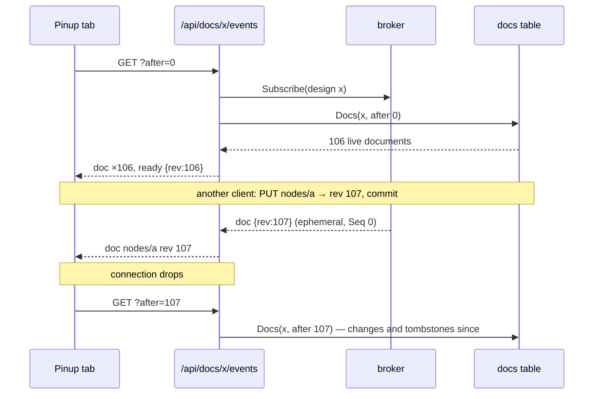
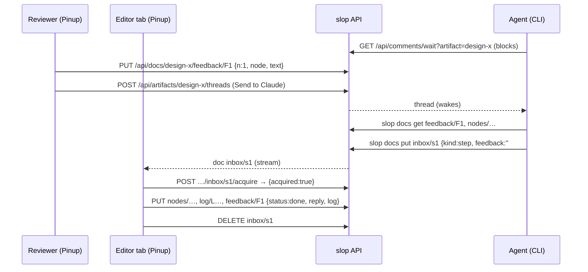
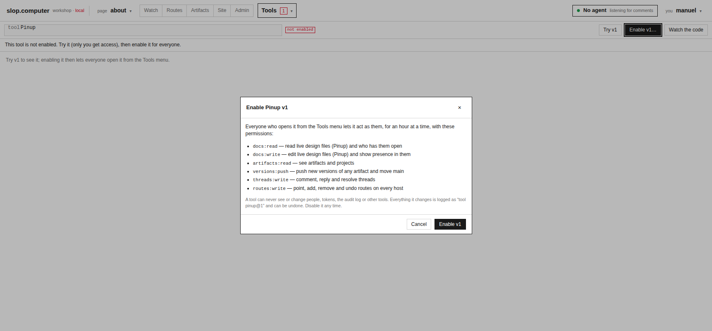
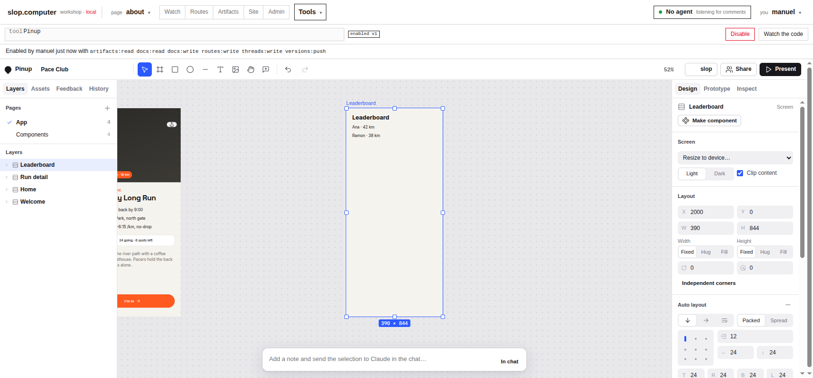
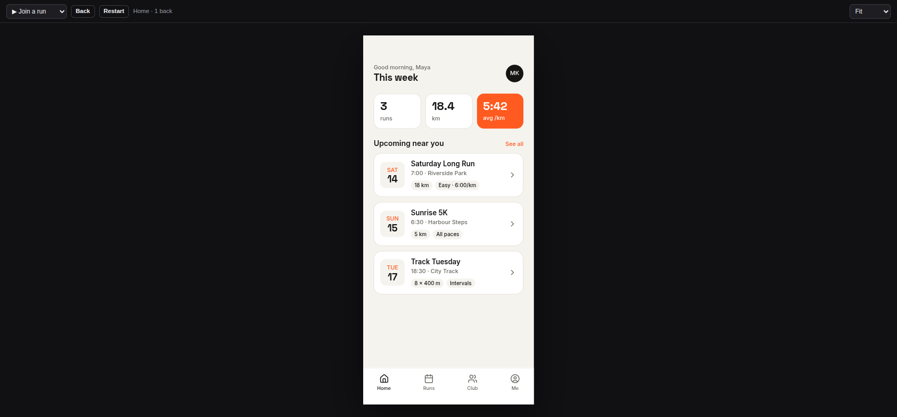
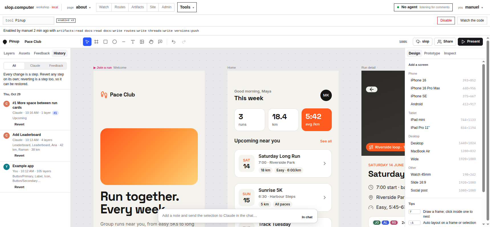

# Pinup on slop: A Live Design Tool Inside a Versioned Page Server

On 29 October 2026, **Pinup**, the screen-design tool built on the previous day as a claude.ai Artifact, became a tool of **slop.computer** ("slop"), the server that hosts versioned pages and data and publishes them on site hosts. In slop, Pinup edits a shared design file live with other people and with coding agents. It saves the file as immutable versions, and it publishes a version as a clickable prototype on a site route. This report explains how that integration is built.

There were two halves. slop gained a new primitive: a store of live, mutable JSON documents with a change stream, leases and presence. Pinup gained a host adapter that implements the runtime interface Pinup was written against on top of that primitive. Pinup's own code was not modified.

The report proceeds in dependency order:

1. the two systems as they existed before the work (§2–3);
2. the document store (§4) and its change stream (§5);
3. presence (§6) and the extended tool runtime (§7);
4. the host adapter (§8) and the build that injects it (§9);
5. versions and publishing (§10), and the agent channel (§11);
6. verification (§12), the failures met (§13), and the costs of the design (§14).

> [!summary]
> - slop's versions are immutable and Pinup needs mutable, live documents. The integration keeps both. A new **docs store** holds the working copy, one document per layer, with per-artifact revisions, tombstones and leases. **Versions** remain the published record, written by an explicit *Save version*.
> - Live changes travel as **ephemeral events** (never stored) on a per-design stream. A client that reconnects **replays by revision from the docs table**. Revisions come from a counter row whose update serializes writers until commit, so the stream can deduplicate by revision without gaps.
> - Pinup reaches its host only through `window.claude.use(name)`. A 271-line adapter implements `db`, `user`, `room` and `downloads` over slop's tool grant. A second mode serves a saved version read-only, so **one page** is both the editor (a Workshop tool) and the prototype player (a site route).
> - The adapter is concatenated into Pinup's own scope at build time, which lets it call and wrap Pinup functions without editing them. The upstream build stays byte-identical to the published artifact (sha256 `531ef701…`).

## 1. What exists, and where

| Item | Location | Content |
|---|---|---|
| Repository | `/home/manuel/workspaces/2026-10-28/slop-computer/slop-computer`, branch `task/slop-computer` | slop (Go server and CLI, React Workshop) |
| Ticket | `ttmp/2026/10/29/SLOP-004--pinup-on-slop-…/` | intern guide (`design-doc/01-…`), diary steps 1–3, screenshots `various/s4-*` |
| Pinup source | `web/pinup/src/` (upstream, unchanged), `web/pinup/slop/` (slop-specific) | the 14 upstream modules; `slop/js/00-slop-host.js` (271 lines), `slop/js/95-slop-ui.js` (139), `slop/build.js` (54) |
| Docs store | `pkg/store/docs.go` (217), `pkg/store/migrations/{postgres,sqlite}/006_docs.sql` | tables `docs` and `doc_heads` |
| Docs API, stream, presence | `pkg/server/docs.go` (355) | `/api/docs/…`, `/api/presence/…` |
| Client and CLI | `pkg/client/docs.go` (144), `cmd/slop/cmds/docs.go` (141) | `slop docs ls/get/put/rm/watch` |
| Tool runtime | `pkg/render/assets/tool.js`, `web/workshop/src/screens/ToolScreen.tsx` | `args`, `config`, `people`, `stream`, `putRaw`, `beacon`, `setArgs` |
| Agent documentation | `pkg/doc/topics/pinup.md` | `slop help pinup`, `/help/pinup` |
| Tests | `pkg/store/docs_test.go` (155), `pkg/server/docs_test.go` (187) | SQLite and Postgres |

Not counting the imported Pinup source and the ticket, the change is 2,041 inserted lines across 27 files. It landed in five commits, `6de88a3`, `f87ad27`, `ef8a8d2`, `2f1f2b9` and `ea9c141`, after `91c42b3` had imported Pinup into the repository.

## 2. The first system: Pinup and its host contract

[[PROJECT REPORT - Pinup - A Shared Design File Inside a Claude Artifact - A Technical Deep Dive]] describes Pinup in full. Three of its properties determine everything in this report.

**Pinup stores a design as many small documents.**

- The file-level data lives in `meta/file`: name, pages, tokens.
- Every layer is its own document, `nodes/<id>`.
- Review items are `feedback/<id>`, history steps `log/<id>`, and work for an editor tab `inbox/<id>`.

Writes are last-writer-wins per document. The client's write queue keeps at most one pending write per document and twelve in flight. It ignores echoes of a document while its own write is pending.

**Pinup reaches its host through a single function.** `cap(name)` in `src/09-collab.js` calls `window.claude.use(name)` and caches the promise. Every feature checks for `null` and degrades. The test double for the host, `tests/mock.js`, is 46 lines long, so the whole surface Pinup needs is written down in one place.

```js
// The host contract, as Pinup uses it (call sites in 02-store.js, 09-collab.js):
db.doc(path).set(data) / .delete() / .onSnapshot(next) / .acquire({holder, ttlMs})
db.collection(path).onSnapshot(next)        // next({docChanges: () => [{type, doc:{id, data()}}]})
user.me() / user.canEdit() / user.can('data.write') / user.profiles(ids)
room.presence(patch) / room.onPeers(h) / room.canSendToClaudeSession() / room.sendToClaudeSession(data, {deliver})
downloads.save({filename, data})            // optional, like sample, assets and comments
```

**Claude changes a Pinup file through the inbox.** An inbox document carries HTML, or a *step*: ordered operations, optionally naming a feedback item. An open editor tab takes a lease on the document. It applies the contents as one history group, marks the feedback item done, and deletes the inbox document. Each step can later be reverted on its own.

## 3. The second system: slop as it stood

slop is one Go binary that is both server and CLI. It answers on three classes of host:

- the **main** host serves the Workshop and the API;
- **site** hosts serve public pages through a route table;
- **sandbox** origins serve one page version each, for previews and tools.

Four of its mechanisms carry this integration.

**Artifacts and versions.** An artifact is a named `page` or `data` collection. A version is an immutable file tree; pushing creates a new one and normally moves the `main` reference. A data artifact's `.json` files become records, one per file (`pkg/records/records.go`, `Parse`). A page receives the records it reads as boot data in `window.slop`. A version holds at most 2,000 files.

**Tools and grants.** A tool is a page artifact whose manifest has a `tool` section listing permissions.

- An admin enables a tool version once.
- The Workshop then opens it in an iframe on the version's sandbox origin and answers the tool's `tool-hello` message with a one-hour bearer grant. The grant carries only the approved permissions.
- `guardPerm` (`pkg/server/auth.go:120`) lets a grant reach only endpoints registered with a permission it holds. Endpoints guarded without a permission, such as `/api/users` and `/api/config`, answer a grant with `403 grant_not_allowed`.

**The event broker.** Every kernel change appends an event in its transaction, and the server publishes it after commit (`pkg/events/broker.go`). Subscribers pass a filter. An event with `Seq == 0` is *ephemeral*: it is delivered live and never stored. Agent presence already used this.

**Threads and the agent loop.** A comment thread is anchored on an artifact version. A coding agent runs `slop comments wait`, blocks until a matching comment appears, and receives the whole thread.

The gap between the two systems is now precise. Pinup needs mutable documents with listeners and leases, and slop has only immutable versions. Everything else maps onto slop mechanisms that already existed.

## 4. The docs store

### 4.1 Data model

The store is two tables, created by migration 006 for both dialects:

```sql
CREATE TABLE doc_heads (artifact_id text PRIMARY KEY REFERENCES artifacts(id), rev bigint NOT NULL);
CREATE TABLE docs (
    artifact_id text NOT NULL REFERENCES artifacts(id),
    path text NOT NULL,                 -- collection/id: "meta/file", "nodes/k9TzQ"
    data text,                          -- a JSON object; NULL is a tombstone
    size integer NOT NULL DEFAULT 0,
    rev bigint NOT NULL,                -- per-artifact, strictly increasing
    updated_by text REFERENCES users(id), updated_at TIMESTAMP WITH TIME ZONE NOT NULL,
    lease_holder text, lease_until TIMESTAMP WITH TIME ZONE,
    PRIMARY KEY (artifact_id, path));
CREATE INDEX docs_rev ON docs (artifact_id, rev);
```

The documents belong to a **design artifact**: a slop data artifact whose type is listed in `store.DocTypes`, currently only `pinup`. Tying documents to an artifact gives them a name, a project, version history and comment threads for free. The type restriction keeps the store from becoming a second, unversioned way to publish pages.

### 4.2 Revisions

Each write takes the artifact's next revision from `doc_heads`, with an upsert that returns the new value:

```sql
INSERT INTO doc_heads(artifact_id, rev) VALUES (?, 1)
ON CONFLICT(artifact_id) DO UPDATE SET rev = doc_heads.rev + 1 RETURNING rev
```

The obvious alternative, `SELECT MAX(rev)+1 FROM docs` inside the transaction, is wrong under concurrency. Two transactions can read the same maximum and assign the same revision.

The upsert locks the head row until the transaction commits. That has two consequences:

- every revision is unique;
- revisions **commit in increasing order** for one artifact, because a writer holding revision *r* blocks the writer that will receive *r+1* until it commits.

The second property is what makes the change stream in §5 correct. The test `TestDocRevsUnderConcurrency` runs forty concurrent writers against Postgres and checks that no revision is handed out twice.

### 4.3 Writes, deletes and tombstones

`PutDoc` checks the following, then upserts the row with the new revision:

- the path has the shape `collection/id`;
- the body is a JSON object of at most 256 KiB;
- the artifact keeps documents;
- after the write, the artifact will hold at most 20,000 live documents and 64 MB.

The quota check runs after the head row is locked, so two writers cannot both pass a check that only one of them should pass.

`DeleteDoc` does not remove the row. It sets `data` to NULL and assigns a new revision. The row is now a **tombstone**. A client that was disconnected asks for changes after the last revision it saw and receives the tombstone, which tells it the document is gone. Tombstones older than seven days can be pruned. A client whose cursor is older than that must reload the whole collection.

### 4.4 Listing and prefixes

`Docs(artifact, prefix, after)` returns documents in revision order:

- with `after == 0` it returns live documents only, which is the initial load;
- with a positive `after` it includes tombstones, which is catching up.

Prefix matching uses `substr(path, 1, n) = prefix` rather than `LIKE`. The underscore is a legal path character and also a `LIKE` wildcard, so `LIKE 'no_es/%'` would match `noXes/a`; the test covers exactly that case.

### 4.5 Leases

A lease lets one of several clients claim a document. Pinup uses it so that only one open tab applies each inbox step. Acquisition is a single conditional update:

```sql
UPDATE docs SET lease_holder = ?, lease_until = ?
WHERE artifact_id = ? AND path = ? AND data IS NOT NULL
  AND (lease_until IS NULL OR lease_until < :now OR lease_holder = ?)
```

The holder has the lease when exactly one row is affected. The holder can renew it. Once it expires, anyone can take it. A tombstone cannot be leased, and the time-to-live is capped at one minute.

## 5. The change stream

### 5.1 Protocol

`GET /api/docs/{artifact}/events?after=<rev>` returns server-sent events:

```text
event: doc       id: 7    data: {"path":"nodes/n1","rev":7,"data":{…},"by":"usr_…"}
event: ready              data: {"rev":12}
event: presence           data: {"peer":"p3k…","user":"usr_…","name":"manuel","kind":"viewer","presence":{…}}
```

A `doc` event carries the document inline up to 64 KiB. Above that it carries `big: true`, and the client fetches the document.

### 5.2 Replay, then live

The handler follows the same discipline as slop's existing kernel stream (`eventStream`):

```text
docEvents(artifact, after):
    sub := broker.Subscribe(ev.type ∈ {doc, presence} ∧ ev.artifact = artifact   ∨ agent waiting on this design)
    docs := Docs(artifact, "", after)        -- live docs if after = 0, else every change after it, tombstones included
    for d in docs: send doc(d); last := max(last, d.rev)
    send ready(last)
    loop: ev from sub
        doc:      if ev.rev ≤ last: skip;  send; last := ev.rev
        presence: send
```

**Subscribing before reading the table closes the race.** Any write that commits after the subscription arrives on the subscription. Any write that committed before the replay query is in the replay. A write that falls into both is skipped by the `rev ≤ last` test. Because revisions commit in order (§4.2), a skipped event can never hide a later, unseen revision.

**When the broker drops a slow subscriber, nothing is lost.** The broker closes that subscriber's channel rather than block other subscribers. The handler then returns, and the client reconnects with its last revision.



### 5.3 Why document changes are ephemeral

Storing doc events in the kernel's `events` table would record every drag of every layer, and every Workshop tab would receive them. The docs table, with its revisions and tombstones, is already a durable change record. So doc events are published with `Seq 0`, and the kernel stream gained a one-line filter (`pkg/server/stream.go`) that drops `doc` and `presence` events. A mutation check confirmed that the test guards this filter: with it removed, `TestDocsAPI` fails with `the kernel stream must skip doc and presence events, got presence …`.

## 6. Presence

Presence is who has a design open and what they are looking at. It lives in memory, per design, which is the same one-process assumption the broker makes.

- `POST /api/presence/{artifact}` with `{peer, presence}` stores the payload (at most 4 KiB) with a timestamp and publishes a `presence` event.
- `{peer, left: true}` removes the peer. A peer id already held by another user is refused with `409 peer_taken`.
- Peers not heard from for 30 seconds are dropped, lazily, on the next post or list for that design.
- `GET /api/presence/{artifact}` returns the current peers.

**Waiting agents appear as peers.** `GET /api/presence` also lists coding agents blocked in `slop comments wait` that wait on this design, its project, or every design, with `kind: "agent"`. Their `agent.waiting` and `agent.left` events, which were already ephemeral, are relayed onto the design's stream as `presence` events. This is done on the server because a grant cannot call `/api/agents`. Pinup draws any peer of kind `agent` with the "Claude" avatar, so an agent that starts waiting becomes visible in the design without any change to Pinup.

## 7. The tool runtime

Three facts that Pinup needs are unavailable to a grant: who the users are, which design to open, and which site hosts exist. The Workshop therefore sends them with every grant message, alongside the secret and permissions:

| Field | Source | Pinup uses it for |
|---|---|---|
| `people` | grant response: active users' ids and names | `user.profiles(ids)` (avatars, feedback authors) |
| `args` | the query of `/tools/<id>?…`, minus the Workshop's own `try` | which design to open (`?file=design-pace-club`) |
| `config` | the Workshop's boot configuration | the site hosts offered by *Publish prototype* |

The tool client `tool.js` gained four calls:

- `api.stream(path, {after, on})`: one server-sent-events reader over `fetch`, so that the grant travels in a header, with reconnection from a caller-supplied cursor. The older `api.on` for kernel events now uses the same reader.
- `api.putRaw`: blob uploads with a non-JSON body.
- `api.beacon`: a `keepalive` request that survives the page closing, used to leave presence.
- `api.setArgs`: asks the Workshop to put the given arguments in its URL, so that reopening the tool reopens the same design.

The Workshop iframe also gained `allow-downloads` and clipboard permissions, which Pinup's export and copy actions need inside a cross-origin frame.

## 8. The host adapter

`web/pinup/slop/js/00-slop-host.js` installs `window.claude` before Pinup first calls `cap()`. It chooses one of two modes:

- **tool mode**, when `window.slop.mode` is `tool` and `slop.tool` exists, which is the case when the Workshop opens the tool;
- **player mode**, when the page was served with a binding named `design`.

Anywhere else it installs nothing, and Pinup keeps its upstream local-storage behaviour.

### 8.1 The `db` capability as a mirror

In tool mode, the adapter opens the design's change stream once and keeps a **mirror**: a map from path to `{data, rev}`, where `data` is null for a deleted document. Pinup's listeners are served from the mirror:

```text
on doc(path, data, rev):
    cur := mirror[path]
    if cur and cur.rev ≥ rev: return                 -- an equal or newer change already applied
    mirror[path] := {data, rev}
    if ready: for each listener matching path:
        type := (cur.data absent) ? "added" : (data null ? "removed" : "modified")
        deliver docChanges([{type, doc: snapshot(path, data)}])
on ready: ready := true; for each listener: deliver its initial set (every live doc under its prefix, as "added")
listen(l): add l; if ready: deliver l's initial set on the next tick
```

Pinup registers its five listeners (`meta/file`, `nodes`, `feedback`, `log`, `inbox`) synchronously during boot, before the stream's `ready` arrives. Replayed documents are therefore applied to the mirror silently, and each listener receives its initial snapshot at `ready`. This matches the Artifact runtime's contract: an initial snapshot first, then individual changes.

Three further details:

- **Tombstones stay in the mirror with their revision.** Otherwise the late fetch of a big document could bring a deleted document back.
- **Echoes are delivered.** Pinup's own writes come back on the stream. The adapter delivers them, and Pinup's pending-write rule ignores them.
- **Writes go straight to the API.** `set` is a `PUT`, and `delete` a `DELETE`. The stream, not the response, updates the mirror.

### 8.2 Errors as the codes Pinup understands

Pinup already maps the Artifact runtime's error codes to behaviour (`src/02-store.js:236-243`). The adapter translates slop's HTTP failures into those codes, so the existing messages and read-only switches apply unchanged:

| slop response | code given to Pinup | Pinup's behaviour |
|---|---|---|
| 401, 403 | `not_granted` | switches to read-only |
| 413 `too_large` | `invalid_argument`, message mentions size | "That layer is too large to save" |
| 507 `quota_exceeded` | `quota_exceeded` | asks the user to delete layers or images |
| 429 | `resource_exhausted` | retries with backoff |
| 5xx, network | `unavailable` | retries, then asks to keep the tab open |

### 8.3 The `user` and `room` capabilities, and "send to Claude"

`user` answers from the grant:

- `canEdit()` and `can('data.write')` are true when the grant holds `docs:write`;
- `profiles` reads the grant's `people`.

`room` handles presence:

- It posts the tab's presence payload at most every 250 ms. Pinup sends cursor positions as often as every 70 ms, and one HTTP request per cursor move would be wasteful.
- It sends a heartbeat every 15 s and a `keepalive` leave on `pagehide`.
- It drops viewers not heard from for 45 s.

`sendToClaudeSession` is the one capability whose meaning changes. In the claude.ai runtime it puts a payload into the chat beside the page. On slop, the agent beside a design is a process blocked on `slop comments wait`. The adapter therefore creates a **comment thread on the design artifact**, anchored to the design, with the payload as text and an instruction to use `slop docs`. A token-based waiter ignores only comments made with its own token. A thread created through a grant carries no token, so a person's hand-off wakes an agent even when that agent is logged in as the same person.

### 8.4 Choosing and creating a design

When the Workshop URL has no `?file=`, the adapter opens a sheet, using Pinup's own `sheet()` helper. The sheet lists the `type: pinup` data artifacts and offers *New design*. Creating a design takes three steps:

1. push version 1 of `design-<slug>` with a `file.json`;
2. write the live `meta/file`;
3. call `api.setArgs({file})`, so the Workshop URL becomes `/tools/pinup?file=design-<slug>`.

Version 1 matters beyond history. Threads require an existing version, so a design without one could not receive a hand-off.

## 9. The build: splicing into Pinup's scope

Pinup's build concatenates numbered modules into one immediately invoked function. The modules share that function's scope, so they call each other without imports. The slop build (`web/pinup/slop/build.js`) uses the same mechanism. It sorts `slop/js/00-slop-host.js` and `slop/js/95-slop-ui.js` together with the upstream modules by file name, which gives the order 00, 01 … 14, 95, 99.

Being inside the scope has three consequences:

1. **Pinup's helpers are callable.** Function declarations are hoisted across the whole function body, so slop code can call `h`, `sheet`, `menuAt`, `toast`, `copyText`, `handoffMarkdown`, `allFrames` and `openPresent`. Constants such as `slug` and `S` can be read after their declarations have executed, which is always the case for code that runs on a user action or after the grant arrives.
2. **Pinup's functions can be wrapped without editing them.** A function declaration creates a mutable binding, and Pinup's internal callers look the binding up at call time. So `95-slop-ui.js` can replace `boot`, `onLoaded` and `showFrame` with wrappers that call the original and then add slop behaviour.
3. **Upstream stays untouched.** `web/pinup/build.js` and `src/` are as imported. `node build.js` still produces a `dist/pinup.html` whose sha256 begins `531ef701b5c1417e`, identical to the published artifact. The slop build writes `dist/slop/` and `dist/slop-player/` instead.

The slop build also wraps the page in a document skeleton (`<!doctype html>`, `<head>`, `<body>`). The Artifact host adds this skeleton itself, so Pinup's output is a fragment. slop serves `index.html` as written, and its boot-data injection (`render.Inject`) only prepends to a fragment, which would leave the page in quirks mode.

## 10. Versions and publishing

### 10.1 Save version

*Save version* (in the new "slop" menu) writes the live file as a new version of the design artifact:

```text
file.json             S.file: name, pages, tokens
pages/<pageId>.json   {id, name, nodes:[every node of that page]}     -- internal _m fields stripped
handoff.md            handoffMarkdown(): tokens, components and screens as JSX, the prototype map
```

- **Grouping by page.** Nodes are grouped by page, rather than written one file per layer, because a version holds at most 2,000 files and a large design has more layers than that. A page is also the natural record for a renderer.
- **Uploading.** The adapter hashes each file with `crypto.subtle.digest('SHA-256', …)`. It asks `/api/blobs/missing` which blobs the server lacks, uploads those with `putRaw`, and pushes the tree with `base` set to the current `main`.
- **Feedback stays out of snapshots.** Review items stay in the live documents, for the reason given in §10.3.

### 10.2 One page, two modes: the player

The prototype player (`06-proto.js`) depends on about a dozen functions from Pinup's editor modules, among them `finishEdit`, `topOf`, `goPage`, `select`, `presenceSoon` and the comments state `CA`. Extracting it into a smaller bundle would mean reimplementing or stubbing all of them. The player is therefore **the full Pinup page in player mode**:

- `db` is built from the boot records of the bound design: `file.json` becomes `meta/file`, and the nodes of each `pages/*.json` become `nodes/<id>`. It is read-only.
- `user` cannot edit, so Pinup switches itself to read-only.
- CSS hides `#app`, the editor, and the player's Close button.
- The wrapped `onLoaded` opens Present mode at the frame whose name slug matches the route parameter `:screen`.
- The wrapped `showFrame` rewrites the URL to `…/<screen slug>` each time a prototype link is followed.

The artifact `pinup-player` holds the same `index.html` as `pinup`, with a plain page manifest. One player serves every design, because a route binding supplies the data and need not appear in the page's own `reads`:

```text
slop route set /proto/pace-club/:screen pinup-player --bind design=design-pace-club
slop route set /proto/pace-club         pinup-player --bind design=design-pace-club
```

*Publish prototype* does this from inside Pinup. It saves a version, then `PUT`s both routes with the binding following `main`. Every later *Save version* moves `main`, and the published prototype follows on its next request.

### 10.3 What publishing exposes

A route binding makes the bound artifact's records part of the page's boot data, and makes its files servable under `/_d/`. Publishing a design therefore makes its saved version public: `file.json`, the page records and `handoff.md`. This is why feedback is not included in snapshots: review notes are internal, and the layers and handoff describe the design itself. On the local server, a player page measured about 849 KB, the Pinup page plus the inlined design.

## 11. The agent channel

An agent works on a design through the CLI. `slop docs` is a thin wrapper around §4–5:

```sh
slop comments wait -a design-pace-club          # woken by "Send to Claude" or "Hand off" in Pinup
slop docs ls design-pace-club feedback/         # open review items
slop docs get design-pace-club nodes/keFmmRsu4p
slop docs put design-pace-club inbox/s1 step.json
slop docs watch design-pace-club                # every change and every peer, as JSON lines
```

A step written by an agent is applied by an open editor tab with Pinup's unchanged code: lease, apply as one history group, link the feedback item, delete the inbox document.



`slop help pinup` (`pkg/doc/topics/pinup.md`) documents for agents:

- the document layout and the HTML attributes the importer reads;
- the step operations: `update`, `set`, `delete`, `html`, `tokens`;
- the condition that an editor tab must be open for steps to land;
- building the real app from a hand-off;
- publishing by hand.

*Hand off* saves a version and opens a thread asking an agent to build the app from `slop pull design-x`. The agent then writes an ordinary slop page artifact, with behaviour and data, and routes it.

## 12. Verification

### 12.1 Automated tests

| Test | Covers |
|---|---|
| `pkg/store/docs_test.go`, `TestDocs` | refusals (artifact type, path shape, non-object, over 256 KiB); revision order; tombstones in catch-up lists and not in initial lists; prefix without wildcards; lease exclusivity, renewal, expiry, and refusal on tombstones; pruning |
| `TestDocRevsUnderConcurrency` | 40 concurrent writers receive 40 distinct revisions (Postgres and SQLite) |
| `pkg/server/docs_test.go`, `TestDocsAPI` | through a tool grant: `ready` then live `doc` events; tombstone event; a second client replaying after revision 1; 403 for a read-only grant, 400, 404, 413; leases; presence on the design stream and *not* on the kernel stream; leave |

The suite passed on SQLite (`go test ./...`) and on Postgres (`TEST_DATABASE_URL`). `make lint` returned 0 and `npx tsc --noEmit` returned 0. `node --check` passed on `tool.js` and on the slop bundle.

### 12.2 The end-to-end run

The integration was then driven in a browser against a local slop server holding the francois import, with the Workshop in local mode:

| Step | Observed |
|---|---|
| Start the new binary | `Applied migration migration=006_docs.sql` |
| `make pinup-push` | `pinup` v1 and `pinup-player` v1 pushed; the player uploaded 0 blobs (same page) |
| Enable the tool | the approval dialog lists `docs:read` and `docs:write` in plain words (Figure 1) |
| *New design* "Pace Club" in project Play | the Workshop URL became `/tools/pinup?file=design-pace-club` |
| *Start with an example app* | `slop docs ls` → 106 documents: 104 nodes, `meta/file`, one log entry |
| An agent writes HTML to `inbox/h1` | the inbox drained and 110 documents remained. A "Leaderboard" screen, 390×844 with vertical auto layout (gap 12, padding 24), appeared on the canvas (Figure 2) |
| *Save version* | v2: `file.json`, `pages/p1.json` (77 nodes), `pages/p7ndBvr.json` (31), `handoff.md` (21,670 characters); listed `via tool` |
| *Publish prototype* | routes `/proto/pace-club` and `/proto/pace-club/:screen`. The player opened at Welcome; following "Find a run" showed Home, and the URL became `/proto/pace-club/home` (Figure 3) |
| An agent waits on the design | Pinup showed the "Claude" avatar |
| *Hand off* | the waiting agent woke with a thread on v2 containing the build brief and the note |
| An agent resolves feedback with a step | node gap 12 → 20; item #1 `done` with the agent's reply and its log id. History lists all three steps with their actors (Figure 4) |



*Figure 1. Enabling Pinup in the Workshop. The dialog lists the six permissions in the tool's manifest, including the two new docs permissions, and states that the tool acts as the user for an hour at a time.*



*Figure 2. The "Leaderboard" screen written by an agent as HTML into `inbox/h1` and imported by the open tab. The right panel shows the recovered auto layout: vertical direction, gap 12, padding 24.*



*Figure 3. The prototype player on the site host at `/proto/pace-club/home`, after following the "Find a run" link from Welcome. The editor is hidden; the bar shows the flow, Back, Restart and the scale mode.*



*Figure 4. History after the run: "Example app" (You, 105 layers), "Add Leaderboard" (Claude, 4 layers) and "#1 More space between run cards" (Claude, 1 layer, linked to feedback item #1). Each step has its own Revert.*

## 13. Failures met during the work

Each failure below has a cause that generalizes beyond this project.

- **Icons loaded after the code that used them.** The first slop button had a blank icon. Pinup loads its icon set inside `boot()`, while the button was built when its module loaded, which is earlier. Code spliced into another program's scope runs at that program's load time, not after its initialization, so slop code that depends on initialized state has to wrap `boot`.
- **A navigation dropped state held in the URL.** After a tool version was enabled, the Workshop navigated to the bare tool path and dropped `?file=`. Once a tool keeps state in the host's URL, every navigation the host performs on the tool's behalf has to carry that state forward.
- **A layout class reused out of context.** The Workshop's address-bar style, written for a select plus an input, was reused for a static label. Its 26-pixel spans had no vertical centring, and the box stretched across the toolbar. The user reported it from a screenshot. The fix is a separate `label` variant, not a change to the shared class.
- **A mutation check undone with a reset.** After deliberately breaking the stream filter to prove the test catches it, `git checkout <file>` was used to undo the change. That also discarded the *uncommitted* real change in the same file. `git diff --stat` showed the loss, and the edit was reapplied before committing. A temporary mutation should be undone with its exact inverse, not by resetting the file to the last commit.
- **A guessed field.** The first push body included a `via` field naming the tool. The server already attributes grant pushes to the tool, so the field was dropped before it could cause a refusal.

## 14. What the design provides, and where it strains

| Decision | What it provides | Where it strains |
|---|---|---|
| Live documents separate from versions | Pinup's model unchanged; versions stay immutable and publishable | Two states to explain; *Save version* is an explicit step |
| A revision counter row | Unique, commit-ordered revisions; a gap-free stream with simple deduplication | Writers of one design are serialized; every write counts the design's live documents for the quota |
| Ephemeral doc events, replay from the table | Nothing in the event log per drag; lossless reconnects | Fan-out to every subscriber of a design is unmeasured under heavy dragging |
| In-memory presence | No storage; agents appear as peers | One server process; expiry is lazy, with the client heartbeat bounding staleness |
| One page for editor and player | No reimplementation of the player's dependencies | About 849 KB per player page; Pinup's Google Fonts load on public pages |
| Adapter spliced into Pinup's scope | No edits to upstream code; byte-identical upstream build | Wrapping relies on the names `boot`, `onLoaded` and `showFrame` remaining stable upstream |
| "Send to Claude" as a thread | Uses the existing agent loop; recorded and visible | Pinup's toasts still say "check the conversation" |
| `routes:write` in the tool manifest | Publishing from inside Pinup | The permission covers every route on every host, not only `/proto/*` |

## 15. Open questions and next steps

- **Other tools.** `store.DocTypes` lists only `pinup`. Another tool that wants live documents needs a way to register the data type it owns, ideally declared in its tool manifest and approved with the tool.
- **Narrower routing permission.** A permission limited to a path prefix would let Pinup publish under `/proto/*` without the right to change every route.
- **Not built yet:**
  - *Open version* (restore a snapshot into the live documents as one revertible step);
  - static publishing through `exportHTMLDoc`;
  - a scripted Playwright test of tool mode against `slop serve --local`;
  - scheduled tombstone pruning.
- **Phase 3:** in-page Claude through an API proxy (`sample`), image uploads (`assets`), a reviewer role able to write only `feedback/`, and `viewer: pinup-player` for design artifacts in the Workshop.
- **Deployment.** The branch is pushed but not merged. Deploying means a new image, a gitops tag bump, `make pinup-push` against the cluster, and enabling the tool.

## Evidence and sources

- Repository: `/home/manuel/workspaces/2026-10-28/slop-computer/slop-computer`, commits `91c42b3` (import), `6de88a3` (store), `f87ad27` (API, stream, presence), `ef8a8d2` (tool runtime, CLI), `2f1f2b9` (adapter, build), `ea9c141` (help), `a819755` (diary and notes).
- Ticket SLOP-004: the intern guide with its "As built" section, the diary (steps 1–3, with the exact commands and failures), and screenshots `s4-01` to `s4-10`.
- Pinup upstream: `web/pinup/README.md` (provenance; published artifact `https://claude.ai/artifact/UVDCAmJEaKWj1eeP9QHB9P`).

## Related notes

- [[PROJECT REPORT - Pinup - A Shared Design File Inside a Claude Artifact - A Technical Deep Dive]]: Pinup itself, as built on 2026-10-28.
- [[DIARY - Pinup - Beat by Beat Through the Pinup Session]]: the session that produced Pinup.
- [[ARTICLE - Playbook - Self-Contained Go Wasm and JavaScript Browser Applications]]: constraints on self-contained browser applications.
