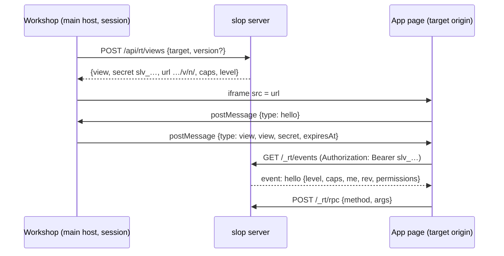
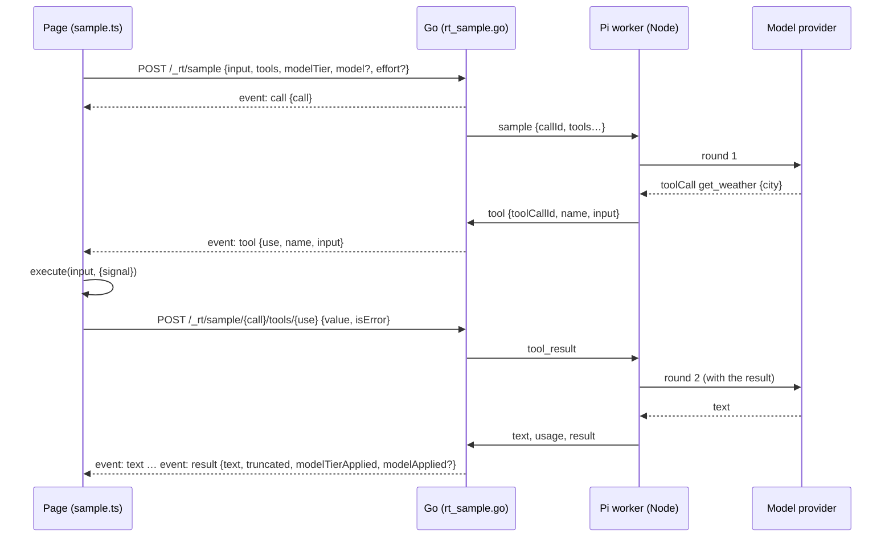
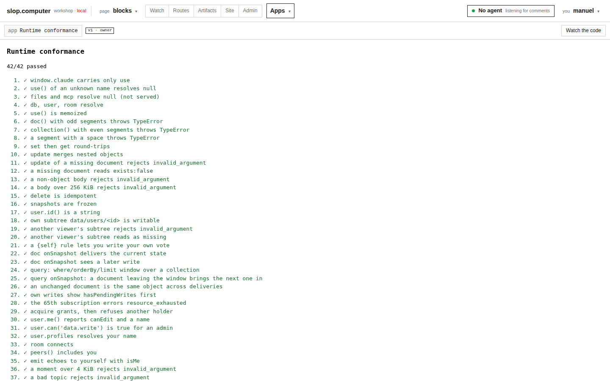
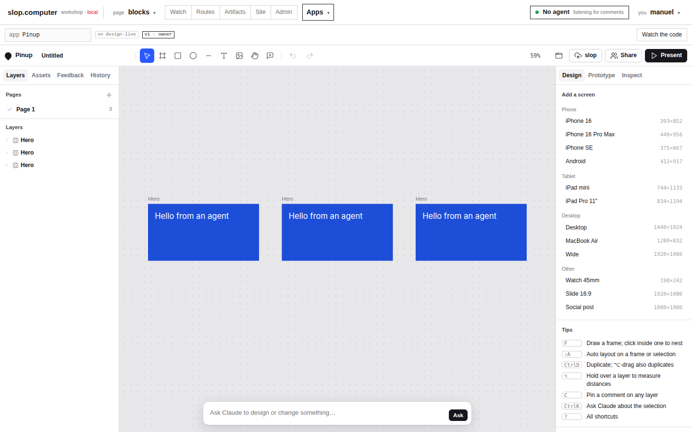
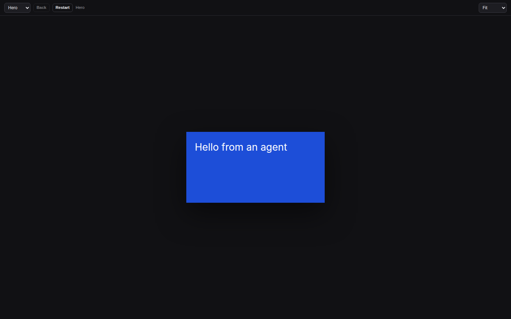
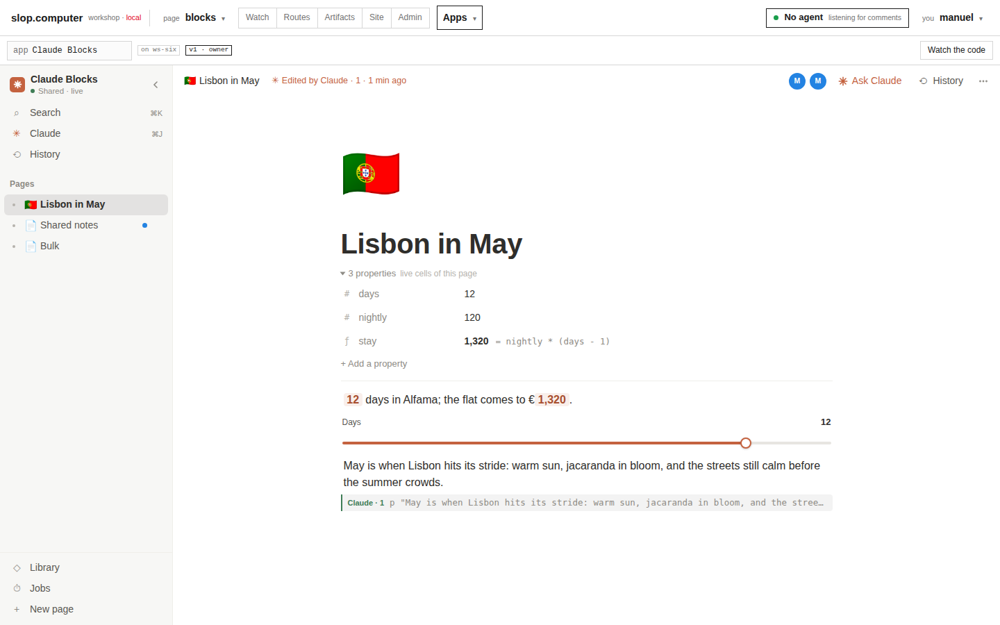

# slop Artifact Runtime: Hosting the claude.ai Artifact Contract Natively

On 29 October 2026, slop.computer ("slop") began hosting the **claude.ai Artifact runtime contract**, version 0.2.92, as its own baseline. Before this work, slop ran each app through an adapter. An adapter is a script that installs its own `window.claude` and maps part of the contract onto slop-specific endpoints. After this work, slop has one implementation of the contract: one server package and one page client. Every app runs on it without app-specific host code.

The work was done on branch `task/slop-runtime` under ticket SLOP-009. It changed 131 files: 26,209 lines added and 2,777 removed. It deleted the docs store, the presence hub, the tool grants and Pinup's adapter. In their place it added:
- a runtime server (`pkg/rt`, `pkg/server/rt*.go`, `pkg/store/rt.go`);
- a page client (`web/runtime`, built to `claude.js`);
- a Workshop shell that opens apps (`AppScreen`);
- a browser conformance suite;
- the `sample` capability, served through a Node worker that runs the Pi SDK.

Pinup and Claude Blocks were moved onto the runtime. Blocks runs from its ten upstream files, unchanged, plus one manifest file.

This report explains the design in dependency order:

1. the contract and the problem with adapters (§1–2);
2. apps, targets, origins and views (§3–4);
3. the document store, its stream and diff sync (§5–7);
4. the other capabilities, and the `slop` extension (§8–9);
5. `sample` through the Pi worker (§10);
6. the Workshop shell and consent (§11);
7. the two applications moved onto the runtime (§12);
8. verification (§13), the failures met (§14), and the costs and open questions (§15).

> [!summary]
> - **One contract implementation.** A page reaches its host only through `window.claude.use(name)`. slop now implements every capability the contract defines, except `files` and `mcp`, in one runtime. An app needs a `capabilities` manifest, not adapter code.
> - **Origins, views and stream.** A *target* (the artifact whose state a view uses) has its own origin, so browser storage survives new versions. A *view* (one open page) gets a short-lived secret through `postMessage`, and talks only to `/_rt/…` on its own origin. Document changes reach it on one SSE stream, in revision order. A gap in the stream is filled from the table.
> - **Models through Pi, for admins only.** `sample` runs in a Pi SDK worker. The page can name any model and effort Pi offers, and slop keeps no budget, but only admins can call it. Page tools make a round trip from the model through Go to the page and back. The tests ran on real lunaroute models: multi-turn, parallel tools, chained tools, failing tools and cancellation.

---

## 1. The contract

A claude.ai Artifact is an HTML page. It reaches the platform through exactly one function, `window.claude.use(name)`. The function returns a promise for a **capability namespace**: a frozen object with a documented API. The promise resolves to `null` when the view cannot run that capability. The capabilities of contract 0.2.92 are:

| Group | Capabilities |
|---|---|
| Storage | `db` (realtime JSON documents with access rules), `assets` (uploaded files), `artifact` (republish the page itself) |
| People | `user` (who is viewing), `room` (presence and ephemeral messages), `comments` (shared threads) |
| Models | `sample` (ask Claude, with page-defined tools) |
| Files | `downloads` (offer a generated file), `files` (read a project's files) |
| Connectors | `mcp` |
| Consent | `permissions` (built in, never declared) |

Three properties of the contract determine most of the implementation.

1. **Absence is normal.** A page must work when `use()` returns `null` and light up when it resolves. A host may therefore implement a subset, but each capability it serves must behave as specified.
2. **The manifest is data.** A page is published with `capabilities: {name: config}`. The config carries db rules, room topic levels, image support for `sample`, and so on. The host enforces the manifest; the page cannot widen it.
3. **Limits and error codes are part of the API.** These include documents of 256 KiB and at most 32 levels deep, 25,000 documents per artifact, paths of at most 16 segments, room messages of 4 KiB, assets of 20 MiB and prompts of 256 KiB. Pages branch on error codes. A host that returns `invalid_argument` where the contract says `quota_exceeded` changes the page's behaviour.

## 2. Why the adapters were replaced

Before SLOP-009, Pinup ran on slop through `web/pinup/slop/js/00-slop-host.js`, a 290-line script. It installed a `window.claude` that implemented `db`, `user`, `room` and `downloads` on top of slop's docs store and presence hub. An analysis for Claude Blocks (SLOP-008) found twelve gaps between that adapter and what Blocks calls:
- nested paths, `where` queries and `snap.docs`;
- longer ids and room topics;
- error codes; one of them was a 413 mapped to `invalid_argument`, which makes Blocks switch to read-only.

Each new app would have brought a new list of gaps.

The underlying problem was a difference in primitives:
- **Paths, queries and leases.** The docs store had two-segment paths, no queries, no rules and leases capped at one minute. The contract has nested paths, queries with up to ten filters, per-path rules and leases of up to ten minutes.
- **Permissions.** Tool grants described permissions on *slop's API*. The contract describes *access levels on an artifact*: `view`, `interact`, `admin` or `owner`.
- **Origins.** The sandbox origin was derived from `(artifact, version)`, so each new version started with empty browser storage. The contract promises one origin per artifact whose storage survives republishing.

The decision (D1 in the ticket's design guide) was to make the contract slop's own baseline. It is implemented once, tested once by a conformance suite, and shared by every app. slop-specific features are not added as extra members on contract namespaces. They are offered through one extension capability, `claude.use("slop")` (§9).

## 3. Apps, targets and origins

### 3.1 Two roles of an artifact

Every view has an **app** and a **target**:
- the *app* is the page version that runs;
- the *target* is the artifact whose db, rooms, assets and comments the view uses.

A self-contained page, for example a tracker written by Claude, is its own target. A data artifact can name the app that runs it, through the `artifacts.app` column. For example, a Pinup design `design-pace-club` has `app = pinup`, and a Blocks workspace has `app = blocks`. One app build therefore serves many targets. Opening the design runs Pinup's approved version against the design's own db.

A target has exactly one app. The target therefore determines the origin, the app version and the rules. The rules come from the app's manifest. This matters for agents: a `slop data set` call on a design resolves its rules through `design.app = pinup` without opening a page.

### 3.2 One origin per target

The origin label is derived from the target alone:

```text
label  = "s" + hex(HMAC(serverKey("sandbox"), "target\x00" + targetID))[:20]
origin = https://<label>.<sandbox domain>
URL    = <origin>/v/<n>/            (the app's version n; siblings resolve under it)
```

The table `rt_origins(label, target_id)` maps a label back to its target. On every request, the sandbox handler looks up the label and puts the target into the request context. Every runtime endpoint then checks that the calling view belongs to that target:

```go
// pkg/server/rt.go
func (s *Server) viewOf(r *http.Request) *rt.View {
	bearer := r.Header.Get("Authorization")
	if !strings.HasPrefix(bearer, "Bearer "+rt.SecretPrefix) {
		return nil
	}
	v := s.views.Lookup(strings.TrimPrefix(bearer, "Bearer "))
	if v == nil {
		return nil
	}
	if t, ok := r.Context().Value(originTarget{}).(string); ok && t != v.Target {
		return nil
	}
	return v
}
```

This placement has three consequences:
- All runtime traffic is same-origin. There is no CORS configuration, and the page's fetches send no cookies.
- A view secret that leaks to another target's page is refused there. A mutation test showed that `TestRuntimeViews` catches the removal of this check: with the comparison disabled, it fails with `secret accepted on a foreign origin`.
- `localStorage`, IndexedDB and `/_blob/<id>` URLs stay the same across versions of the app, because the origin depends only on the target.

## 4. Views

### 4.1 Opening a view

A **view** is one open page: one tab, one app version, one target and one user. Views live in memory, in `pkg/rt/views.go`. The sequence that opens one is:



When the server opens the view, it computes three things:

1. **The level.** An admin gets `admin`. The artifact's creator gets `owner`. Pending and disabled users are refused. Every working user on slop is an admin today, so levels are fully implemented, but only `admin` and `owner` occur in practice.
2. **The capabilities.** They come from the app version's manifest (`slop.json`). `slop.json` is parsed and validated when the version is pushed. An invalid manifest is refused with 400: an unknown capability, more than 64 rules, a `{self}` rule whose prefix rule lacks a level, a bad topic name, or an unknown `slop` permission.
3. **The `slop` permissions.** They are granted only if an admin approved that exact app version (`rt_approvals`). Approval is all or nothing per version. All other capabilities need no approval: levels and consent govern them.

### 4.2 The secret and its lifetime

The secret has the form `slv_` followed by 32 base32 characters. It never appears in a URL. The page receives it by `postMessage`, and accepts the message only when `e.origin` is the shell's origin and `e.source` is `window.parent`. Every runtime call carries the secret as a bearer token with `credentials: "omit"`.

A secret lives one hour. The Workshop renews it every 45 minutes and posts the new one. The registry drops a view whose stream never connected within 15 seconds, and a view whose stream ended 2 minutes ago. A server restart ends every view. When the page then receives a 401, it asks the shell to renew. The shell replies with a new view, and the runtime re-subscribes its queries and re-joins its rooms.

### 4.3 The page side of `use()`

`web/runtime/src/index.ts` is the whole public surface of the runtime:

```ts
function use(name: string): Promise<unknown> {
  if (typeof name !== "string") return Promise.resolve(null);
  let p = memo.get(name);
  if (!p) {
    // Never within the page's first run: resolve after a macrotask.
    p = new Promise((r) => setTimeout(r, 0)).then(() => resolve(name)).catch(() => null);
    memo.set(name, p);
  }
  return p;
}
const claude = Object.freeze({ use });
Object.defineProperty(window, "claude", { value: claude, writable: false, configurable: false });
```

`resolve(name)` waits for the view's `hello` event. It returns `null` for any name that is not among the capabilities granted in `hello`, so the page sees what the server decided and nothing else. The `setTimeout` implements a rule of the contract: `use()` never resolves during the page's first synchronous run. A page that relies on resolution order fails on claude.ai, and this rule makes it fail the same way on slop.

## 5. The document store

### 5.1 Schema

Migration `007` drops the old `docs`, `doc_heads`, `tools`, `tool_grants` and `sandbox_labels` tables. Its central tables are these:

```sql
CREATE TABLE rt_heads (target_id text PRIMARY KEY, rev bigint NOT NULL);
CREATE TABLE rt_docs (
  target_id text NOT NULL, path text NOT NULL,   -- data/users/usr_1/blocks
  coll text NOT NULL,                             -- data/users/usr_1
  body jsonb,                                     -- NULL: a tombstone
  version bigint NOT NULL,                        -- per document
  rev bigint NOT NULL,                            -- per target: orders every change
  size integer NOT NULL, updated_by text, updated_at timestamptz NOT NULL,
  PRIMARY KEY (target_id, path));
```

The migration also creates `rt_leases`, `rt_assets`, `rt_origins`, `rt_approvals` and `rt_consents`, and SQLite gets the same tables. Two counters are kept because they answer different questions:
- `rev` answers "what changed in this target since revision *r*?";
- `version` answers "is this the document I last saw?".

The stream uses `rev`. Diff sync and an agent's `if_version` use `version`.

### 5.2 Serialized writes

A write is one transaction in `RTWrite`. The order of its locks is the key point:

```go
// pkg/store/rt.go (abridged)
err := s.InTx(ctx, func(tx db) error {
	var rev int64
	// 1. The head row first: this upsert serializes every writer of the target.
	tx.row(ctx, `INSERT INTO rt_heads(target_id,rev) VALUES(?,1)
ON CONFLICT(target_id) DO UPDATE SET rev=rt_heads.rev+1 RETURNING rev`, target).Scan(&rev)
	// 2. Then the document row.
	d, err := scanRTDoc(tx.row(ctx, tx.forUpdate(`SELECT … FROM rt_docs WHERE target_id=? AND path=?`), target, path))
	body, err := fn(cur)                 // set, update (merge), patch, or delete
	if body == nil && cur == nil {
		return errNoChange               // deleting nothing takes no rev
	}
	// 3. The quota on new documents, then the upsert with version+1 and rev.
	…
})
```

The update of the head row takes a row lock that is held until commit. Two writers of the same target therefore commit in the order of their revisions. A reader that has seen revision *r* has also seen every revision below *r*. This invariant makes the stream's gap filling correct (§6).

`TestRTWriteConcurrency` exercises it with 20 goroutines doing puts and deletes on 4 documents. It checks that the revisions are contiguous.

The operations follow the contract:
- `update` of a missing document fails with `invalid_argument`;
- `update` merges objects key by key and replaces arrays;
- `delete` is idempotent and takes no revision when there is nothing to delete.

### 5.3 Access rules

A manifest's `db.rules` are compiled into a list sorted from shallow to deep (`pkg/rt/rules.go`). For a given path, the deepest matching rule sets each level. A `{self}` segment matches only the caller's own user id:

```go
func (rs Rules) Need(path, user string) (Level, Level) {
	read, write := LevelView, LevelInteract           // the root default
	segs := strings.Split(path, "/")
	for _, r := range rs.rules {                       // shallow to deep
		if len(r.segs) > len(segs) { continue }
		ok := true
		for i, s := range r.segs {
			if s == "{self}" { ok = user != "" && segs[i] == user } else if segs[i] != s { ok = false }
			if !ok { break }
		}
		if !ok { continue }
		if r.read != LevelNone { read = r.read }
		if r.write != LevelNone { write = r.write }
	}
	if write < read { write = read }
	return read, write
}
```

The rule engine handles two special cases:
- **`self` is a level that nobody holds**, the owner included (`meets` returns false for `LevelSelf`). A rule such as `{path: "signoffs", write: "self"}` can therefore only be satisfied by a deeper `signoffs/{self}` rule.
- **`data/users/<id>/` is private regardless of the rules.** A path under another user's subtree reads as *missing*, not as *forbidden*, so a query never reveals that the document exists.

`CompileRules` also refuses a `{self}` rule whose prefix rule sets only one of the two levels, as the contract requires.

### 5.4 Queries and subscriptions

The server answers `db.query` by loading a collection's live rows and dropping those the caller may not read. It then applies the filters, the order (missing values last, then by id) and the limit.

Subscriptions work differently:
- **The initial load ignores `limit`.** `db.subscribe` registers a document or collection path and returns every matching document. The client evaluates `where`, `orderBy` and `limit` against its own mirror (D5).
- **A change is sent once per view**, not once per subscription. The server sends a changed document to a view if any of the view's subscriptions covers it.

Sending the whole matching set solves the window problem. Suppose a document leaves a `limit(10)` window. Then the eleventh document must appear at once, and it can only appear if the client already holds it. Collections under the contract are modest ("hundreds or low thousands" of documents), so the whole set is affordable. A view may hold at most 64 subscriptions. The 65th fails with `resource_exhausted`, and the conformance suite checks that.

The query evaluator exists twice, in Go (`pkg/rt/query.go`) and in TypeScript (`web/runtime/src/query.ts`). Both run the shared vectors in `pkg/rt/testdata`.

## 6. The stream

Each view has one fetch-based SSE stream, `GET /_rt/events?after=<rev>`. Fetch is used instead of `EventSource` so that the secret can travel in a header.

The stream sends these events, in this order:
1. `hello`;
2. a catch-up from `after`, read from `rt_docs`;
3. `peers` for each joined room;
4. then live `doc`, `room`, `peers`, `reload` and `revoked` events.

The live part of the loop orders document changes by revision:

```go
// pkg/server/rt.go, viewEvents
case o, ok := <-ch:
	switch c := o.Change; {
	case c == nil:                 // room, peers, reload, revoked
		err = writeSSE(w, o.Type, 0, o.Data)
	case c.Rev <= last:            // already sent (by the catch-up, or a duplicate)
	case c.Rev > last+1:           // a gap: read the table from last
		err = catchUp(last)
	default:
		last = c.Rev
		err = send(docOut{…})      // only if a subscription covers it and the rules allow reading
	}
```

This loop is correct because of the lock order in §5.2. Revisions commit in order, so when the stream sees revision `last+2` before `last+1`, `RTChanges(last)` returns both from the table. Live delivery is an optimization of the table, not a separate source of truth. A view whose buffered channel fills up is disconnected. It reconnects with `after=<last rev>` and loses nothing.

The client handles the race between subscribing and the stream. A document can arrive twice: once in the initial load of `db.subscribe`, and once on the stream. Each mirror therefore keeps the highest version it has seen per path, deletions included, and ignores anything older:

```ts
// web/runtime/src/db.ts
function intoMirror(l: Listener, d: Wire): boolean | "refetch" {
  const seen = l.seen.get(d.path) ?? 0;
  if (d.version <= seen) return false;          // old or duplicate
  if (d.deleted || d.body === null) { l.seen.set(d.path, d.version); return l.mirror.delete(d.path); }
  let body = d.body;
  if (d.patch) {
    const cur = l.mirror.get(d.path);
    if (!cur || cur.version !== d.base) return "refetch";
    body = applyPatch(cur.body, d.patch);
  }
  l.seen.set(d.path, d.version);
  l.mirror.set(d.path, { path: d.path, version: d.version, body });
  return true;
}
```

The mirror also gives the contract's guarantee that an unchanged document is the same object across deliveries. Each entry caches its frozen snapshot (`e.snap ??= snapOf(…)`), and a delivery whose documents are all identical is suppressed. A mutation test confirmed that the conformance suite checks this property. When the cache was replaced with a fresh `snapOf(…)`, the suite failed with `FAIL an unchanged document is the same object across deliveries`.

Optimistic writes are an overlay, `pending`, over the mirrors. A document with a pending write shows `metadata.hasPendingWrites` until the RPC returns. The confirmed body is put into the mirrors before the overlay is cleared, so the page never briefly sees the old body.

## 7. Diff sync

Some applications rewrite one growing document again and again. Blocks stores its operation log in chunks of up to 500 operations, and it rewrites the current chunk on every save. Sending the whole body each time makes the traffic grow with the square of the chunk length. This holds for the upload, and for the download to every other open view.

The runtime therefore sends structural patches in both directions. Pages never see them. A `Patch` (`pkg/rt/diff.go`, mirrored in `web/runtime/src/diff.ts`) has four forms:

```text
{"t":"set","v":…}                   replace the value
{"t":"obj","k":{key: Patch}}         change some keys of an object
{"t":"del"}                          (inside obj) remove the key
{"t":"arr","s":i,"d":n,"i":[…]}      splice an array: at i, drop n, insert items
```

For arrays, the diff finds the common prefix and the common suffix and splices the middle. Appending to a log therefore costs one splice of the new items.

The protocol has two rules:
- **Server to client.** `rtPublish` diffs the previous body against the new one when the body is over 512 bytes. It sends `{patch, base: version-1}` instead of the body when the patch is at most a quarter of the body. A client whose mirror is not at `base` refetches the document.
- **Client to server.** The client sends `op: patch` with `base` when it holds the last known version and the patch is under a quarter of the body. On `conflict_base` it resends the whole body with `op: set`.

Both implementations run the vectors in `pkg/rt/testdata/diff.json`. The TypeScript tests also run a property test on 3,000 random pairs, checking `apply(old, diff(old, new)) == new`.

The Blocks live test measured the effect. With both tabs metered, the run sent 22 patches averaging 384 bytes, against 12 whole-chunk sets averaging 23,788 bytes.

## 8. The other capabilities

All capability calls go through one endpoint, `POST /_rt/rpc {method, args}`. It returns `{result}` or `{error: {code, message}}`. The method table names the whole surface:

```go
"db.get", "db.query", "db.write", "db.acquire", "db.subscribe", "db.unsubscribe",
"user.profiles", "user.search",
"room.join", "room.leave", "room.presence", "room.emit",
"room.sendToClaudeSession", "room.canSendToClaudeSession",
"comments.create", "comments.reply", "comments.resolve", "comments.sendToClaude",
"assets.list", "assets.delete", "artifact.publish", "permissions.state", "sample.limits",
```

- **`room`** is held in memory, as are views.
  - A room has peers with presence objects of at most 4 KiB, and moments delivered to whoever is joined.
  - Every message carries the sender stamp `by`, set by the server and never by the page.
  - Event topics are admin-only unless the manifest opens them to `interact`.
  - Each view has a token bucket for emits: 40 per second, with a burst of 80.
  - Agents join as peers of kind `agent`, through `slop room watch` or `slop room emit`.
- **`assets`.** Assets are raw uploads to `/_rt/assets`, kept in the content-addressed blob store and served at `/_blob/<id>` with `nosniff` and a sandbox CSP. They are served with `Cache-Control: private, no-cache` and an ETag. The first version used `immutable`, but the contract says a deleted asset is gone, and the browser kept serving the cached file (§14).
- **`comments`** maps onto slop's existing threads. A thread anchored to an element of the page is a thread on the target. `sendToClaude` creates a thread with the anchor `{"claude": true, …}` on the app version. That is the thread an agent waits on with `slop comments wait`.
- **`downloads`** posts the file to the shell, which shows a confirmation and saves it. The conformance runner checks that the file reaches the browser's download directory.
- **`artifact.publish`** writes a new version of the page and sends `reload` to every view of the target.
- **`permissions`.** It reports and requests consent. The answers are recorded on the server, in `rt_consents`, per user, app and capability (§11).
- **`files` and `mcp`** resolve `null`. slop has no project files or connectors to offer yet.

Agents reach the db through `/api/rt/targets/{t}/db` with a user token: one POST with an `op`, shaped like Claude's ArtifactData tool. The CLI verbs are `slop data get|list|query|set|update|str-replace|delete|batch`. The design guide called them `slop db`, but that name already belonged to the operator command group. The agent surface supports:
- `data/users/me/…`, which resolves to the agent's own subtree;
- `as_level`, which tests rules at a lower level;
- `if_version`, for compare-and-set.

## 9. The `slop` extension capability

Trusted apps need slop's own API to list artifacts, push versions and bind routes. Pinup's *Publish app* panel is one example. That API is offered as one capability, `claude.use("slop")`. The manifest declares the permissions it needs:

```json
"slop": { "permissions": ["artifacts:read", "versions:read", "versions:push", "routes:read", "routes:write"] }
```

Requests to `/_rt/api/…` on the target origin are not handled by a second copy of the API. The server *replays* them into the main mux with the view secret as the bearer token. The existing authorization guard accepts a `slv_` bearer only for permissions approved for that app version. So the guard remains the single place where slop's API is authorized. An app opened at an unapproved version gets no `slop` capability, but its other capabilities still work.

## 10. `sample` through the Pi worker

### 10.1 Policy

The user set the policy for this capability:
- the page may name any model and thinking effort that Pi offers;
- slop keeps no token budget;
- only admins may call it.

The server enforces the policy in `sampleView`. A call needs all of the following:
1. a live view;
2. a configured worker (otherwise `sampling_disabled`);
3. `sample` declared in the manifest (otherwise `not_declared`);
4. a level of at least `admin` (otherwise `not_granted`);
5. the viewer's recorded consent.

Every call writes one audit row, `action = sample`. The row holds the model used, the requested model and tier, the input and output tokens, the number of tools, the duration and whether the call was cancelled. This row is the only accounting.

### 10.2 The worker

The Pi worker is a Node child process. It was ported from the sibling project francois (`web/piworker/src`, built with esbuild into `web/piworker/dist/worker.js`, with the Pi packages kept external). It runs the Pi SDK, `@earendil-works/pi-ai` and `pi-coding-agent` 0.85.1, and reads `~/.pi/agent` (credentials, `models.json`, `settings.json`) on the server host. The credentials never leave that host.

Go and the worker exchange JSON lines over stdio:

```text
Go → worker:  init                       worker → Go:  ready {models}
Go → worker:  sample {callId, input, …}  worker → Go:  text | thinking | tool | usage | result | error
Go → worker:  tool_result {callId, toolCallId, value, isError}
Go → worker:  cancel {callId}
```

`slop serve` starts the worker when it is given `--pi-worker`. The tiers are configured with `--model-quick`, `--model-default` and `--model-complex`. On the local test server they were:
- quick: `lunaroute/glm-5.3-flash`;
- default: `lunaroute/glm-5.3`;
- complex: `lunaroute/deepseek-4.1-flash`.

`--pi-fake` installs a deterministic backend for Go tests. At start, the worker reported 48 models.

One limit per call remains. A call's rounds share an output budget of at most 65,536 generated tokens (`OutputBudget`). Each round asks for `min(model.maxTokens, remaining)`. francois capped each round at 8,192 tokens; that cap was removed. The budget is a bound on one call, not a per-person quota. The worker checks that the provider's reported usage fits what was admitted, and it fails the call otherwise.

### 10.3 Page tools across three processes

The contract lets a page pass tools whose `execute` functions run in the page. Each tool call therefore crosses three processes:



On the Go side, each tool use registers a buffered channel keyed by call and use id. The handler then waits on that channel, on a 150-second timer, or on the call's context. A tool that does not answer in time reaches the model as an error result, `"The page tool did not answer in time"`. The model can then recover. A result posted a second time finds no channel and gets 404; `TestRuntimeSample` checks this.

Tool results are limited to 32 KB. The page replaces a larger result with an error before posting it.

Cancellation runs in the opposite direction. The page's `AbortSignal` posts `/_rt/sample/{call}/cancel` and aborts the fetch. Either action cancels the Go context, and the Go client then sends `cancel` to the worker. The page rejects the call with `cancelled` and attaches the partial text received so far, as the contract requires.

The client keeps the contract's 5-minute cache for identical calls. A call is cached only when it has no tools, no images and no `onText`; `cache: false` and `refresh` bypass it. `sample.json` parses the reply. It tries the whole text first, then a fenced block, then the outermost `{…}` or `[…]`.

### 10.4 Testing on real models

The sample conformance page (`web/rt-conformance/sample`) has 20 checks. It ran against the lunaroute models and passed 20 of 20 in three consecutive runs. From the first of those runs:

| Check | Observed |
|---|---|
| multi-turn: an earlier turn is remembered | `ZEPHYRINE` (11.8 s) |
| one page tool | "The temperature in Oslo right now is 17.25°C." (9.1 s) |
| several tools in one turn | multiply + add: `5555 and 1517` (27.0 s) |
| chained tools over several rounds | `user:u-77 → city:c-9134: User u-77 lives in Quillmarsh.` (19.7 s) |
| a throwing tool reaches the model as an error | `UNAVAILABLE` after 1 try |
| abort while streaming | rejects `cancelled` with 25 characters of partial text |
| `sample.json` | `{"planet":"Mars","moons":2}` |
| explicit model with effort high (`deepseek-4.1-flash`) | `289` |
| the cache replays an identical call | same object returned |
| an unknown model falls back to the tier | `Ok.` |


The screenshot also shows a property of the policy. With full model choice, the page receives whatever the provider produces. When `glm-5.3-flash` ran with thinking enabled, it leaked its reasoning, including a literal `</think>`, into the reply text. The runtime passes such text through unchanged, because filtering it is a provider-adapter concern.

## 11. The Workshop as shell, and consent

The Workshop serves apps at `/run/<target>?v=<n>`, in `AppScreen.tsx`. The screen performs the steps of §4.1 and answers the page's messages:

| Message | Action |
|---|---|
| `hello` | sends `view` (the secret) |
| `renew` | renews or reopens the view |
| `consent` | shows a dialog and records the answer |
| `download` | shows a confirmation and saves the file |
| `compose` | opens the comment composer |
| `permissions` | opens the permissions panel |
| `args` | passes route arguments |
| `navigate` | switches targets |

The *Apps* menu in the top bar replaces the old Tools menu. It lists apps with their targets and the number of unapproved versions. `ApproveDialog` approves a version's `slop` permissions. Artifacts ▸ *New with an app…* creates a data artifact bound to an app.

Consent is collected by the shell and checked by the server. The page asks for consent through `postMessage`. The shell shows its own dialog and records the answer with the user's session, at `POST /api/rt/views/{v}/consent`. The server checks `rt_consents` on every `sample` and `comments` call. A page therefore cannot grant itself a capability: its secret can read consent states, but it cannot write them.



## 12. The applications on the runtime

### 12.1 Pinup

Pinup's adapter (`00-slop-host.js`) was deleted. Pinup now calls `window.claude` exactly as it does on claude.ai. A new 00-slop.js file holds only what is specific to slop:
- it reads the mode from the boot data;
- `SLOP.api` is `claude.use("slop")`;
- the design picker lists data artifacts with `app = pinup` and opens one with `slop.open()`.

The picker now opens a *target* rather than switching files inside the app. Each design has its own origin, db and room. The `?file=` argument and the in-app file switch were needs of the adapter, not of the contract.

*Save version* now writes the design's documents into the version as `db.json`. The editor's manifest declares `db`, `user`, `room`, `downloads`, `sample` and `slop` with six permissions. The player's manifest declares only `db` and `user`.



**Static mode** serves the player. A site route that binds `target=<design>` to an app page renders the page in `ModeStatic`, and the boot data carries that version's `db.json` (`staticRuntime` in `serve.go`). In static mode, `use("db")` returns a read-only db built from those documents, and `use("user")` returns an anonymous viewer. Every other capability returns `null`.

This lets one page work both as the editor in the Workshop and as the public prototype player. Static mode has one detail that matters: the first query snapshot must report every document as `added` in `docChanges()`, because Pinup builds its layers from `docChanges()`. The first implementation returned an empty list, and the player showed nothing.



### 12.2 Claude Blocks

Blocks is a Notion-style page editor over a live Hypha operation log, built as a claude.ai Artifact. On slop it consists of:
- its ten upstream files, unchanged and checked against `SHA256SUMS` by `build.sh`;
- a `slop.json` manifest.

No line of Blocks was modified.

`web/blocks/test/live.js` (15 checks) drives the protocol that Blocks documents for Claude:
1. read the view document;
2. write a turn into the agent's own subtree;
3. wait for the page to stamp it `applied` with no errors.

The test also covers two tabs and a reload, and a 3,100-line turn, which applies 3,101 operations and writes the checkpoint `meta/snap` over 8 chunks. It checks a Claude block filled by the model through `sample`, and the diff sync measurement of §7.



## 13. Verification

| Gate | Result |
|---|---|
| `go test ./...` (SQLite) | passes |
| `go test ./pkg/store/... ./pkg/server/...` with `TEST_DATABASE_URL` (Postgres) | passes; migration 007 applies |
| `golangci-lint run` | 0 issues |
| runtime unit tests (`node --test`, shared vectors, 3,000-pair diff property) | 3 pass; `tsc --noEmit` clean |
| `TestRuntimeViews`, `TestRTWriteConcurrency`, `TestRuntimeSample`, `TestRuntimePublish` | pass |
| browser conformance (`web/rt-conformance/run.mjs`) | 51 of 51 |
| sample conformance on lunaroute | 20 of 20, three runs |
| Pinup: `slop/tests/app.js`, `slop/tests/live.js design-live` | 51 of 51, 14 of 14 |
| Blocks: `test/live.js` | 15 of 15 |

The browser runner signs in, opens `/run/rt-conformance`, accepts the shell's consent and save dialogs, and reads the page's results. It then adds five checks that need two tabs or the browser itself:
- presence from another tab, carrying `by`;
- a moment from one tab reaching the other;
- a download arriving in the browser;
- convergence after a reload.

Two mutation tests confirmed that the suites detect specific defects: the origin check of §3.2 and the snapshot identity of §6.

The conformance run against francois, which would test the suite itself against a second implementation, has not been done yet.

## 14. Failures met

These failures each led to a change in the design or in the tests.

1. **Cached assets survived deletion.** The asset check failed with `{"del":{"deleted":true},"gone":200}`: after a delete, the browser served the file from its cache under `immutable`. Assets now revalidate with `no-cache` and an ETag.
2. **The static db's first snapshot had no changes** (§12.1). The player built no layers until the first snapshot was made all-`added`.
3. **The Blocks test reused a turn id.** Blocks rewrites the view document 1.5 seconds after a change, and its channel skips turn ids it has already seen. A test that read `next` too early wrote a turn the page ignored. The test now waits for `next` to change and for the `applied` stamp. The lesson for agents is to always use the `next` that the view currently offers.
4. **Diff sync was first measured on one tab only.** The test reported 0 patches and 2 sets, because the turn's lease had moved to the other tab. Both tabs are now metered.
5. **The embedded Workshop was stale.** The binary embedded a Workshop built before the `navigate` handler existed, because `pnpm check` had run but `go generate ./pkg/web` had not. The picker click did nothing.
6. **Test harness issues.**
   - ESM ignores `NODE_PATH`, so the runner loads Playwright with `createRequire`.
   - The local login page has hidden inputs, so the runner signs in with a POST to `/auth/local`.
   - `pushState` fires no load event, so the tests poll the URL instead of calling `waitForURL`.
   - A `pkill -f` pattern matched its own shell and killed it; the test server now starts from a script that writes a pid file.
7. **Early test mistakes.** The first foreign-origin test used an unknown label, which returns an HTML 404 instead of an error body. The first role-change test called a route that does not exist. Both were fixed to test the real paths.

## 15. Costs and open questions

**What the design costs:**
- **Views and rooms live in memory**, so slop remains a single-process server. A restart ends every view. Pages recover through renewal, but room presence is lost.
- **The initial load ignores `limit`.** A subscription's first load is linear in the collection size. The contract bounds collections, but an app that keeps tens of thousands of documents in one collection would pay for it.
- **Static mode publishes `db.json` on a public route.** This is the same exposure as the version's files, but `db.json` holds every document of the design at save time.
- **`sample` has no queue and no budget**, by decision. The audit row is the only record, and one admin can run many 64k-token calls at once.

**Open tasks** (ticket SLOP-009 `tasks.md`):
- run the conformance pages against francois;
- ship Node and the Pi worker in the container image, with Pi credentials on the cluster;
- restore the cluster's live Pinup designs, which were lost when migration 007 dropped the `docs` table;
- implement `publish(files)`;
- add an admission queue for `sample`;
- add the target picker to the top bar on `/run`.

## Important project docs

- Design guide: `ttmp/2026/10/29/SLOP-009--artifact-runtime-baseline-slop-hosts-the-artifact-contract-natively-no-adapters/design-doc/01-intern-guide-the-slop-artifact-runtime.md`
- Diary: `…/SLOP-009…/reference/01-diary.md` (steps 1–3)
- Help topic: `slop help runtime` (`pkg/doc/topics/runtime.md`); operations: `doc/production.md`
- Main code:
  - server: `pkg/rt/`, `pkg/server/rt.go`, `pkg/server/rt_more.go`, `pkg/server/rt_sample.go`, `pkg/store/rt.go`;
  - page client and worker: `web/runtime/src/`, `web/piworker/src/`, `pkg/piworker/`;
  - shell: `web/workshop/src/screens/AppScreen.tsx`;
  - suites: `web/rt-conformance/`.
- Related vault notes:
  - [[PROJECT REPORT - Pinup on slop - A Live Design Tool Inside a Versioned Page Server - A Technical Deep Dive]] (the adapter design this work replaced);
  - [[PROJECT REPORT - Claude Blocks - Notion-Shaped Pages Over a Live Hypha Log - A Technical Deep Dive]].
