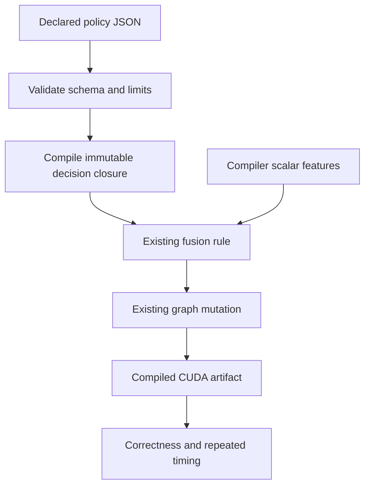

# Kiln: Bounded Fusion Programs and an Unchanged Compiler Selection

The second compiler-policy experiment extended Kiln's optimization interface from a scalar threshold to conditional programs, compiled eight declared policies across 20 fresh source graphs, and selected the unchanged compiler. Every candidate produced the same executables on the 12 training graphs. The registered selection rule therefore resolved an exact tie in favor of baseline. All eight confirmation graphs passed replay correctness, with a selected-policy speedup of exactly 1.0 because the selected policy was baseline itself.

This result establishes a functioning conditional-policy interface and a negative optimization result on the chosen corpus. The distinction matters for compiler self-optimization: constructing a more expressive policy language does not by itself produce a better compiler. The search must encounter programs where the proposed decisions affect generated code, and those effects must improve measured performance without changing semantics.

## 1. Separate the rewrite from its profitability decision

A compiler transformation contains several decisions. A matcher identifies operations with a suitable structure. Legality conditions establish when changing that structure preserves program meaning. The transformation then changes the intermediate representation. A profitability policy decides whether an eligible change is expected to improve the objective, usually execution time.

Kiln's loop fusion transformation combines a producer's computation with its consumers. This can eliminate an intermediate buffer and a kernel launch, but may duplicate work or increase the resources used by the combined kernel. The existing transformation estimates weighted work before and after fusion. Memory reads and writes have weight 12, while arithmetic contributes its scalar function's estimated operation cost. The default policy accepts when fused work is no greater than 1.02 times original work.

The first policy study exposed this decision through `createFusionRule` in `packages/kiln/src/std/loop.js`. A policy callback receives four immutable scalar features: originalWork, fusedWork, consumerCount and producerElements. The matcher and mutation remain the existing implementation. Replacing the profitability callback therefore changes a compiler policy without requiring a new fusion algorithm.

The conditional-program experiment adds `integrations/passnet/fusion_policy.mjs`. Its `prepareFusionPolicy` function validates a declarative program and produces a callback compatible with the existing factory. The compiler variant uses `pipeline.replaceRule` to install the rule locally. Kiln's global default remains 1.02.

## 2. Compile a small declarative language

A decision tree branches on one compiler feature and ends in a threshold or Boolean decision. For example, a policy can allow an increased work ratio for a small producer while retaining the default ratio for larger producers:

```json
{
  "format": "kiln-fusion-policy/1",
  "id": "small-producer",
  "kind": "decision-tree",
  "tree": {
    "if": {"feature": "producerElements", "op": "le", "value": 512},
    "then": {"threshold": 1.08},
    "else": {"threshold": 1.02}
  }
}
```

This example explains the implemented language; its small-producer hypothesis is not a measured improvement. The interpreter supports five scalar comparisons and rejects unknown feature names, malformed nodes and nonfinite numeric values. Limits of 31 nodes and depth six keep proposed programs bounded. Thresholds lie in [0,2], and an independent hard check rejects fused work greater than twice original work, including when a Boolean leaf requests unconditional acceptance.

Preparation creates closures that capture validated scalar values. This detail is essential because validation and execution occur at different times. An early implementation retained a mutable Boolean leaf from the input JSON. Changing that object after preparation changed the resulting decision. A regression test exposed the problem; capturing the Boolean value fixed it. Threshold leaves and predicate values receive the same treatment.

The language exposes compiler metadata rather than tensor values. It does not use eval or allow generated imports. These restrictions define the experiment's intervention and make its decisions inspectable. They do not establish a general sandbox for arbitrary hostile code.



The implementation test exercises the complete path through the real compiler. A conditional rejection policy changes the number of loop kernels for an exponential producer with two consumers, and evaluated outputs remain equal to the original graph. Separate Python integration checks passed all 34 tests.

## 3. Freeze a fresh corpus before performance measurement

The first policy study used a small curated development subset drawn from evaluation tasks. The second study instead reads the pinned official training list and excludes exact source models and generated-program hashes observed in accepted workloads or the earlier policy experiment. Script 80 deterministically orders tasks by SHA256, checks eligible FP32 variants and retains one graph per exact model and task.

The resulting corpus contains 12 training and eight held-out graphs from 20 exact models. Selection scanned 516 task directories, retaining 920 audit records describing considered variants and eligibility outcomes. Heavy unsupported operations were excluded under declared rules. Input volume and intermediate tensor-volume limits bound compilation and reference evaluation costs. This is a restricted compiler-development population, with explicit selection bias; it does not represent the entire PassBench workload distribution.

A hash of the exact source model assigns its split. This avoids exact-model overlap, but related architectures can still occur in different splits. Exact-model separation is therefore a weaker claim than independent architecture-family generalization. The frozen membership hash is:

```text
3012570a49bd83e072278df39e3d7f30478ad7990156a371242ae739c4ffde8e
```

Script 81 records the candidate set, measurement plan, tensor-volume audit and reference-input domains. Running-variance inputs used by batch normalization require positive synthetic reference values. `reference_domains.py` derives these constraints from source FX calls and supported metadata aliases. Runtime inputs still come from the original replay source; domain constraints do not replace those inputs with constants.

The current Codex session authored the policy hypotheses using the previous pilot's observations. An independently identified serving snapshot was not recorded. These proposals must not be described as an evaluation of a named external model or a reproduction of original PassAgent inference.

## 4. Establish whether the intervention changes executable code

Eight policies were declared: unchanged baseline, explicit default 1.02, scalar 1.08, four conditional policies and scalar 1.25. The conditional policies test small producer sizes, single consumers and limited original work. All 160 candidate/graph combinations compiled successfully.

`qualify_policies.py` checks complete graph membership, source hashes, kernel identities, reference-domain identity and artifact hashes. It also verifies that installing the explicit default produces the same executable bodies as leaving the compiler unchanged. This control passed on every graph. No exact baseline executable body appeared in both train and held-out partitions.

The structural outcome was restrictive:

| Candidate group | Changed training executables | Changed held-out executables |
|---|---:|---:|
| Explicit default 1.02 | 0 | 0 |
| Scalar 1.08 | 0 | 0 |
| Four feature trees | 0 | 0 |
| Scalar 1.25 | 0 | 1 |

The single changed held-out program belongs to upernet-convnext-tiny and decreases from two kernels to one. It is an unselected intervention. Using its held-out timing to choose scalar 1.25 would violate the training-only selection rule.

Training decision traces explain the lack of sensitivity. The unchanged compiler produces one kernel for ten training graphs and two kernels for each of the other two. Its observed profitability decisions accept all 70 matched fusion opportunities; there are no profitability rejections to reverse in the saved default traces. Relaxing the tested thresholds therefore changes no training executable. Other matcher restrictions or output boundaries can retain multiple kernels even when every observed profitability decision accepts. A policy that rejects some accepted fusions could still change their code, but that is a different hypothesis requiring an explicitly declared subsequent experiment.

## 5. Measure aliases once and preserve unsuccessful proposals

The timing plan specifies 20 warmups, 100 trials, three repeats, seeded randomized order among distinct executable fingerprints, and an IQR/median limit of 0.2 with at most two retries. Synchronized end-to-end measurements include output allocation, launch and synchronization. CUDA-event measurements include dispatch gaps and are reported as stream elapsed time.

Identical executables share correctness and timing evidence within each graph. Measuring aliases independently would allow random timing differences to select a policy that made no executable change. Shared evidence makes their scores exactly equal.

All 12 training executables passed original replay comparisons and stable timing. Every candidate received a family-balanced end-to-end ratio of 1.0. The predeclared tie order selected baseline. That selection was committed as `b1d6dc8`, after the frozen interpreter/corpus/plan checkpoint `a914e0f`, and before confirmation timing.

The eight held-out executions then passed correctness and stable timing. Only the fixed selected compiler was evaluated against baseline; because both are baseline, their shared ratio is exactly 1.0. This is confirmation of unchanged behavior, without evidence of policy transfer or a speed improvement. The earlier pilot's positive result remains separate historical evidence and is not superseded by this experiment.

## 6. Audit the original reference independently

The long-running original-source Inductor reference completed all 200 tasks and attempted all 2,060 graph variants. Script 85 verifies exact graph order and membership against every task's graph list, then invokes the pinned upstream parser and numerical checker at tolerance one.

The audit found 2,041 execution-success records, but only 2,039 numerically accepted graphs. Two execution-success records fail the numerical criterion. All variants pass in 191 complete tasks. The remaining 19 execution failures have explicit raw messages describing 16 eager execution failures and three compiled execution failures. The upstream parser labels all 19 as eager_fail, so the audit preserves both parser classification and raw messages rather than treating that label as a reliable causal diagnosis.

This run uses GB10 and NVIDIA's PyTorch alpha rather than the paper's A30 and pinned software. Historical timings overlapped development work or were interrupted by pauses. The archived logs support correctness investigation and exploratory timing, not a final controlled performance comparison or a hardware-matched reproduction claim. Raw logs, their hashes, execution receipts and the audit remain in ticket sources.

## 7. Continue from the actual optimization opportunity

The next synthesis experiment should make structural sensitivity part of training workload design before performance feedback. One option is to include graphs whose default traces reject otherwise legal fusion. Another is to generate policies that selectively reject expensive accepted fusions, then measure whether reduced duplication or resource use compensates for extra launches. Both require a declared proposal budget and a new confirmation boundary because this study's held-out structure has now been observed.

The infrastructure should remain shared: one bounded policy interpreter, one artifact qualifier, one timing runner, one training selector and one evidence summarizer. Numbered ticket scripts preserve historical invocations while reusable mechanisms live under `integrations/passnet`. This avoids creating a separate evaluator for every hypothesis.

Broader corpus coverage remains a distinct requirement. Kiln imports 804 evaluation variants spanning 24 complete tasks, while five complete tasks and 73 variants have passed the documented modified PassBench protocol. The 20 direct-policy executions add useful compiler evidence but do not increase that complete-task acceptance count. Original PassAgent reproduction, remaining compiler operation support and full controlled scoring remain unfinished.

## Reproduction references

The working repository is `/home/manuel/code/wesen/kiln/worktrees/passnet`. Ticket `KILN-005` contains design document 07, diary Steps 78 onward, scripts 80–89 and the frozen `policy-corpus-v3`, `policy-artifacts-v3` and `policy-measurements-v2` directories. Script 89 recomputes structural qualification, training ranking, confirmation accounting and timing stability from saved evidence. Script 85 reproduces the reference audit after extracting `reference-full-logs.tar.gz`.

Related historical explanations are [[ARTICLE - PassNet and Kiln - Compiler Integration and the Self-Optimization Experiment]] and [[ARTICLE - Kiln - Reusable Fusion Policy Selected on Training Graphs]]. These notes document different milestones and should be read with their recorded experimental scopes.
