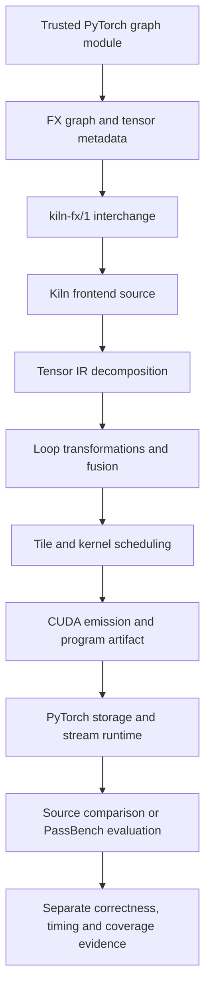

# PassNet and Kiln: Compiler Integration and the First Self-Optimization Experiment

Kiln can now compile selected real PassNet graphs into CUDA, execute the resulting programs on PyTorch-owned memory, and submit them to PassBench's correctness and scoring machinery. This work establishes the experimental infrastructure for improving reusable compiler transformations. It has not yet demonstrated a learned compiler policy or a held-out performance improvement.

The current implementation and evidence are anchored at commit `e98a315` on branch `research/passnet`. The project has two continuing objectives: expand support across the full benchmark, and determine whether automatically proposed changes to Kiln's compiler produce improvements that generalize to unseen graphs. The second objective is now the immediate priority; full corpus support is no longer a prerequisite for starting that experiment.

> [!summary]
> Five of 200 tasks, containing 73 of 2,060 graph variants, have passed the declared PassBench integration protocol. A separate full-corpus audit finds that 804 graphs translate into Kiln source, including every variant of 24 tasks. Translation is an earlier stage than verified execution. The remaining research work includes a frozen corpus, an unchanged-Kiln baseline, reusable policy search and held-out evaluation.

## 1. Define the experiment before interpreting progress

A tensor is an array with a shape, an element type and a memory layout. A computation graph records operations on tensors and their data dependencies. A compiler translates that graph into executable code through intermediate representations, or IRs, that expose different information: mathematical tensor operations, indexed loops, scheduling decisions and GPU instructions.

A compiler pass transforms one representation while preserving its required semantics. PassNet expresses a generated pass as a matcher and a replacement: the matcher identifies a computation pattern, and the replacement supplies an implementation. One benchmark task contains several graph variants with the same pattern but potentially different shapes, dtypes or source models. A pass must handle those variants rather than specialize successfully to just one graph. This task definition comes from the [PassNet paper](https://arxiv.org/abs/2605.29357).

Kiln introduces a second possible object of optimization. An agent can produce a specialized implementation for a graph, or it can modify a reusable compiler transformation that applies across graphs. The latter is the intended self-optimization experiment. Its output must be a compiler policy or pass, and its evidence must include performance on programs that were not used to select that policy.

Several different counts have appeared during implementation. They answer different questions:

| Evidence stage | What it proves | Current count |
|---|---|---:|
| Dataset materialization | Published file-content records have been reconstructed locally. | 2,067,810 records |
| FX-to-Kiln import | A source graph translates into Kiln frontend source. | 804 / 2,060 graphs |
| Complete task import | Every variant of a task translates. | 24 / 200 tasks |
| PassBench acceptance | Every expected variant matches and passes the evaluator under the recorded protocol. | **5 / 200 tasks; 73 / 2,060 graphs** |
| Reusable compiler improvement | One selected compiler change improves an independently held-out set. | Not yet measured |

The importable task count grew from 19 to 21 and then 24. Verified task coverage grew from three to four and then five. There was no decrease from 24 verified tasks to five; the two numbers refer to different stages. A source importer can emit a program that later fails compilation, numerical checks, matching, timing stability or scoring.

These stages also explain why completion is not proportional to the number of tasks already accepted. Operators are shared across tasks. Adding concatenation advanced hundreds of graph imports, while only three additional complete tasks became importable because other dependencies remained missing.

## 2. Preserve independent reference and integration experiments

PassNet has three relevant components. Its dataset supplies real computation graphs. PassBench performs matching, correctness checks, timing and scoring. PassAgent uses an LLM to generate and revise passes with tool feedback. Kiln supplies a different compiler infrastructure, implemented in JavaScript, with its own tensor, loop, tile, kernel and GPU representations.

The unchanged reference experiment retains a pinned PassNet checkout and runs its existing execution path. The integration experiment translates graphs into Kiln and executes the generated CUDA within an explicitly documented protocol. Keeping these experiments separate prevents a compiler integration change from being mistaken for reproduction of the paper's agent or evaluator configuration.

Source acquisition is pinned as follows:

| Resource | Identity |
|---|---|
| PassNet repository | `61c64709f6d324216ae8252cec3cdc35b2dd5da5` |
| Hugging Face dataset | `4f7dd9211178327c2718f1b828d83ea126186f9e` |
| Published Parquet data | Fourteen shards; 966,502,583 bytes; published sizes and LFS SHA256 values checked |
| Evaluation inventory | 200 task directories and all 2,060 referenced graph directories present |

The Parquet fields are `path`, `content` and `source_folder`. Reconstructing those records is a filesystem materialization step, rather than importing a collection of already installed Python packages. The saved materializer records provenance and rejects escaping paths and conflicting duplicates. Large downloaded data remains archived under the ticket's sources directory and outside Git; compact receipts, scripts and selected experimental artifacts are committed.

Execution currently uses `bling.local`, an ARM64 DGX Spark with a GB10 GPU, compute capability 12.1. The tested container provides PyTorch `2.12.0a0+5aff3928d8.nv26.05`, Triton 3.7 and CUDA 13.2. The paper's reference environment uses an A30, compute capability 8.0, PyTorch 2.9.1 and CUDA 12.8. Kiln's A100 target is presently a scheduling-cost-model proxy; the CUDA launcher compiles for the actual GPU architecture. That combination establishes an exploratory hardware port, not an exact reproduction on the paper's hardware.

The unchanged eager/Inductor reference run remained active at the report-preparation observation: 121 of 200 task invocations had completed, and its container was running and unpaused. An invocation's exit code is not a correctness summary. The run has also overlapped development workloads and been paused for isolated experiments, so final controlled comparisons still require a deliberate measurement pass.

## 3. Follow one graph through the implementation

The fifth accepted task concatenates two tensors along the channel dimension, takes a static channel slice, and computes a spatial mean. It returns both the sliced tensor and the mean. Its variants include FP32, FP16 and BF16, with four literal slice limits: 120, 480, 672 and 960 channels.

A small illustrative instance makes the value semantics concrete. Let the first input have shape `[1,2,2,2]` and contain channels `[[1,2],[3,4]]` and `[[5,6],[7,8]]`. Let the second input have one additional channel. Concatenation produces three channels; slicing the first two returns the original first input's values, and the spatial mean returns `[2.5,6.5]` with shape `[1,2,1,1]`. This is an explanatory instance of the operator family, not one of the measured benchmark graphs.

The implementation path is:



`fx_export.py` preserves exact call targets, dependencies, literal arguments, keyword arguments and tensor metadata. Tagged references distinguish a node dependency from a literal string. Tagged tuple, list and dictionary structures preserve output organization. Dtypes, devices, slices and ellipsis have explicit encodings.

`fx_import.py` resolves those references and emits an ordinary Kiln project script. Unsupported operations fail with a diagnostic. The importer does not replace an unsupported operation with a PyTorch call. It flattens tensor results to names such as `out0` and `out1`, while preserving a separate output-structure description so runtime code can reconstruct the original tuple, list or dictionary.

The compiler then follows its existing pipeline. Tensor operations decompose into elementwise operations, reductions and indexed views. Loop transformations determine which computations share kernels. Scheduling maps loops to GPU execution parameters. The exported `kiln-program/1` artifact describes buffers, kernels, launch geometry and generated source.

## 4. Storage dtype and arithmetic precision are separate contracts

Initial Kiln support was predominantly FP32. PassBench contains FP16 and BF16 programs whose observable values depend on narrowing and accumulation behavior. General low-precision support therefore required changes through the compiler, rather than a dtype conversion in the Python wrapper alone.

The implementation now carries output dtype through loop, tile, kernel and GPU representations, buffer sizing and artifact export. CUDA loads and stores use the appropriate half or BF16 representations. Unsupported WGSL storage paths are reported explicitly, while CUDA emission remains available. Kernel identity includes non-FP32 storage types so an FP16 executable cannot be mistaken for its FP32 counterpart.

A tensor's storage type does not specify the arithmetic precision of every intermediate. Inference batch normalization, for example, widens the relevant values to FP32 for its calculation and narrows the result to the required output type. Low-precision elementwise results retain explicit rounding boundaries so fusion cannot silently turn several rounded operations into one FP32 calculation followed by a single narrowing.

The conceptual requirement is:

```text
read values represented in the input storage dtype
compute with the operation's required intermediate precision
round at the operation's observable dtype boundaries
write values in the declared output storage dtype
```

`N.cast` makes conversions explicit in the graph. `round_f16` and `round_bf16` survive lowering as operations with reference and CUDA implementations. Independent rounding tests and PyTorch differential checks were saved as evidence. Layout operations preserve dtype, and static reductions widen for FP32 accumulation before applying the final output conversion.

This work does not establish every PyTorch promotion rule, integer operation, noncontiguous input layout or dynamic-shape behavior. Those remain separately visible limitations.

## 5. Execute CUDA with PyTorch's ownership and ordering

The runtime bridge uses Kiln's existing Python CUDA launcher with allocation disabled. It validates tensor shape, dtype, contiguity and device; allocates outputs and scratch storage through PyTorch; and passes raw pointers plus the current CUDA stream to the launcher.

A stream orders asynchronous GPU work. A pointer alone does not establish when its producer has completed or how long the allocation remains valid. The bridge therefore uses PyTorch's current stream and records storage use on that stream. Each invocation owns its scratch allocations. Artifact validation checks dtype consistency and required buffer size before CUDA initialization.

Compilation caching avoids recompiling a program for every call, but allocation and invocation overhead remain part of observed end-to-end performance. GPU-only timing and end-to-end timing must remain separate measurements. A faster device kernel can still produce a slower callable when the workload is small.

The shared `CorpusDispatch` selects a compiled program from ordered input shapes/dtypes and explicit captured scalar constants. It reconstructs every output using the manifest's structure. Conflicting programs with the same key fail before loading CUDA; an unknown key raises an error. It performs no eager tensor arithmetic and provides no fallback implementation that could conceal unsupported cases.

## 6. Numerical correctness does not imply structural matching

PassBench replaces matching FX subgraphs. That adds requirements beyond computing the right tensor values. Two graphs can express the same operation while differing structurally in positional arguments, keyword arguments, filled defaults or operator identity.

The initial normalization integration binds a narrow whitelist of public functional signatures and fills their defaults. The transformation is applied to both the traced pattern and target graph. Argument binding completes before mutation, so an invalid call cannot leave a partly normalized graph. The original matching algorithm remains responsible for finding the pattern.

The residual/mean task exposed another difference. Ordinary FX proxy tracing turns `+=` into addition, whereas Dynamo preserves `operator.iadd`. An explicit pattern tracer now autowraps a directly imported `operator.iadd` to preserve its identity. This changes pattern tracing; it does not rewrite the target computation into a different operation.

Multi-output patterns exposed a separate upstream limitation. The standard replacement backend emits one opaque result node, but a two-result pattern requires two result nodes. The pinned upstream [direct backend](https://github.com/PaddlePaddle/PassNet/blob/61c64709f6d324216ae8252cec3cdc35b2dd5da5/pass_bench/torch/backend/pass_mgr_direct.py) already supplies `_make_multi_output_replacement`, which destructures the guarded result through individual indexing nodes. The integration imports that helper directly while retaining the standard backend's guarded callable. No implementation was copied into Kiln.

The active integration changes have explicit identities:

| Identity | Purpose |
|---|---|
| `kiln-normalized-fx/1` | Normalize the supported functional argument forms before matching. |
| `kiln-dispatch-record-stream/1` | Permit the allocator-lifetime metadata operation `record_stream` through the dispatch guard. |
| `kiln-pattern-autowrap/1` | Preserve explicit `operator.iadd` identity in match patterns. |
| `kiln-pattern-multi-output/1` | Reuse upstream tuple-result destructuring. |

The dispatch exception permits `record_stream` specifically; arithmetic operations still pass through the original interception policy. The source validator, numerical checks, reverse-order correctness evaluation and stability checks remain in use. Failed attempts, including rejected module-level `torch.fx.wrap` registration, were preserved rather than hidden through a different import path.

These are modified integration results. They must be reported with their protocol identities and kept separate from the unchanged reference experiment.

## 7. Concatenation required safe reads and correct selection

Concatenation became the largest first import blocker after static indexing was implemented. Kiln now has `nn.concat`, `N.concat`, independent reference semantics and Tensor IR decomposition for positive static shapes with matching floating dtypes. The importer emits explicit casts when PyTorch's propagated output dtype requires promotion of mixed floating inputs.

The reference implementation copies contiguous blocks from each input. The first lowering constructs indexed views and selects the correct input segment for each output coordinate. It must also ensure the safety of loads belonging to unselected segments, because a generated implementation can evaluate those loads before selection.

```text
for each input j:
    start = total axis length of earlier inputs
    local = clamp(output_axis - start, 0, input_j_axis_length - 1)
    read_j = input_j with the concatenated coordinate replaced by local
    mask_j = start <= output_axis < start + input_j_axis_length
    result = select(mask_j, read_j, result)
```

The initial operand supplies the starting result; later selections replace its values over their segments. Clamping prevents invalid addresses. Explicit selection preserves NaN and signed-zero behavior that arithmetic masking could corrupt. The result dtype is specified directly so the FP32 mask does not promote a low-precision result.

This is a correctness-first implementation. Static masks occupy space proportional to the number of inputs times the concatenated-axis length, and generated code may read unselected operands. Those costs are documented; the implementation has not been presented as an optimized concatenation strategy. Empty-tensor exceptions, integer concatenation and output-buffer mutation remain unsupported.

Static indexing is owned by a separate `fx_indexing.py` module. It handles unit-step slices, negative integer indices, ellipsis and inserted dimensions. Integer selections retain unit axes during slicing, followed by a reshape that removes selected axes and inserts requested unit dimensions. An independently computed result shape must agree with FX metadata. Strided slices, empty outputs and advanced indexing fail explicitly.

## 8. A failed BF16 check exposed an invalid reference-input domain

The first BF16 concatenation probe failed Kiln's internal end-to-end check before CUDA execution. The maximum absolute discrepancy was `0.0018287301063537598`. Inspection showed that `Project.inputsFor` generated arbitrary FP32 values even when the graph declared BF16 input storage. The reference concatenation copied those values, while typed selection rounded its result to BF16.

A controlled diagnostic kept the graph, transformations and tolerances unchanged and rounded only the input domain to its declared dtype. Every output's error became zero. The fix now prepares representable FP16/BF16 values for both generated and explicitly supplied project Tensor data, returning a new Tensor without mutating caller-owned arrays.

This correction matters beyond concatenation. Validation compares programs over an input domain. If the reference and executable receive different represented values, a failed check can be caused by invalid test preparation rather than an incorrect transformation. The response must be an evidence-backed correction to preparation, rather than a looser tolerance.

After the fix, all four concatenation probes compiled with internal checks enabled and passed PyTorch CUDA comparisons: FP32, FP16, BF16 and mixed FP16/BF16. Each probe returns a concatenation, a transposed concatenation and a sliced concatenation. All 24 compiler test files passed on the DGX. The current Python integration suite contains 30 passing tests.

## 9. Benchmark acceptance still leaves numerical risks

The convolution/residual/resize task is the clearest remaining numerical limitation. The implementation added grouped NCHW convolution, explicit bilinear resizing and a restricted allowance for in-place ReLU on a fresh single-use convolution result.

The first half-precision candidate failed a unit-scale random-input comparison in 508 of 73,728 output values. A staged diagnostic identified convolution as the first divergent stage. In the tested PyTorch environment, half-precision biased convolution aligned more closely with narrowing the unbiased convolution result before adding the typed bias. The Kiln wrapper was adjusted to preserve that observed boundary.

The correction reduced the stress failure but did not eliminate it: 67 values still failed, with maximum absolute error `0.03125`. A diagnostic higher-precision accumulation variant also retained failures. The cause of the remaining mismatch has not been established. It would be premature to attribute it to one reduction ordering or hardware instruction sequence.

The original benchmark replay inputs passed, with maximum absolute discrepancy `1.52587890625e-05`, and PassBench accepted the task under the integration protocol. Both outcomes remain recorded. The acceptance record therefore includes the unresolved stress limitation; it does not claim general numerical equivalence for arbitrary inputs.

This distinction is central to selecting the first self-optimization corpus. A policy search should begin from graphs with trustworthy correctness evidence. A candidate transformation must not appear beneficial merely because a weak input distribution misses a numerical defect.

## 10. Separate complete-corpus inspection from execution coverage

Executing large tensors on the CPU merely to discover unsupported operators made corpus inspection unnecessarily expensive. The shared exporter now uses PyTorch `ShapeProp` with an explicit `FakeTensorMode`, with fallback tensor kernels disabled. It derives tensor metadata without materializing the full input storage for those operations. Trusted graph Python still executes during tracing; this mechanism is not a security sandbox.

The implementation consults the installed PyTorch API rather than porting its internals. The exact installed `ShapeProp` source, revision/hash provenance and [official Fake Tensor documentation](https://docs.pytorch.org/docs/main/user_guide/torch_compiler/torch.compiler_fake_tensor.html) are archived in the ticket. All 30 residual/mean task exports produced identical ordered manifest records and Kiln source under real and fake propagation.

Every complete audit verifies exact task and graph-list membership before summarizing. It records only the first import blocker for each graph. The progression was:

| Import checkpoint | Graphs translated | Tasks with every variant translated |
|---|---:|---:|
| Before basic indexing | 279 | 19 |
| After basic indexing | 381 | 21 |
| After concatenation | 804 | 24 |

Removing a first blocker can reveal another. After concatenation, important first blockers include unsupported input dtypes, linear, matmul, SiLU, softmax, GELU and layer normalization. Local CUDA availability also prevents tracing some trusted source graphs; those environment failures are recorded separately from semantic lowering gaps.

An import blocker is not always an absent compiler operation. Kiln already has primitives for several remaining operations; the importer still needs validated argument, dtype and layout lowering. Other blockers require new compiler semantics.

One newly importable task contains 396 variants. That concentration makes graph count a poor measure of diversity. A self-optimization study must control family weighting and split leakage rather than treating hundreds of related variants as hundreds of independent demonstrations.

## 11. Consolidate ownership as the integration grows

The first experiments used numbered scripts that each exported, compiled and checked one task. Preserving those scripts was useful for provenance, but repeating their runtime logic would allow tolerances, output handling and input ordering to diverge. Shared modules now own the repeated behavior:

| Module | Responsibility |
|---|---|
| `fx_export.py` | Preserve FX structure, targets and metadata. |
| `fx_import.py` and `fx_indexing.py` | Translate explicit supported semantics into Kiln source. |
| `corpus.py` | Export tasks, validate manifests, compile variants and audit imports. |
| `check_corpus_cuda.py` | Compare every nested output against its trusted source model. |
| `runtime.py` | Validate and bind typed storage, streams and scratch allocations. |
| `dispatch.py` | Select artifacts by metadata/constants and reconstruct outputs. |
| `run_task.py` | Invoke a fresh evaluator process per graph and preserve raw logs. |
| Ticket coverage builder | Verify exact graph membership, successful result blocks and replacement counts. |

The recursive checker handles tuple, list and dictionary outputs, including shape and dtype checks. This prevents an experiment from silently checking only its first result. Compile and process receipts remain separate from correctness decisions: exit zero alone is insufficient because the evaluator can report numerical failure in its output.

The fifth task uses four literal pattern modules and one stable replacement callable. The original matcher does not bind a placeholder nested inside a slice stop, so the generator derives a finite pattern family from source literals. This is an explicit task-specific matching boundary, while compilation, dispatch and evaluation execution remain reusable.

All intermediate scripts, selected artifacts, failed attempts and detailed investigation entries remain in ticket KILN-005. The previous documentation editions remain intact. The updated intern guide and consolidation design were delivered to reMarkable as “KILN-005 PassNet Intern Guide Progress 02.”

## 12. What the measurements currently show

The accepted task evidence is:

| Task family | Graph variants | Original scorer's task aggregate |
|---|---:|---:|
| ReLU, inference batch normalization, disabled dropout | 6 | 0.849533 |
| Scalar division and transpose | 12 | 0.822768 |
| Convolution, ReLU, residual addition, bilinear resize | 1 | 0.043470 |
| Residual additions and spatial mean | 30 | 1.003295 |
| Concatenation, channel slice and spatial mean | 24 | 0.848548 |
| **Verified membership total** | **73** | No full-corpus aggregate claimed |

These are exploratory task aggregates from the original scorer, with `p=0` and `fpdb=0.1`, under the recorded integration protocols. They are not a table of GPU-kernel-only speedups, and they cannot be combined into a full 200-task result by ignoring unsupported tasks. The accepted task runs used 20 warmups and 100 timed trials, with the original evaluator's stability checks.

The residual/mean score is approximately eager parity. A value of `1.003295` is too close to one to support a robust speedup claim without repeated controlled measurements. The convolution result is poor, and the concatenation task remains below the eager reference. Successful integration has therefore established measurable compiler behavior, rather than a performance win.

Isolation drivers verify the identity of the reference container, pause it for accepted task measurements and resume it on exit. Failed and overlapping diagnostic runs are retained and excluded from accepted coverage. Other background GPU activity and run-to-run variability still motivate repeated controlled comparisons before drawing performance conclusions.

## 13. Begin self-optimization without waiting for all 200 tasks

The user requested a shorter path to the central research question. The revised plan retains full benchmark support as an active track but starts compiler-policy optimization on a fixed eligible subset. The direct FX-to-Kiln path avoids writing a benchmark matcher for each policy experiment. It measures a different question from PassBench acceptance and must remain labeled accordingly.

The first target is `mergeLoopOps` in `packages/kiln/src/std/loop.js`. Its existing rule inlines an eligible producer into all its consumers, subject to graph constraints and a profitability guard. It computes estimated scalar work before and after the proposed fusion and accepts when:

$$
W_{\mathrm{after}} \leq 1.02\,W_{\mathrm{before}}.
$$

The work estimate comes from the loop schedule. It is a profitability heuristic, not a proof that the fused executable is faster. Fusion can remove launches and memory traffic while duplicating computation or increasing resource pressure. Those effects create a concrete policy-learning problem.

The next implementation will expose this decision as a replaceable policy while preserving semantic legality and default behavior. The initial experiment can search a small policy family, then extend the same interface to generated decision programs. The policy factory, search harness and held-out result have not yet been implemented or measured at this snapshot.

A defensible experiment needs the following sequence:

```text
freeze eligible graph families and correctness requirements
split training families from held-out families
measure unchanged Kiln under fixed settings
verify that candidate policies change decisions or artifacts
search candidates using training measurements only
select one reusable policy
apply that policy unchanged to held-out graphs
report failures, latency, compile cost and decision changes
```

The artifact-change check prevents a vacuous search in which every threshold produces the same executable. The split prevents selecting a policy based on the same programs used to claim generalization. All variants of a task/operator family should remain on one side, with source-model overlap audited separately. The numerical convolution limitation argues for establishing eligibility before using a graph as optimization evidence.

A proposed training objective is a family-balanced average log speedup relative to unchanged Kiln, with an explicit compile-cost term. Family balancing prevents a 396-variant task from dominating a small, diverse corpus solely through its size. This is a proposed experimental objective; it does not replace PassBench's published metric for external comparisons.

The decisive result will be a reusable compiler change that improves unseen graph families at a fixed correctness standard and experimental budget. Until that result exists, the project should be described as a compiler integration and experimental foundation with measured coverage—not a completed demonstration of compiler self-improvement.

## 14. Reproduce and review the current state

The repository worktree is `/home/manuel/code/wesen/kiln/worktrees/passnet`. Ticket documents and evidence are under `ttmp/2026/10/30/KILN-005--reproduce-passnet-and-evaluate-reusable-kiln-compiler-transformations/`.

The current shared commands have explicit boundaries:

```bash
# Export trusted task graphs, deriving metadata without full tensor allocation.
python integrations/passnet/corpus.py export \
  --upstream DATASET --sample TASK --output ARTIFACTS

# Compile every manifest variant with per-graph receipts.
python integrations/passnet/corpus.py compile \
  --directory ARTIFACTS --kiln KILN --target a100

# Compare complete outputs on the configured CUDA host.
PYTHONPATH=runtime/python python integrations/passnet/check_corpus_cuda.py \
  --directory ARTIFACTS --upstream DATASET \
  --include-path /usr/local/cuda/include

# Run the recorded integration protocol, one fresh process per graph.
python integrations/passnet/run_task.py \
  --directory ARTIFACTS --upstream DATASET \
  --pass-directory PASSES --log EVALUATOR_LOG
```

`DATASET`, `TASK`, `ARTIFACTS` and `PASSES` are explanatory placeholders. The numbered scripts contain the concrete experiment paths and container commands. Trusted Python sources execute during loading and tracing; these commands are intended for the pinned research corpus.

For review, the main evidence entry points are `sources/kiln-coverage.json`, `sources/import-audit-summary.json`, each accepted task's isolated evaluator log, and its saved score. Design documents 04 and 05 explain consolidation and concatenation. The detailed investigation diary preserves the failures, commands, decisions and provenance that support this report.

The implementation milestones most relevant to this snapshot are `95e83ee` for static indexing, `7126b49` for concatenation and reference-input correction, `ffa7e7e` for shared dispatch/evaluator execution, and `e98a315` for the fifth accepted task and revised research priority. Earlier historical notes remain available in [[ARTICLE - PassNet and Kiln - From FX Semantics to CUDA Execution]].
