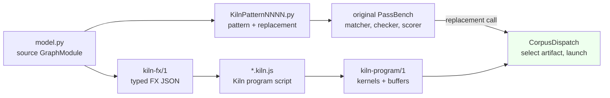

# Kiln: Architecture Review of the PassNet Integration and the Contracts That Make Results Compound

This article reviews the Kiln–PassNet integration at commit `73bc1fc`. The integration translates PassBench's PyTorch graphs into Kiln programs, compiles them to CUDA and runs them inside the original benchmark harness. The research goal is to show that a reusable compiler policy can raise scores on tasks it was not designed on. The review looks at the system as a chain of data contracts between independently written components. Its central observation is that the project's recent losses did not come from missing operators. They came from places where two correct components disagree about a fact that neither of them checks. The article explains the system from first principles, works through four such contract failures with real code and probes, and ends with the plan that follows from them.

> [!summary]
> - Sixteen graphs failed, blocking two otherwise complete task families, because Kiln's pattern deduplication treats output order as identity and PassBench's matcher does not.
> - Kiln's own correctness check compares Kiln against Kiln, so it cannot detect where Kiln's type rules depart from PyTorch's. A probe shows `f16 * f32[]` returning f32 where PyTorch returns f16.
> - The fusion-policy grammar sees only four numbers from one work estimate, which is why a fixed policy that won 32.8× on one task lost 3× on another.
> - The direction is a short consolidation cycle of contract fixes and a census-gated importer refactor. After it, the typed-value wave and a calibrated policy experiment run in parallel, aiming at a two-number result on one frozen snapshot.

## 1. The system as a sequence of representations

The integration is easiest to understand as a sequence of representations. Each one is produced by one component and consumed by the next. When a change breaks the system, it almost always breaks the agreement between a producer and a consumer about what one of these representations means.

PassBench, the benchmark half of PassNet, contains 200 *tasks*. A task is a family of PyTorch FX graphs that share an operator pattern and differ in shapes and dtypes. Across the corpus there are 2,060 graphs. For each graph, the benchmark asks for a *pass*: a Python `pattern` function that identifies a subgraph and a `replacement` that computes the same outputs. The original evaluator applies the pass, runs the graph, compares outputs with eager PyTorch along a tolerance curve and scores speed. A task counts as *complete* only if every one of its graphs matches exactly once, executes and passes the nominal tolerance point `t=-5`.

Kiln is a GPU compiler in JavaScript. It lowers a PyTorch-like program through six IRs: `torch`, `tensor`, `loop`, `tile`, `kernel` and `gpu`. Every lowering is a named rewrite rule and every schedule choice is a recorded decision. The integration places Kiln behind the pass interface:



| Representation | Producer | Consumer | What it asserts |
|---|---|---|---|
| `kiln-fx/1` | `fx_export.export_graph` | `fx_import.import_graph` | every node's target, arguments and PyTorch `tensor_meta` (shape, dtype, strides) |
| `*.kiln.js` | `fx_import` | `kiln-export.mjs` | a functional program whose values equal the FX values |
| `kiln-program/1` | `export.js:exportProgram` | `runtime.TorchProgram` | kernel launch order, buffer table, input and output dtypes |
| `KilnPatternNNNN.py` | `generate_pass.generate` | PassBench `PassMgrBackend` | which subgraph to replace, and in which order the replacement returns values |
| manifest variant | `corpus` + `generate_pass` | `CorpusDispatch` | which artifact serves which (shapes, dtypes, pattern identity) |

### 1.1 One graph through the chain

A small graph makes the representations concrete:

```python
def forward(self, in_0, in_1):
    tmp_0 = in_0 + in_1
    tmp_1 = torch.nn.functional.relu(tmp_0)
    tmp_2 = tmp_1.sum(dim=-1, keepdim=True)
    return (tmp_1, tmp_2)
```

The importer turns it into a Kiln script. Reductions are wrapped in explicit FP32 casts because PyTorch accumulates low-precision reductions in FP32. The importer writes that numerical fact into the program where it applies, and does not leave it to a backend:

```javascript
project("passnet").program(({v0, v1}) => {
const v2 = N.add(v0, v1);
const v3 = N.relu(v2);
const v4 = N.cast(N.sum(N.cast(v3, "f32"), 1, true), "f32");
return {out0: v3, out1: v4};
}, {v0: k.tensor([4, 8], "f32"), v1: k.tensor([4, 8], "f32")});
```

Kiln lifts each tensor primitive into a `loop.kernel`, whose body is an expression over output coordinates. It then fuses producers into consumers when a work estimate allows. The result is two kernels. The first computes `max(add(in0[a0,a1], in1[a0,a1]), 0)`. The second computes `add_{r<8} in0[a0, r]` over the first kernel's output. The sum was not fused into the relu kernel because `relu` is itself a program output and must be written to memory; the fusion rule refuses to inline a producer that the graph returns. The emitted CUDA for the first kernel shows the separate-rounding contract that the qualification runs use:

```cuda
v0 = __fadd_rn(in0, in1);       // no FMA contraction
v1 = fmaxf(v0, 0.0f);
dst[((e % 8) + (8 * (e / 8)))] = v1;
```

At evaluation time, PassBench matches the generated pattern and calls `kiln_generated(in_0, in_1, 0)`. The trailing `0` is the pattern identity. The dispatcher uses the input shapes, dtypes and that identity to select the compiled artifact, launches it on PyTorch's current stream and rebuilds the returned tuple from the recorded output structure.

## 2. Identity: what the matcher thinks a pattern returns

The first contract failure is the most instructive, because both sides are individually correct.

In the frozen ordinary band of the uniform qualification (56 tasks, 561 graphs), 16 graphs in tasks 6, 24 and 185 failed with `No compiled program for input metadata and constants`. In every one of them, the applied pattern's identity differed from the identity recorded for the graph's compiled program. The applied and compiled patterns differed in only one way: the order of the returned tuple.

### 2.1 How Kiln names a pattern

`generate_pass.extract_pattern` traces each source `forward` and builds a structural key from every node, including the `output` node:

```python
key = [{'op': node.op, 'target': ..., 'args': freeze(node.args), 'kwargs': freeze(node.kwargs)}
       for node in nodes]           # includes the output node's argument tuple
```

Two sources that compute the same subgraph and return `(a, b)` and `(b, a)` therefore receive different keys. They become two rule modules, `KilnPattern0003` and `KilnPattern0009`. Each graph variant is compiled under its own identity, and its artifact returns values in its own source order.

### 2.2 How PassBench applies a pattern

The pinned upstream replacement code creates its matcher with `match_output=False` and then binds the replacement's outputs to `match.returning_nodes`:

```python
matcher = SubgraphMatcher(pattern_graph, match_output=False, match_placeholder=False, ...)
...
for gn, copied_node in zip(match.returning_nodes, copied_returning_nodes):
    gn.replace_all_uses_with(copied_node)
```

`returning_nodes` are in the *applied pattern's* return order. Rules are tried in the order of `sorted_output_pass_rule_names.json`, which Kiln sorts only by argument count. Pattern 3 is tried first and matches graph 9's computation, because output order is not part of the match. The replacement is then called with identity 3. No artifact is registered under identity 3 for graph 9's shapes.

### 2.3 Why the obvious fix is wrong

A dispatch fallback that ignores the identity and looks up the artifact by input metadata alone would find graph 9's program. That program returns values in graph 9's order, `(b, a)`. PassBench would bind them as pattern 3's `(a, b)`, swapping the two outputs. The fallback converts a loud failure into a silent wrong answer.

The correct repair makes identity agree with the matcher's notion of identity. The deduplication key should cover the computation *modulo output order*. Each variant then records a permutation from the class representative's return order to its own program's output order:

```python
body_key = key_without_output_node
returns  = [indexes[n] for n in output_args]          # this source's return order

cls  = classes.setdefault(body_key, {'identity': len(patterns), 'returns': returns, ...})
perm = [returns.index(r) for r in cls['returns']]       # fails if returned sets differ
record['specialization']     = [cls['identity']]
record['output_permutation'] = perm

# at call time
flat    = program(*inputs)                 # graph's own order
ordered = [flat[p] for p in perm]          # representative pattern's order
```

Only one rule per class is written. The applied identity then always equals the compiled identity, and outputs are reordered by an explicit, recorded permutation. Tasks 6 and 24 have no other failures in that band, so the repair is expected, though not yet measured, to complete two families.

The general lesson: **an identity used in two components must be computed under the equivalence relation of the stricter consumer.** Here the consumer is PassBench's matcher, and its equivalence ignores output order.

## 3. Types: two type systems with no comparison point

The second contract concerns types. PyTorch and Kiln each have a type system: rules that compute a result's shape and dtype from its operands. The FX export records PyTorch's answer for every node in `tensor_meta`. Kiln computes its own answer in each op's `infer` function. Nothing compares the two per node.

### 3.1 A silent dtype difference

PyTorch's promotion rule distinguishes three operand kinds within a dtype category. Dimensioned tensors dominate 0-dimensional tensors, which in turn dominate Python scalars. Kiln's `elementwiseDtype` treats only splat constants as weak:

```javascript
function elementwiseDtype(xs) {
  const dtypes = [...new Set(xs.filter((x) => !weakScalar(x)).map((x) => x.type.dtype || "f32"))];
  if (dtypes.length === 1 && ["f16", "bf16"].includes(dtypes[0])) return dtypes[0];
  return "f32";
}
```

A probe with `x: f16[2,3]` and `s: f32[]` shows the consequence:

| | Result dtype of `x * s` |
|---|---|
| PyTorch eager | `float16` |
| Kiln artifact output | `f32` |
| Diagnostic raised | none |

The importer validates output metadata in some branches, such as activations, layout and pooling. It does not do so in the generic `binary` branch, so the mismatch passes import. Kiln's internal end-to-end check also passes, because it compares Kiln's compiled kernels with Kiln's own reference interpretation. Both sides share the same type rule.

### 3.2 The postcondition that closes the gap

Every FX node already carries PyTorch's answer, so the remedy is to check it at the point where the Kiln value is created:

```javascript
// proposed: an identity op whose infer() throws on mismatch and that decomposes away
const v2 = N.expect(N.mul(v0, v1), [2, 3], "f16");
```

Such a check costs nothing in generated code, because the op decomposes to nothing. It turns an entire class of semantic drift into an import diagnostic that names the FX node, and it gives the import census a new and accurate failure category.

### 3.3 Contraction is also a type question

The third contract concerns rounding, which belongs to the same category. For f16 and bf16 values, Kiln appends a rounding operation after each elementwise op, as PyTorch eager does at each kernel boundary. The optimization rule `contractFma` rewrites `add(mul(a, b), c)` into one `fma` without looking at dtype, so it removes the rounding of `a*b`. A probe with three f16 inputs shows both the defect and the safety net:

| Contraction mode | Emitted arithmetic | Internal check |
|---|---|---|
| `allow` (default) | `fmaf(in0, in1, in2)`, then one f16 rounding | **FAILED** |
| `separate` | `__fmul_rn`, f16 rounding, `__fadd_rn` | ok |

The qualification bands used `separate`, so their evidence is unaffected. The combination of the default mode with the diagnostic `--skip-internal-reference-check` would, however, ship non-PyTorch arithmetic. The artifact would not record that the check was skipped, because `kiln-export.mjs` stores the contraction mode and policy hash in `program.source` but not the bypass. Both fixes are small. Restrict `contractFma` to FP32 operands, and record `internal_check` in the artifact.

These cases show a division of labor that should become explicit policy:

- The **internal check** detects lowering bugs. It must stay on for any transformation that changes arithmetic order or rounding, and every skip must be recorded in the artifact.
- The **type postcondition** detects frontend semantic drift. It can never be skipped.
- The **external checker** is the acceptance gate and the only place a source tolerance lives.

## 4. One authority per operation

The importer's `import_graph` is a single 484-line function with about 30 branches. The properties of each operation are spread across several places, so adding an operation means editing all of them consistently.

| Property | Where it lives |
|---|---|
| spellings (function, method, `aten` overload) | branch conditions and sets in seven modules |
| argument binding | one `bind()` helper and about ten inline copies |
| whether the result is fresh storage or an alias | one three-line boolean that re-lists the routing table |
| dtype names | five identical dictionaries across importer, helpers, runtime and dispatch |

The fresh-storage boolean deserves attention because its two failure modes differ. Forgetting a new allocating operation there fails safe: in-place ops on its result are rejected. Accidentally listing a view there fails unsafe: a mutation through an alias would be accepted.

The remedy is a declarative operation specification. It records *what* an operation is, while each lowering function keeps *how* it is computed:

```python
@dataclass(frozen=True)
class OpSpec:
    name: str
    functions: frozenset[str]          # call_function spellings
    methods: frozenset[str]            # call_method spellings
    signature: tuple[str, ...]         # PyTorch parameter names in order
    storage: Literal['fresh', 'alias']
    lower: Callable[[Bound, Ctx], Lowered]   # → expr, optional mutated field
```

The import loop becomes lookup, bind, lower, then shared postconditions: the type check from §3, storage tracking and the mutation legality check. The refactor can be verified mechanically. Every manifest records `source_sha256` of the generated script, so the full import census can be captured as `{graph: hash | error}` before porting. Every porting step must reproduce it byte for byte. That makes a large refactor a sequence of steps that are each provably behavior-preserving, and it touches no frozen experiment.

## 5. Typed values belong in the Loop IR

The next capability wave adds exact `int64` and Boolean tensors and data-dependent indexing (gather, index_select, masks, scans). The design choice is whether to add a separate typed layer or to extend the Loop IR's expression grammar.

The Loop IR expression language has four node kinds:

```javascript
E.num(v)                 // constant
E.load(i, [ix...])       // input i at affine index expressions
E.op(fn, ...args)        // scalar function
E.red(fn, r, n, body)    // reduction over fresh variable r
```

Scheduling, hoisting, fusion (`inlineInto`), work estimation (`workOf`), the reference evaluator (`compileSerial`) and CUDA emission all operate on this grammar. A second typed layer would need its own version of each of them, which would amount to a second compiler. Extending the grammar touches a short list of float assumptions:

| Location | Current assumption |
|---|---|
| `E.num` | `+v` coerces to a JavaScript double, which loses `int64` above 2⁵³ |
| `E.op` constant folding | `Math.fround` |
| `compileSerial` | FP32 function table, float arrays |
| kernel registers | float values, integer only for indices |
| `toCuda` | `float` temporaries, loads widened to float |
| `exportProgram` | every data constant written as FP32 |

Data-dependent indexing then needs one new idea rather than one new op per source operator: a load whose index entries may be integer-typed expressions (for example, another load) instead of affine terms. Fusion already substitutes coordinates through load indices, so the extension amounts to recursing into those entries and collecting their variables. The bounds behavior (`clamp`, `assume` or `trap`) becomes an explicit attribute decided at the FX boundary from PyTorch's semantics.

The constant exporter must be fixed early. A BigInt-backed constant passed to `Float32Array.from` raises `TypeError: Cannot convert a BigInt value to a number`, and captured tensor constants are part of this wave.

## 6. Effects live at the program boundary

The guarded input-mutation design accepts an in-place operation only when its target has exactly one use and is either a graph input or fresh storage. A mutation of an input becomes a hidden program output `__mutK`. After the whole program has run, the dispatcher copies that output into the caller's tensor on the current stream:

```python
outputs = program(*inputs)
for m in mutations:
    inputs[m['input_index']].copy_(outputs[m['output']])
return restore_outputs(structure, outputs, inputs)    # {"input_alias": K} returns the caller's tensor
```

This design is sound for a structural reason. **No effect exists inside the compiled program**, so no fusion or scheduling decision can move a read across a write. That should become an invariant for the next effect wave (multi-use inputs and views). Functionalize in the importer with per-storage version numbers, reject observers that read after a write through an alias, and keep effects out of the IR. The one cleanup is to replace the `__mutK` naming convention, which the importer and manifest share implicitly, with an explicit `effects` list in the manifest schema.

## 7. Why a fixed policy could not transfer

The research question is about reusable compiler policy. The most informative measurement so far is negative. A fixed pointwise-fusion program was correct on all 92 graphs of 12 tasks. Its effect on end-to-end latency ranged from 32.8× faster on task 101 to 0.33× on task 25, and the mean official score over 11 transfer tasks fell from 0.849 to 0.823.

The policy grammar explains the result. A `kiln-fusion-policy/1` decision tree may test only these features:

```text
originalWork, fusedWork, consumerCount, producerElements
(+ per consumer: producerWork, consumerWork, fusedConsumerWork, consumerElements)
```

All of them are derived from `workOf`, a trip-count-weighted operation count with a fixed memory weight of 12:

```javascript
const W_MEM = 12;
// for each statement: trips × (load ? W_MEM : flops(fn)); acc: trips; write: trips × W_MEM
```

The tree cannot ask whether a kernel contains a reduction, which operation the producer is, how wide its dtype is, how much it broadcasts, or which target it will run on. If the six changed executables of task 25 and the six of task 101 are indistinguishable in those features, no threshold separates them. Search over the grammar, by hand or by an agent, inherits that limit.

The precondition for useful policy search is therefore a calibrated cost signal with discriminating features, not a better search procedure:

1. Fit and validate `workOf` against GPU-only kernel times that already exist in the raw evidence tarballs, and report rank correlation. If predicted cost does not rank measured cost, stop policy search until it does.
2. Add structural features whose meaning is stable across shapes and hardware: reduction presence, producer and consumer operation class, bytes instead of elements, broadcast factor and the selected tile map.
3. Add a GB10 target specification. Scheduling decisions currently use an A100 model while kernels run on a GB10, which confounds every scheduling result.

## 8. The direction

The project has two success measures: **breadth**, the number of complete externally accepted tasks out of 200 on one frozen snapshot, and **generalization**, the held-out score gain of a reusable strategy at a fixed budget. The review's findings fit a five-phase plan.

| Phase | Work | Exit criterion |
|---|---|---|
| P0 | pattern classes with output permutation; repair the stale mutation test; FP32-only contraction; record check bypass; 32-bit index guard | both test suites green; tasks 6, 24, 185 replayed under the original checker |
| P1 | diagnose the two matcher failures (no match, dead-code pattern) and cluster the 43 nominal numerical failures by operation and dtype | every incomplete ordinary family has a named cause |
| P2 | `OpSpec` registry and per-node type postcondition | byte-identical import census except for intended diagnostics |
| P3a | typed values in Loop IR, exact constant export | first typed families accepted |
| P3b | calibrated cost model, structural features, GB10 target, frozen train/held-out split | one held-out comparison of baseline, hand policy and agent policy at equal budget |

The stopping rules matter as much as the phases. Counts from different snapshots are never combined in a headline number. A single-graph speedup is never reported as a compiler result. A failed P0 replay stops further work until the diagnosis is corrected.

## 9. Working rules this review supports

- Compute every shared identity under the equivalence relation of its strictest consumer.
- Check the frontend's type rule against the source framework's recorded types at every node; a self-consistency check cannot detect frontend drift.
- Keep effects at the compiled program's boundary so that optimization never reasons about ordering of writes.
- Give each operation one declaration that owns its spellings, signature and storage behavior, and gate refactors on byte-identical generated output.
- Before searching for a policy, show that its features rank measured costs.

## 10. Sources

- Review and direction: `/home/manuel/code/wesen/kiln/worktrees/passnet/ttmp/2026/10/30/KILN-005--reproduce-passnet-and-evaluate-reusable-kiln-compiler-transformations/reference/45-resident-expert-architecture-review-and-direction.md`
- Intern system guide: `.../design-doc/22-kiln-passnet-system-guide-for-new-interns.md`
- Handoff guide and ordinary-band result: `.../reference/43-...md`, `.../reference/44-uniform-ordinary-band-passbench-result.md`
- Upstream replacement semantics: `.../sources/upstream/pass_bench/torch/custom_replacement.py`
- Core code: `integrations/passnet/{fx_import,generate_pass,dispatch,runtime}.py`, `packages/kiln/src/std/{tensor,loop,fusion,emit,export}.js`, `scripts/kiln-export.mjs`
- Related notes: [[ARTICLE - Kiln - Compiler Policy Transfer and the 111-Task Coverage Frontier]], [[ARTICLE - PassNet and Kiln - From FX Semantics to CUDA Execution]], [[ARTICLE - Kiln - Project Reassessment and the Path to Agent-Generated Compiler Strategies]]
