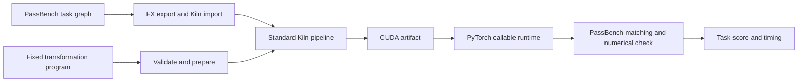

# Kiln: Compiler Policy Transfer and the 111-Task Coverage Frontier

A compiler optimization is reusable when the same rule can be applied to more than one input graph without changing its implementation for each graph. That property is central to the Kiln–PassNet study. PassNet's benchmark provides task families with multiple shapes and dtypes, while Kiln supplies tensor, loop and GPU IR transformations. A transformation can be legal and produce correct CUDA on every graph yet still reduce performance when applied too broadly. The first complete-task comparison of a fixed Kiln transformation program gives a concrete example.

The result also changes how coverage should be planned. The current importer handles 1,526 of the benchmark's 2,060 graphs and all variants of 111 of its 200 tasks. The cumulative externally accepted ledger covers 53 tasks and 505 graphs across recorded compiler snapshots. Import eligibility is substantially ahead of current-release PassBench qualification. The next large experiment therefore evaluates the whole importable task surface under one frozen compiler revision before adding another isolated operator.

> [!summary]
> - A fixed pointwise fusion program preserved PassBench correctness on all 92 graphs in a 12-task comparison, but its mean score fell from 0.849 to 0.823 across 11 transfer tasks.
> - Task-specific executable changes explain why one global policy is insufficient: the same program produced major wins on tasks 83 and 101 and a major loss on task 25.
> - The current import census exposes 58 fully importable but unverified task families. A frozen 111-task, 1,514-graph qualification run is now executing on bling.

## 1. What a transformation program changes

Kiln's compiler starts from a tensor computation, lowers it to loop expressions, selects schedules and emits GPU kernels. A fusion rule can replace a producer load with the producer's calculation inside a consumer. A policy decides whether and where to apply that legal rewrite. The program studied here composes a pointwise-convolution exposure step with selective fusion and a cleanup pass. Its JSON artifact names existing compiler operations and their policy parameters; it does not contain a graph-specific CUDA kernel.

```json
{
  "format": "kiln-transformation-program/1",
  "id": "artifact-policy",
  "kind": "pointwise-fusion-sequence",
  "expose": {
    "kind": "selective",
    "tree": { "threshold": 1.02 },
    "consumer_tree": { "threshold": 2 }
  },
  "cleanup": {
    "kind": "threshold",
    "max_work_growth": 1.02
  }
}
```

The executable grammar is validated in `integrations/passnet/transformation_program.mjs`. Its `prepareOptimizationProgram` checks the bounded policy, and `applyOptimizationProgram` modifies the standard Kiln pipeline. Both the direct policy-study compiler and the ordinary `kiln-export.mjs` exporter call this shared implementation. The latter accepts `--optimization-program PATH`, so the same reusable compiler change can be measured through PassBench without adding a second exporter or evaluator.



The diagram separates compiler choice from evaluation. The candidate changes the pipeline before CUDA generation. PassBench still determines whether the Python replacement matches the target FX graph, whether the computed outputs meet its numerical criterion, and how the measured implementation scores against eager execution.

## 2. How the comparison was controlled

The experiment froze 12 complete task families and all 92 variants before candidate compilation. Each arm used one compiler source snapshot, the same pinned CUDA container, GB10 GPU, A100 scheduling-cost target, separate contraction setting, 20 warmups and 100 timed trials. The control used unchanged Kiln; the candidate added only the fixed transformation program. Task 101 was used during development of the program and is labeled a positive control. The other 11 families are transfer cases, although some had prior Kiln coverage work and are not a pristine unseen population.

The integration uses explicit FX argument normalization to match equivalent PyTorch call forms. Kiln's internal synthetic-input reference check was bypassed in both arms because earlier diagnostics showed it can reject externally correct low-precision programs. PassBench's numerical check at `t=-5` and its scorer remained active. These are declared modifications to the integration protocol; the result is not an exact reproduction of the paper's A30 evaluation.

An audit examined the complete graph membership, replacement count, execution status and numerical decision for every variant. Both arms passed **12/12 tasks and 92/92 graphs**. The candidate changed 49 executable artifacts. This establishes that the observed score difference concerns performance for this population, not a trade of speed for incorrect answers.

| Task | Graphs | Changed artifacts | Control score | Candidate score | Control/candidate end-to-end latency |
|---:|---:|---:|---:|---:|---:|
| 25 | 6 | 6 | 0.801 | 0.264 | 0.330× |
| 83 | 3 | 3 | 0.267 | 0.745 | 2.780× |
| 101, development | 6 | 6 | 0.012 | 0.405 | 32.782× |
| 106 | 6 | 6 | 1.384 | 1.149 | 0.827× |
| Other eight families | 71 | 28 | See ticket audit | See ticket audit | Mostly near 1× |

Across the 11 transfer families, the arithmetic mean of the original per-task scores fell from **0.848880 to 0.822873**. The family-balanced geometric mean of control/candidate end-to-end latency on common-correct graphs was **0.976551×**. Restricting that descriptive ratio to transfer families whose executable changed gives **0.955492×**. The arithmetic mean of task scores is a study summary, not a replacement for PassBench's published aggregate statistic. The task-level scorer outputs remain authoritative.

## 3. What the generated kernels show

The task-level contrast has a visible compiler counterpart. On one task 101 variant, unchanged Kiln emitted one row-mapped kernel with a grid of 6,422,528 blocks. The program emitted a tiled contraction with a grid of 3,328 blocks plus an elementwise kernel. That structural change is consistent with the 32.782× observed task-family latency ratio. It repeats a development case, so it cannot serve as independent evidence of generalization.

Task 83 supplies a second large win. In its first variant, the control's first kernel used a 1,280-block thread-per-block schedule, while the candidate selected a 320-block tiled schedule; the other two kernels remained. The measured task-family ratio was 2.780×. Task 25 shows the opposing effect: the control emitted two kernels, while the candidate emitted three, including an additional elementwise kernel with 393,216 blocks for the first variant. Its task-family latency ratio was 0.330×. The output and schedule differences establish that the policy actually changed the compiler product. They do not by themselves prove which particular scheduling decision caused every microsecond of the measured change.

Task 106 also changed from one kernel to two and regressed to 0.827×. Task 107 changed CUDA source in all 18 variants while measuring about 1.002×; an artifact change does not guarantee a useful speedup. Several unchanged executables also show small timing shifts, which should be treated as measurement variation rather than compiler gains.

The conclusion is specific: this **fixed global program should not become Kiln's default**. The same legal transformation is profitable for some task families and unprofitable for others. The next compiler question is whether a policy can recognize the relevant workload features before applying a transformation. It may need kernel count, launch cost, output size, contraction shape, duplicated work, materialized bytes and hardware occupancy. Those are candidate features, not yet a validated performance model.

## 4. Coverage defines the next research population

A current-source fake-metadata import audit inspected all 2,060 PassBench graphs. It imported 1,526 graphs and completely imported 111 task families. All 53 historically accepted task families are included among those 111. The remaining 58 fully importable families contain 1,083 graphs. Two very large families contain 396 and 126 variants; the other 56 contain 561 together.

```text
200 benchmark tasks / 2,060 graphs
  111 fully importable tasks / 1,514 graphs
     53 historically accepted tasks / 431 graphs inside those tasks
     58 unverified importable tasks / 1,083 graphs
  89 tasks with at least one import-blocked graph
```

The cumulative accepted graph count is 505, because it includes 74 accepted variants from incomplete task families; the 431 figure above counts only variants inside the 53 complete accepted families. This distinction prevents a false comparison between graph counts that have different denominators.

Among 534 currently import-blocked graphs, first failures cluster around nonfloating inputs (119), mutation and alias semantics (135), other missing operation bindings (142), scaled-dot-product attention (23), captured constants (17), source shape propagation (16), and 59 local no-driver errors. These categories describe the **first visible failure per graph**. Fixing one may reveal another. The no-driver cases need reclassification on the GPU host before they are called compiler defects.

The project has frozen a uniform qualification of all 111 currently fully importable tasks and all 1,514 variants. It will evaluate 56 ordinary unverified families, the two large families, and the 53 previously accepted families under one current source snapshot. Each result must pass the same exact-member, match, execution and numerical audit. A prior accepted task that fails this run is a current regression; a successfully imported graph is not counted as accepted until the external evaluator says so.

## 5. A broader compiler strategy portfolio

Coverage expansion and optimization research can proceed together because the latter needs correct workloads, not all 200 tasks at once. The next strategy set should include selective pointwise/convolution fusion, contraction and matrix layout choices, reduction and softmax scheduling, view/index materialization, and launch or dispatch overhead. Each strategy acts on a distinct source of time. Combining them prematurely would make a measured gain difficult to attribute.

The experimental unit should be a complete task family, with all of its shapes and dtypes kept on one side of a training/held-out split. Candidate policies are selected by the original task score after correctness checking. A latency ratio over only common-correct graphs explains performance, but cannot compensate for failures excluded from that ratio. Exact CUDA and schedule identity reveal whether a candidate made a meaningful compiler change.

```text
freeze complete training and held-out task families
measure unchanged Kiln and classify bottlenecks
propose bounded compiler policies or reusable passes
select on correct complete-task scores in training
freeze one candidate before seeing held-out timings
replay every held-out variant through PassBench
promote only a candidate with useful, repeatable score gains
```

The existing `kiln-transformation-program/1` representation and Pi/LLM study lanes can generate and evaluate proposals. New transformation algorithms belong in Kiln's compiler rule and pipeline modules when the current primitives cannot express them. The agent may search profitability and composition; the compiler remains responsible for semantic legality. This keeps the optimization experiment connected to the same importer, compiler pipeline, runtime and PassBench audit used by ordinary Kiln programs.

## 6. Reproducing the evidence

The authoritative ticket is `ttmp/2026/10/30/KILN-005--reproduce-passnet-and-evaluate-reusable-kiln-compiler-transformations` in `/home/manuel/code/wesen/kiln/worktrees/passnet`. Its reference34 defines the coverage and optimization waves, reference35 contains the full 12-task result table, and reference36 declares the uniform 111-task run. `sources/fixed-policy-passbench-v1/` contains both plans, the fixed program, task audits and graph-level comparison; `raw-evidence.tar.gz` preserves all 1,157 raw members. Scripts615–625 freeze, execute, collect and analyze the relevant experiments. The long chronological implementation record is reference24.

The new uniform qualification is running as tmux session `kiln-uniform-importable-v1` on bling. Its result is pending. The completed 92-graph comparison justifies rejecting one global pointwise program; it does not yet establish a better learned policy, a full current-release 200-task Kiln evaluation, or an A30 paper-reproduction score.
