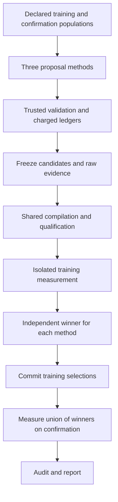

# Kiln: Controlled Policy Search, Action Failures, and Unchanged Winners

A compiler policy is a reusable decision procedure applied during compilation. In Kiln's fusion pass, a policy decides whether combining computations is profitable after the compiler has established that the transformation is supported. The policy can affect many programs without containing a specialized kernel for any one input shape. Evaluating such a policy therefore requires both a population of training graphs and a separate population on which the selected policy is subsequently tested.

This report explains the first completed controlled comparison between a local language-model batch, a fixed threshold search, and seeded random policy generation in the Kiln–PassNet integration. All three methods selected unchanged Kiln. The deterministic methods produced valid policies that either matched the existing executables or reduced aggregate performance. The language model exhausted its proposal allowance by emitting four tool actions in one response, which violated the declared interaction protocol. Eight fresh confirmation graphs executed correctly, but confirmation compared the unchanged executable with itself. No optimization gain was demonstrated.

> [!summary]
> The experiment completed its proposal, compilation, isolated measurement, training selection, and confirmation stages. All 200 policy–graph compilations succeeded. Audits reconstructed 27,600 raw timing samples. The principal findings concern action reliability, executable equivalence, and the absence of an aggregate improvement within this small declared search.

## 1. The optimization problem

Fusion combines producer and consumer computations so that intermediate values can remain inside a kernel rather than requiring separate storage and dispatch. A legal fusion can still be slower. Combining computations may duplicate producer work, change indexing, increase resource requirements, or remove a useful implementation boundary. Kiln already has the graph transformation and legality machinery. The experiment varies its profitability policy.

The simplest candidate is a threshold rule:

\[
\operatorname{accept}(g)=\mathbf{1}[W_{\mathrm{fused}}(g)\leq\theta W_{\mathrm{original}}(g)].
\]

Here the work quantities are compiler estimates, not observed execution times. The original threshold is approximately 1.02. A smaller threshold demands a larger estimated reduction before accepting fusion. A larger threshold tolerates additional estimated work. Neither direction guarantees faster execution, because this estimate does not fully describe launch overhead, memory traffic, or device resource use.

The candidate grammar also includes bounded decision trees, selective policies with aggregate and consumer conditions, and region policies with launch/materialization terms. These constructs reuse existing compiler operations. The experiment does not synthesize a new graph-rewriting algorithm or arbitrary compiler source code.

An illustrative policy has the following implemented shape:

```json
{
  "format": "kiln-fusion-policy/1",
  "id": "threshold-example",
  "kind": "threshold",
  "max_work_growth": 1.0
}
```

That JSON becomes useful only after several distinct checks. It must satisfy the grammar, compile the relevant programs, preserve their required outputs, and improve the declared population metric. Passing one check does not establish the later properties.

## 2. Population and experimental declaration

The training population contains twelve FP32 graphs previously used in compiler-policy studies. Confirmation contains eight newly selected exact models: four matrix cases and four reduction cases. The selector excluded models represented by 541 graph records in tracked earlier corpora, together with the official evaluation models. It selected the first eligible models in a salted task order, reaching the declared quotas after scanning 3,036 tasks.

Eligibility depended on operator structure, dtype, tensor volume and bounded matrix work. It did not depend on candidate speed or correctness. The eight confirmation graphs were selected before their compilation and GPU execution. No graph was replaced after an unfavorable result. Different exact model names can still represent related architectures, so this is not an architecture-disjoint test.

The three proposal methods were declared before execution:

| Method | Proposal allowance | Fixed generation rule |
|---|---:|---|
| Threshold | 4 | Work-growth limits 0.95, 1.0, 1.1 and 1.25 |
| Random | 4 | Seed 20261031; bounded threshold, tree, selective and region grammar |
| Local LLM | 4 | Generic Qwen3-30B-A3B BF16; at most 12 model steps |

The model also had a limit of 4,096 completion tokens per response and 24,576 completion tokens for the batch. These are completion-token limits. Repeated prompt tokens are recorded separately. Equal proposal allowances do not imply equal inference costs, and the report does not treat them as equivalent computational budgets.

The initial experiment uses a single proposal batch. The model receives structural training features and validation observations, but no timing feedback within that batch. This establishes the basic comparison pipeline. It is not an adaptive optimizer that repeatedly measures and revises proposals.

## 3. The trusted task and artifact identity

`integrations/passnet/native_policy_task.py` owns the proposal budget and exposes three operations: `inspect_training`, `submit_policy`, and `finish`. Training inspection returns approved numeric features, including original work, fused work, consumer count, and producer element count. It excludes graph paths, model names, held-out metadata and unrestricted debug fields.

The model cannot change the reference implementation, tolerances, workload membership or evaluator. It submits policy data through the task. A request reserves a numbered attempt before validation, so malformed or duplicate proposals consume the declared allowance. Accepted means that a policy satisfies the grammar. Its result explicitly retains `evaluation_status: not_run` until separate compilation and measurement occur.

`optimization_artifact.mjs` binds the normalized program to its input IR, feature/action contracts, numerical policy, applicability and resource limits. Diagnostic names and author provenance are excluded from semantic identity. Consequently, two submissions with different names can produce the same optimization artifact.

There is a second equivalence relation after compilation. Different policy programs can generate identical executables for a particular graph. Artifact identity therefore cannot replace executable identity:

```text
proposal identity → reusable policy identity → graph-specific executable identity
```

The proposal ledger retains every charged attempt. Compilation and timing deduplicate at their appropriate boundaries. This preserves the cost of redundant search without creating artificial performance differences between identical programs.

## 4. Framework integration and the observed action failure

The native driver reuses R2E-Gym's pinned `Action` parser and `TrajectoryStep` representation. It implements its own bounded lifecycle because the original repository-oriented `Agent.run` expects repository repair state and command scaffolding that do not describe a native compiler-policy task. The original PassAgent configuration remains separate.

The model batch ran from source commit `7776662f3b9e73336302015032529fa5e09bd07a`. The owner verified the installed framework modules, hashed the full model file, checked the GPU for active compute processes, and started a named local server. Requests and responses were retained exactly. There were no hidden provider retries.

The observed interaction was short:

| Response | Action | Recorded outcome |
|---|---|---|
| 0 | Inspect training features | Approved feature view returned |
| 1 | Four submission actions in one response | Entire response rejected; all four submissions charged |

The precise parsing diagnostic was `Expected exactly one complete tool action`. The declared driver does not execute any action body from such a response. It identifies the four reserved submission headers and charges four rejected attempts through the task. The batch consequently ended after two responses with zero accepted artifacts.

The agent loop took 142.0059 seconds and reported 10,678 prompt tokens plus 3,944 completion tokens, or 14,622 tokens in total. A replay audit reconstructed each model-visible message, used the pinned actual Action parser, and verified observations, task requests/results, token totals and submission accounting. Twenty-three terminal files were collected with matching remote hashes.

This result establishes an interaction-protocol failure for this model and interface. It does not establish that the four textual policy bodies would fail compilation or produce poor kernels: they never entered those stages. Admitting those bodies after observing the failure would change the experimental protocol. They remain preserved source evidence, and the LLM method retains its previously declared unchanged-compiler fallback.

## 5. One shared evaluator with independent method selection

The integration adds search orchestration around the existing evaluator. It does not implement another correctness checker or another latency objective. `policy_search.py` verifies declarations and ledgers, assigns candidates to methods, invokes the common freezer, and computes separate method selections through the existing ranking function.



Every method includes unchanged Kiln as its first candidate. Training ranking considers only that method's accepted proposals plus this fallback. Exact ties preserve declaration order. A failed candidate is ineligible where its training measurements fail; a failed unchanged baseline invalidates selection rather than disappearing from the average.

The family-balanced objective is:

\[
S(p)=\exp\left(\frac{1}{|F|}\sum_{f\in F}\frac{1}{|G_f|}\sum_{g\in G_f}\log\frac{T_0(g)}{T_p(g)}\right).
\]

Here each family receives equal weight, and graphs within a family share that family's weight. A speedup above one indicates improvement relative to unchanged Kiln. The implementation uses synchronized end-to-end latency for selection; stream elapsed time is reported separately. The compile-cost coefficient is zero in this pilot, while compilation costs remain available in receipts.

The essential selection procedure is:

```text
for each declared method:
    candidates = unchanged compiler + that method's accepted policies
    reject candidates with any failed training graph
    rank eligible candidates by family-balanced training speedup
    preserve declaration order on exact ties
    record the first candidate

commit all recorded selections
confirm the distinct union of unchanged compiler and selected policies
```

The summary recomputes the selections from the exact training measurement. It rejects different method membership, substituted winners, incomplete graph populations and an expanded confirmation grid. Confirmation data cannot select the winner.

## 6. Compilation, isolation and timing evidence

The common freeze contained ten policies: unchanged and explicit-default controls, four threshold candidates, and four random candidates. Each compiled on all twenty graphs, giving 200 successful policy–graph compilations. This count does not mean support for 200 PassBench tasks. The two quantities have different units and populations.

Qualification verified that the explicit default reproduced the unchanged compiler. It also checked complete corpus ordering, numerical declarations, source hashes, kernel identities and complete executable bodies. Distinct policies whose bodies were identical shared timing evidence for the corresponding graph.

Inference and measurement ran in separate owned containers on the DGX Spark's GB10. The model owner stopped its server before timing began. Each measurement phase verified an immutable bundle containing runtime code, compiled artifacts, frozen declarations and exact upstream source files. The runtime used read-only input mounts and a separate output directory. It did not alter the shared remote compiler checkout.

The protocol used 20 warmups, 100 timed trials, and three repeats. An attempt was unstable if either timing metric's interquartile range exceeded 20 percent of its median; the declared maximum was two retries. The training run produced 38 distinct measured graph/executable pairs. All passed the original-input correctness check and the timing-stability rule. The audit reconstructed 22,800 raw timing samples, including medians, quartiles, means, ranges and final repeat aggregates.

End-to-end timing includes Python invocation, allocation, dispatch and synchronization. CUDA-event stream timing includes dispatch gaps between the recorded events. Neither quantity should be casually relabeled as a pure kernel execution time. The experiment retains both because compiler changes may alter kernel count and invocation overhead as well as device computation.

The reference uses an explicit highest-precision FP32 matrix setting and separate arithmetic contraction. This is the declared compiler-policy research protocol. It does not establish acceptance under unmodified native PassBench settings, and its ratios are relative to unchanged Kiln rather than PyTorch eager execution.

## 7. Training and confirmation results

All deterministic candidates remained eligible. Their family-balanced end-to-end training ratios were:

| Method | Candidate | Speedup | Interpretation |
|---|---|---:|---|
| Threshold | 0.95 | 0.813717 | Aggregate regression |
| Threshold | 1.0 | 0.960235 | Aggregate regression |
| Threshold | 1.1 | 1.000000 | Exact baseline executable aliases |
| Threshold | 1.25 | 1.000000 | Exact baseline executable aliases |
| Random | 1: selective | 0.651238 | Aggregate regression |
| Random | 2: decision tree | 0.810298 | Aggregate regression |
| Random | 3: threshold 1.02 | 1.000000 | Exact baseline executable aliases |
| Random | 4: decision tree | 1.000000 | Exact baseline executable aliases |

Each method selected unchanged Kiln. Threshold and random search retained baseline on exact ties; the LLM method had no accepted alternative. The selections and their complete training evidence were committed at `e2b85df5d24ee176a43fcd9461048013a03a83d8` before confirmation started.

All eight confirmation graphs passed correctness and timing stability for unchanged Kiln. The audit reconstructed another 4,800 raw timing samples. The three method summaries consequently report 1.0 end-to-end and stream speedup, with zero changed confirmation artifacts. These ratios follow from sharing the same executable and measurement. They are not independent estimates of three different optimization effects.

The valid conclusion is that this declared four-slot comparison found no aggregate compiler improvement. The experiment also establishes that its selected fallback executes the eight new graphs under the stated research reference. It does not establish general superiority of threshold search, random search or this language model. One small batch, one random seed, a restricted population and a model-format failure cannot support that claim.

## 8. Architectural assessment

The implementation now separates five responsibilities: proposal generation, proposal validation/accounting, compilation qualification, measurement, and selection. Keeping these responsibilities distinct made the negative result interpretable. A malformed action was recorded as a proposal failure; it was not confused with compiler correctness. An executable alias was recorded as a tie; it was not assigned a noisy independent speedup.

The shared evaluator remained the center of execution. The principal new production module, `policy_search.py`, handles declarations and method membership. `freeze_study.freeze_candidates` and `summarize_policy.confirmation_metrics` were extracted from existing implementations so both single-search studies and method comparisons use the same operations. Scripts 438–440 handle immutable remote execution and evidence auditing for the experiment. They do not contain a second optimizer or metric.

One remaining architectural limitation is the hand-encoded XML action interface. Its strict accounting is appropriate for reproducibility, but this model did not reliably follow its one-action constraint. A subsequent experiment should evaluate a structured action interface or constrained response schema, with parsing rules and budgets fixed before inference. Such a change must be reported as a new protocol. The current rejected batch must remain unchanged.

A second limitation is the search space. The pilot adjusts policies over existing fusion mechanisms. The strongest earlier reusable compiler improvement came from a manually derived singleton-view transformation. This pilot provides no evidence that simply increasing threshold-search volume will discover an equivalent algorithmic change. The next compiler research step should expose a small set of checked transformation actions and a replayable strategy representation, then evaluate whether an agent can compose them into a reusable improvement.

## 9. Reproduction and source map

The worktree is `/home/manuel/code/wesen/kiln/worktrees/passnet`, on branch `research/passnet`. All experiment material is retained under ticket `KILN-005`:

```text
ttmp/2026/10/30/KILN-005--reproduce-passnet-and-evaluate-reusable-kiln-compiler-transformations/
```

The primary source and evidence locations are:

| Location | Purpose |
|---|---|
| `integrations/passnet/policy_search.py` | Method declarations, ledger verification, independent selection and summary |
| `integrations/passnet/native_policy_task.py` | Trusted feature view, proposal validation and charged attempts |
| `integrations/passnet/run_native_policy_agent.py` | Bounded native model interaction and version2 action accounting |
| `integrations/passnet/qualify_policies.py` | Compilation identities, failures and executable aliases |
| `integrations/passnet/measure_policy.py` | Existing correctness and timing evaluator |
| `sources/native-policy-search-v2/` | Protocol, selected corpus, deterministic proposals and candidate freeze |
| `sources/native-policy-search-model-terminal-v1/` | Raw inference requests, responses, task ledger and owner receipt |
| `sources/native-policy-search-artifacts-v1/` | All 200 compilation artifacts and qualification |
| `sources/native-policy-search-selection-v1.json` | Committed training-only selections |
| `sources/native-policy-search-summary-v1.json` | Joint method confirmation summary |
| `sources/native-policy-search-*-audit-v1*` | Model replay and raw measurement audits |

The core comparison implementation is committed at `7776662`; the candidate freeze and model outcome at `f666457`; training selections at `e2b85df`. Model/framework pins and complete source hashes are in the retained bundles. The actual model is generic Qwen3-30B-A3B BF16, not the paper's fine-tuned student. The hardware is GB10, not the paper's A30. No published paper result is claimed as reproduced by this comparison.

Validation includes 53 focused native-task and policy tests, full compilation qualification, actual remote inference, exact response replay, and raw timing audits. The original failed corpus-preparation attempt is also retained: it encountered a list-valued historical manifest before selecting any graph. The corrected attempt skipped non-corpus objects and retained the same salt and eligibility rules. It did not replace graphs based on outcomes.

## 10. What should happen next

The first priority is to make model action execution reliable under a newly declared protocol and to run more than one independent batch. The comparison should continue reporting rejected attempts and inference costs. Valid JSON alone will still be insufficient: policy identity, executable changes, correctness and held-out performance remain separate evidence requirements.

The second priority is to broaden the optimization representation only where there is an observed compiler opportunity. A useful transformation program should specify its query, checked action, applicability conditions, bounded sequencing and failure behavior. Replay should reproduce the same decisions, and failed actions should leave the original IR intact. This provides a concrete next experiment beyond another threshold sweep.

Full support for the 200-task PassBench evaluation, native numerical compatibility, broader original-agent reproduction and transformation synthesis remain active work. The present milestone completes a bounded comparison and verifies its negative outcome. It establishes a repeatable path for evaluating future proposals; it does not complete the overall Kiln–PassNet research objective.

Related report: [[ARTICLE - Kiln - Project Reassessment and the Path to Agent-Generated Compiler Strategies]].
