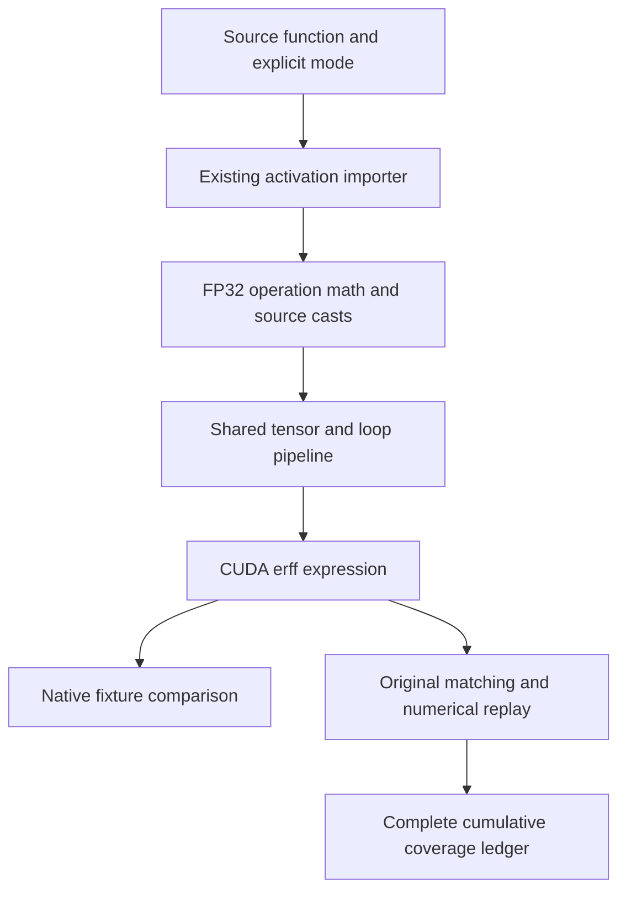

# Exact GELU, source signatures, and complete failure accounting

Kiln now represents both public GELU modes and imports PyTorch's default erf-based operation without substituting the tanh approximation. All 36 CUDA fixture records pass, and original-evaluator qualification adds three complete tasks and 25 individual graphs across the initial run and a repaired matching run. Cumulative accepted replay reaches 27/200 tasks and 338/2060 graphs. Import eligibility reaches 1196 graphs and 69 complete families. These counts describe different gates and are not interchangeable.

This report develops the numerical and integration contracts behind that result. A small activation exposes several independent concerns: the mathematical function, intermediate precision, reference evaluation, source-call normalization and complete benchmark accounting. The compiler must satisfy all of them before a successful translation becomes an accepted graph. Two newly importable families still fail the compiler's end-to-end reference check, leaving 35 variants unexecuted. Their failures remain part of the result.

> [!summary]
> Exact GELU uses an explicit scalar compiler operation with CUDA erff and FP32 operation math. Native fixtures validate both modes across three storage dtypes. A LayerNorm signature repair qualifies a previously unmatched complete family. Sparse composition discrepancies remain unresolved, with unchanged correctness thresholds.

## 1. Distinguishing the two GELU functions

The Gaussian error linear unit has an erf-based form

$$
\operatorname{GELU}(x)=\frac{x}{2}\left(1+\operatorname{erf}\left(\frac{x}{\sqrt2}\right)\right).
$$

PyTorch selects this form when `approximate="none"`. Its explicit `"tanh"` selector chooses a different expression involving a cubic term and hyperbolic tangent. Kiln's existing `N.gelu(x)` implemented that tanh approximation. Treating it as the public PyTorch default would change the computation, even when ordinary random inputs produced visually similar values.

The native Kiln API now accepts `N.gelu(x, approximate)`, with `"none"` and `"tanh"` as the only valid selectors. Its existing default remains `"tanh"`; the importer explicitly supplies the source selector and uses `"none"` when the public source omits it. This keeps the source contract visible at the import boundary. Neither a target GPU nor a profitability policy may silently change the selected function.

The semantic references are the [PyTorch 2.9 functional API](https://docs.pytorch.org/docs/2.9/generated/torch.nn.functional.gelu.html), the pinned [PyTorch 2.9.1 CUDA implementation](https://github.com/pytorch/pytorch/blob/v2.9.1/aten/src/ATen/native/cuda/ActivationGeluKernel.cu) and NVIDIA's [single-precision mathematical API](https://docs.nvidia.com/cuda/cuda-math-api/cuda_math_api/group__CUDA__MATH__SINGLE.html). The inspected source, license and NVIDIA documentation are archived under `sources/gelu-primary-sources-v1/`. Direct downloading of the PyTorch web page returned 403; its installed docstring/schema and pinned implementation are retained as semantic references. No upstream kernel implementation or polynomial was copied into Kiln.

## 2. Storage dtype and operation math are different contracts

A source FP16 or BF16 tensor specifies how input and output values are stored. It does not require every elementary step inside one activation to round to that storage format. The inspected CUDA source widens the activation's internal arithmetic to its operation-math type. For these storage dtypes, the corresponding computation uses FP32 before narrowing the source result.

The importer therefore lowers an activation through explicit boundaries:

```javascript
N.cast(
  N.gelu(N.cast(value, "f32"), "none"),
  "f16"
)
```

The outer cast is part of source semantics. If a later addition consumes the activation, that addition receives the rounded FP16 activation value. Removing the cast because both operations could share a kernel would alter the rounding boundary. Conversely, decomposing the activation into several FP16 tensor operations would introduce rounding that the source activation does not require.

The exact form decomposes to the scalar `gelu_erf` operation registered in the shared function table. Its CUDA expression uses `erff` and FP32 constants. The function remains inside the existing tensor-to-loop-to-kernel pipeline; it introduces no separate kernel compiler or runtime. Pointwise fusion may combine it with surrounding work while retaining explicit source casts.

The tanh decomposition is preserved. WGSL currently has no implementation of the exact operation's error function in Kiln, so the exported exact kernel reports explicit WGSL unavailability. A tanh replacement would be a semantic substitution, not a backend implementation of the requested function.

## 3. An independent JavaScript reference

The JavaScript runtime has no standard `Math.erf`. Reusing the CUDA output as its own expected result would eliminate an independent correctness check, so the compiler needs a separate reference implementation.

`packages/kiln/src/std/special.js` evaluates the defining Gaussian integral with 32-point Gauss-Legendre quadrature. It generates the positive Legendre roots by Newton iteration and computes their weights from the polynomial derivative. Symmetric node pairs integrate over the finite interval from zero to the absolute input. The sign is restored afterward. Inputs of absolute magnitude at least 7 use the signed limiting value, which rounds to one in double precision; signed zero, infinities and NaN have explicit handling.

```text
for each positive root of the degree-32 Legendre polynomial:
    refine the root by Newton iteration
    calculate its quadrature weight
for one erf input:
    transform symmetric nodes into the integration interval
    sum weighted Gaussian values
    normalize and restore the input sign
```

This implementation is reference code. CUDA execution uses its mathematical intrinsic rather than running quadrature on the device. The independent Python `math.erf` oracle covers 1006 values, including small magnitudes and the interval endpoints. The maximum observed absolute reference error is 2.9976021664879227e-15. That is a measured sample bound, not a proof of correctly rounded results for every double input.

A separate fixture records CPU PyTorch GELU outputs for both modes and all three storage dtypes. The compiler test checks frontend and loop reference values against those outputs, verifies exact CUDA emission and WGSL refusal, and preserves the existing default selector. All 34 compiler test files pass with real subprocess execution.

## 4. Canonical source signatures preserve matching predicates

PassBench performs structural matching on captured graphs. Equivalent source calls can have different argument representations: one graph may encode a default in keyword arguments while another omits it or places an equivalent field positionally. Matching can fail even when the compiler-generated implementation is correct.

GELU is a builtin without an inspectable Python signature. Its public contract supplies one input and a keyword-only approximation selector. The existing integration normalizer now has an explicit signature for that builtin. It binds the entire call before mutating the graph, fills the default and retains keyword-only fields as canonical keywords. The selector remains part of the pattern; a `"none"` pattern must not match a `"tanh"` call.

The normalization code continues to use one transactional path. It does not execute a function body, rewrite arithmetic, relax a graph predicate or change replacement code. Regression tests compare real Dynamo capture with symbolic FX, exercise supported call forms and reject a changed selector.

The first complete original-evaluator run exposed another signature difference around GELU. In task 151, symbolic FX retained LayerNorm's `weight`, `bias` and `eps` as keywords, while Dynamo placed all five public fields positionally. The arithmetic was already supported, but every one of the task's seven variants produced zero replacements.

Adding public functional LayerNorm to the same signature whitelist resolves that mismatch. CPU capture of the actual source changes from zero matches to one. Tests preserve affine input roles, output values and epsilon under FP32, FP16 and BF16; changing epsilon still prevents matching. All 53 FX tests pass. The repair changes integration matching rather than the compiler's GELU or LayerNorm numerical algorithms.

## 5. Native CUDA qualification precedes benchmark acceptance

Twelve source-derived fixture programs cover scalar, one-element, tail and wide shapes under FP32, FP16 and BF16. Each returns exact GELU, tanh GELU and exact-GELU-plus-one. The third output checks the activation's source rounding boundary before the next operation. Three seeds produce 36 fixture records and 108 output comparisons.

All 36 records pass against native PyTorch CUDA at the existing dtype tolerances, with output shapes/dtypes and unchanged inputs checked. The scalar reference's signed-zero/nonfinite tests are separate from this finite CUDA fixture scope. The fixture outcome does not resolve the historical 60/63 result from an earlier, different native precision suite.

The validation executes on NVIDIA GB10 with the existing NVIDIA PyTorch container, rather than the paper's A30 environment. Runtime/compiler source bytes are checked against a committed snapshot before staging. The experiment records local Node 26.13.0 and remote Node 26.8.1 separately. Original replay still uses its declared integration extensions and nominal numerical gate; it is not an exact hardware/software reproduction of the paper.

## 6. Count every selected graph, including failures

The complete import re-audit increases eligibility from 1136 to 1196 graphs and from 64 to 69 complete families. Sixty graphs become importable with no regression. The earlier first-error inventory counted 68 GELU-blocked graphs; eight encounter another unsupported operation after GELU is implemented. A first-error count is therefore an upper bound on immediate support gain.

All five newly complete families are frozen before original replay, with every shape and dtype included. Their60 variants yield the following first-run result:

| Gate | Outcome |
|---|---:|
| Declared tasks/graphs | 5 /60 |
| Successful compiled artifacts | 25 |
| Retained failed compile attempts | 2 |
| Original nominally accepted tasks/graphs | 2 /18 |
| Evaluated graphs with zero replacements | 7 |
| Graphs unexecuted after compile failure | 35 |

The compiler stops each task after its first failing variant. The manifest still contains all expected graphs, and the audit accounts for the unexecuted remainder. It does not convert the 25 successful artifacts into 25 accepted graphs. A scoring phase returning zero also does not override missing replacements or numerical failure.

Independent script 325 verifies 164 committed source files, exact plan and graph-list bytes, all successful artifacts and their source identities, both failed compile attempts, scorer/log hashes and all native fixture hashes. The shared coverage builder parses nominal numerical evidence and exact replacement counts. The resulting cumulative ledger reaches 26 tasks and 331 graphs after this first run.

## 7. Repair the complete mismatched family separately

After diagnosing task 151, its full seven-variant membership is frozen into a targeted repair plan. This is a known-failure repair population, not fresh optimization confirmation. The fixed LayerNorm signature change is committed before the new runtime snapshot is staged and verified.

The separate replay qualifies all seven variants with exactly one replacement, successful execution and nominal correctness. Independent verification binds that outcome to its source snapshot and complete task membership. The initial failed run remains archived, including its zero-replacement records. Only the later evaluated evidence supersedes that family's ledger entry.

Together, the initial accepted 18 graphs and repaired seven graphs add 25 accepted graphs across three complete tasks. Cumulative coverage is 27/200 complete tasks and 338/2060 individual graphs, with 273 graphs inside complete tasks. This remains cumulative evidence across recorded compiler versions, not one uniform full-corpus run of the latest compiler.

## 8. Two composition failures remain unresolved

The two compile-blocked families combine GELU with depthwise convolution or LayerNorm/transpose. Their compiler end-to-end check compares the frontend reference against the loop reference on deterministic compiler inputs. It reports two failing values among 401408 in the first program and five among 2047488 in the second. The largest observed absolute discrepancy is 0.001953125.

Those sparse errors are consistent with a need to investigate accumulation order and low-precision narrowing, but their origin is not established by the counts. Native activation fixtures cannot prove that an entire convolution or normalization composition is correct. The compiler check remains enabled, its thresholds are unchanged and neither family is claimed as supported by original replay.

The diagnostic script retains exact sample indices and values. For example, one convolution/GELU output is expected as -0.05804443359375 and obtained as -0.057830810546875. One normalization/GELU output is expected as 1.279296875 and obtained as 1.28125. Investigating the predecessor values and lowering boundaries is the next numerical task. Relabeling these differences as harmless or discarding the affected variants would conceal the remaining work.

## 9. Architectural scope and the next research step

The implementation adds one scalar semantic operation and one reference helper while reusing the existing compiler pipeline, activation importer, argument normalizer, CUDA runtime and original-evaluator orchestration. Experiment-specific scripts preserve acquisition, failed launches, fixture generation, source staging, diagnostics and independent audit; they do not define an alternative production compiler interface.



Broader source coverage supplies additional workloads for reusable compiler research. It does not itself demonstrate a self-improving agent. The previous twenty-family reshape confirmation reported an observed 1.053746x aggregate end-to-end improvement under its own fixed FP32 protocol. These GELU qualification runs are a different experiment and cannot be pooled with it as optimization confirmation.

Original PassAgent still needs a configured model provider. Read-only DGX discovery found no serving runtime or model cache in the checked locations. Official NVIDIA, llama.cpp and Qwen references are archived for local provisioning, but no serving system or original agent trajectory is claimed here. Provisioning should remain separate from isolated GPU timing runs so that inference load does not contaminate compiler measurements.

## 10. Reproduction references

The code and evidence live in worktree `/home/manuel/code/wesen/kiln/worktrees/passnet`, ticketKILN-005. Commit `d316241` introduces exact GELU and its frozen first qualification plan; `f1e5518` records complete first-run evidence and the LayerNorm signature repair. The targeted replay's source receipt records its exact committed revision independently.

Primary implementation files are `packages/kiln/src/std/special.js`, `fns.js`, `tensor.js`, `integrations/passnet/fx_import.py` and `fx_normalize.py`. Tests are `packages/kiln/test/gelu.mjs`, its independently generated oracle fixture, `test_fx_gelu.py` and the LayerNorm cases in `test_fx_normalize.py`.

Begin review with design 17 and `gelu-source-cohort-v1-verified-facts.json`. Read both source-matching diagnostics, the preserved compile-check diagnostic and the targeted replay's verified-facts receipt before interpreting final coverage. Scripts 305 onward preserve the acquisition and execution sequence. The native fixture check, original benchmark acceptance and cumulative ledger each answer a separate question; retaining those distinctions makes the remaining unsupported cases visible.
