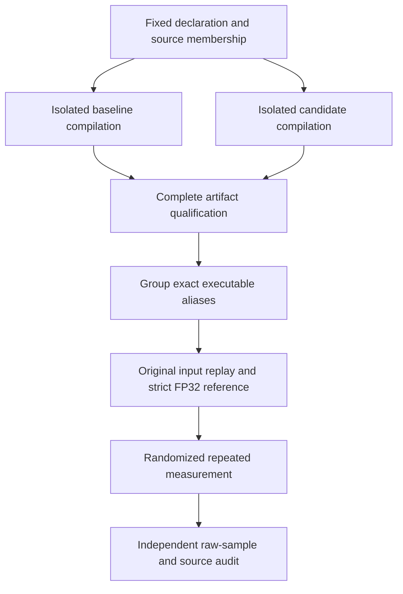

# Fixed compiler confirmation across twenty fresh model families

Kiln's singleton-reshape canonicalization improves the observed family-balanced execution ratio on twenty previously unmeasured exact model identities: 1.053746× for synchronized end-to-end execution and 1.059878× for CUDA-stream elapsed time. Every selected graph passes the declared highest-precision FP32 reference checks and all timing blocks satisfy the stability rule. The numerical result is complete, but the performance effect is uneven: nine families are faster, ten slower, and one produces an identical executable.

This report explains how a small compiler change becomes an independently attributable experiment. It follows the earlier development result in which exposing matrix coordinates reduced one attention variant from 703.734 ms to 20.4884 ms. The present population was selected after the compiler change was fixed and before its artifacts or timings were inspected. Its purpose is to test transfer beyond the motivating examples. It does not expand the official 200-task coverage ledger, and it does not establish architecture-disjoint generalization or reproduce the paper's native scoring protocol.

> [!summary]
> The complete experiment verifies forty artifacts, twenty exact models and 23,400 raw timing samples. Benefits concentrate in the reduction stratum; the matrix stratum has a small aggregate regression. Source identity, numerical policy, complete membership and executable aliases remain explicit throughout the comparison.

## 1. The compiler transformation being tested

A tensor view maps an output coordinate to an input coordinate. A general row-major reshape computes a flat index from the output coordinates and then divides and takes remainders to recover input coordinates. This is correct, but its expression can retain dependencies that are mathematically redundant. A scheduler examining those expressions can conclude that an operand depends on more loop dimensions than it actually does.

Consider a reshape from `[M, 1, K]` to `[M, K]`. The general mapping constructs `flat = i*K + k`, then obtains the first input coordinate as `flat // K` and the last as `flat % K`. On the valid coordinate domain these are simply `i` and `k`. Mapping directly to `[i, 0, k]` preserves element identity while exposing coordinate independence to later analyses.

The shared `reshapeMap` function in `packages/kiln/src/std/tensor.js` now recognizes shapes with identical ordered non-unit extents. It matches axes by position in that sequence, maps varying coordinates directly, and supplies zero for unit axes. Every other reshape retains the existing flatten/unflatten implementation.

```text
input_axes  = ordered axes whose extents are not one
output_axes = ordered axes whose extents are not one
if extents(input_axes) == extents(output_axes):
    for each input axis:
        map to zero if its extent is one
        otherwise map to the corresponding output coordinate
else:
    use general row-major flatten/unflatten
```

This changes an existing compiler primitive. It introduces no benchmark-specific pattern or new scheduling interface. The earlier legality tests cover scalar and all-unit shapes, repeated extents, general reshapes and transposed logical inputs. The earlier CUDA diagnostics also retain three native FP32 discrepancies rather than treating a mathematical index proof as sufficient evidence about floating-point execution.

## 2. Isolating the compiler source change

The control compiler uses production sources from `c15c610`; the candidate uses `fed37d1`. Each compiler has a separate checkout. Their inventories cover 86 production compilation files, and the only differing file is `packages/kiln/src/std/tensor.js`. Both receive identical importer-generated programs, the unchanged fusion policy and the same scheduling target, `a100`. The generated CUDA executes on the actual GB10 hardware; the scheduling target is a cost-model proxy, not a claim of A100 hardware equivalence.

The current execution harness is a separate identity from either production compiler. Its frozen revision is `da42245f2adae05f4bd7baf72743d51867b725dd`, with 161 common source files recorded by hash. This separation matters: attributing the experiment to a single repository revision would obscure the fact that two older production source versions are compiled and then measured by one common, newer harness.

Dependency setup initially failed with `ERR_PNPM_NO_MATCHING_VERSION` for `@pnpm/linux-x64@12.4.1`. The experiment therefore records a limited compiler bootstrap: both compilers use identical Acorn 8.19.0 bytes, with their own workspace-local package links. Their manifests and production code were not edited to make installation succeed. Sharing the active compiler's entire `node_modules` would have risked resolving control imports into candidate packages; the local links prevent that ambiguity. This bootstrap does not establish that the repository's complete package-manager installation is reproducible.

## 3. Selecting a fresh population without performance feedback

The selector scans the official 4,476-task training list. It excludes exact model identities in the 200-task evaluation population and previously selected identities from twelve complete or partial policy-study audits. An independent reconstruction yields 290 excluded exact models and zero overlap with the selected twenty. Related architectures remain eligible: different Electra or ViT model identities are not independent architecture classes.

The declaration requests ten matrix graphs and ten reduction graphs, with one selected graph per exact model and task. All twenty are marked heldout; there is no new training stage, policy ranking or winner selection. Eligibility depends on supported static FP32 metadata and declared resource limits. Whether the compiler produces a changed artifact is deliberately absent from eligibility.

The first declaration did not fill its quotas. Scanning all 4,476 tasks yielded ten matrix graphs and nine reduction graphs, leaving a preserved 19/20 failed selection. No selected source was compiled or timed at this point. The second declaration broadened the memory envelope while retaining the compiler pair, quota, salt, numerical checks and timing rules:

| Limit | Initial declaration | Final declaration |
|---|---:|---:|
| Total input elements | 2 million | 8 million |
| Elements in one tensor | 8 million | 32 million |
| Total tensor elements | 64 million | 128 million |
| Tensor nodes | 128 | 128 |
| Matrix products | 64 million | 64 million |

The broader scan fills both quotas after 2,950 tasks. Its membership hash is `cc554758196f86c52856850e4a923ed264959fab43eacc7416828a9e1207d41a`. Metadata choices can overlap the failed scan; these are one final confirmation population, not two independent experiments. The amendment is disclosed because a failed population construction is part of the experimental history even when no timing feedback has occurred.

## 4. One shared compilation and measurement path

`integrations/passnet/compiler_confirmation.py` manages the source-pair contract. Its freeze records declaration bytes, membership, generated programs, production snapshots and execution source hashes. Compilation calls the existing `compile_policy.mjs` in each checkout with unchanged fusion configuration. Qualification checks membership order, source hashes, numerical policy and executable identity. All forty artifacts qualified, and that qualification was committed at `5ee83ad` before GPU measurement.

`measure_compiler_confirmation.py` then reuses existing runtime, correctness and sampling primitives. This avoids implementing a second CUDA launcher or a competing timing definition. An independent two-graph synthetic fixture exercised the entire path before confirmation compilation. Its purpose was operational validation; its timings are excluded from the optimization result.



Executable fingerprints omit the declared nonexecuting metadata fields `name`, `source` and `compiler_policy`. The executable bodies are also checked for consistency with those fingerprints. Nineteen graph pairs differ; one aliases exactly. That alias shares a measurement group and receives a ratio of exactly one. Independently timing two identical artifacts and interpreting their noise as optimization would create a false contrast.

## 5. Numerical and timing contracts

Inputs come from the original source replay, and expected results come from the original model code. Both generated variants use separate elementary FP32 rounding. The source reference explicitly sets matrix multiplication precision to `highest` and verifies that TF32 is disabled. Output structure, dtype-aware comparison and unchanged inputs are checked, using FP32 relative tolerance `1.3e-6` and absolute tolerance `1e-5`.

This highest-FP32 source reference is an explicitly modified research protocol. It does not convert the unresolved 60/63 native fixture result into a pass, and it does not supply an official PassBench score. Native backend precision compatibility remains an independent requirement.

Each distinct executable receives three repeat blocks, each with twenty warmups and one hundred samples per metric. End-to-end timing synchronizes execution; CUDA-event timing measures stream elapsed time, including dispatch gaps. The latter is not isolated kernel instruction time. The order of distinct fingerprints is deterministically shuffled per graph and repeat with seed 42. A block must have IQR at most twenty percent of its median for both metrics; at most two retries are allowed.

Every selected graph remains in the result. Compile, source-reference, correctness or stability failures would disable the aggregate claim. None occurred. The run uses NVIDIA GB10 and PyTorch `2.12.0a0+5aff3928d8.nv26.05` in the declared NVIDIA container environment. These differ from the paper's A30 and PyTorch configuration. The container tag and runtime version are recorded; an immutable image identity was not captured for the running container.

## 6. Auditing the full result

Script `296-verify-reshape-confirmation.py` verifies the frozen source bytes against the committed execution revision, original source and trusted replay hashes, all forty artifact hashes, production differences and executable fingerprints. It reconstructs every median and IQR from raw samples, checks repeat budgets and stability, verifies alias handling and independently recomputes the geometric means.

There are 39 distinct measurement groups, 117 repeat blocks and 23,400 raw timing samples across both metrics. No additional retry was required. The audit finds no cross-graph exact executable alias, no excluded-model overlap and no retained numerical or measurement failure. Its output is `sources/reshape-confirmation-independent-audit-v2.json`.

For graph i, the reported ratio is the baseline median divided by the candidate median, where each role's median is taken across its three block medians. The population aggregate is the exponential of the mean log ratio. There is one graph per exact model, so this is also the equally weighted exact-model aggregate. Pairwise block ratios remain available for inspection. Three repeats describe this execution; they do not provide a calibrated confidence interval.

## 7. Benefits concentrate in the reduction stratum

| Population | Graphs | End-to-end ratio | Stream ratio |
|---|---:|---:|---:|
| Complete confirmation | 20 | 1.053746× | 1.059878× |
| Matrix stratum | 10 | 0.995662× | 0.995833× |
| Reduction stratum | 10 | 1.115219× | 1.128042× |

These categories were part of the selection protocol. The stratified values are descriptive analysis of that fixed population. They show that the aggregate improvement does not justify a claim that every kind of workload benefits. In particular, matrix workloads have a small aggregate regression despite the much larger matrix-related development example.

The strongest end-to-end result is the selected `timm/vit_gigantic_patch14_clip_224.laion2b` reduction: 0.0481715 ms becomes 0.033194 ms, a 1.451211× ratio. `Mahmoud8_mah-efficient_mlm_m0.40` changes from 0.0336785 to 0.024563 ms, or 1.371107×. `microsoft_table-transformer-detection` changes from 0.040757 to 0.032409 ms, or 1.257583×. These are selected subgraphs, not complete-model inference measurements.

The largest observed regression is `google_electra_base_discriminator`: 0.138504 ms becomes 0.142287 ms, a ratio of 0.973413×, corresponding to approximately 2.73 percent more elapsed time. Its three paired block ratios are 0.973413, 0.971729 and 0.974289. The repeated direction makes it a useful future scheduling diagnostic. This confirmation population is now observed, so tuning against that regression would make it development data for any later candidate.

The nine-faster/ten-slower/one-alias count is based on aggregate observed ratios, without a statistical significance threshold. Tiny changes around one should not be treated as established improvements or regressions. The larger and consistently directed effects merit more attention than the simple win count.

A post-confirmation structural inspection finds that four materially faster reduction graphs also reduce dispatch counts: giant ViT and Mahmoud8 change from four kernels to two, table-transformer from five to three, and the selected Yolos graph from four to two. The nvidia_mit-b1 reduction retains three kernels with changed schedule/layout metadata. These observations narrow the next investigation toward fusion and intermediate materialization. They do not isolate which structural change caused each timing difference. The Electra discriminator regression retains three kernels and identical recorded schedule/layout metadata, while its generated CUDA expressions differ. Script 302 preserves the full per-graph comparison without changing a candidate or timing budget.

## 8. What this establishes about compiler improvement

The source change was motivated by development observations, but it was frozen before selection of this confirmation population. Both compiler versions receive the same programs and common execution environment. Complete source and numerical controls therefore support attributing the observed aggregate difference within this population to the compiler source change, subject to ordinary measurement limits.

The experiment establishes transfer across these twenty fresh exact model identities under the declared FP32/resource envelope. It does not establish transfer to every architecture, all dtypes, the full benchmark or another GPU. The earlier 34.3479× targeted development gain and 1.064442× development aggregate describe a different population and a sequential before/after comparison; they must not be pooled with this fixed-source confirmation.

The transformation was authored during the Codex-assisted compiler work. This is evidence about improving a reusable compiler transformation, not a successful reproduction of original PassAgent or a completed autonomous transformation-synthesis system. Earlier policy-search experiments include null and alias-only outcomes; this positive result does not replace them.

## 9. Coverage and the remaining research work

Official evaluation coverage remains cumulative acceptance of 24/200 complete tasks and 313/2,060 individual graphs, with 248 graphs inside complete tasks. Import eligibility remains 1,136 graphs and 64 complete families. These counters describe different gates. The twenty confirmation graphs come from the training list and cannot be added to the official evaluation numerator. The cumulative accepted ledger also spans compiler revisions; a single uniform current-release run remains separate work.

The next compiler investigation should inspect how direct coordinate maps change fusion, intermediate layouts and chosen schedules in the beneficial and regressing cases. Semantic canonicalization is valid independently of profitability; schedule selection must make productive use of the information it exposes. Any new profitability policy needs a new fixed population for confirmation after development. The current twenty families cannot remain unseen after this report.

Original PassAgent execution still requires a configured model provider or a deliberately provisioned local model runtime. Broader operator, layout and dtype coverage, native precision compatibility, uniform full-corpus evaluation and updated reMarkable delivery remain open. Task `p4wv` can close because its fixed-source confirmation is complete; the overall reproduction and self-optimization project remains active.

## 10. Reproduction and review references

The authoritative experiment materials live under ticket `KILN-005` in `/home/manuel/code/wesen/kiln/worktrees/passnet/ttmp/2026/10/30/`. Design document 16 explains the declaration and controls; design document 15 derives the index-map legality rule. Read the preserved failed v1 scan before interpreting the final membership.

Review the following files together:

- `integrations/passnet/compiler_confirmation.py` and `measure_compiler_confirmation.py` implement the shared fixed-source protocol.
- `sources/reshape-confirmation-v2/confirmation-freeze.json` and `reshape-confirmation-artifacts-v2/pair-qualification.json` pin inputs, code and all forty artifacts.
- `sources/reshape-confirmation-measurements-v2.json` preserves every raw sample; its sibling summary preserves all graph outcomes.
- `sources/reshape-confirmation-independent-audit-v2.json` records independent full-result verification; `reshape-confirmation-report-facts-v2.json` contains the descriptive category calculations.
- Scripts 283–302 preserve selection, dependency setup, source controls, fixture validation, compilation, staging, execution, audit, report derivation and structural inspection.

To reproduce the audit without starting another GPU run, select Node 26 and execute the retained script 296 from this worktree. Re-running the experiment itself requires new output directories; the harness rejects overwriting an existing freeze, compilation directory or measurement file. Keeping those records immutable preserves the distinction between an original observation and a later reproduction.
