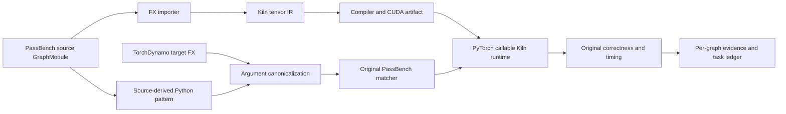

# Kiln: From Operator Coverage to PassBench Matching

Kiln's cumulative PassBench evidence now covers **53 of 200 complete tasks and 505 of 2,060 individual graphs**. The recent increase came from two connected changes: a batch of tensor operation ports, followed by correction of structural differences between source-derived FX patterns and TorchDynamo's target graphs. The strongest new result is a nine-family qualification: task107 and eight additional families passed all 69 of their graph variants at the original numerical threshold after FX argument normalization.

A PassBench task contains several graphs that share an operator pattern but differ in shapes or dtypes. Kiln's importer can translate a graph without its generated Python pass necessarily matching the graph seen by the evaluator. Likewise, a matched pass can execute and still fail numerical comparison or lose performance to eager PyTorch. These are separate conditions. The current coverage ledger counts a graph only when it compiles, executes, applies exactly one replacement, and passes PassBench's numerical check at t=-5. It counts a task only when every graph in that task's frozen graph list meets those conditions.

> [!summary]
> The operator batch made 191 of 201 previously blocked graphs importable across 23 of 24 affected families. Initial PassBench replay accepted only a small fraction because source patterns did not match TorchDynamo call forms. Explicit normalization of max-pooling, padding and hardtanh call representations then accepted nine complete families. The remaining ten import failures in that batch use in-place hardtanh on a placeholder and require mutation semantics.

## 1. The execution path and its independent gates

PassBench owns a Python FX matcher and evaluator. Kiln owns the tensor compiler and CUDA generation. The integration retains PassBench's matcher and numerical protocol while using a declared normalization layer for equivalent FX call forms.

The importer rejects unsupported semantics explicitly. The operation batch added static max pooling, padding, rolling, splitting and chunking, scalar hardtanh and clamp, integer scalar powers, trigonometric functions, reciprocal square root, static expansion and unfolding, and several dtype/device bindings. These changes use Kiln's existing tensor views, reductions and elementwise primitives. Split and chunk outputs remain views without fresh-storage ownership; an in-place operation on such an alias is rejected unless its semantics can be proved.

The max-pooling port also exposed a shared compiler error. A maximum reduction must start at negative infinity, and a padded window with no valid input may produce negative infinity. Kiln previously used the largest finite negative FP32 value as the reduction seed and replaced nonfinite emitted literals. The reduction identity and CUDA/WGSL literal emission now preserve IEEE infinities and NaNs. Seventy-eight compiled max-pooling fixtures passed exact comparison against native PyTorch CUDA on the NVIDIA GB10, spanning FP32, FP16 and BF16 and the tested special values.

Operator fixtures establish selected semantic and GPU behavior. They do not establish PassBench task support. The batch importer subsequently translated 158 of 201 historical first failures. A follow-up pass added views and direct scalar bindings, reaching 191 of 201 and 23 completely importable task families. The one remaining family contains ten in-place hardtanh calls on placeholders. The importer still rejects them because replacing a mutation with a fresh tensor would not preserve observable alias behavior.

## 2. Why importable graphs failed to match

The first complete-family replay of the initial batch accepted only three of sixteen families. Sixty-six executed graphs received the evaluator's “No passes modified the graph” error; another 69 graphs were not executed because compilation stopped earlier in their tasks. A seven-family follow-up accepted two additional complete families. These results showed that importer coverage was much broader than accepted benchmark coverage.

A source pattern is extracted from the dataset model's `forward` method and traced with `torch.fx`. The target is captured through `torch.compile`. FX matching compares call targets, positional arguments and keyword arguments as graph structure. Semantically equal Python calls can therefore differ as patterns.

Task107 supplies a concrete example. Both graphs contain the same convolution and max-pooling call targets. Source tracing records `max_pool2d(conv, 3, stride=2, padding=1, dilation=1, ceil_mode=False, return_indices=False)`. TorchDynamo records `max_pool2d(conv, 3, 2, 1, 1, ceil_mode=False, return_indices=False)`. The values agree, but three values occupy different FX fields. The wrapper for `max_pool2d` exposes only a variadic inspection signature, so the integration declares its seven public parameters explicitly. It binds both forms, applies defaults, and emits one canonical positional form.

The same diagnosis found two other differences. `hardtanh` placed its optional bounds and `inplace` flag in keywords in the pattern but positional arguments in the target. Its inspectable signature supplies the binding order. A source `torch.nn.functional.pad` call was captured as `torch._C._nn.pad` by TorchDynamo. The normalizer binds both to the same four arguments and canonicalizes the target identity to the C call. It performs validation before changing a graph, preserves literal values, and leaves a changed stride or padding mode unmatched. The implementation resides in `integrations/passnet/fx_normalize.py`, so generated passes do not each implement their own rewriting rules.

A local first-graph diagnostic moved from four to nine structural matches across nine examined no-match families. That was a prediction, not an acceptance result. A complete task107 replay then accepted all 18 variants with original score 0.24265578547986374. A separate eight-family replay accepted all 51 variants. The families had original aggregate scores of approximately 0.269 to 1.771. Several correct families scored below eager execution; matcher and correctness gains do not imply performance gains.

## 3. Reading the current coverage correctly

The cumulative ledger reports 53 complete tasks and 505 individual graphs. It combines terminal original-evaluator logs from explicitly recorded compiler snapshots under Kiln's modified FX integration protocol. It is not a claim that one frozen release has passed a uniform 200-task run, and it is not an exact reproduction of the paper's A30 hardware results. The development GPU is a GB10, with A100 scheduling-cost parameters used as a proxy. The pinned CUDA container, source snapshot hashes, full graph lists and per-graph logs remain available in the KILN-005 ticket.

The aggregate score is also separate from coverage. Task107 passed all 18 graphs but scored about 0.243 against eager. By contrast, accepted task105 scored about 4.212. A separate nine-graph linear-and-view family matched and executed every graph, but four variants missed the strict t=-5 numerical threshold even though several passed looser thresholds. The device-only forwarded output was exact; outputs derived from low-precision linear arithmetic differed. The compiler's FP32 widening, accumulation and narrowing order needs comparison with the pinned PyTorch implementation before an arithmetic change is justified. The numerical threshold was not relaxed.

The next research question is therefore more specific than “which operator is unsupported?” Some task families need compiler numerical work, some need end-to-end compiler-check diagnostics, and supported families need better scheduling and invocation performance. These findings can feed the compiler self-optimization experiment: a reusable transformation should be evaluated on held-out complete families with the same matcher, correctness curve and hardware protocol. Improvement in import count alone is insufficient evidence of a better compiler.

## 4. Reproducing and extending the result

The worktree is `/home/manuel/code/wesen/kiln/worktrees/passnet`. The KILN-005 ticket is `ttmp/2026/10/30/KILN-005--reproduce-passnet-and-evaluate-reusable-kiln-compiler-transformations`. Its `reference/28-fx-pattern-canonicalization-and-qualification-design.md` specifies the normalization contract and evidence levels. The implementation diary in `reference/24-implementation-diary-volume-2-pi-agents-and-compiler-optimization.md` records each intermediate failure, source revision, command and decision. The `scripts/` directory preserves import audits, fixture generation, GPU staging and task replay programs. The `sources/` directory retains downloaded upstream material, source hashes, generated artifacts, logs and acceptance audits.

To add a new operator, first determine its exact PyTorch signature, shapes, dtypes, alias behavior and exceptional values. Implement a static semantic contract and Kiln lowering, then compare representative CPU oracles, compiled CUDA fixtures and complete corpus imports. If an importable task still fails matching, capture the source pattern and target FX before changing the normalizer. If it matches but fails numerical comparison, compare intermediate arithmetic under the pinned environment at the existing threshold. Only a terminal complete-family replay should change the coverage ledger.

The immediate next measurement is a uniform rerun of the newly supported families from one compiler revision, followed by a broader corpus run as resource limits allow. The most valuable remaining engineering work is precise diagnosis of low-precision linear and convolution failures, compiler end-to-end check failures, and the placeholder mutation contract. Those are now the constraints on reaching substantially beyond the current 53 complete tasks.
