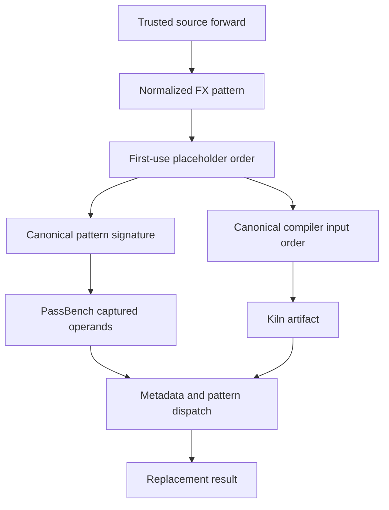

# Kiln: Matrix Semantics, Canonical Operand Bindings and Numerical Acceptance

This milestone extends Kiln's matrix semantics and demonstrates why compiler integration requires explicit contracts for argument binding, mutation and numerical acceptance. The independent matrix fixtures pass 126 CUDA comparisons. The original residual task now passes all 30 variants after correcting two matcher defects. A separate audit corrects an earlier reporting mistake: the previous coverage check used a relaxed point on PassBench's numerical tolerance curve. The current coverage ledger uses the nominal strict point and distinguishes individual passing graphs from complete tasks.

The implementation checkpoint is `ce01a6a` on `research/passnet`, following the initial matrix implementation in `fae626d`. The worktree is `/home/manuel/code/wesen/kiln/worktrees/passnet`. Ticket KILN-005 contains the design documents, chronological investigation diary, source provenance, intermediate scripts and raw evaluation logs. This article explains the contracts that those artifacts establish and the limitations that remain.

## 1. A task has several distinct completion conditions

A PassBench task groups related computational graphs whose shapes, dtypes and literal attributes may differ. Importing one graph establishes that its source operations can be represented in Kiln. Compiling it establishes that the selected compiler pipeline can produce an executable. Neither step establishes that PassBench matches the intended subgraph or that the replacement returns acceptable values.

The integration therefore needs separate predicates. Let I(g) mean successful import, C(g) successful compilation, M(g) exactly one intended replacement, and N(g,t) numerical acceptance at tolerance point t. Complete task acceptance requires successful execution and the appropriate conjunction for every declared member. A task with two passing variants out of four remains incomplete even when all four import and compile.

| Evidence at this checkpoint | Count | Interpretation |
|---|---:|---|
| Evaluation population | 200 tasks / 2,060 graphs | Fixed external denominator |
| Faithfully importable graphs | 984 | Translation eligibility only |
| Families with every graph importable | 43 | Candidates for complete-task evaluation |
| Completely verified tasks at t=-5 | 6 | Modified integration protocol |
| Graphs within those complete tasks | 76 | All variants of the six tasks |
| Individually verified graphs at t=-5 | 78 | Includes two variants of an incomplete linear task |

These counts explain the apparent discrepancy between earlier large coverage numbers and the small number of verified tasks. They measure different stages. A temporary decrease from six complete tasks to five also occurred while the residual matcher was being corrected. The completed rerun restores that task; the failed intermediate evidence remains in the ticket.

## 2. Define matrix semantics independently of scheduling

The new `packages/kiln/src/std/matmul.js` centralizes static shape validation, reference evaluation and tensor-IR lowering. The previous implementation assumed a narrower batching arrangement. The shared module supports vector/vector, vector/matrix, matrix/vector and matrix/matrix products, plus right-aligned broadcasting of batch dimensions from both operands.

For shapes A=[...,M,K] and B=[...,K,N], contraction requires equal K. Each aligned batch dimension must be equal or one. Vector operands are temporarily promoted to matrices: a left vector becomes [1,K], and a right vector becomes [K,1]. The corresponding unit result axes are removed afterward. A vector dot product therefore has scalar shape [], which the compiler artifact and Python runtime must preserve.

The lowering constructs a logical work domain [batch...,M,K,N]. Indexed views broadcast both operands into that domain, elementwise multiplication forms products, and a sum over K contracts them. The final view removes reduction and vector-promotion axes. These are logical views and tensor operations; the downstream loop and kernel pipelines determine whether the implementation materializes intermediates and how it schedules the reduction.

```text
validate positive static operand shapes
promote vector operands
broadcast the two batch prefixes
construct indexed operand views over [batch..., M, K, N]
multiply and reduce over K
remove promoted vector axes
```

`linearSpec` and `lowerLinear` implement the related operation XWᵀ, with a trailing contraction dimension and vector or matrix weights. Bias belongs to the frontend's compound linear semantics and is applied before the final output storage conversion. Keeping shape rules and reference evaluation together makes it possible to test the decomposition against independent, hand-computed examples.

The Python importer module `fx_linalg.py` binds concrete PyTorch linear, matmul, mm and bmm calls. The narrower APIs retain their narrower requirements: mm requires matrices, and bmm requires rank-three operands with equal batch sizes. Unsupported output mutation is rejected explicitly. The importer also compares the resulting shape with exported PyTorch metadata, preventing a plausible but incorrect broadcasting rule from passing unnoticed.

## 3. Arithmetic dtype and storage dtype have different roles

Kiln's matrix arithmetic path currently uses FP32. For FP16 and BF16 source operands, the importer inserts widening conversions, performs multiplication, contraction and linear bias in FP32, then narrows at the source operation boundary. This makes the arithmetic policy explicit rather than allowing low-precision storage to imply a reduction implementation accidentally.

The distinction matters because PyTorch's native matrix implementation may use a different accumulation algorithm. In the current NVIDIA image, reduced-precision BF16 reduction is enabled by default. Two implementations of the same mathematical contraction can therefore differ within the original benchmark's strict tolerance even when the compiler implementation is closer to a higher-precision oracle.

The independent fixture set covers 14 forms across FP32, FP16 and BF16, with seeds 1, 7 and 42: 126 comparisons in total. Cases include scalar outputs, vector promotion, two-sided broadcasting, transpose, odd contraction size 129 and linear bias. All pass the declared CUDA comparison gate, with maximum observed absolute error 7.62939453125e-6. All 26 Node test files passed at the matrix boundary, and the later complete Python integration suite passes 62 tests.

Those fixtures do not establish full benchmark support. The real four-variant linear task provides the counterexample: all variants compile, but only two pass the nominal t=-5 check. The other two pass at t=-4, -3 and 1. The complete task therefore remains unaccepted.

For the first BF16 variant, a separate diagnostic compares the compiled result with native PyTorch, explicit FP32 accumulation and explicit FP64 accumulation. Under that diagnostic's tolerance, Kiln has zero non-close values against both widened references. Native default execution disagrees with Kiln at 3,175 output positions. Disabling native BF16 reduced-precision reduction also removes non-close disagreement with Kiln. The diagnostic restores the option afterward, and the original evaluation runs in a separate process with its normal settings.

This evidence identifies one native precision difference. It does not justify changing the benchmark's acceptance criterion, attributing every remaining failure to the same cause, or claiming numerical equivalence across implementations. Original replay failures remain visible.

## 4. Preserve mutation before reasoning about ownership

Ordinary PyTorch FX tracing can lose the distinction between Python `+=` and ordinary addition when Proxy falls back to a non-mutating operator. That loss is dangerous at the import boundary. A source program that mutates an input has effects beyond its returned value; replacing it with a fresh output changes observable storage semantics.

`fx_trace.py` introduces a mutation-aware Proxy and tracer that preserve explicit in-place operator identities. The importer can then make a conservative decision. In-place addition, subtraction, multiplication or division can be functionalized when the target is known to be freshly produced and has exactly one graph use. A placeholder is caller-owned storage and fails that ownership proof. A view or additional observer also prevents the simple proof.

This change reduced the intermediate import count from 1,006 graphs and 47 complete families to 984 graphs and 43 families. The 22 retracted graphs belonged to previously unverified families. Their earlier apparent eligibility depended on lost mutation information; retaining that count would have overstated semantic support.

General writeback and alias-aware effects remain necessary for the full workload population. The current ownership rule is a deliberately bounded implementation with an explicit rejection path. The raw source and more faithful audit preserve the evidence needed to implement those effects later.

## 5. Canonical operand roles must govern both matching and compilation

Source-derived pattern generation removes the need to hand-author a matcher for every task. `generate_pass.py` extracts the trusted `GraphModule.forward` body, validates its signature and output structure, traces a normalized FX pattern, and records source hashes. A captured pattern identity distinguishes computations with equal tensor metadata but different literal attributes.

An additional binding problem appears when equivalent patterns use different source argument positions. Consider these two expressions:

```python
first(x, y, z) = (x + y) + z
second(x, y, z) = (y + z) + x
```

They have the same operation pattern under placeholder renaming. A matcher can legitimately bind the second graph's y to the first pattern's first operand. A compiled program dispatched using the original positional signature, however, may interpret that captured operand as x. Shape and dtype validation cannot detect the error when all operands have identical metadata.

Floating-point nonassociativity makes the error observable. For FP16 values x=2048, y=-2048 and z=0.5, the two associations can return 0.5 and zero. Algebraic commutativity does not permit the integration to discard source operand roles or operation boundaries.

The generator now canonicalizes placeholders by their first use in normalized FX operations. It applies the resulting permutation to the extracted pattern signature and to the source graph before compiler import. Each manifest record stores `source_input_order`, mapping canonical positions to original source positions. Random-input checking applies the inverse mapping before calling the trusted source model; original replay applies the forward mapping before launching Kiln.



Canonicalization changes argument binding only. It does not reorder arithmetic. A regression test uses the FP16 counterexample and verifies both source signatures through the same dispatch specialization.

## 6. Specialization priority is a separate matcher requirement

After canonical binding was corrected, a second failure remained in the 30-variant residual task. A generic pattern with three tensor placeholders matched a source whose last operand was literal zero. Its replacement received an integer and attempted tensor metadata access, producing `AttributeError: 'int' object has no attribute 'shape'`.

The generated rule list now puts patterns with fewer tensor arguments first. For this family, concrete one- and two-argument literal specializations therefore precede the general three-argument pattern. The original failed run is preserved, and the completed rerun passes all 30 variants at t=-5 with exactly one replacement each. This validates the concrete generated family; it does not establish that argument count is a complete ordering for every possible pattern language. More complex overlapping patterns may require an explicit structural specificity relation.

The stable replacement callable invokes compiled Kiln artifacts only. Pattern extraction does not delegate computation to the trusted source implementation. The existing integration retains the declared normalized-FX, stream-recording, in-place autowrap and multi-output protocol changes; the original PassNet checkout remains pinned and unchanged.

## 7. Correct the numerical audit explicitly

The earlier coverage ledger called the upstream checker with t=1 and treated that as acceptance. That was a reporting mistake: t=1 is a relaxed diagnostic point. The ledger now uses t=-5 as the nominal strict point and retains the relaxed decision in a separately named field. Historical reports remain intact; this article and the current guide provide the correction.

The same issue affects interpretation of the completed TorchInductor reference logs. Re-auditing those identical logs at four points gives:

| Tolerance point | Accepted graphs | Complete tasks |
|---|---:|---:|
| -5 | 1,748 | 140 |
| -4 | 1,855 | 157 |
| -3 | 1,962 | 172 |
| 1 | 2,039 | 191 |

These are four numerical interpretations of one execution record. They are not independent trials or evidence that the compiler changed. The original benchmark's aggregate score integrates its declared tolerance curve and remains a separate metric from the task count at one point.

The hardware and software also differ from the paper. The paper reports an A30 environment; this work runs on DGX Spark GB10 with the recorded NVIDIA PyTorch alpha image and uses the documented A100 scheduling proxy. Historical reference timing overlap and pauses further limit performance interpretation. The result is an exploratory integration and numerical audit, not a completed paper reproduction.

## 8. Consolidate measurement before expanding optimization search

`evaluate_tasks.py` now owns the shared sequence: export, source-pattern generation, compilation, original evaluation and original scoring. It records phase commands, exit codes, elapsed time and logs. It verifies graph-list hashes before starting and hashes compiler, runtime and integration sources before and after every phase. A source change stops the run rather than silently mixing implementations.

`summarize_task_run.py` audits acceptance independently. It checks exact task membership and graph order, detects duplicate observations, requires successful execution and exactly one replacement, and evaluates the original numerical curve. Missing or failed graphs remain in the denominator. The runner calls a completed process `process_complete`; that label carries no correctness claim.

The next cohort is selected mechanically from the saved import audits: every family newly fully importable after matrix lowering and faithful mutation tracing, relative to the activation milestone. It contains 14 tasks and 151 variants, including the incomplete linear task. Membership does not depend on this cohort's timings or correctness results. At this report's initial checkpoint, execution is in progress; cohort membership is not added to verified coverage.

The first completed scoring phase also exposed an upstream filename requirement: the scorer expects a curve named `validation`, while the new runner supplied `benchmark.log`, producing `KeyError: 'validation'`. Evaluation evidence is preserved. Scoring recovery must copy the exact log bytes under the required name and invoke the original scorer; it must not rerun successful GPU measurements merely to repair this naming error.

## 9. Implications for reusable compiler optimization

Three earlier fusion-policy studies have already exercised training selection and confirmation. The scalar pilot reported a narrow positive result: approximately 1.0186 times family-balanced held-out end-to-end performance, with only one changed held-out executable. Two subsequent conditional-policy studies selected unchanged Kiln. Those results support the experimental machinery but provide limited evidence for broad compiler improvement.

The matrix extension broadens the computations available to future intervention. It also shows why optimization search must operate after semantic and measurement contracts are established. An agent can otherwise receive reward for changed operand association, lost mutation, relaxed numerical checks or a mismatched callable rather than a profitable legal transformation.

The next useful search should expose additional legal transformations or scheduling decisions and confirm that candidates reach different executable implementations. Training-only generation, frozen selection, explicit compilation costs and untouched confirmation measurements remain required. Original PassAgent comparison, controlled full-corpus baselines, remaining operator support, general layouts and mutation effects are still open. The goal remains a reproducible comparison between specialized replacement generation and reusable improvements to Kiln's compiler.

## Implementation and evidence references

The primary implementation files are `packages/kiln/src/std/matmul.js` and `integrations/passnet/{fx_linalg.py,fx_trace.py,generate_pass.py,corpus.py,evaluate_tasks.py,summarize_task_run.py}`. Design 08 explains matrix and binding contracts; diary Steps 87–90 preserve the investigation. The canonical residual logs, `linalg-cuda.json`, `linear-precision-diagnostic.json`, `reference-numerical-threshold-audit.json` and `kiln-coverage.json` supply the measured evidence.

PyTorch documentation and native source snapshots are archived under `sources/pytorch/linalg` with URL, size and SHA256 provenance. The Kiln shape/reference/lowering implementation was written independently; no native PyTorch matrix algorithm was copied. Generated matcher bodies are extracted from the pinned PassNet dataset's trusted source models and record their source hashes. The upstream PassNet revision is `61c64709f6d324216ae8252cec3cdc35b2dd5da5`, and the dataset revision is `4f7dd9211178327c2718f1b828d83ea126186f9e`.
