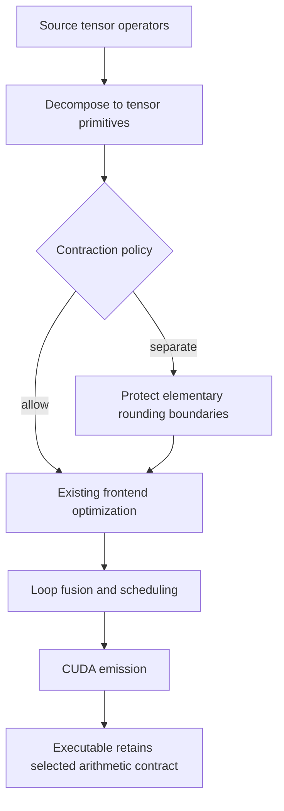

# Kiln: Numerical Contracts, Correctness Gates, and Eleven Complete Tasks

Kiln's PassNet integration now verifies eleven complete benchmark tasks and 206 individual graph variants. The latest qualification run covers 63 variants from four previously compile-blocked families. Every variant compiles, reaches the original evaluator and receives an original score. Sixty-two pass nominal numerical acceptance; three families pass every member. The remaining BF16 failure is retained.

The enabling change is an explicit contract for elementary floating-point operations. Kiln can now preserve separate FP32 rounding through its own optimization passes and through CUDA compilation. This article explains why that contract was needed, how it is represented, what the measurements establish, and why the next self-optimization experiment needs a richer workload population.

## 1. A numerical contract connects compiler levels

A source expression, an intermediate representation and an executable can compute the same real-valued formula while producing different floating-point values. Each level must specify where values round, which operations may fuse and which storage conversions remain observable. Without those rules, a correctness checker can disagree with a valid executable or accept an implementation under a different arithmetic model.

Kiln initially exposed both problems. The frontend evaluates tensor operations through Float32Array storage, which rounds intermediate values to FP32. The fused loop reference used JavaScript numbers and retained double precision between scheduled operations. Independently, the frontend optimization pass contracts multiplication followed by addition into FMA. That contraction removes an intermediate rounding boundary.

These are different mechanisms. Correcting the reference evaluator does not make FMA identical to separate operations. Removing an explicit FMA rewrite also does not prevent the CUDA compiler from contracting ordinary arithmetic. A usable contract must cover both the intermediate representation and emitted code.

## 2. Establish exact oracles before changing tolerances

The first oracle uses one FP32 input with value 100000000 and computes `(x+1)-100000000`. At this magnitude, adding one does not change the rounded FP32 value. The frontend therefore returns zero. The old fused JavaScript reference retains the unit increment and returns one. An actual CUDA execution returns zero.

This example identifies a reference implementation defect without requiring statistical measurement or a tolerance decision. Both full serial evaluation and sampled point evaluation now round scalar results and reduction accumulator updates to FP32. Literal operands are rounded when evaluated and before constant folding. Their stored spelling remains unchanged, avoiding unnecessary changes to emitted kernel identities.

The second oracle distinguishes FMA from separate arithmetic. Let a=1+2^-23, b=1-2^-23 and c=-1. Both multiplicands are representable in FP32. Their exact product is 1-2^-46. Separate multiplication rounds that product to one, after which addition returns zero. FMA preserves the small difference until its single final rounding and returns -2^-46.

The result remains observable after conversion to BF16, whose exponent range includes that value. On the GB10 GPU, allowed contraction returns exactly -1.4210854715202004e-14 and separate rounding returns exactly zero. Native PyTorch's separate elementwise operations return zero. Both compiler modes therefore match their distinct exact expectations. This is a semantic test, not a claim that either policy reproduces every opaque native library operator.

## 3. Carry separate rounding in scalar IR

The standard pipeline now accepts two contraction policies. `allow` preserves existing behavior and remains the default. `separate` preserves distinct FP32 boundaries for elementary addition, subtraction and multiplication.

The optional pass runs after decomposition and before frontend optimization. It changes ordinary scalar function names to protected counterparts: add_rn, sub_rn and mul_rn. Canonical aliases such as subtract and multiply map to the same protected operations. The existing FMA contraction rule matches ordinary add/mul, so it cannot contract these protected functions.



The protected functions use round-to-nearest CUDA intrinsics. NVIDIA documents these operations as retaining their individual boundary rather than being merged into multiply-add. Their JavaScript definitions round both operands and results, including use during constant folding. The implementation keeps runtime compiler flags unchanged. [NVIDIA CUDA Math API](https://docs.nvidia.com/cuda/archive/13.1.1/cuda-math-api/cuda_math_api/group__CUDA__MATH__INTRINSIC__SINGLE.html)

Protected function names participate in existing expression and kernel identities. The executable carries its requirement directly; no hidden launcher configuration or additional cache discriminator is necessary. Explicit source FMA remains explicit. The policy prevents implicit contraction of the protected elementary sequence rather than redefining a deliberately fused source operation.

```javascript
const compiler = std.emmy.pipeline({
  target,
  contraction: "separate"
});
```

The same option is available through the export CLI and complete-task runner:

```bash
node scripts/kiln-export.mjs \
  --script graph.kiln.js --target a100 \
  --contraction separate --out graph.json
```

An explicit export option requires the standard pipeline and rejects a conflicting custom project pipeline. Source provenance records the selected option alongside the program hash. Metadata alone is not considered a new executable; actual code and expression identities determine whether two candidates can share timing evidence.

## 4. Backend support must include the promised semantics

The current protected-operation implementation targets CUDA. No equivalent guarantee is implemented in the WGSL emitter. A protected kernel therefore has no WGSL source and reports a specific unavailable reason. Direct WGSL emission rejects it as well. A regression checks this behavior using FP32 storage, separating the arithmetic requirement from pre-existing low-precision storage restrictions.

This boundary also affects optimization opportunities. A matrix materializer that recognizes ordinary multiplication may not accept a protected product, and fused accumulation may violate separate rounding. Performance must be measured after the contract is fixed. A faster contraction is a valid replacement only when source permissions or semantic facts justify the change.

The mode does not specify every numerical property of an opaque source operator. Native matrix routines can use different accumulation algorithms; normalization can choose a different widened expression; transcendental implementations and parallel reduction order can differ. Separate elementary rounding is a bounded guarantee, not a claim of universal bitwise agreement.

## 5. Keep synthetic validation domains and allocation order correct

Earlier compiler stops also exposed a validation-domain problem. Inference batch normalization requires a valid running-variance domain, while the default synthetic sampler includes negative values. The shared source-domain helper now follows established variance inputs through supported views and casts and supplies positive values for compiler reference checks. Runtime replay inputs remain unchanged.

The first implementation sampled every input before configuring variance. That introduced a memory regression: a graph with shape [512,256,56,56] allocated more than 411 million elements before the ordinary reference-evaluation cost guard could skip expensive work. The node process aborted after roughly 2.4 GB of heap use.

`Project.inputsFor` now accepts an explicit list of input names. Variance setup samples only the small channel vectors, preserving the existing deterministic values and dtype rounding. Other inputs are generated only if the normal reference check runs. The exact previously aborting variant compiles after this allocation-order repair. The work estimate still skips its expensive reference evaluation through the existing policy; no new no-check option or memory-limit increase is used.

These changes illustrate three distinct validation concerns: legal synthetic domains, bounded resource use and a consistent arithmetic model. Treating all three as a generic correctness failure would make diagnosis and experimental interpretation unreliable.

## 6. Qualify the complete declared cohort

The development cohort contains every member of four families that previously stopped during compilation: task indices 51,60,82 and 182, totaling 63 graph variants. Membership was frozen before this run. The workload had already been observed during debugging, so the result is development qualification rather than untouched held-out evidence.

The run uses the shared export, source-pattern generation, compilation, original evaluation and original scoring sequence. Each task retains its complete graph list. Nominal acceptance requires successful execution, exactly one replacement and the upstream checker at t=-5. Original score computation separately uses its complete tolerance curve with p=0 and fpdb=0.1.

| Task index | Graph variants | Nominally accepted | Complete task | Original aggregate score |
|---|---:|---:|---|---:|
| 51 | 4 | 4 | Yes | 0.8761 |
| 60 | 44 | 44 | Yes | 0.8872 |
| 82 | 6 | 5 | No | 0.7079 |
| 182 | 9 | 9 | Yes | 1.9642 |

All 63 compile and reach evaluation/scoring. The single unaccepted case is a BF16 RepViT graph. It passes relaxed curve points but fails nominal t=-5. That failure remains in the ledger and the task remains incomplete.

The aggregate scores answer a different question from nominal acceptance. They combine speed and the benchmark's numerical curve. A score below one can accompany complete nominal correctness, and the CoAtNet family's score near 1.96 does not establish an improvement relative to unchanged Kiln. This run establishes support and an external score; it does not provide a controlled allow-versus-separate compiler-speed comparison.

## 7. Interpret cumulative coverage with its provenance

The latest run contributes 57 newly accepted variants after accounting for five previously passing RepViT variants. Cumulative coverage becomes eleven complete tasks and 206 individually passing graphs. The complete tasks contain 141 graphs; the remaining accepted variants belong to partial tasks.

| Measure | Current evidence |
|---|---:|
| External evaluation population | 200 tasks / 2,060 graphs |
| Importable graphs | 984 |
| Families with every member importable | 43 |
| Completely verified tasks | 11 |
| Graphs within complete tasks | 141 |
| Individually verified graphs including partial tasks | 206 |

The ledger is cumulative development evidence across recorded compiler snapshots. It is not a uniform release test of all workloads through one compiler version. Each task records the active protocol extensions, and cohort records include the numerical policy and source snapshot. A later release evaluation needs one declared compiler configuration and complete accounting across the external denominator.

This distinction also preserves the earlier numerical-audit correction. Historical tolerance-one counts were relaxed diagnostics and must not be presented as nominal correctness. Current counts use t=-5. The original PassNet checkout remains pinned, while the Kiln integration retains its declared matching, stream-recording and tuple-output adaptations.

The platform remains different from the paper: DGX Spark GB10 and the recorded NVIDIA PyTorch alpha image, with an A100 scheduling proxy. These measurements are useful integration evidence but do not complete the original A30 reproduction.

## 8. Verify the measured sources, including deviations

The run snapshots compiler, integration and runtime sources at phase boundaries. A stronger post-run audit compares that snapshot with implementation commit a620e6e. Eighty-five of 89 files match. Four differences are archived byte-for-byte: two inactive diagnostic scripts and an older runtime/test copy.

The launcher differences are an unrelated WebGPU availability guard and documentation. AST comparison confirms that CUDA execution and shared runtime helper code match the declared revision after excluding that WebGPU class and docstrings. The measured state is therefore reconstructible as the commit plus explicit archived overrides. It is not described as a clean checkout.

Future runs are aligned to the committed runtime, and the two old diagnostic files are reversibly archived outside the active integration directory. The initial failed revision audit is preserved alongside the corrected provenance record. This prevents a receipt from asserting stronger revision purity than the executed environment actually had.

## 9. Broaden the optimization population before adding more policies

The numerical work also prompted a structural audit of the previous twelve training graphs. Under the new fixed separate-rounding policy, default fusion produces fourteen kernels. Those graphs contain no reductions, no multi-consumer kernels and no exact duplicate internal kernels. Disabling fusion produces ninety kernels but still none of those structures.

The audit uses prior training graphs only; it does not inspect new confirmation measurements. It provides a concrete explanation for limited headroom in the recent policy studies. Selective fusion requires fanout, duplicate elimination requires duplicate computations and reduction scheduling requires reductions. Adding those transformations to this population would not demonstrate their value.

The next reusable optimization study must select a richer official-training-source population before timing. Its eligibility rules should require matrix or reduction structure, bound resource use, separate exact models between training and confirmation, and retain failures after selection. The numerical contract must remain fixed across baseline and candidates. Candidate implementations must actually change training executables before a performance claim is considered.

This extends the existing training-selection/confirmation framework rather than replacing it. The earlier scalar pilot reported a narrow positive result and two conditional-policy studies selected unchanged Kiln. Those results remain valid within their recorded scope. They do not establish broad transformation synthesis or replace the still-pending original PassAgent comparison.

## Implementation and evidence

The numerical feature is implemented in std/fns.js, std/tensor.js, std/emmy.js and std/emit.js, with shared compiler/CLI propagation. Design 09 explains its semantics and API. All 28 core test files and 65 Python integration tests pass at the feature boundary. The exact CUDA receipt, full 63-variant audit and source reconstruction checks are bound in contraction-verified-facts.json.

The implementation is independent. Primary NVIDIA documentation and pinned PyTorch v2.9.1 normalization sources are archived with URLs, sizes and SHA256 provenance; no native normalization algorithm was copied. Ticket scripts 152–162 preserve acquisition, validation, measurement, structural analysis and source auditing. The intern guide and detailed diary explain the remaining full-corpus, agent and compiler requirements. The project remains active.
