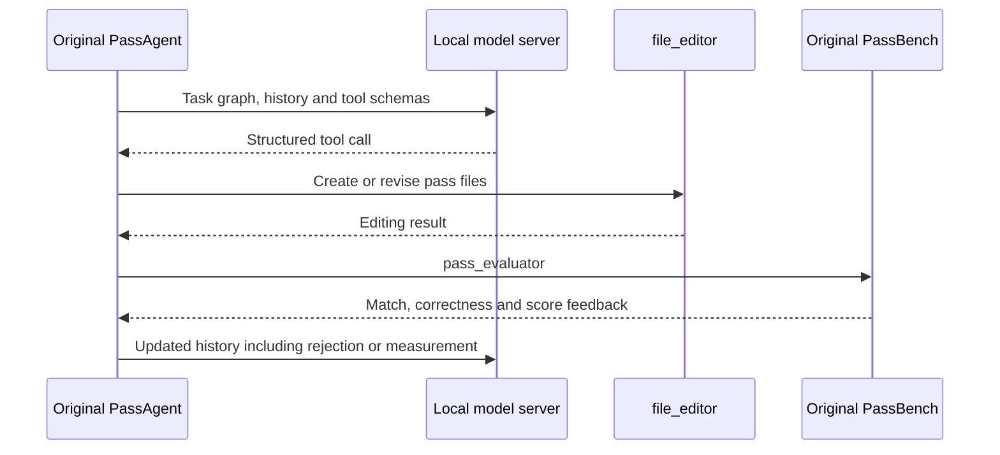

# Original PassAgent execution and experimental identity

The original PassAgent now runs against a local, unquantized Qwen3-30B-A3B model on the DGX Spark. It has installed its editing and evaluation tools, read a real task, and received feedback from the original PassBench evaluator. The first observed evaluation rejects the proposed pass because no pattern matches; its reported penalty score is 0.1. The agent continues from that feedback. This establishes an operational optimization loop, while the terminal trajectory and any successful optimization remain separate results.

This report explains how that loop works and which experimental identities must be preserved before its results can be compared with Kiln. The distinction is necessary because compiler correctness, model behavior, task membership and measurement conditions can each change independently. The current setup preserves original agent and evaluator source, but uses different hardware, runtime versions and serving software from the paper. It is a declared local reference experiment.

> [!summary]
> The local provider passes real chat and structured function-call probes. The original agent reaches its evaluator and receives a genuine rejection. The official evaluation population remains 200 tasks and 2060 graphs. Kiln's accepted replay remains 27 complete tasks and 338 individual graphs; running a reference agent does not add compiler support.

## 1. Define the object being optimized

A compiler pass has a matching component and a replacement component. The matcher identifies a computation within a program; the replacement supplies an implementation that preserves the required outputs. A task groups related graphs so that a pass can be tested across different shapes, input types or other variants. An individual graph is one concrete member of that task. A pass that works on one graph has not thereby passed the complete task.

PassAgent writes Python pass modules for PyTorch FX, the graph representation used by the reference framework. PassBench applies those modules, checks whether a replacement actually occurred, verifies numerical results and measures performance. The generated implementation may use Triton or CUDA. Kiln's longer-term experiment instead changes reusable transformations inside its own compiler and evaluates the resulting generated implementations. These are different optimization objects, even when they use the same workload population.

The first observed rejection illustrates the distinction between a working agent and a working pass. The model reached the editor and evaluator successfully. PassBench then raised `RuntimeError: [PassMgrBackend] No passes modified the graph.` The optimization candidate failed a legitimate semantic integration gate. Replacing that rejection with a successful infrastructure status would remove information the agent needs and invalidate the result.

## 2. Follow one complete feedback cycle

The running example is the shipped CrossViT task at `samples/fusible_subgraphs/crossvit_15_dagger_240.in1k/crossvit_15_dagger_240.in1k_0_start14_end16_4`. It is an operational smoke task containing one graph. Its generated-pass directory begins empty. The task is separate from the complete official evaluation manifest.

The host controller runs the original `pass_agent/examples/run_pass_agent_demo.py`. That script selects PassNet's Docker runtime, reads the original prompts and configures the original PassAgent. The runtime starts a fresh evaluator container, installs the file editing and evaluation commands, and supplies the task's graph information. Model requests originate from the host controller; compilation and benchmark execution occur in the task container.



A tool call is structured model output naming a function and its arguments. The API probe validates that the server can produce a `file_editor` call with parseable JSON arguments. The full agent then supplies the original tool schemas and interprets actual responses. The probe alone cannot establish that editing files or executing a benchmark works; the subsequent original evaluator call supplies that evidence.

The observed evaluator output includes:

```text
RuntimeError: [PassMgrBackend] No passes modified the graph.
Has Any pass matched? [False]
Pass testing early exits on pass mismatch.
aggregated_speedup=0.10000000000000002
FAIL: Pass did not match any pattern
```

The score is the benchmark's configured failure contribution. It is not a measured speedup for a correct implementation. The agent receives this output and continues with fewer steps remaining. No human correction of the proposed pass is inserted into this reference trajectory.

## 3. Preserve task membership independently of filenames

The shipped file named `passbench_demo_dataset_200.jsonl` contains 200 task rows, but each row refers to a one-graph task. Its total is 200 graphs. The official `hf_fusible_eval_samples_v2.txt` list contains 200 tasks with 2060 graphs. Directory-name overlap between the two populations is zero. That observation establishes different record membership; it does not prove that the operator patterns or source models are unrelated.

| Population | Tasks | Graphs | Purpose |
|---|---:|---:|---|
| Shipped200-row demo | 200 | 200 | Original example population |
| Shipping CrossViT smoke | 1 | 1 | Operational tool-loop check |
| Official evaluation v2 | 200 | 2060 | Full evaluation accounting |
| Current cumulative accepted Kiln replay | 27 complete | 338 individual | Previously recorded compiler acceptance |
| Current Kiln import eligibility | 69 complete | 1196 individual | Translation capability before execution qualification |

The 338 accepted individual graphs include graphs from incomplete tasks. Complete accepted tasks contain 273 graphs. Acceptance is cumulative across recorded compiler versions, so these counts are not a uniform current-release remeasurement. Import eligibility means the graph can be represented and compiled far enough to enter later checks; it does not establish original evaluator correctness.

The derived original-agent manifest preserves every official task in original order and retains all 2060 graph identities. It introduces no filtering by Kiln support, shape, dtype or expected runtime. A separate manifest revision changes only the Docker image name after correcting execution configuration. The graph lists and full membership remain unchanged.

This population accounting supports the actual research objective. Complete 200-task compiler support remains open. A restricted supported subset can be useful for development, but its denominator must remain explicit. The original-agent smoke is an intermediate integration result and cannot replace the official evaluation population.

## 4. Pin the model and distinguish storage from inference behavior

The selected local model is `Qwen/Qwen3-30B-A3B` at revision `ad44e777bcd18fa416d9da3bd8f70d33ebb85d39`. Sixteen original safetensor shards occupy 61066575648 bytes. Including tokenizer, configuration and license files, the frozen download contains 25 files and 61084185821 bytes. Published content identities are verified before conversion; bulk weights remain in the DGX's ticket `sources/` directory, while receipts and hashes are retained in Git.

The serving artifact is produced with the pinned llama.cpp converter and `--outtype bf16`. Its 61095803040 bytes have SHA256 `f921b42e9b6191c3ffad54532df61e57fb1477aefdb12f5a4eb496ac8828e8ad`. Inspection finds 579 tensors: 338 stored as BF16 and 241 as F32, with 30532122624 elements in total. No quantized tensor type is present. The F32 auxiliary tensors are part of the converter's output policy.

Unquantized storage does not prove identical generation across serving systems. Matrix arithmetic, reduction order, kernels, tokenization, chat templates and generation settings can affect model outputs. The local server therefore records its source revision, binary hash, model hash, template selection, context, thinking mode and device placement separately.

The server uses context 40960, one request slot, all layers on GPU and explicit thinking enabled. It binds only `127.0.0.1:8041`. The original model template is retained. The API probe succeeds for both ordinary chat and an actual structured file operation. The server warns that an object-valued `tool_choice` is interpreted using its default behavior; the successful response proves tool generation, while strict forced-choice enforcement remains unverified.

The paper's student-training appendix explicitly names `Qwen3-30B-A3B-Thinking-2507`, a later checkpoint. The local generic checkpoint must not be equated with that student-training configuration. Likewise, the 262144-token training context does not become the native context of this local model. The unchanged original example runner passes a 131072 max-token setting, which is recorded alongside the 40960 serving context rather than used to claim a larger supported context.

## 5. Keep controller, converter and evaluator dependencies separate

The host controller needs R2E-Gym, LiteLLM, Docker client libraries and the original agent code. The converter needs the pinned model-conversion dependencies. The evaluator needs CUDA, PyTorch, Triton and PassBench. Installing all three dependency sets into one Python environment would introduce constraints unrelated to the component under investigation.

R2E-Gym is pinned at `0d94c4eb9431cd195c55a7ea3abd54006c9a1735`. Its committed `uv.lock` is exported with artifact hashes enforced. This fixes versions such as LiteLLM 1.65.4.post1 rather than silently selecting current releases from unbounded requirements. The initial unconstrained installer is explicitly superseded before any agent inference. The source pin is a reproducible dependency selection; it is not evidence of the authors' historical installation.

The converter uses its own environment and the pinned llama.cpp source at `0ec4027a2a0183de87c007069adddc06e665f7de`. The CUDA server is built from that source inside the existing NVIDIA runtime, targeting the Spark GPU. Its binary SHA256 is `120e0aa1ff814a42027669f3bc9cb3df03e1d797796c91c129f144a1db95fd57`.

The task container uses Torch 2.12.0a0+5aff3928d8.nv26.05 and Triton 3.7.0. These differ from the paper's reported Torch 2.9.1 and Triton 3.5.1. The local experiment keeps original evaluator code while declaring this software difference. The warmup policy also follows the checked-out repository rather than silently assuming the paper and README agree.

The controller's first import probe failed because the original source uses both checkout-root and pass_agent-root absolute imports. Supplying both paths resolves the failure without modifying upstream code. The LiteLLM import also fetches public model price/context metadata; this runtime behavior is recorded in the import receipt and is another reason source version alone is insufficient to describe every external input.

## 6. Validate executable configuration as well as source bytes

The original image fidelity check verifies 14876 source files, 603 symlinks, 201 empty generated-pass directories and all official graph metadata paths. It confirms the original evaluator imports. The task `entry.sh` files are symlinks to the root entry script; resolving them establishes the correct repository root. No entry-script repair is needed.

A normal startup check subsequently reveals an independent error. The base image's inherited entrypoint is `["bash"]`, while the original runtime supplies `["/bin/bash", "-l"]` as its command. The effective process attempts to interpret `/bin/bash` as a shell script and exits 126 with `cannot execute binary file`. A racing command execution reports 137, after which the original runtime labels the task directory missing. The source directory is present; the container has already exited.

The final image sets an explicit `/usr/bin/env` entrypoint, which executes the original supplied command. Its filesystem layers exactly equal the source-audited image. This is an image execution configuration change. It does not introduce an alternative evaluator, graph matcher or correctness policy.

Three other launcher failures remain in the diary: an omitted remote dataset, an empty-entrypoint Docker commit that retained the temporary executable, and selecting an output directory as cwd when the original tool config requires `./tools/`. The corrected launcher checks the dataset, qualified image and tool paths before execution, launches from the original pass_agent directory, and writes trajectories to absolute output paths.

These failures motivate distinct validation gates:

```python
assert checkpoint_files_verify()
assert converted_tensor_types_are_declared()
assert ordinary_container_startup_works()
assert original_source_files_verify()
assert original_agent_imports()
assert actual_chat_and_tools_work()
assert original_tool_installation_works()
# Only then interpret candidate matching, correctness and timing.
```

This pseudocode describes the required checks, not a new replacement harness. The actual scripts and receipts retain the execution details. A zero process exit code is insufficient: the original runner can print `All tasks completed!` after producing no trajectory. The outer driver therefore checks for a nonempty trajectory artifact and records setup failures separately.

## 7. Separate operational evidence from performance evidence

The model server remains resident on the same DGX used for evaluator execution. PassAgent serializes a model request and its subsequent evaluator feedback, but residency, memory pressure and thermal state still differ from an isolated compiler benchmark. A valid operational score does not remove those measurement conditions.

Any successful best pass should receive a separate final measurement after inference is unloaded. That measurement must preserve the candidate bytes, task membership, correctness thresholds and evaluator configuration. If it differs from the interactive measurement, both results should remain visible. Neither result by itself reproduces the paper's A30 hardware.

The existing compiler evidence remains independent. The fixed singleton-reshape change has fresh exact-model FP32 confirmation, with approximately 1.053746x end-to-end aggregate improvement under its declared research protocol. That result is not a native full-corpus PassBench score. Exact GELU and argument normalization increase accepted replay to 27 complete tasks, while sparse low-precision composition discrepancies remain unresolved. The current provider milestone changes none of those compiler conclusions.

## 8. Continue toward reusable compiler improvement

A direct-kernel agent proposes implementations for task graphs. A Kiln-native agent must instead propose a reusable compiler change, such as a profitability policy or transformation program, then evaluate the unchanged proposal across fresh programs. The hypothesis is that reusable compiler knowledge can generalize better than repeatedly generating individual kernels. It requires an explicit training/selection boundary and confirmation data that have not influenced the proposal.

The local provider removes one operational obstacle to that comparison. It does not select a compiler policy, establish a speedup or justify retuning against already observed confirmation models. The existing legality checks, numerical contracts and source accounting remain necessary when the model begins generating compiler changes.

The next reference gates are terminal smoke-trajectory collection, preservation of generated passes and evaluator logs, an isolated measurement of any successful candidate, then a declared broader original-agent population. Remaining Kiln operation/precision support and a uniform current-release 200-task evaluation remain open. Full goal completion is not claimed at this milestone.

## Evidence and related reports

The source repository is `/home/manuel/code/wesen/kiln/worktrees/passnet`, branch `research/passnet`. Ticket documentation is under `ttmp/2026/10/30/KILN-005--reproduce-passnet-and-evaluate-reusable-kiln-compiler-transformations`. Design 18 and diary Steps 140–142 explain the setup, while `sources/agent-runtime-bootstrap-v1/` contains pinned metadata, source archives, lockfiles, API responses and versioned failure receipts. Scripts 338–384 preserve intermediate work. Provider implementation checkpoints are 06c183e and fe1a0b9.

Primary source references are the pinned [original PassAgent runner](https://github.com/PaddlePaddle/PassNet/blob/61c64709f6d324216ae8252cec3cdc35b2dd5da5/pass_agent/examples/run_pass_agent_demo.py), [original container runtime](https://github.com/PaddlePaddle/PassNet/blob/61c64709f6d324216ae8252cec3cdc35b2dd5da5/pass_agent/runtime/passnet_docker.py), [R2E-Gym source](https://github.com/R2E-Gym/R2E-Gym/tree/0d94c4eb9431cd195c55a7ea3abd54006c9a1735), and [llama.cpp source](https://github.com/ggml-org/llama.cpp/tree/0ec4027a2a0183de87c007069adddc06e665f7de). The paper text is archived as ticket `sources/paper.txt`; its student configuration appears in Table 4.

The preceding report, [[ARTICLE - Kiln - Exact GELU and Complete Source Qualification]], explains the current numerical and compiler coverage. [[ARTICLE - Kiln - Fixed Compiler Confirmation Across Twenty Fresh Model Families]] describes the fixed-source confirmation experiment. This note records the first original-agent feedback milestone while the trajectory is still active; later results require their own dated evidence.
