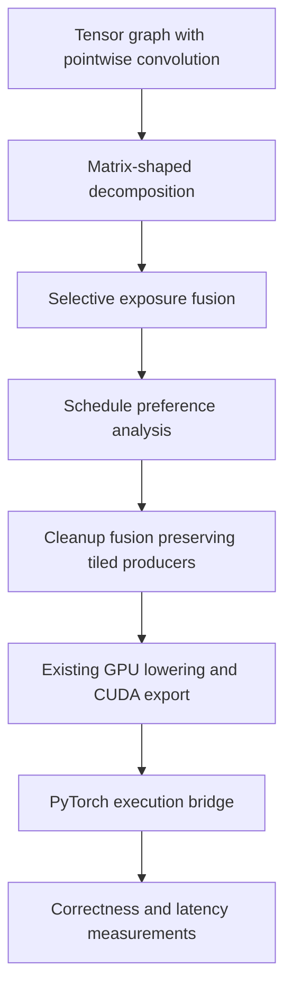

# Kiln: Pointwise Convolution, Pooling Semantics, and Measured Transfer

A fixed compiler transformation now produces a **1.947738× geometric-mean end-to-end speedup across eight additional FP32 graphs**, with both baseline and candidate passing the declared CUDA correctness checks on every graph. The transformation expresses eligible pointwise convolutions as matrix contractions, then applies the existing staged fusion strategy. Five graphs improve and three are slightly slower. The two largest gains, approximately 7.4×, occur in related Xception models.

This report explains the representation change, the pooling work that exposed the original bottleneck, and the experiments that distinguish a large development result from limited transfer evidence. A compiler transformation rewrites a program representation. A schedule assigns its operations to GPU threads, blocks and memory. The result here depends on both: the rewrite makes a matrix reduction recognizable, and staged fusion preserves that reduction long enough for the scheduler to use a tiled implementation.

> [!summary]
> The original six-graph development family improves 32.73× relative to prior Kiln, but remains slower than eager execution. Eight subsequently selected exact models improve 1.948× under a separate direct-replay FP32 protocol. The transformation is manually authored and opt-in. It is available through the agent program interface, but these results do not constitute new LLM discovery or a full PassBench reproduction.

## 1. From supported semantics to useful implementations

The current cumulative integration evidence covers **34 complete evaluation tasks and 375 accepted graphs**. Of those accepted graphs, 306 belong to complete tasks. These numbers describe accumulated evidence across compiler snapshots and the declared integration protocol. They do not mean a single release has passed every graph in a uniform full-corpus rerun.

Average pooling supplied three of the most recent complete tasks. The importer and compiler can now express static CHW and NCHW average pooling, including rectangular windows, stride, padding, ceiling output dimensions, optional inclusion of padding in the divisor and explicit integer divisor overrides. This semantic expansion exposed an existing convolution scheduling problem in a newly accepted family.

Supporting an operator is therefore only an initial condition. An implementation can pass correctness and still be uncompetitive. The six-graph family combining pointwise convolution with pooling illustrates this distinction: its first accepted Kiln implementation had an original task score of approximately 0.01228, and its largest FP16 graph took approximately 749 ms per end-to-end invocation.

## 2. Average-pooling semantics

For one spatial axis of length L, kernel width K, padding P and stride S, the initial output dimension is

\[
O=\left\lfloor\frac{L+2P-K+c(S-1)}{S}\right\rfloor+1,
\]

where c is one for ceiling mode and zero otherwise. Ceiling mode also needs a final-window correction: an output window whose start lies entirely in the trailing padded region is removed. The same calculation is applied independently to height and width.

The divisor requires a separate definition. With padding included, explicit padded cells contribute zero to the numerator but count toward the denominator. Cells reached only because ceiling mode extends the last window are not automatically equivalent to explicit padding. With padding excluded, the denominator counts valid input cells. A supplied divisor override replaces the normal count.

Kiln represents safe input access with a clamped spatial view and a selection mask. Selection matters because multiplying an invalid NaN by zero would still produce NaN. The masked input is viewed as a tensor with output-window and window-element dimensions, reduced along the two window axes, and divided by a statically constructed divisor tensor. Low-precision inputs widen for accumulation and narrow at the operator boundary.

The implementation is in `packages/kiln/src/std/pooling.js`; FX argument normalization is in `integrations/passnet/fx_pooling.py`. Archived PyTorch pooling sources were consulted for semantic analysis. The Kiln implementation is independently written. The ticket retains the consulted source snapshots, hashes and provenance notes in `sources/pooling-semantics-v1`.

Validation comprised 288 deterministic FP32 oracle cases and 24 low-precision CUDA cases. All 312 CUDA fixtures passed, with zero maximum absolute error for the chosen quarter-valued inputs. That exact agreement is evidence for these inputs and semantics, not a universal numerical guarantee. Four complete evaluation families became importable; three passed native evaluation, while one remained blocked by a convolution-plus-batch-normalization reference discrepancy. The failure was retained rather than weakening its tolerance.

## 3. Pointwise convolution as a matrix contraction

A pointwise convolution has a 1×1 spatial kernel. For zero padding, each output spatial position performs a channel reduction without combining neighboring spatial positions. Let G be the number of groups, I the input channels per group, O the output channels per group, and Q the number of output spatial positions. The computation can be written as

\[
Y_{n,g,o,q}=\sum_{i=0}^{I-1}W_{g,o,i}X'_{n,g,i,q}+b_{g,o}.
\]

The input view X' maps q back to output coordinates and applies spatial stride. If the output width is W_o, the source coordinates are

\[
y=\lfloor q/W_o\rfloor s_h,\qquad x=(q\bmod W_o)s_w.
\]

This gives an input view `[N,G,I,Q]` and weights `[G,O,I]`. Existing batched matrix multiplication produces `[N,G,O,Q]`; bias is broadcast, and the result is reshaped to NCHW. The view expresses indexing without introducing a host-side convolution implementation.

`lowerPointwiseConv2d` in `packages/kiln/src/std/conv2d.js` implements this decomposition using the existing `lowerMatmul`. It validates shapes through `conv2dSpec` and retains the original convolution decomposition for non-1×1 kernels or nonzero padding. Grouped and strided pointwise cases have local semantic tests. That local test coverage is broader than the current native transfer population and must not be confused with equivalent GPU coverage.

```text
lower_pointwise_convolution(input, weight, bias, options):
    spec = validate_convolution_shapes_and_options(...)
    if kernel_shape != [1, 1] or padding != [0, 0]:
        return existing_convolution_lowering(...)
    input_matrix = view_input_as_N_G_I_Q(input, stride)
    weight_matrix = reshape(weight, [G, O, I])
    product = existing_batched_matmul(weight_matrix, input_matrix)
    return reshape(product + broadcast(bias), spec.output_shape)
```

The frontend's low-precision operator boundaries remain outside the rewritten FP32 convolution node. Preserving those boundaries matters because moving a cast across bias addition can change FP16 or BF16 results even when the real-valued expressions are equal.

## 4. Why the decomposition needs staged fusion

The decomposition alone did not produce the observed scheduling benefit. Ordinary fusion combined the exposed computation again and recovered a generic row implementation. Staged fusion first exposes eligible intermediate computations, allows schedule analysis to recognize a tiled contraction, and then performs cleanup fusion while preserving producers whose preferred schedule is tiled.



The exposure policy uses aggregate work growth 1.02 and consumer work growth 2. Cleanup uses threshold 1.02 together with the existing tiled-producer preservation rule. These are profitability heuristics, not proofs that the materialized program minimizes latency. A separate kernel adds launch and memory costs; those costs can outweigh improved arithmetic scheduling on small computations.

The agent interface represents the composition as `pointwise-fusion-sequence`, with explicit exposure and cleanup policies. `transformation_program.mjs` prepares the same pipeline used by compilation. `optimization_artifact.mjs` labels its input as tensor IR and gives it the distinct `kiln-pointwise-staged-fusion/1` action contract. This avoids describing a frontend rewrite as a loop-only policy.

The interface reproduces all six previously measured development artifacts exactly. Eleven graphs from two other pooling families produce identical complete artifacts with and without the composition. Those families contain no convolution, so they establish limited absence of collateral changes rather than positive convolution transfer.

## 5. Development result under the original evaluator

All six graphs in the motivating family passed matching and nominal numerical acceptance through the original evaluator. The task score increased from **0.0122771 to 0.401718**. Geometric-mean end-to-end speedup relative to the previous Kiln artifacts was **32.730548×**, with individual improvements from 15.06× to 56.86×. The largest FP16 graph decreased from **749.238 ms to 14.4792 ms**.

These were sequential runs of an already observed development family. They were not interleaved paired measurements or fresh-model confirmation. Eager execution remained faster on every graph, by approximately 1.8–3.6×. The gain establishes removal of a large Kiln scheduling cost; it does not establish superiority to PyTorch eager or reproduce the paper's aggregate result.

The original matcher passes were reused unchanged. An initial attempt to regenerate passes failed because the corpus was already specialized. The retained failure clarified the boundary: changing compiled artifacts did not require changing the established graph bindings or matcher generation.

## 6. Eight-model transfer experiment

The next population was selected before its compilation or timing outcomes. Selection excluded exact models from the evaluation list and prior tracked corpus manifests, then used a salted order of training tasks. The declared envelope required FP32, one zero-padded pointwise convolution, at most two million elements per tensor and at most 64 million convolution multiply products. One eligible graph was selected per model until eight models were available.

Both compiler variants built all eight graphs. Three per variant passed the local end-to-end reference check; five exceeded the interpreter's existing reference-work threshold. The GPU experiment subsequently checked every graph, including the five skipped locally.

This experiment uses direct original-input replay with full-FP32 matrix precision and cuDNN TF32 disabled. It therefore has a different numerical and execution protocol from original PassBench matching and scoring. The runner reuses `check_structure`, `TorchProgram` and the existing `sample` timing function. It checks output structure, dtype, shape, numerical agreement and unchanged inputs before measuring a candidate.

Measurements used the pinned CUDA container on NVIDIA GB10, 20 warmups, 100 trials and three rounds. Candidate order was shuffled deterministically between rounds. Each round could retry up to twice when either timing metric's interquartile range exceeded 20% of its median. All sixteen candidate/graph combinations passed correctness and completed three stable timing rounds.

| Exact model | Baseline ms | Candidate ms | Speedup |
|---|---:|---:|---:|
| PIDNet-s | 0.182227 | 0.121692 | 1.497× |
| 2xmspn_50 | 0.099805 | 0.057639 | 1.732× |
| pose_seresnet_101 | 0.021551 | 0.022151 | 0.973× |
| test_efficientnet.r160_in1k | 0.016096 | 0.016175 | 0.995× |
| dla102.in1k | 0.129788 | 0.087278 | 1.487× |
| deeplabv3_mobilenet_v3_large | 0.038047 | 0.038207 | 0.996× |
| xception41p.ra3_in1k | 1.023360 | 0.137475 | 7.444× |
| xception65p.ra3_in1k | 1.022288 | 0.136572 | 7.485× |

For per-graph ratios r_i, the reported aggregate is exp(mean(log(r_i))) over all eight selected graphs. It equals **1.947738×**. No graph was removed for being slow or incorrect. Three small cases are nominally slower, with the largest slowdown approximately 2.8%; this experiment does not establish statistical significance for those small differences.

The Xception models are related architectures, and their gains strongly affect the aggregate. Exact-model exclusion prevents reuse of those exact model identities; it does not provide architecture-disjoint evaluation. A broader claim requires a larger declared population and additional precision, shape and grouping coverage.

## 7. What this changes about compiler self-optimization

The productive change was an expansion of the compiler's representation choices. Earlier agents searched fusion policies and compositions; this milestone adds a reusable convolution decomposition that those policies can act on. The new primitive and its measured composition were manually authored. No new LLM inference produced these gains.

The next agent experiment can now search whether and how to apply this composition, using the existing program interface. It should use a separate development population. The eight transfer results are now observed and cannot be reused as fresh confirmation after adapting the policy to them. Small-case regressions suggest testing profitability conditions tied to matrix dimensions and materialization cost, while preserving semantic legality and numerical boundaries independently.

The transformation remains opt-in. The current evidence supports further experiments and a concrete reusable optimization; it does not support unconditional default promotion or full 200-task support. Native precision discrepancies, unsupported operators and complete-family evaluation remain separate work items.

## 8. Implementation and evidence references

The worktree is `/home/manuel/code/wesen/kiln/worktrees/passnet`. Ticket materials are under `ttmp/2026/10/30/KILN-005--reproduce-passnet-and-evaluate-reusable-kiln-compiler-transformations`.

- `packages/kiln/src/std/conv2d.js` defines the existing and pointwise decompositions; `packages/kiln/src/std/pooling.js` defines pooling semantics and lowering.
- `integrations/passnet/pointwise_convolution.mjs` installs the opt-in rule; `scheduling_fusion.mjs` supplies the staged fusion mechanism.
- `sources/pointwise-pooling-improvement-v1.json` and `pointwise-pooling-task-audit-v2.json` retain the native development comparison and acceptance evidence.
- `sources/pointwise-transfer-v1` retains selection, exclusions, source scripts, compiled artifacts and failures. Commit `81a7e5f` fixes this population and compiler pair.
- `sources/pointwise-transfer-gpu-results-v1` retains the full CUDA replay, raw timing attempts, runner and eight-model summary. Scripts498–500 stage, execute and collect this experiment.
- Diary volume2 records the implementation rationale, failed attempts and review instructions. The preceding vault article, [[ARTICLE - Kiln - Staged Fusion Generalization and Agent Composition]], explains the staged-fusion strategy and prior agent search results.
