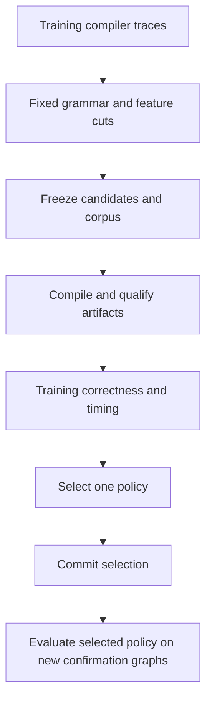

# Kiln: Policy Search from Training Traces and Safe Activation Lowering

The latest milestone completes a compiler-policy experiment in which generated programs changed training executables, preserves the resulting negative performance result, and expands the workload population through activation lowering. Twelve declared fusion policies compiled across 20 real source graphs. All passed training replay checks, but the unchanged compiler won the training objective. Separately, SiLU, sigmoid and conservative handling of in-place activations increased import eligibility from 804 to 912 graph variants. One additional complete PassBench task now passes matching, numerical evaluation and scoring.

The two results answer different questions. The policy study evaluates whether a reusable decision rule improves generated executables. The importer work establishes which source computations Kiln can express and execute. A larger import count cannot stand in for a compiler speedup, and a successful experiment harness cannot stand in for an improved policy.

## 1. Define the intervention before searching

Kiln's loop fusion rule combines a producer's computation with its consumers. Eliminating an intermediate tensor can reduce memory traffic and invocation costs. Fusion can also repeat arithmetic or enlarge the resource requirements of a kernel. The rule therefore estimates weighted work before and after fusion and applies a profitability condition in addition to its existing matching requirements.

The configurable interface is `createFusionRule({maxWorkGrowth, decide, onDecision})` in `packages/kiln/src/std/loop.js`. A decision callback receives originalWork, fusedWork, consumerCount and producerElements. These are compiler estimates; work units include weighted reads and writes and are not measured latency. The global default remains a maximum work ratio of 1.02.

The bounded policy language, implemented in `fusion_policy.mjs`, represents scalar thresholds and conditional trees. It validates at most 31 nodes and depth six, then compiles immutable closures. A separate work-growth cap applies even to unconditional acceptance. The language receives scalar compiler features and has no interface to runtime tensor values.

The preceding experiment generated conditional policies that mostly relaxed fusion. Its training traces contained no profitability rejection to reverse. Every candidate produced the unchanged executable on every training graph, so the registered tie rule selected baseline. The next study therefore tested restrictions on fusion rather than further relaxation.

## 2. Generate programs from training evidence

`propose_policy.py` implements a deterministic grammar with a fixed budget of 12 candidates. The grammar was authored by the current Codex session. Its feature cutoffs are calculated from training compiler traces; it is not an external LLM invocation or a reproduction of original PassAgent inference.

The generator first determines the exact training graph membership from the frozen manifest. It then selects corresponding successful compilation records before inspecting any feature values. It hashes only those training decisions. Tests replace held-out records with malformed data and verify that the resulting proposals and provenance are unchanged.

The grammar contains unchanged/default controls, strict scalar thresholds of 1.0, 0.95, 0.9 and 0.75, a disabled-fusion control, and five conditional programs. Conditions select large or small producers, high estimated work, or single-consumer structure. The observed training cutoffs were a producer median of 432,128 elements, a lower quartile of 6,272 elements and an original-work median of 32,058,496 units.

A representative generated program uses a strict threshold for large producers and retains the original threshold elsewhere:

```text
if producerElements >= 432128:
    accept when fusedWork <= 0.9 * originalWork
else:
    accept when fusedWork <= 1.02 * originalWork
```

This is an executable hypothesis about profitability. It contains no graph identifiers or memorized tensor values. Its usefulness still depends on correctness and measurement.

## 3. Preserve the confirmation boundary during adaptive development

The study reuses the previous 12 training graphs and explicitly acknowledges that their earlier timings were observed. Eight different exact source models and generated-program hashes form a new confirmation set. Selection reads the pinned official training list in deterministic task order and applies declared dtype and volume limits before performance measurement.

Exact models do not overlap between the two sides. Related architecture families may still overlap, so this is weaker than independent architecture-family generalization. The sample is also restricted to supported FP32 workloads; it is not an untouched paper evaluation.

The fixed sequence is:



All 240 candidate/graph combinations compiled. Explicit default and unchanged compiler artifacts match. The shared qualifier now also checks that frozen policy declarations equal receipt and artifact policy metadata, compiler targets agree, kernel counts agree, and a single fingerprint never identifies different executable bodies. These checks matter because identical fingerprints share timing evidence. A false alias could otherwise make two different programs appear to have the same performance.

The frozen timing budget remains 20 warmups, 100 trials and three repeats, with a maximum IQR/median fraction of 0.2 and two retries. End-to-end timing includes allocation, invocation and synchronization. CUDA-event timing includes dispatch gaps and is labeled stream elapsed time. It is not a pure device-kernel measurement.

## 4. Interpret the negative training result

Strict policies changed real training executables. Scalar thresholds changed one to four programs; conditional policies changed one or two in the effective branches; disabling fusion changed nine. All candidates passed replay correctness and completed stable timing.

| Candidate or group | Training geometric-mean end-to-end ratio |
|---|---:|
| Unchanged baseline | 1.0000 |
| Changed large-producer conditional policy | 0.9980 |
| Scalar 1.0 and small-producer conditional alias | 0.9742 |
| High-work conditional policy | 0.9729 |
| Scalar 0.95, scalar 0.9 and their conditional alias | 0.9279 |
| Scalar 0.75 | 0.8301 |
| Disabled fusion | 0.4622 |

Ratios are relative to unchanged Kiln; values below one indicate slower execution. Exact executable aliases share measurements and tie exactly. The 0.9980 result is near parity and should not be interpreted as a statistically established regression.

The registered ranking selected baseline. Selection was committed as `6d2f422` before confirmation evaluation. All eight confirmation graphs then passed, with a selected-policy ratio of exactly 1.0 because the selected program was baseline itself. The completed evidence is committed as `e6620f4`.

These measurements support a limited conclusion: the tested fusion restrictions do not improve this training objective. Extra launches and intermediates appear costly enough to outweigh the tested reductions in repeated work, although the experiment does not isolate those costs. It does not show that fusion is globally optimal or that other scheduling and transformation algorithms lack headroom. Further work should change the intervention or broaden the workload population rather than repeatedly reinterpret this same grammar.

## 5. Preserve source operation rounding when importing activations

SiLU and sigmoid were common first blockers in the full importer audit even though Kiln already implemented their mathematical operations. Mapping their names alone would miss the source arithmetic contract.

PyTorch's CUDA activation kernels use an operation arithmetic type for low-precision storage. In version 2.9.1, the operation type for Half and BFloat16 is float. The importer therefore widens the input for activation arithmetic and narrows once at the source activation boundary. A subsequent consumer must observe that narrowed value, even when the compiler fuses operations into one kernel.

For a storage dtype d, the intended boundary is:

$$
y=\operatorname{round}_d\left(\operatorname{activation}_{\mathrm{FP32}}(\operatorname{FP32}(x))\right).
$$

The emitted Kiln expression is concrete:

```javascript
N.cast(N.silu(N.cast(x, "f32")), "bf16")
```

The analogous sigmoid expression uses `N.sigmoid`. A separate fixture multiplies the sigmoid output by another low-precision tensor, checking that narrowing occurs before the consumer rather than only at the final output.

Existing Kiln SiLU decomposes x multiplied by sigmoid(x), while the native PyTorch kernel evaluates x divided by one plus exp(-x). Mathematical equivalence does not imply bitwise equality in floating point. Tests therefore make explicit tolerance claims. Across three seeds, all three storage dtypes and saturation values, the maximum observed output errors were 9.5367431640625e-7 for FP32, 0.0001220703125 for FP16 and zero for BF16.

The semantic mapping is independently implemented using existing Kiln operations. The exact PyTorch kernel files, operation-type header, public documentation and upstream license are archived with URLs, byte counts and SHA256 values. The primary references are [SiLU documentation](https://docs.pytorch.org/docs/2.9/generated/torch.nn.functional.silu.html), [sigmoid documentation](https://docs.pytorch.org/docs/2.9/generated/torch.sigmoid.html), the [SiLU CUDA kernel](https://github.com/pytorch/pytorch/blob/v2.9.1/aten/src/ATen/native/cuda/ActivationSiluKernel.cu), the [sigmoid CUDA kernel](https://github.com/pytorch/pytorch/blob/v2.9.1/aten/src/ATen/native/cuda/UnarySpecialOpsKernel.cu) and [operation arithmetic type definitions](https://github.com/pytorch/pytorch/blob/v2.9.1/aten/src/ATen/OpMathType.h).

## 6. Functionalize only an ownership case that can be checked

An in-place operation changes the storage observed through existing tensor aliases. Replacing it with a functional operation is valid only when those observations are preserved. The importer now handles a conservative case: the mutated input has known fresh source storage and exactly one use in the entire graph.

Freshness is recorded for supported operations with fresh-result semantics, including arithmetic, activations, reductions, convolution, inference batch normalization, interpolation and concatenation. Placeholders, views, casts and disabled dropout do not acquire freshness. Their source behavior can alias existing storage, so they require stronger analysis before mutation can be removed.

This source fragment qualifies:

```python
owned = torch.relu(x)
return torch.nn.functional.silu(owned, inplace=True)
```

ReLU produces fresh storage and its sole use is the mutation. The functional replacement computes the same output without changing x. A retained observer prevents that reasoning:

```python
owned = torch.relu(x)
observer = owned.view(2, 3)
changed = torch.nn.functional.silu(owned, inplace=True)
return changed, observer
```

The observer must see the mutated contents in the source program. The root value has multiple references, so the importer rejects the functionalization. It also rejects mutation through the view itself because a view does not acquire ownership.

The whole-graph use count includes returned values and view creation. The check is deliberately conservative and is not general alias analysis, input writeback or unrestricted mutation support. Tests cover valid ownership, shared producers, views and direct input mutation. Nine additional CUDA comparisons exercise in-place SiLU on a fresh ReLU result across all three dtypes and seeds. Together with the original activation fixtures, 18 CUDA comparisons and all 47 Python integration tests passed.

## 7. Separate import growth from accepted benchmark execution

The first activation mapping increased import eligibility from 804 graphs across 24 complete tasks to 853 across 32. The ownership check increased it again to 912 graphs across 36 complete tasks. Every audit retains the full 200-task, 2,060-variant denominator and records an explicit first blocker for unsuccessful imports.

These counts establish translation eligibility. They do not establish compilation, execution, numerical acceptance or scoring for all 36 tasks.

Evaluation task 143 provides a stronger new result. Its pattern is SiLU, multiplication and disabled dropout. A single reusable pass and metadata-based compiled-program dispatcher handle its FP32, BF16 and FP16 variants, each with shape [1,257,1024]. All three compiled, matched once and passed source replay and original numerical comparison through the existing modified protocol.

The original scorer, with p=0 and fpdb=0.1, assigns task id 144 a score of 0.8399177755920565. The result is below eager in aggregate, so this is an integration and correctness milestone rather than a performance improvement.

The canonical coverage ledger now invokes the pinned upstream tolerance-one checker in addition to checking exact graph membership, execution labels and replacement counts. The stronger accounting retains all previous accepted graphs and adds these three variants. Verified Kiln coverage is now **six complete tasks and 76 graph variants**, under the documented normalization and stream-metadata protocols.

## 8. Keep the architecture and evidence reusable

Reusable mechanisms remain in `integrations/passnet`: proposal generation, policy interpretation, artifact qualification, measurement, selection, summary, source staging, FX import and execution dispatch. Numbered ticket scripts preserve the historical invocations and fixed experiment settings. They do not define independent evaluator implementations for each hypothesis.

Source staging now excludes Python bytecode caches and avoids owner/group preservation. This fixes a concrete failure caused by container-created root-owned __pycache__ directories during subsequent rsync transfers. The source dataset files still stage explicitly from exact manifest paths.

The working repository is `/home/manuel/code/wesen/kiln/worktrees/passnet`. Ticket KILN-005 contains the complete designs, diary Steps 82–85 and scripts 91–114. Design 07 documents adaptive policy synthesis; design 02 documents activation arithmetic and ownership. Script 99 recomputes the adaptive study's evidence, and script 114 binds activation comparisons, primary-source provenance, import counts and real-task evidence to saved identities. The implementation milestone is commit `09abb7c`.

The full project remains incomplete. Controlled full-corpus performance measurements, original PassAgent evaluation, general mutation and remaining operator/runtime support are still open. The completed work provides an executable policy-search loop, evidence that the tested strict-fusion grammar is unproductive on its training population, and a larger source population for the next compiler intervention.

Related notes are [[ARTICLE - Kiln - Reusable Fusion Policy Selected on Training Graphs]] and [[ARTICLE - Kiln - Bounded Fusion Programs and a Negative Confirmation Result]]. Each preserves its own experimental population and result.
