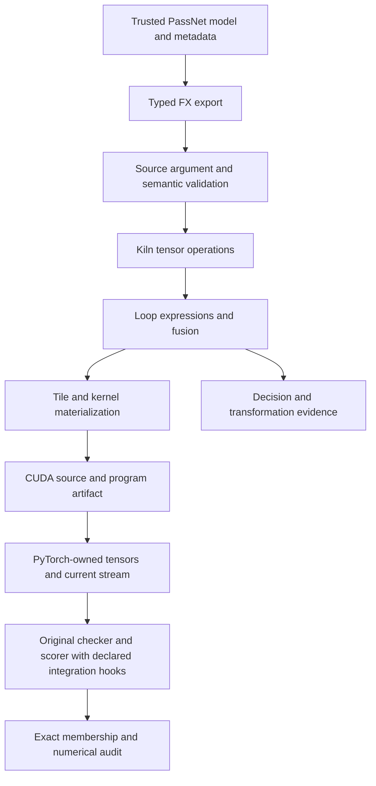
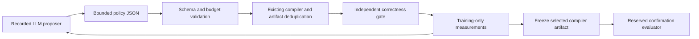

# Kiln after PassNet integration: evidence, architecture, and the next compiler experiment

A compiler improvement is a reusable change that produces better implementations for programs beyond the example that motivated it. A faster kernel for one tensor shape is useful, but establishes a different result. This distinction is the organizing principle for the Kiln–PassNet project and for assessing its progress.

PassNet supplies computational graphs, related shape and dtype variants, an agent that writes replacement passes, and a benchmark that evaluates them. Kiln supplies a compiler whose intermediate representations and transformation rules can themselves be changed. The intended research combines these capabilities: generate a reusable Kiln policy or transformation, hold it fixed, and test what it does to new programs under a declared correctness and measurement protocol.

The project has made substantial progress toward that experiment. It has a working FX-to-Kiln-to-CUDA execution path, reduced-precision storage and rounding, conservative source-effect handling, several completed fusion-policy studies, and a reusable indexing change with positive fresh-model measurements. Its principal weakness is sequencing: integration coverage and numerical investigations have occupied more of the work than the final autonomous synthesis comparison. The next research milestone should use the machinery already built to run that comparison, while full benchmark support continues as a separate engineering track.

> [!summary]
> Current cumulative replay evidence accepts **31 of 200 complete tasks** and **358 of 2,060 individual graphs** under declared modified integration protocols. Import eligibility is **1,251 graphs in 76 complete task families**. A manually derived indexing improvement measures **1.053746× end-to-end speedup** over 20 fresh exact-model families, with regressions retained. No controlled external-LLM experiment has yet demonstrated a better reusable Kiln compiler policy.

This report reassesses the chronological implementation record through diary Step 148, the design series, current source code and experiment receipts. It also incorporates the newly supplied *Kiln: Toward a Self-Improving Compiler Optimization Framework* study and a new full-shape convolution diagnostic. The study is a design input; its 81 external reference records have not all been independently revalidated for this report. All newly stated numerical results below have a named local evidence source. Proposed interfaces and experiments are labeled as proposals.

## 1. The three experiments that must remain distinguishable

A PassNet task contains related concrete graphs. Each graph fixes details such as shape, dtype, literals and output structure. A replacement pass must match the computation and produce acceptable outputs across the task's variants. Supporting an operator name does not establish support for all those combinations.

There are three distinct experiments in this project. **Reference reproduction** asks how the original PassNet implementation behaves with a pinned model and environment. **Kiln integration** asks whether Kiln can compile and execute those graphs through the benchmark interface. **Compiler meta-optimization** asks whether a reusable change to Kiln improves future compilation results. Each requires different evidence.

The integration track has deliberately modified behavior at specific boundaries, including argument normalization and a narrow allowance for stream-lifetime bookkeeping. Those changes are documented. Its accepted results cannot be presented as unchanged PassNet reproduction. Conversely, a direct Kiln policy experiment can establish a compiler result without passing through PassBench's per-task matcher, provided its independent correctness and performance protocol is explicit.

The available device also differs from the paper. The reference paper specifies an NVIDIA A30 with a particular CUDA, PyTorch and Triton stack. Our execution device is a DGX Spark with NVIDIA GB10; recent qualification uses an NVIDIA PyTorch 2.12 development image and CUDA 13.2. CUDA is compiled for the actual device, while the compiler's A100 scheduling preset is a documented cost-model proxy. Neither the preset nor the device constitutes a hardware match to the published experiment.

The full objective remains intact: reproduce and explain the reference behavior, implement broad Kiln support, evaluate reusable improvements, and eventually compare agent-generated compiler artifacts with specialized replacement generation. The three tracks allow useful research before every integration case succeeds, without silently redefining the full objective around a subset.

## 2. Reading the coverage numbers correctly

The authoritative coverage ledger contains all 200 tasks and accounts for all 2,060 graphs. The reporting audit recomputes accepted graph counts from successful execution, exactly one replacement and the original nominal numerical point, `t=-5`. It also checks that every graph of a complete task passes. It does not infer acceptance from an import manifest or an operator list.

| Measurement | Current value | What it establishes |
|---|---:|---|
| Complete task replay acceptance | 31 / 200 | Every recorded variant in those tasks passes the declared integration replay |
| Individual graph replay acceptance | 358 / 2,060 | Accepted variants, including variants from incomplete tasks |
| Accepted graphs inside complete tasks | 289 | The graph population accounted for by the 31 complete tasks |
| Accepted graphs in incomplete tasks | 69 | Useful partial support that does not complete its task |
| Importable graphs | 1,251 / 2,060 | Source contracts lower to Kiln without an import rejection |
| Fully importable task families | 76 / 200 | Every variant imports; execution qualification remains separate |
| Uniform current-release full-corpus run | Not established | The cumulative ledger spans recorded compiler snapshots |

Thus, 31/200 is 15.5 percent of complete tasks. It is neither the percentage of operators implemented nor the fraction of the research project completed. The 1,251 importable graphs indicate a much broader translation boundary, but the gap to 358 accepted graphs includes unexecuted populations, compiler checks, numerical behavior, matching, runtime execution and stability. The counts alone do not assign that gap to one cause.

Earlier reports legitimately contain different numbers. Five complete tasks and 73 graphs described an earlier checkpoint. Later work added matrix, normalization, softmax, reshape, GELU and singleton-view support. Some counts also required correction: an early audit treated `t=1` as nominal correctness, while that setting is relaxed. The later audit uses `t=-5` and preserves the older tolerance curves. A temporary reduction in complete tasks also exposed a real operand-binding regression that was subsequently repaired. Neither history should be rewritten as uninterrupted monotonic progress.

One complete exploratory Inductor reference run exists. Auditing its same logs at `t=-5` accepts 1,748 graphs and 140 complete tasks; at relaxed `t=1`, the counts are 2,039 and 191. These are different interpretations of the same recorded executions, not independent replications. The earlier timing overlap and hardware/software differences remain limitations. There is no justified full-corpus ranking between current Kiln, current Inductor and the paper's models from these records.

## 3. What the integration actually executes

An intermediate representation, or IR, makes a program's computation explicit at a particular compiler stage. Kiln progressively expresses tensor operations as indexed scalar computations, chooses how those computations map onto GPU execution, and emits executable source. The integration preserves source metadata and output structure around that process.



`integrations/passnet/fx_export.py` serializes typed FX nodes, argument/container structure, constants and operator targets. The importer delegates layout/indexing, matrix and normalization contracts to focused modules rather than implementing a second tensor compiler. Unsupported overloads, dtypes and effects fail explicitly. Fake-tensor metadata propagation permits broad source inspection without allocating dataset-sized activations.

`runtime.py` uses the existing `kiln_launch` pointer launcher. It allocates output and scratch storage with declared sizes and dtypes, validates contiguous inputs, and launches on the current PyTorch CUDA stream. Input and scratch lifetimes are recorded with PyTorch's stream mechanism. The generated arithmetic executes in Kiln CUDA kernels; it does not delegate the replacement calculation to eager PyTorch.

The runtime boundary is concrete:

```python
self.program.launch(
    stream=stream.cuda_stream,
    scratch=scratch,
    **pointers,
)
```

That call is only the execution step. Correct output allocation, pointer types, stream ownership, asynchronous lifetimes, constants and multi-kernel scratch must already agree. A correct pointer address with the wrong dtype can interpret the same bytes as a different tensor. A numerically correct single-stream test can also miss a lifetime error on another stream.

`evaluate_tasks.py`, `run_task.py` and `summarize_task_run.py` separate orchestration from acceptance. A completed child process is recorded as process completion. The audit independently examines exact graph membership, replacement counts, result blocks and numerical curves. This separation is necessary because several upstream tools can finish successfully without producing a valid candidate result.

## 4. Reduced precision required compiler changes, not pointer casts

The original Kiln path was primarily FP32-oriented. Adding FP16 and BF16 required changes across tensor inference, reference inputs, scalar expressions, emitted pointer types, output metadata, byte counts and Python allocation. A dtype is a storage contract, while an operation's internal arithmetic can use another precision.

For a simple half-precision chain, the source may first compute an addition and store its half result, then multiply that rounded result. Fusing both operations into one CUDA kernel does not authorize deleting the intermediate rounding. Kiln therefore represents `round_f16` and `round_bf16` explicitly in scalar expressions. Those operations survive fusion as observable arithmetic boundaries.

The conversion implementation was checked against PyTorch on 46,162 conversions from 23,081 FP32 bit patterns, including boundary cases. That establishes the tested conversion behavior, with NaN payload/sign canonicalization excluded from exact bit comparison. It does not establish the correctness of a later reduction using those conversions.

Storage support is backend-specific. Unsupported WGSL storage or mathematical operations produce explicit unavailability instead of silently becoming FP32. Exact GELU illustrates this boundary: the CUDA path uses `erff`, the JavaScript reference implements an independently checked error function, and WGSL exact-GELU support remains unavailable. Replacing exact GELU with the existing tanh approximation would change the source operation.

Source effects required equally careful treatment. Python `+=` can lose its mutation identity under ordinary symbolic tracing. The integration uses a faithful tracing path and functionalizes a supported mutation only when its operand has known fresh storage and one observable use. Inputs and potentially aliased views do not gain that permission. This is a conservative ownership argument, not general alias analysis or input writeback support.

These changes are substantive compiler work. They explain why a small number of complete benchmark tasks required changes in many layers. They also establish a limit: passing numerical replay on the benchmark's input distribution does not prove unrestricted PyTorch storage/effect equivalence or numerical correctness on every stress input.

## 5. Matching and integrity are independent from arithmetic

FX matching compares graph structure. Two Python calls can compute the same operation while using different positional arguments, keyword arguments or omitted defaults. The benchmark's symbolic pattern trace and Dynamo target capture have repeatedly produced such differences.

The integration addresses supported cases through explicit signature normalization before matching. It retains dimension, dtype, epsilon, approximation selectors and supplied values. A source softmax with one axis must not match another axis simply because default arguments were filled. Tests capture actual Dynamo graphs and retain negative matching cases.

Several original restrictions remain consequential. Explicit graph constructors in generated pattern source were rejected by the original AST integrity checker. Multi-output replacements required an existing upstream tuple-destructuring helper. The PyTorch runtime's necessary `record_stream` bookkeeping initially failed dispatch interception. Those observations motivated narrowly declared integration hooks; they did not justify hiding forbidden operations behind an opaque wrapper.

A useful failure classification is therefore:

```text
import rejected
compiler validation failed
no pattern replacement
replacement execution failed
numerical comparison failed
measurement unstable
accepted and measured
```

Treating these as one generic failure destroys information needed by both compiler engineering and an agent. A no-match score says nothing about the speed of a kernel that never ran. An execution status named `correct` in one parser is also insufficient when the stricter numerical curve rejects the output. The current acceptance audit requires all relevant conditions together.

## 6. What the fusion experiments established

Fusion replaces an intermediate tensor load with its producer's computation. It may avoid a kernel launch and materialization, but can duplicate arithmetic or alter resource usage. A profitability policy chooses whether to apply an already permitted transformation. It is distinct from the implementation that performs the rewrite.

The current compiler exposes that distinction through the actual factory:

```javascript
std.loop.createFusionRule({
  maxWorkGrowth: 1.02,
  decide: null,
  selectConsumers: null,
  onDecision: null
})
```

The policy sees frozen compiler-derived features. The bounded JSON interpreter supports threshold, decision-tree, selective and region policies; it has a 31-node and depth-six budget, rejects unknown fields and nonfinite values, and receives no tensor values or graph identifiers. Its work model weights memory operations as well as arithmetic. The resulting values are surrogate work units, not measured latency or pure FLOPs.

The studies have already tested meaningful interventions:

| Study | Held-out or confirmation result | Interpretation |
|---|---:|---|
| Initial threshold 1.25 | 1.018607× end-to-end | Small development transfer; one of seven held-out executables changes |
| Fresh conditional-policy corpus | Unchanged selected | Candidate policies do not change training executables |
| Adaptive stricter policies | Unchanged selected | Actual changes occur, but none wins training selection |
| Rich matrix/reduction corpus | 1.000568× end-to-end; 0.999585× stream | No reliable demonstrated improvement |
| Selective-consumer policy | 0.972049× end-to-end | Selected candidate regresses on confirmation |
| Whole-region model | 0.990099× end-to-end | Regression, with generated-name identity limitations retained |
| Fresh canonical-emission study | Unchanged selected | Genuine changed alternatives lose; aliases tie exactly |

These results do not show that fusion is globally optimal. They show that the tested feature spaces, policies and populations often provide little useful headroom. One early population had no profitability rejections for a relaxed threshold to reverse. A later population exposed real fanout and reductions, yet its winning selective policy accepted no actual partial fusions on the observed splits. Implementing a capability and demonstrating benefit from that capability are different achievements.

The proposal generator is also explicit about its provenance: `propose_policy.py` performs deterministic template synthesis authored during this project. It is not an independent external-LLM evaluation. Describing these completed experiments as autonomous compiler synthesis would overstate what ran.

## 7. Selective fusion improved the transformation model

For producer p with consumers c₁ through cₘ, selecting only some consumers must preserve p for the others. Removing its cost from every candidate would systematically favor partial fusion incorrectly. The shared implementation plans replacements against one graph snapshot, changes only selected consumers and relies on normal liveness/dead-code elimination to determine whether p survives.

Let P be producer work, Cᵢ original consumer work, and Fᵢ work after substitution. For a selected set S:

$$
W(S)=\begin{cases}
\sum_i F_i, & S=U,\\
P+\sum_{i\in S}F_i+\sum_{i\notin S}C_i, & S\ne U.
\end{cases}
$$

Under the implemented additive local objective, all proper subsets retain the same producer, kernel count and materialized output volume. The best retained-producer subset therefore includes negative consumer-work deltas. Complete fusion must be considered separately because it removes p. Comparing empty, complete and the negative-delta subset gives an O(m) local planner after consumer costs have been computed.

The proof concerns that local additive model. It does not prove minimum runtime, globally optimal graph partitioning, or optimality under subsequent scheduling. The planner was compared with exhaustive subset enumeration in 280 deterministic scenarios, and shared graph/CUDA fixtures check lifetime and numerical behavior. Its negative confirmation result remains useful evidence that improving surrogate optimization does not guarantee improving the hardware objective.

The architecture is sound in one important respect: selective and complete fusion share `inlineInto`, graph mutation and the aggregate guard. The implementation did not add another fusion engine. The former singular consumer-selector interface was removed when the whole-region interface became canonical; historical scripts remain tied to their historical revisions.

## 8. The strongest improvement came from representation

The most instructive positive result was not a learned threshold. It was a reusable change to reshape indexing that exposed structure already needed by the existing scheduler.

A reshape maps output coordinates to input coordinates. The general implementation flattened the output position and reconstructed input coordinates with division and remainder. For reshapes that only insert or remove dimensions of size one, this general expression can retain syntactic dependencies that are mathematically unnecessary.

Consider `[B,1,M,K]` reshaped to `[B,M,K]`. The correct input coordinates for output `(b,m,k)` are directly `(b,0,m,k)`. There is no need to flatten all three output coordinates and then recover them. Kiln's shared `reshapeMap` now uses this direct correspondence when the ordered non-unit dimensions agree. General reshapes keep the existing flatten/unflatten path.

```text
input_axes  = input dimensions whose extent is not one
output_axes = output dimensions whose extent is not one
if their ordered extents agree:
    map each non-unit input axis to its corresponding output axis
    map each unit input axis to zero
else:
    use the general reshape mapping
```

The rule preserves logical element order; it is not a source-model-specific optimization. It also composes with an earlier transpose's index map. In the motivating attention program, operand loads then expose the separate output dimensions required by contraction analysis. The legal mapping set expands from thread/row to include tiled execution for the final contraction, with M=16,384, N=64 and K=256.

The recorded development target changes from 703.734 ms to 20.4884 ms, an observed 34.3479× ratio. Its final grid changes from 67,108,864 row blocks to 8,192 tiled blocks. This is strong evidence about that development case. The sequential development comparison is not sufficient evidence for a generalization claim or small timing effects elsewhere.

The recorded eager reference was 15.431 ms. The large improvement relative to the old Kiln implementation therefore does not establish superiority over eager execution. It removes a severe compiler failure mode while leaving further performance work.

A separate fixed-compiler confirmation uses 20 fresh exact-model families, ten matrix and ten reduction cases. The isolated compiler versions have 86 pinned production files and differ only in `tensor.js`. All 40 artifacts qualify; 19 executable pairs change and one aliases exactly. The independently audited measurements contain 23,400 raw timing samples and no retry attempts.

The family-balanced end-to-end ratio is **1.0537461946178859×**, and CUDA-event stream elapsed ratio is **1.0598777633326413×**. Nine families are faster, ten slower and one aliases. The matrix stratum averages 0.995662× end-to-end; the reduction stratum averages 1.115219×. The worst family ratio is 0.973413×. Those regressions are part of the result.

This is the strongest bounded evidence of a reusable compiler improvement in the project. It is manually derived, FP32, metadata-restricted and evaluated on fresh exact models rather than architecture-disjoint families. It uses a declared highest-precision FP32 research reference and is not an official native PassBench score. Those qualifications define what the result proves; they do not erase it.

## 9. Identity defects can create optimization evidence without changed computation

Search depends on knowing when two candidates produce the same executable. Otherwise, identical implementations can be measured independently and one can win because of noise. Conversely, genuinely different storage or arithmetic must not share correctness or timing evidence.

The whole-region study exposed a mismatch between mathematical kernel identity and emitted-source identity. Globally fresh reduction variable names leaked into CUDA source. Some baseline and candidate programs had equal kernel identities, while source hashes differed only because generated binders had different names. The original study and its ranking were preserved with that limitation.

The repair retains fresh symbols during substitution, where they prevent variable capture, and assigns canonical per-kernel binders during materialization. CUDA, WGSL and simulator source then derive from the same canonical Kernel IR. Code generation advances to version 3, making older-version evidence stale rather than silently reusing it.

The regression runs independent Node processes with different prior fresh-symbol histories. Same computations must produce identical artifacts and evidence identities; an actual arithmetic change must remain different. Replaying the observed training population converts the known name-only contrasts into exact aliases without any regex normalization in production.

The same investigation discovered that `spawnSync` could report status zero together with a spawn error in the restricted environment. A test runner checking only status could label an unexecuted child as passing. The corrected runner checks the error field, and a fault-injection test retains that case. This does not establish that all historical tests were invalid. It establishes why process status, artifact presence and substantive validation must remain separate conditions.

These are research-critical engineering fixes. A sophisticated agent cannot compensate for an evaluator that rewards unexecuted tests or treats naming history as an implementation change.

## 10. Numerical correctness has several separate contracts

Three questions recur: does the compiler preserve its declared arithmetic model; does its implementation approximate the intended mathematical operation adequately; and does the original benchmark accept it against its selected native reference? They can have different answers.

An earlier loop interpreter retained JavaScript double intermediates between FP32 operations. For `(100000000 + 1) - 100000000`, it returned one while the FP32 frontend and actual CUDA returned zero. That was a demonstrated validator defect. The serial and sampled loop references now round scalar operations and accumulator updates to FP32.

Fused multiply-add is a different issue. A product followed by addition has two rounding points; FMA has one. The opt-in `contraction: "separate"` policy introduces protected scalar operations emitted with CUDA round-to-nearest intrinsics. It preserves the selected elementary boundaries without changing global NVRTC settings or benchmark tolerances. It does not promise bitwise agreement with every cuBLAS/cuDNN algorithm, transcendental approximation or parallel reduction order.

Native precision settings also matter. Some matrix diagnostics showed a more accurate Kiln result agreeing with rounded FP64 or highest-precision FP32 while differing from a TF32-enabled native implementation. The project retained the failed native run and declared a separate highest-FP32 research protocol. That permits a controlled compiler-policy study, but does not turn the original failure into benchmark acceptance.

The latest convolution investigation demonstrates why these distinctions must be explicit. The blocked source computes FP16 convolution over 608 channels, adds bias, reshapes, computes softmax in FP32 and narrows again. Its deterministic export comparison has 21 differing final values, two outside `atol=1e-4, rtol=1e-3`. Replacing only convolution accumulation with sequential FP32 arithmetic makes the frontend match the loop exactly. That isolates the local discrepancy, but does not choose the correct external oracle.

An initial native CUDA probe using one complete softmax row matched the frontend exactly. The subsequent **original full geometry**, `[128,608,8,6]`, changes the finding:

| Comparison on 6,144 full-shape outputs | Differing values | Values outside the export criterion |
|---|---:|---:|
| Loop against frontend | 21 | 2 |
| Native CUDA FP16 against frontend | 33 | 3 |
| Native CUDA FP16 against loop | 12 | 1 |

The full-shape native result is the same for ordinary bias and explicit bias-free convolution followed by half bias addition. The observed dependence on complete geometry is established; its exact cuDNN algorithm cause is not. The smaller probe could not justify a full-family conclusion.

Independent scalar substitutions test sequential, pairwise, Kahan and Neumaier accumulation. Kahan removes final differences from frontend on this input; Neumaier also matches every intermediate convolution value. Neither is implemented as a compiler strategy in this checkpoint. More importantly, reproducing frontend would still disagree with the measured full-shape native result. An apparently successful internal repair would not establish original benchmark acceptance.

At one affected convolution position, the stored frontend FP32 value is 10.38671875, exactly the midpoint between half values 10.3828125 and 10.390625. Sequential FP32 accumulation yields 10.386717796325684. A sub-micro-unit difference can therefore change a half rounding decision and the subsequent softmax outputs. Accumulator accuracy, intermediate narrowing and opaque native reduction order all matter. The correct next action is to specify and test those contracts, not relax the oracle until a candidate passes.

## 11. What the original agent run proves

The project now has an operational original PassAgent run using pinned R2E-Gym infrastructure and a locally served generic Qwen3-30B-A3B checkpoint. The original checkpoint and unquantized BF16 conversion were content-checked; the produced model contains BF16/F32 auxiliary tensors rather than quantized storage. That establishes serving provenance, not identical generation across serving implementations.

The completed shipping smoke runs 50 steps in approximately 1,086 seconds. It makes 30 editor calls and seven evaluator calls, with 13 responses lacking a function call. Every evaluation returns the no-match score 0.1. No replacement kernel is accepted or timed successfully.

The original trajectory nevertheless records reward 1.0 because `_calculate_reward` is a stub returning that value with “Reward calculation not yet implemented.” The independent audit excludes it. The serialized best snapshot is retained on strict score improvement; all seven evaluator scores tie, so it preserves an early candidate containing an empty Triton kernel. That candidate is invalid even if matching were fixed. It does not establish that every later edit was identical.

There is also a demonstrated framework/runtime issue. The ordinary diagnostic pattern trace finds a match, while the original forced-argument tracer converts functional ReLU argument representation differently and finds none. The discrepancy is reproduced on the exact DGX evaluator image for CPU/CUDA and small/original shapes. Normalizing both representations recovers a structural match in a diagnostic. The original reference run itself remains unchanged.

These facts prevent two opposite overinterpretations. The run does not prove that the model produced a valid optimization, and its failure cannot be attributed solely to model quality. Reproducing the full paper-runtime behavior and any repaired evaluator comparison remains separate work.

The complete official evaluation manifest also differs from the shipped 200-record demo manifest. The former contains 200 tasks and 2,060 graphs; the latter contains one graph per task with different directory membership. A derived full manifest preserves the official population, but the completed trajectory is still one shipping smoke. No full-200 agent score follows from merely preparing that manifest.

The local checkpoint also differs from the paper's explicitly named Thinking-2507 student release. Its serving context is 40,960; the 131,072 runner field is an overall token budget, not a request `max_tokens` or model context. The largest observed prompt is 34,415, so this run does not demonstrate context overflow. A higher model used in the current coding session changes none of these recorded experiment identities.

## 12. How the supplied study changes the design priorities

The study recommends a deployable compiler artifact: an explicit, versioned policy or transformation strategy with applicability conditions, semantic requirements and evaluation evidence. That direction fits the implemented compiler better than treating PassNet as the architecture of the whole research system.

Much of its proposed starting point already exists here. The compiler has a configurable fusion rule, a bounded policy grammar, selective mutation, a local region planner, source snapshots, exact executable deduplication, training-only selection and fresh-model confirmation. Reimplementing those capabilities in new packages would add work without testing a new hypothesis.

The missing abstraction is between an individual rule and arbitrary repository editing. `Run` records checkpoints, graph deltas and events, but these are not yet a portable, typed transformation program with a lossless codec, explicit selection semantics, stale-handle rejection and complete failure/rollback contracts. A trace explaining one execution is not automatically a reusable strategy for another graph.

A proposed artifact should identify its input IR, semantic profile, feature/action versions, executable policy or strategy, applicability scope and resource budget. Its deterministic content identity should remain distinct from an evaluation identity that also includes workload membership, compiler/runtime/toolchain, hardware and protocol. The existing evidence package should supply canonical hashing and evidence mechanisms; the integration should not grow a second general evidence store.

The study's Magellan, Exo 2, Transform-dialect and trace-learning recommendations are useful design leads. Their implementation claims and reuse conditions require primary-source checks before a port. The immediate lesson can be adopted without a platform migration: expose checked actions and queries, serialize the strategy that invokes them, and keep legality separate from profitability. A learned score cannot establish a missing semantic fact.

The same reasoning argues for restraint in package structure. Begin with small compiler-general modules and existing interfaces. Keep FX ingestion, PassNet task selection, matching hooks and official scoring in the integration. Move a general policy or transformation component when an independent caller needs it. A whole-project TypeScript conversion, MLIR backend migration, equality-saturation subsystem or large model-training pipeline is not required for the next controlled experiment.

## 13. How I would run the LLM experiment

I would initially reuse the **pinned R2E-Gym agent lifecycle, tool and trajectory infrastructure** already exercised by the reference run. Its official API supports configured agents operating on executable environments and returning detailed trajectories. The original PassNet configuration remains intact; the Kiln-native task gets a separate configuration and structured result contract. [R2E-Gym's official repository](https://github.com/R2E-Gym/R2E-Gym)

Reusing the framework does not mean copying PassAgent's task assumptions. Its regex score extraction, Python-pass snapshot paths and reward stub are inappropriate authorities for compiler-policy selection. The Kiln evaluator must return typed status, artifact identity, correctness outcome, training objective and budget consumption. The agent framework records interaction; the experiment harness decides whether the candidate qualifies.

The first agent should receive a fixed training corpus, approved compiler features and the existing `kiln-fusion-policy/1` grammar. Proposed tools would inspect training IR and decisions, submit validated policy JSON, request compilation, and request training measurement. The compilation, references, tolerances, timing implementation and final holdout reside outside its editable workspace. These tools are a proposed native task interface; they have not yet run as a controlled external-agent study.



Start with one agent. Compare it with threshold search and seeded random proposals over the same grammar. Count invalid proposals and failed compilations against the declared proposal budget, and record actual distinct executable evaluations separately. Record model snapshot, prompts, tokens, compilation time, GPU time and any cached evidence. A larger number of model calls or GPU evaluations is not an unreported advantage.

If local inference shares the GB10 with timing, proposal and isolated measurement phases must be separated and serving resources released before the latter. A separately provisioned provider can avoid that resource conflict, but its model/version and costs remain experiment parameters. The current local server is stopped; no model is presumed live from a configuration file alone.

Selection uses training data only. The selected artifact is committed and frozen before confirmation. Every previously inspected confirmation population becomes development evidence for subsequent studies. The next confirmation should strengthen canonical-structure or architecture-family separation where the corpus permits it, and state any remaining relation between source models.

## 14. Assessment of the work so far

The implementation has produced more than a superficial adapter. It added real compiler capabilities, found and corrected several semantic and validation defects, and preserved failed experiments rather than only their favorable measurements. The singleton-coordinate result shows that the system can support a meaningful compiler research question with isolated source controls and fresh-model evaluation.

The weakest part is completion of the research comparison. We have repeatedly extended the compiler, assembled a new corpus, measured hand-authored/template policies and published a report. That sequence produced useful infrastructure and negative findings, but has not yet closed the specific experiment in which an external LLM proposes a reusable Kiln artifact and is compared fairly with simpler search. Additional operator coverage alone will not close it.

Documentation and orchestration also need a clearer boundary. The numbered scripts are valuable provenance and were explicitly requested. They should remain archived, while future runs use shared commands. The corpus runner, dispatch layer, study compiler and fixed-compiler confirmation already reflect that consolidation. New experiments should be declarations over those commands, rather than another copied orchestration implementation.

Historical design documents sometimes retain phrases such as “current” or “pending” from their original checkpoint before later appendices describe completion. The updated guide flags historical sections, but a new contributor still has to distinguish design intent, terminal evidence and current tasks. One compact current-state index should point to authoritative receipts; historical documents should remain evidence rather than compete as live status projections.

The public-facing support count also needs stronger release semantics. The 31-task ledger is explicitly cumulative across compiler snapshots. It is a valid historical acceptance ledger, but it is not proof that one current compiler release passes those 31 tasks together. A uniform current-release regression run remains necessary before claiming that broader present support.

Finally, the measurement claims should stay proportional to the experiments. Three timing repeats and stable IQR are useful controls, not calibrated corpus-level confidence intervals. Exact-model exclusion is useful, not architecture-disjoint evaluation. CUDA-event stream elapsed time includes host dispatch gaps and must not be called pure kernel duration. The future promotion gate should report regressions, compile cost and uncertainty alongside its aggregate objective.

## 15. The next work should produce one decisive comparison

The first priority is to freeze a small, already-correct training population with genuine compiler decision opportunities. The criterion is not that it makes a proposed policy look good. It must exercise changed artifacts under at least some legal controls and have stable independent correctness. Earlier studies have shown why a larger corpus with no actionable decisions can yield an uninformative search.

The second priority is the native agent task and a minimal optimization-artifact envelope. They should call existing compiler and evaluation commands. This is the missing connection between a real LLM trajectory and the compiler-policy studies already completed. The initial artifact can contain the bounded policy alone; implementing a complete transformation language first would delay the comparison again.

The third priority is equal-budget search and fresh confirmation. Compare unchanged Kiln, the threshold sweep, seeded random policies and the recorded LLM. Freeze all candidate semantics and the numerical reference before search. Report both a negative result and an improvement faithfully. If the LLM cannot outperform simple search in the existing space, the next question is whether features, candidate diversity or transformation primitives limit discovery.

Only then should the native synthesis task expand to a small transformation language. Begin with structural selection, queries, checked application and bounded sequencing over existing fusion/simplification primitives. Encode/decode/replay must preserve selection and actions; stale references must fail explicitly; rejected actions must leave the original graph unchanged. Source code generation for new primitives remains a separately reviewed track.

Full 200-task support continues in parallel as an engineering objective. The convolution family and the two evaluated K-Net numerical failures remain open. The full-shape evidence should prevent an unjustified accumulator patch; a reusable repair needs a semantic contract and native qualification. Other unsupported operations should be prioritized by complete-family coverage and research relevance, with all failures visible.

The reference track also remains unfinished. It needs a declared resolution of the original matching/runtime issue, broader trajectories on the complete manifest and faithful attribution of hardware/model deviations. Full paper-scale training has not run. Current-release comparisons, stronger holdouts, requested updated reMarkable delivery and the final completion audit remain open requirements.

## 16. What would count as finishing

There is no defensible single percentage for the whole project. The completion conditions are different for integration, reference reproduction and compiler learning.

For integration, every official task and graph must be accounted for under an explicit protocol, with the required supported behavior implemented and verified. Unsupported cases and numerical failures cannot disappear from the denominator. One current compiler configuration needs release-wide regression evidence rather than only cumulative historical successes.

For research, a complete controlled comparison must show what reusable compiler artifact was generated, what data and budget produced it, and what happened on fresh workloads without per-task adaptation. A negative result completes an experiment, but does not establish improvement. Improving the discovery procedure itself requires a further comparison on new optimization problems with fixed starting compilers and equal budgets.

For delivery, the intern guide, detailed diary, retained sources/scripts and milestone reports remain part of the requested output. Earlier reMarkable editions were delivered. A later updated edition was rejected by automatic approval review and has not been uploaded; it must not be described as delivered. This report is a new append-only vault article, with publication identity recorded separately after commit and push.

The project is therefore best described as a functioning compiler research platform with partial benchmark integration, several completed experiments and one meaningful manually derived compiler improvement. Its next major result should test whether a recorded LLM can use that platform to produce a better reusable compiler artifact under controlled conditions.

## Evidence and source map

The repository worktree is `/home/manuel/code/wesen/kiln/worktrees/passnet`. The ticket directory, denoted T below, is `ttmp/2026/10/30/KILN-005--reproduce-passnet-and-evaluate-reusable-kiln-compiler-transformations`. Starting reassessment revision is `78ca571d75a1d53e1ed7e70605e13e1923ee9a5c`; the report/evidence checkpoint and vault publication commit are recorded in the publication receipt. New diagnostic work changes no compiler production semantics.

| Claim or mechanism | Primary local evidence |
|---|---|
| Complete chronology and decisions | T/reference/01-detailed-investigation-diary.md; all 148 entry introductions/lessons indexed in sources/project-reassessment-review-v1, with focused full investigation sections reviewed |
| Current coverage and import counts | T/sources/kiln-coverage.json; import-audit-after-singleton-views.json; project-reassessment-facts-v1.json |
| Numerical acceptance correction | T/design-doc/08-linear-and-broadcast-matrix-semantics-and-typed-lowering.md; sources/reference-numerical-threshold-audit.json |
| Policy studies and native-reference scope | T/design-doc/06–13; integrations/passnet/propose_policy.py, fusion_policy.mjs, compile_policy.mjs, measure_policy.py and select_policy.py |
| Selective/region implementation | packages/kiln/src/std/loop.js and fusion.js; independent planner/graph/CUDA tests and archived study receipts |
| Canonical emission and runner correction | T/design-doc/13; packages/kiln/src/std/kernel.js and records.js; scripts/run-node-tests.mjs |
| Indexing improvement and confirmation | T/design-doc/15–16; sources/reshape-confirmation-measurements-v2-summary.json; fixed confirmation source/measurement verification in script 296 |
| Current singleton qualification | T/sources/singleton-view-source-cohort-v1-verified-facts.json and its raw cohort logs |
| Original-agent terminal result | T/design-doc/18; sources/original-agent-smoke-terminal-v1, including verified facts and exact-runtime matching diagnostics |
| New full-shape numerical evidence | T/scripts/420–421; sources/singleton-full-precision-v2/inputs.json and native.json; raw hash-verified binary witnesses retained locally and on bling, excluded from Git |
| Study and design response | T/sources/kiln-meta-compiler-study.md; design-doc/20; original study SHA-256: 650d2750bd958c1dc1404b07d1d5941b9c5c31588b71404bda4bdc7eaee4395c |
| Reporting audit | T/scripts/422–423 and sources/project-reassessment-facts-v1.json; current counts and full-shape finite comparisons independently recomputed |

The reporting pass rechecks current per-graph ledger fields, unique import membership, the fresh-model aggregate and the new native probe's raw outputs and input hashes. It does not rerun every historical experiment verifier or claim a new performance measurement for the older studies. The distinction between archived evidence, newly checked facts and proposed work is part of the report's contract.
