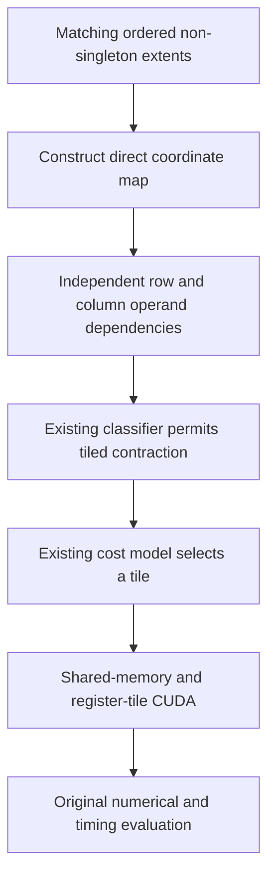

# Kiln: Singleton Reshape Maps and Measured Contraction Speedup

Kiln now preserves direct tensor coordinates when a reshape only inserts or removes singleton dimensions. This small index-map change exposes a previously hidden matrix contraction to the existing tiled scheduler. On the attention variant that motivated the investigation, recorded end-to-end latency falls from 703.734000 ms to 20.488400 ms, an observed 34.35x speedup. All 93 variants in the unchanged development cohort still pass the original nominal numerical and replacement checks.

Across the ten development families, the observed family-balanced geometric-mean ratio is 1.064442x. This is a sequential before/after development comparison, not a held-out generalization result. A separate source-binding improvement qualifies three additional complete families and 14 variants, bringing cumulative replay coverage to 24/200 tasks and 313/2,060 graphs. Native independent CUDA fixtures remain 60/63 because of the explicitly retained FP32 reference discrepancies described below.

> [!summary]
> Direct singleton-axis maps preserve indexing while exposing independent matrix coordinates. The existing scheduler then selects shared-memory tiling. Complete original replay validates all 93 comparison variants without relaxed tolerances. A separate 14-variant source cohort increases coverage; native precision compatibility and agent-driven generalization remain open.

## 1. Start from a measured compiler limitation

The preceding softmax milestone made real attention graphs executable through Kiln. Correctness qualification also exposed substantial performance limits: 88 of its 93 variants were slower than eager. The slowest accepted ratio was a face-parsing attention graph with FP16 input, whose compiled median was 703.734 ms compared with 15.431 ms eager in that replay.

The source computes matrix products, normalization, transpose and reshape. The slow final operation is a batched product with logical dimensions M=16,384, N=64 and K=256 over 64 batches. Its output contains 67,108,864 elements. These dimensions explain why an inefficient per-element reduction can dominate execution, but identifying the dimensions alone does not explain the selected schedule.

Script 263 compiles the actual source and calls Kiln's existing Loop IR and scheduling analysis. The first product permits tiled mapping. The final product permits only thread and row mappings. Both final operand loads appear structurally dependent on both matrix output dimensions, so the classifier cannot separate row-dependent operands from column-dependent operands.

The important evidence is the classifier input, rather than an assumption that a different tile size would be faster. The missing scheduling option follows from how the source's transpose/reshape epilogue is represented before scheduling.

## 2. Define singleton reshaping precisely

A singleton dimension has extent one, so its only valid coordinate is zero. Inserting, removing or moving such dimensions does not change the ordered sequence of varying coordinates. Consider an input shape `[B, 1, M, N]` and output shape `[B, M, N]`. The direct input coordinate corresponding to output `(b,m,n)` is `(b,0,m,n)`.

Kiln's previous general reshape construction first flattened output coordinates into a row-major linear index, then recovered input coordinates with division and remainder. That construction is correct, but can retain syntactic dependence on coordinates that ultimately cancel under their bounds. A structural free-variable analysis sees those expressions before any GPU optimizer can simplify them.

The new legality condition compares the ordered non-singleton extents of the two shapes. If both sequences agree, each varying input coordinate can be copied directly from the corresponding varying output coordinate. Singleton input coordinates become zero. If the sequences differ, the original general mapping remains necessary.

```text
input_axes  = input axes whose extent is not one
output_axes = output axes whose extent is not one

if ordered extents agree:
    singleton input coordinate = 0
    each varying input coordinate = matching output coordinate
else:
    flatten output coordinates and unflatten into input shape
```

The ordering requirement matters. Shapes `[2,3]` and `[3,2]` contain the same extents and have the same element count, but reshaping between them requires the general row-major mapping. Comparing a set of extents would be incorrect. Repeated extents remain unambiguous because the rule matches their positions in the ordered sequences.

## 3. Establish the indexing invariant

Let the common ordered non-singleton shape be `(u0,...,uk)`. Removing unit extents from a row-major stride product leaves that product unchanged. Under the direct coordinate correspondence, both input and output therefore have the same flattened index:

```text
linear_index = sum over r of (
    output_coordinate[matching_axis[r]]
    * product of non-singleton extents after r
)
```

Every singleton coordinate contributes zero. When both shapes contain only singleton dimensions, the sum is empty and the single element has flattened index zero. The same argument covers rank-zero tensors. This proves logical index equivalence for the rule's domain rather than relying only on example shapes.

The implementation is nine lines in the existing private `reshapeMap` in `packages/kiln/src/std/tensor.js`. Normal frontend decomposition and Tensor IR helpers already use that function. No attention-specific rewrite, alternative compiler pipeline or runtime special case is added.

The rule preserves logical indexing. It does not promise bitwise identity after downstream scheduling changes: a newly legal reduction schedule can use a different floating-point accumulation order. CUDA and source numerical validation are consequently required even after the index proof.

## 4. Explain the newly legal contraction

Before simplification, the final left and right loads both contain the batch, row, column and reduction variables in their structural free-variable sets. After simplification, the left load depends on batch, row and reduction, while the right depends on batch, reduction and column. This is the separation the existing contraction classifier needs.



For the targeted final contraction, the selected schedule changes as follows:

| Property | Previous compiler | Singleton-map compiler |
|---|---|---|
| Mapping | `MAP=row,TPB=512` | `MAP=tiled,BM=128,BN=64,BK=16,TM=8,TN=2` |
| Grid blocks | 67,108,864 | 8,192 |
| Threads per block | 512 | 512 |
| End-to-end median | 703.734000 ms | 20.488400 ms |

The previous row schedule assigns cooperative reduction work to individual output elements. The tiled schedule computes an output tile per block and reuses staged operand data across those elements. The grid consequently changes by a factor of 8192. This is a structural consequence of the selected mapping, not an additional measured speedup factor.

The first product's tile and the softmax row schedule remain the same in the targeted program. The final contraction is the visible schedule difference associated with the large latency change. The new median still exceeds its contemporaneous eager median of 15.515200 ms; the change does not make this workload faster than eager.

## 5. Preserve the existing compiler boundaries

The compiler already separates index construction, contraction classification, schedule selection and materialization. This change improves the representation supplied to that sequence. It does not expand tiling legality by weakening the classifier's predicates or asking the emitter to handle operands whose dependencies it cannot represent.

CUDA and WGSL emission are unchanged. Evidence identities include the IR expression and emitted content, so changed index expressions receive changed identities and source content. Unaffected kernels retain their valid evidence. A new code-generation version or compatibility alias is unnecessary for this IR-level change.

This placement also keeps the transformation reusable. The matching condition depends on tensor shapes, rather than a graph filename, dtype, model family or hardware identifier. The rewrite makes existing optimization structure visible wherever the same coordinate invariant holds. Whether the newly exposed schedule is profitable remains a separate scheduling decision.

## 6. Implement the missing source reshape interface

Independent fixture export exposed another missing component: public `torch.reshape` was unsupported even though method reshape already lowered. The fixture was retained, and the source binder was implemented rather than replaced with a simpler supported call.

The existing indexing helper now validates torch, ATen and method reshape/view forms through one static-shape routine. It permits one inferred -1 dimension, checks divisibility and element-count preservation, and verifies output shape and dtype against source metadata. Unknown or duplicate arguments and invalid static dimensions fail explicitly. Reshape/view results do not gain fresh-storage ownership, preserving conservative mutation handling.

Actual PyTorch/FX shape propagation validates source layout behavior before import. This work does not add arbitrary input alias analysis or general noncontiguous runtime input support. The compiler's logical transpose-plus-reshape case is tested independently from those broader source-layout requirements.

The installed PyTorch API schemas and documentation are archived in `pytorch-reshape-source-contract.json`. No PyTorch implementation is copied. The new coordinate rule is derived from row-major indexing and the observed dataset source; the public binding follows the source API contracts.

## 7. Record the full validation outcome

The core regression checks 444 combinations of scalar, singleton-axis placement, repeated extents and FP32/FP16/BF16 types. Additional cases verify transposed logical input, a general reshape that must retain the fallback, and the actual contraction epilogue pattern. All 33 compiler test files execute successfully. The FX suite contains 49 passing tests covering overload equivalence, inferred shapes, invalid metadata and mutation ownership.

Twenty-one source fixture programs compile. Their 63 native CUDA comparisons produce 60 passes and three failures, all on the FP32 tail contraction. This failed native result is preserved without relaxed tolerance. The initial export failure and missing-manifest compile attempt are also retained, together with their unchanged fixture sources.

A separate diagnostic compiles the old and new index lowerings for that exact tail fixture. The old lowering restores only tensor.js from c15c610 and explicitly does not claim to recreate an entire historical source snapshot. Both lowerings select row mapping for this small shape and produce identical outputs on all three input seeds.

Native PyTorch has TF32 enabled in the recorded container. On the wider input, its result differs from the rounded-FP64 reference by up to 0.0980453. Both compiler lowerings pass rounded-FP64 comparisons for all seeds. Both miss one strict full-FP32 comparison on the wider input, with the same one-element discrepancy. The diagnostic preserves every comparison at the same tolerances; it does not turn the original native 60/63 result into a pass.

These results distinguish index-map correctness, downstream floating-point behavior and native framework compatibility. The diagnostic's auxiliary scaled-error metric is descriptive and is not used as a benchmark acceptance rule. Native precision compatibility remains an open project requirement.

## 8. Re-evaluate the complete unchanged development population

The compiler candidate is committed as `fed37d1`. All 158 compiler/runtime source files on the DGX match that revision before the run. The same ten families and 93 variants used in the preceding milestone are rerun with the same frozen plan, numerical policy, container image, Node version, 20 warmups and 100 trials.

All 93 variants pass original replay execution, exactly one replacement and nominal t=-5 correctness. Source and scorer hashes are independently checked. All 93 generated Kiln source programs are byte-identical to their preceding forms; the changed compiler lowering supplies the new behavior. Exact executable structures differ for 81 variants and remain unchanged for twelve.

The comparison uses sequential before/after replays. Unchanged executable structures retain separate timing observations, so their differences describe noise or overhead rather than optimization. The report does not pool them into a new alias rule after observing performance.

| Zero-based task index | Variants | Observed geometric-mean old/new e2e ratio |
|---|---:|---:|
| 25 | 6 | 1.000810 |
| 41 | 3 | 1.003498 |
| 59 | 3 | 0.997667 |
| 66 | 6 | 1.005442 |
| 75 | 48 | 1.541098 |
| 86 | 6 | 1.003180 |
| 137 | 6 | 1.014988 |
| 174 | 6 | 0.998327 |
| 183 | 6 | 0.994807 |
| 193 | 3 | 1.189404 |

The family-balanced end-to-end ratio is 1.064442x and the corresponding GPU ratio is 1.065444x. Each family contributes equally after its variant log-ratios are averaged. This prevents the 48-variant attention family from receiving 48 times the weight of a one-variant family.

There are 58 observed faster variants, 34 slower variants and 1 tied variant. The largest observed slowdown is 1.129 percent. These unpaired measurements do not establish whether small changes of that scale exceed noise. The large targeted improvement and the aggregate development observation should not be presented as a statistical or unseen-program generalization result.

Static exports now contain 248 kernels rather than 254. The maximum scratch requirement remains 1.5 GiB. These structural changes help describe the resulting programs, but do not independently establish the cause of every timing difference. Relative to eager, seven candidate variants are faster and 86 slower in the recorded replay.

## 9. Qualify new source coverage separately

The public reshape binding raises full import eligibility from 1,122 graphs/61 complete families to 1,136 graphs/64 complete families. A full 200-task re-audit verifies zero import regressions. Every newly complete family is frozen into a separate three-task, 14-variant plan before its GPU evaluation, with no shape or dtype filtering.

All three families and all 14 variants pass original replacement, execution and nominal numerical checks. They use the same verified compiler source snapshot as the 93-variant comparison. Their role is coverage qualification; they are not added to the old/new performance population after its declaration.

The cumulative ledger consequently reaches 24/200 complete tasks, 313/2,060 individually accepted graphs and 248 graphs within complete tasks. This remains cumulative evidence across recorded compiler revisions. It is not a uniform full-corpus release run, and import eligibility still exceeds demonstrated execution support.

## 10. Keep one runner and one acceptance implementation

Both evaluations use the existing complete-task runner and shared audit. Ticket wrappers now accept an explicit frozen plan and run name instead of creating another orchestration implementation. Collection requires terminal state; source staging waits until the previous immutable run is complete. An observation timeout never triggers an automatic restart.

The evidence set includes the original failed native fixtures, the complete diagnostic, the 93-variant replay, the separate 14-variant qualification and the cumulative coverage ledger. Script 278 checks exact membership, generated source identity and software configuration before comparing timings. Any numerical failure disables its aggregate speedup report rather than being omitted.

Primary implementation and review references are:

- `packages/kiln/src/std/tensor.js`: shared singleton-coordinate reshape construction.
- `packages/kiln/test/singleton-reshape.mjs`: numerical cases and contraction visibility.
- `integrations/passnet/fx_indexing.py` and `test_fx_reshape.py`: source shape contract.
- `sources/softmax-cohort-v3-verified-facts.json`: complete regression evidence.
- `sources/singleton-reshape-development-comparison.json`: exact old/new comparison.
- `sources/reshape-source-cohort-v1-verified-facts.json`: separate new source coverage.
- Design 15 and diary Steps 127 onward: legality, failures, decisions and commits.

## 11. Interpret the result within the research objective

This is a reusable compiler improvement motivated by an observed development example. The match condition is a shape/index invariant and the replacement is a canonical coordinate construction. Its legality argument is separate from the scheduler's profitability decision. It therefore adds compiler knowledge rather than a specialized replacement kernel for one graph.

The change is Codex-authored engineering work, not a completed original PassAgent synthesis experiment. Original model/provider configuration remains pending. Broader agent-driven transformation discovery and a frozen unseen-family evaluation are still required to answer the generalization question posed by the project.

The hardware and integration limits also remain explicit: measurements use DGX Spark GB10 and the recorded NVIDIA PyTorch development container, rather than the paper's A30 environment. Matching and dispatch use the project's declared modified integration protocol. Numerical thresholds and the original scorer remain preserved, but the resulting measurements are not exact paper reproduction scores.

The next research step is to evaluate compiler transformations across new declared training and confirmation families while preserving these distinctions. Remaining operator, dtype and layout support, native numerical compatibility and a uniform benchmark run remain part of the active full objective.
