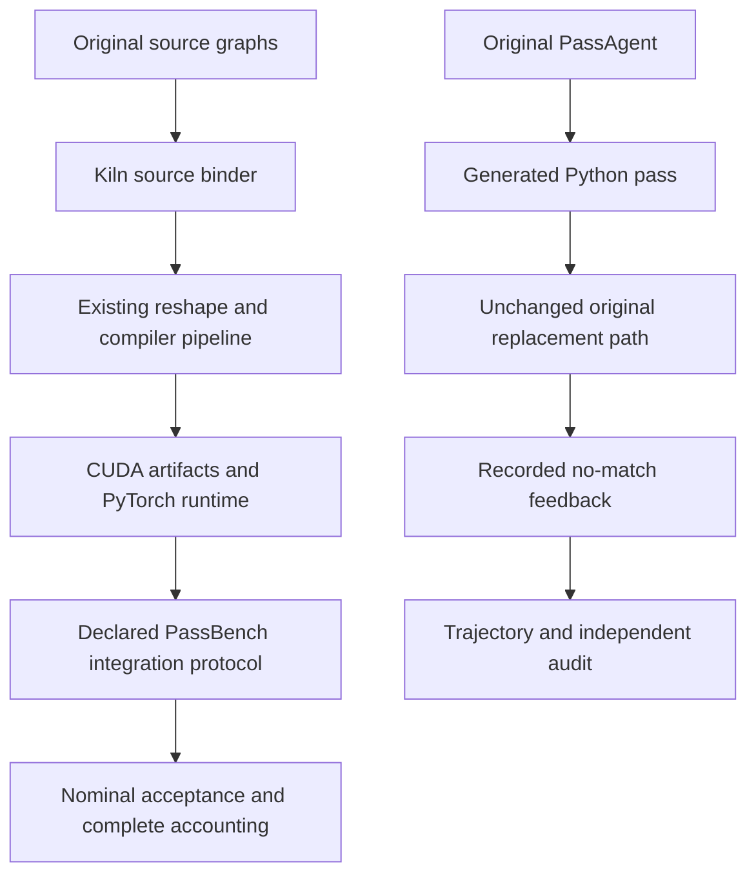

# Singleton view contracts and an audited failure of the original agent

A singleton dimension has size one. A benchmark task groups concrete program variants with related operation structure. Kiln now imports the operations that insert and remove singleton dimensions through its existing reshape operation. Twelve independent CUDA fixture programs pass all 72 finite output comparisons, and full-family qualification adds four complete tasks and 20 individual graphs. Cumulative accepted replay reaches 31/200 complete tasks and 358/2060 individual graphs. A separate import audit reaches 1251 graphs and 76 complete families. Import eligibility and accepted execution remain different measurements.

PassAgent writes compiler passes using a language model and calls PassBench to test them. The original reference run also finishes in this milestone. Its 50-step shipping smoke produces seven evaluator calls, all rejected before candidate correctness or timing, and a best evaluator score of 0.1. The original trajectory nevertheless contains reward 1.0 because the checked-out runtime uses an explicit reward stub. An additional diagnostic confirms that the original pattern tracer creates a matching discrepancy on the exact DGX evaluator runtime. These findings establish useful reference evidence, but they do not constitute a successful agent optimization or a full paper reproduction.

> [!summary]
> Four complete task families and 20 individual graphs are newly accepted. Two evaluated graphs fail the unchanged nominal numerical criterion, and 33 variants remain unexecuted after their family stops at an export check. The reference agent completes its operational loop, while its placeholder reward is excluded and its matching failure is investigated independently.

## 1. Start with the tensor contract

A shape is the ordered list of dimension sizes; an axis is an index into that list. Unsqueeze inserts a unit dimension, while squeeze removes selected unit dimensions. These operations preserve logical values without requiring new arithmetic on them.

For example, a tensor with shape `[2,3]` can be expanded at axis 1 to shape `[2,1,3]`. Its logical element at `[i,0,j]` is the original element at `[i,j]`. Squeezing axis 1 reverses that shape change. Squeezing axis 0 in the original `[2,3]` shape leaves it unchanged because that axis has size two. A correct implementation must preserve these distinctions rather than treating every squeeze as unconditional dimension removal.

The importer already has a shape-preserving, dtype-checked route to `N.reshape`. The new source binder computes the required output shape from the source operation and then invokes that shared route. It does not infer the operation solely from supplied result metadata. A malformed graph with the same element count but the wrong singleton position must still be rejected.

An equivalent Kiln expression for the example is:

```javascript
const expanded = N.reshape(x, [2, 1, 3]);
```

This is an illustration of the emitted operation, not a new frontend API. The actual binder is `lower_singleton_view` in `integrations/passnet/fx_indexing.py`, used by `fx_import.py` for Tensor methods, public torch functions and explicit ATen overloads.

## 2. Establish legality before lowering

For rank r, unsqueeze accepts an axis from `-r-1` through r. Negative axes are normalized against r+1 because the insertion positions belong to the output rank. Squeeze normalizes explicit axes against the input rank, with the scalar convention allowing axis 0 or -1 as a no-op. Confusing these normalization ranges produces errors at the first or final insertion position even when interior examples work.

Squeeze without an axis removes every dimension whose size is one. An explicit axis list removes only selected unit dimensions; selected non-unit dimensions remain. An empty axis list removes nothing. The binder rejects duplicate axes after negative-index normalization, invalid overload forms, unsupported noninteger axes, and metadata that disagrees with the independently computed shape or dtype. Explicit None is kept distinct from an omitted argument, following the supported source-call contract and archived installed-runtime probes.

The legality argument follows directly from logical indexing. For a row-major shape s, define the flattened logical position as

$$
F(c;s)=\sum_k c_k\prod_{j>k}s_j.
$$

Inserting a unit axis contributes a coordinate equal to zero. Its new term is therefore zero, and multiplying another coordinate's stride by one changes nothing. Removing a unit axis reverses the same argument. The ordered non-unit dimensions and logical value order remain unchanged. This is exactly the case handled by Kiln's existing singleton reshape coordinate canonicalization.

The proof concerns logical coordinates. A preceding transpose can change their relationship to physical storage. The compiler composes the reshape coordinate map with the earlier transpose map, so `x.transpose(...).unsqueeze(...)` must still read the correct original coordinates. It must not reinterpret a noncontiguous intermediate as an unrelated contiguous storage buffer. The independent CUDA fixtures include this composition.

The primary API contracts are the versioned [PyTorch unsqueeze documentation](https://docs.pytorch.org/docs/2.9/generated/torch.unsqueeze.html) and [squeeze documentation](https://docs.pytorch.org/docs/2.9/generated/torch.squeeze.html). Direct page downloads returned HTTP403, so the ticket also archives the upstream v2.9.1 docstring source, installed docstrings, exact ATen schemas and 121 independently executed source probes. The binder is independently implemented dimension arithmetic; no PyTorch implementation was copied into Kiln.

## 3. Preserve the ownership boundary

PyTorch singleton operations produce storage-sharing views. Kiln's current integration uses a value-semantic contract and conservative rules for functionalizing mutation. Supporting the correct values and shape of a view does not grant permission to mutate an aliased input.

The importer therefore does not add a view result to its set of values that own fresh storage. Even when a view's producer was fresh, the current analysis rejects an in-place operation through that view instead of assuming that no other observable alias exists. More precise alias analysis could eventually admit additional cases. That extension requires its own legality argument and tests.

This matters in a small example:

```python
fresh = x + 1
view = fresh.unsqueeze(0)
return torch.nn.functional.relu(view, inplace=True)
```

The new shape binder does not silently authorize the last operation. It preserves the existing rejection until ownership analysis can prove the transformation safe. This limits current coverage while protecting correctness. The milestone does not claim general storage-alias equivalence, arbitrary strided inputs or complete PyTorch view semantics.

The implementation also consolidates operand metadata lookup for matrix, normalization and singleton lowering in one helper. Source layout rules remain in the existing indexing module. Reusing that boundary avoids introducing a second reshape implementation or another parallel layout subsystem.

## 4. Separate translation, execution and complete tasks

A benchmark graph is one concrete program variant. A task groups related variants, potentially with different shapes or dtypes. Complete task acceptance requires every listed variant to pass. Individual accepted graphs from an incomplete task remain useful evidence, but they cannot be counted as a complete task.

All 57 FX tests pass after adding source binding, malformed-call, ownership and FX/Dynamo matching cases. Equivalent public, method and ATen forms produce identical Kiln scripts. A test initially exhausted Dynamo's per-code compilation cache; resetting that cache between independent capture cases fixes test isolation without changing matcher predicates or compiler semantics.

The complete 2060-graph import audit increases eligibility from 1196 to 1251 graphs and from 69 to 76 complete families, with zero regressions. Seven newly complete families contain 55 variants. Their complete original membership is frozen before GPU qualification, without selecting favorable shapes or dtypes.

The independent CUDA fixtures cover four shape classes under FP32, FP16 and BF16: a scalar, a unit vector, interior singleton axes and a larger tail dimension. Each program returns six outputs, including insertion, removal, explicit axis selection and transpose composition. All 12 programs compile and all 72 finite output comparisons have zero error. This validates the supported primitive paths; it does not prove every composition in the corpus.

The full-family results are:

| Task index | Variants | Accepted at nominal t=-5 | Outcome |
|---|---:|---:|---|
| 10 | 33 | 0 | Export check stops the family; no original evaluation runs |
| 39 | 6 | 6 | Complete task accepted |
| 88 | 3 | 2 | One FP32 graph fails nominal numerical acceptance |
| 95 | 3 | 2 | One FP16 graph fails nominal numerical acceptance |
| 103 | 6 | 6 | Complete task accepted |
| 138 | 2 | 2 | Complete task accepted |
| 190 | 2 | 2 | Complete task accepted |
| Total | 55 | 20 | Four complete tasks, two evaluated rejections,33 unexecuted |

The four complete tasks contain 16 graphs. Four more accepted graphs belong to the two incomplete tasks. Accordingly, the cumulative ledger advances from 27 complete tasks / 338 individual graphs to 31/358, while graphs inside complete tasks increase from 273 to 289. The 31 tasks are cumulative replay evidence across recorded compiler snapshots, not a uniform current-release rerun of all 200 tasks.

## 5. Keep numerical failures in the result

Task 10 first produces a successful artifact for one variant, then a FP16 S-ViPNAS-Res50 variant fails Kiln's end-to-end export check. The retained diagnostic is `end-to-end check FAILED`. Because the family stops during compilation, none of its 33 variants proceeds through the original evaluator. The successful first artifact is not promoted to original-benchmark acceptance.

Tasks 88 and 95 reach original evaluation, each with exactly one replacement and successful process execution. One graph in each task nevertheless fails the nominal numerical criterion. The FP32 K-Net_fcn case passes at t=-3 but fails at -5 and -4; the FP16 case passes at -4 but fails at -5. Those looser points remain diagnostic information. They do not replace the declared t=-5 acceptance rule.

These observations separate a primitive's supported semantics from a complete computation's numerical behavior. The view fixtures are exact on their tested finite inputs, while the larger compositions still contain arithmetic and reduction behavior that needs investigation. This run does not establish the root cause of the three unresolved families. Predecessor operations, accumulation and rounding remain concrete follow-up subjects; no threshold is relaxed to convert a rejection into acceptance.

The verifier checks 165 committed compiler/runtime source files against revision `a0400576e1eafd20ce018db903e6e0639a92ee62`. It checks the final remote source snapshot, frozen membership, generated script hashes, 23 artifact identities from 24 compilation attempts, and scorer/log hashes. Native fixture artifacts are also bound directly to the committed generated source files. An initial verifier assumption that fixture manifests contain a task-specific source-hash field was corrected by checking those actual committed bytes instead.

The compiler uses the declared A100 cost-model target for scheduling, and CUDA execution runs on the DGX Spark GB10. The launcher compiles for the detected device architecture. These hardware and scheduling identities are retained in the run plan; the milestone makes correctness and coverage claims rather than a paper-hardware performance comparison.

## 6. Read the original agent's actual outcome

The reference experiment runs the original PassAgent with the original PassBench source in a pinned image, using a declared local unquantized Qwen3-30B-A3B model. It is the shipped one-task/one-graph CrossViT operational smoke, not the official 200-task/2060-graph evaluation.

The run finishes after 50 steps and 1086.22 seconds with `exit_reason=abs_step_limit`. The trajectory contains 30 file editing actions, seven evaluator actions and 13 responses without a function call. All seven evaluator calls explicitly reject matching and report the configured0.1 failure contribution. No generated implementation reaches a successful candidate correctness or timing result.

The original trajectory's reward field is misleading if read without its producer:

| Evidence | Observed value | Meaning |
|---|---|---|
| Original trajectory reward | 1.0 | Unconditional placeholder in the checked-out runtime |
| Original test output | Reward calculation not yet implemented | Confirms the reward stub |
| Audited evaluator score | 0.1 | Failure contribution from actual tool feedback |
| Original evaluator acceptance | None | All seven calls stop at matching |

The audit independently parses the tool's Score data JSON and checks it against the saved best score. Original agent and evaluator source are not modified. The serialized best snapshot contains an empty Triton convolution kernel. Because the agent only updates its best snapshot on a strictly higher score and all evaluations tie, this early snapshot remains selected. It is not evidence that every later edit was identical; it is evidence that the retained best implementation is invalid and no later candidate obtains a better evaluator result.

The model's native serving context is 40960. The trajectory's 131072 token-limit field is an agent-run budget, not a request-level generation limit: the original model_query does not pass max_tokens to LiteLLM. The largest recorded prompt is 34415 tokens. This run therefore supplies no observed context-overflow explanation for the missing function calls.

## 7. Reproduce the matching discrepancy independently

The saved pattern expresses the same convolution and in-place ReLU as the source model. Ordinary symbolic tracing produces a functional ReLU call with `inplace=True` in kwargs. Dynamo captures the corresponding source call in that form. An ordinary subgraph matcher finds one match.

PassNet's actual replacement path uses `force_args_symbolic_trace`, which moves inspectable Python function arguments into positional form. For this ReLU, the resulting pattern becomes:

```text
pattern: relu(convolution, True)
target:  relu(convolution, inplace=True)
```

These calls describe the same source arguments, but the matcher compares different graph representations. The diagnostic reporting path uses ordinary symbolic tracing, which explains why it can find no specific node failure while actual replacement still finds no match.

The exact-image diagnostic confirms the effect on the DGX under Torch 2.12.0a0+5aff3928d8.nv26.05. It tests CPU and CUDA, each with small and original task shapes. Every case produces the same counts:

| Pattern/target treatment | Matches |
|---|---:|
| Ordinary symbolic tracing and Dynamo | 1 |
| Original forced-argument pattern and Dynamo | 0 |
| Both diagnostic graphs normalized | 1 |

The last row is a diagnostic control, not a repair applied to the original agent run. It neither executes the empty candidate kernel nor changes the recorded rejection. The paper-version PyTorch 2.9.1 matcher source is also archived. Static inspection shows its schema-based argument normalization is restricted to ATen OpOverload targets; this is not equivalent to running the paper's complete Dynamo/CUDA environment. Paper-version behavior remains a separate confirmation task.

The public checkout, local software stack and chosen checkpoint differ from the paper's experimental configuration. The observed discrepancy must be reported with those identities rather than used to claim that the published paper results are invalid or that the model alone caused every failure.

## 8. Keep the two experiments independent

The compiler qualification uses the existing declared Kiln integration protocol, including its source-argument normalization. The original agent run retains original PassNet behavior. Comparing their acceptance counts directly would conflate different populations, candidate quality and matching protocols. The Kiln replay uses 20 warmups and 100 trials; the original shipping entry uses 25 and 100. These configurations are retained rather than presented as an equalized performance comparison.



The model server is stopped after terminal collection, before the new compiler qualification. The first fixture launch stops on a missing runtime module path; its log is preserved. A separate diagnosed launch supplies the documented path, reuses the already compiled artifacts, and passes the 72-output native gate before running all 55 corpus variants. No live workload is restarted because an observation times out, and no serving overlaps this qualification.

The remaining work follows the evidence. Resolve the export-check failure and two nominal numerical discrepancies while retaining all 33 unexecuted variants. Verify paper-version matching and declare any repaired reference protocol separately. Broader original-agent evaluation and Kiln-native transformation synthesis remain open, as do full 200-task support and uniform controlled release measurements. The previous fixed-compiler confirmation result remains an independent research experiment; this support milestone adds no new held-out speedup claim.

## Evidence and continuation

Source work is in `/home/manuel/code/wesen/kiln/worktrees/passnet`, branch `research/passnet`, ticket KILN-005. Design 15 explains reshape legality and source singleton binding; design 18 explains the local provider, terminal original-agent result and exact-runtime matching diagnosis. Reference 21 stores this report, and diary Steps 144 onward preserve the implementation and experiment sequence.

The authoritative new artifacts are `singleton-view-source-cohort-v1-verified-facts.json`, `singleton-view-source-cohort-v1-audit.json`, `singleton-view-native-fixtures-v1/`, `singleton-view-source-snapshot-v1.json`, and the cumulative `kiln-coverage.json`. The reference-agent audit is `original-agent-smoke-terminal-v1/verified-facts.json`, with complete trajectory/conversation, saved pass files and exact-runtime graph diagnostics alongside it. All are under the ticket's `sources/` directory.

The original tracer and reward behavior are inspectable in the pinned [custom replacement implementation](https://github.com/PaddlePaddle/PassNet/blob/61c64709f6d324216ae8252cec3cdc35b2dd5da5/pass_bench/torch/custom_replacement.py) and [PassNet Docker runtime](https://github.com/PaddlePaddle/PassNet/blob/61c64709f6d324216ae8252cec3cdc35b2dd5da5/pass_agent/runtime/passnet_docker.py). No code from these algorithms is ported into the new singleton binder.

This report follows [[ARTICLE - Kiln - Original PassAgent Execution and Experimental Identity]] and [[ARTICLE - Kiln - Exact GELU and Complete Source Qualification]]. The full objective remains active; 31 accepted tasks is a measured milestone within the 200-task scope.
