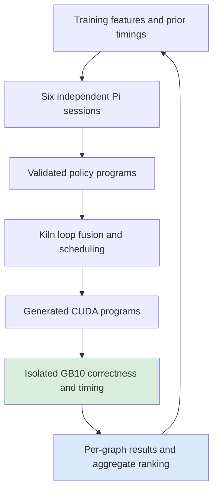

# Kiln: Six GLM Lanes and the Cost of Fusing Matrix Layouts

A language model generated a reusable Kiln fusion policy that improved the family-balanced end-to-end speedup on twelve development graphs to 1.2856×. A fresh run of the same experiment measured 1.2874×. The policy came from one of six concurrent Pi sessions using LunaRoute's `glm-5.3-flash` route. Its strongest observed improvement coincides with a change from a fused row-mapped matrix kernel to a tiled matrix kernel followed by a separate layout conversion.

This report explains that result, the implementation that produced it, and the limits of the evidence. The policy improved four graphs, regressed two, and left six executables unchanged. It has not been promoted into Kiln's default compiler, and its behavior on previously unseen graph families remains untested.

> [!summary]
> The research has advanced from reliable proposal generation to a repeated measured compiler-policy improvement. The central finding is that fusion can remove profitable scheduling opportunities. The next experiment should test a targeted matrix/layout decision, because the discovered policy also causes substantial regressions.

## 1. What the model is optimizing

A computational graph describes tensor operations and their dependencies. A compiler lowers that graph through intermediate representations into executable kernels. A compiler pass rewrites one of those representations. A profitability policy determines when a supported rewrite should be applied; it does not establish mathematical correctness by itself.

Kiln's loop-fusion transformation combines a producer computation with one or more consumers. Combining them can avoid intermediate memory traffic and kernel launches. It can also duplicate work or produce a loop structure for which the scheduler selects a slower implementation. A schedule specifies how the generated computation maps to GPU threads, blocks, tiles, and memory staging. Fusion and scheduling are therefore coupled decisions.

The current agent interface generates policy programs within an existing grammar. It supports aggregate thresholds, decision trees, selective consumer decisions, and region cost policies. The agent does not yet invent arbitrary compiler algorithms or prove new rewrite legality conditions. Kiln continues to implement the transformations and their legality checks.

For an aggregate threshold policy, the profitability condition is approximately

\[
W_{\mathrm{fused}} \leq \theta W_{\mathrm{original}},
\]

where the work quantities are compiler estimates of scalar work. These quantities are not measured GPU latency. The default threshold is 1.02. A selective policy additionally decides which consumers participate before the aggregate decision is evaluated. Its consumer threshold compares `fusedConsumerWork` with `consumerWork` multiplied by the threshold; this denominator differs from the aggregate policy's `originalWork`.

That distinction explains why assigning 1.02 to both thresholds does not reconstruct the default compiler. The two predicates evaluate different quantities at different points in the transformation.

## 2. From the earlier negative result to a usable agent

The preceding report, [[ARTICLE - Kiln - Controlled Policy Search and Unchanged Winners]], documented a completed comparison in which every method selected unchanged Kiln. The local Qwen model's generated actions violated the declared XML protocol and produced no accepted artifacts. Deterministic proposals either matched baseline or reduced aggregate performance.

The next implementation adopted the requested Pi coding-agent SDK and the installed LunaRoute extension. The selected route is `lunaroute/glm-5.3-flash`; the approximate name `glm-fast` was not an available alias in the inspected catalog. Pi supplies provider integration, native tool calling, and session records. The compiler task exposes only three tools: inspect training features, submit policy data, and finish the batch.

The first real GLM batch completed in 20.2406 seconds. Four submissions produced three accepted policies and one schema rejection, `Unknown fusion policy field`. All three accepted policies compiled across the twelve training graphs. GPU evaluation then scored the changed candidates at 0.8877× and 0.9594×; the remaining candidate exactly matched baseline.

This first result established a practical proposal-to-measurement loop. It did not establish an optimization gain. It also supplied concrete feedback for the next batch: the model could inspect both the proposed policies and their measured development outcomes.

## 3. The implementation and its research boundary

The working repository is `/home/manuel/code/wesen/kiln/worktrees/passnet`. The relevant implementation resides in `integrations/passnet/`.

| Component | Responsibility |
|---|---|
| `pi_policy_session.mjs` | Construct the Pi session, select the model, and expose the three policy tools |
| `pi_policy_tools.mjs` | Account for native submissions and return stored task outcomes |
| `run_pi_policy_agent.mjs` | Own the session, Python subprocess, traces, and terminal result |
| `native_policy_rpc.py` | Serialize requests into one persistent `NativePolicyTask` |
| `native_policy_task.py` | Validate proposals and retain accepted optimization artifacts |
| `fusion_policy.mjs` | Interpret policy programs as compiler profitability decisions |
| `compile_policy.mjs` | Compile the corpus under one policy and check reference behavior |
| `measure_policy.py` | Check GPU results and collect repeated latency measurements |
| `select_policy.py` | Rank candidates using the declared training objective |

The execution path is:



The implementation preserves prompts, proposals, generated artifacts, and measurements. Exact executable aliases share timing evidence, preventing identical code from appearing faster merely because it was timed separately. A policy's source identity and its executable identity are different: distinct policies can make the same decisions on every graph.

Some integration work became disproportionate to the immediate research question. The user explicitly redirected the project away from production hardening. The resulting working rule is to retain essential correctness, reproducibility, and timing controls while prioritizing actual candidate generation and measurements. Further framework refinements should solve a demonstrated experimental problem.

The installed SDK did expose a relevant ordering issue: it validates tool arguments before tool execution, and catches extension-hook exceptions. The implementation therefore accounts for identifiable submissions at the awaited assistant-message boundary and limits additional inference at the stream entry point. These details explain the current code; they should not become a requirement to exhaust every possible failure mode before the next useful experiment.

## 4. Six concurrent hypotheses

The second GLM experiment used six independent proposal sessions. Each received the prior policies and measured ranking, together with structural training features. The hypotheses covered launch-cost region selection, materialization-cost region selection, selective consumers, graph fanout, small producers, and a counterhypothesis lane encouraged to challenge the earlier proposals.

Each lane had its own session, configuration, and output directory. Proposal generation ran concurrently; GPU measurement remained isolated. The lanes completed in approximately 8.5–21.3 seconds each. Thirty-six submissions yielded 34 accepted artifacts, which reduced to 33 unique policy artifacts after cross-lane deduplication.

The resulting experiment compiled 35 policies including unchanged and explicit-default controls over the twenty-graph corpus. GPU training evaluation used twelve graphs. The additional eight graphs were compiled because the established evaluator qualifies the complete declared corpus, but this does not make them a new held-out result. The population has already been used during development.

The candidate collection algorithm is straightforward:

```text
for each of six hypotheses concurrently:
    create a fresh Pi session and task
    provide training features and previous measured outcomes
    collect policy submissions and validation feedback

merge identical accepted policy artifacts across lanes
compile each unique policy with the same compiler and numerical settings
measure distinct executables on an isolated GPU
rank policies using all declared training graphs
```

This is exploratory search with timing feedback. It is not an equal-cost comparison between six methods, and it does not support a claim that any lane is generally superior.

## 5. The winning policy and the measured objective

The winner, `glm-28`, originated from the sixth submission in the selective-consumer lane. Its entire policy program is small:

```json
{
  "format": "kiln-fusion-policy/1",
  "id": "glm-28",
  "kind": "selective",
  "tree": { "threshold": 1.02 },
  "consumer_tree": { "threshold": 2 }
}
```

This program supplies a consumer-selection predicate and retains the default aggregate threshold. Its simplicity makes the outcome easier to investigate, but does not imply that the threshold 2 is universally appropriate.

For each graph, speedup is baseline latency divided by candidate latency. The selector averages log speedups within each sample family, then averages those family values and exponentiates:

\[
S=\exp\left(\frac{1}{|F|}\sum_{f\in F}
\frac{1}{|G_f|}\sum_{g\in G_f}\log\frac{T_0(g)}{T_\pi(g)}\right).
\]

The objective uses synchronized end-to-end latency. Measurements also retain CUDA-event stream elapsed time, which includes gaps associated with dispatch. This experiment uses twenty warmups, one hundred timed trials, three repeats, and the existing IQR stability criteria. Execution is on the DGX Spark's GB10; A100 remains the compiler scheduling-target proxy.

| Experiment | Selected policy | Aggregate speedup |
|---|---|---:|
| First four-submission GLM batch | Baseline | 1.0000× |
| Six-lane search | `glm-28` | 1.2856× |
| Fresh repeat of the same compiled experiment | `glm-28` | 1.2874× |

All policies remained eligible in the six-lane rankings. Many were exact aliases, and some had substantial regressions, with the worst aggregate near 0.2134× in the initial run. The positive result must therefore be attributed to the selected policy, not to policy generation in general.

## 6. Following one matrix/layout example

One representative source graph computes a linear operation, reshapes its output into heads, and transposes the head and sequence axes. For the largest observed win, the matrix input has shape `[1, 82, 512]`, and the weight has shape `[512, 512]`. A separate output in the same graph performs a layout conversion of another input.

The baseline emits a layout kernel for that separate output and a fused matrix/layout kernel for the linear result. The fused kernel is row-mapped with `TPB=1024`. Under `glm-28`, the matrix result is materialized separately using `MAP=tiled,BM=32,BN=16,BK=8`, followed by a layout kernel. Total kernel count increases from two to three.

Observed end-to-end latency falls from 1.17646 ms to 0.0618875 ms, approximately 19.01×. The additional launch and intermediate storage are outweighed by a much faster generated computation in this case. The schedule change is direct evidence; attributing every part of the gain specifically to tiling still requires a controlled ablation.

A second example has a `[1, 64, 512]` input, a `[512, 512]` weight, and a bias. Its baseline fuses the linear operation with reshape and transpose into one row-mapped kernel. The candidate uses a tiled matrix kernel and a separate layout kernel. Its observed speedup is approximately 1.568×.

The counterexample is equally informative. A graph producing `[1, 32, 15, 40]` has a baseline row-mapped kernel. After separation, its matrix kernel remains row-mapped, now with `TPB=128,STAGE=all`, followed by a layout kernel. Latency rises from 0.0844555 ms to 0.207151 ms, giving approximately 0.408× speedup. Separating operations did not provide the same scheduling benefit.

## 7. Why the aggregate is insufficient

Across the twelve training graphs, the winner improves four, regresses two, and shares the exact baseline executable on six. The six changed-graph speedups in the first run are approximately 19.010×, 1.412×, 0.839×, 1.415×, 1.568×, and 0.408×. The very large improvement on one graph materially affects the aggregate.

Repeating the same experiment establishes that the aggregate is stable across those two runs. It does not remove selection effects from searching 33 policies, establish architecture-disjoint generalization, or prove that all numerical regimes are supported. No confidence interval or broad model-provider comparison follows from these two runs.

This remains a modified explicit FP32 compiler-policy protocol, including separate contraction and a highest-precision matrix reference. It is not the official PassBench aggregate score. Neither the successful GPU run nor the number of compilations increases the established full200 coverage claim. The broader reproduction still requires unsupported operation and dtype work, native numerical repairs, and additional validation.

## 8. The next compiler experiment

The observed schedules suggest a more specific research question: when does fusing a layout consumer prevent a profitable matrix schedule? A useful transformation policy would preserve the matrix operation in those cases while keeping fusion where materialization provides no scheduling benefit.

One possible future design is to compare feasible schedules for fused and separated forms. The following is proposed pseudocode, not implemented behavior:

```text
if producer is a recognized matrix operation
   and consumer is a supported layout transformation:
    fused = estimate_best_schedule(fuse(producer, consumer))
    separate = estimate_best_schedule(producer)
               + estimate_layout_cost(consumer)
               + estimate_extra_dispatch_cost()
    choose the legal form with lower estimated time
else:
    retain the existing profitability decision
```

A cheaper feature-based rule might approximate that comparison, but its features should represent the mechanism rather than encode task identities. The positive and negative cases above supply immediate tests. A controlled ablation should separately test materialization, schedule eligibility, and the schedule actually selected.

Thinking level is now configurable in the Pi session, with requested and effective levels recorded. A planned comparison can use two fixed hypotheses at low, medium, and high thinking levels. This is a future experiment; no measured conclusion about thinking level is available yet. The user clarified that token cost should not constrain exploratory work.

## 9. Evidence and continuation

The authoritative ticket is `KILN-005` under `ttmp/2026/10/30/KILN-005--reproduce-passnet-and-evaluate-reusable-kiln-compiler-transformations/`. Its second diary volume records Steps 160 onward. The measured result and mechanism analysis are committed through `d1f1b42`.

| Evidence relative to the ticket | What it establishes |
|---|---|
| `sources/pi-policy-batch-v1/run/` | First real GLM prompts, tools, accepted artifacts, and 20.24-second run |
| `sources/pi-policy-train-results-v1/selection.json` | Initial negative GPU result |
| `sources/pi-six-lanes-v1/summary.json` | Six completed concurrent proposal sessions |
| `sources/pi-six-lane-study-v1/origins.json` | Accepted artifact provenance after deduplication |
| `sources/pi-six-lane-results-v1/` | First positive GPU measurements and ranking |
| `sources/pi-six-lane-repeat-results-v1/` | Fresh repeated measurements and ranking |
| `sources/pi-selective-winner-analysis-v1.json` | Changed-graph latencies, kernel shapes, and schedules |
| `scripts/452`–`455` by filename prefix | Lane execution, study preparation, repeat, and analysis procedures |

The next milestone should combine a targeted compiler change with evidence on both the known regressions and additional graph families. The current result supplies a working agent loop and a concrete scheduling problem to investigate. It does not yet establish a generally improved compiler.
