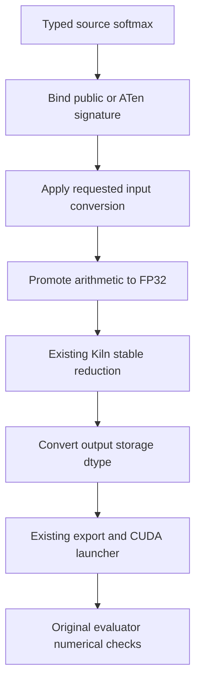

# Kiln: Softmax Source Semantics and Complete Benchmark Qualification

Kiln's PassNet integration now translates the public and ATen softmax interfaces through its existing stable reduction implementation. The source binder preserves reduction axes, scalar shapes, explicit dtype conversion and low-precision accumulation. Independent fixtures establish CUDA correctness across source call forms. Original benchmark execution then establishes a separate property: whether a generated pass actually matches the source graph, executes the Kiln artifact and satisfies PassBench's numerical criterion.

The complete repaired cohort contains ten task families and 93 graph variants. Its audit accepts 10 complete families and 93 individual graphs, leaving 0 variants nonaccepted. The cumulative original-replay ledger now records 21/200 complete tasks and 299/2,060 individually accepted graphs. Import eligibility is broader: 1,122 graphs across 61 complete families. These counts describe different stages of the system and must remain separate.

> [!summary]
> Source softmax reuses Kiln's compiler primitive rather than adding another implementation. The first original-evaluator run exposed a real FX/Dynamo argument mismatch and preserved all failures. The repair normalizes public defaults while retaining axis and dtype predicates. Complete membership, source hashes, raw evaluator logs and upstream numerical checks determine acceptance.

## 1. Define the evidence categories before counting support

A PassBench task is a family of graph variants with a common operator pattern. Variants can differ in shapes and dtypes. A compiler can import several variants of a task without supporting all of them, and a generated executable can be numerically correct without matching the benchmark's graph. A complete-task claim therefore requires every listed variant to pass the declared execution protocol.

This project tracks three successive boundaries. Import eligibility proves that the typed source graph can be represented in Kiln's frontend. Fixture qualification proves that particular source programs execute correctly through generated CUDA and the PyTorch runtime. Original benchmark acceptance additionally proves exact graph membership, replacement matching, successful execution and the original numerical criterion. An import counter cannot substitute for an execution counter.

Before this change, import eligibility was 1,029 graphs and 51 complete families. Original replay acceptance was eleven complete tasks and 206 individual graphs, including passing variants from incomplete families. Those eleven complete tasks contained 141 graphs. These figures were cumulative across recorded compiler revisions, rather than a uniform full-suite test of one release.

Softmax appeared as the first import blocker in 135 graph records. Implementing it made 93 additional graphs importable and ten additional families complete at the import boundary. The other 42 records exposed later blockers. A first-blocker inventory therefore measures where translation stops; it does not guarantee that implementing one operator will make every affected graph complete.

## 2. Reuse the existing stable reduction

For one slice of a tensor along dimension d, softmax is defined by exponentials normalized by their sum. Direct exponentiation can overflow for large positive logits. Subtracting the maximum preserves the mathematical ratio while keeping finite exponentials within a manageable range:

```text
maximum = reduce_max(input, d)
shifted = input - broadcast(maximum)
weights = exp(shifted)
normalizer = reduce_sum(weights, d)
result = weights / broadcast(normalizer)
```

Kiln already implements this decomposition in `packages/kiln/src/std/tensor.js`. The new code is a source binding in `integrations/passnet/fx_norm_ops.py`; it does not introduce a second softmax compiler pass, runtime kernel implementation or evaluator. Existing reduction scheduling, fusion, CUDA emission, dtype storage and launch machinery remain responsible for the executable.



This placement matters architecturally. Source-specific defaults and overloads belong at the importer boundary. Numerical reduction structure belongs in the compiler primitive. Benchmark matching and scoring belong in the evaluation integration. Keeping these responsibilities separate allows a source API change to be tested without duplicating optimization logic.

## 3. Preserve dtype conversion order

The public dtype argument converts the input before computing softmax. This is observable when FP32 logits are narrowed to FP16. Rounding can merge nearby logits before their exponentials are evaluated, changing the final probability distribution. Computing from the original FP32 values and converting only the result would implement a different source program.

The binder emits three distinct boundaries:

```text
storage_dtype = requested_dtype or input_dtype
converted_input = cast(input, storage_dtype)
wide_input = cast(converted_input, FP32)
wide_result = stable_softmax(wide_input, dimension)
output = cast(wide_result, storage_dtype)
```

For ordinary FP16 and BF16 input, the middle computation uses FP32 arithmetic and the final cast supplies the source operation's storage boundary. For an explicit FP32 output request, the input conversion widens the logits and the output remains FP32. For an explicit FP16 request on FP32 input, the narrowing step remains in the generated expression before promotion for arithmetic.

The internal overload `aten._softmax.default` instead accepts a Boolean `half_to_float`. When true, this binder requires FP16 input and returns FP32. Its signature and metadata contract are tested directly. The CUDA fixture population covers that overload with false; the true branch is not claimed as independently exercised by those fixtures. This distinction prevents interface validation from being reported as runtime coverage.

## 4. Handle dimensions and scalar tensors explicitly

The binding accepts functional softmax, torch softmax, Tensor softmax, `aten.softmax.int` and `aten._softmax.default`. Static dimensions must be integers rather than Booleans, and must be in range before negative-axis normalization. Output metadata must retain the input shape and agree with the dtype implied by the source signature.

Scalars accept dimension zero or minus one. The importer reshapes a scalar to one element, applies the existing reduction, then restores scalar shape. It preserves the computation rather than replacing the result with a constant one. That difference matters for nonfinite inputs even though finite scalar softmax is one.

Only the functional interface permits an omitted or None dimension. Its deprecated rule chooses zero for ranks zero, one and three, and one otherwise. The importer resolves that choice from static metadata. Torch and ATen interfaces require an explicit dimension. The functional warning stacklevel remains a static diagnostic argument, not a numerical parameter.

Unknown arguments, duplicate bindings, unsupported dtypes, invalid dimensions and inconsistent metadata produce explicit diagnostics. The broader importer still restricts runtime input storage to supported contiguous floating tensors with positive static dimensions. Adding a source softmax binding does not remove those existing layout restrictions.

## 5. Retain mutation ownership rules

Softmax produces fresh storage. The importer can therefore mark its result as owned and functionalize a following in-place activation when that value has exactly one use. Ownership does not transfer to the original input, and a producer with additional uses still fails the conservative mutation rule.

The fixture population includes an in-place ReLU applied to a softmax result. Runtime checks compare the original inputs with snapshots after execution. This verifies the intended composition through the existing launcher while retaining the source mutation contract. The change does not establish arbitrary alias analysis or general support for input mutation.

## 6. Qualify source execution independently

Thirty-three fixture programs cover functional, torch, method and ATen entry points; first, middle and last reduction axes; scalar and vector tensors; implicit dimensions; explicit widening and narrowing; and downstream mutation. They span FP32, FP16 and BF16 storage.

All 33 artifacts compile under separate FP32 contraction. Three input regimes per fixture provide 99 CUDA comparisons: ordinary random logits, a wider logit range and a large common offset. All pass on the DGX Spark GB10 using the existing fixture tolerances. These checks validate the source-to-CUDA path and detect unstable direct exponentiation or misplaced input conversion. They do not count as original PassBench acceptance.

The local FX suite passes 46 tests after the matching repair. It includes actual Dynamo capture, signature equivalence, scalar and dtype contracts, invalid metadata, and negative matching guards. The compiler core was not changed for this operator integration, so a new full core test campaign was unnecessary at this boundary.

## 7. Preserve the first original-evaluator failure

The experiment freezes every newly complete import family before its original GPU evaluation. All ten families and all 93 variants remain in the plan; no shape or dtype is removed to obtain a passing subset. Task membership is tied to the upstream graph-list bytes by SHA-256.

The first run uses source commit `80d022e`. All 93 variants compile and reach original evaluation and scoring. Four families, containing 21 graphs, satisfy nominal acceptance. The remaining 72 variants fail structural matching, leaving zero unexecuted variants. The cumulative ledger consequently advances to fifteen complete tasks and 227 individually accepted graphs.

A representative failure states:

```text
[PassMgrBackend] Pass KilnPattern0000 failed to match.
RuntimeError: [PassMgrBackend] No passes modified the graph.
```

The original scorer still completes and produces a score. Its process exit therefore cannot establish successful replacement execution. The audit requires raw evidence for exactly one replacement and successful execution before considering numerical acceptance. Keeping the complete first run records the actual integration failure instead of hiding it after the fix.

## 8. Explain the FX/Dynamo representation mismatch

The source-derived pattern is traced through symbolic FX. Functional softmax's tracing behavior inserts its defaults:

```python
softmax(x, dim=-1, _stacklevel=3, dtype=None)
```

Dynamo retains the source call without those explicit defaults:

```python
softmax(x, dim=-1)
```

These calls describe the same numerical computation, but the structural matcher compares their argument representation. The existing normalization whitelist handled earlier functional operators and omitted softmax. The two graphs therefore remained different at the matcher boundary.

Commit `d71eccd` adds functional softmax to that existing whitelist. Both pattern and target bind the real Python signature and fill its public defaults before matching. This preserves the dimension, dtype and all explicitly supplied values. It does not replace the upstream matcher, erase semantic predicates or alter replacement code.

The regression test captures a real Dynamo graph and proves that it does not match the symbolic pattern before normalization. After normalization, exactly one match exists and execution produces the same output. Different dimensions and dtypes still fail matching. The diagnostic script and before/after traces are retained in the ticket for reproduction.

## 9. Audit the complete repaired cohort

The second run retains the same frozen membership and evaluation budgets. It starts only after the first run is terminal and archived. All 157 compiler/runtime source files on the DGX match committed revision `d71eccd`; the source snapshot is recorded independently from the earlier run.

The original evaluator uses 20 warmups and 100 trials. The original scorer is invoked with slowdown penalty p=0 and FPDB parameter 0.1. The separate audit evaluates nominal tolerance t=-5 and requires ordered graph membership, exactly one replacement, successful execution and the original numerical criterion. Scorer log hashes and output hashes bind the measured records to their invocation receipts.

| Zero-based task index | Variants | Nominally accepted | Complete family |
|---|---:|---:|---|
| 25 | 6 | 6 | Complete |
| 41 | 3 | 3 | Complete |
| 59 | 3 | 3 | Complete |
| 66 | 6 | 6 | Complete |
| 75 | 48 | 48 | Complete |
| 86 | 6 | 6 | Complete |
| 137 | 6 | 6 | Complete |
| 174 | 6 | 6 | Complete |
| 183 | 6 | 6 | Complete |
| 193 | 3 | 3 | Complete |

The repaired run accepts 10 complete families and 93 individual variants. Its complete accounting leaves 0 nonaccepted and 0 unexecuted variants. The current cumulative ledger records 21 complete tasks, 299 individual graphs and 234 graphs within complete tasks. Relative to the pre-softmax ledger, the increments are 10 complete tasks and 93 graphs.

These results establish modified-protocol replay qualification on the recorded hardware. They do not establish a general performance improvement, complete support for all imported families, or exact reproduction of the paper's hardware/software setup. The ledger remains cumulative across recorded compiler versions; a uniform full-corpus release run is still a separate requirement.

## 10. Separate numerical qualification from profitable code generation

Among the nominally accepted graph variants, 5 have an end-to-end median faster than eager and 88 are slower. These are descriptive results from this recorded GB10 replay, rather than an isolated compiler-policy comparison or a paper-comparable aggregate. The three slowest accepted ratios are:

| Task index | Eager median, ms | Kiln median, ms | Eager / Kiln |
|---|---:|---:|---:|
| 75 | 15.431 | 703.734 | 0.0219273 |
| 75 | 1.40548 | 54.3827 | 0.0258442 |
| 75 | 0.507116 | 18.9787 | 0.0267203 |

Static exports contain 254 kernels across the 93 programs. Their kernel-count histogram is `{'2': 24, '3': 63, '1': 3, '5': 2, '4': 1}`; input storage coverage is `{'f16': 36, 'bf16': 27, 'f32': 30}`. Maximum output storage is 268435456 bytes and maximum scratch storage is 1610612736 bytes. These counts describe generated programs, not optimization benefit.

For the slowest accepted end-to-end ratio, the recorded schedules are `['MAP=tiled,BM=128,BN=128,BK=16,TM=8,TN=2', 'MAP=row,TPB=64,STAGE=reused', 'MAP=row,TPB=512']`. The graph is `graphs/hf_subgraphs_v2/fusible_subgraphs/float16/8/samples/transformers-auto-model/face-parsing/_decomposed/face-parsing_start21_end29_5`. This provides a concrete program and emitted schedule for further compiler investigation. It does not prove that any particular schedule change will improve its latency. Correct matching and source semantics expose this workload to measurement; a profitable lowering still requires separate compiler work and validation.

## 11. Consolidate experiment orchestration

The new runs reuse `evaluate_tasks.py`, `summarize_task_run.py`, source-derived pattern generation, the existing CUDA runtime and the single coverage-ledger builder. Ticket wrappers accept explicit run and receipt names. They do not duplicate a second evaluator or an alternative acceptance implementation.

The runner snapshots compiler and runtime sources before starting and checks for changes after each phase. A failed phase remains in its result, and later tasks continue according to the declared orchestration. Collection refuses a running cohort rather than treating an observation timeout as terminal. The raw first run remains available alongside the repaired run.

The main implementation references are:

- `integrations/passnet/fx_norm_ops.py`: source softmax binding and dtype order.
- `integrations/passnet/fx_normalize.py`: public-default normalization for structural matching.
- `integrations/passnet/test_fx_softmax.py` and `test_fx_normalize.py`: source contracts and captured Dynamo regression.
- `packages/kiln/src/std/tensor.js`: existing stable reduction decomposition.
- Ticket scripts 243–257: fixtures, frozen membership, source verification, collection, numerical audit and matcher traces.
- `sources/softmax-cohort-v2-audit.json` and `softmax-cohort-v2-verified-facts.json`: full repaired-cohort evidence.

## 12. Record provenance and limits

The semantic references are the official PyTorch functional softmax documentation, the archived PyTorch v2.9.1 functional source and the installed PyTorch 2.11 schemas. Their URLs and hashes are retained in `softmax-reference-provenance.json`. Direct archival access to the documentation server returned HTTP 403, so the version-pinned official GitHub source was downloaded instead. No PyTorch numerical implementation was copied into Kiln; the transformation uses Kiln's existing primitive.

The PassNet checkout remains pinned to `61c64709f6d324216ae8252cec3cdc35b2dd5da5`, and the dataset to `4f7dd9211178327c2718f1b828d83ea126186f9e`. The DGX uses GB10 rather than the paper's A30, with the recorded NVIDIA PyTorch 2.12 development container rather than PyTorch 2.9.1+cu128. The integration's declared argument normalization, dispatch metadata handling and source-derived matcher extensions also differ from untouched PassNet. These facts constrain comparison with the paper's published scores.

The original PassAgent run still requires the requested model and provider configuration. Previous reusable-policy experiments already reach frozen training/confirmation evaluation, but the latest canonical study selected unchanged Kiln. This softmax milestone expands the evaluated workload population; it does not itself synthesize a better compiler policy.

## 13. Continue toward the full research objective

The next coverage work should follow the remaining dependency audit, then pass complete families through the same original evaluator. Import eligibility remains useful for prioritization, while runtime and nominal numerical evidence determine support. Precision, layouts, additional operators and a uniform release evaluation remain active requirements.

The self-optimization track can use the larger supported population to expose different fusion and scheduling behavior. Candidate synthesis must still operate on training graphs, commit its selection before confirmation and retain unchanged-executable aliases. External-model pass generation and comparison with reusable compiler transformations remain necessary research steps.

The intern guide, detailed diary, frozen plans, failed attempts and milestone reports preserve how these components fit together. Their purpose is to make further implementation reproducible without conflating translation capability, numerical correctness, graph matching and optimization benefit.
