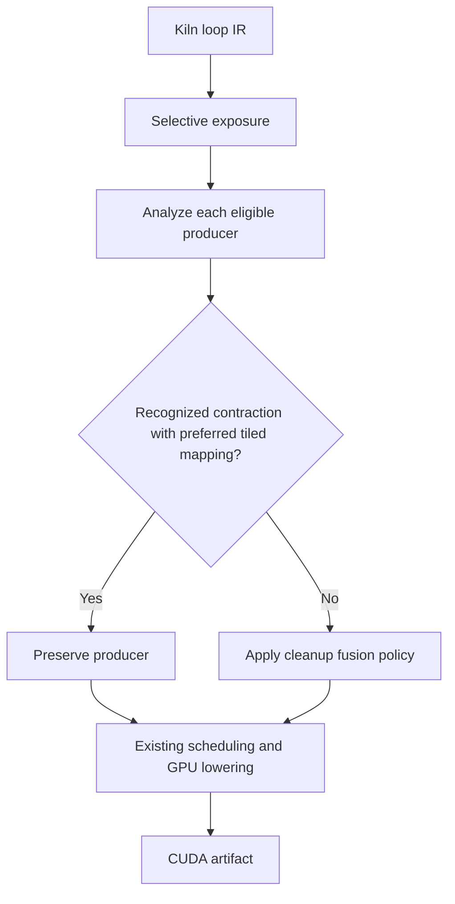

# Kiln: Staged Fusion, Generalization, and the Limits of Policy Search

A reusable Kiln transformation now improves execution on a population of previously unused exact models. The fixed transformation measured a family-balanced end-to-end speedup of **1.146076× across thirteen confirmation graphs**. Two graphs changed executable and improved by 4.405327× and 1.335970×. Eleven produced the same executable as the original compiler. All passed the experiment's correctness checks.

This report explains how the transformation combines fusion and scheduling decisions, how the confirmation population was constructed, and what happened when six language-model agents searched a larger composition space. The composition experiment produced fifteen valid programs and twenty additional development executables, but no convincing improvement over the fixed transformation. Both outcomes matter: the first establishes limited transfer, while the second identifies a search space with little demonstrated remaining benefit.

> [!summary]
> The strongest new evidence is fixed-program transfer to thirteen previously unused exact models. The transformation was manually derived from an agent-generated policy and compiler inspection. The subsequent agent composition experiment did not establish a further gain. These are supported FP32 experiments on GB10, not an official full-corpus PassBench result.

## 1. The compiler problem

Fusion combines computations so that intermediate values can remain within one kernel. Its profitability depends on more than the number of arithmetic operations. Combining a producer with its consumers changes the loop expression presented to later compiler stages. A scheduler may recognize a useful matrix contraction in one expression and fail to recognize it in another, even when both compute the same mathematical function.

The earlier six-lane GLM experiment found a selective fusion policy with approximately 1.287× aggregate development speedup. Inspection showed a mixed result. Separating four matrix computations allowed tiled schedules and improved execution. Two other cases retained row schedules and became slower after separation. The original profitability decision used scalar-work estimates, which did not express this distinction.

This observation motivated two stages. First, selective fusion exposes intermediate computations. Second, another fusion pass combines eligible computations again, while preserving a contraction producer when its preferred estimated schedule is tiled. The second stage recovers fusion in cases where separation failed to create a useful scheduling opportunity.

The implementation does not compare the total estimated latency of every fused and materialized alternative. It asks a narrower question about a producer's schedule preference. That distinction defines the heuristic's limitations and the next opportunities for improvement.

## 2. The staged transformation

The implementation lives in `integrations/passnet/scheduling_fusion.mjs`. It uses existing Kiln APIs from `packages/kiln/src/std/loop.js` and `packages/kiln/src/std/tile.js`. It introduces no new intermediate representation and makes no change to the default compiler pipeline.

The exposure stage uses `createFusionRule` with a selective consumer predicate. A consumer participates when its estimated work after fusion is no more than twice its original consumer work. The ordinary aggregate profitability decision remains at its default threshold. These are two different comparisons: the consumer predicate uses `consumerWork`, whereas the aggregate predicate compares total original and fused work.

The cleanup stage runs in reverse order after the original fusion pass. It considers producers that are loop kernels, are not graph outputs, have users, and have only loop-kernel users. It analyzes the producer expression and rejects further fusion of that producer when a recognized contraction has a preferred tiled mapping. Other producers remain eligible for the existing fusion rule and its legality checks.



The schedule preference calculation enumerates the existing schedule domain, evaluates its analytic cost, and chooses the mapping with the smallest estimated time. It uses `forkTree`, `analyze`, and `estimate`; it does not run GPU benchmarks while compiling.

```text
preferred_mapping(producer, target):
    analysis = analyze(producer.expression, shapes)
    best_by_mapping = {}
    for knobs in enumerate_existing_schedule_domain(analysis, target):
        cost = estimate(analysis, knobs, target).us
        retain_minimum(best_by_mapping[knobs.MAP], cost)
    return mapping_with_minimum_cost(best_by_mapping)

cleanup_eligible(producer):
    require existing loop-kernel structural conditions
    if producer has a recognized contraction:
        if preferred_mapping(producer, target) == tiled:
            return false
    return true
```

The mapping estimate uses the A100 target as a scheduling proxy, while execution occurs on a DGX Spark's NVIDIA GB10. This mismatch is retained in the experiment's scope. A successful measured result does not establish that the cost estimates are accurate in absolute terms or that the same decisions transfer to another GPU.

The fixed staged transformation produced 1.404537× development speedup. Its four improved outputs matched the useful selective-policy artifacts; the two previously regressing cases returned to baseline artifacts. This provided a concrete reason to test transfer before expanding the search space further.

## 3. What the fresh-model confirmation establishes

The initial confirmation plan requested twenty graphs: ten matrix and ten reduction cases. Exact model identities already present in tracked prior corpora and official evaluation models were excluded. The first metadata scan examined eight variants per task and found too few eligible models. A second scan examined sixty-four variants per task and still failed the twenty-model quota.

The completed broader scan found eight matrix and five reduction models. Every eligible selected record was retained in a separately declared thirteen-model population. This population revision occurred before compilation or timing. The failed twenty-model declarations and their scan audits remain preserved; the thirteen-model run is not described as satisfying the earlier plan.

The transformation itself remained fixed from development selection. The confirmation procedure compiled three programs across thirteen graphs, yielding thirty-nine successful compilations, and then measured the original compiler and fixed candidate. The candidate was not ranked against alternatives using these outcomes.

| Confirmation outcome | Count | End-to-end speedup |
|---|---:|---:|
| Changed Electra-derived graph | 1 | 4.405327× |
| Changed RemBERT-derived graph | 1 | 1.335970× |
| Identical baseline executables | 11 | 1.000000× |
| Family-balanced aggregate | 13 graphs | 1.146076× |

Exact model disjointness is weaker than architectural disjointness. Related model architectures may appear in development and confirmation. Moreover, eleven aliases mean the experiment tests changed executable behavior on only two graphs. The result supports transfer within this declared population; it does not establish broad improvement across all transformer architectures or all PassBench tasks.

The evaluator computes a family-balanced geometric mean. If family \(f\) contains graphs \(G_f\), the aggregate is

\[
S=\exp\left[\frac{1}{|F|}\sum_{f\in F}\frac{1}{|G_f|}
\sum_{g\in G_f}\log\frac{T_0(g)}{T_1(g)}\right].
\]

Here \(T_0\) and \(T_1\) are synchronized end-to-end latency measurements. Identical executable fingerprints share measurements and contribute exactly one to the ratio. This avoids treating repeated timings of identical code as distinct optimization evidence.

All results in this report use the declared FP32 reference protocol: separate contraction and highest-precision matrix references. They do not use the paper's full native-precision experimental setup. The correctness statements refer to this experiment's tests and input population.

## 4. Making the transformation available to agents

Before this milestone, the native agent could submit one fusion profitability policy. The staged experiment demonstrated an interaction between two decisions, so the agent action space was extended to express both. The implementation remains deliberately small: `transformation_program.mjs` prepares either an existing single-policy program or a staged transformation.

A composed program has the following form:

```json
{
  "format": "kiln-transformation-program/1",
  "id": "example-sequence",
  "kind": "fusion-sequence",
  "expose": {
    "format": "kiln-fusion-policy/1",
    "id": "expose",
    "kind": "selective",
    "tree": {"threshold": 1.02},
    "consumer_tree": {"threshold": 2}
  },
  "cleanup": {
    "format": "kiln-fusion-policy/1",
    "id": "cleanup",
    "kind": "threshold",
    "max_work_growth": 1.02
  }
}
```

The two stages reuse the existing policy grammar, including threshold rules, decision trees, selective policies, and region policies. Both must contain explicit programs, and their combined decision-node count is bounded by thirty-one. The cleanup stage retains the fixed schedule-preservation condition. Agents can change its profitability policy but cannot remove that condition or alter numerical settings.

`optimization_artifact.mjs` and `compile_policy.mjs` now call the same preparation function. This removes the previous separation between a compiler-only fixed transformation format and an agent-only policy validator. Artifact canonicalization normalizes stage names and removes provenance metadata from executable identity. A distinct action contract identifies staged fusion programs.

The new interface was checked against real compiler execution before inference. Script 465 compiles six development graphs under both the fixed staged program and its equivalent two-policy representation. All reference checks pass and exported executables are exactly equal. This establishes that the agent representation can reproduce the known transformation; it does not establish that arbitrary valid proposals are correct or faster.

## 5. Six actual inference lanes

The experiment used Pi with LunaRoute's `glm-5.3-flash` route. Six independent sessions received identical development feedback and three proposal slots each. Two requested low thinking, two medium, and two high. The sessions exposed only `inspect_training`, `submit_policy`, and `finish` tools. Candidate timing occurred afterward in the existing GPU evaluator.

| Requested thinking | Session durations | Accepted proposals |
|---|---|---:|
| Low | 8.816 s, 11.898 s | 5 of 6 |
| Medium | 37.048 s, 50.736 s | 4 of 6 |
| High | 56.162 s, 56.839 s | 6 of 6 |

Pi reported effective settings matching the requests. This is evidence about the client session configuration, not independent verification of the provider's internal reasoning behavior. Two replicates per level also do not support a statistical quality comparison.

Three proposals failed validation. One low-thinking proposal exceeded the allowed threshold range; two medium-thinking proposals contained invalid decision nodes. Those attempts consumed their declared slots. Fifteen accepted artifacts were distinct after canonicalization.

The raw streaming events are preserved losslessly as gzip archives with original-byte hashes. Streaming snapshots repeated growing message content and occupied approximately 128 MB uncompressed; the compressed evidence occupies approximately 1.4 MB. Final conversations, requests, outcomes, configurations and result receipts are also retained. Compression changes storage, not the recorded experiment.

## 6. Executable diversity did not produce a new improvement

The fifteen proposals and three controls compiled across twenty graphs, producing 360 successful compilations. Only the twelve development graphs entered candidate ranking. The proposals added twenty distinct per-graph executable fingerprints beyond baseline and the fixed staged program. This confirmed that the action-space expansion changed generated code rather than only policy metadata.

GPU evaluation completed with every declared program eligible on all twelve development graphs. The highest score was 1.405801× for `sequence-5`, compared with 1.405437× for the fixed staged transformation in the same run. The relative difference is approximately 0.026%.

That difference does not establish a useful improvement. The nominal winner changed four executable bindings relative to fixed staged, with paired latency ratios ranging from approximately 0.994 to 1.008; the other eight outputs were aliases. No repeated paired experiment or significance analysis establishes the tiny aggregate lead. The preserved selector still records the numerical winner, while the research conclusion retains the previously confirmed fixed transformation.

Five proposals produced exactly the fixed staged executables on all development graphs. Four produced baseline executables. Several novel programs scored approximately 1.384–1.387×, below fixed staged, and one regressed below baseline to 0.960072×. The experiment therefore provides no convincing further gain from this particular composition search.

The nominal winner came from a high-thinking session. That attribution alone is insufficient to prefer high thinking: there were only two runs per level, several candidates were executable aliases, and the measured lead was negligible. A future comparison would need a larger repeated experiment and an outcome measure that distinguishes meaningful compiler gains from timing variation.

## 7. Coverage and the next compiler work

Optimization evidence and benchmark coverage are different quantities. The current cumulative coverage file records 31 complete tasks out of 200 and 358 accepted graphs out of 2,060, including 289 graphs in complete tasks. These records span compiler snapshots and modified protocols; they are not a uniform current-release full-corpus evaluation. The historical importer audit reports 1,251 importable graphs, which is also not a correctness or performance result.

The singleton-view cohort illustrates the remaining gap. Its preserved audit records fifty-five expected graphs, twenty nominally accepted graphs, and thirty-three unexecuted graphs, alongside retained failures. Native precision, compiler reference checks, complete-family execution and official evaluator acceptance still require work. The successful optimization studies do not remove those requirements.

The next expansion should be selected from evidence about missing operations and expensive generated kernels. A useful extension either unlocks additional workload families or enables a different transformation decision, such as a missed contraction or layout opportunity. Continuing the same threshold search on the same small population currently has little demonstrated value.

The architecture should remain centered on existing compiler primitives. The present composition experiment needed one shared preparation module and parameterized stages; it did not require a second compiler framework. Broader source-code synthesis can be evaluated later, once a concrete optimization mechanism exceeds the current primitive set.

## 8. Reproduction and source map

All paths below are relative to `/home/manuel/code/wesen/kiln/worktrees/passnet`. The ticket root is `ttmp/2026/10/30/KILN-005--reproduce-passnet-and-evaluate-reusable-kiln-compiler-transformations`.

| Purpose | Primary files |
|---|---|
| Staged fusion implementation | `integrations/passnet/scheduling_fusion.mjs` |
| Shared program preparation | `integrations/passnet/transformation_program.mjs` |
| Agent artifact identity | `integrations/passnet/optimization_artifact.mjs` |
| Corpus compilation | `integrations/passnet/compile_policy.mjs`, `compile_study.py` |
| GPU measurement and ranking | `integrations/passnet/measure_policy.py`, `select_policy.py` |
| Fixed fresh-model result | Ticket `sources/staged-confirmation-results-v1/` |
| Six-lane inference | Ticket `sources/pi-transformation-lanes-v1/` |
| Compilation diversity | Ticket `sources/pi-transformation-compilation-analysis-v1.json` |
| Composition measurements | Ticket `sources/pi-transformation-results-v1/` |
| Detailed chronological evidence | Ticket `reference/24-implementation-diary-volume-2-pi-agents-and-compiler-optimization.md`, Steps 182–185 |

Scripts 465–470 preserve the representation test, six-lane inference, candidate preparation, trace compression, compilation analysis and result collection. They retain the original output locations and intentionally do not overwrite completed experiments. A rerun should use new declared output paths.

The implementation checkpoint is `125c6bb`; fresh-model confirmation evidence is committed in `e89b705`; composition evidence and conclusions are committed through `60e8065`. The earlier article, [[ARTICLE - Kiln - Six GLM Lanes and Matrix Layout Fusion]], explains the selective-policy discovery that preceded this transformation. This follow-up preserves the correction that final fused default kernels lacked recognized contractions; schedule analysis of separated producers motivated the two-stage implementation.
