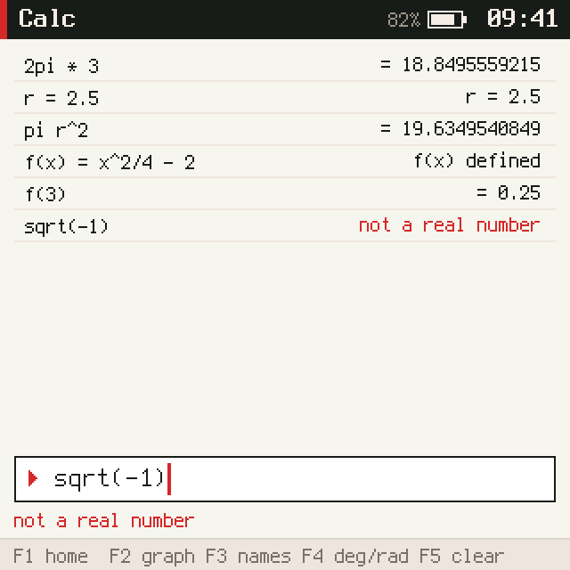
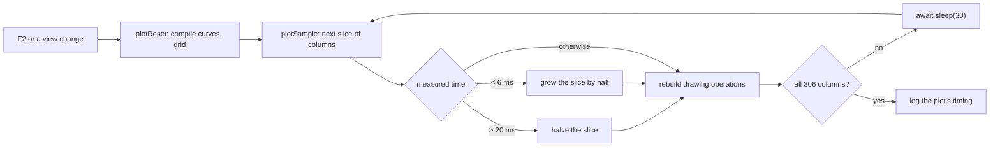
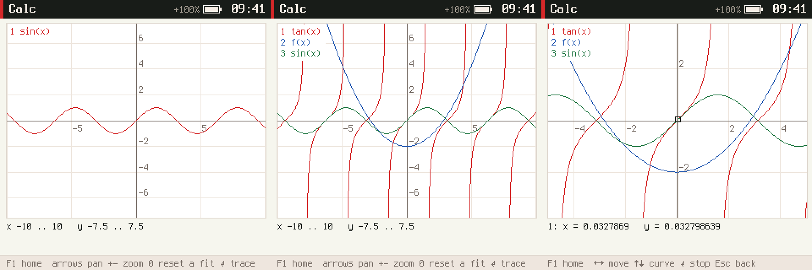

# picocalc-os, PICOCALC-CALC: a calculator and plotter on the PicoCalc

This note reports the third of five tickets that turn picocalc-os into a pocket computer; the previous ones are
[[PROJ - picocalc-os - PICOCALC-FS - Files and File Handles on the PicoCalc]] and
[[PROJ - picocalc-os - PICOCALC-EDIT - Editor, Files and Notes on the PicoCalc]], and
[[PROJ - picocalc-os - Project Overview - A JavaScript OS on Two Devices, With an Agent]] describes the whole. A
device called PicoCalc now has a calculator: an expression language with variables and functions, a history to
recall from, and a plotter for up to three functions of x. The interesting part is the plotter, which has to
evaluate an expression hundreds of times on a device where JavaScript runs about fourteen times slower while Wi-Fi
is up, without ever running a turn long enough for the kernel to stop it.

> [!summary]
> - **Parse once, compile to closures, evaluate many times.** A Pratt parser turns a line into a tree; each node
>   becomes a small JavaScript function of `x`. Plotting three curves is 918 calls of those, not 918 parses.
> - **A plot is computed in slices that measure themselves.** Each slice of columns times itself and the next
>   slice is halved or grown; on the P4 with Wi-Fi up a three-curve plot takes about 0.57 s in six slices, none
>   longer than 9 ms.
> - **Background work is a promise chain the app starts and does not return.** No periodic timers; a returned
>   promise would hold the turn open and block keys.

## Why this ticket exists

The agent already had a `calculate` tool, but there was no calculator a person could use. It could not simply be
reused: a world loads one file and has no module system, and the agent's parser evaluates while it parses, which
is the wrong shape for plotting.

## What was built

| Part | Summary |
|---|---|
| Language | numbers (decimal, exponent, `0x`, `0b`), `+ - * / % ^ !`, implicit multiplication (`2pi`, `3(x+1)`), thirty builtins, `pi e tau ans`, variables, one-argument functions, radians or degrees |
| Calculator | history of 100, Enter recalls an entry, Tab inserts its result, an operator on an empty line continues from `ans`, a names view, errors that name the problem |
| Plotter | up to three curves on a 306×230 canvas, grid, axes, labels, legend, pan, zoom, reset, fit, a trace cursor |
| Persistence | one store record, written 3 s after a burst of changes and when the app leaves the screen |
| Home screen | Calc on key `x`; the grid went to four columns |



## Implementation details

### From text to closures

```text
2sin(x)^2 + 1
  tokens   2  sin  (  x  )  ^  2  +  1
  tree     {+ {* 2 {^ {call sin x} 2}} 1}
  closure  (x) => a(x) + b(x)   with a = (x) => 2 * Math.pow(sin(x), 2), b = () => 1
```

The parser gives `+ -` binding power 1, `* / %` and implicit multiplication 2, puts unary minus below `^` and
parses the right side of `^` as a unary expression. That one arrangement makes `-2^2 = -4`, `2^-1 = 0.5` and
`2^3^2 = 512` all come out right. Implicit multiplication applies before a name or an opening parenthesis, never
before a number, so `2 3` is an error rather than 6. It has the precedence of `*`, so `1/2x` is `(1/2)·x`.
Calculators disagree on that case, and this one follows the rule that needs no exception.

Variables, `ans` and the angle mode are read when a closure runs, not when it is compiled, so `g(x) = a·x` and a
plotted curve follow later assignments. User functions are compiled once and cached by parameter and source; calls
are limited to 32 deep, which turns `a(x) = b(x)`, `b(x) = a(x)` into an error message instead of a crash.

### Sampling a plot within the turn budget

Every turn on picocalc-os has a budget (80 ms for the calculator), and the kernel renders the app's screen tree at
the end of every turn, which counts against the same budget. A plot is one sample per pixel column, 306 per curve.
The host's cost model runs that comfortably; the device with Wi-Fi up is roughly fourteen times slower, and the
model does not know that. So the plotter never samples a whole plot in one turn:



On the device `now()` is wall-clock time, so the slice follows the real speed. On the host `now()` advances
within a segment by the cost model, so the same adaptation runs there too. The loop is a promise chain the key
handler starts and does not return. The prelude treats a returned promise as an asynchronous turn and delivers no
new messages until it settles, so a returned plot loop would have blocked every key until the plot finished.

### Discontinuities and clipping

`tan` produces no `NaN` at its asymptotes; adjacent columns simply land far above and far below the view. The
plotter breaks a curve where two adjacent samples lie outside the view on opposite sides, and where a sample is
missing (`sqrt` of a negative number). It clips each remaining segment to the canvas itself, because the
framebuffer's line routine clips only to the screen. A curve is sent to the compositor as one new canvas
operation, `["poly", [x0, y0, x1, y1, ...], color]`, per unbroken piece.

## On the device



| What (ESP32-P4, Wi-Fi up) | Result |
|---|---|
| One curve | 298 ms in 5 slices, slowest 3.8 ms |
| Three curves (`tan`, a user function, `sin`) | 563–580 ms in 6 slices, slowest 8.8 ms, slice settled at 72 columns |
| Calculator turns during the run | about 26 ms on average; drawing operations and rendering, not sampling, dominate |
| Calculator heap with three curves | 394 KB of 512 KB |
| Crashes | 0 |
| After a reboot | history and the user function restored |

## Tests

- `tests/calc.test.mjs` (13 tests) runs the app in a Node VM with a fake store, clock and `sleep`: precedence,
  implicit multiplication, every builtin, degree mode, variables and functions with recursion limits, error
  messages, formatting, history recall and `ans`, saving and restoring, sampling with gaps and asymptotes, slice
  adaptation under a slow and a fast clock, plot keys, clipping and tick steps.
- `make test-apps` runs the editor's and the calculator's tests; `scripts/calc.txt` writes host captures.

## Current status

- Done: `d51cf0c` (calculator and plotter), `a5c66ab` (timing log and device captures), docs `c00a377`. Guide
  before and guide as built with the diary on the reMarkable under `/ai/2026/10/31/PICOCALC-CALC`. Ticket closed.

## Open questions

- The fonts lack π, √, ×, ÷, ∞ and ²; the font generator needs `xfonts-terminus` and `pcf2bdf` to add them.
- Building the drawing operations incrementally would cut the calculator's turn time on the device.
- A user function's body is not counted in the bound on the first slice's size; the time-based adaptation
  corrects it after one slice.

## Next

PICOCALC-AGENDA: a todo list and agenda with reminders on the network clock.

## Important files

- `picocalc-os/js/apps/calc.js` — the language, the calculator and the plotter
- `picocalc-os/js/system/compositor.js` — the canvas `poly` operation
- `picocalc-os/js/apps/launcher.js` — the Calc entry and the four-column grid
- `picocalc-os/tests/calc.test.mjs`, `picocalc-os/scripts/calc.txt`
- Ticket: `ttmp/2026/10/31/PICOCALC-CALC--a-calculator-with-history-and-graphing-for-the-picocalc/`
